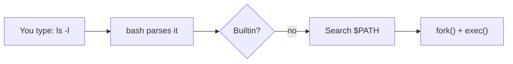
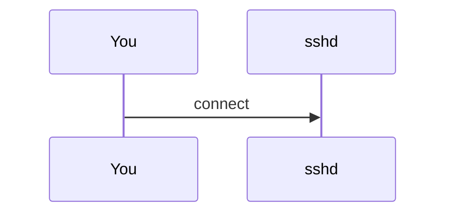
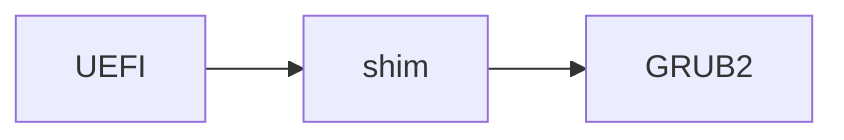

# Course Style Guide

This is the authoring guide for the **Rocky Linux Deep Dive** course. Read it
before you write or edit a module. Every module should feel like it came from
the same author.

## Who we're writing for

A smart person who can use a computer and wants to *really* understand Linux,
going from "I can follow a tutorial" to "I know why it works and can fix it
when it breaks." They may be a developer, a Windows admin, a new SRE, or a
support engineer. Assume curiosity but no prior Linux knowledge beyond what
earlier modules taught.

**Deep, not dense.** We go deep: how the pieces fit, what happens under the hood,
where the config lives, how to prove what is going on. We do **not** do
line-by-line kernel source walks, struct field dumps, or function-name trivia.
When the kernel matters, explain the *mechanism* with a picture and an analogy,
then show the user-visible evidence (`/proc`, `/sys`, a command's output).

Test for every paragraph: *would a reader who is learning this for the first
time understand it on one read, and would an expert nod along?*

## Target platform

- **Rocky Linux 10** is the primary target (kernel 6.12, systemd 257, DNF 4,
  NetworkManager-only networking, nftables-based firewalld, SELinux
  enforcing, cgroup v2, x86_64-v3 / aarch64 / ppc64le / s390x / riscv64).
- Rocky Linux 9 is still widely deployed. Where behaviour differs, add a
  `!!! version "Rocky 9 vs 10"` callout. Don't litter the text with these;
  only call out differences a learner would actually trip over.
- Never invent commands, flags, file paths, package names, or output. If you
  aren't sure a flag exists on Rocky 10, look it up (web search the man page)
  or leave it out. Example output may be trimmed (mark with `…`) but must be
  realistic for Rocky 10.
- Use `dnf`, not `yum`. Use `nmcli`/`ip`, never `ifconfig`/`netstat`/`network-scripts`
  (which are gone). Use `ss`, `journalctl`, `systemctl`, `firewall-cmd`.

## Voice and tone

- Second person, active voice, present tense. "You run `ls -l` and see…"
- Short paragraphs (2 to 4 sentences). Short sentences. One idea per paragraph.
- Explain the *why* before the *how*. Lead each concept with the problem it solves.
- Define every term the first time it appears, in plain words, in **bold**.
- Use an analogy when a concept is abstract, but only one per concept, and
  say where the analogy breaks down if it matters.
- No filler ("It is important to note that…", "In today's world…"). No
  marketing. No emoji in prose.
- Don't use em dashes. Use a period, comma, colon, or parentheses instead.
- Headings are sentence case and describe the idea: "How the shell finds a
  command", not "PATH".

## Module skeleton

Every module page follows this shape. Section names in **bold** are fixed;
everything else is yours.

````markdown
---
title: systemd and Services
description: One sentence that appears in search and social cards.
---

# 07 · systemd and Services

<ul class="module-meta">
  <li>⏱ ~2.5 hours</li>
  <li>4 labs</li>
  <li>Builds on: 06 · Processes</li>
</ul>

Opening hook: 2 to 4 sentences. A real situation the reader will face
("Your web app died at 3am and came back on its own. Who restarted it?")
and what this module will let them do.

!!! abstract "What you'll learn"
    - Bullet list of 4 to 7 concrete, checkable outcomes ("Write a unit file
      that restarts a crashed service").

## The big picture

Concept map of the whole module: one diagram (mermaid or `.layers`) and a
few paragraphs. A reader who stops here should still have the right mental model.

## <concept sections…>

5 to 9 sections that build on each other. Each section:
1. The problem / why it exists.
2. The idea, in plain words (+ analogy or diagram).
3. What it looks like on a real system: commands with realistic output.
4. Optional: a tiny "Try it" (`!!! example "Try it"`) or a `.quiz` checkpoint.

## Labs

3 to 5 labs, each in a `!!! lab` block (see below). Each lab: goal, steps,
"Check your work", and cleanup. Labs must be safe on a throwaway VM and
undo themselves.

## Common pitfalls

Use `!!! pitfall` blocks or a table: symptom → cause → fix.

## Cheat sheet

A table of the commands from this module: command | what it does.

## Flashcards

6 to 10 `.flashcards` cards (see below).

## Recap

!!! recap "Key takeaways"
    5 to 8 bullets.

## Go deeper

- Man pages as badges: [[man:systemd.unit(5)]] [[man:systemctl(1)]]
- 2 to 5 high-quality external links (upstream docs, Rocky/RHEL docs, LWN).
  Link to docs.rockylinux.org, freedesktop.org, kernel.org docs, Red Hat
  product documentation for RHEL 10, etc. Only link URLs you are confident exist.

**Next:** [08 · Logging and the Journal](08-logging-and-the-journal.md)
````

Target length: 500 to 900 lines of Markdown per module. Aim for at least
**3 diagrams** (mermaid and/or `.layers`/`.stepper`), **3 to 5 quizzes**,
**1 practice terminal**, a **flashcards** set, and **3 or more labs** per module. More examples beat more prose.

## Formatting conventions

### Commands and output

Use `console` fenced blocks for interactive sessions. Prompt `$` for a normal
user, `#` for root. Output lines have no prompt. Prefer `sudo` with `$` over
`#` unless the lab is explicitly "become root".

````markdown
```console
$ systemctl status chronyd
● chronyd.service - NTP client/server
     Loaded: loaded (/usr/lib/systemd/system/chronyd.service; enabled; preset: enabled)
     Active: active (running) since Tue 2026-10-13 09:12:44 UTC; 2h 3min ago
…
```
````

Use `bash` blocks for scripts and files you write, `ini` for unit files and
`.conf` files, `text` for plain listings. Give a file a title:
```` ```ini title="/etc/systemd/system/hello.service" ````.

Use code annotations to explain parts of a command or script, but **only in
languages that allow a trailing `#` comment** (bash, YAML, Python). systemd
units, `journald.conf`, logrotate and other ini-style files do not accept
trailing comments, so a reader who copies an annotated line gets a broken
config. For those, explain the lines in a list under the block.

````markdown
```bash
dnf -y install httpd  # (1)!
systemctl enable --now httpd  # (2)!
```

1. Install the Apache web server package.
2. Start it now and at every boot.
````

Annotations don't render inside `console` blocks. Annotate a `bash` or
`yaml` block instead.

Keyboard keys: `++ctrl+c++`.

### Admonitions

| Type | Use it for |
|------|-----------|
| `!!! abstract "What you'll learn"` | Module outcomes (top of page, once) |
| `!!! analogy "Think of it like…"` | A mental model / analogy |
| `!!! example "Try it"` | A 1 to 3 command mini exercise inline with the text |
| `!!! lab "Lab 1: Title"` | A full hands-on lab |
| `!!! tip` | Pro tips and shortcuts |
| `!!! note` | Side information |
| `!!! warning` | Something that can hurt you |
| `!!! danger` | Data loss / lockout risk |
| `!!! pitfall "Title"` | Common mistakes and how to recognise them |
| `!!! version "Rocky 9 vs 10"` | Version differences |
| `!!! recap "Key takeaways"` | Module summary |
| `??? question "Why…?"` | Collapsible deeper dive / "for the curious" |

Use `???` (collapsed) for optional deep-dives so the main path stays light.
Lab solutions and hints go in `??? success "Solution"` / `??? tip "Hint"`.

### Lab format

````markdown
!!! lab "Lab 2: Make a service that heals itself"

    **Goal:** Watch systemd restart a crashing service automatically.

    **You'll need:** a Rocky 10 VM, sudo.

    1. Create the script:

        ```bash
        sudo tee /usr/local/bin/flaky.sh <<'EOF'
        #!/bin/bash
        sleep 5; exit 1
        EOF
        sudo chmod +x /usr/local/bin/flaky.sh
        ```

    2. …

    **Check your work:** `systemctl show flaky -p NRestarts` shows a number
    greater than 0.

    ??? success "What just happened?"
        Explanation.

    **Clean up:** `sudo systemctl disable --now flaky; sudo rm …`
````

Note the indentation: content inside an admonition is indented 4 spaces;
code blocks inside a numbered list item inside an admonition are indented
8 spaces.

### Tabs

Use content tabs to show alternatives side by side (CLI vs config file,
Rocky 9 vs Rocky 10, ext4 vs XFS):

````markdown
=== "nmcli"

    ```console
    $ nmcli con mod eth0 ipv4.dns 1.1.1.1
    ```

=== "Keyfile"

    ```ini title="/etc/NetworkManager/system-connections/eth0.nmconnection"
    [ipv4]
    dns=1.1.1.1;
    ```
````

## Diagrams

Diagrams are the heart of the course. Every hard concept gets a picture.

### Mermaid (static diagrams)

Flowcharts, sequence diagrams, state diagrams, and timelines are rendered by
Mermaid. Keep them small (≤ 15 nodes), label edges, and use `flowchart LR` or
`TB` deliberately. Quote labels that contain punctuation.

````markdown

````



Also good: `stateDiagram-v2` for process/unit states, `sequenceDiagram` for
protocols (DHCP, SSH, Kerberos), `graph TB` for hierarchies (cgroups, the
process tree).

### Interactive widgets

All widgets are Markdown-in-HTML containers. **Always add the `markdown`
attribute** to every container `<div>` so the Markdown inside is rendered.
Leave a blank line after each opening tag and before each closing tag.

#### Stepper: walk through a sequence one step at a time

Best for: boot sequence, the life of a packet, what happens when you type a
command, a login, a DNF transaction.

````markdown
<div class="stepper" markdown>

<div class="step" data-title="Firmware" markdown>

UEFI firmware runs a power-on self test, then reads the EFI System
Partition…



</div>

<div class="step" data-title="GRUB2" markdown>

GRUB reads the boot entries in `/boot/loader/entries/`…

</div>

</div>
````

Don't number `data-title` values ("1. Firmware"): the widget numbers steps itself.
Steps can contain anything: text, code, mermaid, tables. Keep each step
short (a screenful). 4 to 9 steps works best.

#### Layers: a clickable stack diagram

Best for: anything that's a stack (the storage stack, the network layers,
kernel vs userspace, the SELinux decision layers, a container's building
blocks). Bars are listed top to bottom. `data-tag` is a short optional
label on the right of the bar.

````markdown
<div class="layers" data-hint="Click a layer to see what lives there." markdown>

<div class="layer" data-label="Filesystem (XFS)" data-tag="/dev/mapper/rl-root" markdown>

**What it does:** turns blocks into files and directories…

```console
$ df -hT /
```

</div>

<div class="layer" data-label="LVM logical volume" data-tag="dm-0" markdown>

…

</div>

</div>
````

Add `data-open="0"` on the container to pre-select the first layer.

#### Quiz: a checkpoint question

`data-answer` is the **1-based** number of the correct option. The first
paragraph(s) are the question; the list holds the options; anything after the
list is the explanation shown once the reader gets it right.

````markdown
<div class="quiz" data-answer="2" markdown>

A file has mode `640` and is owned by `alice:devs`. Can `bob` (a member of
`devs`) edit it?

- Yes, group members can always edit
- No, the group only has read (`4`)
- Yes, because `6` means read and write for everyone

Right: the middle digit is the group's permission. `4` is read only, so bob
can read but not write.

</div>
````

Optional `data-title="Quick check"` changes the badge text.

#### Decision tree: interactive troubleshooting

Best for: "service won't start", "can't reach the network", "SELinux denial
or not?". Each `.node` has a `data-id`; buttons with `data-goto` jump to
another node. The first node is the start. Nodes without buttons are
end-points (shown highlighted).

````markdown
<div class="decision" markdown>

<div class="node" data-id="start" markdown>

**Does `ping 1.1.1.1` work?**

<button data-goto="dns">Yes</button> <button data-goto="noroute">No</button>

</div>

<div class="node" data-id="dns" markdown>

The network works, so names must be the problem. Check `/etc/resolv.conf`…

</div>

</div>
````

#### Practice terminal: type real commands

A simulated terminal that checks what the reader types. Best for drilling
commands right after you teach them (one or two per module). Each `.task`
holds the instruction, `data-expect` (the accepted command; separate
alternatives with `||`), an optional `data-match` regular expression for
looser matching, a `data-hint`, and a `text` code block with the output to
print on success (hidden until then). `data-prompt` on the container changes
the prompt (default `[alex@rocky-lab ~]$ `).

````markdown
<div class="terminal-sim" data-title="Find the culprit" markdown>

<div class="task" data-expect="systemctl status httpd||systemctl status httpd.service" data-hint="Ask systemctl for the status of the httpd unit." markdown>

**Step 1.** Check whether the web server is running.

```text
× httpd.service - The Apache HTTP Server
     Active: failed (Result: exit-code) since …
```

</div>

</div>
````

Keep it to 3 to 6 tasks. Accept every reasonable spelling of a command
(`ls -l` vs `ls -la`, `.service` suffix or not) with `||` or `data-match`.

#### Flashcards: recall practice

Put a set of 6 to 10 cards in a `## Flashcards` section just before the
Recap. The first paragraph of each card is the front, the rest is the back.

````markdown
<div class="flashcards" markdown>

<div class="card" markdown>

What does `systemctl mask` do?

Links the unit to `/dev/null` so nothing, not even a dependency, can start it.

</div>

</div>
````

#### Calculators

- `<div class="widget-chmod"></div>`: permission bits, octal, and symbolic
  calculator (used in the permissions module).
- `<div class="widget-subnet" data-cidr="10.0.0.5/24"></div>`: IPv4 subnet
  calculator (used in the networking module).

### Rules for widgets

- Never nest one widget inside another.
- Mermaid is fine inside steppers, layers, and decision nodes.
- Everything inside a widget must also make sense if JavaScript is off.

## Man pages and links

- Reference man pages with the badge syntax `[[man:name(section)]]`, e.g.
  `[[man:chmod(1)]]`, `[[man:systemd.service(5)]]`. They link to
  [rockyman.org](https://rockyman.org/), the Rocky Linux man page site.
  Encourage readers to run `man` locally too.
- Link to other modules with relative Markdown links:
  `[systemd](07-systemd-and-services.md#units)`.
- Only link to external URLs you are confident are real and stable.

## Checklist before you finish a module

- [ ] Follows the skeleton; meta bar; "What you'll learn"; Recap; Next link.
- [ ] Every new term defined on first use.
- [ ] ≥ 3 diagrams, ≥ 3 quizzes, ≥ 3 labs with cleanup.
- [ ] Every command is real on Rocky 10, output is realistic.
- [ ] No kernel struct/function trivia without a plain-English reason to care.
- [ ] No em dashes in prose.
- [ ] `mkdocs build --strict` passes with no warnings for your page.
