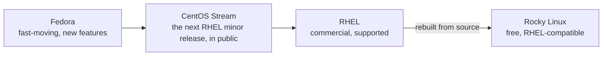
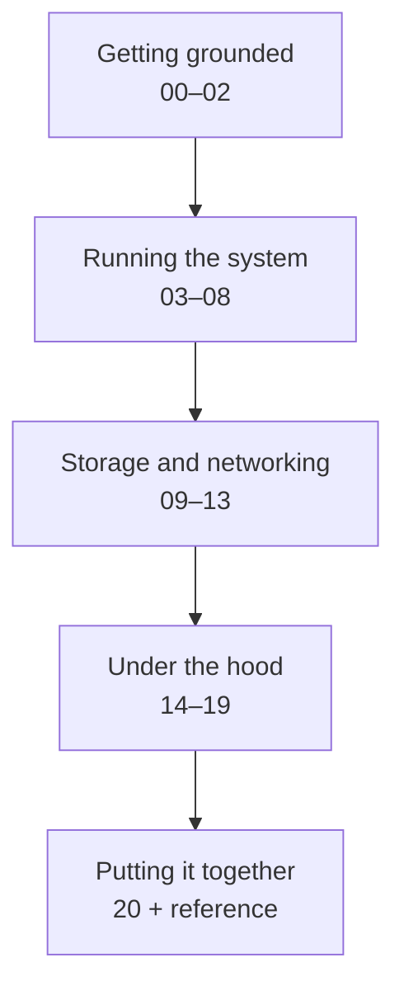

# 00 · Start Here

<ul class="module-meta">
  <li>⏱ ~1 hour</li>
  <li>3 labs</li>
  <li>No prerequisites</li>
</ul>

Most people learn Linux by copying commands from blog posts until something works. That gets you through the day, but the first time a server won't boot, a service won't start, or a disk fills up at 2am, copied commands run out. This course gives you the next level: a clear picture of **how Rocky Linux actually works**, so you can reason about problems you've never seen before.

!!! abstract "What you'll learn"
    - What Rocky Linux is and how it relates to Fedora, CentOS Stream, and RHEL
    - How the course is organised and how to get the most out of it
    - How to build a lab virtual machine you can break and restore safely
    - How to get help on any command, offline, using man pages

## What is Rocky Linux?

**Linux** is, strictly speaking, just the **kernel**: the core program that controls the hardware and shares it between everything else. On its own it can't do anything useful for you. To get a working system you need thousands of other pieces: a shell, core utilities like `ls` and `cp`, a service manager, a package manager, networking tools, security frameworks, and so on.

A **distribution** (or "distro") is a curated, tested bundle of the kernel plus all of those pieces, with a way to install and update them. **Rocky Linux** is a free, community-built distribution designed to be **bug-for-bug compatible with Red Hat Enterprise Linux (RHEL)**. If a program, a script, or a skill works on RHEL, it works on Rocky.

It was started in 2020 by Gregory Kurtzer (one of the original CentOS founders) after CentOS Linux was discontinued, and it is governed by the Rocky Enterprise Software Foundation (RESF).

### Where Rocky comes from

Enterprise Linux is built in stages. New ideas land first in Fedora, get stabilised in CentOS Stream, ship as RHEL, and are then rebuilt from source as Rocky Linux.



That pipeline is why Rocky is predictable: by the time a feature reaches you, it has been through years of testing. It is also why this course applies almost word for word to RHEL, AlmaLinux, Oracle Linux, and CentOS Stream.

### Versions and support

Rocky uses **major versions** (8, 9, 10) and **minor releases** (10.0, 10.1, …).

- A **major version** is a new platform: a new kernel series, new defaults, and features added or removed. You move between majors by reinstalling (or with a migration tool), not with a normal update.
- A **minor release** is a refresh of the same platform, delivered roughly every six months. Going from 10.0 to 10.1 is just `sudo dnf upgrade`.

| Version | Kernel series | Released | Supported until |
|---|---|---|---|
| Rocky Linux 10 | 6.12 | June 2025 | May 2035 |
| Rocky Linux 9 | 5.14 | July 2022 | May 2032 |
| Rocky Linux 8 | 4.18 | June 2021 | May 2029 |

Each major version gets about ten years of security updates. That long life is the whole point of an enterprise distribution: you can build on it and not have the ground move under you.

!!! version "Rocky 9 vs 10"
    This course targets **Rocky Linux 10**. Rocky 9 is still everywhere, and 95% of what you learn here applies to it unchanged. Where Rocky 9 behaves differently in a way that would trip you up, you'll see a green callout like this one.

<div class="quiz" data-answer="3" markdown>

Your team runs Rocky Linux 10.0. A colleague says "we need to reinstall to get to 10.1." Are they right?

- Yes, every release needs a reinstall
- Yes, but only on servers using LVM
- No, minor releases are a normal `dnf upgrade`
- No, Rocky never changes after installation

Correct. Minor releases (10.0 → 10.1 → 10.2) are delivered as ordinary package updates. Only major versions (9 → 10) need a reinstall or a migration tool.

</div>

## How this course works

The course has 21 modules in five parts. Each part builds on the one before it.



Every module has the same shape, so you always know where you are:

1. **The big picture.** A diagram and a few paragraphs that give you the mental model. If you only read this part, you'll still understand the idea.
2. **Concept sections.** Each one explains a problem, the idea that solves it, and what it looks like on a real system.
3. **Checkpoints.** Short quizzes. Click an answer; if you're wrong you can try again.
4. **Labs.** Hands-on exercises on your VM, each with a "Check your work" step and a clean-up.
5. **Pitfalls, cheat sheet, recap.** The things that bite people, the commands in one table, and the key ideas.

### The building blocks you'll see

Here is a sample of each so you recognise them later.

!!! analogy "Think of it like…"
    Yellow boxes are analogies: a familiar picture to hang a new idea on.

!!! example "Try it"
    Purple boxes are quick one-to-three-command experiments to run right now.

!!! pitfall "A classic mistake"
    Red boxes describe mistakes almost everyone makes once, and how to spot them.

??? question "For the curious: what's in a collapsed box?"
    Collapsed boxes hold optional deeper detail. Skip them on your first pass if you like. Nothing later depends on them.

Interactive diagrams look like this. Click a layer:

<div class="layers" data-hint="Click a part of the course to see what it covers." markdown>

<div class="layer" data-label="Putting it together" data-tag="20" markdown>

A troubleshooting playbook with real break-fix scenarios, plus a cheat sheet and glossary.

</div>

<div class="layer" data-label="Under the hood" data-tag="14–19" markdown>

Boot, the kernel, SELinux, hardening, containers, and performance. This is where Linux stops being magic.

</div>

<div class="layer" data-label="Storage and networking" data-tag="09–13" markdown>

Disks, filesystems, LVM, RAID, encryption, networking, firewalls, and file sharing.

</div>

<div class="layer" data-label="Running the system" data-tag="03–08" markdown>

Users, permissions, packages, processes, services, and logs: the daily work of running a server.

</div>

<div class="layer" data-label="Getting grounded" data-tag="00–02" markdown>

What Linux is, how the pieces fit together, and how to drive the shell.

</div>

</div>

Commands appear in terminal blocks. `$` means "run as your normal user"; `#` means "run as root". You don't type the prompt, and the copy button skips it for you. Lines without a prompt are output:

```console
$ cat /etc/rocky-release
Rocky Linux release 10.1 (Red Quartz)
```

Your exact output (version numbers, dates, sizes) will differ a little. That's fine.

## Your lab environment

You'll learn ten times faster by doing. Every module has labs, and some of them deliberately break things. So you need a machine where breaking things doesn't matter: a **virtual machine (VM)**.

### What you need

| | Minimum | Comfortable |
|---|---|---|
| CPU | 2 vCPUs | 4 vCPUs |
| Memory | 2 GB | 4 GB |
| Disk | 20 GB | 40 GB, plus a second empty 10 GB disk for storage labs |
| Hypervisor | Any: KVM/virt-manager, VirtualBox, VMware, Hyper-V, UTM (Apple Silicon), Parallels, or a cloud VM | |

!!! warning "Rocky 10 needs a modern CPU"
    On x86, Rocky Linux 10 is built for the **x86-64-v3** level, which means the CPU (and the virtual CPU your hypervisor shows the VM) must support instructions like AVX2. Most Intel CPUs since Haswell (2013) and AMD CPUs since Excavator qualify. If the installer refuses to boot or crashes immediately in a VM, set the VM's CPU type to "host" / "host-passthrough" so it sees your real CPU features. On Apple Silicon, use the **aarch64** image.

!!! tip "Snapshots are your undo button"
    Whatever hypervisor you use, learn to take a **snapshot** right after installing. Before any lab that says "this will break things", take another. Restoring a snapshot takes seconds; rebuilding a VM takes half an hour.

<div class="stepper" markdown>

<div class="step" data-title="Download" markdown>

Get the ISO from the official download page at [rockylinux.org/download](https://rockylinux.org/download). Pick your architecture (`x86_64` for most PCs and Intel Macs, `aarch64` for Apple Silicon and ARM servers).

There are three ISO flavours:

- **DVD**: everything on the disc; installs offline. Pick this if unsure.
- **Boot**: tiny; downloads packages during install.
- **Minimal**: just enough for a minimal server install.

Verify the download against the published checksum:

```console
$ sha256sum Rocky-10.1-x86_64-dvd1.iso
```

</div>

<div class="step" data-title="Create the VM" markdown>

Create a new VM with at least 2 CPUs, 2 to 4 GB RAM, and a 20 to 40 GB disk. If your hypervisor asks for the OS type, choose "Red Hat Enterprise Linux 10 (64-bit)" or the closest match.

Add a **second, empty 10 GB disk** now. Modules 09 and 10 use it for partitioning, LVM, and RAID labs. (If you can't, those labs also work with loop devices.)

Use UEFI firmware if your hypervisor offers it. That matches modern real hardware and the boot module.

</div>

<div class="step" data-title="Install" markdown>

Boot the ISO and choose **Install Rocky Linux**. The installer (called **Anaconda**) shows a summary screen where you set:

- **Software Selection:** choose **Server** (no GUI). A server without a desktop is what you'll meet in the real world, and it keeps the VM small.
- **Installation Destination:** select the first disk and keep **Automatic** partitioning. This gives you the standard Rocky layout with LVM, which you'll dissect in module 10. Leave the second disk unselected.
- **User Creation:** create your user and tick **Make this user administrator**. That adds you to the `wheel` group, which lets you use `sudo`.
- **Root account:** you can leave root locked. You'll use `sudo` for admin tasks, which is the safer habit.

Click **Begin Installation**, wait, then reboot.

</div>

<div class="step" data-title="First login" markdown>

Log in at the console with your user, then find the VM's IP address so you can SSH in from your own computer's terminal (copy and paste works much better there):

```console
$ ip -brief address
lo               UNKNOWN        127.0.0.1/8 ::1/128
enp1s0           UP             192.168.122.50/24 fe80::5054:ff:fe3a:9c1e/64
```

From your computer:

```console
$ ssh yourname@192.168.122.50
```

</div>

<div class="step" data-title="Update and snapshot" markdown>

Bring the system fully up to date, install a few tools the labs use, then reboot:

```console
$ sudo dnf -y upgrade
$ sudo dnf -y install vim-enhanced bash-completion man-pages tar lsof strace tmux
$ sudo reboot
```

Now shut the VM down and take a snapshot called **clean install**. Every lab in this course assumes you can get back here.

</div>

</div>

<div class="quiz" data-answer="2" markdown>

You're about to do a lab that deliberately corrupts `/etc/fstab`. What should you do first?

- Nothing; labs always clean up after themselves
- Take a VM snapshot so you can roll back in seconds
- Back up your home directory to the cloud

Snapshots are the right tool. Labs do include clean-up steps, but a lab that breaks booting may leave you unable to run them. A snapshot rolls the whole machine back regardless.

</div>

### Optional: the Cockpit web console

Rocky ships a browser-based admin console called **Cockpit**. It's handy for seeing what's going on at a glance (graphs, logs, services, storage) and it shows you the equivalent commands for many actions. On a Server install it's usually already installed, just not running:

```console
$ sudo systemctl enable --now cockpit.socket
$ sudo firewall-cmd --add-service=cockpit --permanent
$ sudo firewall-cmd --reload
```

Then browse to `https://<vm-ip>:9090` and log in with your user. Your browser will warn about a self-signed certificate; that's expected on a lab VM.

We'll do almost everything from the command line in this course, because that's where understanding comes from. But Cockpit is a good companion.

## Getting help without leaving the terminal

Every command and most config files on Rocky come with a **manual page** ("man page"). They are the most accurate documentation you have, because they're installed with the exact version of the software on your machine.

```console
$ man ls                 # the manual for ls
$ man 5 passwd           # section 5: the /etc/passwd file format
$ man -k partition       # search man page names and descriptions
$ ls --help              # most commands also have a short built-in summary
```

Man pages are grouped into numbered **sections**. The ones you'll use most:

| Section | Contains | Example |
|---|---|---|
| 1 | User commands | `ls(1)`, `grep(1)` |
| 5 | File formats and config files | `fstab(5)`, `sshd_config(5)` |
| 7 | Overviews and concepts | `signal(7)`, `boot(7)` |
| 8 | System administration commands | `mount(8)`, `useradd(8)` |

Throughout the course you'll see man page badges like [[man:systemctl(1)]]. Click one to browse the Rocky Linux man pages on [rockyman.org](https://rockyman.org/), or run `man 1 systemctl` on your VM.

!!! tip "Navigating a man page"
    Man pages open in `less`. Press ++slash++ to search, ++n++ for the next match, ++space++ to page down, ++g++ / ++shift+g++ for top and bottom, and ++q++ to quit. Most man pages have an **EXAMPLES** section near the end; jump straight to it with `/EXAMPLES`.

## Labs

!!! lab "Lab 1: Build and snapshot your lab VM"

    **Goal:** A fully updated Rocky Linux 10 VM with a snapshot you can return to.

    1. Follow the five steps in the installer walkthrough above.
    2. Confirm the version and that you're an administrator:

        ```console
        $ cat /etc/rocky-release
        Rocky Linux release 10.1 (Red Quartz)
        $ id
        uid=1000(alex) gid=1000(alex) groups=1000(alex),10(wheel) context=unconfined_u:unconfined_r:unconfined_t:s0-s0:c0.c1023
        $ sudo whoami
        root
        ```

    3. Shut down and take a snapshot named **clean install**.

    **Check your work:** `id` lists the `wheel` group, and `sudo whoami` prints `root`.

    ??? question "What's that `context=` part in the `id` output?"
        That's your SELinux label. Every process and file on Rocky carries one. You'll learn to read them in [module 16](16-selinux.md). For now, just notice it's there.

!!! lab "Lab 2: Find out about your machine"

    **Goal:** Get comfortable asking the system about itself.

    Run each command and write down one thing you learned from it:

    ```console
    $ hostnamectl              # hostname, OS, kernel, hardware vendor, virtualization
    $ uname -r                 # the running kernel version
    $ lscpu | head -20         # CPU model, cores, flags
    $ free -h                  # memory and swap
    $ lsblk                    # disks and partitions (spot your second, empty disk)
    $ ip -brief address        # network interfaces and IP addresses
    $ systemctl --failed       # services that failed to start (hopefully none)
    ```

    **Check your work:** you can answer: How many CPUs does the VM have? How much RAM? What's the name of the empty second disk (for example `vdb` or `sdb`)?

!!! lab "Lab 3: Become fluent in man pages"

    **Goal:** Find answers in man pages instead of a search engine.

    Using only `man` and `man -k`, answer these:

    1. Which `ls` option sorts files by modification time?
    2. In `/etc/fstab`, what does the sixth field mean? (Hint: `man 5 fstab`.)
    3. Which command's man page has the description "change file mode bits"?

    ??? success "Answers"
        1. `-t` (add `-r` to reverse, so the newest is at the bottom: `ls -ltr`).
        2. It's `fs_passno`: the order in which `fsck` checks filesystems at boot. `0` means don't check, which is normal for XFS.
        3. `man -k "file mode bits"` finds `chmod(1)`.

## Recap

!!! recap "Key takeaways"
    - Rocky Linux is a free, community rebuild of RHEL, so skills transfer directly to the whole Enterprise Linux family.
    - Major versions (9 → 10) are new platforms; minor releases (10.0 → 10.1) are normal updates.
    - Each module goes big picture → concepts → checkpoints → labs → recap.
    - Your lab VM is disposable. Snapshot early and often.
    - `man`, `man -k`, and `--help` answer most questions offline, for the exact version you're running.

## Go deeper

- [[man:man(1)]] [[man:hostnamectl(1)]] [[man:lsblk(8)]]
- [Rocky Linux documentation](https://docs.rockylinux.org/): official guides, from beginner to advanced
- [Rocky Linux release notes](https://docs.rockylinux.org/release_notes/): what changed in each release
- [rockyman.org](https://rockyman.org/): Rocky Linux man pages in your browser

**Next:** [01 · How Linux Works](01-how-linux-works.md)
