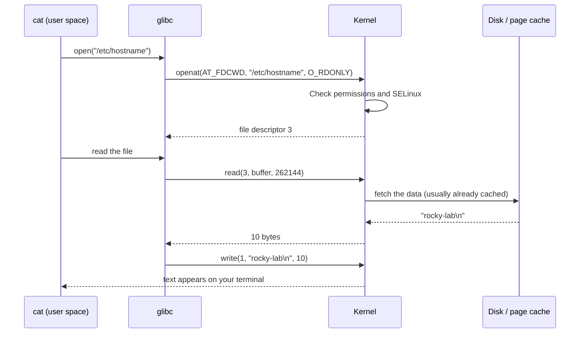
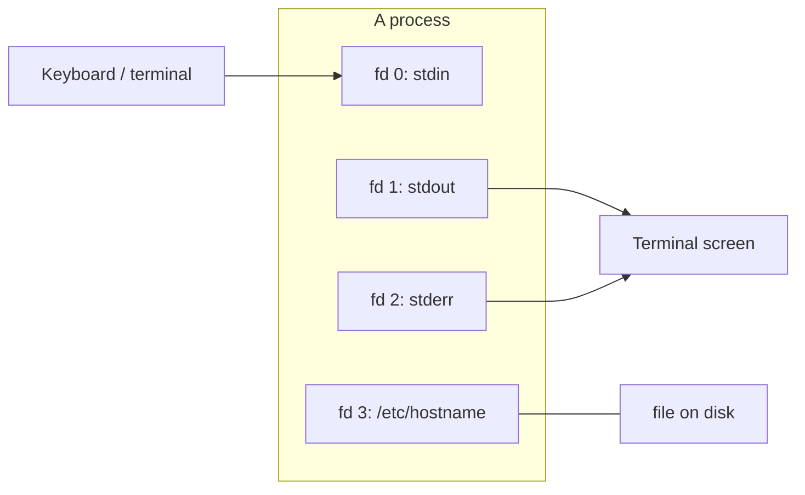
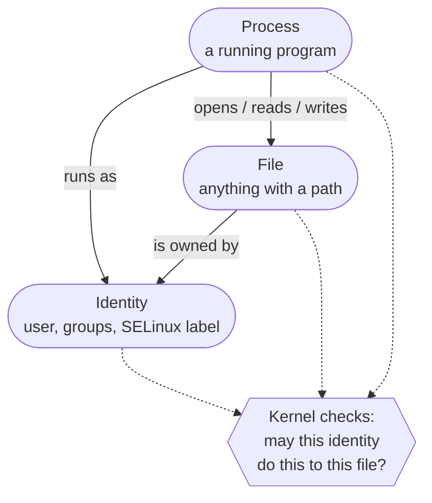
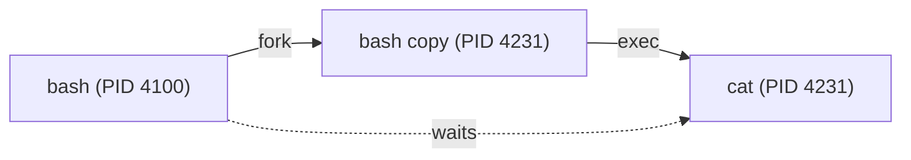
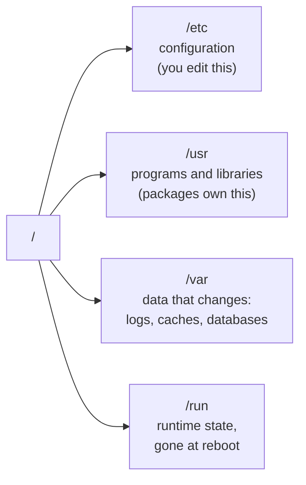
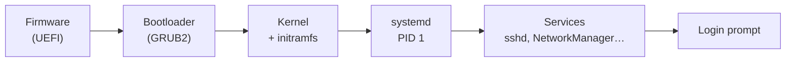

# 01 · How Linux Works

<ul class="module-meta">
  <li>⏱ ~1.5 hours</li>
  <li>4 labs</li>
  <li>Builds on: 00 · Start Here</li>
</ul>

You type `cat /etc/hostname`, press Enter, and a word appears. That takes a few milliseconds, and in that time the shell, the kernel, the filesystem, the memory manager, a disk driver, and your terminal all cooperated. This module gives you the map of those pieces. Every later module zooms in on one part of this map, so it's worth getting right.

!!! abstract "What you'll learn"
    - The difference between the **kernel** and **user space**, and why the wall between them exists
    - What a **system call** is, and how to watch a program make them with `strace`
    - Why Linux treats almost everything (devices, processes, kernel settings) **as a file**
    - The three big ideas every Linux skill rests on: **processes, files, and identities**
    - Exactly what happens, step by step, when you run a command
    - Which components make up a Rocky Linux system, and which module covers each

## The big picture

A running Linux system is a stack of layers. Each layer only talks to the layers directly above and below it. Click through them from top to bottom:

<div class="layers" data-open="0" markdown>

<div class="layer" data-label="Your applications" data-tag="user space" markdown>

**What lives here:** web servers (`httpd`, `nginx`), databases, `podman`, your scripts. Everything you install to do real work.

They never touch hardware directly. When they need anything (a file, memory, the network) they ask the kernel.

</div>

<div class="layer" data-label="Shell and system tools" data-tag="user space" markdown>

**What lives here:** `bash`, `ls`, `cp`, `ps`, `systemctl`, `dnf`, `ip`. The tools you use to drive the system.

To Linux, these are just ordinary programs, no different from your applications. `ls` has no special powers.

</div>

<div class="layer" data-label="System services" data-tag="user space" markdown>

**What lives here:** `systemd` (PID 1, which starts and supervises everything else), `sshd`, `NetworkManager`, `firewalld`, `journald`, `chronyd`.

Services are long-running programs with no terminal attached. Covered in [module 07](07-systemd-and-services.md).

</div>

<div class="layer" data-label="C library (glibc)" data-tag="user space" markdown>

**What lives here:** `glibc`, the GNU C library. It provides friendly functions like `printf()` and `fopen()` and turns them into the raw **system calls** the kernel understands.

Almost every program on the system is linked against it:

```console
$ ldd /usr/bin/ls | grep libc
	libc.so.6 => /lib64/libc.so.6 (0x00007f3a1c600000)
```

</div>

<div class="layer" data-label="System call interface" data-tag="the wall" markdown>

**The boundary.** A few hundred numbered entry points (roughly 370 on x86_64: `openat`, `read`, `write`, `clone`, `execve`, …) are the *only* way a program can ask the kernel for something. The CPU enforces this boundary in hardware.

</div>

<div class="layer" data-label="Linux kernel" data-tag="kernel space" markdown>

**What lives here:** the process scheduler, memory manager, filesystems (VFS, XFS, ext4), the network stack, security (SELinux), and device drivers.

The kernel has full control of the machine. Everything above it gets only what the kernel allows. Covered in [module 15](15-the-kernel.md).

</div>

<div class="layer" data-label="Hardware" data-tag="CPU, RAM, disks, NICs" markdown>

**What lives here:** the physical (or virtual) CPU, memory, storage, and network cards.

Only the kernel and its drivers talk to hardware directly.

</div>

</div>

The single most important line in that diagram is **the wall** between user space and the kernel. Almost everything in Linux makes sense once you understand why it's there.

## Kernel space and user space

Imagine a hundred programs all running on one machine, and any of them could write anywhere in memory or send commands straight to the disk. One buggy program could corrupt another's data or wipe the disk. One malicious program could read everyone's passwords.

Linux prevents this by splitting the world in two:

- **Kernel space**: the kernel runs with the CPU in its privileged mode. It can touch all memory and all hardware.
- **User space**: every other program runs with the CPU in its restricted mode. Each process gets its own private view of memory and cannot touch hardware at all.

The CPU itself enforces the split. If a user-space program tries to execute a privileged instruction or touch memory it doesn't own, the CPU stops it and hands control to the kernel, which usually kills the program (that's the famous "Segmentation fault").

!!! analogy "Think of it like a restaurant"
    The **kitchen** is kernel space: knives, fire, the stock room. Only trained staff go in. The **dining room** is user space: customers can't wander into the kitchen, however hungry they are. The **waiter** is the system call: you place an order through a fixed menu, the kitchen decides whether to make it, and the result comes back out. A customer who tries to climb over the counter gets thrown out (a segmentation fault).

So how does a program read a file, if it can't touch the disk? It asks.

## System calls: how programs ask the kernel for things

A **system call** (syscall) is a request from a program to the kernel. Opening a file, reading from the network, starting a new program, allocating memory: every one of these is a system call.



Notice the kernel checks permissions on every request. This is the only place they *can* be enforced reliably, because every request has to come through this door. Permissions ([module 04](04-permissions-and-acls.md)) and SELinux ([module 16](16-selinux.md)) both work at this boundary.

??? question "Under the hood: how many system calls are there, and how do you look one up?"
    Each system call has a **number**, and the number differs between CPU architectures. On x86_64 the numbers run from 0 up to about 460, but there is a big unused gap in the middle (newer calls added since 2019 start at 424 on every architecture), so the real count is roughly 370. The `audit` package, installed by default on Rocky, includes a translator:

    ```console
    $ ausyscall openat
    257
    $ ausyscall 59
    execve
    ```

    You'll meet these numbers again in audit rules ([module 17](17-security-hardening.md)) and in seccomp filters that containers use to block dangerous calls ([module 18](18-containers.md)). The full list, with a one-line purpose for each, is in `man 2 syscalls`.

??? question "Under the hood: the one common request that skips the wall"
    Programs ask for the current time constantly (every log line, every timeout). Crossing into the kernel costs a few hundred nanoseconds, so Linux cheats: it maps a tiny read-only library called the **vDSO** ("virtual dynamic shared object") into every process. `clock_gettime()` and `gettimeofday()` run inside the vDSO, in user space, reading a clock page the kernel keeps updated. No wall crossing at all.

    You can see it in any process's memory map, and you'll notice that `strace` never shows `clock_gettime` for most programs, because it isn't a real system call there:

    ```console
    $ grep vdso /proc/self/maps
    7ffd8b5f4000-7ffd8b5f6000 r-xp 00000000 00:00 0                          [vdso]
    ```

    This is also why a VM with a misbehaving clock source can make time calls suddenly slow: if the kernel decides the clock is unreliable, the vDSO falls back to a real system call. [Module 36](36-time-synchronization.md) goes deeper on clocks.

### Watching system calls with strace

You don't have to take this on faith. The `strace` tool shows you every system call a program makes. It's one of the most useful debugging tools on Linux.

```console
$ strace -e trace=openat,read,write cat /etc/hostname
openat(AT_FDCWD, "/etc/ld.so.cache", O_RDONLY|O_CLOEXEC) = 3
openat(AT_FDCWD, "/lib64/libc.so.6", O_RDONLY|O_CLOEXEC) = 3
read(3, "\177ELF\2\1\1\3\0\0\0\0\0\0\0\0\3\0>\0\1\0\0\0\0\0\0\0\0\0\0"..., 832) = 832
…
openat(AT_FDCWD, "/etc/hostname", O_RDONLY) = 3
read(3, "rocky-lab\n", 262144)            = 10
write(1, "rocky-lab\n", 10rocky-lab
)             = 10
read(3, "", 262144)                     = 0
+++ exited with 0 +++
```

Reading it line by line:

1. The first two `openat` calls are the **dynamic linker** loading glibc before `cat` itself even starts.
1. The trimmed lines (`…`) are glibc loading your language and character-set settings (the **locale**). Some of those `openat` calls fail with `ENOENT` (no such file), which is normal: glibc tries several places and uses the first that exists.
2. `openat(... "/etc/hostname" ...) = 3`: the kernel opened the file and handed back **file descriptor 3**, a small number that stands for "this open file" from now on.
3. `read(3, …) = 10`: read 10 bytes from descriptor 3.
4. `write(1, …)`: write them to descriptor **1**, which is standard output, your terminal.
5. `read(3, "", …) = 0`: a read that returns 0 bytes means "end of file", so `cat` exits.

For a summary instead of every call, use `-c`:

```console
$ strace -c ls / > /dev/null
% time     seconds  usecs/call     calls    errors syscall
------ ----------- ----------- --------- --------- ----------------
 23.11    0.000089           8        11           mmap
 14.29    0.000055           6         9           openat
 11.43    0.000044           4        10           close
…
------ ----------- ----------- --------- --------- ----------------
100.00    0.000385           4        87         2 total
```

Even `ls` makes about 90 system calls. Every one of them crossed the wall.

!!! tip "strace is a superpower for troubleshooting"
    When a program fails with a vague error ("could not load configuration"), `strace -f -e trace=file <program>` shows exactly which files it tried to open and which ones failed with `ENOENT` (no such file) or `EACCES` (permission denied). That often turns an hour of guessing into ten seconds.

<div class="quiz" data-answer="3" markdown>

A program running as your normal user wants to read a file. Which part of the system decides whether it's allowed?

- The program itself, by checking the file's permissions before opening it
- glibc, the C library
- The kernel, when the program makes the `openat` system call
- The disk controller

The kernel decides. A program can't skip the check, because the only way to open a file is to ask the kernel, and the kernel checks permissions (and SELinux policy) on every request.

</div>

## Everything is a file

Here's a design decision from the 1970s that still shapes everything: Unix (and Linux) expose as much as possible through **one interface: files**. If you can open, read, and write a file, you can talk to:

| What | Where it appears | Try |
|---|---|---|
| Regular files and directories | anywhere | `cat /etc/os-release` |
| Hardware devices | `/dev` | `lsblk`, then `ls -l /dev/vda` |
| Running processes | `/proc/<PID>/` | `cat /proc/self/status` |
| Kernel settings and statistics | `/proc/sys`, `/proc/meminfo` | `cat /proc/sys/kernel/hostname` |
| Devices and drivers as the kernel sees them | `/sys` | `cat /sys/class/net/*/address` |
| A bottomless trash can | `/dev/null` | `echo gone > /dev/null` |
| An endless supply of zeros or randomness | `/dev/zero`, `/dev/urandom` | `od -An -N8 -tx1 /dev/urandom` |

The payoff is enormous: the same tools work everywhere. `cat` can read a log file, a kernel setting, or a process's memory map. `echo` can write a text file or change a kernel parameter. You already know how to use the interface; you just need to know where to look.

```console
$ cat /proc/loadavg
0.08 0.03 0.01 1/187 4231
$ cat /sys/block/vda/size          # disk size in 512-byte sectors
83886080
$ ls -l /dev/vda /dev/null
brw-rw----. 1 root disk 252, 0 Oct 14 09:12 /dev/vda
crw-rw-rw-. 1 root root   1, 3 Oct 14 09:12 /dev/null
```

The first character of that `ls -l` output tells you what kind of file it is. `b` is a **block device** (storage, read in blocks), `c` is a **character device** (a stream of bytes, like a terminal), `-` is a regular file, `d` a directory, `l` a symbolic link.

!!! note "Not literally files on disk"
    `/proc` and `/sys` are **virtual filesystems**. Nothing in them is stored on disk. When you read `/proc/loadavg`, the kernel generates the answer on the spot. That's why `ls -l` shows most of them as 0 bytes long, yet `cat` prints plenty.

### File descriptors

When a program opens a file, the kernel gives it a **file descriptor**: a small integer that means "the thing you opened." Every process starts with three already open:



You can see any process's open file descriptors in `/proc`:

```console
$ ls -l /proc/$$/fd
total 0
lrwx------. 1 alex alex 64 Oct 14 10:02 0 -> /dev/pts/0
lrwx------. 1 alex alex 64 Oct 14 10:02 1 -> /dev/pts/0
lrwx------. 1 alex alex 64 Oct 14 10:02 2 -> /dev/pts/0
lrwx------. 1 alex alex 64 Oct 14 10:02 255 -> /dev/pts/0
```

(`$$` is the shell's own process ID. `/dev/pts/0` is your terminal. Descriptor 255 is a private copy bash keeps of the terminal, so it can still reach it after you redirect 0, 1 or 2.) Redirection (`>`, `<`, `2>`) and pipes (`|`), which you'll master in [module 02](02-shell-and-filesystem.md), are nothing more than rearranging these numbers before a program starts.

### Practice: explore through files

Try it right here before you touch your VM. Type each command and press Enter. If you get stuck, click **Hint** or **Show me**.

<div class="terminal-sim" data-title="Everything is a file" markdown>

<div class="task" data-expect="cat /proc/loadavg" data-hint="The kernel's load averages live in a file called loadavg under /proc." markdown>

**Step 1.** Print the system's load averages straight from the kernel: read `/proc/loadavg`.

```text
0.08 0.03 0.01 1/187 4231
```

</div>

<div class="task" data-expect="cat /proc/sys/kernel/hostname" data-hint="Kernel settings live under /proc/sys. The hostname is in the kernel directory." markdown>

**Step 2.** The hostname is a kernel setting. Read it from `/proc/sys/kernel/hostname`.

```text
rocky-lab
```

</div>

<div class="task" data-expect="ls -l /dev/null" data-match="ls -l?a? /dev/null" data-hint="Use ls with the long listing option on /dev/null." markdown>

**Step 3.** Look at `/dev/null` with a long listing. What kind of file is it? (Check the first character.)

```text
crw-rw-rw-. 1 root root 1, 3 Oct 14 09:12 /dev/null
```

</div>

<div class="task" data-expect="ls -l /proc/$$/fd||ls -l /proc/self/fd" data-hint="$$ expands to your shell's PID. Its open files are in /proc/<PID>/fd." markdown>

**Step 4.** List your shell's open file descriptors using `$$`.

```text
lrwx------. 1 alex alex 64 Oct 14 10:02 0 -> /dev/pts/0
lrwx------. 1 alex alex 64 Oct 14 10:02 1 -> /dev/pts/0
lrwx------. 1 alex alex 64 Oct 14 10:02 2 -> /dev/pts/0
lrwx------. 1 alex alex 64 Oct 14 10:02 255 -> /dev/pts/0
```

</div>

</div>

<div class="quiz" data-answer="2" markdown>

You run `cat /proc/meminfo` and see lots of output, but `ls -l /proc/meminfo` says the file is 0 bytes. What's going on?

- The file is corrupted
- `/proc` is a virtual filesystem; the kernel generates the contents when you read it
- `ls` can't read files owned by root

`/proc` and `/sys` don't live on disk. The kernel builds the contents fresh each time you read them, so there's no stored size to report.

</div>

## The three big ideas: processes, files, identities

Almost every Linux question boils down to some combination of three things:



- A **process** is a running program: code plus memory plus open files, with a numeric **process ID (PID)**. ([Module 06](06-processes-and-signals.md))
- A **file** is anything with a path: data on disk, a device, a socket, a kernel setting. ([Modules 02](02-shell-and-filesystem.md) and [09](09-disks-and-filesystems.md))
- An **identity** is who a process is acting as: a user ID, group IDs, and an SELinux label. ([Modules 03](03-users-groups-and-sudo.md) and [16](16-selinux.md))

"Permission denied" is the kernel saying: *this process, running as this identity, may not do that to this file.* When you troubleshoot it, you check exactly those three things.

!!! example "Try it"
    See all three for your current shell:

    ```console
    $ echo $$                     # the process: your shell's PID
    $ id                          # the identity: user, groups, SELinux label
    $ ls -l /proc/$$/exe          # the file this process is running
    ```

## The life of a command

Let's put it all together. Here is exactly what happens when you type `cat /etc/hostname` in an SSH session and press Enter. Step through it:

<div class="stepper" markdown>

<div class="step" data-title="You press Enter" markdown>

Your keystrokes travel over the network to **`sshd`** on the server, which writes them into a **pseudo-terminal** (`/dev/pts/0`). Your shell, **`bash`**, is reading from that terminal on file descriptor 0 and receives the line `cat /etc/hostname`.

</div>

<div class="step" data-title="bash parses the line" markdown>

`bash` splits the line into words (`cat` and `/etc/hostname`), expands any variables, wildcards, or `~`, and checks whether `cat` is an alias, a function, or a **builtin** (a command built into bash itself, like `cd`). It isn't.

So bash searches each directory in the `PATH` variable, in order, for an executable file named `cat`:

```console
$ echo $PATH
/home/alex/.local/bin:/home/alex/bin:/usr/local/bin:/usr/bin:/usr/local/sbin:/usr/sbin
$ type cat
cat is /usr/bin/cat
```

</div>

<div class="step" data-title="fork: copy the shell" markdown>

bash calls the **`clone`** system call (the modern form of **fork**). The kernel creates a new process that is a near-identical copy of the shell: same open files, same environment, same identity. Now there are two bash processes: the parent and the child.

This is cheap because the kernel doesn't actually copy the memory. Both processes share it until one of them writes to a page (a trick called **copy-on-write**).

</div>

<div class="step" data-title="exec: become cat" markdown>

The child calls **`execve("/usr/bin/cat", ["cat", "/etc/hostname"], env)`**. The kernel throws away the child's copy of bash and loads the `cat` program in its place. Same process ID, completely new program.

The kernel reads the start of `/usr/bin/cat`, sees it's an **ELF** binary that needs the dynamic linker, and the linker loads `libc.so.6` before handing control to `cat`'s `main()`.



</div>

<div class="step" data-title="cat asks the kernel" markdown>

`cat` makes the system calls you saw in the strace output: `openat` on `/etc/hostname`, then `read`.

Inside the kernel, the **VFS** (virtual filesystem layer) walks the path `/` → `etc` → `hostname`, checking permissions and SELinux at each step. It asks the XFS filesystem for the file's data. Almost certainly the data is already in memory, in the **page cache**, so no disk access is needed at all.

</div>

<div class="step" data-title="Output to your screen" markdown>

`cat` calls `write(1, "rocky-lab\n", 10)`. File descriptor 1 is the terminal it inherited from bash, so the kernel delivers the bytes to the pseudo-terminal, `sshd` reads them and sends them back over the network, and they appear in your terminal window.

</div>

<div class="step" data-title="Exit and wait" markdown>

`cat` reads again, gets 0 bytes (end of file), and calls **`exit_group(0)`**. The kernel frees its memory and closes its files, but keeps a tiny record holding the **exit status** (`0` means success).

Meanwhile bash has been waiting in **`wait4()`**. The kernel wakes it with the child's exit status, which bash stores in `$?`, and the record is cleared. bash prints a new prompt. Total time: a couple of milliseconds.

```console
$ cat /etc/hostname
rocky-lab
$ echo $?
0
```

</div>

</div>

That **fork → exec → wait** pattern is how *every* program on the system starts, including the services that `systemd` launches at boot. You'll see it again in [module 06](06-processes-and-signals.md) and [module 07](07-systemd-and-services.md).

<div class="quiz" data-answer="1" markdown>

When bash runs `cat`, the new process has the same PID before and after `execve`. Why?

- `exec` replaces the program running inside an existing process; it doesn't create a new process
- The kernel recycles the PID of the parent
- `cat` is a builtin, so no new process is created

`fork` creates the new process (and PID). `exec` keeps that same process but swaps the program inside it. That's why they're two separate steps.

</div>

## What makes a system "Rocky Linux"

The kernel is the same Linux kernel used everywhere (with Red Hat's patches and backports). What makes Rocky *Rocky* is the selection of components around it, which it shares with RHEL. These are the parts you'll meet in this course:

| Component | What it does | Module |
|---|---|---|
| Linux kernel 6.12 | Hardware, processes, memory, filesystems, networking | [15](15-the-kernel.md) |
| bash + GNU coreutils | The shell and the basic commands (`ls`, `cp`, `mv`, …) | [02](02-shell-and-filesystem.md) |
| systemd | PID 1: boots the system, starts and supervises services | [07](07-systemd-and-services.md) |
| journald + rsyslog | Collect and store logs | [08](08-logging-and-the-journal.md) |
| RPM + DNF | Package format and package manager | [05](05-software-rpm-and-dnf.md) |
| XFS + LVM | Default filesystem and volume manager | [09](09-disks-and-filesystems.md), [10](10-lvm-raid-and-encryption.md) |
| NetworkManager | Configures every network interface | [11](11-networking.md) |
| firewalld (nftables) | Host firewall | [12](12-firewalld.md) |
| SELinux | Mandatory access control, enforcing by default | [16](16-selinux.md) |
| GRUB2 + dracut | Bootloader and initial RAM disk | [14](14-the-boot-process.md) |
| sshd, chronyd, auditd | Remote access, time sync, security auditing | [17](17-security-hardening.md) |
| Podman | Daemonless containers | [18](18-containers.md) |

### Where things live

Linux follows a convention for where files go, the **Filesystem Hierarchy Standard**. You'll tour it properly in module 02, but four directories cover most of what an admin touches:



A rule of thumb that will save you pain: **packages install defaults into `/usr`, you put your changes in `/etc`**. When a package updates, it replaces its files in `/usr` but leaves your `/etc` changes alone. systemd units, firewalld services, crypto policies, and many others follow this pattern.

<div class="quiz" data-answer="2" markdown>

You want to change a setting for a service whose default unit file lives in `/usr/lib/systemd/system/`. Where should your change go so a package update doesn't overwrite it?

- Edit the file in `/usr/lib/systemd/system/` directly
- Put an override in `/etc/systemd/system/`
- Put it in `/var/lib/systemd/`
- Put it in `/run/systemd/system/`

Packages own `/usr`; you own `/etc`. Overrides in `/etc` survive updates and take priority. (`/run` works too, but it's wiped at every reboot.) You'll do exactly this with `systemctl edit` in module 07.

</div>

## From power-on to prompt, in 30 seconds

You'll spend a whole module on booting ([module 14](14-the-boot-process.md)). For now, here's the shape of it, because it explains how all these layers come to exist:



Firmware finds the bootloader, the bootloader loads the kernel and a small temporary filesystem (the **initramfs**), the kernel uses it to find and mount the real root filesystem, then starts **`systemd`** as process number 1. Every other process on the system is a descendant of PID 1:

```console
$ ps -p 1 -o pid,comm
    PID COMMAND
      1 systemd
$ pstree -ps $$
systemd(1)---sshd(901)---sshd-session(4090)---sshd-session(4099)---bash(4100)---pstree(4240)
```

(`pstree -s` shows the ancestors of one process, here your shell. Your terminal may draw the lines as `───` instead of `---`.) Read it left to right: `systemd` started `sshd`, which started a session process for your login, which started your `bash`, which forked and exec'd `pstree`. The whole family tree is right there. Run plain `pstree -p` to see every branch.

??? question "Under the hood: why two `sshd-session` processes?"
    Since OpenSSH 9.8 (Rocky 10 ships 9.9), the listening `sshd` no longer handles logins itself. For each connection it starts a separate program, `sshd-session`. That process, still running as root, forks a second, unprivileged `sshd-session` that runs as you and does all the risky work of talking to the network. This **privilege separation** means a bug in the network-facing code lands in a process that has no root powers. `ps -o pid,user,args` shows them as `sshd-session: alex [priv]` (root) and `sshd-session: alex@pts/0` (you).

!!! version "Rocky 9 vs 10"
    On Rocky 9 (OpenSSH 8.7) the same chain reads `sshd───sshd───sshd───bash`: the per-connection processes were copies of `sshd` itself. Scripts and monitoring checks that count `sshd` processes to find logged-in users give different answers on 10.

??? question "Under the hood: zombies and orphans"
    Between `exit_group` and the parent's `wait4`, the dead child is a **zombie**: it holds no memory, only its PID and exit status, and shows as state `Z` (`<defunct>`) in `ps`. If a buggy parent never calls `wait`, zombies pile up and can exhaust PIDs. Killing a zombie does nothing (it's already dead); you fix it by fixing or killing the *parent*. If a parent dies first, its children are **re-parented** to PID 1 (or to the nearest ancestor that asked to be a "subreaper", which systemd's per-user manager does), and systemd reaps them when they exit. That's one of PID 1's quiet duties.

## Labs

!!! lab "Lab 1: Spy on a program with strace"

    **Goal:** See system calls with your own eyes.

    1. Install strace if you didn't in module 00: `sudo dnf -y install strace`
    2. Trace which files `ls` opens:

        ```console
        $ strace -e trace=openat ls /tmp
        ```

    3. Now trace a command that fails:

        ```console
        $ strace -e trace=openat cat /etc/shadow
        …
        openat(AT_FDCWD, "/etc/shadow", O_RDONLY) = -1 EACCES (Permission denied)
        cat: /etc/shadow: Permission denied
        +++ exited with 1 +++
        ```

    4. Count all system calls made by `date`:

        ```console
        $ strace -c date
        ```

    **Check your work:** In step 3 you can point to the exact system call that failed and the error the kernel returned (`EACCES`).

    **Clean up:** nothing to undo; `strace` only watches.

    ??? success "Why does `cat /etc/shadow` fail?"
        `/etc/shadow` holds password hashes and is readable only by root. Your process runs as your user, so the kernel refuses the `openat` call with `EACCES`. `cat` just reports what the kernel told it. Try `sudo strace -e trace=openat cat /etc/shadow` and the same call succeeds.

!!! lab "Lab 2: Explore a process through /proc"

    **Goal:** Learn that a process is just files you can read.

    1. Start a long-running process in the background and note its PID:

        ```console
        $ sleep 1000 &
        [1] 4302
        ```

    2. Explore its directory in `/proc` (use your PID):

        ```console
        $ cat /proc/4302/cmdline | tr '\0' ' '; echo
        $ grep -E 'State|PPid|Uid' /proc/4302/status
        $ ls -l /proc/4302/exe /proc/4302/cwd
        $ ls -l /proc/4302/fd
        ```

    3. Confirm that its parent is your shell: compare `PPid` with `echo $$`.

    **Check your work:** you can say what program it's running, its state (`S`, sleeping), who its parent is, and which terminal its file descriptors point to.

    **Clean up:** `kill %1`

!!! lab "Lab 3: Talk to the kernel through files"

    **Goal:** Read and change kernel state with nothing but `cat` and `echo`.

    1. Read some kernel information:

        ```console
        $ cat /proc/version
        $ cat /proc/cpuinfo | grep "model name" | head -1
        $ grep -E 'MemTotal|MemAvailable' /proc/meminfo
        $ cat /proc/sys/kernel/hostname
        ```

    2. Save the current name, then change the hostname through `/proc` (temporarily; it resets at reboot):

        ```console
        $ orig=$(hostname)
        $ sudo sh -c 'echo scratch-name > /proc/sys/kernel/hostname'
        $ hostname
        scratch-name
        ```

    3. Put it back, the same way:

        ```console
        $ echo "$orig" | sudo tee /proc/sys/kernel/hostname
        ```

    **Check your work:** `hostname` shows your original name again. `hostnamectl` would also have shown `scratch-name` as the *transient* hostname: the kernel's copy, as opposed to the *static* one stored in `/etc/hostname`.

    **Clean up:** step 3 already restored the name; a reboot would too.

    ??? question "Why `sudo sh -c '…'` instead of `sudo echo … > file`?"
        In `sudo echo scratch-name > /proc/...`, the **redirection is done by your own shell**, running as you, before `sudo` even starts, so it fails with "Permission denied". Wrapping the whole thing in `sudo sh -c '...'` makes a root shell do the redirection. `echo ... | sudo tee file` is the other common trick.

!!! lab "Lab 4: Watch fork, exec, and wait happen"

    **Goal:** See the life of a command from the shell's point of view.

    1. Find your shell's PID with `echo $$`.
    2. In a **second** SSH session, trace that shell, following child processes (replace the PID):

        ```console
        $ sudo strace -f -e trace=clone,clone3,execve,wait4 -p 4100
        ```

    3. Back in the first session, run `cat /etc/hostname`.
    4. In the second session, find the `clone`, then the `execve("/usr/bin/cat", …)` in the child, then the parent's `wait4` returning.
    5. Stop the trace with ++ctrl+c++.

    **Check your work:** you can match each line of the strace output to a step in the "life of a command" stepper above. You'll also see `wait4` return with a status like `[{WIFEXITED(s) && WEXITSTATUS(s) == 0}]`: that's the exit code that ends up in `$?`.

    **Clean up:** ++ctrl+c++ detaches `strace`; the traced shell carries on unharmed.

## Common pitfalls

!!! pitfall "Assuming root can do anything"
    Root bypasses normal file permissions, but not everything. SELinux can still deny root ([module 16](16-selinux.md)), immutable files can't be changed even by root ([module 04](04-permissions-and-acls.md)), and the kernel can refuse operations for other reasons. "But I'm root!" is the start of an investigation, not the end.

!!! pitfall "Editing files under /usr"
    Changes to package-owned files in `/usr` get silently overwritten at the next update. Put configuration in `/etc`.

!!! pitfall "Trusting the error message instead of the syscall"
    Programs often turn a precise kernel error into a vague message. When an error doesn't make sense, `strace` shows you the real one (`ENOENT`, `EACCES`, `EPERM`, `ECONNREFUSED`, …).

## Cheat sheet

| Command | What it does |
|---|---|
| `strace <cmd>` | Show every system call a command makes |
| `strace -c <cmd>` | Summarise system calls by count and time |
| `strace -f -p <PID>` | Attach to a running process (and its children) |
| `strace -e trace=file <cmd>` | Only show file-related system calls |
| `echo $$` | Your shell's PID |
| `echo $?` | Exit status of the last command (0 = success) |
| `type <cmd>` | Is it a builtin, alias, function, or which file? |
| `ldd <binary>` | Shared libraries a program needs |
| `ls -l /proc/<PID>/fd` | A process's open files |
| `cat /proc/<PID>/status` | A process's state, parent, identity, and memory |
| `pstree -p` | The whole process family tree with PIDs |
| `uname -r` | Running kernel version |
| `cat /etc/rocky-release` | Rocky version |

## Flashcards

<div class="flashcards" markdown>

<div class="card" markdown>

What is a system call?

A request from a program to the kernel, such as `openat`, `read`, `write`, `execve`. It's the only way across the wall into kernel space.

</div>

<div class="card" markdown>

What do file descriptors 0, 1 and 2 mean?

Standard input, standard output, and standard error. Every process starts with them open.

</div>

<div class="card" markdown>

Why do files in `/proc` show 0 bytes?

`/proc` is a virtual filesystem: the kernel generates the content when you read it, so nothing is stored.

</div>

<div class="card" markdown>

`fork` vs `exec`?

`fork` creates a new process (a copy of the parent). `exec` replaces the program running inside a process, keeping its PID.

</div>

<div class="card" markdown>

Who is PID 1 on Rocky Linux?

`systemd`. It starts and supervises every service, and every process descends from it.

</div>

<div class="card" markdown>

Where do your config changes belong: `/usr` or `/etc`?

`/etc`. Packages own `/usr` and overwrite it on update; `/etc` is yours.

</div>

</div>

## Recap

!!! recap "Key takeaways"
    - The **kernel** controls the hardware; every other program runs in restricted **user space**.
    - Programs get anything done by making **system calls**, and the kernel checks permissions on each one. `strace` shows you those calls.
    - Linux exposes devices, processes, and kernel settings **as files** under `/dev`, `/proc`, and `/sys`, so ordinary tools work on all of them.
    - Every open file is a **file descriptor**; 0, 1, and 2 are stdin, stdout, and stderr.
    - Most problems come down to **a process, running as an identity, acting on a file**.
    - Every program starts with **fork → exec → wait**, and every process descends from **systemd, PID 1**.
    - Packages own `/usr`; **you own `/etc`**.

## Go deeper

- [[man:intro(2)]] [[man:syscalls(2)]] [[man:strace(1)]] [[man:proc(5)]] [[man:hier(7)]]
- [The Linux Kernel documentation: "The Linux kernel user's and administrator's guide"](https://docs.kernel.org/admin-guide/index.html)
- Michael Kerrisk, *The Linux Programming Interface*: the definitive book on system calls, if you ever want the full story
- [Julia Evans' zines](https://wizardzines.com/), especially "Linux debugging tools you'll love" and the strace zine: friendly, accurate, and short

**Next:** [02 · The Shell and the Filesystem](02-shell-and-filesystem.md)
