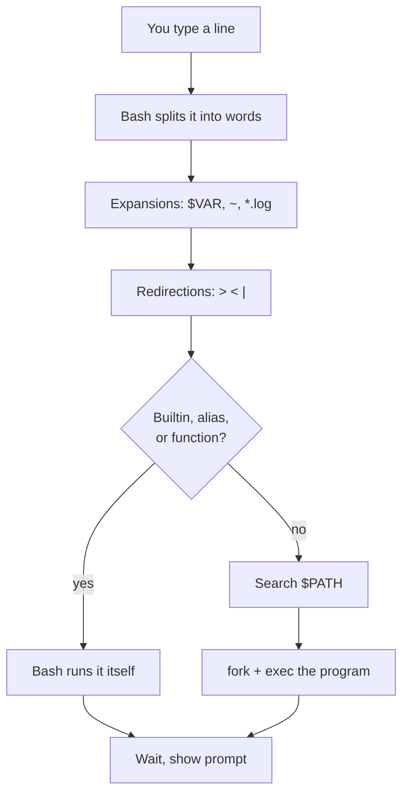
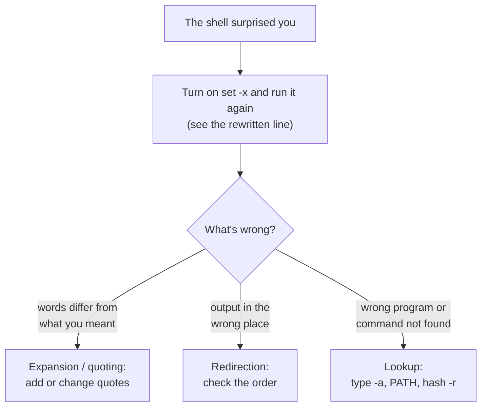
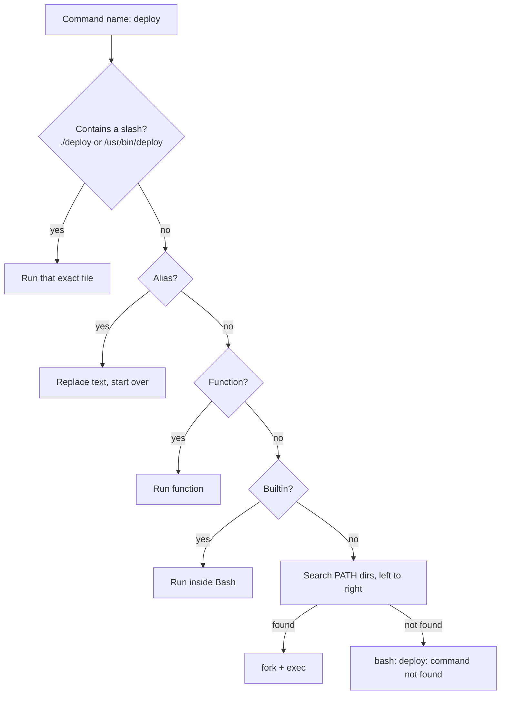
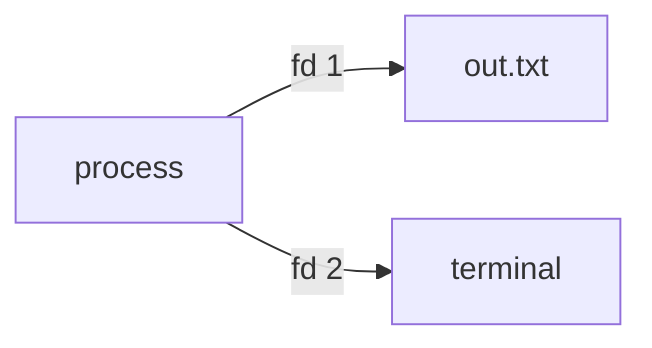
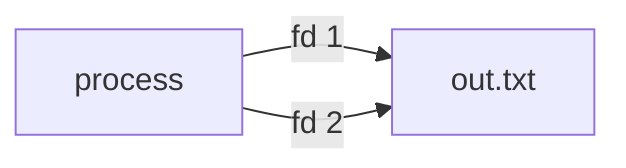
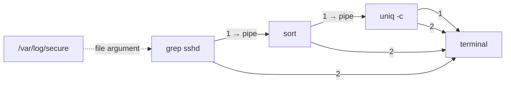
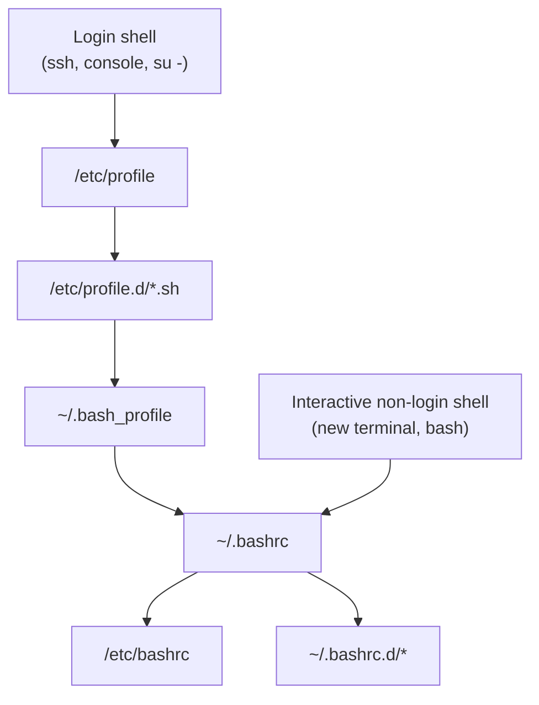

# 02 · The Shell and the Filesystem

<ul class="module-meta">
  <li>⏱ ~3 hours</li>
  <li>5 labs</li>
  <li>Builds on: 01 · How Linux Works</li>
</ul>

You type `rm *.log` and a second later you wonder: did that delete what you meant? Who decided which files `*.log` matched, `rm` or something else? Almost everything you do on a Rocky Linux server goes through the shell, and almost every surprise comes from not knowing what the shell did to your line *before* the command ever ran. This module takes the shell apart, then takes you on a tour of the filesystem it lets you explore.

!!! abstract "What you'll learn"
    - Predict exactly what Bash does to a command line: splitting, expansion, quoting, and how it finds the program to run.
    - Tell a builtin from an alias from a program with `type`, and fix a broken `PATH`.
    - Use redirection and pipes with confidence, including `2>&1` and why its position matters.
    - Find your way around the Filesystem Hierarchy Standard: what lives in `/etc`, `/usr`, `/var`, `/proc`, `/sys`, and `/run`.
    - Find files with `find` and text with `grep`, then slice it with `cut`, `sort`, `uniq`, `wc`, `sed`, and `awk`.
    - Get help from the system itself with `man`, `--help`, and `man -k`.
    - Explain which startup files a login shell reads versus a non-login shell, and where to put your own settings.

## The big picture

### The shell and the filesystem in one sentence

Here is the whole idea:

> **You type a line, Bash rewrites it (expands it, strips the quotes, wires up its input and output, finds the program), and the program only ever sees the finished list of words, three streams, and one tree of files starting at `/`.**

Everything else in this module is detail around that sentence. The first half of the module is about the **rewrite**. The second half is about the **tree**.

The **shell** is an ordinary program whose job is to read a line of text, turn it into a command, and ask the kernel to run that command. On Rocky Linux the default shell is **Bash** (the Bourne Again SHell). It is not part of the kernel and it is not magic: it is `/usr/bin/bash`, a program like any other.

Every time you press ++enter++, Bash runs the same loop: read the line, break it into words, expand those words (variables, wildcards, `~`), set up any redirections, find the command, run it, and wait for it to finish. The command it runs gets three open "channels" for input and output, and sees a filesystem tree that starts at `/`.



If you keep one idea from this module, keep this: **the shell rewrites your line before the program sees it.** `rm` never sees `*.log`. It sees a list of real filenames that Bash produced. Once you can predict that rewrite, the shell stops being mysterious.

### Four parts of the rewrite explain most surprises

When the shell does something you didn't expect, it is nearly always one of these four. Learn them and most "why did it do that?" moments answer themselves.

| What surprised you | Which part of the rewrite | How to see it or fix it |
|---|---|---|
| **1. The program got different words than you typed** (a `*` became filenames, a `$VAR` vanished) | **Expansion** | `set -x` (or put `echo` in front) to see the rewritten line |
| **2. One filename became two arguments**, or a `*` you wanted literal got expanded | **Quoting** | Wrap variables in `"..."`; use `'...'` for fully literal text |
| **3. Output or errors went somewhere unexpected** | **Redirection and pipes** | Redirections apply left to right: `> file 2>&1`. Pipes carry only stdout |
| **4. The wrong program ran, or "command not found"** | **Command lookup** | `type -a name` shows what wins; check `PATH`; `hash -r` clears the cache |



### Words you'll see

| Word | Plain meaning |
|---|---|
| **shell** / **Bash** | The program that reads your command line and runs it. Bash is Rocky's default shell |
| **word** / **argument** | One item in the finished command line. The first word is the command; the rest are its arguments |
| **expansion** | Bash replacing something you typed (`*.log`, `$HOME`, `~`) with its value |
| **glob** | A wildcard pattern like `*.conf` that expands to matching filenames |
| **quoting** | `'...'`, `"..."` or `\` to stop some or all expansion |
| **builtin** | A command built into Bash itself, like `cd` and `type` |
| **PATH** | The list of directories Bash searches for programs |
| **stdin / stdout / stderr** | The three streams every program starts with: input (0), output (1), errors (2) |
| **redirection** / **pipe** | Pointing a stream at a file (`>`, `<`, `2>`) / at another program (the pipe symbol) |
| **exit status** | A number a program returns when it ends; `0` means success. Stored in `$?` |
| **FHS** | The Filesystem Hierarchy Standard: which kind of file lives in which directory |
| **mount** | Attaching a disk or share onto a directory in the one tree |

## The shell is just a program

Open a terminal and ask the system which shell you are running and where it lives.

```console
$ echo $SHELL
/bin/bash
$ ls -l /bin/bash
-rwxr-xr-x. 1 root root 1388992 Feb 10  2026 /bin/bash
$ bash --version | head -1
GNU bash, version 5.2.26(1)-release (x86_64-redhat-linux-gnu)
$ ps -p $$
    PID TTY          TIME CMD
   2214 pts/0    00:00:00 bash
```

`$$` is a special variable holding the shell's own **process ID** (PID). `ps -p $$` proves the shell is just another process. Your login account's shell is recorded in `/etc/passwd` (you will meet that file in [03 · Users, Groups and sudo](03-users-groups-and-sudo.md)).

!!! note "Why `/bin/bash` and `/usr/bin/bash` are the same file"
    On Rocky Linux, `/bin` is a symbolic link to `usr/bin`. This is the **/usr merge**, covered in the filesystem tour below. Both paths reach the same file.

### How Bash reads a line

When you press ++enter++, Bash does not hand your line to a program as one string. It works through it in stages.

1. **Tokenising.** Bash splits the line into **words** at unquoted spaces and tabs, and recognises **operators** such as `|`, `>`, `&&`, and `;`.
2. **Expansion.** Each word goes through a fixed series of expansions (covered next).
3. **Redirection.** Bash opens or connects the files named by `>`, `<`, `2>`, and so on.
4. **Execution.** The first word is the command name. Bash looks it up and runs it with the remaining words as **arguments**.

You can watch the result of all this with `set -x`, which makes Bash print each command after expansion, prefixed with `+`.

```console
$ cd /etc
$ set -x
$ ls -d host*
+ ls --color=auto -d host.conf hostname hosts
host.conf  hostname  hosts
$ set +x
```

Notice two rewrites. The alias `ls` became `ls --color=auto`, and `host*` became three filenames. `ls` received four arguments and never saw a `*`.

### The expansion order

Bash expands words in a fixed order. Knowing the order explains nearly every "why did it do that?" moment.

| Order | Expansion | Example in | Becomes |
|---|---|---|---|
| 1 | **Brace expansion** | `file{1,2}.txt` | `file1.txt file2.txt` |
| 2 | **Tilde expansion** | `~/notes` | `/home/alice/notes` |
| 2 | **Parameter and variable expansion** | `$HOME`, `${USER}` | `/home/alice`, `alice` |
| 2 | **Arithmetic expansion** | `$((6*7))` | `42` |
| 2 | **Command substitution** | `$(hostname)` | `rocky10` |
| 3 | **Word splitting** | results of unquoted `$VAR` | split on spaces |
| 4 | **Pathname expansion (globbing)** | `*.conf` | matching filenames |
| 5 | **Quote removal** | `"a b"` | `a b` (one word) |

Steps marked 2 happen in a single pass, left to right. A **glob** is a wildcard pattern: `*` matches any run of characters, `?` matches one character, and `[abc]` matches one of a set. If a glob matches nothing, Bash leaves it unchanged by default, which is why `ls *.nope` complains about a file literally called `*.nope`.

```console
$ echo ~ $((2+2)) {a,b,c}-x
/home/alice 4 a-x b-x c-x
$ echo "Today is $(date +%A)"
Today is Thursday
$ ls *.nope
ls: cannot access '*.nope': No such file or directory
```

### Quoting: turning expansion off

**Quoting** tells Bash which characters to treat literally. There are three tools.

- **Single quotes** `'...'` turn off *everything*. What you type is what the program gets.
- **Double quotes** `"..."` keep `$VAR`, `$(...)`, and `$((...))` working but stop word splitting and globbing.
- **Backslash** `\` makes the next single character literal.

```console
$ name="Rocky Linux"
$ echo '$name has *'
$name has *
$ echo "$name has *"
Rocky Linux has *
$ echo $name has \*
Rocky Linux has *
```

The difference that bites people is word splitting. An unquoted variable that contains spaces becomes *several* arguments.

```console
$ touch "my report.txt"
$ f="my report.txt"
$ ls -l $f
ls: cannot access 'my': No such file or directory
ls: cannot access 'report.txt': No such file or directory
$ ls -l "$f"
-rw-r--r--. 1 alice alice 0 Oct 15 09:41 my report.txt
```

!!! tip "The one rule that prevents most shell bugs"
    Wrap variables in double quotes: `"$f"`, `"$HOME/dir"`, `"$@"`. Only leave them bare when you *want* word splitting, and you will rarely want it.

### Practise: predict the rewrite

This is the core skill of the module. Before you press ++enter++, say what the program will actually receive:

> **"Bash will run `<program>` with the arguments `<word 1>`, `<word 2>`, …"**

Then check yourself with `set -x`. Try these three before opening the answers.

```text
A:  echo file{1,2}.txt $((6*7))
B:  f="my report.txt"; ls -l $f
C:  echo '$HOME' "$HOME"
```

??? success "Answer A"
    "Bash will run `echo` with the arguments `file1.txt`, `file2.txt`, `42`." Brace expansion makes two words, arithmetic expansion turns `$((6*7))` into `42`. `echo` never sees a brace or a `$`.

??? success "Answer B"
    "Bash will run `ls` with the arguments `-l`, `my`, `report.txt`" (plus `--color=auto` from the alias in an interactive shell). The unquoted `$f` is expanded, then **word splitting** cuts it at the space. That's why `ls` complains about two missing files. Write `ls -l "$f"` and `ls` gets one argument, `my report.txt`.

??? success "Answer C"
    "Bash will run `echo` with the arguments `$HOME` and `/home/alice`" (your own home directory). Single quotes switch off all expansion; double quotes still allow `$` expansion but keep the result as one word.

<div class="quiz" data-answer="3" markdown>

The current directory holds `a.txt`, `b.txt`, and `notes.md`. You run `echo '*.txt' "*.txt" *.txt`. What does `echo` print?

- `a.txt b.txt a.txt b.txt a.txt b.txt`
- `*.txt *.txt *.txt`
- `*.txt *.txt a.txt b.txt`
- `*.txt a.txt b.txt a.txt b.txt`

Right. Single and double quotes both stop globbing, so the first two words stay literal. Only the unquoted `*.txt` is expanded by Bash into the matching filenames.

</div>

## How the shell finds a command

After expansion, the first word is the command name. Bash checks, in this order:

1. Is it an **alias**? An alias is a text shortcut, like `ll` for `ls -l`.
2. Is it a **shell function**? A small named script defined in the shell.
3. Is it a **builtin**? A command compiled into Bash itself, like `cd`, `echo`, `export`, and `type`.
4. Otherwise, it is an external **program**. Bash searches each directory listed in `PATH`, left to right, and runs the first match.

`cd` *has* to be a builtin. A program runs as a separate process, and a child process cannot change its parent's current directory. If `cd` were a program, it would change its own directory and then exit, leaving your shell exactly where it was.

The `type` builtin tells you which kind a name is.

```console
$ type cd ll ls grep
cd is a shell builtin
ll is aliased to `ls -l --color=auto'
ls is aliased to `ls --color=auto'
grep is aliased to `grep --color=auto'
$ type -a echo
echo is a shell builtin
echo is /usr/bin/echo
$ type -P grep
/usr/bin/grep
```

`type -a` shows every match, in the order Bash would try them. `type -P` skips aliases and builtins and prints the file that a `PATH` search finds.

### PATH, the search list

**PATH** is an environment variable holding a colon-separated list of directories.

```console
$ echo $PATH
/home/alice/.local/bin:/home/alice/bin:/usr/local/bin:/usr/bin:/usr/local/sbin:/usr/sbin
```

Bash searches these directories left to right and runs the first match. Where do the two `~/…/bin` entries come from? Rocky's default `~/.bashrc` (copied from `/etc/skel`) prepends them, which is why a script you drop into `~/.local/bin` just works.

??? question "Under the hood: Bash caches what it finds"
    Bash remembers where it found each program in a small **hash table**, so it does not search `PATH` again next time. `hash` shows the table and `hash -r` clears it.

    ```console
    $ hash
    hits	command
       3	/usr/bin/grep
       1	/usr/bin/ls
    ```

    The failure mode: you install a newer `tool` into `/usr/local/bin` (which comes earlier in `PATH`) but your open shell keeps running the old `/usr/bin/tool`, because the cached path still exists. `type tool` says "tool is hashed (/usr/bin/tool)". Run `hash -r`, or open a new shell.

#### Worked story: "command not found", but the script is right there

**Symptom.** You write a script called `deploy` in your current directory, make it executable, and type `deploy`. Bash says `bash: deploy: command not found`.

**Evidence.**

```console
$ ls -l deploy
-rwxr-xr-x. 1 alice alice 52 Oct 15 10:02 deploy
$ type deploy
bash: type: deploy: not found
$ echo $PATH
/home/alice/.local/bin:/home/alice/bin:/usr/local/bin:/usr/bin:/usr/local/sbin:/usr/sbin
```

**Reasoning.** This is part 4 of the rewrite, command lookup. `deploy` has no slash in it, so Bash searches only the `PATH` directories. Your current directory isn't one of them (and it shouldn't be, see the warning below). The file exists; Bash just never looks there.

**Fix.** Either give Bash a path, which skips the search: `./deploy`. Or move the script into a directory that *is* on `PATH`: `mv deploy ~/.local/bin/`.

**Check.** After the move, `type deploy` answers `deploy is /home/alice/.local/bin/deploy`, and plain `deploy` runs.

!!! warning "Never put `.` in PATH"
    Adding the current directory to `PATH` means a file called `ls` dropped into `/tmp` by someone else runs when you type `ls` there. To run a program in the current directory, type `./program` explicitly.



When Bash runs an external program it uses the two-step **fork and exec** you met in [01 · How Linux Works](01-how-linux-works.md): it copies itself (fork), and the copy replaces itself with the program (exec). The shell then waits for the child to exit and stores its **exit status** in `$?`. Zero means success; anything else means failure.

```console
$ grep -q root /etc/passwd; echo $?
0
$ grep -q nosuchuser /etc/passwd; echo $?
1
$ nosuchcommand; echo $?
bash: nosuchcommand: command not found
127
```

`&&` runs the next command only if the previous one succeeded; `||` runs it only if the previous one failed. `mkdir backup && cp *.conf backup/` will not copy anything if the directory could not be created.

??? question "Prove it: watch Bash exec a program with strace"
    `strace` (install with `sudo dnf install -y strace`) prints the system calls a process makes. Trace only `execve`, the "replace me with this program" call:

    ```console
    $ strace -f -e trace=execve bash -c 'ls /tmp > /dev/null'
    execve("/usr/bin/bash", ["bash", "-c", "ls /tmp > /dev/null"], 0x7ffc5d1e2a40 /* 27 vars */) = 0
    execve("/usr/bin/ls", ["ls", "/tmp"], 0x55f1c3a8e2b0 /* 27 vars */) = 0
    +++ exited with 0 +++
    ```

    Three details are worth noticing. Bash resolved `ls` to the full path `/usr/bin/ls` itself. The argument list `["ls", "/tmp"]` contains no `>` and no `/dev/null`: the redirection was done by Bash before exec, so `ls` never knew. And because `ls` was the last thing to do, Bash skipped the fork and simply exec'd `ls` in its own process, an optimisation you can see because only one PID appears.

<div class="terminal-sim" data-title="How does Bash see this?" markdown>

<div class="task" data-expect="type cd" data-hint="The builtin that reports what kind of command a name is, followed by cd." markdown>

**Step 1.** Ask Bash what kind of command `cd` is.

```text
cd is a shell builtin
```

</div>

<div class="task" data-expect="type -a echo" data-hint="type with the option that lists every match, for echo." markdown>

**Step 2.** Show *every* place `echo` could come from, in the order Bash tries them.

```text
echo is a shell builtin
echo is /usr/bin/echo
```

</div>

<div class="task" data-expect="echo $PATH||echo &quot;$PATH&quot;" data-hint="Print the PATH variable with echo." markdown>

**Step 3.** Print the list of directories Bash searches for programs.

```text
/home/alex/.local/bin:/home/alex/bin:/usr/local/bin:/usr/bin:/usr/local/sbin:/usr/sbin
```

</div>

<div class="task" data-expect="echo ~ $((6*7))||echo ~ $(( 6*7 ))||echo ~ $((6 * 7))" data-hint="echo, then a tilde, then an arithmetic expansion of six times seven." markdown>

**Step 4.** Use one `echo` to show tilde expansion and the arithmetic expansion of `6*7`.

```text
/home/alex 42
```

</div>

<div class="task" data-expect="echo '$HOME'" data-hint="Single quotes switch off all expansion." markdown>

**Step 5.** Print the literal text `$HOME`, not its value.

```text
$HOME
```

</div>

</div>

## Standard streams, redirection, and pipes

Every process starts with three open **file descriptors** (small integers that refer to open files or devices):

| fd | Name | Default | Used for |
|---|---|---|---|
| 0 | **stdin** (standard input) | your keyboard | data the program reads |
| 1 | **stdout** (standard output) | your terminal | normal output |
| 2 | **stderr** (standard error) | your terminal | errors and diagnostics |

Keeping errors on a separate channel is a deliberate design. You can send the real output into a file or another program while error messages still reach your screen.

**Redirection** rewires these descriptors *before* the program starts. The program does not know or care; it just writes to fd 1 as usual.

| Syntax | Meaning |
|---|---|
| `cmd > file` | stdout to `file` (create or truncate) |
| `cmd >> file` | stdout appended to `file` |
| `cmd 2> file` | stderr to `file` |
| `cmd > file 2>&1` | stdout to `file`, then stderr to wherever stdout points |
| `cmd &> file` | Bash shorthand for both stdout and stderr to `file` |
| `cmd < file` | stdin from `file` |
| `cmd 2> /dev/null` | throw errors away |
| `cmd1`, a pipe symbol, then `cmd2` | stdout of `cmd1` becomes stdin of `cmd2` |

```console
$ find /etc -name '*.repo' > repos.txt
find: '/etc/sudoers.d': Permission denied
find: '/etc/ssh/sshd_config.d': Permission denied
…
$ wc -l repos.txt
4 repos.txt
$ find /etc -name '*.repo' 2> /dev/null
/etc/yum.repos.d/rocky-addons.repo
/etc/yum.repos.d/rocky-devel.repo
/etc/yum.repos.d/rocky-extras.repo
/etc/yum.repos.d/rocky.repo
```

The "Permission denied" lines went to stderr, so they still appeared on screen while the results went into the file.

### Why `2>&1` must come last

`2>&1` means "make fd 2 point wherever fd 1 points *right now*." Bash processes redirections left to right, so the order changes the result.

<div class="stepper" markdown>

<div class="step" data-title="Start" markdown>

Before any redirection, both stdout (1) and stderr (2) point at your terminal.


Command: `ls /etc /nope > out.txt 2>&1`

</div>

<div class="step" data-title="> out.txt" markdown>

Bash handles `> out.txt` first. fd 1 now points at `out.txt`. fd 2 still points at the terminal.



</div>

<div class="step" data-title="2>&1" markdown>

Next, `2>&1` copies fd 1's *current* target into fd 2. Both now go to `out.txt`. The file gets the listing and the error.



</div>

<div class="step" data-title="The wrong order" markdown>

Now try `ls /etc /nope 2>&1 > out.txt`. Bash does `2>&1` first, when fd 1 still points at the terminal, so fd 2 is pointed at the terminal. Then `> out.txt` moves only fd 1.


The error still appears on screen. Redirections are assignments, applied in order, not wishes.

</div>

</div>

### Pipes

A **pipe** (`|`) connects the stdout of one command to the stdin of the next. The kernel creates a small in-memory buffer between them, and both programs run at the same time. Data flows as soon as it is produced, which is why `journalctl -f | grep error` shows matches live.



Only stdout goes into the pipe. Errors from every stage still go straight to the terminal. Use `2>&1 |` (or `|&` in Bash) when you want errors to flow down the pipe too.

Two pipe helpers are worth knowing early:

- `tee file` copies its input to a file *and* to stdout, so you can save and watch at the same time.
- `xargs` turns lines of input into arguments for another command: `find . -name '*.tmp' -print0 | xargs -0 rm`.

??? question "Under the hood: pipe buffers, SIGPIPE, and whose exit status you get"
    A pipe is a kernel buffer, 64 KiB by default on Linux. If the reader is slow, the writer fills the buffer and the kernel simply pauses it until there is room. If the reader *exits*, the next write gets the signal **SIGPIPE** and the writer dies quietly. That is how `yes | head -1` finishes instead of running forever.

    The exit status of a pipeline (`$?`) is the status of the **last** command only. A failure earlier in the pipe is invisible unless you ask:

    ```console
    $ false | true; echo $?
    0
    $ false | true; echo "${PIPESTATUS[@]}"
    1 0
    $ yes | head -1; echo "${PIPESTATUS[@]}"
    y
    141 0
    ```

    `PIPESTATUS` holds every stage's status. `141` is 128 + 13, "killed by signal 13" (SIGPIPE). In scripts, `set -o pipefail` makes the pipeline fail if any stage fails, which is what you want for `mysqldump … | gzip > backup.gz` (otherwise a failed dump still "succeeds"). The catch: with `pipefail`, a harmless `| head` can turn into a 141 failure, so test both.

!!! example "Try it"
    ```console
    $ ls /etc /nope > out.txt 2>&1; cat out.txt | head -3
    $ ls /etc /nope 2>&1 > out.txt
    $ rm out.txt
    ```
    The second command prints the error to your screen. Explain why, using the stepper above.

<div class="quiz" data-answer="2" markdown>

You run `sudo dnf check-update | grep kernel > updates.txt`. `dnf` prints a warning on stderr. Where does the warning go?

- Into `updates.txt`
- To your terminal
- Into the pipe, where `grep` filters it out
- Nowhere, because `grep` discards stderr

Right. A pipe only carries stdout. `dnf`'s stderr was never redirected, so it still points at your terminal.

</div>

## A tour of the filesystem

Linux has a single tree of directories starting at `/`, called the **root directory** (not to be confused with the root *user* or `/root`, the root user's home). Disks, USB sticks, and network shares do not get drive letters. They are **mounted** onto a directory somewhere in the tree. You will mount things yourself in [09 · Disks and Filesystems](09-disks-and-filesystems.md).

The layout follows the **Filesystem Hierarchy Standard** (FHS), so a Rocky server, a Fedora laptop, and a Debian container all keep config in `/etc` and logs in `/var/log`. Click each directory to see what lives there.

<div class="layers" data-hint="Click a directory to see what lives there and how to explore it." data-open="0" markdown>

<div class="layer" data-label="/etc" data-tag="configuration" markdown>

**System-wide configuration**, as plain text files. If you want to change how something behaves, you almost always edit a file under `/etc`.

```console
$ ls /etc | head -8
adjtime
aliases
alternatives
anacrontab
audit
authselect
bash_completion.d
bashrc
$ ls /etc/ssh/
moduli  ssh_config  ssh_config.d  sshd_config  sshd_config.d  ssh_host_ecdsa_key …
```

Rule of thumb: packages ship defaults in `/usr`, you put your changes in `/etc`. Many services read a `*.d/` directory of drop-in files so you can add a small file instead of editing a big one.

</div>

<div class="layer" data-label="/usr" data-tag="programs and libraries" markdown>

**Installed software**, managed by the package manager. Treat it as read-only.

- `/usr/bin`: programs for everyone (`ls`, `grep`, `bash`)
- `/usr/sbin`: system administration programs (`useradd`, `sshd`)
- `/usr/lib`, `/usr/lib64`: shared libraries, plus vendor defaults such as `/usr/lib/systemd/system/` unit files
- `/usr/share`: architecture-independent data (man pages, docs, icons)
- `/usr/local`: software *you* install by hand, kept apart from packages

```console
$ rpm -qf /usr/bin/ls
coreutils-9.5-6.el10.x86_64
```

</div>

<div class="layer" data-label="/bin, /sbin, /lib, /lib64" data-tag="symlinks into /usr" markdown>

These are **symbolic links**, not directories. Since RHEL 7 (and so on every Rocky release), all programs and libraries live under `/usr`, and the old top-level names point there. This is the **/usr merge**.

```console
$ ls -ld /bin /sbin /lib /lib64
lrwxrwxrwx. 1 root root 7 Jun 11  2025 /bin -> usr/bin
lrwxrwxrwx. 1 root root 7 Jun 11  2025 /lib -> usr/lib
lrwxrwxrwx. 1 root root 9 Jun 11  2025 /lib64 -> usr/lib64
lrwxrwxrwx. 1 root root 8 Jun 11  2025 /sbin -> usr/sbin
```

Old scripts that say `#!/bin/bash` keep working because the link resolves to `/usr/bin/bash`.

</div>

<div class="layer" data-label="/var" data-tag="variable data" markdown>

**Data that changes while the system runs**: logs, caches, spools, databases, web content.

- `/var/log`: log files (`secure`, `messages`, `dnf.log`) and the persistent journal in `/var/log/journal`
- `/var/cache/dnf`: downloaded repository metadata
- `/var/lib`: state for services (`/var/lib/rpm` was the RPM database on older releases; `/var/lib/mysql`, `/var/lib/containers`)
- `/var/spool`: queues for mail, cron, and printing

Because `/var` grows, it is a common candidate for its own filesystem on servers. A full `/var` breaks logging and package installs.

</div>

<div class="layer" data-label="/home and /root" data-tag="user files" markdown>

`/home/<name>` holds each regular user's files and personal settings (the dotfiles). `/root` is the root user's home, kept separate so root can log in even if `/home` is on a network share that is unavailable.

```console
$ ls -ld /home/alice /root
drwx------. 4 alice alice  117 Oct 15 09:41 /home/alice
dr-xr-x---. 3 root  root   147 Oct 14 18:02 /root
```

New home directories are private (`drwx------`) by default on Rocky.

</div>

<div class="layer" data-label="/proc" data-tag="kernel view of processes" markdown>

A **virtual filesystem**: nothing here is on disk. The kernel generates each file when you read it. Every running process has a directory named after its PID, and system-wide files report kernel state.

```console
$ cat /proc/loadavg
0.08 0.03 0.01 1/213 2381
$ ls /proc/self/
attr  cgroup  cmdline  cwd  environ  exe  fd  limits  maps  mounts  status …
$ ls -l /proc/self/fd
lrwx------. 1 alice alice 64 Oct 15 09:52 0 -> /dev/pts/0
lrwx------. 1 alice alice 64 Oct 15 09:52 1 -> /dev/pts/0
lrwx------. 1 alice alice 64 Oct 15 09:52 2 -> /dev/pts/0
lr-x------. 1 alice alice 64 Oct 15 09:52 3 -> /proc/2390/fd
```

`/proc/self` always means "the process reading this". Here you can see fds 0, 1, and 2 all pointing at the terminal. You will use `/proc` heavily in [06 · Processes and Signals](06-processes-and-signals.md).

</div>

<div class="layer" data-label="/sys" data-tag="kernel view of devices" markdown>

Another virtual filesystem, **sysfs**, that shows devices, drivers, and kernel settings as a tree of small files.

```console
$ cat /sys/class/net/enp1s0/address
52:54:00:6b:3a:1f
$ cat /sys/block/vda/size
41943040
```

That disk size is in 512-byte sectors (20 GiB here). Some files in `/sys` are writable by root and change kernel behaviour immediately.

</div>

<div class="layer" data-label="/run" data-tag="runtime state (RAM)" markdown>

A **tmpfs** (a filesystem that lives in RAM) created fresh at every boot. Services put PID files, sockets, and lock files here. Because it is emptied on reboot, stale files from a crash cannot confuse the next boot.

```console
$ findmnt /run
TARGET SOURCE FSTYPE OPTIONS
/run   tmpfs  tmpfs  rw,nosuid,nodev,size=1586012k,nr_inodes=819200,mode=755,inode64
```

`/run/user/<uid>` is a private runtime directory for each logged-in user.

</div>

<div class="layer" data-label="/tmp and /var/tmp" data-tag="scratch space" markdown>

World-writable scratch space with the **sticky bit**, so users cannot delete each other's files (see [04 · Permissions and ACLs](04-permissions-and-acls.md)).

- `/tmp`: short-lived files. Cleaned by `systemd-tmpfiles` (files untouched for 10 days by default).
- `/var/tmp`: files that should survive a reboot. Cleaned after 30 days by default.

```console
$ ls -ld /tmp
drwxrwxrwt. 12 root root 4096 Oct 15 09:30 /tmp
```

Check whether your `/tmp` is on disk or in RAM with `findmnt /tmp`.

</div>

<div class="layer" data-label="/dev" data-tag="device files" markdown>

**Device files**: special files that represent hardware and kernel interfaces. Reading or writing them talks to a driver.

- `/dev/vda`, `/dev/sda`, `/dev/nvme0n1`: disks
- `/dev/null`: discards everything written to it
- `/dev/zero`, `/dev/urandom`: endless zeros or random bytes
- `/dev/pts/0`: your terminal

Managed automatically by the kernel's devtmpfs and **udev**.

</div>

<div class="layer" data-label="/boot, /opt, /srv, /mnt, /media" data-tag="the rest" markdown>

- `/boot`: kernels, initramfs images, and GRUB config ([14 · The Boot Process](14-the-boot-process.md))
- `/opt`: self-contained third-party software (`/opt/vendorapp/`)
- `/srv`: data this machine *serves* (web roots, FTP, a local repo)
- `/mnt`: a place to temporarily mount something by hand
- `/media`: where desktops auto-mount removable media

</div>

</div>

### Getting around

You already know `cd` and `ls`. A few extras make navigation fast.

| Command | What it does |
|---|---|
| `pwd` | print the current (working) directory |
| `cd -` | go back to the previous directory |
| `cd` or `cd ~` | go to your home directory |
| `ls -la` | long listing including **hidden files** (names starting with `.`) |
| `ls -lh` | human-readable sizes |
| `ls -lt` | newest first |
| `tree -L 2` | draw the tree two levels deep (`sudo dnf install tree`) |
| `stat file` | every piece of metadata about a file |
| `file thing` | guess what kind of data a file holds |

A path starting with `/` is an **absolute path**. Anything else is a **relative path**, interpreted from your current directory. `.` means "this directory" and `..` means "the parent".

```console
$ stat /etc/hostname
  File: /etc/hostname
  Size: 8         	Blocks: 8          IO Block: 4096   regular file
Device: 253,0	Inode: 16786510    Links: 1
Access: (0644/-rw-r--r--)  Uid: (    0/    root)   Gid: (    0/    root)
Context: system_u:object_r:hostname_etc_t:s0
Access: 2026-10-15 08:12:03.512000000 +0000
Modify: 2026-10-14 18:02:41.118000000 +0000
Change: 2026-10-14 18:02:41.118000000 +0000
 Birth: 2026-10-14 18:02:41.118000000 +0000
$ file /usr/bin/ls /etc/hosts
/usr/bin/ls: ELF 64-bit LSB pie executable, x86-64, version 1 (SYSV), dynamically linked, …
/etc/hosts:  ASCII text
```

The `Context:` line is the file's SELinux label, which you will meet in [16 · SELinux](16-selinux.md). The `Inode:` line matters more than it looks: a filename is only a **directory entry** pointing at an inode, and the inode is the file.

??? question "Under the hood: you deleted the log, but the disk is still full"
    A classic 3am incident: `/var` is at 100%, you `rm` a 20 GB debug log, and `df` does not move. `rm` only removes the *name*. The kernel frees the inode and its blocks when the last name is gone **and** the last process holding it open has closed it. The service that writes the log still has it open, so the space stays allocated, and `du` (which walks names) and `df` (which asks the filesystem) now disagree.

    `/proc` shows you the culprit, because every open file descriptor is a symlink that says `(deleted)`:

    ```console
    $ sudo find /proc/[0-9]*/fd -lname '*(deleted)' -printf '%p -> %l\n' 2>/dev/null
    /proc/1873/fd/4 -> /var/log/myapp/debug.log (deleted)
    ```

    Two fixes: restart the service (it closes the file and the space comes back), or truncate it through the descriptor without restarting: `sudo truncate -s 0 /proc/1873/fd/4`. Next time, empty a live log with `sudo truncate -s 0 file` (or `: > file`) instead of `rm`, so the writer keeps a valid file.

<div class="quiz" data-answer="4" markdown>

A service crashed and left a stale PID file that stops it from starting. After a reboot the file is gone. Which directory was it most likely in?

- `/var/lib`
- `/etc`
- `/var/tmp`
- `/run`

Right. `/run` is a tmpfs in RAM, rebuilt empty at every boot. That is exactly why services keep PID files and sockets there.

</div>

## Finding things

### find: search by name, type, size, time, owner

`find` walks a directory tree and tests every entry against the conditions you give it. The general form is `find WHERE TESTS ACTIONS`.

```console
$ find /etc -name '*.conf' -newer /etc/hostname 2>/dev/null
/etc/resolv.conf
/etc/chrony.conf
$ sudo find /var/log -type f -size +10M
/var/log/journal/3f2a9c…/system.journal
$ find ~ -type f -mtime -1
/home/alice/my report.txt
$ sudo find / -xdev -user 1002
/home/carol
/home/carol/.bashrc
…
```

Useful tests: `-name` and `-iname` (case-insensitive), `-type f` (file) or `-type d` (directory), `-size +10M`, `-mtime -1` (modified less than a day ago), `-user`, `-perm`. `-xdev` stops `find` from crossing into other filesystems such as `/proc`.

Quote the pattern (`'*.conf'`). If you do not, Bash may expand `*.conf` in the *current* directory before `find` ever sees it.

To act on what you find, use `-exec`. The `{}` is replaced by each filename, and `+` batches many names into one command.

```console
$ find ~/project -name '*.bak' -exec rm -v {} +
removed '/home/alice/project/a.bak'
removed '/home/alice/project/b.bak'
```

!!! tip "Test before you delete"
    Run the `find` without `-exec rm` (or with `-print`) first and read the list. Then add the action.

??? note "locate: fast, but not installed by default"
    `locate` searches a prebuilt database of filenames, so it answers in milliseconds. It is not part of a minimal Rocky install. Install `plocate` and build the database first.

    ```console
    $ sudo dnf install -y plocate
    $ sudo updatedb
    $ locate sshd_config
    /etc/ssh/sshd_config
    /etc/ssh/sshd_config.d
    /usr/share/man/man5/sshd_config.5.gz
    ```

    The database is only as fresh as the last `updatedb` run (a systemd timer refreshes it daily), so a file you created a minute ago may not show up. `find` always looks at the live disk.

### grep: search inside files

`grep` prints lines that match a pattern. `sshd_config` is mode `600` (it can hold secrets), so reading it needs `sudo`.

```console
$ sudo grep PermitRootLogin /etc/ssh/sshd_config
#PermitRootLogin prohibit-password
$ sudo grep -r 'Listen' /etc/httpd/conf/ 2>/dev/null
$ grep -c '' /etc/passwd
27
$ grep -v '^#' /etc/chrony.conf | grep -v '^$'
pool 2.rocky.pool.ntp.org iburst
sourcedir /run/chrony-dhcp
driftfile /var/lib/chrony/drift
makestep 1.0 3
rtcsync
…
```

Flags you will use constantly: `-i` ignore case, `-n` show line numbers, `-r` recurse into directories, `-v` invert (show lines that do *not* match), `-l` list only filenames, `-E` extended regular expressions, `-w` match whole words. The last example is a classic: strip comments and blank lines to see the settings a config file really contains.

## Essential text tools

Linux tools are small and each does one job. You chain them with pipes. Most of them read files given as arguments, or stdin if you give none.

### Viewing files

- `cat file`: dump the whole file.
- `less file`: page through it. ++space++ next page, `b` back, `/word` search forward, `n` next match, `G` end, `q` quit.
- `head -n 20 file` / `tail -n 20 file`: first or last 20 lines.
- `tail -f file`: keep the file open and print new lines as they are written. Press ++ctrl+c++ to stop. Perfect for watching a log while you reproduce a problem.

```console
$ sudo tail -f /var/log/secure
Oct 15 10:02:11 rocky10 sshd-session[2511]: Accepted publickey for alice from 192.168.122.1 port 51522 ssh2: ED25519 SHA256:…
Oct 15 10:02:11 rocky10 sshd-session[2511]: pam_unix(sshd:session): session opened for user alice(uid=1000) by (uid=0)
^C
```

### Slicing and counting

| Tool | Job | Example |
|---|---|---|
| `wc` | count lines, words, bytes | `wc -l /etc/passwd` |
| `cut` | pick columns by delimiter | `cut -d: -f1,7 /etc/passwd` |
| `sort` | sort lines | `sort -t: -k3 -n /etc/passwd` |
| `uniq` | collapse *adjacent* duplicates | `uniq -c` (after `sort`) |
| `tr` | translate characters | `tr a-z A-Z` |
| `sed` | stream editor: search and replace | `sed 's/old/new/g'` |
| `awk` | pattern and field processing | `awk -F: '$3>=1000 {print $1}'` |

`uniq` only removes duplicates that sit next to each other, so you almost always `sort` first. Here is a real question answered with a pipeline: which shells do the accounts on this machine use, and how many of each?

```console
$ cut -d: -f7 /etc/passwd | sort | uniq -c | sort -rn
     19 /sbin/nologin
      4 /bin/bash
      1 /usr/sbin/nologin
      1 /bin/sync
      1 /sbin/shutdown
      1 /sbin/halt
```

Read it left to right: take field 7 of each line, sort so identical shells are adjacent, count each group, then sort by count, largest first.

!!! tip "Sort order depends on your locale"
    In the default `en_US.UTF-8` locale, `sort` (and `ls`, and glob ranges like `[a-z]`) use dictionary rules: case and punctuation are mostly ignored. `LC_ALL=C` switches to plain byte order, which is predictable in scripts and much faster on big files.

    ```console
    $ printf 'b\nA\na\nB\n' | sort | tr '\n' ' '; echo
    a A b B
    $ printf 'b\nA\na\nB\n' | LC_ALL=C sort | tr '\n' ' '; echo
    A B a b
    ```

    A script that compares two sorted lists (`comm`, `join`) must sort both with the same locale, or it silently gives wrong answers.

### A taste of sed and awk

`sed` edits text as it streams past. The most common use is substitution: `s/pattern/replacement/flags`.

```console
$ echo "PermitRootLogin yes" | sed 's/yes/no/'
PermitRootLogin no
$ sed -n '1,3p' /etc/passwd
root:x:0:0:root:/root:/bin/bash
bin:x:1:1:bin:/bin:/sbin/nologin
daemon:x:2:2:daemon:/sbin:/sbin/nologin
```

`sed -i` edits a file in place. It is powerful and unforgiving, so use `sed -i.bak` to keep a backup.

`awk` splits each line into fields (`$1`, `$2`, …) and runs a small program on them. It shines when you need to compare or add numbers.

```console
$ awk -F: '$3 >= 1000 && $3 < 60000 {print $1, $6}' /etc/passwd
alice /home/alice
bob /home/bob
$ df -k / /boot | awk 'NR>1 {used+=$3} END {print used/1024 " MiB used"}'
2793.21 MiB used
```

`NR` is the line number; `NR>1` skips the header. `END` runs once after the last line.

<div class="quiz" data-answer="1" markdown>

You want the five IP addresses that failed SSH logins most often. Lines look like `Failed password for bob from 203.0.113.9 port 4022 ssh2`. Which pipeline is correct?

- `grep 'Failed password' /var/log/secure | awk '{print $(NF-3)}' | sort | uniq -c | sort -rn | head -5`
- `grep 'Failed password' /var/log/secure | uniq -c | sort -rn | head -5`
- `grep 'Failed password' /var/log/secure | awk '{print $(NF-3)}' | uniq -c | head -5`
- `sort /var/log/secure | grep 'Failed' | head -5 | uniq -c`

Right. Extract the address field (fourth from the end), sort so duplicates are adjacent, count them, sort by count, and keep the top five. Skipping the first `sort` would make `uniq -c` count only consecutive repeats.

</div>

## Getting help from the system

You do not need to memorise flags. The system documents itself.

- `command --help`: a short usage summary, built into most GNU tools.
- `man command`: the **manual page**, the authoritative reference. Navigate it like `less`.
- `man -k keyword` (same as `apropos`): search man page names and descriptions.
- `info command`: longer GNU manuals, sometimes more complete than the man page (install the `info` package if it is missing).
- `help builtin`: help for Bash builtins such as `cd` or `type`, which have no man page of their own.

Man pages are organised into numbered **sections**. The same name can exist in several, so the section matters.

| Section | Contents | Example |
|---|---|---|
| 1 | user commands | `man 1 passwd` |
| 5 | file formats and config files | `man 5 passwd` (the `/etc/passwd` format) |
| 8 | system administration commands | `man 8 useradd` |
| 7 | overviews and conventions | `man 7 hier` (the filesystem layout) |

```console
$ man -k crontab
anacrontab (5)       - configuration file for Anacron
crontab (1)          - maintains crontab files for individual users
crontab (5)          - files used to schedule the execution of programs
$ help type | head -3
type: type [-afptP] name [name ...]
    Display information about command type.
```

In this course, man page references look like this: [[man:bash(1)]] [[man:hier(7)]]. Click them to read online, or run `man` locally.

## Environment variables and dotfiles

### Shell variables vs environment variables

A **shell variable** exists only inside the current shell. An **environment variable** is a variable the shell passes down to every program it starts. `export` turns one into the other.

```console
$ GREETING=hello
$ bash -c 'echo "child sees: $GREETING"'
child sees:
$ export GREETING
$ bash -c 'echo "child sees: $GREETING"'
child sees: hello
$ TZ=Asia/Tokyo date
Thu Oct 15 19:04:12 JST 2026
```

The last line shows a handy trick: `VAR=value command` sets a variable for that one command only.

Some environment variables you will meet everywhere:

| Variable | Meaning |
|---|---|
| `PATH` | where to look for programs |
| `HOME` | your home directory |
| `USER` | your user name |
| `SHELL` | your login shell |
| `PWD` | current directory |
| `EDITOR` | which editor tools like `crontab -e` and `sudoedit` should open |
| `LANG` | language and character encoding |
| `PS1` | the shell prompt format |

`env` (or `printenv`) lists the whole environment. Each process's environment is also visible in `/proc/<pid>/environ`.

### Login and non-login shells

Bash reads different startup files depending on how it was started, and this is the source of the classic "my alias works in one terminal but not over SSH" puzzle.

- A **login shell** is the first shell of a session: an SSH login, a console login, or `su -`. It reads `/etc/profile` (which runs `/etc/profile.d/*.sh`), then the first of `~/.bash_profile`, `~/.bash_login`, or `~/.profile` that exists.
- An **interactive non-login shell** is any other shell you type into: a new terminal tab in a desktop session, or typing `bash`. It reads `~/.bashrc`.
- A **non-interactive shell** runs a script. It reads neither (unless `BASH_ENV` is set).

Rocky smooths this over. The default `~/.bash_profile` that `useradd` copies from `/etc/skel` sources `~/.bashrc`, and `~/.bashrc` sources `/etc/bashrc` plus any files in `~/.bashrc.d/`.



The practical rule:

- Put environment variables (`PATH` changes, `EDITOR`) in `~/.bash_profile`, so they are set once per login and inherited.
- Put aliases, functions, and prompt settings in `~/.bashrc` (or a file in `~/.bashrc.d/`), because they are not inherited by child processes and must be set in every interactive shell.
- For system-wide settings, add a file to `/etc/profile.d/`. Do not edit `/etc/profile` or `/etc/bashrc`, which belong to the `setup` package.

```bash title="~/.bashrc.d/aliases"
alias ll='ls -lh --color=auto'
alias ports='ss -tulpn'
export EDITOR=vim
```

Run `source ~/.bashrc` (or `. ~/.bashrc`) to load changes into the current shell. Without `source`, running the file would start a child shell, load the settings there, and throw them away when it exits.

??? question "How can I tell whether my shell is a login shell?"
    Run `shopt -q login_shell && echo login || echo non-login`. Over SSH you will see `login`. Type `bash` and run it again: `non-login`.

??? question "Under the hood: /etc/profile.d runs for non-login shells too"
    The diagram above is the textbook story. Rocky adds a twist: `/etc/bashrc` (read by every interactive shell through `~/.bashrc`) checks whether the shell is a login shell, and if it is *not*, it runs the `/etc/profile.d/*.sh` scripts itself.

    ```console
    $ grep -A1 'login_shell' /etc/bashrc
      if ! shopt -q login_shell ; then # We're not a login shell
    …
    $ grep 'profile.d/\*.sh' /etc/bashrc
        for i in /etc/profile.d/*.sh; do
    ```

    So a file you drop into `/etc/profile.d/` reaches login shells *and* new terminal tabs, which is why it is the right place for site-wide settings. What it does **not** reach: cron jobs and systemd services, which never start an interactive shell. They get their environment from the crontab or the unit file (`Environment=`). "It works when I log in but not from cron" is almost always this.

## Working faster: completion and history

**Tab completion** saves typing and prevents typos. Press ++tab++ once to complete a unique match; press it twice to list the options. On Rocky, the `bash-completion` package (installed by default on most install types) teaches ++tab++ about subcommands and options, so `systemctl res`++tab++ completes to `restart`, and `dnf in`++tab++ to `install`.

```console
$ sudo dnf install -y bash-completion
```

**History** remembers what you typed. It lives in memory during a session and is written to `~/.bash_history` when the shell exits.

| Keys / command | Effect |
|---|---|
| ++up++ / ++down++ | step through previous commands |
| ++ctrl+r++ | reverse search: type part of an old command, press ++ctrl+r++ again for older matches |
| `history 10` | show the last 10 commands with numbers |
| `!42` | rerun command number 42 |
| `!!` | rerun the last command (`sudo !!` reruns it with sudo) |
| `!$` | the last argument of the previous command |
| ++ctrl+a++ / ++ctrl+e++ | jump to start / end of the line |
| ++ctrl+u++ / ++ctrl+k++ | cut to the start / end of the line |
| ++ctrl+l++ | clear the screen |

```console
$ tail -3 /var/log/secure
tail: cannot open '/var/log/secure' for reading: Permission denied
$ sudo !!
sudo tail -3 /var/log/secure
…
$ mkdir -p /tmp/demo/a/b && cd !$
cd /tmp/demo/a/b
```

!!! tip "Keep secrets out of history"
    Rocky sets `HISTCONTROL=ignoredups`. If you also add `ignorespace` (`export HISTCONTROL=ignoreboth`), any command you start with a space is not saved, which is handy when a password must appear on a command line.

## Labs

!!! lab "Lab 1: Watch the shell rewrite your line"

    **Goal:** See expansion and quoting happen, step by step.

    **You'll need:** a Rocky 10 VM, a normal user.

    1. Make a scratch directory with awkward filenames:

        ```bash
        mkdir ~/shell-lab && cd ~/shell-lab
        touch one.txt two.txt "three four.txt" notes.md
        ```

    2. Turn on tracing and compare three forms:

        ```bash
        set -x
        ls *.txt
        ls "*.txt"
        f="three four.txt"; ls $f; ls "$f"
        set +x
        ```

    3. Count the arguments each form produces with a tiny function:

        ```bash
        count() { echo "$# args"; }
        count *.txt
        count "*.txt"
        count $f
        count "$f"
        ```

    **Check your work:** `count *.txt` prints `3 args`, `count "*.txt"` prints `1 args`, `count $f` prints `2 args`, `count "$f"` prints `1 args`.

    ??? success "What just happened?"
        Bash expanded the unquoted glob into three filenames (one of them containing a space, kept as a single word because globbing happens *after* word splitting). Quoting the glob stopped expansion. The unquoted `$f` was split on its space into two words; the quoted one stayed whole.

    **Clean up:** `cd ~ && rm -rf ~/shell-lab && unset -f count`

!!! lab "Lab 2: Break and fix PATH"

    **Goal:** Understand how commands are found by breaking the search.

    **You'll need:** a Rocky 10 VM.

    1. Save your PATH, then empty it:

        ```bash
        OLDPATH=$PATH
        PATH=
        ls
        cd /etc && pwd
        ```

        `ls` fails with "No such file or directory" but `cd` and `pwd` still work. Why?

    2. Run a program by full path, then restore PATH:

        ```bash
        /usr/bin/ls
        PATH=$OLDPATH
        ```

    3. Create a personal script directory. Rocky already lists `~/.local/bin` in PATH:

        ```bash
        mkdir -p ~/.local/bin
        printf '#!/bin/bash\necho "hello from $0"\n' > ~/.local/bin/hello
        chmod +x ~/.local/bin/hello
        hello
        type hello
        ```

    **Check your work:** `type hello` prints `hello is /home/<you>/.local/bin/hello`.

    ??? success "Why did cd work with an empty PATH?"
        `cd` and `pwd` are builtins. Bash runs them itself and never searches PATH. `ls` is an external program, so with no directories to search Bash cannot find it.

    **Clean up:** `rm ~/.local/bin/hello`

!!! lab "Lab 3: Plumbing with redirection and pipes"

    **Goal:** Separate output from errors and build a pipeline that answers a real question.

    **You'll need:** a Rocky 10 VM with sudo.

    1. Search the whole system for `.repo` files and split the two streams:

        ```bash
        find / -name '*.repo' > ~/found.txt 2> ~/errors.txt
        wc -l ~/found.txt ~/errors.txt
        ```

    2. Prove the order of `2>&1` matters:

        ```bash
        ls /etc/hostname /nope > ~/both.txt 2>&1;  cat ~/both.txt
        ls /etc/hostname /nope 2>&1 > ~/both.txt;  cat ~/both.txt
        ```

    3. Find which programs have the most processes running right now:

        ```bash
        ps -eo comm= | sort | uniq -c | sort -rn | head -5
        ```

    4. Save and display at the same time with `tee`:

        ```bash
        df -h | tee ~/disk-report.txt | grep -v tmpfs
        ```

    **Check your work:** In step 2, the first `cat` shows both the filename and the error; the second `cat` shows only `/etc/hostname`, because the error went to your screen.

    **Clean up:** `rm -f ~/found.txt ~/errors.txt ~/both.txt ~/disk-report.txt`

!!! lab "Lab 4: Explore the filesystem with the tools"

    **Goal:** Answer questions about the system using `find`, `grep`, `/proc`, and `rpm -qf`.

    **You'll need:** a Rocky 10 VM with sudo.

    1. Which package owns the files in `/etc/ssh`?

        ```bash
        rpm -qf /etc/ssh/sshd_config /etc/ssh/ssh_config
        ```

    2. What settings in `sshd_config` are actually active (not comments)?

        ```bash
        sudo grep -Ev '^\s*(#|$)' /etc/ssh/sshd_config
        sudo ls /etc/ssh/sshd_config.d/
        ```

    3. Which files in `/etc` changed in the last 2 days?

        ```bash
        sudo find /etc -type f -mtime -2
        ```

    4. What does your shell have open, and what is its current directory?

        ```bash
        ls -l /proc/$$/fd
        readlink /proc/$$/cwd
        ```

    5. Confirm the /usr merge:

        ```bash
        ls -ld /bin /sbin /lib64
        readlink -f /bin/bash
        ```

    **Check your work:** `readlink -f /bin/bash` prints `/usr/bin/bash`, and `/proc/$$/cwd` matches `pwd`.

    **Clean up:** nothing to undo; this lab only reads.

!!! lab "Lab 5: Make your shell yours"

    **Goal:** Add an alias and an environment variable in the right files, and prove login vs non-login behaviour.

    **You'll need:** a Rocky 10 VM.

    1. Add an alias in `~/.bashrc.d/` and a variable in `~/.bash_profile`:

        ```bash
        mkdir -p ~/.bashrc.d
        echo "alias lab5='echo alias works'" > ~/.bashrc.d/lab5
        cp ~/.bash_profile ~/.bash_profile.bak
        echo 'export LAB5_VAR=from_profile' >> ~/.bash_profile
        ```

    2. Compare a non-login and a login shell:

        ```bash
        bash -ic 'lab5; echo "var=$LAB5_VAR"'
        bash -lic 'lab5; echo "var=$LAB5_VAR"'
        ```

    3. Search your history for that `cp` command with ++ctrl+r++ and type `bash_pro`.

    **Check your work:** The non-login shell prints `alias works` and an empty `var=` (unless your current shell already exported it). The login shell prints both.

    ??? success "Why the difference?"
        `-i` makes Bash interactive, so it reads `~/.bashrc`, which loads `~/.bashrc.d/lab5`. Only `-l` (login) also reads `~/.bash_profile`, where the variable lives.

    **Clean up:** `rm ~/.bashrc.d/lab5 && mv ~/.bash_profile.bak ~/.bash_profile`

## Common pitfalls

!!! pitfall "Unquoted variables with spaces"
    **Symptom:** `rm $file` deletes the wrong things or complains about files that do not exist. **Cause:** word splitting turned one filename into several arguments. **Fix:** always write `"$file"`.

!!! pitfall "`2>&1` in the wrong place"
    **Symptom:** errors still appear on screen even though you wrote `2>&1`. **Cause:** `cmd 2>&1 > file` duplicates stderr *before* stdout moves. **Fix:** write `cmd > file 2>&1`, or `cmd &> file`.

!!! pitfall "Redirecting onto your input file"
    **Symptom:** `sort data.txt > data.txt` leaves an empty file. **Cause:** Bash truncates `data.txt` for writing *before* `sort` starts reading it. **Fix:** write to a new file and rename it, or use `sort -o data.txt data.txt`.

!!! pitfall "sudo and redirection"
    **Symptom:** `sudo echo "x" > /etc/foo.conf` says "Permission denied". **Cause:** the redirection is performed by *your* shell, as you, before sudo runs. **Fix:** `echo "x" | sudo tee /etc/foo.conf` (or `sudo tee -a` to append).

!!! pitfall "Setting variables in the wrong startup file"
    **Symptom:** an alias works in a desktop terminal but not over SSH, or a variable is missing in a cron job. **Cause:** login and non-login shells read different files, and cron runs non-interactive shells that read neither. **Fix:** variables in `~/.bash_profile`, aliases in `~/.bashrc`; for scripts and cron, set what you need inside the script.

| Symptom | Cause | Fix |
|---|---|---|
| `command not found` for a program you just installed | Bash cached the old location, or the directory is not in PATH | `hash -r`; check `echo $PATH` and `type -a name` |
| `find` returns files from the current directory only | Unquoted `-name *.conf` was expanded by Bash first | Quote it: `-name '*.conf'` |
| `uniq` misses duplicates | Input was not sorted | Pipe through `sort` before `uniq` |
| `locate` cannot find a new file | Database is stale | `sudo updatedb` or use `find` |

## Cheat sheet

| Command | What it does |
|---|---|
| `type -a name` | show whether a name is an alias, function, builtin, or program |
| `echo $PATH` / `hash -r` | show the search path / forget cached locations |
| `set -x` / `set +x` | trace commands after expansion / stop tracing |
| `cmd > f 2>&1` / `cmd &> f` | send stdout and stderr to a file |
| `cmd 2> /dev/null` | discard errors |
| `tee f` (at the end of a pipe) | save output and show it |
| `find DIR -name 'pat' -type f` | find files by name |
| `find DIR -mtime -1 -size +10M` | find by age and size |
| `grep -rni pattern DIR` | search file contents recursively |
| `grep -v '^#' file` | hide comment lines in a config file |
| `less`, `head`, `tail -f` | page, peek, follow a file |
| `cut -d: -f1 file` | pick a column |
| `uniq -c`, then `sort -rn` | count and rank occurrences (sort first) |
| `wc -l` | count lines |
| `sed 's/a/b/g'` | substitute text |
| `awk -F: '{print $1}'` | print a field |
| `man -k word` / `man 5 name` | search manuals / open a specific section |
| `help builtin` | help for Bash builtins |
| `export VAR=value` | make a variable visible to child processes |
| `source ~/.bashrc` | reload settings in the current shell |
| ++ctrl+r++, `!!`, `!$` | search history, repeat last command, last argument |
| `rpm -qf /path` | which package owns this file |

## Flashcards

<div class="flashcards" markdown>

<div class="card" markdown>

Name the expansions Bash performs, in order.

Brace; then tilde, parameter, arithmetic, and command substitution in one left-to-right pass; then word splitting, pathname expansion (globbing), and finally quote removal.

</div>

<div class="card" markdown>

The shell and the filesystem in one sentence?

Bash rewrites your line (expansion, quotes, redirection, command lookup), and the program only sees the finished words, three streams, and one tree starting at `/`.

</div>

<div class="card" markdown>

Something in the shell surprised you. What's the first thing to turn on?

`set -x`. It prints each command after Bash has rewritten it, so you see exactly what the program received. `set +x` turns it off.

</div>

<div class="card" markdown>

Why must `cd` be a shell builtin?

A child process cannot change its parent's current directory. A `cd` program would change only its own directory and then exit.

</div>

<div class="card" markdown>

What does `2>&1` actually do?

It points fd 2 at whatever fd 1 points to *at that moment*. Redirections apply left to right, so write `> file 2>&1`.

</div>

<div class="card" markdown>

What does a pipe carry?

Only stdout of the left command, into stdin of the right one. stderr still goes to the terminal unless you redirect it.

</div>

<div class="card" markdown>

What is `/bin` on Rocky Linux?

A symbolic link to `usr/bin`. All programs live under `/usr` (the /usr merge).

</div>

<div class="card" markdown>

Which directory is a RAM filesystem rebuilt empty at every boot, used for PID files and sockets?

`/run`.

</div>

<div class="card" markdown>

Where do aliases go, and where do exported variables go?

Aliases in `~/.bashrc` (or `~/.bashrc.d/`), read by every interactive shell. Variables in `~/.bash_profile`, read once per login and inherited.

</div>

<div class="card" markdown>

Why does `sudo echo x > /etc/file` fail?

Your own shell performs the redirection, as you, before sudo runs. Use `echo x | sudo tee /etc/file`.

</div>

</div>

## Recap

!!! recap "Key takeaways"
    - **In one sentence:** Bash rewrites your line (expansion, quotes, redirection, command lookup), and the program only sees the finished words, three streams, and one tree starting at `/`. When surprised, `set -x` shows the rewrite.
    - Bash is an ordinary program that rewrites your line (expansions, quote removal) *before* running anything. Programs never see your wildcards.
    - Expansion happens in a fixed order; word splitting and globbing come late, so quote variables with `"..."` to keep them whole.
    - Commands are resolved as alias, function, builtin, then a left-to-right PATH search. `type -a` tells you which one wins.
    - Every process has stdin, stdout, and stderr. Redirections are applied left to right, so `> file 2>&1` is the correct order. Pipes carry only stdout.
    - The FHS gives every Rocky system the same layout: config in `/etc`, software in `/usr`, changing data in `/var`, kernel views in `/proc` and `/sys`, runtime state in `/run`. `/bin` is just a link into `/usr`.
    - `find` searches the live tree, `locate` searches a database, `grep` searches inside files, and small tools chained with pipes answer big questions.
    - Login shells read `~/.bash_profile`, interactive shells read `~/.bashrc`; put variables in the first and aliases in the second.

## Go deeper

- Man pages: [[man:bash(1)]] [[man:hier(7)]] [[man:find(1)]] [[man:grep(1)]] [[man:sed(1)]] [[man:awk(1)]] [[man:man(1)]] [[man:environ(7)]]
- [GNU Bash Reference Manual](https://www.gnu.org/software/bash/manual/bash.html): the definitive description of expansions, quoting, and redirections.
- [Filesystem Hierarchy Standard 3.0](https://refspecs.linuxfoundation.org/FHS_3.0/fhs/index.html): the specification behind the directory tour.
- [Rocky Linux documentation: admin guide](https://docs.rockylinux.org/books/admin_guide/): Rocky's own introduction to commands and the filesystem.
- [The Bash Hackers / Greg's Wiki: Bash pitfalls](https://mywiki.wooledge.org/BashPitfalls): a long list of real shell mistakes and their fixes.

**Next:** [03 · Users, Groups and sudo](03-users-groups-and-sudo.md)
