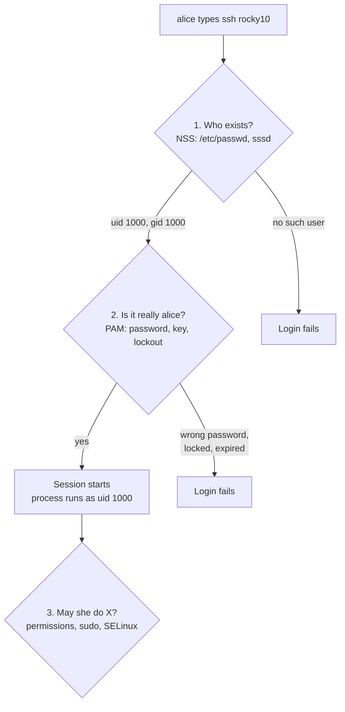
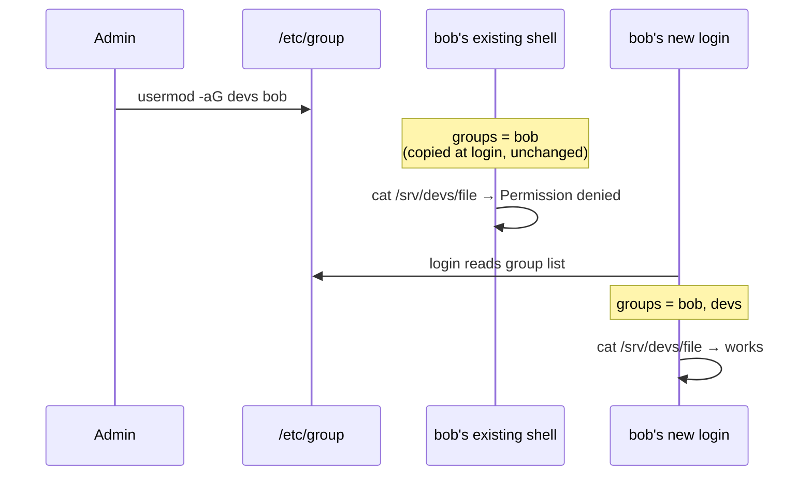
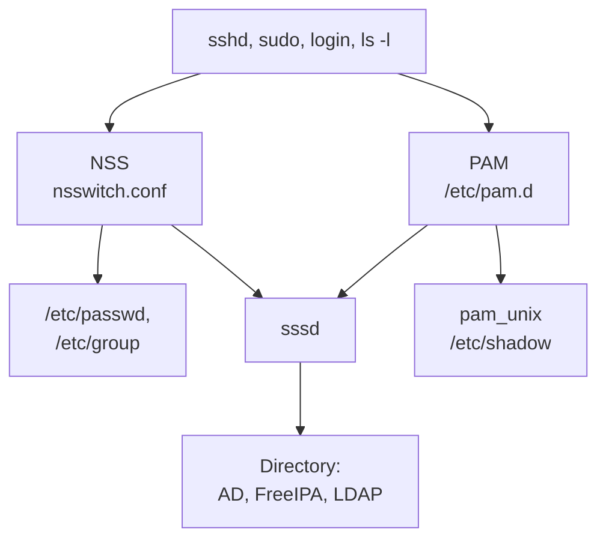

# 03 · Users, Groups and sudo

<ul class="module-meta">
  <li>⏱ ~3 hours</li>
  <li>5 labs</li>
  <li>Builds on: 02 · The Shell and the Filesystem</li>
</ul>

A new developer joins on Monday. By lunch they need an account, access to the shared project directory, and the ability to restart one service, but not to read everyone's mail. On Wednesday someone mistypes their password five times and is locked out. Every one of these moments is about **identity**: who exists on this machine, how they prove it, and what they are allowed to do. This module shows you the files, commands, and moving parts behind all of it, so you can set it up correctly and debug it when a login fails.

!!! abstract "What you'll learn"
    - Read `/etc/passwd`, `/etc/shadow`, and `/etc/group` field by field, and recognise a yescrypt password hash.
    - Explain why `getent` is the right way to look up a user, and what NSS does.
    - Create, modify, lock, and delete accounts with `useradd`, `usermod`, `passwd`, `chage`, and `userdel`.
    - Use primary and supplementary groups correctly, and explain why a group change needs a new login.
    - Grant precise admin rights with `sudo`, `visudo`, and `/etc/sudoers.d/`, and know when to use `su` instead.
    - Walk through what PAM does during a login, and configure password quality and lockout policy.
    - Know where `sssd` and `authselect` fit when identities come from a central directory.

## The big picture

Linux identity answers three separate questions. Keeping them apart is the single most useful habit for debugging login problems.

1. **Who exists?** Is there a user called `alice`, and what is her UID? Answered by the **Name Service Switch** (NSS), which reads `/etc/passwd` and friends, or a directory server.
2. **Is it really them?** Prove you are `alice`. Answered by **PAM** (Pluggable Authentication Modules), which checks a password, a key, or a token.
3. **May they do this?** May `alice` restart `httpd` or read this file? Answered by `sudo` rules, file permissions ([04 · Permissions and ACLs](04-permissions-and-acls.md)), and SELinux ([16 · SELinux](16-selinux.md)).



The kernel itself only knows numbers. A process carries a **UID** (user ID) and a set of **GIDs** (group IDs). Names like `alice` and `wheel` exist for humans and are translated to numbers by user-space libraries. When you see a file owned by a bare number in `ls -l`, it means no name maps to that number any more.

## Users are numbers

Every account has a **UID**. Rocky divides the number space by convention, set in `/etc/login.defs`.

| UID range | Who | Example |
|---|---|---|
| 0 | **root**, the superuser. The kernel gives UID 0 special powers. | `root` |
| 1 to 200 | **static system accounts**: fixed numbers reserved by Red Hat so they match on every machine | `sshd` (74), `apache` (48) |
| 201 to 999 | **dynamic system accounts**: picked by `useradd -r` or `systemd-sysusers` from the free range | `chrony`, `polkitd` |
| 1000 and up | **regular users**, humans | `alice` (1000), `bob` (1001) |
| 65534 | `nobody`, an account with no privileges at all | `nobody` |

```console
$ id
uid=1000(alice) gid=1000(alice) groups=1000(alice),10(wheel) context=unconfined_u:unconfined_r:unconfined_t:s0-s0:c0.c1023
$ grep -E '^(UID_MIN|UID_MAX|SYS_UID_MIN|SYS_UID_MAX|HOME_MODE)' /etc/login.defs
HOME_MODE	0700
UID_MIN                  1000
UID_MAX                 60000
SYS_UID_MIN               201
SYS_UID_MAX               999
```

No human logs in as a system account; they exist so each service runs under its own identity. The static list lives in `/usr/share/doc/setup/uidgid` if you ever need to know who owns UID 48.

`id` shows your UID, your primary group, every group you belong to, and your SELinux context. "Root" means UID 0, not the name. Any account with UID 0 is root, which is why security audits check that exactly one line in `/etc/passwd` has a 0 in field three.

### /etc/passwd: the account list

`/etc/passwd` is a plain text file, one account per line, seven fields separated by colons. Everyone can read it, because many programs need to translate UIDs to names.

```text
alice:x:1000:1000:Alice Admin:/home/alice:/bin/bash
  │   │   │    │       │           │          └─ 7. login shell
  │   │   │    │       │           └─ 6. home directory
  │   │   │    │       └─ 5. comment (GECOS): full name, etc.
  │   │   │    └─ 4. primary group ID
  │   │   └─ 3. user ID
  │   └─ 2. password placeholder: "x" means "see /etc/shadow"
  └─ 1. user name
```

System accounts usually have `/sbin/nologin` as their shell. `nologin` prints "This account is currently not available" and exits, so nobody gets an interactive shell as `apache` even if they somehow authenticate. Services still run as those users; systemd starts them directly without a login shell.

```console
$ grep -E '^(root|sshd|alice):' /etc/passwd
root:x:0:0:root:/root:/bin/bash
sshd:x:74:74:Privilege-separated SSH:/usr/share/empty.sshd:/usr/sbin/nologin
alice:x:1000:1000:Alice Admin:/home/alice:/bin/bash
```

### /etc/shadow: the secrets

Password hashes used to live in field two of `/etc/passwd`, readable by everyone, which made offline cracking trivial. They moved to `/etc/shadow`, which only root can read.

```console
$ ls -l /etc/passwd /etc/shadow
-rw-r--r--. 1 root root 1376 Oct 15 09:10 /etc/passwd
----------. 1 root root  812 Oct 15 09:10 /etc/shadow
$ sudo grep '^alice:' /etc/shadow
alice:$y$j9T$Hk3S0lG7pq1lWJkV1oCXa.$1uQ9mT0yQ6Rz3cP0xE8lD4bJ2sV7hN5kA9fW1gU3iY/:20376:0:99999:7:::
```

Mode `----------` looks alarming, but root bypasses ordinary permission checks, and the programs that need the file (`passwd`, the login stack) run with root's power. The nine fields are:

| # | Field | In the example |
|---|---|---|
| 1 | user name | `alice` |
| 2 | password hash | `$y$j9T$…` |
| 3 | last password change, in days since 1970-01-01 | `20376` |
| 4 | minimum days before the password may change again | `0` |
| 5 | maximum days before it must change | `99999` (effectively never) |
| 6 | days of warning before it expires | `7` |
| 7 | days after expiry before the account is disabled | empty |
| 8 | account expiry date, in days since 1970 | empty (never) |
| 9 | reserved | empty |

### Reading a password hash

A **hash** is a one-way scramble: easy to compute from the password, practically impossible to reverse. When you log in, the system hashes what you typed with the same settings and compares results. The stored field says which algorithm and settings to use.

```text
$y$j9T$Hk3S0lG7pq1lWJkV1oCXa.$1uQ9mT0yQ6Rz3cP0xE8lD4bJ2sV7hN5kA9fW1gU3iY/
 │  │   │                       └─ the hash itself
 │  │   └─ the salt (random, unique per password)
 │  └─ cost parameters
 └─ algorithm id: y = yescrypt
```

The **salt** is a random value mixed in before hashing, so two users with the same password get different hashes, and precomputed crack tables are useless.

| Prefix | Algorithm | Where you see it |
|---|---|---|
| `$y$` | **yescrypt** | default for new passwords on Rocky 10 |
| `$6$` | SHA-512 crypt | default on Rocky 8 and 9; still accepted on 10 |
| `$1$` | MD5 crypt | ancient, do not use |
| `!` or `!!` alone | no usable password | account cannot log in with a password |
| `!` before a hash | locked | `passwd -l` adds it, `passwd -u` removes it |

**yescrypt** is designed to need lots of memory as well as CPU time to compute. That makes large-scale cracking on GPUs far more expensive than with SHA-512, which only costs CPU time.

!!! version "Rocky 9 vs 10"
    Rocky 9 hashes new passwords with SHA-512 (`$6$`). Rocky 10 uses yescrypt (`$y$`). Existing hashes are never converted, because the system does not know your password until you type it. An account migrated from an older system keeps its `$6$` hash until its password is changed. Both kinds work for login.

### /etc/group and /etc/gshadow

Groups let you grant access to many people at once. `/etc/group` has four fields.

```console
$ grep -E '^(wheel|devs|alice):' /etc/group
wheel:x:10:alice
devs:x:1005:alice,bob
alice:x:1000:
```

The fields are group name, password placeholder (group passwords live in `/etc/gshadow` and are almost never used), GID, and a comma-separated list of **supplementary members**.

Notice `alice` is not listed as a member of the `alice` group. She does not need to be: that is her **primary group**, recorded as the GID in field four of her `/etc/passwd` line. Rocky uses **user private groups**: every new user gets a group of the same name, with only them in it, as their primary group.

## NSS and getent: the right way to look up a user

Here is a trap. On a machine joined to Active Directory or FreeIPA, thousands of users can log in who have **no line in `/etc/passwd`**. Their accounts come from a directory server. If your script checks `grep alice /etc/passwd`, it will wrongly decide she does not exist.

Programs do not read `/etc/passwd` directly. They call C library functions such as `getpwnam()`, and the library consults the **Name Service Switch** (NSS). NSS reads `/etc/nsswitch.conf` to decide where to look, and in what order, for each kind of data (users, groups, hosts).

```console
$ grep -E '^(passwd|shadow|group|hosts):' /etc/nsswitch.conf
passwd:     files systemd
shadow:     files systemd
group:      files systemd
hosts:      files dns myhostname
```

Each line is a search order. `files` means the classic files in `/etc`. `systemd` lets systemd supply accounts it creates on the fly (for example a service with `DynamicUser=yes`). On a machine joined to a directory you will see `sss` in the `passwd` and `group` lines too, meaning "ask the `sssd` daemon". This file is generated by `authselect` (covered later), so do not edit it by hand.

??? question "Under the hood: Rocky's nsswitch.conf is not Fedora's"
    If you compare with a Fedora machine you will see `hosts: files myhostname resolve [!UNAVAIL=return] dns`. RHEL 10 (and so Rocky 10) patches authselect's profiles to drop `resolve` (systemd-resolved is not used) and to move `myhostname` *after* `dns`. The reason: `myhostname` always answers for the machine's own name, so placed before `dns` it can answer before DNS returns the fully qualified name, and `hostname --fqdn` stops printing the FQDN. Without systemd-resolved in the chain, Red Hat restored the RHEL 8 and 9 order. Small ordering details like this are why you never hand-edit generated files; you would lose the fix at the next `authselect apply-changes`.

`getent` asks NSS exactly the way every program does. It is the command to use in scripts and when debugging.

```console
$ getent passwd alice
alice:x:1000:1000:Alice Admin:/home/alice:/bin/bash
$ getent group wheel
wheel:x:10:alice
$ getent passwd nosuchuser; echo "exit=$?"
exit=2
```

!!! tip "The debugging split"
    If `getent passwd alice` finds her but she cannot log in, NSS is fine and the problem is in authentication (PAM, a lock, an expired password, sshd config). If `getent` finds nothing, no amount of password resetting will help: the identity source is the problem.

<div class="quiz" data-answer="2" markdown>

A server is joined to Active Directory. `grep carol /etc/passwd` prints nothing, but `getent passwd carol` prints a full entry. What is going on?

- carol's account is broken and must be recreated
- carol is a directory user supplied through NSS (sssd), so she has no line in the local file
- `getent` is reading a stale cache of a deleted account
- carol is a system account, which lives in `/etc/shadow` instead

Right. NSS merges several sources. Directory users come from `sssd` and never appear in `/etc/passwd`. Always use `getent` to check whether a user exists.

</div>

## Managing accounts

All account tools are in the `shadow-utils` package and need root. They edit `/etc/passwd`, `/etc/shadow`, `/etc/group`, and `/etc/gshadow` together and safely, with file locking. Do not edit those files with a text editor; if you truly must, use `vipw` and `vigr`, which lock the files and check them.

### Creating a user

```console
$ sudo useradd -c "Bob Builder" bob
$ getent passwd bob
bob:x:1001:1001:Bob Builder:/home/bob:/bin/bash
$ sudo ls -la /home/bob
total 12
drwx------. 2 bob  bob   83 Oct 15 10:21 .
drwxr-xr-x. 5 root root  44 Oct 15 10:21 ..
-rw-r--r--. 1 bob  bob   18 Feb 18  2026 .bash_logout
-rw-r--r--. 1 bob  bob  144 Feb 18  2026 .bash_profile
-rw-r--r--. 1 bob  bob  522 Feb 18  2026 .bashrc
$ sudo passwd bob
Changing password for user bob.
New password:
Retype new password:
passwd: all authentication tokens updated successfully.
```

On Rocky, `useradd` creates the home directory, a private group with the same name, and copies starter dotfiles from `/etc/skel`. Defaults come from `/etc/login.defs` and `/etc/default/useradd`. The new account has no password, so it cannot log in with one until you set it.

Useful options:

| Option | Meaning |
|---|---|
| `-c "Full Name"` | comment (GECOS) field |
| `-G wheel,devs` | supplementary groups |
| `-s /bin/zsh` | login shell |
| `-u 1500` | pick a specific UID |
| `-e 2026-12-31` | account expires on this date |
| `-r` | create a system account (UID below 1000, no home by default) |
| `-M` | do not create a home directory |

A service account for an app you are installing typically looks like this:

```console
$ sudo useradd -r -s /sbin/nologin -d /var/lib/myapp -c "My App" myapp
```

### Changing, locking, and deleting

```console
$ sudo usermod -aG devs bob          # add bob to devs, keep his other groups
$ sudo usermod -s /sbin/nologin bob  # change his shell
$ sudo usermod -L bob                # lock: puts "!" in front of the hash
$ sudo usermod -U bob                # unlock
$ sudo userdel -r bob                # delete bob, his home, and his mail spool
```

!!! danger "usermod -G without -a"
    `usermod -G devs bob` *replaces* all of bob's supplementary groups with just `devs`. If bob was in `wheel`, he just lost sudo. Always write `-aG` (append) unless you mean to replace the list.

Locking with `-L` only blocks *password* logins. A user with an SSH key can still get in. To stop an account completely, also expire it: `sudo usermod -e 1 bob` (expiry set to 2 January 1970), or set the shell to `nologin`.

`userdel` without `-r` leaves the home directory behind, owned by a UID that no longer has a name. If you later create a new user who gets the same UID, they silently inherit those files. Decide on purpose.

### Password ageing with chage

`chage` reads and writes the ageing fields of `/etc/shadow`.

```console
$ sudo chage -l alice
Last password change                                    : Oct 15, 2025
Password expires                                        : never
Password inactive                                       : never
Account expires                                         : never
Minimum number of days between password change          : 0
Maximum number of days between password change          : 99999
Number of days of warning before password expires       : 7
$ sudo chage -M 90 -W 14 alice      # must change every 90 days, warn 14 days ahead
$ sudo chage -d 0 alice             # force a change at next login
$ sudo chage -E 2026-12-31 alice    # account stops working after this date
```

`chage -d 0` sets "last changed" to day zero, which forces a new password at the next login. It is the standard way to hand someone a temporary password.

## Primary and supplementary groups

Every process carries one **primary group** (its effective GID) and a list of **supplementary groups**. When a process creates a file, the file's group is the primary group. When the kernel checks group permissions on an existing file, it accepts a match against *any* of the process's groups.

```console
$ id bob
uid=1001(bob) gid=1001(bob) groups=1001(bob),1005(devs)
$ groups bob
bob : bob devs
```

The catch: group membership is copied into a process when you **log in**, and inherited by every child process from then on. Adding bob to a group changes `/etc/group`, but bob's running shells still carry the old list.

```console
$ sudo usermod -aG devs bob
$ id                       # run by bob in his existing session
uid=1001(bob) gid=1001(bob) groups=1001(bob)
$ id bob                   # asks NSS, which reads the updated file
uid=1001(bob) gid=1001(bob) groups=1001(bob),1005(devs)
```

`id` with no argument reports the *current process*. `id bob` looks the user up fresh. To pick up the new group, bob logs out and back in. For a quick test without logging out, `newgrp devs` starts a new shell with `devs` as its primary group (and the updated list), and `sg devs -c 'command'` runs one command that way.



<div class="quiz" data-answer="3" markdown>

You ran `sudo usermod -aG wheel alice` while she was logged in over SSH. She runs `sudo dnf update` in the same session and is told she is not in the sudoers file. What should she do?

- Wait a few minutes for the group cache to expire
- Run `source ~/.bashrc`
- Log out and log back in (or start a new SSH session)
- Run `usermod -aG wheel alice` again herself

Right. Supplementary groups are fixed into the process at login. Re-reading a dotfile does not change them. A fresh login builds a new group list that includes `wheel`.

</div>

## sudo: borrowing root, one command at a time

Logging in as root is risky. Every command has full power, mistakes are unbounded, and the logs only say "root did it". **sudo** lets an authorised user run a single command as root (or another user), after proving who they are with *their own* password. Every use is logged with the real user's name.

```console
$ sudo dnf check-update
[sudo] password for alice:
…
$ sudo -l
Matching Defaults entries for alice on rocky10:
    !visiblepw, always_set_home, match_group_by_gid, always_query_group_plugin, env_reset, env_keep="COLORS DISPLAY …", secure_path=/sbin\:/bin\:/usr/sbin\:/usr/bin

User alice may run the following commands on rocky10:
    (ALL) ALL
```

`sudo -l` shows what *you* are allowed to run. It is the authoritative answer, because it includes rules from every file and alias.

After you authenticate, sudo remembers it for 5 minutes per terminal, so you are not asked again for each command. `sudo -k` forgets it immediately.

??? question "Under the hood: why `sudo mytool` says command not found"
    Look at `secure_path` in the `sudo -l` output above: `/sbin:/bin:/usr/sbin:/usr/bin`. sudo throws away your `PATH` and uses that list instead, so a trojan `ls` in a directory early in *your* `PATH` can never run as root. The side effect: anything in `/usr/local/bin` or `~/.local/bin` is invisible to sudo.

    ```console
    $ type mytool
    mytool is /usr/local/bin/mytool
    $ sudo mytool
    sudo: mytool: command not found
    $ sudo /usr/local/bin/mytool
    ```

    Use the full path (and write sudoers rules with full paths, which is required anyway). Do not "fix" it by adding `/usr/local/bin` to `secure_path` unless only root can write there.

### The wheel group

Rocky ships this rule in `/etc/sudoers`:

```text title="/etc/sudoers (excerpt)"
## Allows people in group wheel to run all commands
%wheel  ALL=(ALL)       ALL
```

So making someone a full administrator is just `sudo usermod -aG wheel alice`. The installer does exactly this when you tick "Make this user administrator".

### Writing your own rules

A sudoers rule reads: **who** may run, on **which host**, **as whom**, **what**.

```text
alice    ALL = (root)      /usr/bin/systemctl restart httpd
 │        │       │          └─ command(s), full paths
 │        │       └─ run as this user (default root)
 │        └─ on which hosts (ALL is normal for a local file)
 └─ user, or %group
```

Never edit `/etc/sudoers` directly. Put your rules in a separate file under `/etc/sudoers.d/`, and always use **visudo**, which locks the file and refuses to save a syntax error. A broken sudoers file means *nobody* can use sudo, which on a machine with root login disabled can mean nobody can fix it.

```console
$ sudo visudo -f /etc/sudoers.d/webops
```

```text title="/etc/sudoers.d/webops"
# Web operators may manage httpd, nothing else
Cmnd_Alias HTTPD = /usr/bin/systemctl restart httpd, \
                   /usr/bin/systemctl reload httpd, \
                   /usr/bin/systemctl status httpd
%webops  ALL = (root) HTTPD
```

```console
$ sudo visudo -c
/etc/sudoers: parsed OK
/etc/sudoers.d/webops: parsed OK
```

Files in `/etc/sudoers.d/` are read in name order (the `@includedir /etc/sudoers.d` line at the end of `/etc/sudoers` pulls them in). Names containing a `.` or ending in `~` are ignored, so `webops.conf` would silently do nothing. Use plain names like `webops`. Rocky ships a `README.txt` in that directory, and the dot in its name is exactly why sudo never tries to parse it.

!!! warning "Some commands are a root shell in disguise"
    Allowing `sudo vi`, `sudo less`, `sudo find`, or `sudo systemctl` with no specific unit is the same as allowing everything: each can start a shell, and that shell runs as root. Grant specific commands with specific arguments. To let someone edit one file, allow `sudoedit /etc/httpd/conf/httpd.conf`, which runs the editor as the user and only writes the file back as root.

### Where sudo logs

```console
$ sudo journalctl _COMM=sudo --since today
Oct 15 10:15:02 rocky10 sudo[2210]:    alice : TTY=pts/0 ; PWD=/home/alice ; USER=root ; COMMAND=/usr/bin/dnf check-update
Oct 15 10:16:40 rocky10 sudo[2244]:      bob : user NOT in sudoers ; TTY=pts/1 ; PWD=/home/bob ; USER=root ; COMMAND=/usr/bin/cat /etc/shadow
```

The same lines go to `/var/log/secure`. You will dig into the journal in [08 · Logging and the Journal](08-logging-and-the-journal.md).

### su vs sudo

`su` (substitute user) starts a whole new shell as another user. It asks for the **target** user's password, not yours.

| | `sudo command` | `su -` |
|---|---|---|
| Password asked | yours | the target user's (root's) |
| Scope | one command | a whole shell |
| Who is allowed | controlled per user and command in sudoers | anyone who knows the password |
| Logged as | the real user, command by command | "root session opened" |
| Works if root has no password | yes | no |

Use `sudo` by default. If you really need a root shell, `sudo -i` gives you a root login shell using *your* password, and it is still logged.

The `-` in `su -` matters. `su -` starts a login shell with root's environment and home directory. Plain `su` keeps your environment, including your `PATH`, which leads to confusing "command not found" errors and can run the wrong program.

### Root login on Rocky

The Rocky 10 installer's Root Account screen has **Disable root account** selected by default. Root still exists (UID 0 always does), but it has no usable password, and all administration goes through the user you created with "Make this user administrator" (a wheel member). That is a good default. If you choose **Enable root account** you set a password, and an extra checkbox, "Allow root SSH login with password", appears.

For SSH, OpenSSH's default is `PermitRootLogin prohibit-password`: root may log in with an SSH key but never with a password. Ticking that installer checkbox writes `/etc/ssh/sshd_config.d/01-permitrootlogin.conf` containing `PermitRootLogin yes`. Always check the *effective* value, because drop-ins in `/etc/ssh/sshd_config.d/` are read before the rest of the main file.

```console
$ sudo sshd -T | grep -i permitrootlogin
permitrootlogin without-password
$ sudo ls /etc/ssh/sshd_config.d/
40-redhat-crypto-policies.conf  50-redhat.conf
```

Do not be thrown by `without-password`: it is the old spelling of `prohibit-password`, and `sshd -T` prints the first name in its internal table for that value. Both mean "keys yes, passwords no". Note the `sudo` on `ls`: the drop-in directory is mode `700` and `sshd_config` is mode `600`, so a normal user cannot even read the SSH policy.

To forbid root over SSH entirely, create a drop-in that sorts early, for example `/etc/ssh/sshd_config.d/01-no-root.conf` containing `PermitRootLogin no`, then `sudo systemctl reload sshd`. sshd uses the *first* value it reads for most keywords, which is why low numbers win (and why the installer's `01-` file beats anything you put in `sshd_config` itself).

<div class="quiz" data-answer="1" markdown>

You add `%dbadmins ALL=(postgres) /usr/bin/psql` to a file called `/etc/sudoers.d/db.conf`. Members of `dbadmins` report the rule does not work. Why?

- sudo ignores files in `sudoers.d` whose names contain a dot
- The rule must say `(root)` instead of `(postgres)`
- Group names in sudoers must start with `@`
- sudoers.d files only take effect after a reboot

Right. sudo skips files in `/etc/sudoers.d/` with a `.` in the name or ending in `~`, so editor backups and `.rpmnew` files cannot sneak in. Rename it to `db`.

</div>

??? question "Under the hood: how sudo becomes root"
    `sudo` is itself a setuid-root program (you will meet setuid in [04 · Permissions and ACLs](04-permissions-and-acls.md#the-special-bits-setuid-setgid-sticky)). The kernel starts it with an *effective* UID of 0 while the *real* UID is still yours, so sudo knows both who you are and that it has the power to switch.

    ```console
    $ ls -l /usr/bin/sudo
    ---s--x--x. 1 root root 262560 Mar 12  2026 /usr/bin/sudo
    $ sudo grep -E '^(Uid|Gid)' /proc/self/status
    Uid:	0	0	0	0
    Gid:	0	0	0	0
    $ grep -E '^(Uid|Gid)' /proc/self/status
    Uid:	1000	1000	1000	1000
    Gid:	1000	1000	1000	1000
    ```

    The four columns are the real, effective, saved, and filesystem IDs. sudo then:

    1. Reads `/etc/sudoers` and `/etc/sudoers.d/*` and finds a rule that matches you, the host, the target user, and the command.
    2. Authenticates you through PAM using `/etc/pam.d/sudo`, so password quality, faillock, and sssd all apply to sudo too.
    3. Records a timestamp in `/run/sudo/ts/<your-name>`, keyed to your terminal, which is why another terminal asks again.
    4. Cleans the environment (`env_reset`), sets a safe `PATH` (`secure_path`), switches all its IDs to the target user, and execs the command.

    Your original identity is not forgotten. `pam_loginuid` set your **login UID** at login and nothing can change it afterwards, so the audit system ([17 · Security Hardening](17-security-hardening.md)) attributes root's actions to you:

    ```console
    $ sudo cat /proc/self/loginuid
    1000
    ```

<div class="terminal-sim" data-title="Who is this user?" markdown>

<div class="task" data-expect="id" data-hint="The shortest command that prints your UID, GID and groups." markdown>

**Step 1.** Show your own UID, primary group, and supplementary groups.

```text
uid=1000(alex) gid=1000(alex) groups=1000(alex),10(wheel) context=unconfined_u:unconfined_r:unconfined_t:s0-s0:c0.c1023
```

</div>

<div class="task" data-expect="getent passwd bob" data-hint="Use getent with the passwd database and the name bob." markdown>

**Step 2.** Look up the account `bob` the same way every program does (through NSS).

```text
bob:x:1001:1001:Bob Builder:/home/bob:/bin/bash
```

</div>

<div class="task" data-expect="sudo usermod -aG devs bob||sudo usermod -a -G devs bob||sudo gpasswd -a bob devs" data-hint="usermod with the append and groups options, then the group, then the user. Do not forget sudo." markdown>

**Step 3.** Add bob to the supplementary group `devs` without removing his other groups.

```text
[sudo] password for alex:
```

</div>

<div class="task" data-expect="sudo chage -l bob" data-hint="chage has a list option. Reading another user's ageing needs sudo." markdown>

**Step 4.** Show bob's password ageing settings.

```text
Last password change                                    : Oct 15, 2026
Password expires                                        : never
Password inactive                                       : never
Account expires                                         : never
Minimum number of days between password change          : 0
Maximum number of days between password change          : 99999
Number of days of warning before password expires       : 7
```

</div>

<div class="task" data-expect="sudo visudo -c" data-hint="visudo has a check-only option." markdown>

**Step 5.** Check every sudoers file for syntax errors without opening an editor.

```text
/etc/sudoers: parsed OK
/etc/sudoers.d/webops: parsed OK
```

</div>

</div>

## PAM: what happens when you log in

Many programs need to check a password: `login`, `sshd`, `sudo`, `su`, the desktop login screen, `passwd`. Rather than each one implementing password checks, lockouts, and session setup, they all hand the job to **PAM**, the Pluggable Authentication Modules framework.

Each program has a config file in `/etc/pam.d/` with the same name as the service. That file lists **modules** (small shared libraries in `/usr/lib64/security/`) in four groups called **stacks**:

| Stack | Question it answers | Typical modules |
|---|---|---|
| `auth` | Are you who you say you are? | `pam_unix` (check the hash), `pam_faillock` (lockout), `pam_sss` |
| `account` | Is this account allowed in right now? | `pam_unix` (expired?), `pam_access`, `pam_nologin` |
| `password` | Rules for changing a password | `pam_pwquality` (strength), `pam_pwhistory`, `pam_unix` (write the hash) |
| `session` | Set up and tear down the session | `pam_limits`, `pam_systemd`, `pam_loginuid`, `pam_selinux` |

Most service files do not list modules themselves. They include shared files, `system-auth` (local logins) and `password-auth` (remote logins), which `authselect` generates.

```console
$ grep -v '^#' /etc/pam.d/sshd | head -6
auth       substack     password-auth
auth       include      postlogin
account    required     pam_sepermit.so
account    required     pam_nologin.so
account    include      password-auth
password   include      password-auth
```

Each line has a **control flag** that says what the result means. `required` means "this must pass, but keep running the other modules"; `requisite` means "must pass, stop immediately on failure"; `sufficient` means "if this passes, that is enough"; `optional` means the result rarely matters. The other modules keep running after a `required` failure on purpose, so an attacker cannot tell from the timing which check failed.

Here is what happens, step by step, when alice logs in over SSH with a password.

<div class="stepper" markdown>

<div class="step" data-title="Who is alice?" markdown>

sshd receives the user name `alice`. Before doing anything else it asks NSS whether she exists.

```console
$ getent passwd alice
alice:x:1000:1000:Alice Admin:/home/alice:/bin/bash
```

If NSS finds no such user, sshd still goes through the motions (so an attacker cannot probe for valid names), but the login can never succeed.

</div>

<div class="step" data-title="auth: prove it" markdown>

sshd starts PAM with the service name `sshd`, which loads `/etc/pam.d/sshd` and through it `password-auth`. The **auth** stack runs:

- `pam_faillock` (if enabled) checks: is alice already locked out from too many failures?
- `pam_unix` reads alice's hash from `/etc/shadow`, hashes the typed password with the same algorithm, salt, and cost, and compares.
- On failure, `pam_faillock` records the failure. On success, it clears the counter.

With SSH key login, sshd checks the key itself and skips the password part of this stack.

</div>

<div class="step" data-title="account: allowed now?" markdown>

A correct password is not enough. The **account** stack asks whether the account may log in *right now*:

- `pam_unix` checks the ageing fields in `/etc/shadow`. Is the account expired? Has the password expired? If it must be changed, PAM tells sshd, which forces a password change.
- `pam_nologin` refuses non-root logins if `/etc/nologin` exists (used during maintenance).
- `pam_access` (if configured) checks `/etc/security/access.conf` for who may log in from where.

"Correct password, still rejected" is very often a failure here, not in auth.

</div>

<div class="step" data-title="session: set up" markdown>

The **session** stack prepares the environment:

- `pam_selinux` works out alice's SELinux context.
- `pam_loginuid` records her login UID for the audit system, so later `sudo` actions can be traced back to her.
- `pam_limits` applies resource limits from `/etc/security/limits.conf`.
- `pam_systemd` registers the session with `systemd-logind`, which creates `/run/user/1000` and a cgroup for her processes.

</div>

<div class="step" data-title="Become alice" markdown>

sshd now switches the process to alice's identity: it sets her supplementary groups from NSS, then her GID, then her UID. Once it gives up root, it cannot get it back.

It changes into her home directory and runs her login shell, `/bin/bash`, which reads `/etc/profile` and `~/.bash_profile` (see [02 · The Shell and the Filesystem](02-shell-and-filesystem.md#environment-variables-and-dotfiles)).

```console
$ loginctl
SESSION  UID USER  SEAT LEADER CLASS TTY   IDLE SINCE
      4 1000 alice -    2511   user  pts/0 no   -
…
```

</div>

<div class="step" data-title="Logged" markdown>

Every step is logged to the journal and `/var/log/secure`:

```console
$ sudo tail -3 /var/log/secure
Oct 15 10:02:11 rocky10 sshd-session[2511]: Accepted password for alice from 192.168.122.1 port 51522 ssh2
Oct 15 10:02:11 rocky10 sshd-session[2511]: pam_unix(sshd:session): session opened for user alice(uid=1000) by (uid=0)
Oct 15 10:02:11 rocky10 systemd-logind[812]: New session 4 of user alice.
```

The `pam_unix(sshd:session)` tag tells you which module and stack wrote the line, which points you straight at the failing step when a login breaks.

</div>

</div>

!!! danger "Keep a root shell open while you change PAM"
    A mistake in a PAM file can lock *everyone* out, including you. Before editing anything related to PAM, sudo, or sshd, open a second session with `sudo -i` and keep it open until you have tested a fresh login.

### Password quality: pam_pwquality

When a user changes their password, the `password` stack runs `pam_pwquality`, which rejects weak ones. Its settings live in `/etc/security/pwquality.conf`, or better, a drop-in file in `/etc/security/pwquality.conf.d/`.

```ini title="/etc/security/pwquality.conf.d/50-local.conf"
# at least 12 characters
minlen = 12
# from at least 3 of: lower, upper, digit, symbol
minclass = 3
# reject dictionary words
dictcheck = 1
```

```console
$ passwd
Changing password for user alice.
Current password:
New password:
BAD PASSWORD: The password is shorter than 12 characters
```

When root sets a password with `passwd user`, the checks warn but do not block. They are aimed at users choosing their own.

### Lockout after failed attempts: pam_faillock

`pam_faillock` counts failed logins and locks the account temporarily after too many. Its settings are in `/etc/security/faillock.conf`.

```ini title="/etc/security/faillock.conf (key settings)"
# lock after 3 failures (the default)
deny = 3
# unlock automatically after 10 minutes (the default)
unlock_time = 600
# uncomment to lock root too
# even_deny_root
```

```console
$ sudo faillock --user alice
alice:
When                Type  Source                                           Valid
2026-10-15 10:30:12 RHOST 192.168.122.1                                        V
2026-10-15 10:30:19 RHOST 192.168.122.1                                        V
2026-10-15 10:30:25 RHOST 192.168.122.1                                        V
$ sudo faillock --user alice --reset
```

Faillock is switched on through authselect, which is next.

## authselect and sssd: the bigger picture

Hand-editing `/etc/pam.d/system-auth` and `/etc/nsswitch.conf` is fragile, so Rocky generates them with **authselect**. You pick a **profile** (a template) and turn on **features** (optional pieces), and authselect writes consistent files.

```console
$ authselect current
Profile ID: local
Enabled features:
…
$ authselect list-features local
…
with-faillock
with-mkhomedir
…
$ sudo authselect enable-feature with-faillock
```

Generated files carry a "Generated by authselect" warning at the top. If you edit them by hand, the next authselect run overwrites your change.

When a company has hundreds of servers, nobody wants to create alice on each one. Accounts live in a central **directory** such as Active Directory, FreeIPA (Red Hat Identity Management), or plain LDAP. On Rocky, the **sssd** (System Security Services Daemon) connects the machine to that directory. It plugs into both NSS (so `getent passwd alice` works) and PAM (so her directory password works), and it caches credentials so people can still log in if the directory is briefly unreachable.



You join a machine to a domain with `realm join` (from the `realmd` package), which configures sssd and selects the `sssd` authselect profile for you. Setting up a directory is beyond this module; the point is to recognise the pieces when you meet them ([26 · Centralized Identity](26-centralized-identity.md) goes all the way).

??? question "Under the hood: the sssd cache, and the 90-minute group change"
    sssd keeps a local cache of users and groups (in `/var/lib/sss/db/`) so lookups are fast and logins survive a directory outage. The price is staleness: by default an entry is trusted for 90 minutes (`entry_cache_timeout = 5400` seconds). Someone adds carol to an AD group, she logs in to your server ten minutes later, and `id carol` does not show the group yet.

    ```console
    $ sudo sss_cache -u carol     # forget what you know about carol
    $ sudo sss_cache -E           # forget everything (users, groups, netgroups…)
    ```

    The next lookup goes back to the directory. Remember the other half of the lesson from earlier: carol still needs a fresh login, because her running sessions carry the old group list no matter what the cache says.

!!! version "Rocky 9 vs 10"
    Rocky 9 uses the `sssd` authselect profile by default, so `sss` appears in `nsswitch.conf` even on standalone machines. Rocky 10 defaults to the simpler `local` profile, which handles only local accounts and does not need sssd running. `realm join` switches to `sssd` when you join a domain.

<div class="quiz" data-answer="4" markdown>

alice types the right password but SSH says "Permission denied". `/var/log/secure` shows `pam_unix(sshd:account): account alice has expired (account expired)`. Which PAM stack rejected her?

- auth, because her password was wrong
- session, because her home directory is missing
- password, because her password is too weak
- account, because the account's expiry date has passed

Right. The log tag `(sshd:account)` names the stack. Authentication succeeded; the account check failed. `sudo chage -l alice` will show the expiry date, and `sudo chage -E -1 alice` removes it.

</div>

## Labs

!!! lab "Lab 1: Anatomy of an account"

    **Goal:** Create a user and find every trace of it in the identity files.

    **You'll need:** a Rocky 10 VM, sudo.

    1. Create the user and set a password:

        ```bash
        sudo useradd -c "Lab User" labuser
        echo 'labuser:Correct-Horse-42' | sudo chpasswd
        ```

    2. Find the account everywhere it appears:

        ```bash
        getent passwd labuser
        getent group labuser
        sudo getent shadow labuser
        sudo ls -la /home/labuser
        ```

    3. Look at the hash prefix and the ageing fields:

        ```bash
        sudo getent shadow labuser | cut -d: -f2 | cut -c1-4
        sudo chage -l labuser
        ```

    4. Lock the account and see what changes:

        ```bash
        sudo usermod -L labuser
        sudo getent shadow labuser | cut -d: -f2 | cut -c1-5
        sudo usermod -U labuser
        ```

    **Check your work:** step 3 prints `$y$j` on Rocky 10. After locking, the hash starts with `!$y$`.

    ??? success "What just happened?"
        `useradd` wrote a line to `/etc/passwd`, `/etc/shadow`, `/etc/group`, and `/etc/gshadow`, and copied `/etc/skel` into a new home. `chpasswd` hashed the password with yescrypt. Locking just prefixes the hash with `!` so it can never match, and unlocking removes the `!`, restoring the original password.

    **Clean up:** `sudo userdel -r labuser`

!!! lab "Lab 2: The group-membership delay"

    **Goal:** Prove that group changes only apply to new logins.

    **You'll need:** a Rocky 10 VM, sudo.

    1. Create a group, a shared directory, and a user:

        ```bash
        sudo groupadd projx
        sudo mkdir /srv/projx
        sudo chgrp projx /srv/projx
        sudo chmod 2770 /srv/projx
        sudo useradd grpuser
        echo 'grpuser:Lab-Pass-123' | sudo chpasswd
        ```

    2. Start a session as the user and try the directory:

        ```bash
        sudo -iu grpuser
        id
        touch /srv/projx/hello      # Permission denied
        ```

    3. In a *second* terminal, add the user to the group:

        ```bash
        sudo usermod -aG projx grpuser
        ```

    4. Back in the first session, try again, then use `newgrp`:

        ```bash
        touch /srv/projx/hello      # still denied
        id grpuser                  # lists projx
        newgrp projx
        touch /srv/projx/hello && ls -l /srv/projx
        exit; exit
        ```

    **Check your work:** `touch` fails until `newgrp`, and `id` (no argument) and `id grpuser` disagree until then.

    **Clean up:** `sudo userdel -r grpuser; sudo rm -rf /srv/projx; sudo groupdel projx`

!!! lab "Lab 3: A least-privilege sudo rule"

    **Goal:** Let a user restart one service and nothing else.

    **You'll need:** a Rocky 10 VM, sudo. `chronyd` is used because it is installed by default.

    1. Create the user and the rule, validated by visudo:

        ```bash
        sudo useradd opsuser
        echo 'opsuser:Ops-Pass-123' | sudo chpasswd
        echo 'opsuser ALL=(root) /usr/bin/systemctl restart chronyd' | sudo tee /etc/sudoers.d/opsuser
        sudo chmod 0440 /etc/sudoers.d/opsuser
        sudo visudo -c
        ```

    2. Test it as the user:

        ```bash
        sudo -iu opsuser
        sudo -l
        sudo systemctl restart chronyd && echo "restart allowed"
        sudo systemctl stop chronyd
        exit
        ```

    3. Find both attempts in the log:

        ```bash
        sudo journalctl _COMM=sudo --since '-10min' | grep opsuser
        ```

    **Check your work:** the restart works after entering opsuser's password; the stop is refused with "Sorry, user opsuser is not allowed to execute '/usr/bin/systemctl stop chronyd' as root on rocky10." (your hostname at the end). Both appear in the journal.

    **Clean up:** `sudo rm /etc/sudoers.d/opsuser; sudo userdel -r opsuser`

!!! lab "Lab 4: Turn on account lockout and trip it"

    **Goal:** Enable `pam_faillock` with authselect and watch it lock an account.

    **You'll need:** a Rocky 10 VM, sudo, and a **second root shell kept open** (`sudo -i` in another terminal).

    1. Record the current state, then enable the feature:

        ```bash
        authselect current
        sudo authselect enable-feature with-faillock
        grep faillock /etc/pam.d/system-auth
        ```

    2. Create a victim account:

        ```bash
        sudo useradd lockme
        echo 'lockme:Right-Pass-123' | sudo chpasswd
        ```

    3. As your normal user (not root, since root skips the password), try `su - lockme` three times with a wrong password, then once with the right one:

        ```bash
        su - lockme      # wrong password, x3
        su - lockme      # correct password: still refused
        ```

    4. Inspect and reset:

        ```bash
        sudo faillock --user lockme
        sudo faillock --user lockme --reset
        su - lockme      # correct password now works
        exit
        ```

    **Check your work:** `faillock --user lockme` lists three failures marked `V` (valid), and the correct password is refused until you reset.

    ??? success "What just happened?"
        `su` uses the `system-auth` stack. With the feature on, `pam_faillock` runs before and after `pam_unix`. After 3 failures (`deny = 3`), the "before" check refuses the login without even looking at the password, for 10 minutes (`unlock_time = 600`) or until reset.

    **Clean up:** `sudo faillock --user lockme --reset; sudo userdel -r lockme; sudo authselect disable-feature with-faillock`

!!! lab "Lab 5: Who can log in as root?"

    **Goal:** Audit root access paths on your VM.

    **You'll need:** a Rocky 10 VM, sudo.

    1. Is there exactly one UID 0 account?

        ```bash
        awk -F: '$3 == 0 {print $1}' /etc/passwd
        ```

    2. Does root have a usable password?

        ```bash
        sudo getent shadow root | cut -d: -f2 | cut -c1-3
        ```

        `!` or `!!` or `*` means locked; `$y$` or `$6$` means a password is set.

    3. What does sshd actually do with root?

        ```bash
        sudo sshd -T | grep -i permitrootlogin
        sudo grep -ri permitrootlogin /etc/ssh/sshd_config /etc/ssh/sshd_config.d/
        ```

    4. Who can become root through sudo?

        ```bash
        getent group wheel
        sudo grep -rv '^#' /etc/sudoers.d/ 2>/dev/null
        ```

    **Check your work:** you can state, for your VM, whether root can log in on the console, over SSH with a password, over SSH with a key, and which users can use sudo. (Remember that `sshd -T` prints `without-password` for `prohibit-password`.)

    **Clean up:** nothing to undo; this lab only reads.

## Common pitfalls

!!! pitfall "Replacing groups instead of adding"
    **Symptom:** after "adding" a user to a group, they lose sudo or access to other shares. **Cause:** `usermod -G group user` without `-a` replaces the whole supplementary list. **Fix:** always use `usermod -aG`. Repair with `usermod -aG wheel,… user`.

!!! pitfall "Locked out by a sudoers typo"
    **Symptom:** every sudo command prints `>>> /etc/sudoers.d/x: syntax error`. **Cause:** a file was written without `visudo`. **Fix:** from an existing root shell, or with `pkexec visudo` on a desktop, or by booting to rescue mode, fix the file. Prevention: `visudo -f`, or `visudo -c` after any scripted change.

!!! pitfall "Password lock does not stop SSH keys"
    **Symptom:** a "locked" user still logs in. **Cause:** `usermod -L` and `passwd -l` only disable the password hash; key authentication does not use it. **Fix:** also expire the account (`usermod -e 1 user`) or set its shell to `/sbin/nologin`, and remove `~/.ssh/authorized_keys`.

| Symptom | Cause | Fix |
|---|---|---|
| New group membership "does not work" | Running sessions keep the old group list | Log in again, or `newgrp group` |
| Correct password, "Permission denied" | Account or password expired, faillock lock, `/etc/nologin` exists | `chage -l`, `faillock --user`, check `/var/log/secure` for the stack name |
| Rule in `/etc/sudoers.d/name.conf` ignored | Files with a `.` in the name are skipped | Rename without a dot |
| PAM edit reverted itself | File is generated by authselect | Use `authselect enable-feature` or a custom profile |
| `ls -l` shows numbers instead of owner names | UID no longer exists (user deleted), or the directory service is down | `getent passwd <uid>`; check `sssd` |
| Root SSH still allowed after editing `sshd_config` | An earlier drop-in in `sshd_config.d/` sets it first | `sshd -T` to see the effective value; fix the drop-in |

## Cheat sheet

| Command | What it does |
|---|---|
| `id [user]` | show UID, GID, and groups (no arg: current process) |
| `getent passwd user` | look up a user the way programs do (via NSS) |
| `getent group name` | look up a group |
| `useradd -c "Name" -G wheel user` | create a user, home dir, and private group |
| `useradd -r -s /sbin/nologin svc` | create a system (service) account |
| `passwd user` | set a password |
| `usermod -aG group user` | add to a supplementary group |
| `usermod -L` / `-U user` | lock / unlock the password |
| `usermod -e 1 user` | expire the account (blocks all logins) |
| `userdel -r user` | delete a user and their home |
| `groupadd`, `groupdel` | create, delete a group |
| `chage -l user` | show password ageing |
| `chage -d 0 user` | force password change at next login |
| `newgrp group` | start a shell with an updated group list |
| `sudo -l` | list what you may run with sudo |
| `sudo -i` | root login shell, using your own password |
| `visudo -f /etc/sudoers.d/name` | safely edit a sudo rule file |
| `visudo -c` | check all sudoers files for errors |
| `sudo journalctl _COMM=sudo` | sudo audit log |
| `sshd -T` | print sshd's effective configuration |
| `faillock --user u [--reset]` | show or clear failed-login lockouts |
| `authselect current` | show the active auth profile and features |
| `authselect enable-feature with-faillock` | turn on lockout |

## Flashcards

<div class="flashcards" markdown>

<div class="card" markdown>

What makes an account "root"?

UID 0. The name is irrelevant to the kernel; any account with UID 0 has root's powers.

</div>

<div class="card" markdown>

What does the prefix `$y$` mean in `/etc/shadow`?

The password is hashed with yescrypt, the Rocky 10 default. `$6$` is SHA-512, the Rocky 9 default.

</div>

<div class="card" markdown>

Why use `getent passwd alice` instead of `grep alice /etc/passwd`?

`getent` asks NSS, so it also finds users from sssd and directories that never appear in the local file.

</div>

<div class="card" markdown>

You added bob to a group but his session cannot use it. Why?

Supplementary groups are copied into a process at login. He needs a new login (or `newgrp`).

</div>

<div class="card" markdown>

What does `usermod -G devs bob` do that `usermod -aG devs bob` does not?

It *replaces* bob's supplementary groups with just `devs`, dropping wheel and the rest.

</div>

<div class="card" markdown>

Why is `/etc/sudoers.d/web.conf` ignored?

sudo skips files in `sudoers.d` whose names contain a `.` or end in `~`.

</div>

<div class="card" markdown>

Name PAM's four stacks.

auth (prove identity), account (allowed now?), password (changing it), session (set up and tear down).

</div>

<div class="card" markdown>

Which tool should you use instead of editing `/etc/pam.d/system-auth` by hand?

`authselect`, for example `authselect enable-feature with-faillock`.

</div>

</div>

## Recap

!!! recap "Key takeaways"
    - The kernel knows only numbers. Names come from NSS, which reads `/etc/passwd` and `/etc/group` and can also ask `sssd` for directory users. Use `getent`, not `grep`.
    - `/etc/shadow` holds salted password hashes and ageing data. Rocky 10 uses yescrypt (`$y$`); Rocky 9 used SHA-512 (`$6$`).
    - Every user has one primary group (user private group on Rocky) and any number of supplementary groups. Group changes take effect at the next login.
    - Use `useradd`, `usermod -aG`, `chage`, and `userdel`, never a text editor, to change accounts.
    - `sudo` runs single commands as root with *your* password and logs each one. Grant rules in `/etc/sudoers.d/` via `visudo`; wheel members get full access.
    - PAM runs four stacks (auth, account, password, session) for every login. The log tag like `pam_unix(sshd:account)` tells you which step failed.
    - Password quality (`pwquality`) and lockout (`faillock`) are PAM modules, turned on through `authselect`.

## Go deeper

- Man pages: [[man:passwd(5)]] [[man:shadow(5)]] [[man:group(5)]] [[man:nsswitch.conf(5)]] [[man:useradd(8)]] [[man:usermod(8)]] [[man:chage(1)]] [[man:sudoers(5)]] [[man:visudo(8)]] [[man:pam.d(5)]] [[man:pam_faillock(8)]] [[man:pwquality.conf(5)]] [[man:authselect(8)]]
- [RHEL 10: Configuring authentication and authorization](https://docs.redhat.com/en/documentation/red_hat_enterprise_linux/10/html/configuring_authentication_and_authorization_in_rhel/index): authselect, sssd, and PAM in the Red Hat family.
- [Rocky Linux admin guide: user management](https://docs.rockylinux.org/books/admin_guide/06-users/): Rocky's own walkthrough of the account commands.
- [Sudo project documentation](https://www.sudo.ws/docs/): the sudoers manual from the sudo maintainers.
- [The Linux-PAM System Administrators' Guide](https://github.com/linux-pam/linux-pam): the PAM project, with documentation of control flags and modules.

**Next:** [04 · Permissions and ACLs](04-permissions-and-acls.md)
