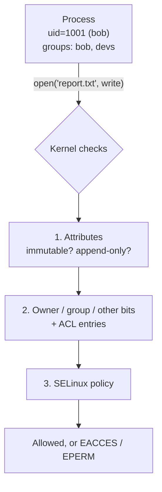
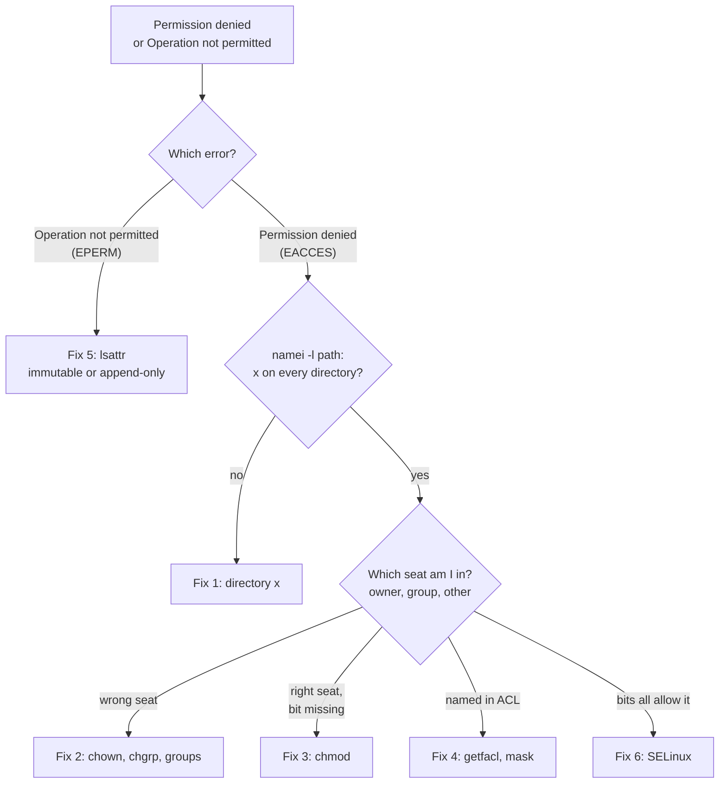
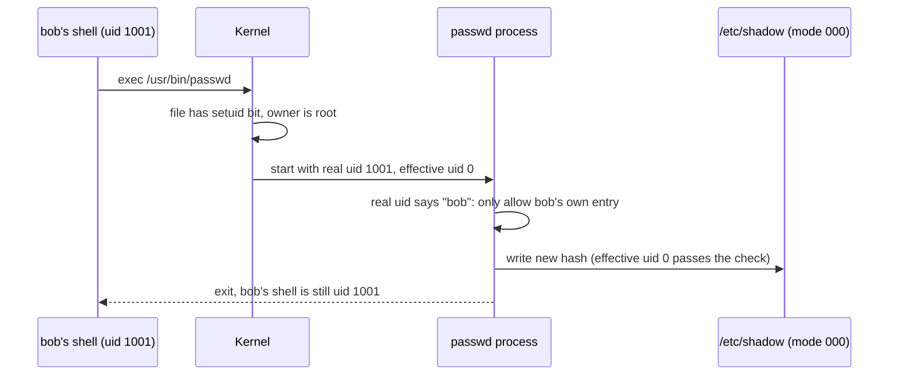
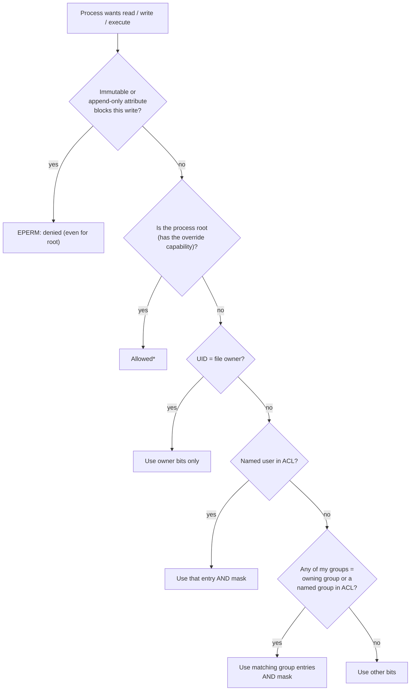

# 04 · Permissions and ACLs

<ul class="module-meta">
  <li>⏱ ~3 hours</li>
  <li>5 labs</li>
  <li>Builds on: 03 · Users, Groups and sudo</li>
</ul>

"Permission denied." It is the most common error on any Linux system, and the most misunderstood. A user can delete a file they cannot even read. Another cannot open a file with mode `777`. Root cannot change a config file it owns. Each of these has a clear, predictable reason once you know how the kernel makes its decision. This module teaches you that decision, step by step, and the tools to shape it.

!!! abstract "What you'll learn"
    - Read and set permissions in symbolic (`u+x`) and octal (`750`) form, and explain what `rwx` means on a **directory**.
    - Change ownership with `chown` and `chgrp`, and control default permissions with `umask`.
    - Use setuid, setgid, and the sticky bit, and explain how `passwd`, `/tmp`, and shared group directories rely on them.
    - Predict the kernel's access decision for any user and file: root, owner, group, other, then the ACL mask.
    - Grant access to individual users and groups with POSIX ACLs, set defaults that new files inherit, and avoid the mask trap.
    - Protect files with `chattr +i` and `+a`, and give a program one slice of root's power with file capabilities.

## The big picture

### Permissions in one sentence

Here is the whole idea:

> **Every file has three seats: owner, group and everyone else. The kernel puts you in exactly one seat, reads only that seat's `rwx`, and you need `x` on every directory along the way.**

Everything else in this module is an extra layer on that sentence. ACLs add more named seats (and a cap called the mask). Special bits change what happens when a program runs or a file is created. Attributes and capabilities sit outside the seats altogether.

!!! analogy "Think of it like a theatre"
    Each room has three kinds of seat: the owner's box, the members' section, and the public gallery. The usher looks at your ticket and puts you in the first seat that matches. If you own the box, you sit in the box, even if the public gallery has a better view. And to reach any room you have to be allowed through every corridor on the way. Where the analogy breaks: a Linux directory is more like a guest list than a corridor. Being allowed to edit the list (`w` on the directory) lets you cross anyone's name off it, which is how you can delete a file you cannot read.

### What the kernel looks at

Every file and directory on a Linux filesystem carries a small amount of security information in its **inode** (the record that describes a file): an owning user, an owning group, and a set of permission bits. Some files carry extra layers: an **ACL** (Access Control List) with entries for more users and groups, **attributes** such as immutable, and **capabilities** for programs.

When a process tries to open, write, or run a file, the kernel compares the process's identity (UID and groups, from [03 · Users, Groups and sudo](03-users-groups-and-sudo.md)) with that information. If the answer is no, you get `Permission denied` (the `EACCES` error) or `Operation not permitted` (`EPERM`).



The model in this module is called **Discretionary Access Control** (DAC): the file's owner decides who gets access. SELinux adds a second, independent layer on top called Mandatory Access Control, which can deny something even when DAC allows it. Both must say yes. SELinux gets its own module, [16 · SELinux](16-selinux.md). Here, we stay with DAC.

### The few things that solve most problems

When you hit `Permission denied` and the reason is not obvious, it is nearly always one of these.

| What's wrong | In seat terms | The check | The fix |
|---|---|---|---|
| **1. A directory on the path lacks `x`** | You never reach the room | `namei -l /full/path` | `chmod` or group membership on that directory |
| **2. You sit in the wrong seat** | Wrong owner or group on the file | `ls -l`, `id` | `chown` / `chgrp`, or add the user to the group |
| **3. Your seat lacks the bit** | Right seat, missing `r`, `w` or `x` | `ls -l`, `stat -c '%A %a'` | `chmod` |
| **4. The ACL mask is cutting a named entry** | An extra seat, capped by the mask | `getfacl` shows `#effective:` | `setfacl -m m::rw` or re-run `setfacl -m` |
| **5. An attribute forbids the change** | Nobody may change it, root included | Error says `Operation not permitted`; `lsattr` | `chattr -i` (on purpose) |
| **6. The bits are fine, SELinux says no** | A second, separate check | `ls -Z`, `ausearch -m avc` | See [16 · SELinux](16-selinux.md) |

And a short way to pick:



### Words you'll see

| Word | Plain meaning |
|---|---|
| **mode** | The permission bits of a file, like `rw-r--r--` or `644` |
| **owner** / **owning group** | The user and group a file belongs to, shown by `ls -l` |
| **other** | Everyone who is neither the owner nor in a matching group |
| **octal** | Writing each `rwx` triplet as one digit: r=4, w=2, x=1 |
| **umask** | Bits removed from every new file's mode |
| **setuid** / **setgid** / **sticky** | Special bits: run as owner, inherit group, only owners delete |
| **ACL** | Access Control List: extra named users and groups on one file |
| **mask** | The ceiling on every ACL entry except owner and other |
| **default ACL** | A template on a directory, copied to new files inside it |
| **attribute** | A flag like immutable (`i`) or append-only (`a`) that even root obeys |
| **capability** | One named slice of root's power, such as binding to port 80 |
| **EACCES** / **EPERM** | "Permission denied" (bits said no) / "Operation not permitted" (often an attribute) |

### Core skill: predict the answer before the kernel does

The thing you most need is to look at `ls -l` and say whether a given user gets in. Use this template every time:

1. **Path:** does the user have `x` on every directory leading to the file? If not, stop: denied.
2. **Seat:** is the user the owner? Then use the owner bits only. Otherwise, is any of their groups the owning group? Then use the group bits only. Otherwise, use other.
3. **Bits:** does that one seat have the bit they need? (For deleting or renaming, look at the *directory's* `w` and `x` instead, and check for a sticky `t`.)

Two exceptions you'll meet later: root skips steps 2 and 3 (but not attributes), and a user named in an ACL gets their own seat, capped by the mask.

The sections below explain each step in detail. Try the template first.

**Practice 1.** bob is not in group `apps`. The file `/srv/app/conf/app.ini` is mode `644`.

```console
$ ls -ld /srv/app
drwxr-x---. 3 root apps 18 Oct 15 11:10 /srv/app
```

??? success "Answer"
    Denied at step 1. bob sits in "other" on `/srv/app`, and other has `---`, so no `x`. He never reaches `conf/`, whatever the file's own mode says. `namei -l /srv/app/conf/app.ini` shows exactly where the path stops.

**Practice 2.** alice runs `cat mine.txt`.

```console
$ ls -l mine.txt
----rwxrwx. 1 alice alice 6 Oct 15 12:00 mine.txt
```

??? success "Answer"
    Denied. alice is the owner, so step 2 puts her in the owner seat, which is `---`. The kernel stops there and never looks at the generous group and other bits. Everyone else can read it. She can still `chmod` it back, because changing the mode is the owner's right, not a bit.

**Practice 3.** alice cannot read `boss.txt`. Can she delete it?

```console
$ ls -ld ~/drop ~/drop/boss.txt
drwxrwxr-x. 2 alice alice  22 Oct 15 11:02 /home/alice/drop
-r--------. 1 root  root   10 Oct 15 11:02 /home/alice/drop/boss.txt
```

??? success "Answer"
    Yes. Deleting changes the directory's list of names, so step 3 looks at the directory: alice owns `drop` and has `w` and `x`, and there is no sticky `t`. The file's own `r--------` does not matter for deletion.

## Reading permissions

`ls -l` shows the permission string first.

```console
$ ls -l /etc/hosts /usr/bin/ls /home
-rw-r--r--. 1 root root    158 Jun 23  2025 /etc/hosts
-rwxr-xr-x. 1 root root 140920 Feb 11  2026 /usr/bin/ls

/home:
total 0
drwx------. 4 alice alice 117 Oct 15 09:41 alice
drwx------. 3 bob   bob    78 Oct 15 10:21 bob
```

The string `-rw-r--r--.` breaks down like this:

```text
 -    rw-   r--   r--   .
 │     │     │     │    └─ "." = has an SELinux label; "+" = has an ACL
 │     │     │     └─ other: everyone else
 │     │     └─ group: members of the owning group
 │     └─ user (owner)
 └─ type: - file, d directory, l symlink, c/b device, s socket, p pipe
```

Each triplet is three bits: **r** (read), **w** (write), **x** (execute). A `-` means the bit is off. The two names after the link count are the owning user and owning group.

### Octal notation

Each triplet can be written as one digit by adding up its bits: **r = 4**, **w = 2**, **x = 1**.

| Bits | Sum | Digit |
|---|---|---|
| `rwx` | 4+2+1 | 7 |
| `rw-` | 4+2 | 6 |
| `r-x` | 4+1 | 5 |
| `r--` | 4 | 4 |
| `---` | 0 | 0 |

So `rw-r--r--` is `644`, and `rwxr-x---` is `750`. `stat` shows both forms:

```console
$ stat -c '%A %a %U:%G %n' /etc/hosts /etc/shadow /usr/bin/ls
-rw-r--r-- 644 root:root /etc/hosts
---------- 0 root:root /etc/shadow
-rwxr-xr-x 755 root:root /usr/bin/ls
```

Play with the calculator to build intuition. Click bits and watch the octal and symbolic forms change together.

<div class="widget-chmod"></div>

## What rwx means on files and on directories

On a **file**, the bits mean what you would guess:

- **r**: read the contents.
- **w**: change the contents.
- **x**: run it as a program. (Scripts also need **r**, because the interpreter has to read them.)

On a **directory**, they mean something different, and this is the part that trips almost everyone. A directory is just a list of names, each pointing to an inode. The bits control that *list*.

| Bit | On a directory it lets you… | Without it… |
|---|---|---|
| **r** | list the names inside (`ls`) | you cannot see what is there |
| **w** | create, delete, and rename entries (needs **x** too) | you cannot add or remove files, even ones you own |
| **x** | pass through it and reach the entries inside (`cd`, open a file by path) | nothing inside is reachable, even with the right file permissions |

Two consequences surprise people.

**Deleting a file is a change to the directory, not the file.** If you have `w` and `x` on a directory, you can delete any file in it, even one you cannot read, owned by someone else. The file's own permissions do not matter for deletion. (The sticky bit, later, is how `/tmp` fixes this.)

```console
$ ls -ld ~/drop ~/drop/boss.txt
drwxrwxr-x. 2 alice alice  22 Oct 15 11:02 /home/alice/drop
-r--------. 1 root  root   10 Oct 15 11:02 /home/alice/drop/boss.txt
$ cat ~/drop/boss.txt
cat: /home/alice/drop/boss.txt: Permission denied
$ rm ~/drop/boss.txt
rm: remove write-protected regular file '/home/alice/drop/boss.txt'? y
$ ls ~/drop
$
```

**Every directory on the path needs x.** To open `/srv/app/conf/app.ini`, you need `x` on `/`, `/srv`, `/srv/app`, and `/srv/app/conf`, then `r` on the file. One missing `x` anywhere and the file is unreachable, whatever its own mode says.

```console
$ ls -ld /srv/app
drwxr-x---. 3 root apps 18 Oct 15 11:10 /srv/app
$ cat /srv/app/conf/app.ini
cat: /srv/app/conf/app.ini: Permission denied
$ ls -l /srv/app/conf/app.ini
ls: cannot access '/srv/app/conf/app.ini': Permission denied
```

The file itself may be `644`, but `bob` is not in group `apps`, so he has no `x` on `/srv/app` and cannot get past it. `namei -l` shows the permissions of every component in a path, which makes this kind of problem obvious:

```console
$ namei -l /srv/app/conf/app.ini
f: /srv/app/conf/app.ini
dr-xr-xr-x root root /
drwxr-xr-x root root srv
drwxr-x--- root apps app
                     conf - Permission denied
```

A directory with `r` but no `x` is a strange half-state: you can list the names but cannot look at any of the files.

```console
$ ls -ld /tmp/locked
drw-r--r--. 2 alice alice 19 Oct 15 11:20 /tmp/locked
$ sudo -u bob ls -l /tmp/locked
ls: cannot access '/tmp/locked/a.txt': Permission denied
total 0
-????????? ? ? ? ?            ? a.txt
```

<div class="quiz" data-answer="3" markdown>

`/srv/share` is `drwxrwxrwx` (777). Inside it, `plan.txt` is owned by alice with mode `600`. What can bob do with `plan.txt`?

- Nothing: mode 600 protects it completely
- Read it, because the directory is 777
- Delete or rename it, but not read it
- Read and edit it, because the directory is 777

Right. Reading needs `r` on the file, which bob lacks. Deleting and renaming change the *directory*, and bob has `w` and `x` there. This is exactly why shared writable directories need the sticky bit.

</div>

## Changing permissions: chmod

`chmod` changes the mode. You can give it a full octal value or a symbolic change.

**Octal** sets all bits at once:

```console
$ chmod 640 report.txt        # rw-r-----
$ chmod 755 deploy.sh         # rwxr-xr-x
$ chmod 700 ~/private         # rwx------
```

**Symbolic** changes only the bits you name. The form is *who*, *operator*, *bits*:

- who: `u` (user/owner), `g` (group), `o` (other), `a` (all)
- operator: `+` add, `-` remove, `=` set exactly
- bits: `r`, `w`, `x`, plus `X`, `s`, `t` covered below

```console
$ chmod u+x deploy.sh         # owner may run it
$ chmod go-w shared.txt       # remove write from group and other
$ chmod o= secrets.txt        # other gets nothing
$ chmod u=rw,g=r,o= notes.txt # same as 640
```

Use octal when you know the exact final mode you want. Use symbolic when you want to change one thing and leave the rest alone.

`chmod -R` works recursively, but `chmod -R 755` makes every *file* executable too. The capital **`X`** solves this: it adds `x` only to directories (and to files that already have an `x` somewhere).

```console
$ chmod -R u=rwX,g=rX,o= /srv/project
```

That one command gives directories `750` and regular files `640`.

## Ownership: chown and chgrp

Every file has one owning user and one owning group. Only root can give a file away to another user (otherwise you could dodge disk quotas, or plant files that look like someone else's). An owner can change the group, but only to a group they belong to.

```console
$ sudo chown bob report.txt            # new owner
$ sudo chown bob:devs report.txt       # owner and group
$ chgrp devs report.txt                # group only (you must be in devs)
$ sudo chown -R apache:apache /var/www/html/app
```

Note `chown bob: file` (with a trailing colon) sets the group to bob's primary group.

## Default permissions: umask

When a program creates a file, it asks for a mode, usually `666` for files and `777` for directories. The **umask** is a mask of bits to *remove* from that request. It is a per-process setting, inherited by child processes.

```console
$ umask
0022
$ umask -S
u=rwx,g=rx,o=rx
$ touch newfile; mkdir newdir
$ ls -ld newfile newdir
-rw-r--r--. 1 alice alice 0 Oct 15 11:30 newfile
drwxr-xr-x. 2 alice alice 6 Oct 15 11:30 newdir
```

Requested `666` with umask `022` removed gives `644`. Requested `777` minus `022` gives `755`. It is a removal, not subtraction: a umask of `077` makes new files `600` and new directories `700`.

On Rocky, regular users and root alike get `0022` by default. Some distributions give a user with a **user private group** (module 03) `0002` instead, so her group can write her new files (safe, because that group contains only her). Rocky does not; if you want group-writable files, set the umask yourself.

| umask | New file | New directory | Typical use |
|---|---|---|---|
| `022` | `644` | `755` | everyone may read: Rocky's default |
| `002` | `664` | `775` | group may edit |
| `027` | `640` | `750` | group may read, other nothing |
| `077` | `600` | `700` | private |

Set it for your session with `umask 027`, permanently in `~/.bashrc`. Services do not log in, so they get their own with `UMask=` in a systemd unit (default `0022`, see [07 · systemd and Services](07-systemd-and-services.md)).

??? question "Under the hood: where your umask comes from"
    Nothing reads `/etc/login.defs` on its own. At every login (console, SSH, `su -`), the `pam_umask` module, called from `/etc/pam.d/postlogin`, reads `UMASK` from it and sets the session's umask:

    ```console
    $ grep -E '^(UMASK|USERGROUPS_ENAB)' /etc/login.defs
    UMASK		022
    USERGROUPS_ENAB yes
    $ grep umask /etc/pam.d/postlogin
    session     optional                   pam_umask.so silent
    ```

    `pam_umask` has a `usergroups` option that copies the owner bits into the group bits for a user with a user private group (`022` becomes `002`), but Rocky does not turn it on: the line above passes only `silent`. `USERGROUPS_ENAB yes` is read by `useradd` and `userdel` (create and remove the private group), not by `pam_umask`.

    So a security baseline that sets `UMASK 027` in `login.defs` takes effect at the next login. Log in again and run `umask` to prove it; `grep Umask /proc/$$/status` shows the live value for any process. Services are not affected: they take `UMask=` from their unit.

!!! note "umask never adds bits"
    `umask` only removes. That is why new files are never executable by default: programs ask for `666`, and no umask can add `x`. You make a script executable with `chmod +x` on purpose.

## The special bits: setuid, setgid, sticky

There is a fourth octal digit in front of the other three. Its three bits change *behaviour* rather than access.

| Bit | Octal | Shows as | On a file | On a directory |
|---|---|---|---|---|
| **setuid** | 4000 | `s` in owner x | runs as the file's **owner** | (ignored on Linux) |
| **setgid** | 2000 | `s` in group x | runs with the file's **group** | new files inherit the directory's group |
| **sticky** | 1000 | `t` in other x | (no effect today) | only a file's owner may delete or rename it |

A capital `S` or `T` means the special bit is set but the underlying `x` is not, which is almost always a mistake.

### setuid: how passwd edits /etc/shadow

You learned in module 03 that `/etc/shadow` is mode `000`. Yet any user can run `passwd` and change their password, which writes to that file. How?

```console
$ ls -l /usr/bin/passwd /etc/shadow
-rwsr-xr-x. 1 root root 32648 Jun 24  2025 /usr/bin/passwd
----------. 1 root root   812 Oct 15 09:10 /etc/shadow
```

The `s` in the owner's execute position is **setuid**. When any user runs this program, the kernel gives the new process the *file owner's* effective UID, which is root. `passwd` is carefully written to only let you change *your own* password (unless you are already root), and then it writes the file with root's power.



The kernel keeps two identities for the process: the **real UID** (who started it, bob) and the **effective UID** (whose permissions are checked, root). `passwd` uses the real UID to decide *whose* password you may change, and the effective UID to actually write the file.

setuid root programs are powerful and dangerous: any bug in one can give an attacker root. Rocky ships very few, and you should know which:

```console
$ find /usr -xdev -perm -4000 -type f 2>/dev/null
/usr/bin/chage
/usr/bin/gpasswd
/usr/bin/newgrp
/usr/bin/su
/usr/bin/mount
/usr/bin/umount
/usr/bin/crontab
/usr/bin/passwd
/usr/bin/sudo
…
```

A new setuid file that you did not install is a red flag worth investigating. Filesystems mounted with the `nosuid` option ignore the bit entirely, which is why removable media and `/tmp` are often mounted that way.

??? question "Under the hood: chown silently strips setuid (and capabilities)"
    The kernel clears the setuid bit, the setgid bit (on executables), and any file capability whenever a file's owner or group changes. Writing to the file as a non-root user clears setuid too. Otherwise you could write your own code into a setuid binary, or hand a setuid file to someone else. The `chown` rule applies to root as well:

    ```console
    $ sudo install -m 4755 /usr/bin/true /usr/local/bin/demo
    $ ls -l /usr/local/bin/demo
    -rwsr-xr-x. 1 root root 32808 Oct 15 11:38 /usr/local/bin/demo
    $ sudo chown root:wheel /usr/local/bin/demo
    $ ls -l /usr/local/bin/demo
    -rwxr-xr-x. 1 root wheel 32808 Oct 15 11:38 /usr/local/bin/demo
    $ sudo rm /usr/local/bin/demo
    ```

    In production this shows up as "the config-management run broke `arping`, `newuidmap`, or our vendor tool": a recursive `chown -R` over `/usr` or `/opt` removed the bits. `rpm -V` reports it (`M` for mode, `P` for capabilities), and `sudo dnf reinstall <package>` restores them.

### setgid on a directory: shared team folders

When a user creates a file, it normally gets the user's primary group. In a shared project directory that is wrong: alice's files would belong to group `alice`, and bob could not edit them.

Setting **setgid** on the directory makes every new file and subdirectory inside inherit the *directory's* group. New subdirectories get the setgid bit too, so it propagates.

```console
$ sudo mkdir /srv/devs
$ sudo chgrp devs /srv/devs
$ sudo chmod 2770 /srv/devs
$ ls -ld /srv/devs
drwxrws---. 2 root devs 6 Oct 15 11:40 /srv/devs
$ touch /srv/devs/alice-notes.txt
$ ls -l /srv/devs
-rw-r--r--. 1 alice devs 0 Oct 15 11:41 alice-notes.txt
```

The file belongs to group `devs`, not `alice`. Combined with a group-friendly umask (`002`) or a default ACL (later), the whole team can edit each other's files.

### The sticky bit: why /tmp is safe

`/tmp` must be writable by everyone, but you saw above that write on a directory lets you delete *any* file in it. The **sticky bit** fixes that: in a sticky directory, only a file's owner, the directory's owner, or root may delete or rename it.

```console
$ ls -ld /tmp
drwxrwxrwt. 14 root root 4096 Oct 15 11:45 /tmp
$ sudo -u bob rm -f /tmp/alice-temp.txt
rm: cannot remove '/tmp/alice-temp.txt': Operation not permitted
```

The `t` at the end is the sticky bit. Use it on any directory where several users drop files: `chmod 1777 /srv/dropbox` or, combined with setgid, `chmod 3770`.

??? question "Under the hood: when even root gets Permission denied in /tmp"
    Shared sticky directories are where attackers plant traps: create `/tmp/report.csv` (or a symlink with that name pointing at `/etc/shadow`) and wait for a root script to write to it. The kernel has extra rules for world-writable sticky directories, switched on by systemd's `/usr/lib/sysctl.d/50-default.conf`:

    ```console
    $ sysctl fs.protected_regular fs.protected_symlinks
    fs.protected_regular = 1
    fs.protected_symlinks = 1
    $ ls -l /tmp/report.csv
    -rw-rw-rw-. 1 alice alice 0 Oct 15 12:30 /tmp/report.csv
    $ sudo sh -c 'echo data > /tmp/report.csv'
    sh: line 1: /tmp/report.csv: Permission denied
    ```

    `protected_regular` refuses to open-with-create an existing file in a sticky world-writable directory when the file belongs to someone else, **even for root**, and despite mode `666`. `protected_symlinks` refuses to follow a symlink there unless it belongs to you or to the directory's owner. If a cron job "suddenly" fails writing to `/tmp`, this is why. The fix is to use `mktemp` (a fresh, unpredictable name) or a private directory, not to turn the protection off.

<div class="quiz" data-answer="2" markdown>

You want a directory `/srv/reports` where everyone in group `finance` can create files, every new file belongs to `finance`, and nobody can delete a colleague's file. Which mode, with group `finance`?

- `0770`
- `3770`
- `4770`
- `1777`

Right. `3` is setgid (2) plus sticky (1). setgid makes new files inherit `finance`; sticky stops users deleting each other's files; `770` keeps outsiders out.

</div>

## How the kernel decides

Now you can put it all together. When a process asks for access, the kernel walks a fixed sequence and **stops at the first category that matches**. It does not add permissions from several categories together.



\*Root bypasses read and write checks, and execute checks too, provided at least one `x` bit is set somewhere on the file. Even root cannot run a file with no execute bit at all.

The key rule is **first match wins**. If you are the owner, *only* the owner bits count, even if group or other would give you more. That gives a surprising result:

```console
$ chmod 077 mine.txt
$ ls -l mine.txt
----rwxrwx. 1 alice alice 6 Oct 15 12:00 mine.txt
$ cat mine.txt
cat: mine.txt: Permission denied
```

alice is the owner, the owner bits are `---`, and the check stops there. Everyone else can read it. (alice can still `chmod` it back, because changing the mode is a right of the owner, not a permission bit.)

After the DAC check passes, SELinux gets its own vote. If you see `Permission denied` and the bits look right, check SELinux with `ls -Z` and `ausearch -m avc` ([16 · SELinux](16-selinux.md)).

<div class="quiz" data-answer="1" markdown>

`data.csv` is `-rw----r--`, owned by `alice:devs`. bob is in `devs`. Can bob read it?

- No: he matches the group category, which has no permissions, and the check stops there
- Yes: "other" has read, and bob is someone other than alice
- Yes: the kernel uses the most generous category that applies
- No: only root can read files with an odd mode like 604

Right. bob is not the owner, but he *is* in the owning group, so the group bits `---` apply and the search stops. Group membership can take access away.

</div>

??? question "Prove it: watch the kernel say no"
    Every "Permission denied" message is a program printing an error code the kernel returned. `strace` shows the exact system call and code:

    ```console
    $ strace -e trace=openat cat /etc/shadow 2>&1 | tail -3
    openat(AT_FDCWD, "/etc/shadow", O_RDONLY) = -1 EACCES (Permission denied)
    cat: /etc/shadow: Permission denied
    +++ exited with 1 +++
    $ strace -e trace=unlinkat rm -f /tmp/alice-temp.txt 2>&1 | head -1
    unlinkat(AT_FDCWD, "/tmp/alice-temp.txt", 0) = -1 EPERM (Operation not permitted)
    ```

    `EACCES` comes from the permission-bit and ACL check. `EPERM` means a rule *other* than the rwx bits said no: the sticky bit, an immutable attribute, or an operation only the owner or a capability may perform. Telling the two apart narrows your search immediately.

    The umask, too, is visible in the kernel's view of a process, without changing it:

    ```console
    $ grep Umask /proc/$$/status
    Umask:	0022
    ```

<div class="terminal-sim" data-title="Permissions drill" data-prompt="[alex@rocky-lab project]$ " markdown>

<div class="task" data-expect="stat -c '%a %A %U:%G %n' report.txt||stat report.txt||ls -l report.txt" data-hint="ls -l report.txt or stat report.txt both show the mode." markdown>

**Step 1.** Show the current permissions of `report.txt`.

```text
-rw-r--r--. 1 alex devs 2048 Oct 15 12:10 report.txt
```

</div>

<div class="task" data-expect="chmod 640 report.txt||chmod o-r report.txt||chmod o= report.txt||chmod u=rw,g=r,o= report.txt" data-hint="Remove read for other: octal 640, or symbolic o-r." markdown>

**Step 2.** Make `report.txt` readable by its group but not by everyone else (owner keeps read and write).

```text
```

</div>

<div class="task" data-expect="setfacl -m u:bob:rw report.txt||setfacl -m user:bob:rw report.txt||setfacl -m u:bob:rw- report.txt" data-hint="setfacl -m with an entry of the form u:NAME:PERMS." markdown>

**Step 3.** Give the user `bob` read and write access with an ACL entry.

```text
```

</div>

<div class="task" data-expect="getfacl report.txt" data-hint="The ACL counterpart of ls -l is get-f-acl." markdown>

**Step 4.** Display the full ACL.

```text
# file: report.txt
# owner: alex
# group: devs
user::rw-
user:bob:rw-
group::r--
mask::rw-
other::---
```

</div>

<div class="task" data-expect="sudo chmod 2770 /srv/team||sudo chmod g+s /srv/team||sudo chmod 2775 /srv/team" data-hint="setgid is the 2 in the leading octal digit, or g+s." markdown>

**Step 5.** Make new files in `/srv/team` inherit the directory's group (you need sudo).

```text
```

</div>

</div>

## POSIX ACLs: beyond one owner and one group

Owner, group, other covers most cases, but not all. "alice owns it, devs can read it, and bob from QA may also edit it" needs a fourth party. Creating a group just for bob does not scale. **POSIX ACLs** (Access Control Lists) let you add entries for any number of specific users and groups.

ACLs are supported out of the box on XFS and ext4, the filesystems Rocky uses. The tools are `getfacl` and `setfacl`, from the `acl` package (installed by default).

```console
$ ls -l report.txt
-rw-r-----. 1 alice devs 2048 Oct 15 12:10 report.txt
$ setfacl -m u:bob:rw report.txt
$ ls -l report.txt
-rw-rw----+ 1 alice devs 2048 Oct 15 12:10 report.txt
$ getfacl report.txt
# file: report.txt
# owner: alice
# group: devs
user::rw-
user:bob:rw-
group::r--
mask::rw-
other::---
```

The `+` at the end of the mode string tells you an ACL is present. Read the `getfacl` output as:

| Entry | Meaning |
|---|---|
| `user::rw-` | the owner (same as the owner bits) |
| `user:bob:rw-` | a **named user** entry for bob |
| `group::r--` | the owning group |
| `group:qa:r--` | (would be) a **named group** entry |
| `mask::rw-` | the **mask**: the maximum any named entry or the group may get |
| `other::---` | everyone else (same as the other bits) |

Common commands:

```console
$ setfacl -m g:qa:r report.txt       # add or modify a named group entry
$ setfacl -x u:bob report.txt        # remove bob's entry
$ setfacl -b report.txt              # remove the whole ACL
$ setfacl -R -m g:devs:rwX /srv/proj # recursive, X = x on directories only
$ getfacl -R /srv/proj > acl-backup.txt
$ setfacl --restore=acl-backup.txt   # put them back
```

### The mask, and the foot-gun

The **mask** caps the permissions of every named user, every named group, and the owning group. It does *not* affect the owner or other. `getfacl` flags any entry that the mask is cutting down with an `#effective:` comment.

Here is the trap. When a file has an ACL, the *group* bits that `ls -l` shows are actually the **mask**, not the owning group's permissions. So a harmless-looking `chmod g-w` (or a `chmod 640` in a deploy script) lowers the mask and silently takes write away from every named user.

```console
$ chmod 640 report.txt
$ getfacl report.txt
# file: report.txt
# owner: alice
# group: devs
user::rw-
user:bob:rw-			#effective:r--
group::r--
mask::r--
other::---
```

bob's entry still says `rw-`, but the mask is `r--`, so he can only read. Running `setfacl -m u:bob:rw` again, or `setfacl -m m::rw`, recalculates or sets the mask and restores his access.

!!! tip "Rule of thumb"
    On files with ACLs, change permissions with `setfacl`, not `chmod`. If a named user "should" have access but does not, look for `#effective:` in `getfacl`.

!!! example "Story: the deploy script that took bob's write access"
    **Symptom:** bob could edit `report.txt` yesterday. Today, after a deploy, he gets `Permission denied` when saving.

    **Evidence:** `ls -l report.txt` still shows a `+`, so the ACL is there. `getfacl report.txt` shows `user:bob:rw-  #effective:r--` and `mask::r--`.

    **Reasoning:** bob has a named seat, and his seat still says `rw-`. But the mask caps every named seat, and the deploy script ran `chmod 640`, which on a file with an ACL sets the mask.

    **Fix:** `setfacl -m m::rw report.txt` (or `setfacl -m u:bob:rw report.txt`, which recalculates the mask). Then change the script to use `setfacl`.

    **Check:** `getfacl report.txt` no longer shows `#effective:` next to bob's entry.

### Default ACLs: inheritance for new files

An ACL on a directory only controls the directory itself. To make new files *inside* it get ACL entries automatically, set a **default ACL** (`-d`). Default ACLs exist only on directories; they are a template, copied onto each new file and subdirectory.

```console
$ sudo setfacl -m g:devs:rwx /srv/proj
$ sudo setfacl -d -m g:devs:rwx /srv/proj
$ getfacl /srv/proj
# file: srv/proj
# owner: root
# group: root
user::rwx
group::r-x
group:devs:rwx
mask::rwx
other::r-x
default:user::rwx
default:group::r-x
default:group:devs:rwx
default:mask::rwx
default:other::r-x
$ touch /srv/proj/new.txt
$ getfacl --omit-header /srv/proj/new.txt
user::rw-
group::r-x			#effective:r--
group:devs:rwx			#effective:rw-
mask::rw-
other::r--
```

Two things to notice. The new file got the `devs:rwx` entry automatically. And its mask is `rw-`, because `touch` asked for mode `666` (no `x`), and that request caps the mask. When a directory has a default ACL, the umask is not applied; the default ACL takes its place.

??? question "Under the hood: where ACLs live, and how backups lose them"
    The mode bits live in the inode. ACLs, SELinux labels, and file capabilities do not: they are **extended attributes** (xattrs), small name/value pairs stored alongside the inode. `getfattr` (package `attr`) shows them raw:

    ```console
    $ getfattr -d -m - /srv/proj/new.txt
    # file: srv/proj/new.txt
    security.selinux="unconfined_u:object_r:var_t:s0"
    system.posix_acl_access=0sAgAAAAEABgD/////…
    ```

    Any tool that copies only data and mode drops them. That is how a restore "works" but the team suddenly cannot write to the share:

    | Tool | Keeps ACLs and xattrs only with |
    |---|---|
    | `cp` | `cp -a` (or `--preserve=all`) |
    | `rsync` | `rsync -aAX` |
    | `tar` | `tar --acls --xattrs` when creating *and* extracting |
    | `mv` within one filesystem | always (it is a rename) |

    Keep a text copy as a safety net: `getfacl -R /srv/proj > proj.acl` restores with `setfacl --restore=proj.acl`.

<div class="quiz" data-answer="4" markdown>

`getfacl plan.txt` shows `user:carol:rwx` and `mask::r-x`. What can carol do with `plan.txt`?

- Read, write, and execute, because her entry says `rwx`
- Nothing, because named entries are disabled when a mask exists
- Only what the "other" entry allows
- Read and execute, because the mask removes write

Right. The effective permission of a named user is the entry AND the mask: `rwx` AND `r-x` = `r-x`. `getfacl` would show `#effective:r-x` next to her entry.

</div>

## File attributes: chattr and lsattr

Permissions decide *who* may change a file. **File attributes** can forbid changes for *everyone*, root included. They live in the inode, separate from the mode, and are managed with `chattr` (change) and `lsattr` (list). Two are useful for security:

- **`i` (immutable):** the file cannot be modified, deleted, renamed, or linked to. Not by its owner, not by root.
- **`a` (append-only):** the file can only be added to, never truncated or rewritten. Handy for logs.

```console
$ sudo chattr +i /etc/resolv.conf
$ lsattr /etc/resolv.conf
----i----------------- /etc/resolv.conf
$ sudo rm /etc/resolv.conf
rm: cannot remove '/etc/resolv.conf': Operation not permitted
$ sudo chattr -i /etc/resolv.conf
```

Only root (strictly, a process with the `CAP_LINUX_IMMUTABLE` capability) can set or clear these flags. Their real value is stopping *accidents and tools*: a config-management run, a package script, or a careless `rm -rf` cannot change an immutable file. Use them sparingly and document it, because the next admin will be very confused when root gets "Operation not permitted". Note the error is `EPERM` ("Operation not permitted"), not `EACCES` ("Permission denied"); that difference is a clue that an attribute, not a mode bit, is to blame.

## Capabilities: root split into pieces

Traditionally, a process was either root (allowed everything) or not. That is a blunt tool. A web server only needs to bind to port 80, but running it as root to do that also lets it read `/etc/shadow` and load kernel modules.

Linux splits root's power into about 40 separate **capabilities**, each a named privilege. A process can hold just the ones it needs.

| Capability | Lets a process… |
|---|---|
| `CAP_NET_BIND_SERVICE` | bind to ports below 1024 |
| `CAP_NET_RAW` | use raw sockets (craft packets) |
| `CAP_DAC_OVERRIDE` | ignore file read/write/execute permissions |
| `CAP_DAC_READ_SEARCH` | ignore read permission on files and directories |
| `CAP_CHOWN` | change file ownership |
| `CAP_SETUID` | change its own UID |
| `CAP_LINUX_IMMUTABLE` | set and clear the `i` and `a` attributes |
| `CAP_SYS_ADMIN` | a huge grab-bag of admin operations; nearly root |

Capabilities can be attached to a **program file** with `setcap`, so that anyone who runs it gets those capabilities and nothing more. This is the modern replacement for many setuid-root programs.

```console
$ getcap /usr/bin/newuidmap
/usr/bin/newuidmap cap_setuid=ep
```

`newuidmap` (used by rootless containers, [18 · Containers](18-containers.md)) only needs to set UID mappings, so it gets `cap_setuid` instead of being setuid root. The letters after `=` say what to do with the capability: `p` puts it in the process's **permitted** set (allowed to use) and `e` makes it **effective** (switched on) immediately.

### The ping story

`ping` sends ICMP packets, which historically needed a raw socket, which needed root. For decades `ping` was setuid root. Then distributions replaced that with `cap_net_raw`. Today the kernel offers unprivileged "ICMP echo" sockets to any group listed in a sysctl, and on Rocky 10 `ping` needs neither:

```console
$ ls -l /usr/bin/ping
-rwxr-xr-x. 1 root root 89472 Feb 11  2026 /usr/bin/ping
$ getcap /usr/bin/ping /usr/bin/arping /usr/bin/clockdiff
/usr/bin/arping cap_net_raw=p
/usr/bin/clockdiff cap_net_raw=p
$ sysctl net.ipv4.ping_group_range
net.ipv4.ping_group_range = 0	2147483647
```

`ping` has no setuid bit and no capability. The sysctl (set by systemd's `/usr/lib/sysctl.d/50-default.conf`) lets every group, GID 0 through the maximum, open ICMP echo sockets. That is the arc of Linux privilege: from "run as root", to "run with one capability", to "no privilege needed at all".

Its siblings from the same `iputils` package still need raw packets (`arping` speaks ARP, not ICMP), so they keep `cap_net_raw`. Notice it is `=p` with no `e`: the capability is *permitted* but not switched on. These programs are capability-aware: they raise it only for the moment they open the socket, then drop it. A program that is not written that way needs `=ep`.

??? question "Under the hood: the day ping broke for one user"
    Because the sysctl is a *range of GIDs*, someone hardening a server can set `net.ipv4.ping_group_range = 1 0` (an empty range, the kernel default). Now unprivileged ping fails with "socket: Operation not permitted" while root's ping still works, even though `/usr/bin/ping` never changed. The setting is also per network namespace, so a fresh namespace starts with the kernel's empty default. Check `sysctl net.ipv4.ping_group_range` before you start chmodding binaries.

### Seeing a process's capabilities

```console
$ grep Cap /proc/self/status
CapInh:	0000000000000000
CapPrm:	0000000000000000
CapEff:	0000000000000000
CapBnd:	000001ffffffffff
CapAmb:	0000000000000000
$ sudo grep CapEff /proc/self/status
CapEff:	000001ffffffffff
$ capsh --decode=0000000000000400
0x0000000000000400=cap_net_bind_service
```

A normal shell has an empty effective set (`CapEff` all zeros). Root's is full. Services managed by systemd can be given exactly the capabilities they need with `AmbientCapabilities=` and limited with `CapabilityBoundingSet=`, without ever running as root ([07 · systemd and Services](07-systemd-and-services.md)).

!!! warning "Capabilities can still be dangerous"
    `cap_dac_override`, `cap_sys_admin`, `cap_setuid`, and `cap_sys_module` on a general-purpose program are each a path to full root. Treat any unexpected file capability the way you would treat an unexpected setuid file. `sudo getcap -r / 2>/dev/null` lists every one on the system.

## Labs

!!! lab "Lab 1: Directory permissions, hands on"

    **Goal:** Feel the difference between `r`, `w`, and `x` on a directory.

    **You'll need:** a Rocky 10 VM, sudo, and a second user (created in step 1).

    1. Set up a directory and a test user:

        ```bash
        sudo useradd permtest
        mkdir -p ~/dirlab/box && echo "hello" > ~/dirlab/box/a.txt
        chmod 755 ~ ~/dirlab
        ```

    2. Try each directory mode as `permtest`:

        ```bash
        for mode in 755 711 744 733; do
          chmod $mode ~/dirlab/box
          echo "== box is $mode"
          sudo -u permtest ls ~/dirlab/box
          sudo -u permtest cat ~/dirlab/box/a.txt
          sudo -u permtest touch ~/dirlab/box/new-$mode
        done
        ls -l ~/dirlab/box
        ```

    3. Use `namei` to see why a path is blocked:

        ```bash
        chmod 700 ~/dirlab
        sudo -u permtest cat ~/dirlab/box/a.txt
        namei -l ~/dirlab/box/a.txt
        ```

    **Check your work:** With `711` permtest cannot list but *can* `cat a.txt`. With `744` permtest sees the name `a.txt` but cannot read it. With `733` permtest cannot list but can create `new-733`.

    ??? success "What just happened?"
        `x` alone lets you reach a file whose name you already know. `r` alone shows names but gives no way in. `w` plus `x` lets you create entries even when you cannot list them, which is how a "drop box" directory works.

    **Clean up:** `chmod 700 ~; rm -rf ~/dirlab; sudo userdel -r permtest`

    Note: Rocky home directories are normally `700`; the clean up restores that.

!!! lab "Lab 2: A shared team directory"

    **Goal:** Build a directory where a team shares files properly, using setgid, sticky, and a default ACL.

    **You'll need:** a Rocky 10 VM, sudo.

    1. Create the team and users:

        ```bash
        sudo groupadd team
        sudo useradd -G team ana
        sudo useradd -G team ben
        ```

    2. Create the directory with setgid and sticky:

        ```bash
        sudo mkdir /srv/team
        sudo chown root:team /srv/team
        sudo chmod 3770 /srv/team
        ls -ld /srv/team
        ```

    3. Add a default ACL so new files are group-writable regardless of umask:

        ```bash
        sudo setfacl -d -m g:team:rwX /srv/team
        getfacl /srv/team
        ```

    4. Test as the users:

        ```bash
        sudo -u ana bash -c 'umask 077; echo draft > /srv/team/ana.txt'
        ls -l /srv/team
        sudo -u ben bash -c 'echo edit >> /srv/team/ana.txt' && echo "ben edited"
        sudo -u ben rm /srv/team/ana.txt
        ```

    **Check your work:** `ana.txt` belongs to group `team` and has a `+`. ben can append to it, even though ana's umask was `077`, but `rm` fails with "Operation not permitted".

    ??? success "What just happened?"
        setgid made the file's group `team`. The default ACL gave it a `group:team:rwx` entry (effective `rw-`, because the mask is capped by the `666` that the shell asked for) and replaced the umask. The sticky bit stopped ben deleting a file he does not own, even though he may edit it.

    **Clean up:** `sudo rm -rf /srv/team; sudo userdel -r ana; sudo userdel -r ben; sudo groupdel team`

!!! lab "Lab 3: Trip over the ACL mask"

    **Goal:** Reproduce the mask foot-gun and fix it.

    **You'll need:** a Rocky 10 VM, sudo.

    1. Create a file and grant a named user write:

        ```bash
        sudo useradd maskuser
        mkdir ~/masklab && chmod 711 ~ ~/masklab
        echo v1 > ~/masklab/doc.txt
        chmod 644 ~/masklab/doc.txt
        setfacl -m u:maskuser:rw ~/masklab/doc.txt
        sudo -u maskuser bash -c "echo v2 >> $HOME/masklab/doc.txt" && echo "write OK"
        ```

    2. Now "tidy up" with chmod, as a deploy script might:

        ```bash
        chmod 644 ~/masklab/doc.txt
        getfacl ~/masklab/doc.txt
        sudo -u maskuser bash -c "echo v3 >> $HOME/masklab/doc.txt"
        ```

    3. Fix it by resetting the mask:

        ```bash
        setfacl -m m::rw ~/masklab/doc.txt
        sudo -u maskuser bash -c "echo v3 >> $HOME/masklab/doc.txt" && echo "write OK again"
        ```

    **Check your work:** after step 2, `getfacl` shows `user:maskuser:rw-  #effective:r--` and the write fails. After step 3 it works.

    **Clean up:** `chmod 700 ~; rm -rf ~/masklab; sudo userdel -r maskuser`

!!! lab "Lab 4: Immutable and append-only"

    **Goal:** See attributes override root.

    **You'll need:** a Rocky 10 VM, sudo.

    1. Make an immutable file and try to change it as root:

        ```bash
        echo "keep me" | sudo tee /root/pinned.conf
        sudo chattr +i /root/pinned.conf
        sudo lsattr /root/pinned.conf
        echo "changed" | sudo tee /root/pinned.conf
        sudo rm -f /root/pinned.conf
        ```

    2. Make an append-only log:

        ```bash
        sudo touch /root/audit.log
        sudo chattr +a /root/audit.log
        echo "line 1" | sudo tee -a /root/audit.log
        echo "overwrite" | sudo tee /root/audit.log
        sudo cat /root/audit.log
        ```

    **Check your work:** writes to `pinned.conf` and `rm` fail with "Operation not permitted". `tee -a` appends to `audit.log`, but plain `tee` (which truncates) fails.

    **Clean up:** `sudo chattr -i /root/pinned.conf; sudo chattr -a /root/audit.log; sudo rm /root/pinned.conf /root/audit.log`

!!! lab "Lab 5: One capability instead of root"

    **Goal:** Give a program exactly one piece of root and see the effect.

    **You'll need:** a Rocky 10 VM, sudo.

    1. Make a private copy of `cat` in your home directory and confirm it cannot read `/etc/shadow`:

        ```bash
        cp /usr/bin/cat ~/rcat
        ~/rcat /etc/shadow
        ```

    2. Give the copy `CAP_DAC_READ_SEARCH`, then try again:

        ```bash
        sudo setcap cap_dac_read_search=ep ~/rcat
        getcap ~/rcat
        ~/rcat /etc/shadow | head -2
        ```

    3. Show that it got *only* read powers:

        ```bash
        cp /usr/bin/touch ~/rtouch
        sudo setcap cap_dac_read_search=ep ~/rtouch
        ~/rtouch /etc/should-fail
        ```

    4. Find every file capability on the system:

        ```bash
        sudo getcap -r /usr 2>/dev/null
        ```

    **Check your work:** `~/rcat /etc/shadow` prints hashes as your normal user; `~/rtouch` still gets "Permission denied" creating a file in `/etc`.

    ??? success "What just happened?"
        The file capability put `CAP_DAC_READ_SEARCH` in the effective set of any process running `~/rcat`, so the kernel skipped read checks for it. That capability says nothing about writing, so `~/rtouch` was still blocked. This is also why a stray capability on a binary is a security hole: `rcat` is now a "read any file" tool for every user.

    **Clean up:** `rm -f ~/rcat ~/rtouch` (do this now; do not leave it lying around)

## Common pitfalls

!!! pitfall "chmod -R 777 to 'fix' a permission problem"
    **Symptom:** an app works after `chmod -R 777`, so it stays that way. **Cause:** the real problem was usually one missing `x` on a parent directory, a wrong owner, or SELinux. **Fix:** find the actual blocker with `namei -l path` and `ls -Z`; set the narrowest mode that works (and `X`, not `x`, for recursive changes).

!!! pitfall "Owner locked out by their own bits"
    **Symptom:** the owner cannot read a file that the group and others can. **Cause:** first-match-wins: the owner category matched and its bits are off. **Fix:** `chmod u+r file`. The owner can always change the mode.

!!! pitfall "chmod silently breaking ACLs"
    **Symptom:** a user with an ACL entry suddenly loses write access after a deploy. **Cause:** `chmod` on a file with an ACL changes the mask. **Fix:** `getfacl` and look for `#effective:`; restore with `setfacl -m m::rwx`. Prefer `setfacl` on ACL files.

| Symptom | Cause | Fix |
|---|---|---|
| `Permission denied` but the file mode looks fine | A parent directory lacks `x` for you, or SELinux | `namei -l /full/path`; check `ls -Z` and the audit log |
| `Operation not permitted` even as root | Immutable or append-only attribute | `lsattr file`; `chattr -i` / `-a` |
| User can delete others' files in a shared dir | No sticky bit | `chmod +t dir` |
| New files in a team dir have the wrong group | No setgid on the directory | `chmod g+s dir` (and `chgrp` existing files) |
| Script says `Permission denied` when run | No `x` bit, or the filesystem is mounted `noexec` | `chmod +x`; check `findmnt -no OPTIONS --target file` |
| setuid program runs without privilege | Filesystem mounted `nosuid` | Check mount options; move the program |

## Cheat sheet

| Command | What it does |
|---|---|
| `ls -l`, `ls -ld dir` | show mode, owner, group (`-d`: the directory itself) |
| `stat -c '%a %A %U:%G' f` | octal and symbolic mode, owner, group |
| `namei -l /path/to/file` | permissions of every directory on a path |
| `chmod 640 f` / `chmod u+x,go-w f` | set mode (octal / symbolic) |
| `chmod -R u=rwX,g=rX,o= dir` | recursive, `x` only on directories |
| `chown user:group f` / `chgrp group f` | change owner / group |
| `umask` / `umask 027` | show / set the creation mask |
| `chmod u+s`, `g+s`, `+t` | setuid, setgid, sticky |
| `find / -xdev -perm -4000` | find setuid files |
| `getfacl f` | show ACL |
| `setfacl -m u:bob:rw f` | add or change a named user entry |
| `setfacl -d -m g:team:rwX dir` | default ACL for new files |
| `setfacl -x u:bob f` / `setfacl -b f` | remove one entry / all ACLs |
| `setfacl -m m::rw f` | set the mask |
| `chattr +i f` / `chattr +a f` | immutable / append-only |
| `lsattr f` | list attributes |
| `getcap f` / `getcap -r /usr` | show file capabilities |
| `setcap cap_net_bind_service=ep f` | grant a file capability |
| `capsh --decode=HEX` | decode a capability bitmask from `/proc` |

## Flashcards

<div class="flashcards" markdown>

<div class="card" markdown>

What does `x` mean on a directory?

Permission to pass through it and reach entries inside by name (search). Without it nothing inside is reachable.

</div>

<div class="card" markdown>

What permission do you need to delete a file?

Write and execute on the *directory* containing it. The file's own mode does not matter (unless the directory is sticky).

</div>

<div class="card" markdown>

Octal values of r, w, and x?

r = 4, w = 2, x = 1. So `rwxr-x---` is 750.

</div>

<div class="card" markdown>

In what order does the kernel check categories, and when does it stop?

Owner, then named users, then groups (owning and named), then other. It stops at the first category that matches you.

</div>

<div class="card" markdown>

What do setuid, setgid, and sticky do on a directory?

setuid: nothing on Linux. setgid: new entries inherit the directory's group. sticky: only a file's owner (or the directory owner, or root) may delete or rename it.

</div>

<div class="card" markdown>

What does the ACL mask limit?

Named users, named groups, and the owning group. Not the owner and not other.

</div>

<div class="card" markdown>

Why did `chmod 640` remove a named user's write access?

On a file with an ACL, the group bits *are* the mask, so `chmod` lowered the mask.

</div>

<div class="card" markdown>

`rm` fails as root with "Operation not permitted". First thing to check?

`lsattr file`: the immutable (`i`) or append-only (`a`) attribute.

</div>

<div class="card" markdown>

What is a capability?

One named slice of root's power, such as `CAP_NET_BIND_SERVICE`, that a process or program file can hold without being root.

</div>

<div class="card" markdown>

State the permissions mental model in one sentence.

Every file has three seats (owner, group, other). The kernel puts you in exactly one seat, reads only that seat's `rwx`, and you need `x` on every directory along the way.

</div>

<div class="card" markdown>

`Permission denied` versus `Operation not permitted`: which points at an attribute?

`Operation not permitted` (EPERM). Check `lsattr` for `i` or `a`. `Permission denied` (EACCES) points at mode bits or ACLs.

</div>

</div>

## Recap

!!! recap "Key takeaways"
    - One sentence: three seats (owner, group, other), the kernel seats you in exactly one and reads only its `rwx`, and every directory on the path needs `x`. ACLs, special bits, attributes and capabilities are layers on top.
    - Permissions are three triplets (owner, group, other) of `rwx`, written symbolically or as octal digits (r=4, w=2, x=1).
    - On directories, `r` lists names, `w` creates and deletes entries, and `x` lets you pass through. Deleting a file depends on the directory, not the file.
    - The kernel checks owner, then group, then other, and **stops at the first match**. Root bypasses most checks; attributes and SELinux can still stop it.
    - `umask` removes bits from new files' modes. Default ACLs replace the umask in directories that have them.
    - setuid runs a program as its owner (`passwd`), setgid on a directory shares a group (team folders), and sticky stops users deleting each other's files (`/tmp`).
    - ACLs add named users and groups; the mask caps them, and `chmod` on an ACL file changes the mask.
    - `chattr +i`/`+a` block changes even by root. Capabilities give a program one slice of root instead of all of it.

## Go deeper

- Man pages: [[man:chmod(1)]] [[man:chown(1)]] [[man:umask(2)]] [[man:acl(5)]] [[man:getfacl(1)]] [[man:setfacl(1)]] [[man:chattr(1)]] [[man:capabilities(7)]] [[man:setcap(8)]] [[man:namei(1)]] [[man:path_resolution(7)]]
- [Red Hat Enterprise Linux 10 documentation](https://docs.redhat.com/en/documentation/red_hat_enterprise_linux/10): the RHEL 10 guide library; the system administration and security guides cover permissions, umask, and ACLs on the platform Rocky follows.
- [Rocky Linux admin guide: file system and permissions](https://docs.rockylinux.org/books/admin_guide/07-file-systems/): Rocky's own treatment, with more examples.
- [capabilities(7) on man7.org](https://man7.org/linux/man-pages/man7/capabilities.7.html): the full list of capabilities and how they are inherited.
- [Andreas Grünbacher: POSIX Access Control Lists on Linux](https://www.usenix.org/legacy/publications/library/proceedings/usenix03/tech/freenix03/gruenbacher.html): the classic paper explaining ACLs and the mask, by their Linux implementer.

**Next:** [05 · Software: RPM and DNF](05-software-rpm-and-dnf.md)
