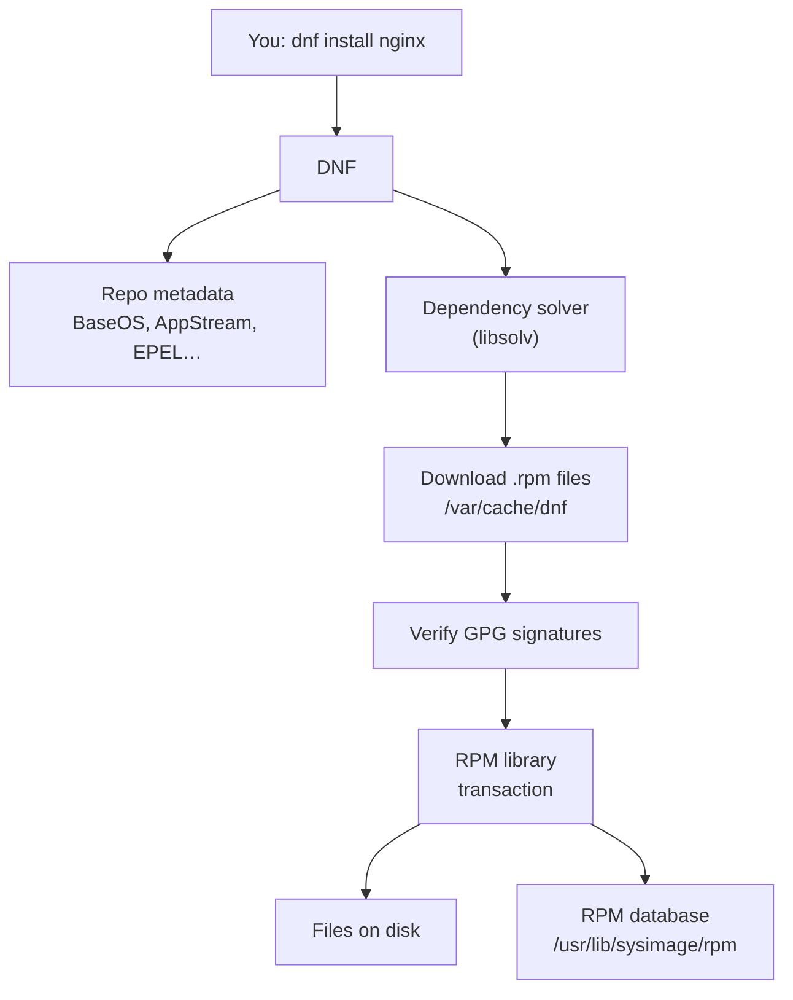
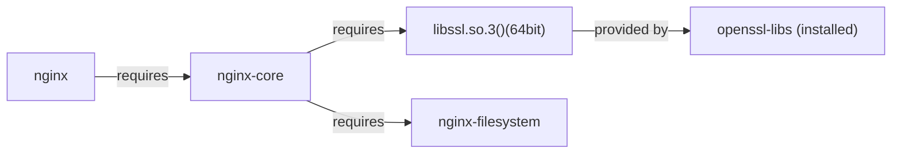

# 05 · Software: RPM and DNF

<ul class="module-meta">
  <li>⏱ ~3 hours</li>
  <li>5 labs</li>
  <li>Builds on: 04 · Permissions and ACLs</li>
</ul>

You type `sudo dnf install nginx` and ten seconds later a web server is on disk, with its config in `/etc`, its service unit registered, a user account created, and every library it needs pulled in. Then a month later an update breaks something and you need to know exactly what changed, and how to put it back. Package management is how software arrives on, changes on, and leaves every Rocky server. This module opens the box: what a package is, where packages come from, how DNF decides what to install, and how to prove that what is on disk is what the vendor shipped.

!!! abstract "What you'll learn"
    - Describe what is inside an RPM: files, metadata, dependencies, scripts, and a signature.
    - Query the RPM database to answer "which package owns this file?", "what did this package install?", and "has anything been modified?"
    - Explain Rocky's repositories (BaseOS, AppStream, CRB, extras) and enable EPEL correctly.
    - Install, remove, update, search, and roll back software with `dnf`, including groups and transaction history.
    - Explain how Rocky 10 ships alternative software versions now that modularity is gone.
    - Automate updates with `dnf-automatic`, pin versions with `versionlock`, and build your own repository with `createrepo_c`.
    - Know the supported upgrade paths within and between major versions.

## The big picture

There are two layers, and it helps to keep them apart.

- **RPM** (the RPM Package Manager) is the low-level tool. It knows how to install, remove, and query one package file at a time, and it keeps a database of everything installed. It does **not** download anything, and it does not go looking for dependencies.
- **DNF** (Dandified YUM) is the high-level tool. It reads **repositories** (online collections of packages), works out which packages are needed to satisfy your request, downloads them, checks their signatures, and then hands them to the RPM library to install as one **transaction**.



The analogy: RPM is a warehouse worker who can shelve or remove one box and keeps the inventory book. DNF is the purchasing department: it reads supplier catalogues, works out everything needed to complete an order, checks the delivery seals, and gives the worker a complete list to shelve in one go.

!!! note "DNF 4 on Rocky 10"
    Rocky 9 and Rocky 10 both use DNF 4. Fedora has moved to DNF 5, so a Fedora blog post may show options or output that Rocky does not have. When in doubt, `man dnf` on your Rocky machine is the authority. `yum` still exists as a compatibility name; it runs the same DNF.

## What is a package?

An **RPM package** is a single file, named like `bash-5.2.26-6.el10.x86_64.rpm`, that contains four things:

1. **A payload**: a compressed archive of the files to install, with their owners, permissions, and SELinux-relevant paths.
2. **Metadata (the header)**: name, version, description, licence, and lists of what the package **provides** and **requires**.
3. **Scriptlets**: small shell scripts to run before or after install or removal (create a user, reload systemd, update a cache).
4. **A signature**: a cryptographic signature from the vendor's key, so you can prove nobody tampered with it.

The filename encodes the **NEVRA**: name, epoch, version, release, architecture.

```text
bash-5.2.26-6.el10.x86_64.rpm
│    │      │      └─ architecture: x86_64, aarch64, noarch (any CPU)...
│    │      └─ release: the packager's build number + dist tag (el10 = Enterprise Linux 10)
│    └─ version: the upstream software version
└─ name
```

The **epoch** is a rarely used number (usually 0, and hidden) that overrides version comparison when upstream renumbers its versions. The **release** changes when Rocky rebuilds the same upstream version, for example to add a security patch. That is why an "old" version number can still be fully patched: Red Hat and Rocky **backport** fixes into the version they ship, rather than jumping to a new upstream release mid-life.

<div class="layers" data-hint="Click a layer to look inside an RPM." data-open="0" markdown>

<div class="layer" data-label="Signature" data-tag="who built it" markdown>

A GPG signature over the header and payload. RPM checks it against keys you have imported. If the package was changed after signing, the check fails.

```console
$ rpm -qi bash | grep Signature
Signature   : RSA/SHA256, Tue 11 Feb 2026 09:14:02 AM UTC, Key ID 5b106c736fedfc85
```

</div>

<div class="layer" data-label="Header: identity" data-tag="name, version, vendor" markdown>

```console
$ rpm -qi bash
Name        : bash
Version     : 5.2.26
Release     : 6.el10
Architecture: x86_64
Install Date: Tue 14 Oct 2026 06:01:12 PM UTC
Size        : 8452049
License     : GPL-3.0-or-later
Source RPM  : bash-5.2.26-6.el10.src.rpm
Vendor      : Rocky Enterprise Software Foundation
Packager    : Rocky Linux Build System (Peridot) <releng@rockylinux.org>
URL         : https://www.gnu.org/software/bash
Summary     : The GNU Bourne Again shell
…
```

</div>

<div class="layer" data-label="Header: dependencies" data-tag="provides / requires" markdown>

Packages do not depend on other *packages* by name so much as on **capabilities**: a library, a file path, a virtual name. Any package that provides the capability satisfies the need.

```console
$ rpm -q --requires bash | head -4
config(bash) = 5.2.26-6.el10
filesystem >= 3
libc.so.6()(64bit)
libc.so.6(GLIBC_2.34)(64bit)
$ rpm -q --provides bash | head -3
/bin/bash
/bin/sh
bash = 5.2.26-6.el10
```

`libc.so.6()(64bit)` is generated automatically by scanning the binaries at build time. DNF resolves it to `glibc`.

</div>

<div class="layer" data-label="Scriptlets" data-tag="%pre, %post, %preun, %postun" markdown>

Shell snippets run at install and removal time, as root.

```console
$ rpm -q --scripts openssh-server
preinstall scriptlet (using /bin/sh):
getent group 'sshd' >/dev/null || groupadd -f -g '74' -r 'sshd' || :
…
postinstall scriptlet (using /bin/sh):
…
```

Here the package creates the `sshd` system group (fixed GID 74) before its files arrive. The script is generated at build time from a `sysusers.d` file the package also ships, `/usr/lib/sysusers.d/openssh-server.conf`, so the same account definition works for RPM installs and for image builders. Packages can also use **triggers** and **file triggers**, which run when *other* packages install files into certain paths (for example, rebuilding a cache whenever any package adds a library).

</div>

<div class="layer" data-label="Payload" data-tag="the files" markdown>

A compressed cpio archive. Each file carries its mode, owner, size, and checksum, and some are flagged as **config files** (`c`) or **documentation** (`d`).

```console
$ rpm -ql chrony | head -6
/etc/chrony.conf
/etc/chrony.keys
/etc/dhcp/dhclient.d/chrony.sh
/etc/logrotate.d/chrony
/etc/sysconfig/chronyd
/usr/bin/chronyc
$ rpm -qc chrony
/etc/chrony.conf
/etc/chrony.keys
/etc/logrotate.d/chrony
/etc/sysconfig/chronyd
```

</div>

</div>

??? question "Prove it: unpack an RPM without installing it"
    An RPM is a header followed by a cpio archive. `rpm2cpio` strips the header and outputs the archive, which `cpio` can list or extract into the current directory, nothing installed:

    ```console
    $ dnf download tree
    $ rpm -qp --qf '%{NAME} %{VERSION} %{PAYLOADCOMPRESSOR}\n' tree-*.rpm
    tree 2.1.0 zstd
    $ rpm2cpio tree-*.rpm | cpio -t
    ./usr/bin/tree
    ./usr/share/doc/tree
    ./usr/share/doc/tree/README
    …
    ```

    `-p` (package) makes any query operate on a file instead of the installed database. This is the safe way to inspect a package someone hands you before installing it. (`cpio` may need `sudo dnf install -y cpio`.)

## Querying with rpm

Most day-to-day RPM use is *asking questions*. Every query starts with `rpm -q`.

| Query | Answers |
|---|---|
| `rpm -qa` | every installed package |
| `rpm -q name` | is it installed, which version? |
| `rpm -qi name` | full information |
| `rpm -ql name` | every file it installed |
| `rpm -qc name` / `rpm -qd name` | only its config / doc files |
| `rpm -qf /path` | which package owns this file? |
| `rpm -q --requires name` | what it needs |
| `rpm -q --whatrequires name` | which installed packages need it |
| `rpm -q --scripts name` | its scriptlets |
| `rpm -q --changelog name` | the packager's change history |
| `rpm -V name` | has anything changed since install? |

```console
$ rpm -qf /etc/ssh/sshd_config /usr/bin/ls
openssh-server-9.9p1-7.el10.x86_64
coreutils-9.5-6.el10.x86_64
$ rpm -qa | wc -l
412
$ rpm -qa --last | head -3
tree-2.1.0-8.el10.x86_64                     Thu 15 Oct 2026 01:02:44 PM UTC
kernel-6.12.0-124.8.1.el10_1.x86_64          Wed 14 Oct 2026 06:20:13 PM UTC
…
$ rpm -q --changelog openssh-server | head -4
* Tue Jul 29 2026 Rocky Linux Build System … 
- Fix CVE-…
…
```

`rpm -qf` is one of the most useful commands on the system. Found an unfamiliar file in `/etc`? Ask who put it there. If the answer is "not owned by any package", someone created it by hand.

??? question "Under the hood: the scanner says you are vulnerable (you probably are not)"
    A security scanner sees `iputils-20240905` and reports a CVE that upstream fixed in a later release. Because Red Hat and Rocky **backport** fixes into the shipped version, the version number cannot tell you. The changelog can:

    ```console
    $ rpm -q iputils
    iputils-20240905-5.el10.x86_64
    $ rpm -q --changelog iputils | grep -m1 CVE
    - Fix CVE-2025-47268 iputils: Signed Integer Overflow in Timestamp Multiplication in iputils ping (RHEL-94582)
    ```

    `dnf updateinfo info --cve CVE-2025-47268` asks the repository's advisory data the same question. This is the standard answer to auditors: cite the advisory (RLSA-…) and the package release that contains it, not the upstream version.

`--qf` (query format) lets you choose the output fields, which is great for scripts:

```console
$ rpm -qa --qf '%{SIZE}\t%{NAME}\n' | sort -rn | head -3
283104729	linux-firmware
94718355	glibc-all-langpacks
56920114	kernel-modules
```

### Verifying installed files

The RPM database records the size, checksum, permissions, owner, and timestamp of every file it installed. `rpm -V` compares the disk against that record and reports only differences.

```console
$ sudo rpm -V openssh-server
S.5....T.  c /etc/ssh/sshd_config
$ sudo rpm -Va 2>/dev/null | grep -v '^\.\{7\}T\.' | head
S.5....T.  c /etc/chrony.conf
S.5....T.  c /etc/sudoers
…
```

The `grep -v` drops lines where *only* the timestamp differs, which are rarely interesting. Each position in the 9-character code is one test. A `.` means it passed.

| Char | Meaning |
|---|---|
| `S` | size differs |
| `M` | mode (permissions or file type) differs |
| `5` | content checksum differs |
| `D` | device number differs |
| `L` | symlink target differs |
| `U` / `G` | user / group owner differs |
| `T` | modification time differs |
| `P` | file capabilities differ |
| `missing` | the file is gone |

The `c` before the path marks a config file, which you are *expected* to edit. A `5` on a file in `/usr/bin` is a very different matter: either someone replaced a program, or the disk is corrupt. `rpm -Va` across the whole system is a fast first check after a suspected compromise (though a skilled attacker can tamper with the database too, so treat it as a clue, not proof).

!!! version "Rocky 9 vs 10"
    Rocky 10 keeps the RPM database in `/usr/lib/sysimage/rpm`, with `/var/lib/rpm` left as a symlink for compatibility. Rocky 9 keeps it in `/var/lib/rpm`. Both use an SQLite database file (`rpmdb.sqlite`). `rpm --eval '%_dbpath'` prints the location on any system.

<div class="quiz" data-answer="2" markdown>

`rpm -V httpd` prints `..5....T.  c /etc/httpd/conf/httpd.conf` and `S.5....T.    /usr/sbin/httpd`. Which line should worry you?

- The first: config files must never change
- The second: a program binary's size and content differ from what the package installed
- Both equally
- Neither: `T` just means the timestamp changed

Right. The `c` marks a config file, which admins edit all the time. A changed binary under `/usr/sbin` is unexpected: investigate it, and reinstall the package with `dnf reinstall httpd` once you understand why.

</div>

## Repositories

A **repository** (repo) is a directory of RPM files plus **metadata**: compressed XML and SQLite files that list every package, what it provides and requires, and checksums. DNF downloads the metadata, not every package, to make decisions.

### Rocky's repositories

| Repo id | What it holds | Enabled by default |
|---|---|---|
| `baseos` | the core OS: kernel, systemd, glibc, coreutils, sshd. Lifecycle matches the major release. | yes |
| `appstream` | applications, languages, databases, and tools: httpd, nginx, PostgreSQL, Python, compilers | yes |
| `extras` | Rocky-specific extras, including `epel-release` and other `*-release` packages | yes |
| `crb` | **CodeReady Builder**: development headers and build tools that other packages need to build. Required by many EPEL packages. | no |
| `highavailability`, `rt`, `nfv`, `plus`, `devel`, … | special-purpose add-ons (Rocky 10 has no `resilientstorage`) | no |

```console
$ dnf repolist
repo id                                 repo name
appstream                               Rocky Linux 10 - AppStream
baseos                                  Rocky Linux 10 - BaseOS
extras                                  Rocky Linux 10 - Extras
$ dnf repolist --all | grep -i crb
crb                                     Rocky Linux 10 - CRB                    disabled
```

### Repo files in /etc/yum.repos.d

Each repo is described by a section in a `.repo` file in `/etc/yum.repos.d/`. Rocky's own repos live in files owned by the `rocky-repos` package.

```console
$ ls /etc/yum.repos.d/
rocky-addons.repo  rocky-devel.repo  rocky-extras.repo  rocky.repo
```

```ini title="/etc/yum.repos.d/rocky.repo (excerpt)"
[baseos]
name=Rocky Linux $releasever - BaseOS
mirrorlist=https://mirrors.rockylinux.org/mirrorlist?arch=$basearch&repo=BaseOS-$releasever$rltype  # (1)!
#baseurl=http://dl.rockylinux.org/$contentdir/$releasever/BaseOS/$basearch/os/  # (2)!
gpgcheck=1  # (3)!
enabled=1
countme=1
metadata_expire=6h  # (4)!
gpgkey=file:///etc/pki/rpm-gpg/RPM-GPG-KEY-Rocky-10  # (5)!
```

1. DNF asks this URL for a list of nearby mirrors. `$releasever` and `$basearch` are DNF variables filled in at run time (`10`, `x86_64`).
2. The alternative: a fixed URL. Uncomment it (and comment out `mirrorlist`) to pin one server.
3. Refuse any package whose signature does not verify.
4. Re-download metadata after 6 hours.
5. The public key used to check signatures.

Global settings live in `/etc/dnf/dnf.conf`:

```ini title="/etc/dnf/dnf.conf"
[main]
gpgcheck=1
installonly_limit=3
clean_requirements_on_remove=True
best=True
skip_if_unavailable=False
```

`installonly_limit=3` keeps the three newest kernels installed, so you can always boot an older one if a new kernel misbehaves ([14 · The Boot Process](14-the-boot-process.md)). Kernels are **install-only** packages: `dnf upgrade` installs the new one *beside* the old ones instead of replacing it, and removes the oldest once there are more than three. (This is also why you never `rpm -Uvh` a kernel: that replaces the running kernel's files and leaves you no fallback.) `clean_requirements_on_remove` lets `dnf remove` also remove dependencies nothing else needs.

Turn repos on and off with `dnf config-manager` (part of `dnf-plugins-core`, installed by default), or for one command only with `--enablerepo` / `--disablerepo`:

```console
$ sudo dnf config-manager --set-enabled crb
$ dnf --disablerepo='*' --enablerepo=baseos list available 'kernel*'
```

### GPG keys and trust

Rocky signs every package with its private key. Your system has the matching public key in `/etc/pki/rpm-gpg/`. The first time DNF installs from a repo, it imports the key named in `gpgkey=` and asks you to confirm (or imports silently with `-y`). After that, RPM verifies every package before installing it.

```console
$ ls /etc/pki/rpm-gpg/
RPM-GPG-KEY-Rocky-10  RPM-GPG-KEY-Rocky-10-Testing
$ rpm -q gpg-pubkey --qf '%{NAME}-%{VERSION}-%{RELEASE}\t%{SUMMARY}\n'
gpg-pubkey-6fedfc85-…	Release Engineering (Rocky Linux 10) <…> public key
$ rpm -K tree-2.1.0-8.el10.x86_64.rpm
tree-2.1.0-8.el10.x86_64.rpm: digests signatures OK
```

`rpm -K` (`--checksig`) checks a package file's signature by hand.

!!! danger "Never set gpgcheck=0 on a real repo"
    Turning off signature checks means anyone who can tamper with a mirror, a proxy, or your DNS can install code that runs as root on your servers through package scriptlets. If a key is missing, import the right key; do not disable the check. The only reasonable exception is a local test repo of packages you built yourself.

### EPEL: Extra Packages for Enterprise Linux

**EPEL** is a repository maintained by the Fedora project with thousands of packages that RHEL and Rocky do not ship: `htop`, `ncdu`, `fail2ban`, `nginx` modules, `pamtester`, and more. It is high quality but community supported: Rocky does not test or patch it.

On Rocky, enable CRB first (many EPEL packages need libraries from it), then install the `epel-release` package from `extras`:

```console
$ sudo dnf config-manager --set-enabled crb
$ sudo dnf install -y epel-release
…
Installed:
  epel-release-10-…noarch
Complete!
$ dnf repolist
repo id                     repo name
appstream                   Rocky Linux 10 - AppStream
baseos                      Rocky Linux 10 - BaseOS
crb                         Rocky Linux 10 - CRB
epel                        Extra Packages for Enterprise Linux 10 - x86_64
extras                      Rocky Linux 10 - Extras
```

!!! version "Rocky 9 vs 10"
    EPEL 9 is one repo for every Rocky 9 point release. EPEL 10 is built **per minor release** (10.0, 10.1, …), tracking the RHEL 10 minor versions, and the `epel-release` repo file picks the right one from your system's version. If EPEL breaks right after a new Rocky point release, it is usually because the matching EPEL branch and the Rocky release are a few days apart; a `sudo dnf clean metadata` after both are out normally fixes it.

<div class="quiz" data-answer="3" markdown>

You run `sudo dnf install epel-release` and DNF says "No match for argument: epel-release". What is the most likely cause?

- EPEL does not support Rocky Linux
- You must enable CRB before you can find `epel-release`
- The `extras` repo, which provides `epel-release`, is disabled
- The GPG key for EPEL is missing

Right. On Rocky, `epel-release` comes from the `extras` repo. Check `dnf repolist --all | grep extras` and enable it with `dnf config-manager --set-enabled extras`. CRB is needed for EPEL's *dependencies*, not to find the release package.

</div>

## Working with dnf

### Finding software

```console
$ dnf search htop          # htop lives in EPEL, covered above
=========================== Name Exactly Matched: htop ===========================
htop.x86_64 : Interactive process viewer
$ dnf info nginx
Available Packages
Name         : nginx
Epoch        : 2
Version      : 1.26.3
Release      : …el10
Architecture : x86_64
Size         : 33 k
Source       : nginx-1.26.3-….el10.src.rpm
Repository   : appstream
Summary      : A high performance web server and reverse proxy server
…
$ dnf provides /usr/bin/semanage
policycoreutils-python-utils-….el10.noarch : SELinux policy core python utilities
Repo        : appstream
Matched from:
Filename    : /usr/bin/semanage
```

`dnf provides` (alias `whatprovides`) is the answer to "command not found, which package do I need?". It accepts paths and globs: `dnf provides '*/bin/dig'` finds `bind-utils`.

### Installing, removing, updating

```console
$ sudo dnf install tree
Last metadata expiration check: 0:12:41 ago on Thu 15 Oct 2026 12:50:03 PM UTC.
Dependencies resolved.
================================================================================
 Package       Architecture    Version                  Repository        Size
================================================================================
Installing:
 tree          x86_64          2.1.0-8.el10             baseos            58 k

Transaction Summary
================================================================================
Install  1 Package

Total download size: 58 k
Installed size: 115 k
Is this ok [y/N]: y
Downloading Packages:
tree-2.1.0-8.el10.x86_64.rpm                    412 kB/s |  58 kB     00:00
--------------------------------------------------------------------------------
Total                                            98 kB/s |  58 kB     00:00
Running transaction check
Transaction check succeeded.
Running transaction test
Transaction test succeeded.
Running transaction
  Preparing        :                                                        1/1
  Installing       : tree-2.1.0-8.el10.x86_64                               1/1
  Verifying        : tree-2.1.0-8.el10.x86_64                               1/1

Installed:
  tree-2.1.0-8.el10.x86_64

Complete!
```

| Command | What it does |
|---|---|
| `dnf install pkg` | install, with dependencies |
| `dnf install ./file.rpm` | install a local file, pulling dependencies from repos |
| `dnf remove pkg` | remove it and dependencies nothing else needs |
| `dnf reinstall pkg` | put back the package's files (fixes deleted or damaged files; keeps edited configs) |
| `dnf check-update` | list available updates (exit code 100 if there are some) |
| `dnf upgrade` | update everything (`dnf update` is the same) |
| `dnf upgrade pkg` | update one package |
| `dnf upgrade --security` | only updates marked as security fixes |
| `dnf updateinfo list` | list the advisories (RLSA, RLBA, RLEA) that apply |
| `dnf downgrade pkg` | go back to an older version still in the repo |
| `dnf autoremove` | remove dependencies no longer needed |
| `dnf clean all` | delete cached metadata and packages |

Always prefer `dnf install ./file.rpm` over `rpm -i file.rpm`. Both install the file, but only DNF fetches missing dependencies and records the action in its history.

### What happens during dnf install

<div class="stepper" markdown>

<div class="step" data-title="Load metadata" markdown>

DNF reads every enabled `.repo` file and checks its cached metadata in `/var/cache/dnf/`. If the cache is older than `metadata_expire`, it downloads fresh `repomd.xml` from a mirror, checks its signature or checksums, then fetches the package lists it points to.

```console
$ ls /var/cache/dnf/
appstream-3b1c…  baseos-8f2a…  extras-1d4e…  expired_repos.json …
```

`Last metadata expiration check: 0:12:41 ago` in the output tells you how fresh it is.

</div>

<div class="step" data-title="Solve dependencies" markdown>

DNF hands the solver (**libsolv**) three things: what is installed (from the RPM database), what is available (from the metadata), and your request. The solver finds a set of packages where every `Requires` is met by some `Provides`, nothing conflicts, and, with `best=True`, the newest versions are chosen.



If no solution exists you get a "conflicting requests" or "nothing provides" error, and *nothing* is changed.

</div>

<div class="step" data-title="Confirm" markdown>

DNF shows you the transaction: what will be installed, upgraded, or removed, and the download size. This is your moment to read it. A surprising "Removing:" section is a warning sign worth stopping for.

</div>

<div class="step" data-title="Download" markdown>

Packages are downloaded in parallel into `/var/cache/dnf/<repo>/packages/` and checked against the checksums in the metadata. A corrupt or truncated download is rejected here.

</div>

<div class="step" data-title="Verify signatures" markdown>

Every package's GPG signature is checked against the imported keys. If the key for this repo has never been imported, DNF imports it from `gpgkey=` after showing you its fingerprint. An unsigned or badly signed package aborts the whole transaction.

</div>

<div class="step" data-title="Test transaction" markdown>

RPM does a dry run: are there file conflicts between packages? Is there enough disk space? This is the "Running transaction test" line. Still nothing on disk has changed.

</div>

<div class="step" data-title="Run the transaction" markdown>

For each package, in dependency order, RPM:

1. runs the `%pre` scriptlet (for example, create the service user),
2. unpacks the payload into place,
3. runs `%post` (for example, `systemctl daemon-reload` through a systemd macro),
4. records the package in the RPM database.

Upgrades install the new version first, then remove the old one's leftover files and run its `%preun`/`%postun`. Config files you edited are kept; if the package ships a new default, it is saved alongside as `file.rpmnew`.

</div>

<div class="step" data-title="Record history" markdown>

DNF writes the whole transaction to its history database in `/var/lib/dnf/` and logs to `/var/log/dnf.log` and `/var/log/dnf.rpm.log`. That record is what makes `dnf history undo` possible.

```console
$ tail -2 /var/log/dnf.rpm.log
2026-10-15T13:02:44+0000 SUBDEBUG Installed: tree-2.1.0-8.el10.x86_64
2026-10-15T13:02:44+0000 INFO --- logging finished ---
```

</div>

</div>

!!! tip ".rpmnew and .rpmsave"
    When an update ships a new default config but you have edited yours, RPM keeps your file and writes the new one as `name.rpmnew`. When you remove a package whose config you edited, RPM saves it as `name.rpmsave`. After big updates, run `sudo find /etc \( -name '*.rpmnew' -o -name '*.rpmsave' \)` and merge the changes you want.

??? question "Under the hood: noreplace decides whether your edit survives"
    Whether you get `.rpmnew` or `.rpmsave` on an *upgrade* is decided by the packager, per file. A file marked `%config(noreplace)` keeps your edited version in place and puts the new default beside it as `.rpmnew`. A file marked plain `%config` does the opposite: the **new default goes live**, and your edited file is moved aside to `.rpmsave`. Your change silently stops applying until you merge it back. You can see the flags with a query format:

    ```console
    $ rpm -q --qf '[%{FILEFLAGS:fflags}\t%{FILENAMES}\n]' chrony | grep '^c'
    cn	/etc/chrony.conf
    cg	/etc/chrony.keys
    cn	/etc/logrotate.d/chrony
    cn	/etc/sysconfig/chronyd
    ```

    `c` is config, `n` is noreplace, `g` is "ghost" (owned by the package but not shipped in it; `chrony.keys` is created on the machine). Before you edit a vendor file, check for `n`. Better still, use the package's drop-in directory (`sshd_config.d/`, `sudoers.d/`, `/etc/systemd/system/*.d/`) so the conflict never arises.

### Transaction history and undo

Every DNF transaction gets a number. You can inspect it and reverse it.

```console
$ sudo dnf history
ID     | Command line              | Date and time    | Action(s)      | Altered
-------------------------------------------------------------------------------
     6 | install tree              | 2026-10-15 13:02 | Install        |    1
     5 | upgrade -y                | 2026-10-14 18:19 | I, U           |   37
     4 | install -y epel-release   | 2026-10-14 18:05 | Install        |    1
…
$ sudo dnf history info 6
Transaction ID : 6
…
Packages Altered:
    Install tree-2.1.0-8.el10.x86_64 @baseos
$ sudo dnf history undo 6
…
Removing:
 tree           x86_64         2.1.0-8.el10            @baseos          115 k
…
Complete!
```

`undo` reverses one transaction. `rollback N` reverses everything after transaction `N`. Both need the older package versions to still be available in a repo to downgrade, so they work best for recent installs and removals. Undoing a large upgrade is not always possible; that is what VM snapshots and backups are for.

### Package groups

A **group** is a named set of packages for a purpose, such as "Development Tools" or "Server with GUI" (the latter is an **environment group**, a group of groups).

```console
$ dnf group list
Available Environment Groups:
   Server with GUI
   Server
   Minimal Install
   Workstation
   …
Available Groups:
   Container Management
   Development Tools
   Headless Management
   …
$ dnf group info "Development Tools"
$ sudo dnf group install "Development Tools"
```

`@` is shorthand for a group in install commands: `sudo dnf install @development`.

<div class="quiz" data-answer="1" markdown>

You ran `sudo dnf install httpd` yesterday (transaction 12). Today you want the system exactly as before, including the dependencies it pulled in. What do you run?

- `sudo dnf history undo 12`
- `sudo dnf remove httpd`
- `sudo rpm -e httpd`
- `sudo dnf downgrade httpd`

Right. `history undo 12` reverses the whole transaction, including every dependency it installed. `dnf remove httpd` also removes unneeded dependencies thanks to `clean_requirements_on_remove`, but `undo` is the exact inverse, and `rpm -e` would leave the dependencies behind.

</div>

## Choosing software versions on Rocky 10

Enterprise distributions face a tension: the OS must stay stable for ten years, but developers want newer PostgreSQL, Node.js, or Python. Rocky 8 and 9 solved this with **modularity**: **module streams** that let you choose, for example, `nodejs:18` or `nodejs:20`, with `dnf module enable`.

Modularity proved confusing (streams that silently hid packages, "filtered by modular filtering" errors) and Red Hat dropped it. **RHEL 10, and therefore Rocky 10, ships no module streams.** Each AppStream application has one default version as an ordinary package. When Red Hat adds a newer version during the release's life, it arrives as a **separately named package**, with the version in the name, that you install with plain `dnf install`.

```console
$ dnf module list
$ dnf search postgresql | grep -i server
…
```

On Rocky 10, `dnf module list` shows no streams. Use `dnf search` and `dnf info` to see which versions are offered, and check the Application Streams lifecycle page for how long each is supported.

!!! version "Rocky 9 vs 10"
    On Rocky 9 you will still meet modules:

    ```console
    $ dnf module list nodejs
    Name    Stream   Profiles                    Summary
    nodejs  18       common [d], development, …  Javascript runtime
    nodejs  20       common [d], development, …  Javascript runtime
    $ sudo dnf module enable nodejs:20
    $ sudo dnf install nodejs
    ```

    The `dnf module` command still exists in Rocky 10's DNF 4, but there is no content for it to act on: `dnf module enable nodejs:20` stops with an error ("missing groups or modules: nodejs:20"). Playbooks and scripts that enable module streams must be rewritten for Rocky 10 to install the versioned package names instead.

## Keeping systems updated

### Within a major version

Rocky releases a new **minor version** (10.0, 10.1, 10.2, …) roughly every six months. Moving between them needs nothing special: `sudo dnf upgrade` takes you to the latest minor release, because the repos are addressed by the major version (`$releasever` = `10`). Security fixes arrive as advisories in between.

```console
$ cat /etc/rocky-release
Rocky Linux release 10.1 (Red Quartz)
$ sudo dnf upgrade --refresh
…
$ cat /etc/rocky-release
Rocky Linux release 10.2 (Red Quartz)
$ sudo dnf needs-restarting -r
Core libraries or services have been updated since boot-up:
  * kernel
  * systemd

Reboot is required to fully utilize these updates.
```

`dnf needs-restarting -r` tells you whether a reboot is needed (new kernel, glibc, or systemd). `dnf needs-restarting -s` lists services that should be restarted to pick up updated libraries.

### Between major versions

There is no supported in-place upgrade from Rocky 9 to Rocky 10. The documented path is a **fresh install** of Rocky 10, then migrating your data and configuration, ideally driven by automation so it is repeatable. AlmaLinux's **ELevate** project (built on Red Hat's Leapp tool) supported in-place migrations of Rocky in the past, but it dropped Rocky support in late 2025, so treat any guide that shows `leapp upgrade` on Rocky with suspicion.

Major upgrades change so much (kernel, OpenSSL, default crypto policy, removed packages like modules) that a rebuild is usually the safer option anyway. Plan it like a migration, not a patch.

### Automatic updates with dnf-automatic

`dnf-automatic` runs DNF from a systemd timer so updates happen unattended.

```console
$ sudo dnf install -y dnf-automatic
$ systemctl list-unit-files 'dnf-automatic*'
UNIT FILE                          STATE    PRESET
dnf-automatic.service              static   -
dnf-automatic.timer                disabled disabled
…
```

```ini title="/etc/dnf/automatic.conf (key settings)"
[commands]
upgrade_type = security   # (1)!
download_updates = yes
apply_updates = yes       # (2)!
reboot = never            # (3)!

[emitters]
emit_via = stdio          # (4)!
```

1. `default` applies every update; `security` only those flagged as security advisories.
2. With `no`, it only downloads (or only notifies, if `download_updates = no`).
3. Can be `when-needed` to reboot when a kernel or core library changed. Be sure your services come back cleanly before you enable it.
4. Where to report: `stdio` (the journal), `email`, or `motd`.

```console
$ sudo systemctl enable --now dnf-automatic.timer
$ systemctl list-timers dnf-automatic.timer
NEXT                        LEFT     LAST PASSED UNIT                ACTIVATES
Fri 2026-10-16 06:23:51 UTC 17h      -    -      dnf-automatic.timer dnf-automatic.service
```

Timers are explained in [07 · systemd and Services](07-systemd-and-services.md). Results land in the journal: `journalctl -u dnf-automatic`.

### Pinning a version with versionlock

Sometimes you need to hold one package at a known version, for example a kernel validated with a vendor driver, or a database you upgrade only in a maintenance window. The **versionlock** plugin stops DNF from changing it.

```console
$ sudo dnf install -y python3-dnf-plugin-versionlock
$ sudo dnf versionlock add postgresql-server
Adding versionlock on: postgresql-server-0:16.…el10.*
$ dnf versionlock list
postgresql-server-0:16.…el10.*
$ sudo dnf upgrade
…
$ sudo dnf versionlock delete postgresql-server
```

Locks live in `/etc/dnf/plugins/versionlock.list`. A lock also blocks *security* updates for that package, so every lock needs an owner and a review date.

<div class="quiz" data-answer="4" markdown>

You maintain an Ansible playbook that runs `dnf module enable nodejs:20` before installing Node.js. On a new Rocky 10 server, what should you expect?

- It works exactly as on Rocky 9
- DNF automatically maps the module stream to a package
- The `dnf module` command has been removed, so the playbook crashes with "No such command"
- There are no module streams on Rocky 10, so the enable step fails to find `nodejs:20`; install the right package name directly instead

Right. Rocky 10's DNF 4 still has the `module` subcommand, but RHEL 10 and Rocky 10 ship no modular content, so the task errors out. Rewrite it to install the package (or versioned package) by name.

</div>

## Building a local repository

A **local repository** is useful for air-gapped networks, for distributing your own RPMs, or for freezing a known set of packages. All you need is a directory of RPMs and metadata generated by `createrepo_c`.

```console
$ sudo dnf install -y createrepo_c
$ sudo mkdir -p /srv/localrepo
$ sudo dnf download --destdir /srv/localrepo tree
$ sudo createrepo_c /srv/localrepo
Directory walk started
Directory walk done - 1 packages
Temporary output repo path: /srv/localrepo/.repodata/
Preparing sqlite DBs
Pool started (with 5 workers)
Pool finished
$ ls /srv/localrepo/repodata/
…-filelists.xml.zst  …-other.xml.zst  …-primary.xml.zst  repomd.xml …
```

```ini title="/etc/yum.repos.d/local.repo"
[localrepo]
name=Local packages
baseurl=file:///srv/localrepo
enabled=1
gpgcheck=1
gpgkey=file:///etc/pki/rpm-gpg/RPM-GPG-KEY-Rocky-10
```

Because these are Rocky's own signed packages, `gpgcheck=1` with Rocky's key works. For your own packages, sign them with your own key and point `gpgkey=` at it. Re-run `createrepo_c --update /srv/localrepo` whenever you add RPMs. Serve the directory over HTTP with any web server and other machines can use `baseurl=http://yourserver/localrepo/`.

??? note "Flatpak, briefly (desktops only)"
    **Flatpak** is a different way to ship desktop applications: each app comes as a sandboxed bundle with its own runtime, independent of the OS packages, usually from the Flathub store. It is useful on Rocky workstations for getting current desktop apps without touching system libraries. It is not used for server software, and Flatpak apps are not managed or updated by DNF.

    ```console
    $ sudo dnf install -y flatpak
    $ flatpak remote-add --if-not-exists flathub https://dl.flathub.org/repo/flathub.flatpakrepo
    $ flatpak install flathub org.gnome.TextEditor
    ```

<div class="terminal-sim" data-title="Package detective" markdown>

<div class="task" data-expect="rpm -qf /etc/chrony.conf" data-hint="rpm query, with the option that means 'file'." markdown>

**Step 1.** Find out which package owns `/etc/chrony.conf`.

```text
chrony-4.…el10.x86_64
```

</div>

<div class="task" data-expect="rpm -qc chrony||rpm -q -c chrony||rpm -ql chrony" data-hint="rpm -q with the option that lists only config files." markdown>

**Step 2.** List only the configuration files that package installed.

```text
/etc/chrony.conf
/etc/chrony.keys
/etc/logrotate.d/chrony
/etc/sysconfig/chronyd
```

</div>

<div class="task" data-expect="sudo rpm -V chrony||rpm -V chrony" data-hint="rpm with the verify option, on the chrony package." markdown>

**Step 3.** Check whether any of chrony's files have changed since installation.

```text
S.5....T.  c /etc/chrony.conf
```

</div>

<div class="task" data-expect="dnf provides /usr/bin/dig||dnf provides */bin/dig||dnf whatprovides /usr/bin/dig||dnf provides dig" data-match="dnf (provides|whatprovides) ['&quot;]?(\*/bin/dig|/usr/bin/dig|\*/dig)['&quot;]?" data-hint="dnf provides, followed by the path /usr/bin/dig." markdown>

**Step 4.** `dig: command not found`. Ask DNF which package provides `/usr/bin/dig`.

```text
bind-utils-32:9.18.…el10.x86_64 : Utilities for querying DNS name servers
Repo        : appstream
Matched from:
Filename    : /usr/bin/dig
```

</div>

<div class="task" data-expect="sudo dnf history||dnf history||sudo dnf history list||dnf history list" data-hint="dnf has a subcommand that lists past transactions." markdown>

**Step 5.** Show the list of past DNF transactions.

```text
ID     | Command line              | Date and time    | Action(s)      | Altered
-------------------------------------------------------------------------------
     6 | install bind-utils        | 2026-10-15 13:02 | Install        |    3
     5 | upgrade -y                | 2026-10-14 18:19 | I, U           |   37
```

</div>

</div>

## Labs

!!! lab "Lab 1: Interrogate the RPM database"

    **Goal:** Answer real questions about installed software using only `rpm`.

    **You'll need:** a Rocky 10 VM.

    1. How many packages are installed, and which were installed most recently?

        ```bash
        rpm -qa | wc -l
        rpm -qa --last | head -5
        ```

    2. Who owns these files, and is anything in `/etc` not owned by a package?

        ```bash
        rpm -qf /usr/bin/ssh /etc/hosts /etc/fstab
        rpm -qf /etc/hostname /etc/machine-id
        ```

    3. What does `openssh-server` do when installed, and what changed recently?

        ```bash
        rpm -q --scripts openssh-server | head -20
        rpm -q --changelog openssh-server | head -10
        ```

    4. Which installed packages depend on `openssl-libs`?

        ```bash
        rpm -q --whatrequires openssl-libs | head
        ```

    **Check your work:** `rpm -qf /etc/hostname` reports "not owned by any package", because the installer wrote that file, not a package.

    **Clean up:** nothing to undo; this lab only reads.

!!! lab "Lab 2: Detect and repair a changed file"

    **Goal:** Use `rpm -V` to spot a modified file and `dnf reinstall` to fix a missing one.

    **You'll need:** a Rocky 10 VM, sudo. `tree` is used because it is small and harmless.

    1. Install `tree` and verify it is clean:

        ```bash
        sudo dnf install -y tree
        rpm -V tree && echo "clean"
        ```

    2. Damage it: change the binary's mode and delete its doc file:

        ```bash
        sudo chmod 700 /usr/bin/tree
        rpm -qd tree
        sudo rm -f "$(rpm -qd tree | head -1)"
        sudo rpm -V tree
        ```

    3. Repair with DNF and check again:

        ```bash
        sudo dnf reinstall -y tree
        rpm -V tree && echo "clean again"
        ```

    **Check your work:** step 2 shows `.M.......` for `/usr/bin/tree` and `missing` for the doc file; step 3 prints `clean again`.

    **Clean up:** `sudo dnf remove -y tree`

!!! lab "Lab 3: Enable EPEL and use history undo"

    **Goal:** Add EPEL properly, install from it, then reverse the whole thing with DNF history.

    **You'll need:** a Rocky 10 VM with internet access, sudo.

    1. Note the current last transaction and whether CRB is on:

        ```bash
        sudo dnf history | head -4
        dnf repolist --all | grep -E '^(crb|extras)'
        ```

    2. Enable CRB and EPEL, then install a package from EPEL:

        ```bash
        sudo dnf config-manager --set-enabled crb
        sudo dnf install -y epel-release
        sudo dnf install -y htop
        rpm -qi htop | grep -E '^(Vendor|Signature)'
        ```

    3. Find the transaction IDs for the two installs:

        ```bash
        sudo dnf history list htop
        sudo dnf history list epel-release
        ```

    4. Undo them by ID, newest first (replace the numbers with yours):

        ```bash
        sudo dnf history undo 8 -y     # the htop install
        sudo dnf history undo 7 -y     # the epel-release install
        sudo dnf config-manager --set-disabled crb
        ```

    **Check your work:** `htop`'s Vendor is "Fedora Project". After the undos, `rpm -q htop epel-release` reports both as not installed, and `dnf repolist` no longer shows `epel` or `crb`.

    ??? success "Why use IDs instead of `undo last` twice?"
        Each undo is itself a new transaction. After the first `undo last`, the "last" transaction is that removal, so a second `undo last` would *reinstall* htop. Referring to transactions by ID avoids the trap.

    **Clean up:** `sudo dnf remove -y htop epel-release; sudo dnf config-manager --set-disabled crb`

!!! lab "Lab 4: Build and use a local repository"

    **Goal:** Serve packages from a directory you control.

    **You'll need:** a Rocky 10 VM, sudo.

    1. Build the repo:

        ```bash
        sudo dnf install -y createrepo_c
        sudo mkdir -p /srv/localrepo
        sudo dnf download --destdir /srv/localrepo tree
        sudo createrepo_c /srv/localrepo
        ```

    2. Describe it to DNF:

        ```bash
        sudo tee /etc/yum.repos.d/local.repo <<'EOF'
        [localrepo]
        name=Local packages
        baseurl=file:///srv/localrepo
        enabled=1
        gpgcheck=1
        gpgkey=file:///etc/pki/rpm-gpg/RPM-GPG-KEY-Rocky-10
        EOF
        ```

    3. Install *only* from it:

        ```bash
        sudo dnf --disablerepo='*' --enablerepo=localrepo install -y tree
        dnf list installed tree
        ```

    **Check your work:** `dnf list installed tree` shows `@localrepo` in the repository column.

    **Clean up:** `sudo dnf remove -y tree; sudo rm -f /etc/yum.repos.d/local.repo; sudo rm -rf /srv/localrepo; sudo dnf remove -y createrepo_c`

!!! lab "Lab 5: Safe automatic security updates"

    **Goal:** Configure `dnf-automatic` to download and apply security updates only, and check what it would do.

    **You'll need:** a Rocky 10 VM, sudo.

    1. Install and configure:

        ```bash
        sudo dnf install -y dnf-automatic
        sudo cp /etc/dnf/automatic.conf /etc/dnf/automatic.conf.orig
        sudo sed -i 's/^upgrade_type = .*/upgrade_type = security/; s/^apply_updates = .*/apply_updates = yes/' /etc/dnf/automatic.conf
        grep -E '^(upgrade_type|apply_updates|reboot)' /etc/dnf/automatic.conf
        ```

    2. See which security advisories apply right now:

        ```bash
        dnf updateinfo list --security
        ```

    3. Run it once by hand, then enable the timer:

        ```bash
        sudo systemctl start dnf-automatic.service
        journalctl -u dnf-automatic --since '-10min' --no-pager | tail
        sudo systemctl enable --now dnf-automatic.timer
        systemctl list-timers dnf-automatic.timer
        ```

    **Check your work:** the timer shows a NEXT run time, and the journal shows the run's result.

    **Clean up:** `sudo systemctl disable --now dnf-automatic.timer; sudo mv /etc/dnf/automatic.conf.orig /etc/dnf/automatic.conf; sudo dnf remove -y dnf-automatic`

## Common pitfalls

!!! pitfall "Installing RPMs with rpm -i"
    **Symptom:** "Failed dependencies" errors, or a package DNF knows nothing about in its history. **Cause:** `rpm -i` does not resolve dependencies or record history. **Fix:** `sudo dnf install ./package.rpm`.

!!! pitfall "Disabling gpgcheck to make an error go away"
    **Symptom:** "GPG check FAILED" or "public key not installed", so someone sets `gpgcheck=0`. **Cause:** the repo's key was never imported, or the package really is not signed by who you think. **Fix:** import the vendor's key (`sudo rpm --import <key-file-or-URL>`) after checking its fingerprint; never turn off the check.

!!! pitfall "Mixing third-party repos that replace base packages"
    **Symptom:** updates fail with conflicts, or core packages come from an unexpected repo. **Cause:** a third-party repo ships its own builds of OS packages. **Fix:** check with `dnf list installed | grep -v '@baseos\|@appstream'`, use `excludepkgs=` or `priority=` in the third-party `.repo` file, and prefer EPEL, which never replaces RHEL packages by policy.

| Symptom | Cause | Fix |
|---|---|---|
| `No match for argument: epel-release` | `extras` repo disabled | `dnf config-manager --set-enabled extras` |
| EPEL install fails with "nothing provides lib…-devel" | CRB not enabled | `dnf config-manager --set-enabled crb` |
| `dnf module enable` fails with "missing groups or modules" on Rocky 10 | No modular content in Rocky 10 | Install the (versioned) package directly |
| Disk full in `/var` after many updates | Old packages in the cache | `sudo dnf clean all` |
| Service still runs old code after an update | Process started before the update | `dnf needs-restarting -s`; restart those services |
| Updated config ignored | New default saved as `.rpmnew` | `find /etc -name '*.rpmnew'` and merge |
| `dnf history undo` fails to downgrade | Old version no longer in any repo | Restore from snapshot or backup; plan rollbacks before big upgrades |

## Cheat sheet

| Command | What it does |
|---|---|
| `rpm -qa` / `rpm -qa --last` | list installed packages / newest first |
| `rpm -qi pkg` | package information |
| `rpm -ql pkg` / `rpm -qc pkg` | files / config files of a package |
| `rpm -qf /path` | which package owns a file |
| `rpm -q --requires` / `--whatrequires` | dependencies / reverse dependencies |
| `rpm -q --scripts pkg` | show install scriptlets |
| `rpm -q --changelog pkg` | packager change log |
| `rpm -V pkg` / `rpm -Va` | verify one / all packages |
| `rpm -qp ... file.rpm` | query a package file instead of the database |
| `rpm -K file.rpm` | check a package file's signature |
| `dnf search word` / `dnf info pkg` | find / describe packages |
| `dnf provides /path` | which package provides a file or command |
| `dnf install pkg` / `dnf install ./f.rpm` | install from repo / local file |
| `dnf remove pkg` / `dnf autoremove` | remove / clean unused dependencies |
| `dnf upgrade` / `dnf upgrade --security` | update all / security only |
| `dnf check-update` / `dnf updateinfo list` | list pending updates / advisories |
| `dnf history` / `dnf history undo N` | list / reverse transactions |
| `dnf group list` / `dnf group install "Name"` | package groups |
| `dnf repolist --all` | show all repos and their state |
| `dnf config-manager --set-enabled crb` | enable a repo |
| `dnf download pkg` | download an RPM without installing |
| `dnf needs-restarting -r` | is a reboot needed? |
| `dnf versionlock add pkg` | pin a package version |
| `createrepo_c DIR` | build repo metadata for a directory of RPMs |
| `systemctl enable --now dnf-automatic.timer` | turn on automatic updates |

## Flashcards

<div class="flashcards" markdown>

<div class="card" markdown>

What is the difference between RPM and DNF?

RPM installs, removes, and queries individual package files and keeps the database. DNF reads repositories, solves dependencies, downloads, verifies, and drives RPM in one transaction.

</div>

<div class="card" markdown>

What does NEVRA stand for?

Name, Epoch, Version, Release, Architecture: the full identity of a package, as in `bash-5.2.26-6.el10.x86_64`.

</div>

<div class="card" markdown>

Which command tells you which package owns a file?

`rpm -qf /path/to/file`. For files not yet installed, `dnf provides /path`.

</div>

<div class="card" markdown>

In `rpm -V` output, what does `5` mean, and what does a `c` before the path mean?

`5`: the file's content checksum changed. `c`: it is a config file, which you are expected to edit.

</div>

<div class="card" markdown>

How do you enable EPEL on Rocky?

`dnf config-manager --set-enabled crb`, then `dnf install epel-release` (from the extras repo).

</div>

<div class="card" markdown>

What replaced module streams in Rocky 10?

Nothing modular: alternative versions ship as ordinary, separately named packages in AppStream.

</div>

<div class="card" markdown>

What are `.rpmnew` files?

New default config files from an update, saved beside your edited config instead of overwriting it.

</div>

<div class="card" markdown>

How do you move from Rocky 9 to Rocky 10?

A fresh install of Rocky 10 and a migration of data and config. There is no supported in-place upgrade.

</div>

<div class="card" markdown>

Why should you never set `gpgcheck=0`?

Packages run scriptlets as root. Without signature checks, anyone who can tamper with the download path can run code as root on your machine.

</div>

</div>

## Recap

!!! recap "Key takeaways"
    - An RPM is a signed bundle of files, metadata (provides/requires), and scriptlets. RPM installs and queries; DNF fetches, solves, verifies, and drives RPM.
    - `rpm -qf`, `-ql`, `-qi`, `--scripts`, and `-V` answer most "what is this, where did it come from, has it changed?" questions.
    - Rocky's repos are BaseOS, AppStream, extras, and (disabled) CRB. EPEL needs CRB plus `epel-release` from extras.
    - Repos are defined in `/etc/yum.repos.d/*.repo`; keep `gpgcheck=1` and import keys rather than disabling checks.
    - `dnf install`, `remove`, `upgrade`, `provides`, `history`, and `history undo` cover daily work; every transaction is recorded.
    - Rocky 10 has no module streams: alternative versions are separate packages.
    - Minor versions arrive through `dnf upgrade`; major versions need a fresh install. `dnf-automatic`, `versionlock`, and `createrepo_c` help you run updates at scale.

## Go deeper

- Man pages: [[man:rpm(8)]] [[man:dnf(8)]] [[man:dnf.conf(5)]] [[man:dnf-automatic(8)]] [[man:createrepo_c(8)]] [[man:rpmkeys(8)]] [[man:dnf-versionlock(8)]]
- [RHEL 10: Managing software with the DNF tool](https://docs.redhat.com/en/documentation/red_hat_enterprise_linux/10/html-single/managing_software_with_the_dnf_tool/index): the reference for DNF on the platform Rocky 10 follows.
- [Rocky Linux documentation](https://docs.rockylinux.org/): Rocky's guides, including repositories and the release notes for each version.
- [EPEL documentation](https://docs.fedoraproject.org/en-US/epel/): what EPEL is, its policies, and how to enable it.
- [RPM Packaging Guide](https://rpm-packaging-guide.github.io/): how packages are built from a `.spec` file, if you want to make your own.

**Next:** [06 · Processes and Signals](06-processes-and-signals.md)
