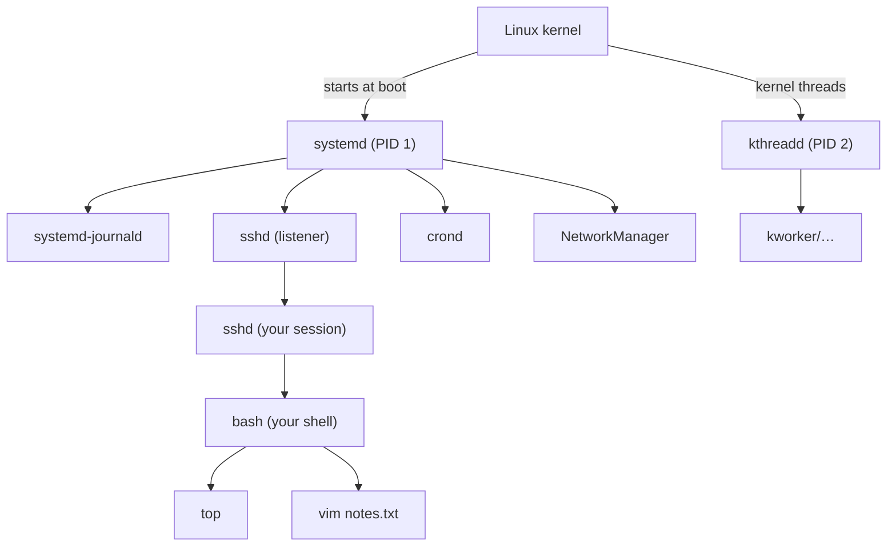
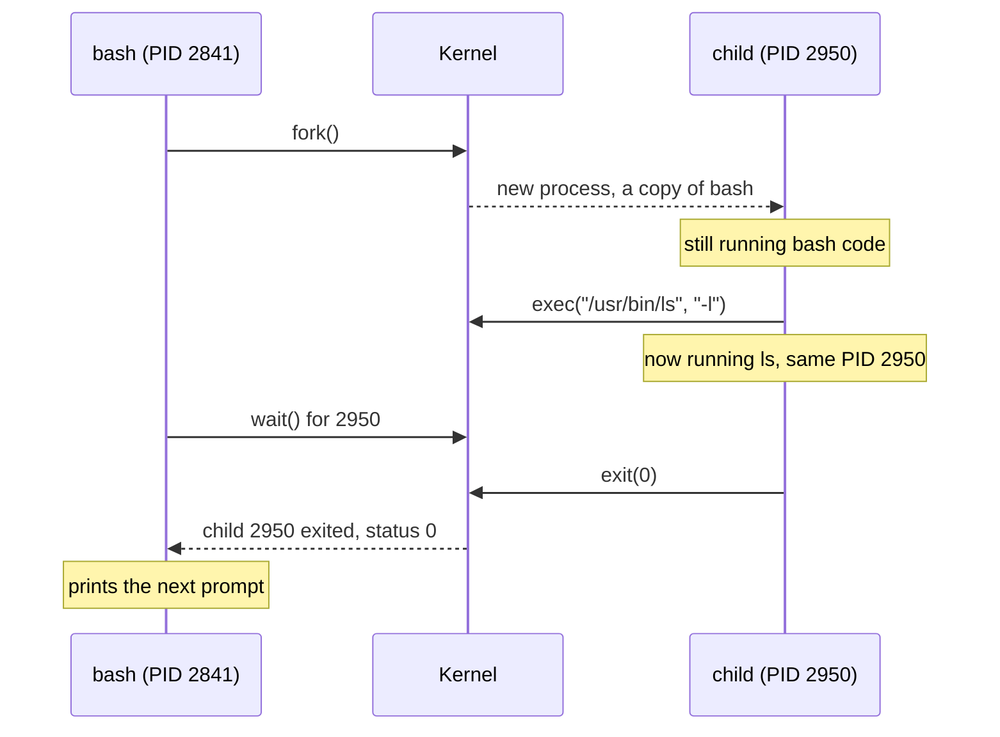
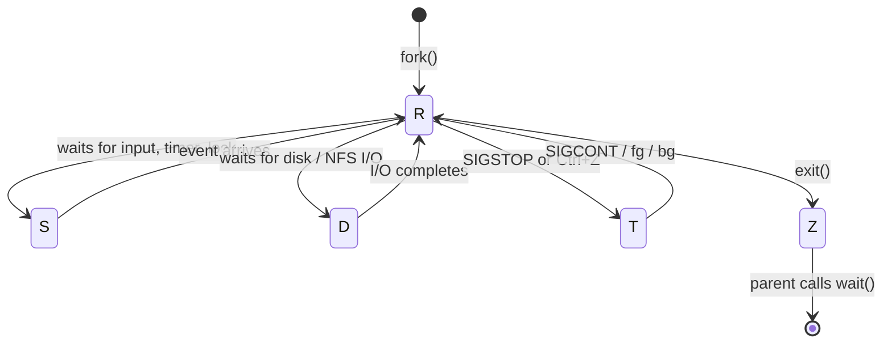
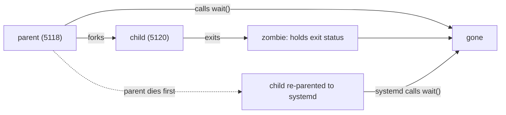
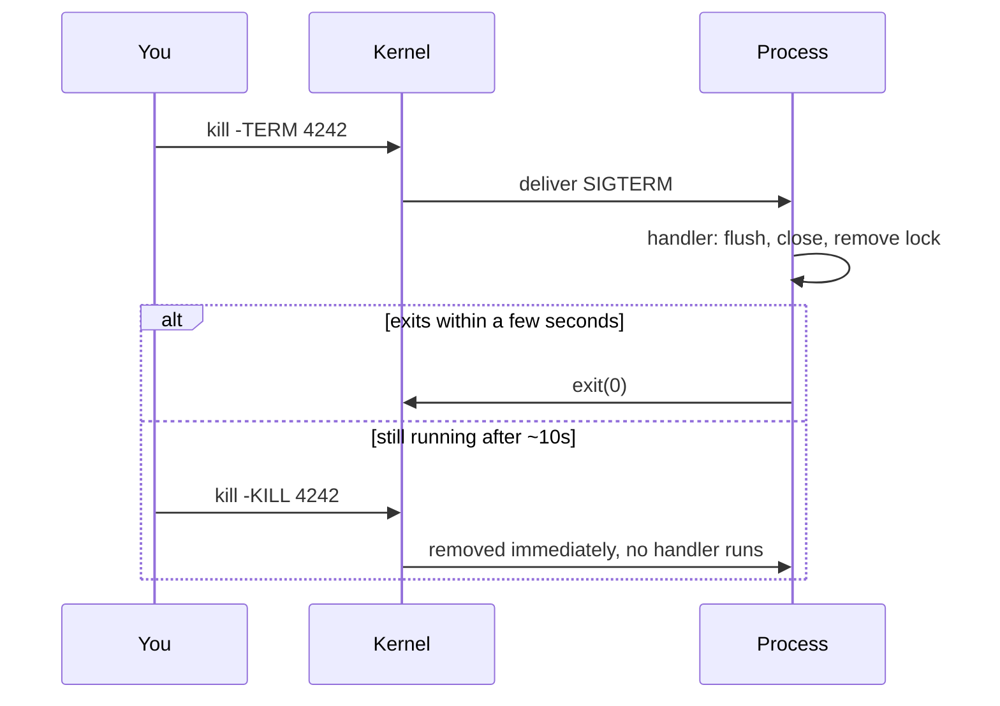
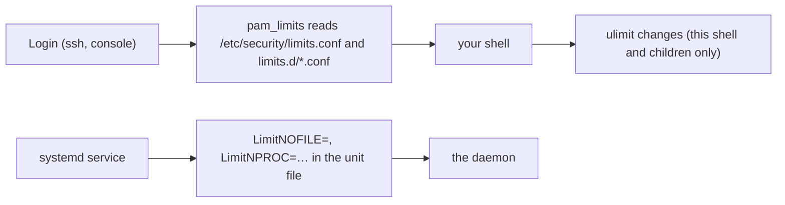

# 06 · Processes and Signals

<ul class="module-meta">
  <li>⏱ ~2.5 hours</li>
  <li>5 labs</li>
  <li>Builds on: 02 · The Shell and the Filesystem, 03 · Users, Groups and sudo</li>
</ul>

Your server's load average just hit 40, a backup job "won't die" even after
`kill -9`, and someone left a `[defunct]` entry in `ps` that nobody can remove.
All three are process problems, and all three make sense once you can see a
process the way the kernel sees it. This module teaches you to find any
process, read its life story in `/proc`, change its priority, talk to it with
signals, and put limits on it before it takes the machine down.

!!! abstract "What you'll learn"
    - Explain the difference between a program, a process, and a thread, and
      find any process's PID, parent, and place in the process tree.
    - Describe how `fork()` and `exec()` create every process on the system.
    - Read process states (`R S D Z T I`) in `ps` and `top`, and explain why
      D-state processes push the load average up.
    - Inspect a live process through `/proc/<pid>`: its command line, open
      files, and limits.
    - Change scheduling priority with `nice` and `renice`.
    - Choose the right signal (`TERM`, `KILL`, `HUP`, `INT`, `STOP`, `CONT`)
      and handle signals in a bash script with `trap`.
    - Recognise an OOM kill and set resource limits with `ulimit`.

## The big picture

A **program** is a file on disk, like `/usr/bin/sleep`. It does nothing on its
own. A **process** is a program that is *running*: the kernel has loaded it
into memory, given it a number, and is handing it slices of CPU time. Run the
same program three times and you get three processes.

Every process on a Rocky Linux system descends from one ancestor:
**systemd**, which the kernel starts as **PID 1** at boot. Every other
process was created by an existing process copying itself. The result is a
family tree.



The kernel keeps a record for every process: who its parent is, which user
owns it, what files it has open, how much memory it uses, and what it is doing
right now (its **state**). You can read almost all of that record as plain
text under `/proc`. The rest of this module is about reading that record and
acting on it.

!!! analogy "Think of it like a kitchen"
    The program is a recipe card. A process is a cook actually following the
    recipe, with their own bench space (memory), their own ingredients (open
    files), and a ticket number (PID). The kernel is the head chef who decides
    which cook gets the stove (CPU) next and can shout instructions at them
    (signals).

## Programs, processes, and PIDs

Each process gets a **PID** (process ID), a number unique among running
processes. It also records its **PPID** (parent process ID), the PID of the
process that created it. PIDs are recycled after a process exits, so a PID
identifies a process only while it is alive.

Your shell knows its own PID in the special variable `$$`, and its parent's in
`$PPID`:

```console
$ echo "my PID is $$, my parent is $PPID"
my PID is 2841, my parent is 2840
$ ps -o pid,ppid,user,cmd -p 2840,2841
    PID    PPID USER     CMD
   2840    2836 alice    sshd-session: alice@pts/0
   2841    2840 alice    -bash
```

The leading `-` in `-bash` means it is a **login shell**. The parent is the
SSH session that started it.

### Seeing the tree with pstree

`pstree` (from the `psmisc` package; install it with `sudo dnf install psmisc`
if it's missing) draws the family tree. `-p` adds PIDs, and giving it a PID
shows just that branch:

```console
$ pstree -p | head -12
systemd(1)─┬─NetworkManager(812)─┬─{NetworkManager}(830)
           │                     └─{NetworkManager}(833)
           ├─agetty(901)
           ├─auditd(748)───{auditd}(749)
           ├─chronyd(806)
           ├─crond(905)
           ├─dbus-broker-lau(781)───dbus-broker(784)
           ├─firewalld(810)───{firewalld}(1002)
           ├─sshd(899)───sshd-session(2836)───sshd-session(2840)───bash(2841)───pstree(2903)
           ├─systemd(2820)───(sd-pam)(2823)
           ├─systemd-journal(611)
           ├─systemd-logind(795)
…
```

Names in `{braces}` are **threads** (more on those soon). The `systemd(2820)`
lower down is your personal **user manager**, a second copy of systemd that
runs services for your login session.

!!! version "Rocky 9 vs 10"
    On Rocky 10, OpenSSH splits each connection into a separate
    `sshd-session` process, so you see `sshd` (the listener) and then
    `sshd-session` children. On Rocky 9 every level is just called `sshd`.

## How a process is born: fork and exec

Linux creates processes in two steps, and almost everything about process
behaviour follows from this design.

1. **`fork()`**: an existing process asks the kernel to make a copy of
   itself. The copy (the **child**) is identical: same code, same memory
   contents, same open files. Only the PID and PPID differ.
2. **`exec()`**: the child asks the kernel to throw away its current program
   and load a new one from disk in its place. The PID stays the same; the
   program inside changes.

When you type `ls` in bash, bash forks, the child execs `/usr/bin/ls`, and
the parent bash waits for the child to finish.



Copying a whole process sounds expensive, but the kernel cheats with
**copy-on-write**: parent and child share the same memory pages until one of
them writes to a page, and only then is that page copied. That is why `fork()`
is fast even for big processes.

Why split it into two steps? Because the gap between `fork()` and `exec()` is
where the child sets itself up. Redirection like `ls > out.txt` works because
the child opens `out.txt` as its standard output *before* it execs `ls`. `ls`
never knows a file is involved.

!!! example "Try it"
    Watch exec replace a program without changing the PID:

    ```console
    $ bash -c 'echo "bash is PID $$"; exec sleep 30' &
    [1] 3012
    bash is PID 3012
    $ ps -o pid,cmd -p 3012
        PID CMD
       3012 sleep 30
    ```

    PID 3012 started life as bash and became `sleep`, because `exec` swaps
    the program in place.

### Prove it: watch fork and exec with strace

You don't have to take this on faith. `strace` (install it with
`sudo dnf install strace`) prints the system calls a program makes. `-f`
follows children, and `-e trace=` limits the output to the calls we care
about:

```console
$ strace -f -e trace=clone,clone3,execve,wait4 bash -c 'ls /tmp > /dev/null; echo done'
execve("/usr/bin/bash", ["bash", "-c", "ls /tmp > /dev/null; echo done"], 0x7ffd… /* 25 vars */) = 0
clone(child_stack=NULL, flags=CLONE_CHILD_CLEARTID|CLONE_CHILD_SETTID|SIGCHLD, child_tidptr=0x7f…) = 3120
strace: Process 3120 attached
[pid  3120] execve("/usr/bin/ls", ["ls", "/tmp"], 0x55… /* 25 vars */) = 0
[pid  3120] +++ exited with 0 +++
wait4(-1, [{WIFEXITED(s) && WEXITSTATUS(s) == 0}], 0, NULL) = 3120
--- SIGCHLD {si_signo=SIGCHLD, si_code=CLD_EXITED, si_pid=3120, si_uid=1000, si_status=0, si_utime=0, si_stime=0} ---
done
+++ exited with 0 +++
```

Read it top to bottom and you see the whole life cycle. Bash is `execve`'d.
It calls `clone` (the system call behind `fork()` on Linux) and gets back the
child's PID, 3120. The child `execve`s `ls` and exits. The kernel sends the
parent `SIGCHLD`, and the parent collects the exit status with `wait4`.
Notice that `echo done` caused no `clone` at all: `echo` is a bash
**builtin**, so bash runs it itself without creating a process.

### Exit status and waiting

When a process finishes it returns a small number, its **exit status**: `0`
means success, anything else means failure. The parent collects it by calling
`wait()`. In bash, `$?` holds the exit status of the last command:

```console
$ ls /nope
ls: cannot access '/nope': No such file or directory
$ echo $?
2
```

Hold on to the idea that the parent must *collect* the exit status. It is the
key to understanding zombies below.

## Threads versus processes

A **thread** is a separate line of execution *inside* a process. All threads
of a process share the same memory and open files, but each has its own place
in the code and its own turn on the CPU. A web server might run one process
with 50 threads, each handling a different request.

Threads are cheaper to create and talk to each other through shared memory,
but one bad thread can crash the whole process, while separate processes are
isolated from each other.

To the Linux scheduler, a thread and a process are nearly the same thing: both
are a **task** that can be put on a CPU. A thread is a task that shares its
memory with siblings. Each thread even has its own ID (a **TID**). The PID you
see in `ps` is the ID of the process's first thread, and the kernel calls it
the **thread group ID**.

```console
$ ps -o pid,nlwp,cmd -C firewalld
    PID NLWP CMD
    810    2 /usr/bin/python3 -sP /usr/sbin/firewalld --nofork --nopid
$ ls /proc/810/task
1002  810
$ ps -L -o pid,tid,comm -p 810
    PID     TID COMMAND
    810     810 firewalld
    810    1002 firewalld
```

`NLWP` is "number of lightweight processes", an old name for threads. Each
thread shows up as a directory under `/proc/<pid>/task/`.

## Process states

At any moment a process is in one **state**. `ps` and `top` show it as a
single letter. Knowing these letters is the fastest way to tell "busy" from
"stuck".



| Letter | Name | What it means in practice |
|---|---|---|
| `R` | Running / runnable | On a CPU now, or ready and waiting for one. |
| `S` | Interruptible sleep | Waiting for something (a keypress, a network packet, a timer). Most processes are here most of the time. Signals wake it. |
| `D` | Uninterruptible sleep | Waiting on the kernel to finish I/O, usually disk or NFS. Cannot be interrupted, **not even by `kill -9`**. |
| `Z` | Zombie | Finished, but the parent hasn't collected its exit status yet. Uses no memory or CPU, just a slot in the process table. |
| `T` | Stopped | Paused by a signal (`SIGSTOP`, `++ctrl+z++`) or a debugger. |
| `I` | Idle | A kernel thread with nothing to do. Ignore these. |

`ps` adds extra characters after the state letter in its `STAT` column:
`s` = session leader, `+` = in the foreground of a terminal, `l` = has threads,
`<` = high priority, `N` = low priority (niced).

```console
$ ps -eo pid,stat,comm | head -8
    PID STAT COMMAND
      1 Ss   systemd
      2 S    kthreadd
      3 S    pool_workqueue_release
      4 I<   kworker/R-rcu_g
…
    611 Ss   systemd-journal
    810 Ssl  firewalld
```

### D state and the load average

The **load average** (shown by `uptime`, `top`, and `/proc/loadavg`) is the
average number of tasks that are *running*, *waiting for a CPU*, or **in D
state**, over the last 1, 5, and 15 minutes.

```console
$ uptime
 10:42:17 up 3 days,  2:01,  2 users,  load average: 0.15, 0.22, 0.19
$ cat /proc/loadavg
0.15 0.22 0.19 1/213 3120
```

The `1/213` means 1 task runnable right now out of 213 total; `3120` is the
most recently created PID.

That D-state rule surprises people. If an NFS server goes away, every process
touching it piles up in `D` state. The load average can climb to 50 on a
machine whose CPUs are 99% idle. So a high load average means "lots of tasks
want something", not necessarily "the CPU is busy". Check which:

```console
$ ps -eo pid,stat,wchan:20,cmd | awk '$2 ~ /^D/'
   4120 D    nfs_wait_bit_killab ls /mnt/share
   4133 D    nfs_wait_bit_killab df -h
```

`wchan` ("wait channel") names the kernel function the task is sleeping in,
which is often enough to tell you *what* it's waiting on. Here, NFS.

!!! note "Why can't you kill a D-state process?"
    Signals are delivered when a process returns from the kernel to its own
    code. A D-state task is stuck *inside* the kernel waiting for hardware or
    the network, so the signal waits too. The fix is to fix what it's waiting
    on (bring the NFS server back, replace the dying disk). Many modern
    network filesystem waits are "killable", which lets `SIGKILL` through,
    but you can't rely on it.

### Zombies and orphans

When a process exits, the kernel frees almost everything: its memory, its
open files. It keeps a tiny record holding the exit status, so the parent can
`wait()` for it. Until the parent does, the dead child is a **zombie** (state
`Z`, shown as `<defunct>`).

```console
$ ps -eo pid,ppid,stat,cmd | awk '$3 ~ /^Z/'
   5120    5118 Z    [sleep] <defunct>
```

You **cannot kill a zombie**: it's already dead. A few zombies are harmless.
Thousands mean a buggy parent that never calls `wait()`, and eventually the
system can run out of PIDs. The fix is to make the *parent* reap them (restart
or fix the parent). If the parent dies, its zombies are adopted and reaped
automatically.

That adoption is the other half of the story. An **orphan** is a process
whose parent died while it was still running. Linux doesn't leave orphans
parentless: it re-parents them to PID 1 (or to a nearer process that has
registered as a **subreaper**, which your systemd user manager does for your
session). systemd calls `wait()` for its adopted children, so orphans never
become permanent zombies.



<div class="quiz" data-answer="3" markdown>

`top` shows a load average of 35 on an 8-CPU server, but CPU usage is 2% user
and 95% idle. What is the most likely explanation?

- The load average is broken and should be ignored
- 35 processes are using the CPU but `top` can't see them
- Many tasks are in D state, waiting on I/O such as a slow disk or a hung NFS mount
- There are 35 zombie processes

Right. Load average counts runnable tasks *and* tasks in uninterruptible
sleep. Low CPU use plus high load points at I/O. Check with
`ps -eo stat,wchan:20,cmd | awk '$1 ~ /^D/'`. Zombies don't count toward
load.

</div>

## Watching processes: ps, top, htop, pgrep

### ps: a snapshot

`ps` prints a snapshot of processes. It accepts both BSD-style options
(`ps aux`, no dash) and UNIX-style options (`ps -ef`). Both show everything:

```console
$ ps -ef | head -4
UID          PID    PPID  C STIME TTY          TIME CMD
root           1       0  0 Oct12 ?        00:00:04 /usr/lib/systemd/systemd --switched-root --system --deserialize=46
root           2       0  0 Oct12 ?        00:00:00 [kthreadd]
root           3       2  0 Oct12 ?        00:00:00 [pool_workqueue_release]
```

Names in `[square brackets]` are **kernel threads**: work the kernel does in
the background. They have no program file on disk.

Two columns confuse everyone:

- **VSZ** (virtual size) is all memory the process has *mapped*, including
  shared libraries and memory it reserved but never touched. Usually much
  larger than reality.
- **RSS** (resident set size) is memory actually sitting in RAM right now,
  in KiB. This is closer to what you care about.

The most useful form is `-o` with exactly the columns you want, plus a sort:

```console
$ ps -eo pid,ppid,user,stat,ni,%cpu,rss,comm --sort=-rss | head -5
    PID    PPID USER     STAT  NI %CPU   RSS COMMAND
    810       1 root     Ssl    0  0.0 44812 firewalld
    812       1 root     Ssl    0  0.0 21540 NetworkManager
      1       0 root     Ss     0  0.0 16420 systemd
    611       1 root     Ss     0  0.0 15204 systemd-journal
```

### top: live and interactive

`top` refreshes every few seconds. The header is a dashboard of the whole
system:

```console
$ top
top - 10:51:03 up 3 days,  2:10,  2 users,  load average: 0.08, 0.17, 0.18
Tasks: 213 total,   1 running, 212 sleeping,   0 stopped,   0 zombie
%Cpu(s):  1.3 us,  0.7 sy,  0.0 ni, 97.8 id,  0.0 wa,  0.2 hi,  0.0 si,  0.0 st
MiB Mem :   3654.2 total,   2412.6 free,    689.3 used,    792.1 buff/cache
MiB Swap:   2048.0 total,   2048.0 free,      0.0 used.   2964.9 avail Mem

    PID USER      PR  NI    VIRT    RES    SHR S  %CPU  %MEM     TIME+ COMMAND
    810 root      20   0  369888  44812  14972 S   0.3   1.2   0:41.07 firewalld
   3301 alice     20   0  226044   4352   3584 R   0.3   0.1   0:00.04 top
…
```

The CPU line splits time into `us` (user programs), `sy` (kernel), `ni`
(niced programs), `id` (idle), `wa` (idle while waiting for I/O), `hi`/`si`
(hardware/software interrupts), and `st` (**steal**: time the hypervisor gave
your VM's CPU to someone else).

Useful keys inside `top`: `P` sort by CPU, `M` sort by memory, `1` show each
CPU, `c` show full command lines, `k` send a signal, `r` renice, `H` show
threads, `q` quit.

### htop: friendlier

`htop` is a colourful, scrollable `top` with mouse support and a tree view
(`F5`). It isn't in the Rocky base repositories; it comes from **EPEL**
(Extra Packages for Enterprise Linux, covered in
[05 · Software: RPM and DNF](05-software-rpm-and-dnf.md)):

```console
$ sudo dnf install epel-release
$ sudo dnf install htop
```

### pgrep and pkill: find by name

Instead of `ps | grep` (which also finds the grep itself), use `pgrep`:

```console
$ pgrep -a sshd
899 sshd: /usr/sbin/sshd -D [listener] 0 of 10-100 startups
2836 sshd-session: alice [priv]
2840 sshd-session: alice@pts/0
$ pgrep -u alice -l bash
2841 bash
$ pgrep -f 'python3 .*firewalld'
810
```

`-a` shows the full command, `-l` the name, `-u` filters by user, and `-f`
matches the full command line instead of only the name. `pkill` takes the
same options but sends a signal instead of printing. Always run the `pgrep`
version first to see what you're about to hit.

### Practice: find and inspect processes

Try it here first. Type each command and press Enter; use **Hint** if you get
stuck.

<div class="terminal-sim" data-title="Find that process" markdown>

<div class="task" data-expect="echo $$" data-hint="The special variable $$ holds the current shell's PID. Print it with echo." markdown>

**Step 1.** Print your shell's own PID.

```text
2841
```

</div>

<div class="task" data-expect="pstree -ps $$||pstree -sp $$||pstree -p -s $$||pstree -s -p $$" data-hint="pstree takes -p to show PIDs and -s to show the parents of a PID. Give it $$." markdown>

**Step 2.** Show your shell's ancestors, with PIDs, all the way up to PID 1.

```text
systemd(1)───sshd(899)───sshd-session(2836)───sshd-session(2840)───bash(2841)───pstree(3302)
```

</div>

<div class="task" data-expect="pgrep -a sshd" data-hint="pgrep finds processes by name; -a also prints the full command line." markdown>

**Step 3.** Find every `sshd` process and show its full command line, without piping `ps` into `grep`.

```text
899 sshd: /usr/sbin/sshd -D [listener] 0 of 10-100 startups
2836 sshd-session: alex [priv]
2840 sshd-session: alex@pts/0
```

</div>

<div class="task" data-expect="grep State /proc/1/status||grep State: /proc/1/status" data-hint="Every process has a status file under /proc/PID/. Search PID 1's for the State line." markdown>

**Step 4.** What state is PID 1 in? Read it from its `status` file in `/proc`.

```text
State:  S (sleeping)
```

</div>

<div class="task" data-expect="ps -eo pid,stat,cmd --sort=-%cpu" data-match="ps -eo pid,stat,(cmd|comm|args) --sort[= ]-(%cpu|pcpu)" data-hint="Use ps -eo to choose the columns pid,stat,cmd and --sort=-%cpu to put the busiest first." markdown>

**Step 5.** List every process with its PID, state, and command, busiest CPU user first.

```text
    PID STAT CMD
   3290 R    /usr/bin/python3 /usr/bin/dnf makecache --timer
    810 Ssl  /usr/bin/python3 -sP /usr/sbin/firewalld --nofork --nopid
      1 Ss   /usr/lib/systemd/systemd --switched-root --system --deserialize=46
…
```

</div>

</div>

## Reading a process's life story in /proc

`/proc` is a **virtual filesystem**: nothing in it is stored on disk. When you
read a file under `/proc/<pid>/`, the kernel generates the text on the spot
from its record of that process. It is the most honest source of truth you
have, and tools like `ps` and `top` simply read it for you.

Click each file to see what it tells you.

<div class="layers" data-hint="Click a file to see what it reveals about the process." data-open="0" markdown>

<div class="layer" data-label="status" data-tag="identity and memory" markdown>

**The summary card.** Name, state, PID, parent, owner, memory, thread count.

```console
$ grep -E '^(Name|State|Tgid|Pid|PPid|Uid|VmRSS|Threads|voluntary)' /proc/810/status
Name:   firewalld
State:  S (sleeping)
Tgid:   810
Pid:    810
PPid:   1
Uid:    0       0       0       0
VmRSS:     44812 kB
Threads:        2
voluntary_ctxt_switches:        5102
```

`Uid` lists real, effective, saved, and filesystem UIDs. Lots of *voluntary*
context switches means the process often sleeps waiting for work.

</div>

<div class="layer" data-label="cmdline and environ" data-tag="how it was started" markdown>

**The exact command and environment.** Arguments are separated by NUL bytes,
so convert them to spaces to read:

```console
$ tr '\0' ' ' < /proc/810/cmdline; echo
/usr/bin/python3 -sP /usr/sbin/firewalld --nofork --nopid
$ sudo tr '\0' '\n' < /proc/810/environ | head -3
LANG=en_US.UTF-8
PATH=/usr/local/sbin:/usr/local/bin:/usr/sbin:/usr/bin
INVOCATION_ID=4c1d9a…
```

`environ` is readable only by the process owner and root, because
environments often hold secrets.

</div>

<div class="layer" data-label="fd/" data-tag="open files" markdown>

**Every open file descriptor.** A **file descriptor** (fd) is a small number a
process uses to refer to an open file, pipe, or socket. `0`, `1`, `2` are
standard input, output, and error.

```console
$ ls -l /proc/$$/fd
lrwx------. 1 alice alice 64 Oct 15 11:02 0 -> /dev/pts/0
lrwx------. 1 alice alice 64 Oct 15 11:02 1 -> /dev/pts/0
lrwx------. 1 alice alice 64 Oct 15 11:02 2 -> /dev/pts/0
lrwx------. 1 alice alice 64 Oct 15 11:02 255 -> /dev/pts/0
```

Classic use: "disk is full but `du` can't find the files." Look for open but
deleted files: `sudo find /proc/*/fd -lname '*(deleted)' 2>/dev/null`.

</div>

<div class="layer" data-label="limits" data-tag="resource ceilings" markdown>

**The resource limits in force for this process** (see
[Resource limits](#resource-limits-with-ulimit) below):

```console
$ cat /proc/$$/limits
Limit                     Soft Limit           Hard Limit           Units
Max cpu time              unlimited            unlimited            seconds
Max file size             unlimited            unlimited            bytes
Max stack size            8388608              unlimited            bytes
Max core file size        unlimited            unlimited            bytes
Max processes             14421                14421                processes
Max open files            1024                 524288               files
…
```

</div>

<div class="layer" data-label="cgroup and oom_score" data-tag="who manages it" markdown>

**Which systemd unit owns it, and how likely it is to be OOM-killed:**

```console
$ cat /proc/810/cgroup
0::/system.slice/firewalld.service
$ cat /proc/810/oom_score /proc/810/oom_score_adj
667
0
```

The cgroup path tells you which service a stray process belongs to (see
[07 · systemd and Services](07-systemd-and-services.md)). `oom_score` is
explained in [The OOM killer](#the-oom-killer).

</div>

</div>

## Priorities: nice and renice

When more tasks want CPU than there are CPUs, the kernel's **scheduler**
decides who goes next. On Rocky 10 (kernel 6.12) it is the **EEVDF**
scheduler, which aims to give every runnable task a fair share of CPU time,
weighted by priority. You don't need its internals; you need one knob.

The **nice value** runs from **-20** (greediest, highest priority) to **19**
(nicest, lowest priority). The default is 0. A process that is "nice" yields
CPU to others. Each step is roughly a 10% to 25% change in share, so a nice-19
task competing with a nice-0 task gets only a few percent of the CPU.

Rules:

- Any user can make their own processes **nicer** (raise the number).
- Only root can make a process **less nice** (lower the number), even back
  to where it started.
- Nice only matters when there's competition. A niced process on an idle
  machine still gets 100% of a CPU.

```console
$ nice -n 10 tar czf /tmp/etc.tgz /etc 2>/dev/null &
[1] 3480
$ ps -o pid,ni,pri,comm -p 3480
    PID  NI PRI COMMAND
   3480  10   9 tar
$ renice -n 15 -p 3480
3480 (process ID) old priority 10, new priority 15
$ renice -n 0 -p 3480
renice: failed to set priority for 3480 (process ID): Permission denied
$ sudo renice -n 0 -p 3480
3480 (process ID) old priority 15, new priority 0
```

In `top`, `NI` is the nice value and `PR` is the kernel's priority (20 + nice
for normal tasks). `rt` in the `PR` column means a real-time task, which
always beats normal tasks; leave real-time scheduling (`chrt`) to software
that documents a need for it.

!!! tip "I/O priority too"
    Nice controls CPU. For disk-heavy jobs, `ionice -c3 <command>` runs the
    command in the "idle" I/O class, so it only touches the disk when nobody
    else wants to. A good default for backups: `nice -n 19 ionice -c3 rsync …`.

For services, set priority in the unit file instead (`Nice=`, `CPUWeight=`);
see [07 · systemd and Services](07-systemd-and-services.md).

<div class="quiz" data-answer="2" markdown>

As a normal user you run `nice -n 5 ./build.sh`. Later you want it to finish
faster and run `renice -n 0 -p <pid>`. What happens?

- It works, because you own the process
- It fails: lowering a nice value needs root, even back to 0
- It works, but only after the process restarts
- It fails, because nice values can only be set at launch

Correct. Normal users may only make their processes *nicer*. Going back down,
even to the default, requires root (or the `CAP_SYS_NICE` capability).

</div>

## Signals: talking to processes

A **signal** is a small numbered message the kernel delivers to a process. It
carries no data, just "signal number 15 happened". The process can
**handle** it (run its own code), **ignore** it, or let the **default
action** happen (usually: terminate). Two signals, `SIGKILL` and `SIGSTOP`,
can't be handled or ignored; the kernel acts on them directly.

The command `kill` is badly named: it **sends a signal**, and only kills if
that signal's effect is to terminate. With no option, `kill` sends `SIGTERM`.

| Signal | No. | Sent by | Default | Typical meaning |
|---|---|---|---|---|
| `SIGHUP` | 1 | terminal closing, `kill -HUP` | terminate | "Your terminal hung up." Many daemons use it as **reload your config**. |
| `SIGINT` | 2 | `++ctrl+c++` | terminate | "The user wants you to stop." |
| `SIGQUIT` | 3 | `++ctrl+backslash++` | terminate + core dump | "Stop and leave a core dump for debugging." |
| `SIGKILL` | 9 | `kill -9` | terminate | **Die now.** Can't be caught. No cleanup happens. |
| `SIGUSR1` / `SIGUSR2` | 10 / 12 | programs | terminate | Application-defined (e.g. reopen log files). |
| `SIGTERM` | 15 | `kill`, `systemctl stop` | terminate | **Please exit cleanly.** Can be caught to clean up. |
| `SIGCHLD` | 17 | kernel | ignore | "One of your children changed state." |
| `SIGCONT` | 18 | `fg`, `bg`, `kill -CONT` | continue | Resume a stopped process. |
| `SIGSTOP` | 19 | `kill -STOP` | stop | Freeze. Can't be caught. |
| `SIGTSTP` | 20 | `++ctrl+z++` | stop | Polite freeze from the terminal; can be caught. |

`kill -l` lists them all. Use names rather than numbers in scripts:
`kill -TERM 1234` is clearer than `kill -15 1234`.

### TERM first, KILL last

`SIGTERM` lets a program finish writing files, release locks, and remove
temporary files. `SIGKILL` gives it no chance: the kernel removes it
immediately, possibly leaving corrupt data or stale lock files behind. The
correct escalation is:



This is exactly what `systemctl stop` does for services: `SIGTERM`, wait
(90 seconds by default), then `SIGKILL`.

```console
$ sleep 600 &
[1] 3601
$ kill 3601
[1]+  Terminated              sleep 600
$ sleep 600 &
[1] 3605
$ kill -KILL 3605
[1]+  Killed                  sleep 600
```

Notice bash reports `Terminated` versus `Killed`: it saw different signals.

!!! warning "`kill -9` is not a fix"
    If a process ignores `SIGTERM`, find out why (is it in `D` state? stuck on
    a lock?) before reaching for `-9`. And `kill -9` does nothing to a zombie
    (already dead) or a D-state process (signal can't be delivered yet).

`pkill -HUP rsyslogd` signals by name, and `kill -TERM -- -3700` (a negative
number) signals a whole **process group**, every process in one pipeline or
job.

### Handling signals in bash: trap

Your own scripts can catch signals with `trap`. The classic use is cleaning up
temporary files whether the script finishes, fails, or is interrupted:

```bash title="~/cleanup-demo.sh"
#!/bin/bash
tmp=$(mktemp)
echo "working in $tmp (PID $$)"

cleanup() {
    echo "cleaning up $tmp"
    rm -f "$tmp"
}
trap cleanup EXIT            # (1)!
trap 'echo "got SIGTERM"; exit 143' TERM   # (2)!
trap 'echo "reloading config"' HUP         # (3)!

while true; do
    date >> "$tmp"
    sleep 2
done
```

1. `EXIT` is a bash pseudo-signal: run this when the script ends for any
   reason it can see (normal exit, `exit`, or after a handled signal).
2. Exit codes above 128 conventionally mean "killed by signal N-128":
   143 = 128 + 15 (TERM).
3. Handling `HUP` without exiting is how daemons implement "reload".

`trap '' INT` (empty string) ignores a signal; `trap - INT` restores the
default. No trap can catch `SIGKILL`, which is why it leaves temp files
behind.

<div class="quiz" data-answer="4" markdown>

A service holds a lock file and removes it on shutdown. An admin runs
`kill -9` on it. What happens to the lock file?

- It's removed, because the kernel cleans up all files a process created
- It's removed, because bash `trap` handlers still run for SIGKILL
- It's removed after a 90-second timeout
- It stays behind, because SIGKILL can't be caught so no cleanup code runs

Exactly. The kernel closes the process's open file *descriptors*, but files
it created on disk stay. Next start, the service may refuse to run because it
thinks another copy is alive. Use `SIGTERM` first.

</div>

## Jobs: foreground, background, and surviving logout

Your shell can run several commands at once as **jobs**. A **foreground**
job owns the terminal (gets your keystrokes). **Background** jobs run while
you keep typing.

```console
$ sleep 300 &                 # start in the background
[1] 3702
$ sleep 400                   # foreground… press Ctrl+Z
^Z
[2]+  Stopped                 sleep 400
$ jobs -l
[1]-  3702 Running                 sleep 300 &
[2]+  3705 Stopped                 sleep 400
$ bg %2                       # resume job 2 in the background (sends SIGCONT)
[2]+ sleep 400 &
$ fg %1                       # bring job 1 to the foreground
sleep 300
^C
```

`++ctrl+z++` sends `SIGTSTP` (state `T`), `bg` and `fg` send `SIGCONT`.
`%1` means "job 1"; `%+` is the current job.

### Why jobs die when you log out

When your SSH session ends, the terminal sends `SIGHUP` to your shell, and
bash passes it on to its jobs, which (by default) exit. Three ways around
this:

| Tool | How it works | Good for |
|---|---|---|
| `nohup cmd &` | Starts `cmd` ignoring `SIGHUP`; output goes to `nohup.out` | Quick one-off |
| `disown -h %1` | Tells bash not to send `SIGHUP` to an already-running job | "Oops, I forgot nohup" |
| `tmux` / `screen` | Keeps a whole terminal session alive on the server to reattach later | Interactive work over flaky links |
| `systemd-run --user` | Runs it as a proper transient unit with logs and limits | Anything long-lived |

```console
$ nohup ./long-report.sh &
[1] 3810
nohup: ignoring input and appending output to 'nohup.out'
```

!!! note "systemd may still clean up"
    `systemd-logind` has a `KillUserProcesses=` setting that kills everything
    in your session at logout. It is off by default on Rocky, so `nohup` works.
    For anything that should *really* survive, make it a service (module 07)
    or use `loginctl enable-linger` with a user service.

## The OOM killer

Linux lets processes reserve more memory than exists, betting they won't all
use it at once. This is called **overcommit**. Usually the bet pays off. When
it doesn't, and RAM plus swap are truly exhausted, the kernel has to free
memory *now*. Its last resort is the **OOM killer** (Out Of Memory): it picks
one process and sends it `SIGKILL`.

How does it pick? Each process has an **`oom_score`** (0 to 1000), mostly
based on how much memory it uses. The biggest consumer usually loses. You can
bias the choice with **`oom_score_adj`** (-1000 to +1000): `-1000` means
"never kill this", `+1000` means "kill this first".

```console
$ cat /proc/810/oom_score /proc/810/oom_score_adj
667
0
$ echo -500 | sudo tee /proc/810/oom_score_adj
-500
```

For a service, set it permanently in the unit file with `OOMScoreAdjust=`
(module 07). Protecting the processes you need to *recover* the machine, such
as `sshd`, means you can still log in to fix a box that ran out of memory.

The evidence of an OOM kill is in the kernel log:

```console
$ sudo journalctl -k -g 'Out of memory'
Oct 15 11:20:41 rocky10 kernel: Out of memory: Killed process 4120 (python3) total-vm:6215840kB, anon-rss:3402112kB, file-rss:2048kB, shmem-rss:0kB, UID:1000 pgtables:6800kB oom_score_adj:0
```

A service can also be OOM-killed *inside its own limit* when systemd caps its
memory with `MemoryMax=` (a cgroup limit, see
[07 · systemd and Services](07-systemd-and-services.md) and
[18 · Containers from the Ground Up](18-containers.md)). That kill only
considers processes in that service, so the rest of the machine is safe.
`systemctl status` then reports `Result: oom-kill`.

!!! note "systemd-oomd"
    systemd also ships `systemd-oomd`, a userspace daemon that watches memory
    *pressure* and kills a whole cgroup before the kernel OOM killer has to
    act. Check whether it runs on your system with
    `systemctl is-enabled systemd-oomd`.

!!! danger "Don't set -1000 everywhere"
    If every important process is marked unkillable, the OOM killer runs out
    of choices and the machine may hang or panic instead. Protect only what
    you need to recover the box (like `sshd`).

## Resource limits with ulimit

**Resource limits** (rlimits) stop one process from eating everything: open
files, processes per user, core dump size, stack size, and so on. Each limit
has two values:

- **Soft limit**: the value actually enforced. A process can raise it, up to
  the hard limit.
- **Hard limit**: the ceiling. A normal user can lower it but never raise it.

Limits are inherited from parent to child, so a limit set in your shell
applies to everything you start from it.

```console
$ ulimit -n            # soft limit on open files
1024
$ ulimit -Hn           # hard limit
524288
$ ulimit -a
real-time non-blocking time  (microseconds, -R) unlimited
core file size              (blocks, -c) unlimited
data seg size               (kbytes, -d) unlimited
scheduling priority                 (-e) 0
file size                   (blocks, -f) unlimited
pending signals                     (-i) 14421
max locked memory           (kbytes, -l) 8192
max memory size             (kbytes, -m) unlimited
open files                          (-n) 1024
pipe size                (512 bytes, -p) 8
POSIX message queues         (bytes, -q) 819200
real-time priority                  (-r) 0
stack size                  (kbytes, -s) 8192
cpu time                   (seconds, -t) unlimited
max user processes                  (-u) 14421
virtual memory              (kbytes, -v) unlimited
file locks                          (-x) unlimited
```

Where limits come from depends on how the process was started:



The trap: **`/etc/security/limits.conf` does not apply to systemd
services.** It's read by PAM at login. A database started by systemd gets its
limits from the unit file (`LimitNOFILE=65536`), not from `limits.conf`.

```ini title="/etc/security/limits.d/90-devs.conf"
# <domain>  <type>  <item>   <value>
@devs       soft    nofile   8192
@devs       hard    nofile   65536
```

`prlimit` reads or changes the limits of an *already running* process:

```console
$ prlimit --pid 810 --nofile
RESOURCE DESCRIPTION              SOFT   HARD UNITS
NOFILE   max number of open files 1024 524288 files
```

<div class="quiz" data-answer="1" markdown>

You add `mysql hard nofile 65536` to `/etc/security/limits.conf` and restart
the `mysqld` service, but `/proc/<pid>/limits` still shows 1024 open files.
Why?

- systemd services don't go through PAM login, so limits.conf doesn't apply; set `LimitNOFILE=` in the unit
- You need to reboot for limits.conf to take effect
- The hard limit can never exceed 1024
- `nofile` is not a valid item name

Right. `limits.conf` is applied by `pam_limits` during a login session.
Services started by systemd use `LimitNOFILE=` (set it with
`systemctl edit mysqld`).

</div>

## Labs

!!! lab "Lab 1: Trace your own family tree"

    **Goal:** Find your shell's ancestors all the way to PID 1 and watch
    fork and exec happen.

    **You'll need:** a Rocky 10 VM, a normal user.

    1. Show your shell's branch of the tree:

        ```console
        $ pstree -ps $$
        systemd(1)───sshd(899)───sshd-session(2836)───sshd-session(2840)───bash(2841)───pstree(4010)
        ```

        `-s` shows the parents of the given PID.

    2. Walk up the tree by hand using `/proc`:

        ```bash
        pid=$$
        while [ "$pid" -ne 0 ]; do
            printf '%6s  %s\n' "$pid" "$(tr '\0' ' ' < /proc/$pid/cmdline)"
            pid=$(awk '/^PPid:/ {print $2}' /proc/$pid/status)
        done
        ```

    3. Start a subshell and confirm the child has a new PID and your shell
       as its parent:

        ```console
        $ bash -c 'echo "child $$, parent $PPID"'
        child 4022, parent 2841
        ```

    4. Prove that `exec` keeps the PID: run `bash -c 'echo $$; exec sleep 60' &`,
       then `ps -o pid,cmd -p <that PID>`.

    **Check your work:** the loop in step 2 ends at PID 1,
    `/usr/lib/systemd/systemd …`, and the PID in step 4 shows `sleep 60`.

    ??? success "What just happened?"
        Every line in step 2 was a process that forked the one below it. The
        `exec` in step 4 replaced bash with sleep inside the same process,
        which is how your shell runs every external command (fork first, then
        exec in the child).

    **Clean up:** `kill %1 2>/dev/null` (or just wait 60 seconds).

!!! lab "Lab 2: Make a zombie, then watch it get reaped"

    **Goal:** Create a zombie on purpose, see why it can't be killed, and
    make it disappear the right way.

    **You'll need:** a Rocky 10 VM, a normal user.

    1. Start a parent that never calls `wait()`. The trick: bash starts a
       short-lived child, then `exec`s into `sleep`, which never reaps it:

        ```console
        $ bash -c 'sleep 2 & exec sleep 300' &
        [1] 4100
        ```

    2. After 2 seconds, look for the zombie:

        ```console
        $ ps -o pid,ppid,stat,cmd --ppid 4100
            PID    PPID STAT CMD
           4101    4100 Z    [sleep] <defunct>
        ```

    3. Try to kill it. Nothing changes:

        ```console
        $ kill -9 4101; ps -o pid,stat -p 4101
            PID STAT
           4101 Z
        ```

    4. Kill the *parent*. The zombie is re-parented to a subreaper, which
       reaps it at once:

        ```console
        $ kill 4100
        $ ps -p 4101 || echo "zombie gone"
            PID TTY          TIME CMD
        zombie gone
        ```

    **Check your work:** step 2 showed state `Z`, and step 4 printed
    `zombie gone`.

    ??? success "What just happened?"
        The `sleep 2` child exited, but its parent (now running `sleep 300`)
        has no code that calls `wait()`, so the exit status sat in the process
        table. `SIGKILL` can't affect something already dead. When the parent
        died, the orphaned zombie was adopted and reaped.

    **Clean up:** nothing left; `jobs` should be empty.

!!! lab "Lab 3: Signals and trap"

    **Goal:** See how a script reacts to `TERM`, `HUP`, `INT`, `STOP`/`CONT`,
    and `KILL`.

    **You'll need:** a Rocky 10 VM, two terminals.

    1. Save the `cleanup-demo.sh` script from the
       [trap section](#handling-signals-in-bash-trap) as `~/cleanup-demo.sh`
       and make it executable: `chmod +x ~/cleanup-demo.sh`.
    2. In terminal 1 run `~/cleanup-demo.sh`. Note the PID and temp file it
       prints.
    3. In terminal 2, send `HUP`: `kill -HUP <pid>`. Terminal 1 prints
       `reloading config` and keeps going.
    4. Freeze it with `kill -STOP <pid>`, check `ps -o pid,stat -p <pid>`
       (state `T`), then `kill -CONT <pid>`.
    5. Send `TERM`: `kill <pid>`. Terminal 1 prints `got SIGTERM` and
       `cleaning up …`. Confirm the temp file is gone with `ls /tmp/tmp.*`.
    6. Run the script again and this time `kill -KILL <pid>`. No message
       appears, and the temp file is left behind.

    **Check your work:** after step 5 the temp file is gone; after step 6 it
    still exists.

    ??? success "What just happened?"
        `HUP`, `TERM`, and the `EXIT` pseudo-signal ran your handlers.
        `STOP` and `CONT` were handled by the kernel directly. `KILL`
        bypassed the script completely, so the cleanup never ran: the reason
        to always try `TERM` first.

    **Clean up:** `rm -f /tmp/tmp.* ~/cleanup-demo.sh` (only your own temp
    files will match; check with `ls -l /tmp/tmp.*` first).

!!! lab "Lab 4: Hit a resource limit"

    **Goal:** Lower the open-files limit in a subshell and watch a program
    fail, then find the limit in `/proc`.

    **You'll need:** a Rocky 10 VM, a normal user.

    1. Start a subshell with a tiny limit, so your main shell is untouched:

        ```console
        $ bash
        $ ulimit -n 8
        $ ulimit -n
        8
        ```

    2. Try to open many files at once with a here-loop:

        ```console
        $ for i in $(seq 3 12); do eval "exec $i</etc/hostname" || break; done
        bash: /etc/hostname: Too many open files
        ```

    3. Inspect from the inside:

        ```console
        $ grep 'open files' /proc/$$/limits
        Max open files            8                    8                    files
        $ ls /proc/$$/fd
        0  1  2  3  4  5  6  7
        ```

        Note that the hard limit dropped too: `ulimit -n` sets both unless
        you add `-S`. Try `ulimit -n 1024` now and it fails, because a normal
        user can't raise the hard limit.

    4. Leave the subshell with `exit`, and check your original shell still
       shows `ulimit -n` of 1024.

    **Check your work:** step 2 fails with `Too many open files`, and the
    limit is back to normal after `exit`.

    ??? success "What just happened?"
        Limits belong to a process and are inherited by children, so the
        change stayed inside the subshell. The error number behind "Too many
        open files" is `EMFILE`, a message you'll meet in real logs when a
        busy service has `LimitNOFILE=` set too low.

    **Clean up:** `exit` the subshell if you haven't.

## Common pitfalls

| Symptom | Cause | Fix |
|---|---|---|
| `kill -9` on a `<defunct>` process does nothing | It's already dead; only its parent can reap it | Find the parent (`ps -o ppid= -p <pid>`) and restart or fix it |
| Service won't start after a `kill -9`: "already running", stale lock | `SIGKILL` skipped all cleanup | `kill -TERM` first, or `systemctl stop`, which escalates for you |
| "Load is 30, add CPUs!" but CPUs are idle | Load includes D-state tasks waiting on I/O | Check `wa` in `top` and `D` in `ps`; look at storage or NFS |
| Searching `ps aux` output with grep always finds one extra result | grep matched itself | Use `pgrep -a foo` |
| Background job dies when you log out | `SIGHUP` from the terminal | `nohup`, `tmux`, or a systemd unit |
| Service limit ignores `limits.conf` | systemd doesn't use PAM limits | `LimitNOFILE=` via `systemctl edit` |
| `renice` "Permission denied" | Normal users can't lower nice values | Use `sudo` |
| Process "uses" 4 GB VSZ | VSZ counts mapped, not used memory | Look at RSS |
| Disk full, `du` finds nothing | Deleted file still held open | `find /proc/*/fd -lname '*(deleted)'`, restart that process |

## Cheat sheet

| Command | What it does |
|---|---|
| `echo $$ $PPID` | Current shell's PID and parent PID |
| `pstree -p` / `pstree -ps <pid>` | Process tree with PIDs / ancestors of one PID |
| `ps -ef` / `ps aux` | All processes (UNIX / BSD style) |
| `ps -eo pid,ppid,stat,ni,rss,cmd --sort=-rss` | Custom columns, sorted |
| `ps -L -p <pid>` | Threads of a process |
| `top` / `htop` | Live view (`htop` from EPEL) |
| `pgrep -a <name>` / `pkill <name>` | Find / signal by name |
| `cat /proc/<pid>/status` | State, owner, memory, threads |
| `ls -l /proc/<pid>/fd` | Open files and sockets |
| `cat /proc/<pid>/limits` | Resource limits in force |
| `cat /proc/loadavg` / `uptime` | Load averages |
| `nice -n 10 <cmd>` / `renice -n 5 -p <pid>` | Start with / change nice value |
| `ionice -c3 <cmd>` | Run with idle I/O priority |
| `kill -l` | List signals |
| `kill <pid>` / `kill -KILL <pid>` | Send TERM / KILL |
| `kill -HUP <pid>` | Ask a daemon to reload |
| `kill -STOP <pid>` / `kill -CONT <pid>` | Freeze / resume |
| `trap 'cmd' TERM EXIT` | Handle signals in a script |
| `jobs`, `fg %n`, `bg %n`, `++ctrl+z++` | Job control |
| `nohup <cmd> &`, `disown -h %n` | Survive logout |
| `journalctl -k -g 'Out of memory'` | Find OOM kills |
| `ulimit -a`, `ulimit -n 4096` | Show / set shell limits |
| `prlimit --pid <pid>` | Show / set limits of a running process |

## Flashcards

<div class="flashcards" markdown>

<div class="card" markdown>

What's the difference between a program and a process?

A program is a file on disk. A process is a running instance of it, with its own PID, memory, open files, and state.

</div>

<div class="card" markdown>

What do `fork()` and `exec()` each do?

`fork()` copies the calling process to make a child. `exec()` replaces the program running inside a process with a new one, keeping the same PID.

</div>

<div class="card" markdown>

What does process state `D` mean, and why does it matter?

Uninterruptible sleep, usually waiting on disk or NFS I/O. Signals (even `KILL`) can't get through, and it counts toward the load average.

</div>

<div class="card" markdown>

What is a zombie, and how do you get rid of it?

A process that has exited but whose parent hasn't collected its exit status with `wait()`. Fix or restart the parent; killing the zombie does nothing.

</div>

<div class="card" markdown>

What happens to an orphan process?

It is re-parented to PID 1 (or a nearer subreaper such as your systemd user manager), which reaps it when it exits.

</div>

<div class="card" markdown>

`SIGTERM` versus `SIGKILL`?

`TERM` (15) asks a process to exit and can be caught to clean up. `KILL` (9) can't be caught; the kernel removes the process and no cleanup code runs.

</div>

<div class="card" markdown>

What range do nice values cover, and who can lower them?

-20 (highest priority) to 19 (lowest). Anyone can make their own processes nicer; only root can lower a nice value.

</div>

<div class="card" markdown>

Why doesn't `/etc/security/limits.conf` affect a systemd service?

PAM applies it at login. Services get their limits from unit settings such as `LimitNOFILE=`.

</div>

<div class="card" markdown>

Where is the evidence of an OOM kill?

In the kernel log: `journalctl -k -g 'Out of memory'`. For a service with `MemoryMax=`, `systemctl status` shows `Result: oom-kill`.

</div>

</div>

## Recap

!!! recap "Key takeaways"
    - A program is a file; a process is a running instance with a PID, a
      parent, memory, and open files. Everything descends from systemd, PID 1.
    - New processes come from `fork()` (copy me) plus `exec()` (become a
      different program). The gap between them is where redirection happens.
    - Threads share one process's memory; to the scheduler they're all tasks.
    - `D` state can't be interrupted and counts toward load average; `Z` is a
      dead child waiting for its parent to collect its exit status.
    - `/proc/<pid>/` is the live, authoritative record: `status`, `cmdline`,
      `fd/`, `limits`, `cgroup`.
    - Nice values range from -20 to 19; only root can make things greedier.
    - `kill` sends signals. Try `TERM` before `KILL`, because only `TERM` lets
      a program clean up. `HUP` often means reload.
    - The OOM killer picks the biggest memory user unless `oom_score_adj`
      says otherwise; limits for services come from unit files, not
      `limits.conf`.

## Go deeper

- Man pages: [[man:ps(1)]] [[man:top(1)]] [[man:proc(5)]] [[man:signal(7)]]
  [[man:kill(1)]] [[man:nice(1)]] [[man:renice(1)]] [[man:pstree(1)]]
  [[man:prlimit(1)]] [[man:limits.conf(5)]] [[man:bash(1)]] (see "SIGNALS"
  and "JOB CONTROL")
- [The /proc filesystem](https://docs.kernel.org/filesystems/proc.html):
  kernel documentation for every file under `/proc/<pid>`.
- [EEVDF scheduler](https://docs.kernel.org/scheduler/sched-eevdf.html):
  short kernel doc on the scheduler Rocky 10 uses.
- [Linux kernel OOM handling (LWN)](https://lwn.net/Kernel/Index/#OOM_killer):
  LWN's index of articles on the OOM killer.

**Next:** [07 · systemd and Services](07-systemd-and-services.md)
