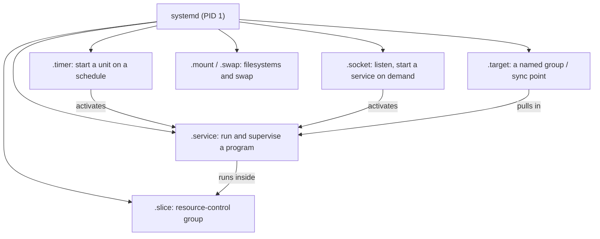
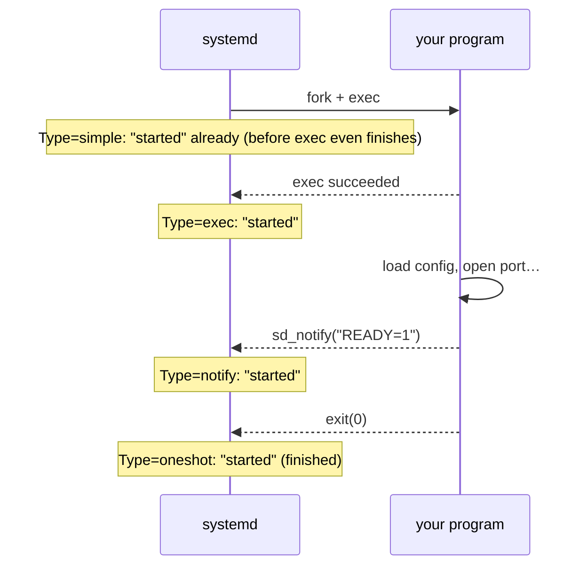
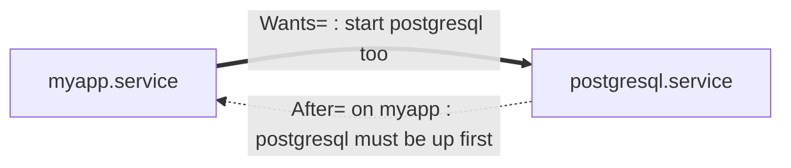
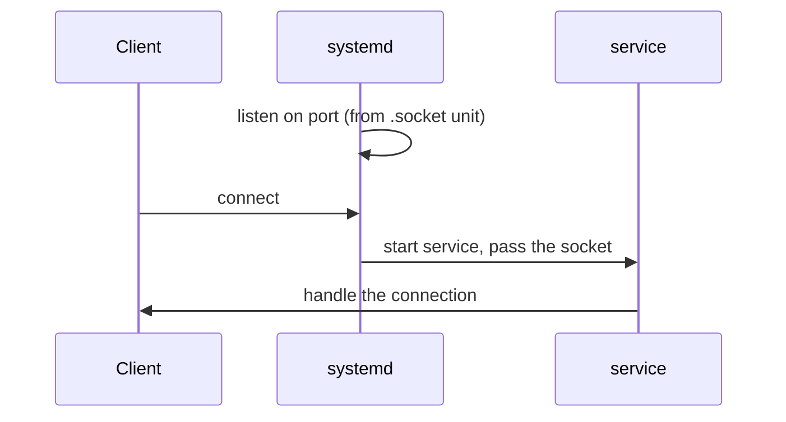

# 07 · systemd and Services

<ul class="module-meta">
  <li>⏱ ~3 hours</li>
  <li>5 labs</li>
  <li>Builds on: 06 · Processes and Signals</li>
</ul>

Your web app crashed at 3 a.m. and was back up by 3:00:05 without anyone
waking up. A nightly cleanup job ran even though the server was powered off at
midnight. A service that used to start fine now starts before the network is
ready and fails on every boot. All three are systemd at work (or misconfigured).
By the end of this module you'll be able to read any unit file, write your own
services and timers, fix ordering problems, and lock a service down so a
compromise can't spread.

!!! abstract "What you'll learn"
    - Explain what systemd does as PID 1 and what a **unit** is.
    - Use `systemctl` to start, stop, enable, mask, and inspect services.
    - Read and write a service unit, choosing the right `Type=` and `Restart=`.
    - Override a packaged unit safely with a drop-in (`systemctl edit`).
    - Tell **requirement** dependencies (`Wants=`, `Requires=`) from
      **ordering** (`After=`, `Before=`).
    - Replace a cron job with a timer and check its schedule with
      `systemd-analyze calendar`.
    - Limit and sandbox a service, and score it with
      `systemd-analyze security`.

## The big picture

Before systemd, Linux booted by running a pile of shell scripts in a fixed
order (**SysV init**). Each script started a daemon and hoped for the best.
Nobody watched the daemon afterwards: if it crashed, it stayed dead. Scripts
ran one at a time, so boot was slow. And tracking a daemon meant trusting a
**PID file** it wrote, which was often stale.

**systemd** replaced that with one program, running as PID 1, that knows about
every service, mount, socket, and timer as a typed object called a **unit**.
It starts units in parallel where dependencies allow, puts each service in its
own **control group** (cgroup) so it can track every process the service
creates, restarts things that die, and captures their output into the
journal.



You talk to systemd with **`systemctl`**. Everything else in this module is a
variation on: write a unit file, tell systemd about it, and ask it to start
(or enable) the unit.

!!! analogy "Think of it like a stage manager"
    Unit files are the cue sheets. systemd is the stage manager who reads
    them, decides what must be ready before each cue, calls everyone in the
    right order (and in parallel where possible), and replaces an actor who
    collapses mid-show. Targets are the "Act 1 ready" checkpoints.

## Units and unit types

A **unit** is anything systemd manages, described by a small text file in INI
format. The file's extension is the unit's type.

| Type | Manages | Example |
|---|---|---|
| `.service` | A program (daemon or one-off job) | `sshd.service` |
| `.socket` | A listening socket that starts a service on first connection | `cockpit.socket` |
| `.timer` | A schedule that starts another unit | `dnf-makecache.timer` |
| `.target` | A group of units; a synchronisation point | `multi-user.target` |
| `.mount` / `.automount` | A mounted filesystem | `boot.mount` |
| `.swap` | A swap device | `dev-mapper-rl\x2dswap.swap` |
| `.path` | Watches a file path, starts a unit when it changes | `cups.path` |
| `.slice` | A cgroup for grouping and limiting resources | `user.slice` |
| `.scope` | A group of processes started outside systemd (e.g. a login session) | `session-3.scope` |
| `.device` | A kernel device, created automatically from udev | `dev-sda.device` |

Many units are generated, not written: `/etc/fstab` lines become `.mount`
units at boot, and every login session becomes a `.scope`.

```console
$ systemctl list-units --type=service --state=running | head -6
  UNIT                     LOAD   ACTIVE SUB     DESCRIPTION
  auditd.service           loaded active running Security Audit Logging Service
  chronyd.service          loaded active running NTP client/server
  crond.service            loaded active running Command Scheduler
  dbus-broker.service      loaded active running D-Bus System Message Bus
  firewalld.service        loaded active running firewalld - dynamic firewall daemon
```

## Driving services with systemctl

### Reading status

`systemctl status` is the first command to run for any service problem. It
packs a lot in:

```console
$ systemctl status chronyd
● chronyd.service - NTP client/server
     Loaded: loaded (/usr/lib/systemd/system/chronyd.service; enabled; preset: enabled)
     Active: active (running) since Tue 2026-10-13 09:12:44 UTC; 2 days ago
       Docs: man:chronyd(8)
             man:chrony.conf(5)
   Main PID: 806 (chronyd)
      Tasks: 1 (limit: 22960)
     Memory: 3.9M (peak: 4.4M)
        CPU: 312ms
     CGroup: /system.slice/chronyd.service
             └─806 /usr/sbin/chronyd -F 2

Oct 13 09:12:44 rocky10 systemd[1]: Starting chronyd.service - NTP client/server...
Oct 13 09:12:44 rocky10 chronyd[806]: chronyd version 4.6.1 starting (+CMDMON +NTP …)
Oct 13 09:12:44 rocky10 systemd[1]: Started chronyd.service - NTP client/server.
Oct 13 09:12:50 rocky10 chronyd[806]: Selected source 162.159.200.1 (2.rocky.pool.ntp.org)
```

- **Loaded:** where the unit file is, whether it's **enabled** (starts at
  boot), and the vendor **preset** (what the distribution intended).
- **Active:** the current state. Common values: `active (running)`,
  `active (exited)` (a one-shot that finished), `inactive (dead)`,
  `failed`, `activating`.
- **CGroup:** every process belonging to the service. Because of cgroups,
  systemd can't lose track of a child process, even if it double-forks.
- The last lines are the newest journal entries for this unit.

??? question "Prove it: how systemd keeps track of every process"
    The `CGroup:` line isn't decoration. Each service gets a directory in the
    cgroup filesystem, and the kernel lists every process in it. A process can't
    leave its cgroup by forking or detaching from a terminal, which is why systemd
    never loses a child the way PID files used to:

    ```console
    $ systemctl show sshd -p MainPID -p ControlGroup -p NRestarts
    MainPID=899
    ControlGroup=/system.slice/sshd.service
    NRestarts=0
    $ cat /sys/fs/cgroup/system.slice/sshd.service/cgroup.procs
    899
    $ cat /proc/899/cgroup
    0::/system.slice/sshd.service
    ```

    When you `systemctl stop` a service, systemd signals *every* PID in that
    cgroup (how it does so is set by `KillMode=`), not just the main one. That's
    how it cleans up stray children a SysV script would have left behind.
    `systemctl show <unit>` with no `-p` dumps every property systemd knows,
    hundreds of them; it's the authoritative "what is systemd actually using"
    view, after all files and drop-ins have been merged.

### The everyday verbs

```console
$ sudo systemctl start httpd        # run it now
$ sudo systemctl stop httpd         # stop it now (SIGTERM, then SIGKILL after a timeout)
$ sudo systemctl restart httpd      # stop + start
$ sudo systemctl reload httpd       # ask it to re-read config without stopping (if supported)
$ sudo systemctl enable httpd       # start at boot
$ sudo systemctl enable --now httpd # enable AND start, the usual combination
$ sudo systemctl disable httpd      # don't start at boot
$ systemctl is-active httpd; systemctl is-enabled httpd
active
enabled
$ systemctl --failed                # everything in the failed state
```

**Start** and **enable** are different things, and mixing them up is the
number one beginner mistake. Start affects *now*. Enable affects *the next
boot*. What does enable actually do? It creates a symlink:

```console
$ sudo systemctl enable httpd
Created symlink '/etc/systemd/system/multi-user.target.wants/httpd.service' → '/usr/lib/systemd/system/httpd.service'.
```

That symlink says "when `multi-user.target` is reached, also want
`httpd.service`". It comes from the unit's `[Install]` section
(`WantedBy=multi-user.target`).

### Practice: drive systemctl

<div class="terminal-sim" data-title="Interrogate a service" markdown>

<div class="task" data-expect="systemctl status sshd||systemctl status sshd.service" data-hint="Ask systemctl for the status of the sshd unit." markdown>

**Step 1.** Is the SSH server running? Show its full status.

```text
● sshd.service - OpenSSH server daemon
     Loaded: loaded (/usr/lib/systemd/system/sshd.service; enabled; preset: enabled)
     Active: active (running) since Tue 2026-10-13 09:12:45 UTC; 2 days ago
   Main PID: 899 (sshd)
     CGroup: /system.slice/sshd.service
             └─899 "sshd: /usr/sbin/sshd -D [listener] 0 of 10-100 startups"
```

</div>

<div class="task" data-expect="systemctl is-enabled sshd||systemctl is-enabled sshd.service" data-hint="There's an is-something verb that answers the boot question in one word." markdown>

**Step 2.** Will it start at the next boot? Answer with a one-word command.

```text
enabled
```

</div>

<div class="task" data-expect="systemctl cat sshd||systemctl cat sshd.service" data-hint="One verb prints the effective unit file, including drop-ins, with their paths." markdown>

**Step 3.** Show the unit file systemd is really using, including any drop-ins.

```text
# /usr/lib/systemd/system/sshd.service
[Unit]
Description=OpenSSH server daemon
…
```

</div>

<div class="task" data-expect="systemctl --failed||systemctl list-units --failed||systemctl list-units --state=failed" data-hint="systemctl has a --failed option." markdown>

**Step 4.** List every unit that is currently in the failed state.

```text
  UNIT LOAD ACTIVE SUB DESCRIPTION

0 loaded units listed.
```

</div>

<div class="task" data-expect="systemd-analyze calendar weekly||systemd-analyze calendar 'weekly'" data-hint="systemd-analyze has a calendar verb that explains OnCalendar= expressions." markdown>

**Step 5.** When would a timer with `OnCalendar=weekly` next fire?

```text
  Original form: weekly
Normalized form: Mon *-*-* 00:00:00
    Next elapse: Mon 2026-10-19 00:00:00 UTC
       From now: 3 days left
```

</div>

</div>

### Masking: stronger than disable

A disabled unit can still be started by hand or pulled in by another unit.
A **masked** unit can't be started at all: systemd links it to `/dev/null`.

```console
$ sudo systemctl mask --now cups
Created symlink '/etc/systemd/system/cups.service' → '/dev/null'.
$ sudo systemctl start cups
Failed to start cups.service: Unit cups.service is masked.
$ sudo systemctl unmask cups
```

Use masking when two services conflict. For example, if you manage the
firewall with your own `nftables.service` rules, mask `firewalld` so nothing
can start it and wipe your ruleset.

## Where unit files live

Unit files live in several directories. When the same name exists in more
than one, the highest-priority directory wins. This is how you override a
packaged unit without editing the package's file (which `dnf update` would
overwrite).

<div class="layers" data-hint="Click a directory. Higher in the stack wins." data-open="0" markdown>

<div class="layer" data-label="/etc/systemd/system/" data-tag="admin: highest" markdown>

**Yours.** Your own units, overrides, drop-ins (`*.d/` directories), and the
`*.wants/` symlinks that `systemctl enable` creates. Never touched by package
updates. Back this directory up.

</div>

<div class="layer" data-label="/run/systemd/system/" data-tag="runtime" markdown>

**Temporary.** Units created at runtime: by generators at boot, by
`systemd-run`, by `systemctl --runtime`. It's on a tmpfs, so it vanishes at
reboot.

</div>

<div class="layer" data-label="/usr/lib/systemd/system/" data-tag="vendor: lowest" markdown>

**The distribution's.** Unit files installed by RPM packages. Don't edit here:
your changes would be silently overwritten at the next update.

```console
$ rpm -qf /usr/lib/systemd/system/sshd.service
openssh-server-9.9p1-…el10.x86_64
```

</div>

</div>

Two commands show you the truth after all the layering:

```console
$ systemctl cat sshd           # the effective unit file plus any drop-ins, with paths
$ systemd-delta --type=extended,overridden   # every override on the system
```

## Reading a unit file

Here is the shape of a typical service unit (trimmed; your copy of
`sshd.service` may differ slightly):

```ini title="/usr/lib/systemd/system/sshd.service"
[Unit]
Description=OpenSSH server daemon
Documentation=man:sshd(8) man:sshd_config(5)
After=network.target sshd-keygen.target
Wants=sshd-keygen.target

[Service]
Type=notify
EnvironmentFile=-/etc/sysconfig/sshd
ExecStart=/usr/sbin/sshd -D $OPTIONS
ExecReload=/bin/kill -HUP $MAINPID
KillMode=process
Restart=on-failure
RestartSec=42s

[Install]
WantedBy=multi-user.target
```

Line by line:

- `Description=`: the human-readable name shown in `status` and boot messages.
- `After=`: **ordering**. If both are being started, start this one after those.
- `Wants=`: a soft **requirement**. Also start `sshd-keygen.target` (which
  creates host keys on first boot) when this starts.
- `Type=notify`: when systemd should consider the service "started". See the
  `Type=` table below.
- `EnvironmentFile=`: read variables from this file. The leading `-` means
  "fine if it doesn't exist".
- `ExecStart=`: the command to run, with an absolute path. `-D` keeps sshd in
  the foreground.
- `ExecReload=`: what `systemctl reload` does. systemd fills in `$MAINPID`.
  Note the `HUP` from module 06.
- `KillMode=process`: on stop or restart, signal only the main `sshd`
  process, not everything in its cgroup. This is why
  `systemctl restart sshd` doesn't cut off the SSH session you typed it in:
  the per-connection `sshd-session` processes are left alone.
- `Restart=on-failure`: self-healing. Restart after an error exit or a crash.
- `WantedBy=`: used only by `systemctl enable`, which creates a symlink in
  `multi-user.target.wants/`.

!!! warning "No comments at the end of a line"
    systemd unit files (and `journald.conf`) only treat `#` or `;` as a
    comment at the *start* of a line. `Restart=on-failure  # heal` sets the
    value to the whole string, and systemd logs a parse error and ignores
    the setting. That's why the explanations here are in a list, not in the
    file.

Three sections, always the same jobs:

- **`[Unit]`**: description and relationships to other units. Same for every unit type.
- **`[Service]`** (or `[Timer]`, `[Socket]`, `[Mount]`…): the type-specific part.
- **`[Install]`**: what `enable` should do. Ignored at runtime.

## Writing your own service

A minimal service for a script you wrote:

```ini title="/etc/systemd/system/hello.service"
[Unit]
Description=Hello demo service

[Service]
Type=exec
ExecStart=/usr/local/bin/hello.sh
User=nobody

[Install]
WantedBy=multi-user.target
```

After creating or editing any unit file, tell systemd to re-read the files:

```console
$ sudo systemctl daemon-reload
$ sudo systemctl enable --now hello
```

!!! warning "Write to stdout, run in the foreground"
    Under systemd a service should **not** daemonize itself (no `&`, no
    `nohup`, no double-fork) and doesn't need its own log file. Print to
    stdout/stderr and the journal captures it, tagged with the unit name
    (see [08 · Logging and the Journal](08-logging-and-the-journal.md)).

### Choosing Type=

`Type=` answers one question: **when does systemd consider the service
"started"?** That moment matters, because units ordered `After=` this one
wait for it.

| `Type=` | "Started" means | Use it for |
|---|---|---|
| `simple` (default) | Immediately, as soon as systemd has forked the process | Legacy default. Even a typo'd binary path counts as "started". |
| `exec` | The program has actually been executed successfully | **Your default for new services.** Catches a bad `ExecStart=` path at start. |
| `notify` | The program sends `READY=1` to systemd when it's really ready | Daemons built for systemd (`sshd` on Rocky 10, PostgreSQL, many others). Best ordering guarantee. |
| `oneshot` | The program has **finished** successfully | Setup scripts and jobs. Add `RemainAfterExit=yes` to keep the unit "active" afterwards. |
| `forking` | The parent process exits, leaving a forked child behind | Old-style daemons that background themselves. Pair with `PIDFile=`. Avoid for new code. |



??? question "Under the hood: how a `Type=notify` service says it's ready"
    How does a `Type=notify` service "say" it's ready? systemd puts the path of a
    socket in the service's environment variable `$NOTIFY_SOCKET`, and the
    program sends a tiny text message, `READY=1`, to it (through the
    `sd_notify()` library call). Scripts can do the same with the
    `systemd-notify --ready` command. The same channel carries `STATUS=…` text,
    which `systemctl status` shows as a `Status:` line.

    You can watch the protocol from a shell. This transient service sleeps 3
    seconds, reports a status line, then declares itself ready:

    ```console
    $ sudo systemd-run --unit=notify-demo -p Type=notify -p NotifyAccess=all \
        bash -c 'sleep 3; systemd-notify --status="warming up"; systemd-notify --ready; sleep 60'
    $ systemctl status notify-demo | grep -E 'Active|Status'
         Active: active (running) since …
         Status: "warming up"
    ```

    `systemd-run` blocks for those 3 seconds, because with `Type=notify` the
    unit stays `activating` until `READY=1` arrives. `NotifyAccess=all` is
    needed because the message comes from a child process (`systemd-notify`),
    not the main PID. Stop it with `sudo systemctl stop notify-demo`.

<div class="quiz" data-answer="3" markdown>

You have a setup script that creates some directories and exits. A web server
unit must not start until it has finished. Which `Type=` should the setup
unit use?

- `simple`, because it's the default
- `exec`, because it detects a bad path
- `oneshot`, so "started" means the script finished successfully
- `forking`, because the script exits

Right. With `oneshot`, units ordered `After=` it wait until the script has
*exited* successfully. With `simple` or `exec` they'd start while the script
was still running.

</div>

## Overriding with drop-ins

You want `httpd` to restart on failure, or to get a higher file limit. Don't
copy the whole unit to `/etc`; you'd stop receiving the vendor's fixes. Add a
**drop-in**: a small `.conf` file in a `<unit>.d/` directory whose settings are
merged on top.

```console
$ sudo systemctl edit httpd
```

This opens an editor on `/etc/systemd/system/httpd.service.d/override.conf`.
Add only what you're changing:

```ini title="/etc/systemd/system/httpd.service.d/override.conf"
[Service]
Restart=on-failure
RestartSec=5s
LimitNOFILE=65536
```

Save and quit; `systemctl edit` runs `daemon-reload` for you. Restart the
service to apply it, then confirm with `systemctl cat httpd`, which shows the
original file followed by your drop-in:

```console
$ systemctl cat httpd
# /usr/lib/systemd/system/httpd.service
[Unit]
Description=The Apache HTTP Server
…
# /etc/systemd/system/httpd.service.d/override.conf
[Service]
Restart=on-failure
RestartSec=5s
LimitNOFILE=65536
```

!!! pitfall "Changing ExecStart= in a drop-in"
    Settings that can appear several times (`ExecStart=`, `Environment=`,
    `After=`) **add** to the list in a drop-in. For `ExecStart=` on a normal
    service that gives "more than one ExecStart= setting" and the unit
    refuses to load. Clear it with an empty assignment first:

    ```ini
    [Service]
    ExecStart=
    ExecStart=/usr/sbin/httpd -DFOREGROUND -f /etc/httpd/alt.conf
    ```

`systemctl edit --full httpd` copies the whole unit to `/etc` instead. Use it
rarely. `systemctl revert httpd` deletes all your overrides and goes back to
the vendor version.

## Dependencies: requirement versus ordering

This is the most misunderstood part of systemd. There are **two independent
questions**, answered by two different families of settings:

1. **Requirement:** if I start unit A, should unit B be started too?
   (`Wants=`, `Requires=`, `BindsTo=`)
2. **Ordering:** if both A and B are starting, which goes first?
   (`After=`, `Before=`)

Neither implies the other. `Requires=postgresql.service` with no `After=`
starts both **at the same time**, and your app races the database.
`After=postgresql.service` with no `Wants=` only matters if something else
happens to start PostgreSQL.



The thick arrow is the **requirement** (who gets pulled in); the dotted arrow
is the **ordering** (who goes first). They are two separate lines in the unit
file:

```ini
[Unit]
Wants=postgresql.service
After=postgresql.service
```

| Setting | Meaning | If the other unit fails |
|---|---|---|
| `Wants=` | Start it too | We start anyway. The recommended default. |
| `Requires=` | Start it too, we need it | If it fails to start (and we're ordered after it), we don't start. If it's stopped later, we're stopped too. |
| `BindsTo=` | Like `Requires=`, but tighter | If it stops or disappears for any reason, we stop. |
| `PartOf=` | Only for stop/restart | Stopping or restarting it stops or restarts us. |
| `Conflicts=` | Can't run together | Starting one stops the other. |
| `After=` / `Before=` | Order only | No effect on whether anything starts. |

### Waiting for the network

The classic case: a service that needs a working IP address at boot.
`network.target` only means "the network stack is being set up", not "I have
an address". For that, use `network-online.target`:

```ini
[Unit]
Wants=network-online.target
After=network-online.target
```

On Rocky, `NetworkManager-wait-online.service` makes that target wait until
NetworkManager reports the network is up.

<div class="quiz" data-answer="2" markdown>

`myapp.service` has `Requires=redis.service` and nothing else. At boot, what
happens?

- Redis starts, then myapp starts after Redis is ready
- Both start at roughly the same time; myapp may run before Redis is listening
- myapp starts, then Redis
- myapp never starts, because `Requires=` needs `Wants=` as well

Correct. `Requires=` pulls Redis into the boot, but without `After=redis.service`
there's no ordering, so systemd starts them in parallel.

</div>

## Targets: named states of the system

A **target** is a unit that groups other units and acts as a checkpoint.
"The system has reached `multi-user.target`" means everything wanted by
it has been started. Targets replace the old numbered **runlevels**.

| Target | Old runlevel | What you get |
|---|---|---|
| `poweroff.target` | 0 | Shut down |
| `rescue.target` | 1 | Single user: local filesystems, root shell, no network services |
| `multi-user.target` | 3 | Full system, text login. Default on servers. |
| `graphical.target` | 5 | `multi-user` plus a graphical login |
| `reboot.target` | 6 | Reboot |
| `emergency.target` | (none) | Bare minimum: root filesystem read-only, root shell, almost nothing else |

```console
$ systemctl get-default
multi-user.target
$ sudo systemctl set-default graphical.target
$ sudo systemctl isolate rescue.target      # switch now (drops your SSH session!)
$ systemctl list-dependencies multi-user.target | head
```

How boot walks through targets is covered in
[14 · The Boot Process](14-the-boot-process.md).

## Restart= and self-healing

Supervision is systemd's superpower. `Restart=` decides when a dead service
comes back:

| `Restart=` | Restarts when… |
|---|---|
| `no` (default) | Never |
| `on-failure` | Non-zero exit, killed by a signal, timeout, or watchdog. **Usual choice.** |
| `on-abnormal` | Killed by a signal, timeout, or watchdog, but not a clean non-zero exit |
| `always` | Any exit, even a clean one |

`RestartSec=` is how long to wait first (default 100ms). To stop a broken
service from restarting forever in a tight loop, systemd has a **start rate
limit**: by default, more than 5 starts in 10 seconds puts the unit in
`failed` with "start request repeated too quickly". Tune it in `[Unit]`:

```ini
[Unit]
StartLimitIntervalSec=60
StartLimitBurst=3

[Service]
Restart=on-failure
RestartSec=5s
```

Once a unit hits the limit it stays down until you fix it and run
`sudo systemctl reset-failed <unit>` (or start it manually).

!!! pitfall "`kill <pid>` doesn't trigger `Restart=on-failure`"
    systemd treats death by `SIGTERM`, `SIGINT`, `SIGHUP`, or `SIGPIPE` as a
    **clean** exit, the same as exit code 0. So if someone (or a script, or
    the OOM tooling in an app) sends a plain `kill` to the main PID, an
    `on-failure` service stays down. To test self-healing, use
    `systemctl kill --signal=KILL`, or `kill -SEGV`. And `systemctl stop`
    never triggers a restart, whatever `Restart=` says.

??? question "Under the hood: back off instead of hammering"
    A fixed `RestartSec=5s` retries a dead database every 5 seconds forever.
    Since systemd 254 you can make the delay grow instead:

    ```ini
    [Service]
    Restart=on-failure
    RestartSec=2s
    RestartSteps=5
    RestartMaxDelaySec=2min
    ```

    The delay climbs from 2 seconds to 2 minutes over five restarts. Combine
    it with `StartLimitIntervalSec=0` (no rate limit) for a service that
    should keep trying through a long outage of something it depends on.
    `systemctl show <unit> -p NRestarts` tells you how often it has fired.

```console
$ systemctl show flaky -p NRestarts -p Result
NRestarts=3
Result=exit-code
```

## Timers: cron, but better

A **timer** unit starts another unit (usually a `oneshot` service with the
same name) on a schedule. Compared with cron, you get: logs in the journal,
`systemctl status` for the job, resource limits and sandboxing, dependencies,
and catch-up for missed runs.

```ini title="/etc/systemd/system/cleanup.timer"
[Unit]
Description=Nightly temp cleanup

[Timer]
OnCalendar=*-*-* 02:30:00
RandomizedDelaySec=15m
Persistent=true

[Install]
WantedBy=timers.target
```

- `OnCalendar=`: every day at 02:30. Format: `DayOfWeek Year-Month-Day Hour:Minute:Second`.
- `RandomizedDelaySec=`: add up to 15 minutes of random delay so a fleet doesn't all fire at once.
- `Persistent=true`: if the machine was off at 02:30, run the job as soon as it boots.

It activates `cleanup.service` (same name, `.service` extension). You
**enable the timer**, not the service:

```console
$ sudo systemctl enable --now cleanup.timer
$ systemctl list-timers
NEXT                        LEFT LAST                        PASSED UNIT                   ACTIVATES
Thu 2026-10-15 14:12:03 UTC  47min Thu 2026-10-15 13:02:11 UTC 22min ago dnf-makecache.timer  dnf-makecache.service
Fri 2026-10-16 00:00:00 UTC  10h  Thu 2026-10-15 00:00:00 UTC 13h ago logrotate.timer        logrotate.service
Fri 2026-10-16 02:41:27 UTC  13h  -                           -      cleanup.timer          cleanup.service
…
```

`OnCalendar=` expressions are easy to get wrong, so check them before you
deploy. `systemd-analyze calendar` normalises the expression and shows the
next run:

```console
$ systemd-analyze calendar 'Mon..Fri *-*-* 08:00' --iterations=3
  Original form: Mon..Fri *-*-* 08:00
Normalized form: Mon..Fri *-*-* 08:00:00
    Next elapse: Fri 2026-10-16 08:00:00 UTC
       From now: 18h left
       Iter. #2: Mon 2026-10-19 08:00:00 UTC
       Iter. #3: Tue 2026-10-20 08:00:00 UTC
```

Handy shortcuts: `hourly`, `daily`, `weekly`, `monthly`, `*:0/15` (every 15
minutes). Besides wall-clock times there are **monotonic** timers relative to
events: `OnBootSec=10min` (10 minutes after boot), `OnUnitActiveSec=1h`
(an hour after it last ran).

!!! tip "One-off timers without files"
    `sudo systemd-run --on-active=30m /usr/bin/systemctl restart httpd`
    schedules a single run 30 minutes from now, as a transient unit.

<div class="quiz" data-answer="1" markdown>

You created `backup.service` and `backup.timer`, ran
`sudo systemctl enable --now backup.service`, and the job never runs on
schedule. What went wrong?

- You enabled the service, not the timer; the timer is what must be enabled and started
- Timers only work with `Type=simple` services
- `OnCalendar=` needs a cron-style expression
- You forgot `RemainAfterExit=yes`

Right. The timer unit carries the schedule and the `[Install]` section. Run
`sudo systemctl enable --now backup.timer` and check `systemctl list-timers`.

</div>

## Socket activation

With **socket activation**, systemd opens a listening socket itself and only
starts the service when the first connection arrives, handing over the open
socket. Benefits: services that are rarely used take no memory until needed,
and boot is faster because clients can connect (and queue) before the
service has even started. `cockpit.socket` on Rocky works this way: port 9090
is open, but the Cockpit web service starts only when you browse to it.



A socket unit and its service share a name. With `Accept=yes`, systemd
starts a fresh instance of a **template** service (`name@.service`) for each
connection, which is perfect for tiny demos (Lab 4 builds one).

## Resource control with slices

Every service runs in its own cgroup, and cgroups are grouped into
**slices**: `system.slice` for services, `user.slice` for logins,
`machine.slice` for VMs and containers. You can see the whole tree:

```console
$ systemd-cgls --no-pager | head -12
Control group /:
-.slice
├─user.slice
│ └─user-1000.slice
│   ├─user@1000.service …
│   └─session-3.scope
│     ├─2840 sshd-session: alice@pts/0
│     └─2841 -bash
├─init.scope
│ └─1 /usr/lib/systemd/systemd --switched-root --system --deserialize=46
└─system.slice
  ├─chronyd.service
  │ └─806 /usr/sbin/chronyd -F 2
…
$ systemd-cgtop          # live CPU/memory per cgroup
```

Limits are just unit settings. `set-property` applies them live **and**
saves them (add `--runtime` to make the change last only until reboot):

```console
$ sudo systemctl set-property httpd.service MemoryMax=512M CPUQuota=50%
$ systemctl show httpd -p MemoryMax -p CPUQuotaPerSecUSec
MemoryMax=536870912
CPUQuotaPerSecUSec=500ms
```

| Setting | Effect |
|---|---|
| `MemoryMax=` | Hard memory cap; exceeding it triggers an OOM kill inside the service |
| `MemoryHigh=` | Soft cap; the service is slowed and reclaimed above it |
| `CPUQuota=` | Max CPU time, e.g. `50%` of one CPU, `200%` = two CPUs |
| `CPUWeight=` | Relative share when CPUs are contended (default 100) |
| `TasksMax=` | Max number of processes and threads (stops fork bombs) |
| `IOWeight=` | Relative disk I/O share |

??? question "Under the hood: the drop-in directory nobody looks in"
    `set-property` doesn't edit your `override.conf`. It writes its own
    drop-ins to **`/etc/systemd/system.control/`**, a directory that ranks
    *above* `/etc/systemd/system/`:

    ```console
    $ ls /etc/systemd/system.control/httpd.service.d/
    50-CPUQuota.conf  50-MemoryMax.conf
    ```

    This bites in production: someone sets `MemoryMax=` in a drop-in with
    `systemctl edit`, restarts, and the old value from a forgotten
    `set-property` still wins. `systemctl cat` and
    `systemctl show -p DropInPaths` list every file that applies, including
    these. Remove a `set-property` value by deleting its file (or
    `systemctl revert`, which clears both kinds) and running
    `daemon-reload`.

How cgroups work underneath, and how containers use the same mechanism, is
in [18 · Containers from the Ground Up](18-containers.md).

## Sandboxing a service

If an attacker takes over a web server, what can they reach? By default, a
service sees the whole filesystem with its user's permissions. systemd can
shrink that world with one line per protection, using kernel namespaces and
filters under the hood.

| Setting | What it does |
|---|---|
| `ProtectSystem=strict` | Whole filesystem read-only except paths you list in `ReadWritePaths=` (`full` makes `/usr`, `/boot`, `/etc` read-only) |
| `ProtectHome=yes` | `/home`, `/root`, `/run/user` appear empty |
| `PrivateTmp=yes` | Private `/tmp` and `/var/tmp`, invisible to other services |
| `PrivateDevices=yes` | Only harmless pseudo-devices in `/dev` (no disks) |
| `NoNewPrivileges=yes` | The service and its children can never gain privileges (setuid binaries stop working for it) |
| `DynamicUser=yes` | Run as a throwaway UID allocated at start |
| `CapabilityBoundingSet=` | Which root powers (capabilities) it may ever have; empty = none |
| `SystemCallFilter=@system-service` | Block system calls a normal service never needs |

`systemd-analyze security` scores how exposed each service is (0 = locked
down, 10 = wide open):

```console
$ systemd-analyze security --no-pager | head -6
UNIT                          EXPOSURE PREDICATE HAPPY
auditd.service                     8.9 EXPOSED   🙁
chronyd.service                    3.9 OK        🙂
crond.service                      9.6 UNSAFE    😨
dbus-broker.service                8.7 EXPOSED   🙁
firewalld.service                  9.6 UNSAFE    😨
```

Run it with a unit name (`systemd-analyze security hello.service`) to get a
line-by-line checklist of which protections are missing. Don't chase a 0:
some services legitimately need access (a backup agent must read `/home`).
Sandboxing works alongside SELinux, not instead of it
([16 · SELinux](16-selinux.md)).

## How long did boot take?

`systemd-analyze` also answers "why is boot slow?":

```console
$ systemd-analyze
Startup finished in 1.873s (kernel) + 3.104s (initrd) + 9.412s (userspace) = 14.390s
multi-user.target reached after 9.380s in userspace.
$ systemd-analyze blame | head -4
5.912s NetworkManager-wait-online.service
1.204s kdump.service
 802ms firewalld.service
 611ms tuned.service
$ systemd-analyze critical-chain
multi-user.target @9.380s
└─kdump.service @8.170s +1.204s
  └─network-online.target @8.166s
    └─NetworkManager-wait-online.service @2.252s +5.912s
…
```

`blame` lists units by how long they took, but many ran in parallel and
didn't delay anything. **`critical-chain`** shows the chain that actually
gated reaching the target: optimise that. More in
[14 · The Boot Process](14-the-boot-process.md).

## Soft reboot

A **soft reboot** (`systemctl soft-reboot`) stops all of user space, every
service and session, then starts it again from the top, **without**
restarting the kernel or the firmware. Because hardware isn't
re-initialised, it takes seconds instead of minutes. It's useful after
updating everything *except* the kernel (glibc, systemd, OpenSSL).

```console
$ sudo systemctl soft-reboot
```

systemd has offered it since version 254, so the command exists on Rocky 10
(systemd 257). Red Hat lists soft reboots as a supported feature starting
with RHEL 10.1 and documents them mainly for **image mode** systems, where a
new OS image is staged and then switched to with a soft reboot. Check what
the Rocky 10.x release notes say before you build a patching process on it.

!!! warning
    A soft reboot does **not** load a new kernel. After a kernel update you
    still need a real `reboot`. `systemctl show -p SoftRebootsCount` (on the
    system manager) tells you how many soft reboots happened since the last
    real boot.

## User services

Each logged-in user has their own systemd instance (the "user manager" you
saw in `pstree` in module 06). Put units in `~/.config/systemd/user/` and
manage them with `systemctl --user` without sudo. They stop when you log out,
unless an admin runs `loginctl enable-linger <user>`, which starts the user
manager at boot. This is how rootless Podman containers run as services.

## When a service won't start

<div class="decision" markdown>

<div class="node" data-id="start" markdown>

**Run `systemctl status <unit>`. What does `Loaded:` say?**

<button data-goto="notfound">not-found</button>
<button data-goto="error">error / bad-setting</button>
<button data-goto="masked">masked</button>
<button data-goto="loaded">loaded</button>

</div>

<div class="node" data-id="notfound" markdown>

systemd has no unit by that name. Check the spelling with
`systemctl list-unit-files '*name*'`. If you just created the file, run
`sudo systemctl daemon-reload`. Make sure the file is in `/etc/systemd/system/`
and ends in `.service`.

</div>

<div class="node" data-id="error" markdown>

The unit file has a syntax problem. Run `systemd-analyze verify <unit>` and
`journalctl -b -u <unit>`. Common causes: a relative path in `ExecStart=`,
two `ExecStart=` lines in a drop-in, a typo in a section name.

</div>

<div class="node" data-id="masked" markdown>

Someone deliberately blocked it. Find out why before you
`sudo systemctl unmask <unit>`; it may conflict with another service.

</div>

<div class="node" data-id="loaded" markdown>

**What does `Active:` say?**

<button data-goto="exitcode">failed (Result: exit-code)</button>
<button data-goto="limit">failed (start-limit-hit)</button>
<button data-goto="deps">inactive, dependency failed</button>
<button data-goto="exec">failed (Result: exit-code, status=203/EXEC)</button>

</div>

<div class="node" data-id="exitcode" markdown>

The program started and then exited with an error. Its own messages are in
the journal: `journalctl -u <unit> -b -e`. Try running the `ExecStart=`
command by hand as the service's `User=`. If it works by hand but not under
systemd, suspect SELinux (`sudo ausearch -m avc -ts recent`) or a sandboxing
setting.

</div>

<div class="node" data-id="limit" markdown>

It crashed too often and hit the start rate limit. Fix the underlying error
first (see the journal), then `sudo systemctl reset-failed <unit>` and start
it again.

</div>

<div class="node" data-id="deps" markdown>

Something it `Requires=` failed. `systemctl list-dependencies <unit>` shows
the tree; `systemctl --failed` shows which one broke. Fix that unit first.

</div>

<div class="node" data-id="exec" markdown>

Status `203/EXEC` means systemd couldn't execute the program at all: wrong
path, missing execute bit, missing `#!` line in a script, or SELinux denying
execution from that location (scripts in a home directory often hit this).

</div>

</div>

## Labs

!!! lab "Lab 1: Your first service"

    **Goal:** Turn a script into a supervised service that logs to the
    journal and starts at boot.

    **You'll need:** a Rocky 10 VM, sudo.

    1. Create the script:

        ```bash
        sudo tee /usr/local/bin/hello.sh <<'EOF'
        #!/bin/bash
        while true; do
            echo "hello from PID $$ at $(date +%T)"
            sleep 10
        done
        EOF
        sudo chmod +x /usr/local/bin/hello.sh
        ```

    2. Create the unit:

        ```bash
        sudo tee /etc/systemd/system/hello.service <<'EOF'
        [Unit]
        Description=Hello demo service

        [Service]
        Type=exec
        ExecStart=/usr/local/bin/hello.sh
        DynamicUser=yes

        [Install]
        WantedBy=multi-user.target
        EOF
        ```

    3. Load, enable, and start it:

        ```console
        $ sudo systemctl daemon-reload
        $ sudo systemctl enable --now hello
        Created symlink '/etc/systemd/system/multi-user.target.wants/hello.service' → '/etc/systemd/system/hello.service'.
        ```

    4. Watch it: `systemctl status hello` and `journalctl -u hello -f`
       (++ctrl+c++ to stop following).

    5. Find which user it runs as: `ps -o user,pid,cmd -C hello.sh`.

    **Check your work:** `systemctl is-active hello` prints `active`, and the
    journal shows a line every 10 seconds.

    ??? success "What just happened?"
        systemd forked and executed your script in its own cgroup, attached
        its stdout to the journal, and created the enable symlink.
        `DynamicUser=yes` made it run as a temporary user (named after the
        unit) that exists only while the service runs.

    **Clean up:** keep it for Labs 2 and 5, or:
    `sudo systemctl disable --now hello; sudo rm /etc/systemd/system/hello.service /usr/local/bin/hello.sh; sudo systemctl daemon-reload`

!!! lab "Lab 2: A service that heals itself"

    **Goal:** Watch `Restart=` bring a crashing service back, and then hit
    the start rate limit.

    **You'll need:** Lab 1's `hello.service`.

    1. Add a drop-in:

        ```console
        $ sudo systemctl edit hello
        ```

        and add:

        ```ini
        [Unit]
        StartLimitIntervalSec=60
        StartLimitBurst=3

        [Service]
        Restart=on-failure
        RestartSec=2s
        ```

    2. Restart it and kill it with a signal (counts as a failure):

        ```console
        $ sudo systemctl restart hello
        $ sudo systemctl kill --signal=KILL hello
        $ sleep 3; systemctl show hello -p NRestarts -p ActiveState
        NRestarts=1
        ActiveState=active
        ```

    3. Kill it two or three more times (wait 3 seconds between each). On
       the fourth start inside 60 seconds, systemd gives up:

        ```console
        $ systemctl status hello | head -5
        × hello.service - Hello demo service
             Loaded: loaded (/etc/systemd/system/hello.service; enabled; preset: disabled)
            Drop-In: /etc/systemd/system/hello.service.d
                     └─override.conf
             Active: failed (Result: start-limit-hit) since …
        ```

    4. Recover: `sudo systemctl reset-failed hello && sudo systemctl start hello`.

    **Check your work:** you saw `NRestarts` go up, then `start-limit-hit`.

    ??? success "What just happened?"
        `Restart=on-failure` treated each `SIGKILL` as a crash and restarted
        after 2 seconds. On the fourth start inside 60 seconds the rate limit
        tripped and systemd stopped trying, which protects the machine from a
        tight crash loop.

    **Clean up:** `sudo systemctl revert hello` removes the drop-in; then
    `sudo systemctl restart hello`.

!!! lab "Lab 3: Replace a cron job with a timer"

    **Goal:** Run a job every two minutes with a timer and read its history.

    **You'll need:** a Rocky 10 VM, sudo.

    1. The job (a oneshot service):

        ```bash
        sudo tee /etc/systemd/system/diskreport.service <<'EOF'
        [Unit]
        Description=Log root filesystem usage

        [Service]
        Type=oneshot
        ExecStart=/usr/bin/df -h /
        EOF
        ```

    2. The schedule. Check the expression first:

        ```console
        $ systemd-analyze calendar '*:0/2' --iterations=2
        ```

        then create the timer:

        ```bash
        sudo tee /etc/systemd/system/diskreport.timer <<'EOF'
        [Unit]
        Description=Run diskreport every 2 minutes

        [Timer]
        OnCalendar=*:0/2
        Persistent=true

        [Install]
        WantedBy=timers.target
        EOF
        ```

    3. Enable the **timer**:

        ```console
        $ sudo systemctl daemon-reload
        $ sudo systemctl enable --now diskreport.timer
        $ systemctl list-timers diskreport.timer
        ```

    4. Wait a few minutes, then read the output:
       `journalctl -u diskreport.service --since '-10min'`.

    **Check your work:** the journal shows `df` output at two-minute
    intervals, and `systemctl status diskreport.service` shows
    `inactive (dead)` with a successful last run.

    ??? success "What just happened?"
        The timer fired the matching service on schedule. Because the service
        is `oneshot`, it's "active" only while `df` runs. Unlike cron, each
        run's output and exit status are in the journal, with no mail setup.

    **Clean up:** `sudo systemctl disable --now diskreport.timer; sudo rm /etc/systemd/system/diskreport.{service,timer}; sudo systemctl daemon-reload`

!!! lab "Lab 4: Socket activation in 10 lines"

    **Goal:** Have systemd listen on a port and start a service per
    connection.

    **You'll need:** a Rocky 10 VM, sudo.

    1. Create the socket and a template service:

        ```bash
        sudo tee /etc/systemd/system/greet.socket <<'EOF'
        [Socket]
        ListenStream=127.0.0.1:4444
        Accept=yes

        [Install]
        WantedBy=sockets.target
        EOF
        sudo tee /etc/systemd/system/greet@.service <<'EOF'
        [Service]
        ExecStart=/usr/bin/echo "Hello, you were served by a brand new process"
        StandardInput=socket
        EOF
        ```

    2. Start the socket only:

        ```console
        $ sudo systemctl daemon-reload
        $ sudo systemctl start greet.socket
        $ ss -ltn 'sport = :4444'
        State  Recv-Q Send-Q Local Address:Port  Peer Address:Port
        LISTEN 0      4096       127.0.0.1:4444       0.0.0.0:*
        ```

    3. Connect with bash's built-in `/dev/tcp`:

        ```console
        $ cat < /dev/tcp/127.0.0.1/4444
        Hello, you were served by a brand new process
        ```

    4. See the instance that ran: `journalctl -u 'greet@*' -n 5`.

    **Check your work:** step 3 prints the greeting, yet no greet service was
    running before you connected.

    ??? success "What just happened?"
        systemd (PID 1) owned the listening socket. On each connection it
        accepted it and started `greet@<n>.service` with the connection as
        its stdin and stdout. The echo ran, wrote into the socket, and exited.

    **Clean up:** `sudo systemctl stop greet.socket; sudo rm /etc/systemd/system/greet.socket /etc/systemd/system/greet@.service; sudo systemctl daemon-reload`

!!! lab "Lab 5: Sandbox and score a service"

    **Goal:** Measure and improve a service's exposure score.

    **You'll need:** Lab 1's `hello.service`.

    1. Get a baseline:

        ```console
        $ systemd-analyze security hello.service --no-pager | tail -1
        → Overall exposure level for hello.service: 5.4 MEDIUM 😐
        ```

        Your number may differ. `DynamicUser=yes` already switched on
        several protections: it implies `ProtectSystem=strict`,
        `ProtectHome=read-only`, `PrivateTmp=yes`, `NoNewPrivileges=yes`,
        and `RemoveIPC=yes`. `systemctl show hello -p ProtectSystem` proves it.

    2. Harden it with a drop-in (`sudo systemctl edit hello`):

        ```ini
        [Service]
        ProtectSystem=strict
        ProtectHome=yes
        PrivateTmp=yes
        PrivateDevices=yes
        NoNewPrivileges=yes
        CapabilityBoundingSet=
        SystemCallFilter=@system-service
        RestrictAddressFamilies=AF_UNIX
        ```

    3. Restart and re-score:

        ```console
        $ sudo systemctl restart hello
        $ systemd-analyze security hello.service --no-pager | tail -1
        ```

    4. Prove a protection works. A `PrivateTmp=` service has its own `/tmp`:

        ```console
        $ pid=$(systemctl show -p MainPID --value hello)
        $ sudo readlink /proc/1/ns/mnt /proc/$pid/ns/mnt
        mnt:[4026531841]
        mnt:[4026532301]
        ```

    **Check your work:** the score dropped noticeably, the service is still
    `active`, and its mount namespace differs from PID 1's.

    ??? success "What just happened?"
        Each setting removed something the script never needed. The
        different `mnt:[…]` number shows systemd gave the service its own
        view of the filesystem (a **mount namespace**, covered in module 18).

    **Clean up:** `sudo systemctl disable --now hello; sudo systemctl revert hello; sudo rm /etc/systemd/system/hello.service /usr/local/bin/hello.sh; sudo systemctl daemon-reload`

## Common pitfalls

| Symptom | Cause | Fix |
|---|---|---|
| Edited unit file, nothing changed | systemd caches unit files | `sudo systemctl daemon-reload`, then restart the unit |
| Service runs now, gone after reboot | Started but not enabled | `systemctl enable --now` |
| Edits in `/usr/lib/systemd/system` vanished | Package update replaced the file | Use `systemctl edit` drop-ins in `/etc` |
| "more than one ExecStart= setting" | Drop-in appended to `ExecStart=` | Add an empty `ExecStart=` line first |
| Service starts before database is ready | `Requires=` without `After=` | Add `After=`; use `Type=notify` in the dependency if available |
| Fails at boot, works when started by hand | Ordered before the network is up | `Wants=` + `After=network-online.target` |
| `status=203/EXEC` | Bad path, no exec bit, no shebang, or SELinux | Check path, `chmod +x`, `#!/bin/bash`, `ausearch -m avc` |
| "start request repeated too quickly" | Hit the start rate limit | Fix the crash, then `systemctl reset-failed` |
| Timer never runs | Enabled the service, not the timer | `systemctl enable --now name.timer` |
| Limits from `limits.conf` ignored | Services don't use PAM | `LimitNOFILE=` in a drop-in |

## Cheat sheet

| Command | What it does |
|---|---|
| `systemctl status <unit>` | State, cgroup, recent logs |
| `systemctl start / stop / restart / reload <unit>` | Act now |
| `systemctl enable --now <unit>` | Start now and at boot |
| `systemctl disable / mask / unmask <unit>` | Don't start at boot / block entirely / unblock |
| `systemctl --failed` | List failed units |
| `systemctl list-units --type=service` | Loaded services |
| `systemctl list-unit-files` | All unit files and their enable state |
| `systemctl cat <unit>` | Show the effective unit with drop-ins |
| `systemctl edit <unit>` / `systemctl revert <unit>` | Create a drop-in / remove overrides |
| `systemctl daemon-reload` | Re-read unit files |
| `systemctl show <unit> -p <Prop>` | Show one property |
| `systemctl list-dependencies <unit>` | Dependency tree |
| `systemctl get-default` / `set-default <target>` | Default boot target |
| `systemctl isolate rescue.target` | Switch to a target now |
| `systemctl list-timers` | Timers with next and last run |
| `systemctl reset-failed <unit>` | Clear failed state and rate limit |
| `systemctl set-property <unit> MemoryMax=…` | Apply a resource limit |
| `systemctl soft-reboot` | Restart user space only |
| `systemctl --user …`, `loginctl enable-linger` | Per-user services |
| `systemd-analyze calendar '<expr>'` | Check a timer schedule |
| `systemd-analyze verify <file>` | Lint a unit file |
| `systemd-analyze security [<unit>]` | Exposure score |
| `systemd-analyze blame` / `critical-chain` | Boot timing |
| `systemd-cgls` / `systemd-cgtop` | cgroup tree / live usage |
| `systemd-run --on-active=… <cmd>` | Run a transient unit or one-off timer |
| `systemd-delta` | List all overrides |

## Flashcards

<div class="flashcards" markdown>

<div class="card" markdown>

What's the difference between `start` and `enable`?

`start` runs the unit now. `enable` creates symlinks (from `[Install]`) so it starts at boot. `enable --now` does both.

</div>

<div class="card" markdown>

What does `systemctl mask` do?

Links the unit to `/dev/null` so nothing, not even a dependency, can start it.

</div>

<div class="card" markdown>

Which unit file directory wins: `/etc/systemd/system`, `/run/systemd/system`, or `/usr/lib/systemd/system`?

`/etc` beats `/run` beats `/usr/lib`. Packages install to `/usr/lib`; your changes go in `/etc`.

</div>

<div class="card" markdown>

How do you safely change one setting of a packaged unit?

`systemctl edit <unit>` creates a drop-in in `/etc/systemd/system/<unit>.d/override.conf` that's merged on top.

</div>

<div class="card" markdown>

What's the difference between `Requires=` and `After=`?

`Requires=` pulls the other unit in (requirement). `After=` only orders startup. Without `After=`, both start in parallel.

</div>

<div class="card" markdown>

When is a `Type=oneshot` service considered started?

When its process has exited successfully. Units ordered after it wait for it to finish.

</div>

<div class="card" markdown>

What does `Persistent=true` do in a timer?

If the machine was off when the timer should have fired, it runs the job at the next boot.

</div>

<div class="card" markdown>

A service shows "start request repeated too quickly". What now?

It hit the start rate limit. Fix the crash (read the journal), then `systemctl reset-failed <unit>` and start it.

</div>

<div class="card" markdown>

What does `systemctl soft-reboot` restart, and what doesn't it?

It restarts all of user space (every service) but keeps the running kernel. A kernel update still needs a full reboot.

</div>

</div>

## Recap

!!! recap "Key takeaways"
    - systemd is PID 1 and manages typed **units**: services, sockets, timers,
      targets, mounts, slices.
    - Start/stop act now; enable/disable act at boot (symlinks); mask blocks
      a unit completely.
    - Unit files in `/etc/systemd/system` beat `/run` beat
      `/usr/lib/systemd/system`. Override packaged units with
      `systemctl edit`, never by editing `/usr/lib`.
    - `Type=` decides when a service counts as started: prefer `exec` for
      simple programs, `notify` when supported, `oneshot` for jobs.
    - Requirement (`Wants=`, `Requires=`) and ordering (`After=`) are
      separate. You usually need both.
    - `Restart=on-failure` plus sensible start limits gives self-healing.
    - Timers replace cron with logs, catch-up (`Persistent=`), and
      `systemd-analyze calendar` for checking schedules.
    - Slices cap resources; `Protect*`/`Private*`/`NoNewPrivileges=` shrink
      what a compromised service can touch.

## Go deeper

- Man pages: [[man:systemctl(1)]] [[man:systemd.unit(5)]]
  [[man:systemd.service(5)]] [[man:systemd.timer(5)]]
  [[man:systemd.socket(5)]] [[man:systemd.exec(5)]]
  [[man:systemd.resource-control(5)]] [[man:systemd.special(7)]]
  [[man:systemd.time(7)]] [[man:systemd-analyze(1)]]
- [systemd documentation index](https://www.freedesktop.org/software/systemd/man/latest/):
  every upstream man page, always current.
- [Red Hat Enterprise Linux 10 documentation](https://docs.redhat.com/en/documentation/red_hat_enterprise_linux/10):
  vendor documentation that matches Rocky 10 (see the systemd and boot guides).
- [systemd for Administrators](http://0pointer.de/blog/projects/systemd-for-admins-1.html):
  the systemd author's own series explaining the design.
- [systemd unit dependencies and order (Fedora Magazine)](https://fedoramagazine.org/systemd-unit-dependencies-and-order/):
  a short, clear walk through requirement versus ordering.

**Next:** [08 · Logging and the Journal](08-logging-and-the-journal.md)
