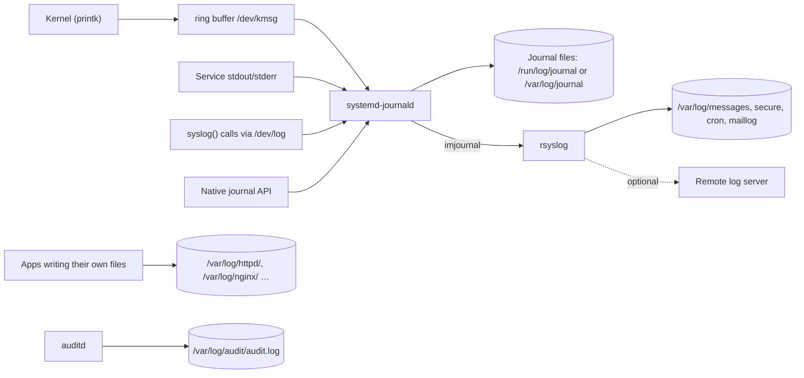
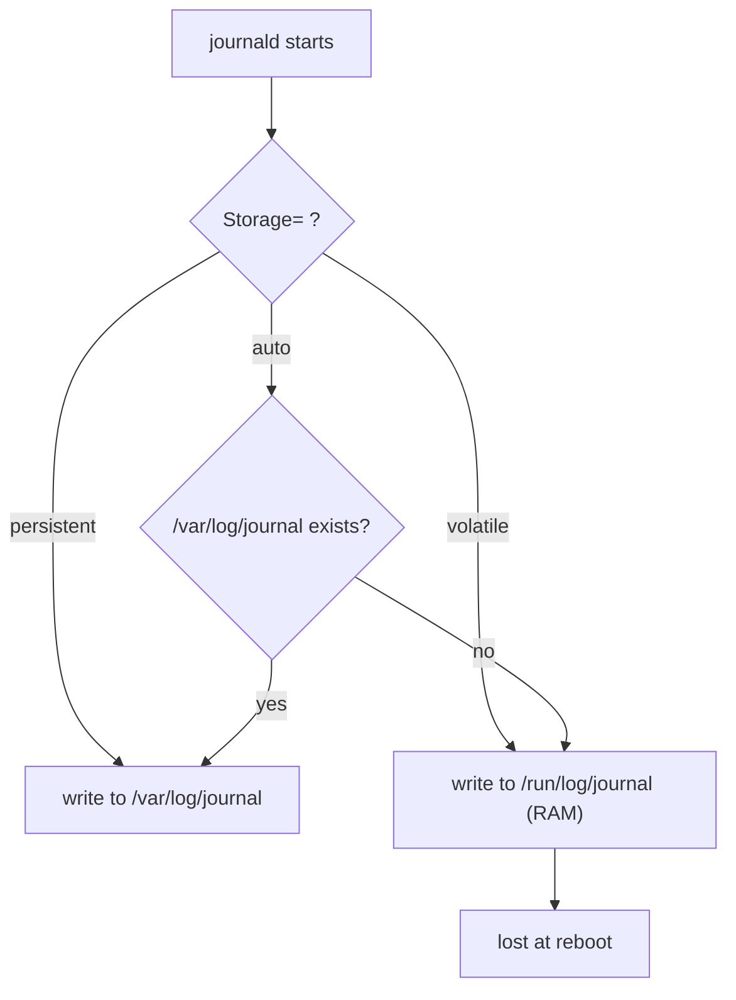
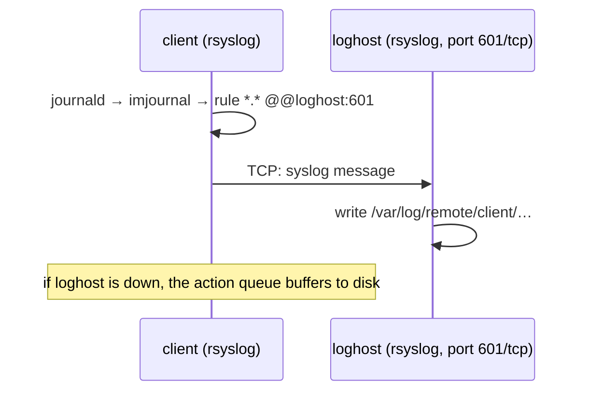

# 08 · Logging and the Journal

<ul class="module-meta">
  <li>⏱ ~2 hours</li>
  <li>4 labs</li>
  <li>Builds on: 07 · systemd and Services</li>
</ul>

Something broke at 02:14 last night. The service has been restarted, the
monitoring is green again, and your manager wants to know why it happened.
The answer is almost certainly written down somewhere on the machine. This
module shows you where every kind of log message goes on Rocky Linux, how to
query the systemd journal like a database, how to keep logs across reboots
and off the box, and a method for reading logs under pressure.

!!! abstract "What you'll learn"
    - Trace a log message from its source (kernel, service, application) to
      where it's stored.
    - Query the journal by unit, boot, priority, time, PID, and field, and
      export it as JSON.
    - Make the journal persistent and set size limits in `journald.conf`.
    - Explain how rsyslog fits next to journald and what lives in
      `/var/log/messages`, `secure`, and `cron`.
    - Rotate application log files with logrotate.
    - Send your own messages with `logger` and forward logs to another host.

## The big picture

On a Rocky Linux system, log messages come from four kinds of places, and
almost all of them flow into one collector: **systemd-journald**, the
journal daemon. From there, a second daemon, **rsyslog**, writes the
classic text files in `/var/log`.



Two things to notice:

- **Not everything goes through the journal.** Web servers and databases
  often write their own files under `/var/log/<app>/`. The Linux audit system
  writes `/var/log/audit/audit.log` by itself.
- **Rocky runs both journald and rsyslog by default.** You get the
  structured, indexed journal *and* plain text files that every tool
  understands. The same message usually exists in both.

!!! analogy "Think of it like a post office"
    journald is the sorting office: every letter (message) gets stamped with
    who sent it, when, and from where, then filed in an indexed archive.
    rsyslog is a clerk who photocopies certain letters into labelled binders
    (`messages`, `secure`), and can mail copies to head office.

## Where log messages come from

### The kernel ring buffer

The kernel logs hardware detection, driver errors, filesystem problems, OOM
kills, and segfaults into a fixed-size in-memory **ring buffer**. When the
buffer fills, the oldest messages are overwritten. `dmesg` reads it directly:

```console
$ sudo dmesg -T --level=err,warn | tail -4
[Thu Oct 15 09:02:11 2026] ACPI: _OSC evaluation for CPUs failed, trying _PDC
[Thu Oct 15 09:02:13 2026] xfs filesystem being mounted at /boot supports timestamps until 2038-01-19 (0x7fffffff)
[Thu Oct 15 11:20:41 2026] Out of memory: Killed process 4120 (python3) total-vm:6215840kB, anon-rss:3402112kB, …
[Thu Oct 15 12:03:55 2026] python3[5012]: segfault at 0 ip 00007f… sp 00007ffd… error 4 in libc.so.6
```

`-T` converts timestamps to wall-clock time (approximate after suspend), and
`--level` filters by severity. journald also reads this buffer, so
`journalctl -k` shows the same messages, kept for longer.

### Services

Anything a systemd service prints to stdout or stderr is captured by journald
automatically and tagged with the unit name. You learned in
[07 · systemd and Services](07-systemd-and-services.md) that a service
shouldn't manage its own log files; this is why.

??? question "Under the hood: two stdout surprises"
    **Buffering.** When stdout is a pipe instead of a terminal, most runtimes
    buffer output in blocks of several KiB. A Python service that prints one
    line a minute can look silent in `journalctl -f` for an hour, then dump
    everything at once (or lose it in a crash). Set
    `Environment=PYTHONUNBUFFERED=1` in the unit, or flush explicitly.

    **Priority.** Every stdout line arrives at priority `info` (stderr too),
    so `journalctl -p err` won't find your app's errors. But systemd honours
    a kernel-style prefix: a line that starts with `<3>` is stored as
    priority 3 (`err`) with the prefix removed (`SyslogLevelPrefix=`, on by
    default). Try it:

    ```console
    $ sudo systemd-run --unit=prio-demo bash -c 'echo "<3>disk on fire"; echo "all good"'
    $ journalctl -u prio-demo -p err -o cat
    disk on fire
    ```

### The syslog socket

The traditional Unix logging API, `syslog()`, sends messages to the socket
`/dev/log`. On Rocky, journald owns that socket, so classic programs (and the
`logger` command) feed the journal too.

### Application files

Some programs write directly to files: `httpd` writes
`/var/log/httpd/access_log` and `error_log`, for example. journald never sees
these. You read them with `less`, `tail -f`, or `grep`, and rotate them with
logrotate.

## The journal: structured logs

Each journal entry isn't just a line of text. It's a set of **fields**:
`MESSAGE=` plus metadata. Fields starting with an underscore are **trusted**:
journald fills them in itself from the kernel, so a program can't fake them.
See everything with `-o verbose`:

```console
$ journalctl -u sshd -n 1 -o verbose
Thu 2026-10-15 10:31:07.118204 UTC [s=3c1f…;i=1a2b;b=8e4c…;m=…;t=…;x=…]
    _BOOT_ID=8e4c2f0d6a7b4e1c9d3f5a6b7c8d9e0f
    _MACHINE_ID=2b1e…
    _HOSTNAME=rocky10
    PRIORITY=6
    SYSLOG_FACILITY=10
    SYSLOG_IDENTIFIER=sshd-session
    _UID=0
    _GID=0
    _COMM=sshd-session
    _EXE=/usr/libexec/openssh/sshd-session
    _CMDLINE="sshd-session: alice [priv]"
    _SYSTEMD_UNIT=sshd.service
    _PID=2836
    _SELINUX_CONTEXT=system_u:system_r:sshd_t:s0-s0:c0.c1023
    MESSAGE=Accepted publickey for alice from 192.168.122.1 port 51234 ssh2: ED25519 SHA256:…
```

Because entries are fields, you can filter on any of them precisely, without
fragile `grep` patterns. One trusted field worth knowing is **`_TRANSPORT`**:
how the message arrived (`kernel`, `stdout`, `syslog`, `journal`, `audit`,
or `driver` for journald's own notes). `journalctl _TRANSPORT=stdout -b`
shows only what services printed. And because the journal is indexed, those filters are
fast even on gigabytes of logs.

### Priorities

Every message has a **priority** (severity), the same eight levels syslog has
always used:

| No. | Name | Meaning |
|---|---|---|
| 0 | `emerg` | System is unusable |
| 1 | `alert` | Act immediately |
| 2 | `crit` | Critical condition |
| 3 | `err` | Error |
| 4 | `warning` | Warning |
| 5 | `notice` | Normal but significant |
| 6 | `info` | Informational |
| 7 | `debug` | Debug detail |

`-p err` means "priority `err` *and more severe*" (0 to 3).

## journalctl power use

`journalctl` with no options dumps the whole journal, oldest first, into a
pager. The real power is in combining filters. Filters of *different* kinds
are ANDed together.

### The filters you'll use daily

```console
$ journalctl -u httpd                 # one unit (repeat -u for several)
$ journalctl -b                       # this boot only
$ journalctl -b -1                    # the previous boot
$ journalctl --list-boots             # which boots are stored
$ journalctl -p warning               # warning and worse
$ journalctl -k                       # kernel messages (like dmesg)
$ journalctl -f                       # follow new messages live (like tail -f)
$ journalctl -e                       # jump to the end
$ journalctl -n 50                    # last 50 entries
$ journalctl -r                       # newest first
$ journalctl -g 'timed out'           # grep MESSAGE (regex; all-lowercase = case-insensitive)
$ journalctl -x                       # add explanation text where available
```

A combined example, the kind you'll actually type during an incident:

```console
$ journalctl -u httpd -b -p err --since "02:00" --until "02:30"
Oct 15 02:14:03 rocky10 httpd[1822]: AH00558: …
Oct 15 02:14:09 rocky10 systemd[1]: httpd.service: Main process exited, code=killed, status=9/KILL
Oct 15 02:14:09 rocky10 systemd[1]: httpd.service: Failed with result 'oom-kill'.
```

### Time ranges

`--since` and `--until` accept absolute times (`"2026-10-15 02:00"`),
times today (`"02:00"`), and relative or named times (`"-1h"`, `"yesterday"`,
`"today"`).

### Matching fields

Put `FIELD=value` on the command line to match it. Several values for the same
field are ORed; different fields are ANDed; a `+` between groups means OR:

```console
$ journalctl _PID=2836
$ journalctl _UID=1000 -b
$ journalctl _SYSTEMD_UNIT=sshd.service _COMM=sshd-session
$ journalctl _EXE=/usr/sbin/crond
$ journalctl _SYSTEMD_UNIT=httpd.service + _SYSTEMD_UNIT=php-fpm.service
$ journalctl -F _SYSTEMD_UNIT | head -3      # list values a field has taken
auditd.service
chronyd.service
crond.service
```

`journalctl /usr/sbin/sshd` (a path to a program) is a shortcut for
`_EXE=/usr/sbin/sshd`.

### Output formats

`-o` changes the format. `short` is the default. Others:

| `-o` | Use for |
|---|---|
| `short-iso` | ISO 8601 timestamps, unambiguous across time zones |
| `short-precise` | Microsecond timestamps, for ordering fast events |
| `short-monotonic` | Seconds since boot (great for boot problems) |
| `verbose` | Every field |
| `cat` | Just the message, no metadata |
| `json` / `json-pretty` | Machine-readable, for scripts and log shippers |

```console
$ journalctl -u chronyd -n 1 -o json-pretty --output-fields=MESSAGE,_PID,PRIORITY
{
        "__CURSOR" : "s=3c1f…",
        "__REALTIME_TIMESTAMP" : "1760524370118204",
        "__MONOTONIC_TIMESTAMP" : "5120334812",
        "_BOOT_ID" : "8e4c2f0d6a7b4e1c9d3f5a6b7c8d9e0f",
        "PRIORITY" : "6",
        "MESSAGE" : "Selected source 162.159.200.1 (2.rocky.pool.ntp.org)",
        "_PID" : "806"
}
```

Pipe `-o json` into `jq` (in the Rocky AppStream repo) for quick reports:

```console
$ journalctl -b -p err -o json | jq -r '._SYSTEMD_UNIT // .SYSLOG_IDENTIFIER' | sort | uniq -c | sort -rn | head -3
      7 kernel
      3 httpd.service
      1 NetworkManager.service
```

!!! tip "Who can read the journal?"
    Normal users see only their own messages. Members of the `wheel` group
    (and `adm`, `systemd-journal`) can read the whole system journal without
    sudo.

<div class="quiz" data-answer="3" markdown>

You want the error messages from `nginx.service` during the boot *before* the
current one. Which command?

- `journalctl -u nginx -p err -b`
- `journalctl -u nginx --since yesterday | grep error`
- `journalctl -u nginx -p err -b -1`
- `journalctl -k -b -1`

Right. `-b -1` selects the previous boot, `-u` the unit, and `-p err` shows
`err` and anything more severe. This only works if the journal is
persistent (next section): a volatile journal forgets earlier boots.

</div>

### Practice: query the journal

<div class="terminal-sim" data-title="Journal detective" markdown>

<div class="task" data-expect="journalctl -u sshd||journalctl -u sshd.service" data-hint="-u filters by unit." markdown>

**Step 1.** Show every journal entry from the SSH server's unit.

```text
Oct 13 09:12:45 rocky10 systemd[1]: Starting sshd.service - OpenSSH server daemon...
Oct 13 09:12:45 rocky10 sshd[899]: Server listening on 0.0.0.0 port 22.
Oct 13 09:12:45 rocky10 systemd[1]: Started sshd.service - OpenSSH server daemon.
```

</div>

<div class="task" data-expect="journalctl -b -p err||journalctl -p err -b||journalctl -b -p 3||journalctl -p 3 -b" data-hint="Combine -b (this boot) with -p (priority)." markdown>

**Step 2.** Show only errors (and worse) from the current boot.

```text
Oct 15 09:02:11 rocky10 kernel: ACPI: _OSC evaluation for CPUs failed, trying _PDC
Oct 15 11:20:41 rocky10 kernel: Out of memory: Killed process 4120 (python3) …
```

</div>

<div class="task" data-expect="journalctl --list-boots" data-hint="There's a --list-something option for boots." markdown>

**Step 3.** How many boots does this journal remember?

```text
IDX BOOT ID                          FIRST ENTRY                 LAST ENTRY
 -1 5a7d3e2c1b0a49f8e7d6c5b4a3928170 Wed 2026-10-14 08:55:02 UTC Wed 2026-10-14 18:01:44 UTC
  0 8e4c2f0d6a7b4e1c9d3f5a6b7c8d9e0f Thu 2026-10-15 09:02:09 UTC Thu 2026-10-15 13:40:11 UTC
```

</div>

<div class="task" data-expect="journalctl -k||journalctl --dmesg||journalctl -k -b||journalctl -b -k" data-hint="One short option selects kernel messages, like dmesg." markdown>

**Step 4.** Show the kernel's messages through the journal instead of `dmesg`.

```text
Oct 15 09:02:09 rocky10 kernel: Linux version 6.12.0-55.12.1.el10_0.x86_64 …
Oct 15 09:02:09 rocky10 kernel: Command line: BOOT_IMAGE=(hd0,gpt2)/vmlinuz-6.12.0-55.12.1.el10_0.x86_64 root=/dev/mapper/rl-root ro …
…
```

</div>

<div class="task" data-expect="logger -t practice hello" data-match="logger +(-t +practice +['\x22]?hello['\x22]?|['\x22]?hello['\x22]? +-t +practice)" data-hint="logger -t sets the tag; the message comes after it." markdown>

**Step 5.** Write the message `hello` to the system log with the tag `practice`.

```text
(no output: check it with journalctl -t practice)
```

</div>

</div>

## Persistent versus volatile journal

journald can store its files in two places:

- **`/run/log/journal/`**: a tmpfs in RAM. **Volatile**: lost at every
  reboot.
- **`/var/log/journal/`**: on disk. **Persistent**: survives reboots.

The `Storage=` setting decides:

| `Storage=` | Behaviour |
|---|---|
| `auto` (default) | Persistent **if `/var/log/journal/` exists**, otherwise volatile |
| `persistent` | Always disk; creates `/var/log/journal/` if needed |
| `volatile` | Always RAM only |
| `none` | Don't store (still forwards to rsyslog etc.) |

Whether your machine keeps old boots therefore depends on whether that
directory exists. Many Rocky installs have it, but cloud images, containers,
kickstarts that trim `/var/log`, and "cleaned up" golden images often don't.
Check it rather than guess. This is what a volatile journal looks like:

```console
$ ls -ld /var/log/journal
ls: cannot access '/var/log/journal': No such file or directory
$ journalctl --list-boots
IDX BOOT ID                          FIRST ENTRY                 LAST ENTRY
  0 8e4c2f0d6a7b4e1c9d3f5a6b7c8d9e0f Thu 2026-10-15 09:02:09 UTC Thu 2026-10-15 13:40:11 UTC
```

Only one boot listed and no directory: volatile. When the machine crashes and
reboots, the evidence is gone. On any server you care about, make it
persistent (Lab 2).



??? question "Prove it: where the journal really is"
    Ask journald itself which files it's using and how big they are:

    ```console
    $ sudo ls -l /var/log/journal/$(cat /etc/machine-id)/
    -rw-r-----+ 1 root systemd-journal 16777216 Oct 15 09:02 system@8f1d…-0000000000000001-00063f….journal
    -rw-r-----+ 1 root systemd-journal  8388608 Oct 15 13:40 system.journal
    -rw-r-----+ 1 root systemd-journal  8388608 Oct 15 13:38 user-1000.journal
    $ journalctl --header --file /var/log/journal/$(cat /etc/machine-id)/system.journal | head -4
    File path: /var/log/journal/2b1e…/system.journal
    File ID: 51c0…
    Machine ID: 2b1e…
    Boot ID: 8e4c2f0d6a7b4e1c9d3f5a6b7c8d9e0f
    ```

    The directory is named after the **machine ID** (`/etc/machine-id`), a
    unique ID generated at install. `system.journal` is the active file;
    names with `@` are archived (rotated) files that are never modified again.
    `user-1000.journal` holds messages from UID 1000's own processes, which is how
    normal users can read their own logs. The `+` after the permissions means an
    ACL grants read access to groups like `wheel` and `adm`. Journal files are
    binary, so read them with `journalctl` (`--file` or `-D <dir>` reads
    copies, for example from a dead server's disk), and check them for corruption
    with `journalctl --verify`.

### Configuring journald

Don't edit the main config file; add a drop-in, exactly like unit drop-ins:

```ini title="/etc/systemd/journald.conf.d/50-local.conf"
[Journal]
Storage=persistent
SystemMaxUse=1G
SystemKeepFree=2G
MaxRetentionSec=1month
```

- `SystemMaxUse=`: total disk the persistent journal may use. The default is
  10% of the filesystem, capped at 4 GiB.
- `SystemKeepFree=`: always leave at least this much free on the filesystem.
- `MaxRetentionSec=`: delete entries older than this, regardless of size.

```console
$ sudo systemctl restart systemd-journald
$ journalctl --disk-usage
Archived and active journals take up 312.0M in the file system.
$ sudo journalctl --vacuum-size=200M      # shrink now
$ sudo journalctl --vacuum-time=2weeks    # or delete by age
```

!!! version "Rocky 9 vs 10"
    On Rocky 9 the default settings live in `/etc/systemd/journald.conf`
    (all commented out). Newer systemd packaging ships the commented
    defaults as `/usr/lib/systemd/journald.conf` instead, so on Rocky 10 the
    `/etc` copy may not exist. Find out with
    `ls /etc/systemd/journald.conf /usr/lib/systemd/journald.conf`. A drop-in
    in `/etc/systemd/journald.conf.d/` works on both and survives updates,
    so always use that, and check the merged result with
    `systemd-analyze cat-config systemd/journald.conf`.

### Rate limiting

A service that logs thousands of lines a second could drown the journal.
journald limits each service (by default 10,000 messages per 30 seconds,
`RateLimitIntervalSec=` / `RateLimitBurst=`) and drops the excess with a note:

```text
systemd-journald[611]: Suppressed 48213 messages from chatty.service
```

If you see that, the service has a logging problem. Raise the limit only if
you really need every line. For a single noisy unit, set
`LogRateLimitIntervalSec=` / `LogRateLimitBurst=` in that unit instead of
changing the global value.

??? question "Under the hood: why the same flood is dropped on one box and not another"
    The burst isn't a fixed number. journald scales it by the free space on
    the filesystem holding the journal (roughly, the more free space, the
    more it lets through), so the documented 10,000 is a base value. Two
    "identical" servers with different free space will suppress different
    amounts of the same flood. When you compare, look at the actual
    `Suppressed N messages` lines, not the config.

## rsyslog and the classic /var/log files

**rsyslog** is the traditional syslog daemon. On Rocky it reads messages from
the journal (its `imjournal` input module) and writes them into text files
according to rules in `/etc/rsyslog.conf` and `/etc/rsyslog.d/*.conf`.

Each rule is **selector** then **action**. A selector is
`facility.priority`, where the **facility** is a broad category of sender
(`kern`, `authpriv`, `cron`, `mail`, `daemon`, `user`, `local0` to `local7`):

```text title="/etc/rsyslog.conf (rules section, trimmed)"
*.info;mail.none;authpriv.none;cron.none                /var/log/messages
authpriv.*                                              /var/log/secure
mail.*                                                  -/var/log/maillog
cron.*                                                  /var/log/cron
*.emerg                                                 :omusrmsg:*
local7.*                                                /var/log/boot.log
```

So on a stock Rocky system:

| File | Contains |
|---|---|
| `/var/log/messages` | General system messages, `info` and above, except mail, auth, cron |
| `/var/log/secure` | Authentication: SSH logins, `sudo`, `su`, PAM failures |
| `/var/log/cron` | crond activity |
| `/var/log/maillog` | Mail server |
| `/var/log/boot.log` | Boot-time service status messages |
| `/var/log/dnf.log`, `dnf.rpm.log` | Package transactions (written by DNF itself) |
| `/var/log/audit/audit.log` | SELinux denials and audit events (written by auditd) |

```console
$ sudo tail -3 /var/log/secure
Oct 15 10:31:07 rocky10 sshd-session[2836]: Accepted publickey for alice from 192.168.122.1 port 51234 ssh2: ED25519 SHA256:…
Oct 15 10:31:07 rocky10 sshd-session[2836]: pam_unix(sshd:session): session opened for user alice(uid=1000) by alice(uid=0)
Oct 15 10:33:52 rocky10 sudo[2990]:   alice : TTY=pts/0 ; PWD=/home/alice ; USER=root ; COMMAND=/usr/bin/tail -3 /var/log/secure
```

Why keep rsyslog when the journal has everything? Text files work with every
tool and every habit, rsyslog has mature remote forwarding, and many
compliance tools expect `/var/log/secure`. If you don't need it, you can
disable it, but leave it on while you learn.

!!! note "The audit log is separate"
    `auditd` writes `/var/log/audit/audit.log` itself, and doesn't go through
    rsyslog. SELinux denials (`AVC` records) land there. Search it with
    `sudo ausearch -m avc -ts recent`. Covered in
    [16 · SELinux](16-selinux.md) and
    [17 · Security Hardening](17-security-hardening.md).

<div class="quiz" data-answer="2" markdown>

A colleague asks where to look for failed `sudo` attempts on a Rocky server
using only text files. Where do you point them?

- `/var/log/messages`
- `/var/log/secure`
- `/var/log/audit/audit.log` only
- `/var/log/cron`

Correct. `sudo` and PAM log to the `authpriv` facility, which rsyslog writes
to `/var/log/secure` (and excludes from `messages` with `authpriv.none`).

</div>

## logrotate: keeping text logs in check

Text log files grow forever unless something trims them. **logrotate**
renames the current file (`messages` becomes `messages-20261015`), starts a
fresh one, optionally compresses old ones, and deletes the oldest. On Rocky it
runs once a day from `logrotate.timer` (not cron).

Global defaults are in `/etc/logrotate.conf`; each package drops its own
rules in `/etc/logrotate.d/`:

```text title="/etc/logrotate.d/myapp"
/var/log/myapp/*.log {
    weekly
    rotate 4
    compress
    delaycompress
    missingok
    notifempty
    create 0640 myapp myapp
    postrotate
        systemctl reload myapp.service >/dev/null 2>&1 || true
    endscript
}
```

Line by line:

- `weekly`: rotate once a week (also `daily`, `monthly`, or `size 100M`).
- `rotate 4`: keep four old files and delete anything older.
- `compress` / `delaycompress`: gzip old files, but wait one cycle, so a
  program still writing the just-rotated file isn't disrupted.
- `missingok` / `notifempty`: don't complain if the file is missing; skip
  empty files.
- `create 0640 myapp myapp`: create the fresh file with this mode and owner.
- `postrotate … endscript`: tell the app to reopen its log file. Without
  this it keeps writing into the renamed file, because it holds an open file
  descriptor to it (module 06), and renaming doesn't change that.

Test a config without changing anything with `-d` (debug, dry run), or force a
rotation with `-f`:

```console
$ sudo logrotate -d /etc/logrotate.d/myapp
$ sudo logrotate -f /etc/logrotate.d/myapp
$ systemctl list-timers logrotate.timer
```

The journal doesn't need logrotate: journald rotates and vacuums its own files
using the limits you set in `journald.conf`.

<div class="quiz" data-answer="3" markdown>

You rotated `/var/log/myapp.log` by renaming it, but the app keeps writing
into `myapp.log-20261015` instead of the new file. Why?

- logrotate forgot to create the new file
- The disk is full
- The app still holds an open file descriptor to the renamed file; it must be told to reopen (`postrotate`) or use `copytruncate`
- Log files can't be renamed while SELinux is enforcing

Right. A rename doesn't affect an open file descriptor. That's why rules
usually send a reload or `HUP` in `postrotate`.

</div>

## Writing your own log messages

`logger` sends a message into syslog (and therefore the journal and
rsyslog). Perfect for scripts:

```console
$ logger -t backup -p local0.notice "nightly backup finished: 12.4 GiB"
$ journalctl -t backup -n 1
Oct 15 13:52:40 rocky10 backup[6120]: nightly backup finished: 12.4 GiB
```

`-t` sets the tag (`SYSLOG_IDENTIFIER`), `-p` the facility and priority. For
a whole command's output, `systemd-cat` pipes it into the journal:

```console
$ systemd-cat -t diskcheck -p info df -h /
$ journalctl -t diskcheck -n 2 -o cat
Filesystem           Size  Used Avail Use% Mounted on
/dev/mapper/rl-root   17G  2.9G   15G  17% /
```

## Remote logging

If an attacker gets root, or the disk dies, local logs are gone or
untrustworthy. Sending a copy to a central log host fixes both. The simplest
route on Rocky is rsyslog over TCP.

Which port? Classic syslog is 514/**udp**. For TCP, use **601**, the
registered syslog-over-TCP port. On Rocky this matters because of SELinux:
601/tcp is already labelled `syslogd_port_t`, so rsyslog may listen on it,
while 514/tcp is labelled for the old `rsh` service, which rsyslog isn't allowed to bind
(check with `sudo semanage port -l | grep -E 'syslog|rsh'`). Many guides
say "TCP 514"; on an enforcing Rocky box that fails with an AVC denial
unless you relabel the port.



On the **log server**, enable the TCP input and open the firewall:

```text title="/etc/rsyslog.d/10-receive.conf (server)"
module(load="imtcp")
input(type="imtcp" port="601")
template(name="PerHost" type="string" string="/var/log/remote/%HOSTNAME%/messages.log")
if $fromhost-ip != '127.0.0.1' then {
    action(type="omfile" dynaFile="PerHost")
    stop
}
```

```console
$ sudo systemctl restart rsyslog
$ sudo firewall-cmd --add-port=601/tcp --permanent && sudo firewall-cmd --reload
```

On each **client**, forward everything. `@@` means TCP (a single `@` is UDP),
and the queue settings make rsyslog buffer to disk while the server is
unreachable:

```text title="/etc/rsyslog.d/90-forward.conf (client)"
*.* action(type="omfwd" target="loghost.example.com" port="601" protocol="tcp"
           queue.type="LinkedList" queue.filename="fwd" queue.saveOnShutdown="on"
           action.resumeRetryCount="-1")
```

Plain syslog over TCP is unencrypted. For production, add TLS (rsyslog's
`gtls` driver) or send over a private network. The other option is
**systemd-journal-remote** (package `systemd-journal-remote`): the client runs
`systemd-journal-upload` and the server stores real journal files, keeping
all the structured fields.

## Reading logs during an incident

Under pressure, people `grep -i error` across everything and drown. Narrow
by *time* and *source* first, then read. Walk through it:

<div class="decision" markdown>

<div class="node" data-id="start" markdown>

**Do you know which service is affected?**

<button data-goto="svc">Yes</button>
<button data-goto="when">No, just "something broke"</button>

</div>

<div class="node" data-id="svc" markdown>

Start narrow: `systemctl status <unit>` (state, last lines, `Result:`),
then `journalctl -u <unit> -b -e`.

**Did the service die, or is it running but misbehaving?**

<button data-goto="died">It died or restarted</button>
<button data-goto="running">Running but wrong</button>

</div>

<div class="node" data-id="died" markdown>

**What does `Result:` / the last line say?**

<button data-goto="oom">oom-kill or "Killed"</button>
<button data-goto="exit">exit-code</button>
<button data-goto="reboot">The whole machine rebooted</button>

</div>

<div class="node" data-id="oom" markdown>

The kernel or the service's `MemoryMax=` killed it. Confirm with
`journalctl -k -b -g 'Out of memory|oom'` and see which process was chosen.
Look at memory growth before the kill. See
[06 · Processes and Signals](06-processes-and-signals.md#the-oom-killer).

</div>

<div class="node" data-id="exit" markdown>

The program exited with an error. Read the lines from the program itself
(not systemd) just before the exit:
`journalctl -u <unit> -b -o short-precise | tail -40`. If it mentions
permissions but file modes look right, check SELinux:
`sudo ausearch -m avc -ts recent`.

</div>

<div class="node" data-id="reboot" markdown>

Look at the *previous* boot: `journalctl -b -1 -e` and
`journalctl -b -1 -p warning -k`. If the previous boot's log just stops
mid-stream with no shutdown messages, it was a crash, power loss, or watchdog
reset, not a clean reboot. No `-b -1` at all? The journal is volatile; fix
that now (Lab 2). Kernel panics are captured by kdump
([15 · The Kernel](15-the-kernel.md)).

</div>

<div class="node" data-id="running" markdown>

Check the app's own log files (`/var/log/<app>/`), which journald may not
see, plus `journalctl -u <unit> -p warning --since -1h`. Then widen to the
whole system at the same moment: `journalctl --since "HH:MM" --until "HH:MM"`
to spot a neighbour (disk full, network flap, OOM) that caused it.

</div>

<div class="node" data-id="when" markdown>

**Do you know roughly when it happened?**

<button data-goto="window">Yes</button>
<button data-goto="scan">No</button>

</div>

<div class="node" data-id="window" markdown>

Read *everything* in a tight window, warnings first:
`journalctl --since "02:10" --until "02:20" -p warning`, then without `-p`.
The first error in time is usually the cause; later ones are fallout.
Check `/var/log/secure` for logins or `sudo` at that moment too.

</div>

<div class="node" data-id="scan" markdown>

Get an overview: `systemctl --failed`, `journalctl -b -p err`, and
`journalctl -k -b -p warning`. Count errors by source with the `jq` one-liner
from this module. Pick the noisiest or earliest source and go back to
"Yes, I know which service".

</div>

</div>

## Labs

!!! lab "Lab 1: A journalctl workout"

    **Goal:** Answer real questions about your system using only journal
    filters.

    **You'll need:** a Rocky 10 VM, a user in `wheel`.

    1. How many boots are recorded? `journalctl --list-boots`
    2. What did the kernel say about your disks at boot?
       `journalctl -k -b -g 'sd[a-z]|vd[a-z]|nvme'`
    3. Who logged in today, and how?
       `journalctl -u sshd --since today -g Accepted`
    4. Which units logged errors this boot?
       `journalctl -b -p err -o json | jq -r '._SYSTEMD_UNIT // .SYSLOG_IDENTIFIER' | sort | uniq -c`
       (install `jq` with `sudo dnf install jq` if needed)
    5. Make a failure and find it. Run a transient service that fails at once,
       `sudo systemd-run --unit=lab1-fail /bin/false`, then find out why
       with `journalctl -u lab1-fail -p notice`.
    6. Find every message from one PID: pick a PID from step 3 output and run
       `journalctl _PID=<pid>`.

    **Check your work:** you can answer each question in one command, without
    `grep` on a text file.

    ??? success "What just happened?"
        Each filter used an indexed field (`_BOOT_ID`, `_TRANSPORT=kernel`,
        `_SYSTEMD_UNIT`, `PRIORITY`, `_PID`), so the journal didn't have to
        scan the whole log. `-g` then searched only inside the matching
        entries.

    **Clean up:** `sudo systemctl reset-failed lab1-fail` removes the failed
    transient unit.

!!! lab "Lab 2: Make the journal survive reboots"

    **Goal:** Switch to persistent storage, cap its size, and prove the
    previous boot is readable.

    **You'll need:** a Rocky 10 VM, sudo, permission to reboot.

    1. Check the current state: `ls -ld /var/log/journal; journalctl --list-boots | wc -l`.
       If the directory already exists, your journal is already persistent:
       do the lab anyway to add the size cap and see the proof in step 5.
    2. Create a drop-in:

        ```bash
        sudo mkdir -p /etc/systemd/journald.conf.d
        sudo tee /etc/systemd/journald.conf.d/50-persistent.conf <<'EOF'
        [Journal]
        Storage=persistent
        SystemMaxUse=500M
        EOF
        ```

    3. Apply it and move the current RAM journal to disk:

        ```console
        $ sudo systemctl restart systemd-journald
        $ sudo journalctl --flush
        $ ls /var/log/journal/
        2b1e7c…
        ```

    4. Leave a marker, then reboot:

        ```console
        $ logger -t lab2 "before the reboot"
        $ sudo systemctl reboot
        ```

    5. After logging back in, read the previous boot:

        ```console
        $ journalctl -b -1 -t lab2
        Oct 15 14:20:05 rocky10 lab2[6230]: before the reboot
        ```

    **Check your work:** `journalctl --list-boots` shows at least two boots,
    and step 5 shows your marker.

    ??? success "What just happened?"
        With `Storage=persistent`, journald wrote to `/var/log/journal/<machine-id>/`
        on disk. `--flush` moved what was in `/run` there immediately.
        `SystemMaxUse=500M` keeps it from growing without bound.

    **Clean up:** keeping a persistent journal is a good idea. To undo:
    `sudo rm /etc/systemd/journald.conf.d/50-persistent.conf && sudo systemctl restart systemd-journald`
    (and `sudo rm -rf /var/log/journal` only if it didn't exist before).

!!! lab "Lab 3: Your own log file with rsyslog and logrotate"

    **Goal:** Route an application's messages to their own file and rotate
    it.

    **You'll need:** a Rocky 10 VM, sudo.

    1. Send facility `local5` to its own file and nowhere else:

        ```bash
        sudo tee /etc/rsyslog.d/40-myapp.conf <<'EOF'
        local5.*    /var/log/myapp.log
        & stop
        EOF
        sudo systemctl restart rsyslog
        ```

        `& stop` means "and don't process this message any further", so it
        won't also appear in `/var/log/messages`.

    2. Log something: `logger -p local5.info -t myapp "order 1234 created"`
    3. Check: `sudo tail -1 /var/log/myapp.log`, and
       `sudo grep -c 'order 1234' /var/log/messages` (should be 0).
    4. Add a rotation rule:

        ```bash
        sudo tee /etc/logrotate.d/myapp <<'EOF'
        /var/log/myapp.log {
            daily
            rotate 3
            compress
            missingok
            notifempty
            postrotate
                /usr/bin/systemctl kill -s HUP rsyslog.service >/dev/null 2>&1 || true
            endscript
        }
        EOF
        ```

    5. Dry run, then force a rotation:

        ```console
        $ sudo logrotate -d /etc/logrotate.d/myapp
        $ sudo logrotate -f /etc/logrotate.d/myapp
        $ ls /var/log/myapp*
        /var/log/myapp.log.1.gz
        ```

        There's no `myapp.log` yet: rsyslog creates it on the next message.

    6. Log again and confirm the new message lands in a fresh file:

        ```console
        $ logger -p local5.info -t myapp "order 1235 created"
        $ ls /var/log/myapp*
        /var/log/myapp.log  /var/log/myapp.log.1.gz
        ```

    **Check your work:** the message is in `myapp.log` but not in `messages`,
    and after rotation a `.1.gz` exists and new messages go to the new file.

    ??? success "What just happened?"
        rsyslog matched the `local5` facility and wrote to your file. The
        `HUP` in `postrotate` told rsyslog to reopen its files, so it stopped
        writing into the rotated copy.

        The rotated file is named `.1.gz`, not `-20261015.gz`, for a subtle
        reason: when you pass logrotate a single file, it reads **only that
        file**, so the global defaults in `/etc/logrotate.conf` (including
        `dateext`) never applied. The daily `logrotate.timer` runs
        `logrotate /etc/logrotate.conf`, which sets the globals first and then
        includes `/etc/logrotate.d/`, so tonight's rotation would be date
        named. To test a rule exactly as the timer will run it, use
        `sudo logrotate -d /etc/logrotate.conf`.

    **Clean up:** `sudo rm /etc/rsyslog.d/40-myapp.conf /etc/logrotate.d/myapp /var/log/myapp.log*; sudo systemctl restart rsyslog`

!!! lab "Lab 4 (two VMs): Forward logs to a central server"

    **Goal:** Send one VM's logs to another over TCP.

    **You'll need:** two Rocky 10 VMs on the same network: `loghost`
    (server) and `client`. Replace `192.168.122.50` with the server's IP.

    1. On **loghost**, create `/etc/rsyslog.d/10-receive.conf` with the server
       config from the [remote logging](#remote-logging) section, then:

        ```console
        $ sudo systemctl restart rsyslog
        $ sudo firewall-cmd --add-port=601/tcp
        $ ss -ltn 'sport = :601'
        ```

    2. On **client**, create the forwarding rule:

        ```bash
        sudo tee /etc/rsyslog.d/90-forward.conf <<'EOF'
        *.* action(type="omfwd" target="192.168.122.50" port="601" protocol="tcp"
                   queue.type="LinkedList" queue.filename="fwd" action.resumeRetryCount="-1")
        EOF
        sudo systemctl restart rsyslog
        logger -t lab4 "hello from the client"
        ```

    3. On **loghost**: `sudo tail /var/log/remote/*/messages.log`.

    **Check your work:** the `lab4` message appears on loghost under a
    directory named after the client.

    ??? success "What just happened?"
        journald handed the message to rsyslog on the client, which forwarded
        it over TCP to port 601. The server's `imtcp` input received it and
        the `PerHost` template wrote it into a per-client file. The firewall
        rule here is runtime only (no `--permanent`), so it disappears at the
        next reload.

    **Clean up:** client: `sudo rm /etc/rsyslog.d/90-forward.conf; sudo systemctl restart rsyslog`.
    Server: `sudo rm /etc/rsyslog.d/10-receive.conf; sudo rm -rf /var/log/remote; sudo firewall-cmd --reload; sudo systemctl restart rsyslog`.

## Common pitfalls

| Symptom | Cause | Fix |
|---|---|---|
| `journalctl -b -1` says "Specifying boot ID or boot offset has no effect, no persistent journal was found" | Volatile journal | Make it persistent (Lab 2) |
| `journalctl` shows only your own messages | Not in `wheel`/`adm`/`systemd-journal` | Use `sudo` or join a group |
| Disk filled by `/var/log/journal` | No size cap | `SystemMaxUse=` in a drop-in; `journalctl --vacuum-size=` now |
| App log file grows forever | No logrotate rule | Add `/etc/logrotate.d/<app>` |
| After rotation, app keeps writing to the old file | App wasn't told to reopen | `postrotate` reload/`HUP`, or `copytruncate` |
| Edits to `journald.conf` "do nothing" on Rocky 10 | Edited a file that isn't read, or forgot restart | Use `/etc/systemd/journald.conf.d/*.conf`, restart journald |
| "Suppressed N messages" | Rate limit hit | Fix the noisy service; tune `RateLimitBurst=` if justified |
| Can't find SELinux denials in the journal | They're in the audit log | `ausearch -m avc` or `/var/log/audit/audit.log` |
| Timestamps don't line up across servers | Clocks differ | Make sure `chronyd` is running; use `-o short-iso` |

## Cheat sheet

| Command | What it does |
|---|---|
| `journalctl -u <unit>` | Logs for one unit |
| `journalctl -b`, `-b -1`, `--list-boots` | This boot, previous boot, list boots |
| `journalctl -p err` | Errors and worse |
| `journalctl -k` | Kernel messages |
| `journalctl -f` | Follow live |
| `journalctl -e`, `-n 50`, `-r` | Jump to end, last 50, newest first |
| `journalctl --since "-1h" --until "now"` | Time window |
| `journalctl -g <regex>` | Search messages |
| `journalctl _PID=<n>`, `_UID=<n>`, `_COMM=<name>` | Match a field |
| `journalctl -t <tag>` | Match a syslog identifier |
| `journalctl -F <FIELD>` | List values a field has taken |
| `journalctl -o verbose / json / short-iso / cat` | Output formats |
| `journalctl --disk-usage` | Space used |
| `journalctl --vacuum-size=200M` / `--vacuum-time=2weeks` | Shrink the journal |
| `journalctl --flush` | Move the RAM journal to disk |
| `dmesg -T --level=err,warn` | Read the kernel ring buffer |
| `logger -t tag -p facility.prio "msg"` | Write a syslog message |
| `systemd-cat -t tag <cmd>` | Send a command's output to the journal |
| `logrotate -d <conf>` / `-f <conf>` | Dry-run / force rotation |
| `ausearch -m avc -ts recent` | Recent SELinux denials (audit log) |

## Flashcards

<div class="flashcards" markdown>

<div class="card" markdown>

Who writes `/var/log/messages` on Rocky Linux?

rsyslog, which reads messages from the journal (via `imjournal`) and writes them out by facility and priority.

</div>

<div class="card" markdown>

Which file holds SSH logins and `sudo` use?

`/var/log/secure` (the `authpriv` facility), and the journal (`journalctl -u sshd`).

</div>

<div class="card" markdown>

With `Storage=auto`, when is the journal persistent?

Only if `/var/log/journal/` exists. Otherwise it lives in `/run/log/journal/` and is lost at reboot.

</div>

<div class="card" markdown>

What does `journalctl -p err` show?

Messages with priority `err` (3) and everything more severe: `crit`, `alert`, `emerg`.

</div>

<div class="card" markdown>

What's special about journal fields that start with `_`, like `_PID`?

They're trusted: journald fills them in from the kernel, so the logging program can't fake them.

</div>

<div class="card" markdown>

Where do you configure journald on Rocky 10 without fighting package updates?

A drop-in such as `/etc/systemd/journald.conf.d/50-local.conf`, then restart `systemd-journald`.

</div>

<div class="card" markdown>

What runs logrotate on Rocky Linux?

`logrotate.timer`, a systemd timer, once a day.

</div>

<div class="card" markdown>

Where are SELinux denials logged?

In the audit log, `/var/log/audit/audit.log`, written by `auditd`. Search with `ausearch -m avc`.

</div>

<div class="card" markdown>

In rsyslog, what's the difference between `@host` and `@@host`?

`@` forwards over UDP; `@@` forwards over TCP.

</div>

</div>

## Recap

!!! recap "Key takeaways"
    - Kernel messages, service output, and `syslog()` calls all flow into
      **journald**; rsyslog then writes classic files like
      `/var/log/messages` and `/var/log/secure`.
    - Some logs bypass both: application files in `/var/log/<app>/` and the
      audit log in `/var/log/audit/`.
    - The journal is structured and indexed. Filter by unit (`-u`), boot
      (`-b`), priority (`-p`), time (`--since`), and any field (`_PID=`).
    - `Storage=auto` is only persistent if `/var/log/journal` exists. Make
      it persistent and capped with a drop-in in
      `/etc/systemd/journald.conf.d/`.
    - logrotate manages text files; journald manages its own size.
    - `logger` and `systemd-cat` put your scripts' messages into the same
      system.
    - Ship logs off the box (rsyslog over TCP or systemd-journal-remote) so
      a crash or compromise can't erase them.
    - In an incident: narrow by time and source first, find the *first*
      error, then read around it.

## Go deeper

- Man pages: [[man:journalctl(1)]] [[man:systemd-journald.service(8)]]
  [[man:journald.conf(5)]] [[man:systemd.journal-fields(7)]]
  [[man:rsyslog.conf(5)]] [[man:logrotate(8)]] [[man:logger(1)]]
  [[man:systemd-cat(1)]] [[man:dmesg(1)]]
- [journalctl upstream manual](https://www.freedesktop.org/software/systemd/man/latest/journalctl.html):
  every filter and output option.
- [rsyslog documentation](https://www.rsyslog.com/doc/):
  modules (`imjournal`, `imtcp`, `omfwd`), queues, and TLS.
- [systemd.journal-fields](https://www.freedesktop.org/software/systemd/man/latest/systemd.journal-fields.html):
  what every journal field means.

**Next:** [09 · Disks and Filesystems](09-disks-and-filesystems.md)
