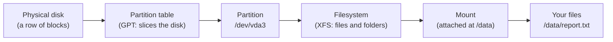
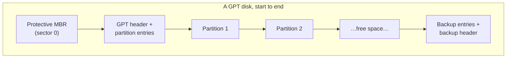
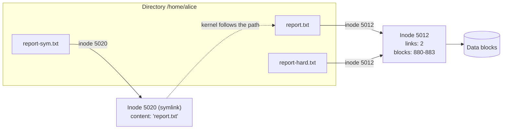
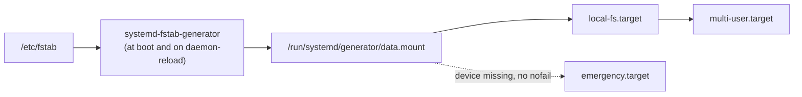

# 09 · Disks and Filesystems

<ul class="module-meta">
  <li>⏱ ~3 hours</li>
  <li>4 labs</li>
  <li>Builds on: 02 · The Shell and the Filesystem, 07 · systemd and Services</li>
</ul>

A monitoring alert fires: `/var` is 100% full. You delete a 20 GB log file, run `df`, and the disk is *still* full. Another server refuses to boot because someone typed one wrong character in `/etc/fstab`. Both problems take five minutes to fix once you understand what a disk, a filesystem, and a mount really are. This module gives you that understanding, from the raw block device all the way up to the file your application writes.

!!! abstract "What you'll learn"
    - Identify every disk and partition on a system with `lsblk` and `blkid`, and decode names like `nvme0n1p3`.
    - Explain the storage stack, from an application's `write()` down to the physical disk.
    - Partition a disk with GPT, create XFS and ext4 filesystems, and grow them.
    - Explain inodes, hard links and symbolic links, and diagnose inode exhaustion.
    - Write a correct `/etc/fstab` line (and a systemd mount unit) that won't break your boot.
    - Add swap as a partition, a file, or compressed RAM with zram.
    - Find what is eating your disk, including space held by deleted-but-open files.

## The big picture

A disk is just a long row of numbered blocks. It has no idea what a "file" is. Everything that makes storage useful (names, folders, permissions, timestamps) is built in software on top of that row of blocks, in layers.



Read it left to right. A **partition table** divides the disk into regions. A **filesystem** organizes one region into files and directories. **Mounting** attaches that filesystem somewhere in the single directory tree that starts at `/`. On Rocky Linux there is usually one more layer, LVM, between the partition and the filesystem; that gets its own module ([10 · LVM, RAID and Encryption](10-lvm-raid-and-encryption.md)).

!!! analogy "Think of it like a warehouse"
    The disk is an empty warehouse floor. The partition table paints lines on the floor to mark separate areas. The filesystem installs shelves and an index card system in one area so you can find things by name. Mounting is putting a door to that area somewhere in the building's hallway, so people can walk in through `/data`.

## How Linux names disks

Linux shows each disk as a **block device**: a special file in `/dev` that reads and writes in fixed-size chunks (blocks) and allows jumping to any position. The name tells you which driver found the disk.

| Name | What it is | Partitions look like |
|------|-----------|----------------------|
| `/dev/sda`, `/dev/sdb` | SATA, SAS, USB, or SCSI disk (the `sd` driver). Letters go in discovery order. | `/dev/sda1`, `/dev/sda2` |
| `/dev/nvme0n1` | NVMe SSD: controller `0`, namespace `1` | `/dev/nvme0n1p1` (note the `p`) |
| `/dev/vda` | Virtio disk in a KVM/QEMU virtual machine | `/dev/vda1` |
| `/dev/sr0` | Optical drive (or a virtual CD-ROM) | none |
| `/dev/loop0` | **Loop device**: a regular file pretending to be a disk | `/dev/loop0p1` |
| `/dev/dm-0` | Device-mapper device (LVM, LUKS); usually used via `/dev/mapper/…` | none |
| `/dev/zram0` | Compressed RAM disk, used for swap | none |

!!! warning "sda today might be sdb tomorrow"
    Names like `sda` are handed out in the order the kernel discovers disks. Add a USB stick or a new controller and the letters can shift. That's why config files refer to disks by **UUID** (a unique ID written inside the filesystem) instead of by name. You'll see the stable aliases in `/dev/disk/`.

### lsblk: the map of your storage

`lsblk` draws the tree of block devices and how they stack. On a typical Rocky 10 VM installed with defaults:

```console
$ lsblk
NAME          MAJ:MIN RM  SIZE RO TYPE MOUNTPOINTS
sr0            11:0    1 1024M  0 rom
vda           252:0    0   40G  0 disk
├─vda1        252:1    0  600M  0 part /boot/efi
├─vda2        252:2    0    1G  0 part /boot
└─vda3        252:3    0 38.4G  0 part
  ├─rl-root   253:0    0 34.4G  0 lvm  /
  └─rl-swap   253:1    0    4G  0 lvm  [SWAP]
vdb           252:16   0   10G  0 disk
```

Reading it: `vda` is a 40 GB disk with three partitions. `vda1` holds the EFI boot files, `vda2` is `/boot`, and `vda3` is handed to LVM, which carves it into `rl-root` (your `/`) and `rl-swap`. `vdb` is a second disk with nothing on it yet.

Add `-f` to see filesystems, labels and UUIDs:

```console
$ lsblk -f
NAME        FSTYPE      FSVER    LABEL UUID                                   FSAVAIL FSUSE% MOUNTPOINTS
vda
├─vda1      vfat        FAT32          4A1C-7F2E                               591.8M     1% /boot/efi
├─vda2      xfs                        6c3e1a5d-6c1b-4f0e-9d0a-5b2f0e8c1a77    731.2M    25% /boot
└─vda3      LVM2_member LVM2 001       Yx3n2K-…
  ├─rl-root xfs                        0f6a4b0e-2d1c-4a8e-b3a2-91e5d3c7a6f1     29.1G    15% /
  └─rl-swap swap        1              b5d2c0f4-7e19-4c33-8a0b-2c6e4f1d9b80                  [SWAP]
vdb
```

`blkid` gives the same identity information in a script-friendly form:

```console
$ sudo blkid /dev/vda2
/dev/vda2: UUID="6c3e1a5d-6c1b-4f0e-9d0a-5b2f0e8c1a77" TYPE="xfs" PARTUUID="a1d4…"
```

The stable aliases live under `/dev/disk/`. Each is a symlink to the current kernel name:

```console
$ ls -l /dev/disk/by-uuid/
lrwxrwxrwx. 1 root root 10 Oct 15 09:02 0f6a4b0e-2d1c-4a8e-b3a2-91e5d3c7a6f1 -> ../../dm-0
lrwxrwxrwx. 1 root root 10 Oct 15 09:02 4A1C-7F2E -> ../../vda1
lrwxrwxrwx. 1 root root 10 Oct 15 09:02 6c3e1a5d-6c1b-4f0e-9d0a-5b2f0e8c1a77 -> ../../vda2
…
```

Other folders there: `by-id/` (model and serial number), `by-path/` (physical port), `by-label/` (filesystem label), `by-partuuid/` (GPT partition ID). They are created by **udev**, the service that reacts to hardware events and builds `/dev`.

<div class="quiz" data-answer="3" markdown>

You see `/dev/nvme1n1p2` in `lsblk`. What is it?

- The second NVMe namespace on controller 1
- Partition 1 of the second NVMe disk
- Partition 2 of namespace 1 on NVMe controller 1
- A loop device backed by an NVMe file

Right. `nvme1` is the controller, `n1` the namespace (think: the disk), and `p2` the second partition.

</div>

## Partition tables: GPT and MBR

A **partition table** is a small data structure at the start of the disk that lists where each partition begins and ends. There are two formats.

**MBR** (Master Boot Record, also called "msdos" or "DOS") is the 1980s format. It fits in the first 512-byte sector, allows four primary partitions (more through an "extended" partition trick), and can't address beyond 2 TiB with 512-byte sectors.

**GPT** (GUID Partition Table) is the modern format, part of the UEFI standard. It allows 128 partitions by default, handles enormous disks, gives every partition a unique ID, and keeps a **backup copy** of the table at the end of the disk so a damaged header can be repaired. Rocky 10 uses GPT for new installs.



The **protective MBR** is a fake MBR entry that covers the whole disk. Old tools that don't understand GPT see "one big partition of unknown type" and leave it alone instead of thinking the disk is empty.

### Tools for partitioning

| Tool | Style | Notes |
|------|-------|-------|
| `fdisk` | Interactive menu | Handles both MBR and GPT. Changes are only written when you press `w`. |
| `parted` | Command line or interactive | Scriptable. **Changes apply immediately**, there is no "write" step. |
| `gdisk` / `sgdisk` | Interactive / scriptable | GPT specialists. May need `sudo dnf install gdisk`. |

A scripted GPT partition with `parted` looks like this:

```console
$ sudo parted -s /dev/vdb mklabel gpt
$ sudo parted -s /dev/vdb mkpart data xfs 1MiB 100%
$ sudo parted /dev/vdb print
Model: Virtio Block Device (virtblk)
Disk /dev/vdb: 10.7GB
Sector size (logical/physical): 512B/512B
Partition Table: gpt
Disk Flags:

Number  Start   End     Size    File system  Name  Flags
 1      1049kB  10.7GB  10.7GB               data
```

Starting at `1MiB` keeps the partition **aligned**: its start lines up with the physical block boundaries of SSDs and RAID stripes, which matters for performance. The `xfs` in `mkpart` is only a hint stored in the table; it does not create a filesystem.

!!! tip "The kernel didn't notice my new partition"
    If a partition you just made doesn't appear in `lsblk`, ask the kernel to re-read the table with `sudo partprobe /dev/vdb`. This usually happens when the disk is in use.

!!! danger "Partitioning the wrong disk destroys it"
    `mklabel` on the wrong device wipes its partition table in an instant. Always run `lsblk` first and check that the disk you are about to touch has **no mountpoints** and the size you expect. All labs in this module use loop devices so you can't hurt a real disk.

## The storage stack

When an application saves a file, the data passes through several layers of the kernel before it reaches hardware. Each layer has one job, and knowing them tells you where to look when something is slow or broken. Click each layer.

<div class="layers" data-hint="Click a layer to see what it does and how to look at it." data-open="0" markdown>

<div class="layer" data-label="Application" data-tag="user space" markdown>

**What it does:** calls `open()`, `write()`, `read()`, `fsync()`. It thinks in file names and byte offsets and has no idea what disk is underneath.

```console
$ strace -e trace=openat,write -f echo hi > /tmp/x
```

These calls are **system calls**: requests into the kernel. See [15 · The Kernel](15-the-kernel.md).

</div>

<div class="layer" data-label="VFS (Virtual File System)" data-tag="kernel" markdown>

**What it does:** the **VFS** is a common front door for every filesystem. It resolves the path `/data/report.txt` to the right mounted filesystem, checks permissions, and passes the request on. Because of the VFS, `cat` works the same on XFS, ext4, NFS, or `/proc`.

It also owns the **page cache** (file data kept in RAM) and the **dentry cache** (recent path lookups).

```console
$ cat /proc/filesystems | head -5
```

</div>

<div class="layer" data-label="Filesystem (XFS, ext4)" data-tag="/dev/mapper/rl-root" markdown>

**What it does:** turns "write 4 KiB at offset 8192 of inode 1234" into "write block 5,812,004". It keeps the inodes, directories, free-space maps, and a **journal** so it can recover after a crash.

```console
$ df -hT /
Filesystem          Type  Size  Used Avail Use% Mounted on
/dev/mapper/rl-root xfs    35G  5.2G   30G  15% /
```

</div>

<div class="layer" data-label="Device mapper (LVM, LUKS)" data-tag="dm-0 (optional)" markdown>

**What it does:** an optional layer that remaps blocks. LVM joins disks into flexible volumes; LUKS encrypts. To the filesystem it looks like one plain disk.

```console
$ sudo dmsetup ls
rl-root	(253:0)
rl-swap	(253:1)
```

Covered in [10 · LVM, RAID and Encryption](10-lvm-raid-and-encryption.md).

</div>

<div class="layer" data-label="Block layer" data-tag="I/O queues" markdown>

**What it does:** collects read/write requests, merges neighbouring ones, and queues them for the device (one queue per CPU on fast devices). An **I/O scheduler** can reorder them.

```console
$ cat /sys/block/vda/queue/scheduler
[none] mq-deadline kyber bfq
```

The bracketed entry is active. `none` is normal for fast SSDs and virtual disks.

</div>

<div class="layer" data-label="Device driver" data-tag="virtio_blk, nvme, sd" markdown>

**What it does:** speaks the hardware's language (NVMe, SCSI/SATA, virtio) and moves the data with DMA.

```console
$ lsmod | grep -E 'virtio_blk|nvme'
virtio_blk             32768  3
```

</div>

<div class="layer" data-label="Physical disk" data-tag="SSD, HDD, virtual disk" markdown>

**What it does:** stores the bits. It may also have its own write cache, which is why `fsync()` exists: to force data all the way to stable storage.

```console
$ cat /sys/block/vda/size     # in 512-byte sectors
83886080
```

</div>

</div>

## What a filesystem really is

A **filesystem** is a data structure written onto a block device. It answers three questions: what files exist, what is in them, and where on the disk that content lives.

### Inodes and directory entries

Each file has an **inode** (index node): a small record holding everything *about* the file except its name. That means owner, group, permissions, size, timestamps, link count, and the list of disk blocks holding the content. Every inode has a number.

The file's **name** lives somewhere else: in its parent directory. A **directory** is just a special file containing a list of **directory entries**, each mapping a name to an inode number.

```console
$ ls -i /etc/hostname
16777347 /etc/hostname
$ stat /etc/hostname
  File: /etc/hostname
  Size: 22        	Blocks: 8          IO Block: 4096   regular file
Device: 253,0	Inode: 16777347    Links: 1
Access: (0644/-rw-r--r--)  Uid: (    0/    root)   Gid: (    0/    root)
Context: system_u:object_r:hostname_etc_t:s0
Access: 2026-10-15 08:41:12.442190312 +0000
Modify: 2026-10-14 17:03:55.118812010 +0000
Change: 2026-10-14 17:03:55.118812010 +0000
 Birth: 2026-10-14 17:03:55.118812010 +0000
```

`Links: 1` is the **link count**: how many directory entries point at this inode. When the count drops to zero *and* no process has the file open, the filesystem frees the inode and its blocks. That second condition will matter later.

### Hard links and symbolic links

Because names and inodes are separate, one inode can have several names.

A **hard link** is a second directory entry pointing at the same inode. Both names are equally "real"; neither is the original. Deleting one just lowers the link count.

A **symbolic link** (symlink, soft link) is a tiny separate file whose content is a *path*. Opening it makes the kernel follow that path. If the target is deleted, the symlink **dangles** (points nowhere).



| | Hard link | Symbolic link |
|--|-----------|---------------|
| Command | `ln target name` | `ln -s target name` |
| Own inode? | No, shares the target's | Yes |
| Survives target deletion? | Yes, data stays while any link remains | No, it dangles |
| Cross filesystems? | No (inode numbers are per filesystem) | Yes |
| Link to a directory? | No | Yes |

!!! example "Try it"
    ```console
    $ cd /tmp && echo hello > a.txt
    $ ln a.txt b.txt && ln -s a.txt c.txt
    $ ls -li a.txt b.txt c.txt
    $ rm a.txt && cat b.txt && cat c.txt
    ```
    `b.txt` still prints `hello`. `c.txt` fails with "No such file or directory" because the path it points at is gone.

<div class="quiz" data-answer="2" markdown>

`/data/big.iso` has a link count of 2. You run `rm /data/big.iso`. What happens to the disk space?

- It's freed immediately
- Nothing is freed: another directory entry still points at the inode
- Half of it is freed
- It's moved to a trash folder

Correct. `rm` removes one name and drops the link count to 1. The data is freed only when the count hits zero and no process has the file open. Find the other name with `find /data -samefile /data/big.iso` *before* deleting.

</div>

## XFS and ext4

Rocky Linux supports several filesystems, but two do almost all the work.

**XFS** is the default on Rocky (and on RHEL since version 7). It was designed for big files, big disks and many parallel writers. It allocates inodes dynamically, so it rarely runs out of them. Its one famous limitation: **you can grow XFS, but you can't shrink it.**

**ext4** is the classic Linux filesystem, the default on many other distributions. It can grow and shrink (shrinking only while unmounted). It creates a fixed number of inodes at format time.

Both are **journaling** filesystems. Before changing their metadata, they write a description of the change to a **journal** (a log). After a crash, the filesystem replays or discards the journal entries instead of scanning the entire disk.

=== "XFS"

    ```console
    $ sudo mkfs.xfs /dev/vdb1
    meta-data=/dev/vdb1              isize=512    agcount=4, agsize=655232 blks
             =                       sectsz=512   attr=2, projid32bit=1
             =                       crc=1        finobt=1, sparse=1, rmapbt=1
             =                       reflink=1    bigtime=1 inobtcount=1 nrext64=1
    data     =                       bsize=4096   blocks=2620928, imaxpct=25
    …
    $ sudo xfs_info /data             # inspect a mounted XFS
    $ sudo xfs_growfs /data           # grow to fill the device (takes the MOUNTPOINT)
    $ sudo xfs_admin -L data /dev/vdb1  # set a label (unmounted)
    $ sudo xfs_repair -n /dev/vdb1    # check only, no changes (unmounted)
    ```

    `agcount` is the number of **allocation groups**: XFS splits the disk into independent regions so many CPUs can allocate space at once.

=== "ext4"

    ```console
    $ sudo mkfs.ext4 /dev/vdb1
    mke2fs 1.47.1 (20-May-2024)
    Creating filesystem with 2620928 4k blocks and 655360 inodes
    …
    $ sudo tune2fs -l /dev/vdb1 | grep -E 'Inode count|Reserved block'
    Inode count:              655360
    Reserved block count:     131046
    $ sudo resize2fs /dev/vdb1        # grow to fill the device (online OK)
    $ sudo resize2fs /dev/vdb1 5G     # shrink (must be unmounted first)
    $ sudo e2fsck -f /dev/vdb1        # full check (unmounted)
    ```

    By default ext4 reserves 5% of blocks for root, so a "full" disk still lets root log in and clean up.

!!! version "XFS shrink on Rocky 10"
    RHEL 10 lists a *limited* XFS shrink with `xfs_growfs` as a **Technology Preview**: it only works when the space being removed is unused and the new size stays within the last allocation group. Technology Previews aren't meant for production. For practical purposes, plan as if XFS can't shrink: to make one smaller, back up, recreate, and restore.

### Repairing a filesystem

If a filesystem is damaged (after a hardware fault or a hard power cut that the journal couldn't cover), you repair it **unmounted**.

| | XFS | ext4 |
|--|-----|------|
| Check without changing | `xfs_repair -n /dev/X` | `e2fsck -n /dev/X` |
| Repair | `xfs_repair /dev/X` | `e2fsck -f /dev/X` (or `fsck.ext4`) |
| At boot | No boot-time check; the journal replays on mount | `systemd-fsck` runs if the fstab pass field is non-zero |

`fsck.xfs` exists but deliberately does nothing; XFS checks are always manual. If `xfs_repair` refuses because the log is dirty, first try mounting the filesystem once (which replays the log) and unmounting it. `xfs_repair -L` zeroes the log and can lose the most recent changes: it's the last resort.

<div class="quiz" data-answer="1" markdown>

Your `/srv` filesystem is XFS on a 100 GB volume. Management wants to give 40 GB of that space to a different volume. What's the realistic plan?

- Back up `/srv`, recreate a smaller XFS, restore the data
- Run `xfs_growfs -D` with a smaller size, it's fully supported
- Run `resize2fs /srv 60G`
- Unmount and run `xfs_repair --shrink`

Right. Production XFS can only grow. `resize2fs` is for ext4, and `xfs_repair` has no shrink option.

</div>

## Mounting

**Mounting** attaches a filesystem to a directory, called the **mount point**. The directory's previous contents are hidden (not deleted) until you unmount.

```console
$ sudo mkdir -p /data
$ sudo mount /dev/vdb1 /data
$ findmnt /data
TARGET SOURCE    FSTYPE OPTIONS
/data  /dev/vdb1 xfs    rw,relatime,seclabel,attr2,inode64,logbufs=8,logbsize=32k,noquota
$ sudo umount /data
```

`findmnt` is the clearest way to see mounts; `findmnt` with no arguments shows the whole tree. You may also see **mount options**, which change how the filesystem behaves:

| Option | Meaning |
|--------|---------|
| `ro` / `rw` | Read-only or read-write |
| `noatime` / `relatime` | Don't update access times / only update them occasionally (`relatime` is the default) |
| `nosuid`, `nodev`, `noexec` | Ignore setuid bits, device files, or execute permission. Good hardening for `/tmp`, removable media, and data volumes. |
| `defaults` | `rw,suid,dev,exec,auto,nouser,async` |

!!! pitfall "umount: target is busy"
    A filesystem can't be unmounted while a process has a file open on it, or has its current directory inside it (including your own shell). Find the culprit:

    ```console
    $ sudo umount /data
    umount: /data: target is busy.
    $ sudo fuser -vm /data
                         USER        PID ACCESS COMMAND
    /data:               root     kernel mount /data
                         alice      2214 ..c.. bash
    ```

    The `c` means alice's shell has its current directory in `/data`. Have her `cd` out, or stop the process.

## /etc/fstab: mounting at boot

`mount` by hand lasts until the next reboot. To make a mount permanent, add a line to `/etc/fstab`. Each line has six fields:

```text title="/etc/fstab"
UUID=0f6a4b0e-2d1c-4a8e-b3a2-91e5d3c7a6f1  /       xfs   defaults                 0 0
UUID=6c3e1a5d-6c1b-4f0e-9d0a-5b2f0e8c1a77  /boot   xfs   defaults                 0 0
UUID=4A1C-7F2E                             /boot/efi vfat umask=0077,shortname=winnt 0 2
/dev/mapper/rl-swap                        none    swap  defaults                 0 0
UUID=3d2c9a10-5be4-4b7e-9f22-6a1e0c4b7d55  /data   xfs   defaults,nofail,noatime  0 0
```

Taking the last line apart, field by field:

1. **What** to mount. Use `UUID=` (from `blkid`) or `LABEL=`, never `/dev/sdb1`, because device names can change between boots.
2. **Where** to mount it. The directory must exist. For swap, this is `none`.
3. **Filesystem type**: `xfs`, `ext4`, `vfat`, `swap`, `nfs`, …
4. **Options**, comma-separated, no spaces. `defaults` plus anything extra.
5. **Dump**: legacy backup flag. Always `0`.
6. **fsck pass**: `0` = don't check at boot, `1` = check first (root on ext4), `2` = check after root. Use `0` for XFS, since its checker does nothing at boot.

The options that save you at 3 a.m.:

| Option | What it does |
|--------|-------------|
| `nofail` | If the device is missing at boot, carry on instead of dropping to emergency mode. Use it for any non-essential disk. |
| `x-systemd.device-timeout=10s` | How long to wait for the device to show up (default 90 seconds). |
| `x-systemd.automount` | Don't mount at boot; mount on first access to the directory. |
| `_netdev` | This needs the network (mostly for iSCSI; NFS and CIFS are detected automatically). |
| `x-systemd.requires=…` | Mount only after another unit or mount is ready. |

!!! danger "One typo, no boot"
    A bad line in `/etc/fstab` for a filesystem without `nofail` drops the machine into **emergency mode** at boot, often on a cloud VM where you have no console. Always test before rebooting:

    ```console
    $ sudo findmnt --verify
    Success, no errors or warnings detected
    $ sudo systemctl daemon-reload
    $ sudo mount -a
    ```

    `findmnt --verify` parses the file and checks that sources exist and types are known. `mount -a` mounts everything not yet mounted, so a mistake shows up now instead of at reboot.

### How systemd turns fstab into mounts

At boot, systemd doesn't read `/etc/fstab` directly. A small program called a **generator** (`systemd-fstab-generator`) converts each line into a **mount unit**, and systemd starts those units in parallel with everything else. This is why you run `systemctl daemon-reload` after editing fstab: it re-runs the generator.



You can see the generated unit:

```console
$ systemctl cat data.mount
# /run/systemd/generator/data.mount
# Automatically generated by systemd-fstab-generator

[Unit]
Documentation=man:fstab(5) man:systemd-fstab-generator(8)
SourcePath=/etc/fstab
After=blockdev@dev-disk-by\x2duuid-3d2c9a10\x2d….target

[Mount]
What=/dev/disk/by-uuid/3d2c9a10-5be4-4b7e-9f22-6a1e0c4b7d55
Where=/data
Type=xfs
Options=defaults,nofail,noatime
```

### Writing a mount unit yourself

You can skip fstab and write a mount unit directly, which gives you dependencies, ordering, and the usual `systemctl` controls. The one strict rule: **the unit name must match the mount path**, with `/` turned into `-`. `/srv/backup` becomes `srv-backup.mount`. Let `systemd-escape` work out tricky names:

```console
$ systemd-escape -p --suffix=mount /srv/my-data
srv-my\x2ddata.mount
```

```ini title="/etc/systemd/system/srv-backup.mount"
[Unit]
Description=Backup volume

[Mount]
What=/dev/disk/by-uuid/3d2c9a10-5be4-4b7e-9f22-6a1e0c4b7d55  # (1)!
Where=/srv/backup  # (2)!
Type=xfs
Options=defaults,noatime

[Install]
WantedBy=multi-user.target  # (3)!
```

1. Same as fstab field 1. The `/dev/disk/by-uuid/` path is stable.
2. Must match the unit file name exactly.
3. `systemctl enable` hooks it into normal boot.

```console
$ sudo systemctl daemon-reload
$ sudo systemctl enable --now srv-backup.mount
```

Use fstab for simple, static mounts (everyone knows where to look). Use a mount unit when the mount must order against a service. See [07 · systemd and Services](07-systemd-and-services.md) for units in general.

<div class="quiz" data-answer="4" markdown>

You add a USB backup disk to `/etc/fstab` with options `defaults`. Months later the disk is unplugged and the server reboots. What happens?

- The mount is skipped silently
- systemd mounts `/` read-only
- The kernel panics
- Boot waits about 90 seconds for the device, then drops to emergency mode

Exactly. Without `nofail`, a missing device fails `local-fs.target`. Add `nofail` (and maybe `x-systemd.device-timeout=10s`) to removable or non-essential disks.

</div>

## Swap

**Swap** is disk space the kernel uses as overflow for RAM. When memory is tight, the kernel moves rarely-used memory pages out to swap, freeing RAM for active work. Swap is not "extra RAM" (disk is thousands of times slower), it's a pressure valve. A little swap lets the kernel move out idle junk; a system that is constantly swapping is short of memory.

You have three options on Rocky:

=== "Swap partition or LV"

    The installer's default: the `rl-swap` logical volume.

    ```console
    $ sudo mkswap /dev/vdb2
    $ sudo swapon /dev/vdb2
    ```

    fstab: `UUID=…  none  swap  defaults  0 0`

=== "Swap file"

    No repartitioning needed. Write the file with `dd` so it has no holes:

    ```console
    $ sudo dd if=/dev/zero of=/swapfile bs=1M count=2048
    $ sudo chmod 600 /swapfile
    $ sudo mkswap /swapfile
    $ sudo swapon /swapfile
    ```

    fstab: `/swapfile  none  swap  defaults  0 0`

=== "zram"

    A **zram** device is a compressed block device living in RAM. Swapping to it is far faster than to disk, and compression typically fits 2 to 3 pages into the space of one. Rocky 10 ships `zram-generator`:

    ```console
    $ sudo dnf install zram-generator
    $ sudo tee /etc/systemd/zram-generator.conf <<'EOF'
    [zram0]
    zram-size = min(ram / 2, 4096)
    compression-algorithm = zstd
    EOF
    $ sudo systemctl daemon-reload
    $ sudo systemctl start systemd-zram-setup@zram0.service
    ```

Check what's active:

```console
$ swapon --show
NAME       TYPE      SIZE USED PRIO
/dev/dm-1  partition   4G   0B   -2
/swapfile  file        2G   0B   -3
/dev/zram0 partition 1.8G   0B  100
```

The kernel uses higher **priority** (`PRIO`) swap first, so zram (100) fills before disk swap. Memory and swap from the kernel's point of view are covered in [15 · The Kernel](15-the-kernel.md#memory-in-plain-terms).

## Where did my space go?

### df vs du

Two tools answer two different questions:

- `df` asks the **filesystem**: "how many blocks are used?"
- `du` walks the **directory tree** and adds up file sizes it can see.

```console
$ df -h /var
Filesystem           Size  Used Avail Use% Mounted on
/dev/mapper/rl-var    20G   19G  1.0G  95% /var
$ sudo du -xh --max-depth=1 /var | sort -h | tail -5
208M	/var/cache
1.1G	/var/lib
2.3G	/var/log
3.6G	/var
```

`df` says 19 GB used; `du` only finds 3.6 GB. That gap is a clue. Usual causes, in order:

1. A file was **deleted while a process still has it open** (next section).
2. Files are **hidden under a mount point**: something wrote into `/var/lib/data` while nothing was mounted there, then a filesystem was mounted on top.
3. `du` couldn't read some directories (run it as root).

`-x` tells `du` to stay on one filesystem, so it doesn't wander into `/proc` or other mounts. Use `sort -h` to sort human-readable sizes.

To find big individual files:

```console
$ sudo find /var -xdev -type f -size +500M -exec ls -lh {} +
-rw-r-----. 1 root root 1.9G Oct 15 03:12 /var/log/app/debug.log
```

### Deleted but still open

When you `rm` a log file that a running service is still writing to, the name disappears but the inode lives on: its link count is 0, but a process holds it open. The space is not freed until that process closes the file. `lsof +L1` lists open files with a link count below 1:

```console
$ sudo lsof +L1
COMMAND  PID USER   FD   TYPE DEVICE   SIZE/OFF NLINK     NODE NAME
java    1873 app     7w   REG  253,2 16106127360     0  1048711 /var/log/app/app.log (deleted)
```

There's 15 GB pinned by PID 1873. Two fixes:

- Restart (or reload) the service so it closes and reopens its log. The cleanest fix.
- If you can't restart it now, truncate the file through the process's file descriptor: `sudo truncate -s 0 /proc/1873/fd/7`.

!!! tip "Prevent it next time"
    Don't `rm` an active log. Truncate it (`truncate -s 0 file`) or let logrotate handle it with `copytruncate` or a reload. See [08 · Logging and the Journal](08-logging-and-the-journal.md).

### Inode exhaustion

A filesystem can run out of **inodes** while it still has free blocks. Every file needs one inode, so millions of tiny files (session files, mail queues, cache shards) can use them all. The symptom is baffling: "No space left on device" while `df -h` shows free space.

```console
$ touch /srv/cache/new
touch: cannot touch '/srv/cache/new': No space left on device
$ df -h /srv
Filesystem      Size  Used Avail Use% Mounted on
/dev/vdc1       9.8G  2.1G  7.2G  23% /srv
$ df -i /srv
Filesystem     Inodes  IUsed IFree IUse% Mounted on
/dev/vdc1      655360 655360     0  100% /srv
```

`df -i` gives it away. This is mostly an ext4 problem: its inode count is fixed when you run `mkfs.ext4`. XFS creates inodes on demand (up to a percentage of space, `imaxpct`), so it rarely hits this. The fix is to delete the small files (find the directory with the most entries) or, longer term, reformat with more inodes (`mkfs.ext4 -i` or `-N`) or use XFS.

### The page cache: "free" memory isn't wasted

Linux keeps recently read and written file data in spare RAM, called the **page cache**. A second read of the same file comes from RAM instead of disk. This makes `free` look alarming to newcomers:

```console
$ free -h
               total        used        free      shared  buff/cache   available
Mem:           7.5Gi       1.9Gi       412Mi        18Mi       5.5Gi       5.6Gi
Swap:          4.0Gi          0B       4.0Gi
```

Only 412 MiB "free"? Look at `buff/cache`: 5.5 GiB of file data the kernel is holding *just in case*. It gives that memory back instantly when a program needs it. The number that matters is **available**: 5.6 GiB, the memory programs can actually get. Unused RAM is wasted RAM, so the kernel fills it with cache.

!!! example "Try it: watch the cache work"
    ```console
    $ dd if=/dev/zero of=/var/tmp/cachetest bs=1M count=500 status=none
    $ sync; echo 3 | sudo tee /proc/sys/vm/drop_caches >/dev/null
    $ time cat /var/tmp/cachetest > /dev/null    # cold: from disk
    $ time cat /var/tmp/cachetest > /dev/null    # warm: from RAM, much faster
    $ rm /var/tmp/cachetest
    ```
    `drop_caches` empties the clean cache. It's a test tool only, never a "fix" to run in production.

Practice the full-disk hunt before you need it at 3 a.m.:

<div class="terminal-sim" data-title="Investigate a full disk" markdown>

<div class="task" data-expect="lsblk -f" data-hint="lsblk with the option that adds filesystem columns." markdown>

**Step 1.** Show every block device with its filesystem type and UUID.

```text
NAME        FSTYPE      FSVER    LABEL UUID                                   FSAVAIL FSUSE% MOUNTPOINTS
vda
├─vda1      vfat        FAT32          4A1C-7F2E                               591.8M     1% /boot/efi
├─vda2      xfs                        6c3e1a5d-6c1b-4f0e-9d0a-5b2f0e8c1a77    731.2M    25% /boot
└─vda3      LVM2_member LVM2 001       Yx3n2K-…
  ├─rl-root xfs                        0f6a4b0e-2d1c-4a8e-b3a2-91e5d3c7a6f1      1.1G    97% /
  └─rl-swap swap        1              b5d2c0f4-7e19-4c33-8a0b-2c6e4f1d9b80                  [SWAP]
```

</div>

<div class="task" data-expect="df -h /" data-match="df -h?T? /" data-hint="df with human-readable sizes, for the root filesystem only." markdown>

**Step 2.** Root looks nearly full. Confirm with `df` in human-readable units, for `/` only.

```text
Filesystem           Size  Used Avail Use% Mounted on
/dev/mapper/rl-root   35G   34G  1.1G  97% /
```

</div>

<div class="task" data-expect="sudo du -xh --max-depth=1 /var||sudo du -xh -d1 /var||sudo du -xh -d 1 /var" data-hint="sudo du, stay on one filesystem (-x), human sizes (-h), one level deep (--max-depth=1), on /var." markdown>

**Step 3.** As root, see how big each directory directly under `/var` is, without crossing into other filesystems.

```text
0	/var/adm
182M	/var/cache
1.2G	/var/lib
3.1G	/var/log
…
4.6G	/var
```

</div>

<div class="task" data-expect="sudo lsof +L1" data-hint="lsof can list files whose link count is less than 1." markdown>

**Step 4.** `du` finds far less than `df` reports. Look for deleted files that are still held open.

```text
COMMAND  PID USER   FD   TYPE DEVICE    SIZE/OFF NLINK     NODE NAME
java    1873 app     7w   REG  253,0 26843545600     0  1048711 /var/log/app/app.log (deleted)
```

</div>

<div class="task" data-expect="sudo systemctl restart app||sudo systemctl restart app.service" data-hint="Restart the service that owns PID 1873. Its unit is called app." markdown>

**Step 5.** PID 1873 belongs to `app.service`. Restart it so it lets go of the 25 GB deleted log.

```text
(no output: the service restarted and closed the deleted file)
```

</div>

<div class="task" data-expect="df -h /" data-match="df -h?T? /" data-hint="Same df command as step 2." markdown>

**Step 6.** Check the space again.

```text
Filesystem           Size  Used Avail Use% Mounted on
/dev/mapper/rl-root   35G  9.2G   26G  27% /
```

</div>

</div>

Here is the whole "disk full" investigation as a decision tree:

<div class="decision" markdown>

<div class="node" data-id="start" markdown>

**Writes fail with "No space left on device". What does `df -h` show for that filesystem?**

<button data-goto="full">Use% is near 100%</button> <button data-goto="notfull">There is free space</button>

</div>

<div class="node" data-id="full" markdown>

**Does `sudo du -xsh <mountpoint>` roughly match `df`'s Used column?**

<button data-goto="realfiles">Yes, about the same</button> <button data-goto="gap">No, du is much smaller</button>

</div>

<div class="node" data-id="realfiles" markdown>

The space is used by real files. Drill down with `sudo du -xh --max-depth=1 <mountpoint> | sort -h`, repeat in the biggest directory, and use `find -size +500M`. Clean up, rotate logs, or grow the filesystem (XFS: `xfs_growfs`, see [Module 10](10-lvm-raid-and-encryption.md) for growing the LV first).

</div>

<div class="node" data-id="gap" markdown>

**Does `sudo lsof +L1` list large `(deleted)` files?**

<button data-goto="deleted">Yes</button> <button data-goto="hidden">No</button>

</div>

<div class="node" data-id="deleted" markdown>

A process is holding deleted files open. Restart or reload that service, or truncate via `/proc/<PID>/fd/<FD>`. Space returns immediately.

</div>

<div class="node" data-id="hidden" markdown>

Files are probably **hidden under a mount point**. Bind-mount the parent filesystem somewhere else to look underneath: `sudo mount --bind / /mnt/peek` then `sudo du -xsh /mnt/peek/var/*`. Unmount when done.

</div>

<div class="node" data-id="notfull" markdown>

**What does `df -i` show?**

<button data-goto="inodes">IUse% is 100%</button> <button data-goto="other">Inodes are fine</button>

</div>

<div class="node" data-id="inodes" markdown>

**Inode exhaustion.** Find the directory with the most files: `sudo find <mountpoint> -xdev -type d -exec sh -c 'echo "$(ls -A "$1" | wc -l) $1"' _ {} \; | sort -n | tail`. Delete what you can; reformat with more inodes later.

</div>

<div class="node" data-id="other" markdown>

Check for **quotas** (`xfs_quota -x -c report <mountpoint>`), a read-only remount after errors (`findmnt -o TARGET,OPTIONS <mountpoint>`, look for `ro`), and the kernel log (`journalctl -k | grep -i -E 'xfs|ext4'`).

</div>

</div>

## Labs

All labs use **loop devices**: a regular file attached as a fake disk with `losetup`. Nothing touches your real disks, and cleanup is just detaching and deleting the file.

!!! lab "Lab 1: Map your storage"

    **Goal:** Draw an accurate picture of the storage on your VM, from disks to mounts.

    **You'll need:** a Rocky 10 VM, sudo. This lab only reads.

    1. List block devices with filesystems:

        ```console
        $ lsblk -f
        ```

    2. For your root filesystem, find the source device, type, and options:

        ```console
        $ findmnt /
        ```

    3. Follow the device back to the disk. If the source is `/dev/mapper/rl-root`, find which `dm-N` it is and what's underneath it:

        ```console
        $ ls -l /dev/mapper/
        $ ls /sys/block/dm-0/slaves/
        ```

    4. Compare the UUIDs in `/etc/fstab` with `sudo blkid`. Every `UUID=` in fstab should match a line in `blkid`.

    5. Check the I/O scheduler and size of your main disk (replace `vda` if needed):

        ```console
        $ cat /sys/block/vda/queue/scheduler
        $ echo $(( $(cat /sys/block/vda/size) * 512 / 1024**3 )) GiB
        ```

    **Check your work:** you can sketch, on paper, the chain disk → partition → (LVM) → filesystem → mount point for `/` and `/boot`, and each fstab UUID maps to a real device.

    ??? success "What just happened?"
        `/sys/block/dm-0/slaves/` shows which devices sit *underneath* a device-mapper device; on a default install that's `vda3`. You traced the storage stack from the top layer (mount) to the bottom (disk) using only files the kernel exposes.

    **Clean up:** nothing to clean up.

!!! lab "Lab 2: Partition, format, mount, and grow"

    **Goal:** Partition a fake disk with GPT, put XFS and ext4 on it, mount both, then grow the XFS filesystem.

    **You'll need:** sudo, about 2 GB free in `/var/tmp`.

    1. Create a 1 GiB file and attach it as a loop device. `-P` asks the kernel to scan for partitions:

        ```console
        $ truncate -s 1G /var/tmp/disk1.img
        $ LOOP=$(sudo losetup -fP --show /var/tmp/disk1.img); echo $LOOP
        /dev/loop0
        ```

    2. Make a GPT table with two partitions, 300 MiB and 300 MiB, leaving the rest free:

        ```console
        $ sudo parted -s $LOOP mklabel gpt
        $ sudo parted -s $LOOP mkpart xfsdata xfs 1MiB 301MiB
        $ sudo parted -s $LOOP mkpart extdata ext4 301MiB 601MiB
        $ lsblk $LOOP
        ```

    3. Create filesystems and mount them:

        ```console
        $ sudo mkfs.xfs -q ${LOOP}p1
        $ sudo mkfs.ext4 -q ${LOOP}p2
        $ sudo mkdir -p /mnt/x /mnt/e
        $ sudo mount ${LOOP}p1 /mnt/x && sudo mount ${LOOP}p2 /mnt/e
        $ df -hT /mnt/x /mnt/e
        ```

    4. Compare their inode counts:

        ```console
        $ df -i /mnt/x /mnt/e
        ```

    5. Try to grow something. Partition 1 (XFS) can't grow, because partition 2 sits right after it. That's the everyday reason LVM exists (next module). Partition 2 (ext4) has free space after it, so grow that one while it stays mounted:

        ```console
        $ sudo parted -s $LOOP resizepart 2 100%
        $ sudo partprobe $LOOP
        $ lsblk $LOOP
        $ sudo resize2fs ${LOOP}p2
        $ df -h /mnt/e
        ```

    **Check your work:** `df -h /mnt/e` shows roughly 690 MB instead of 270 MB, and `df -i` showed a fixed inode count for ext4 but a much larger (dynamic) one for XFS.

    ??? tip "Hint: resize2fs says 'Nothing to do'"
        The kernel hasn't seen the bigger partition. Run `sudo partprobe $LOOP` and check `lsblk $LOOP` before `resize2fs`.

    **Clean up:**

    ```console
    $ sudo umount /mnt/x /mnt/e
    $ sudo losetup -d $LOOP
    $ rm -f /var/tmp/disk1.img; sudo rmdir /mnt/x /mnt/e
    ```

!!! lab "Lab 3: A safe permanent mount"

    **Goal:** Make a filesystem mount at boot with a systemd mount unit, test it without rebooting, and see what `nofail` does.

    **You'll need:** sudo.

    1. Make an image file with an XFS filesystem directly on it (no partition table needed):

        ```console
        $ truncate -s 300M /var/tmp/vault.img
        $ sudo mkfs.xfs -q /var/tmp/vault.img
        ```

    2. Write a mount unit. The `loop` option makes `mount` attach the file to a loop device automatically:

        ```console
        $ sudo mkdir -p /srv/vault
        $ sudo tee /etc/systemd/system/srv-vault.mount <<'EOF'
        [Unit]
        Description=Lab vault image

        [Mount]
        What=/var/tmp/vault.img
        Where=/srv/vault
        Type=xfs
        Options=loop,noatime,nodev,nosuid

        [Install]
        WantedBy=multi-user.target
        EOF
        $ sudo systemctl daemon-reload
        $ sudo systemctl enable --now srv-vault.mount
        ```

    3. Confirm it's mounted and controlled by systemd:

        ```console
        $ systemctl status srv-vault.mount --no-pager
        $ findmnt /srv/vault
        ```

    4. Now see an fstab mistake *safely*. Add a line for a disk that doesn't exist, with `nofail`, and verify:

        ```console
        $ echo 'UUID=00000000-0000-0000-0000-000000000000 /srv/ghost xfs defaults,nofail,x-systemd.device-timeout=5s 0 0' | sudo tee -a /etc/fstab
        $ sudo findmnt --verify
        ```

        `findmnt --verify` warns that the source can't be found. On a real boot, `nofail` means systemd waits 5 seconds, then continues.

    **Check your work:** `findmnt /srv/vault` shows a `/dev/loopN` source, and `findmnt --verify` flags the ghost line instead of letting you find out at reboot.

    **Clean up:**

    ```console
    $ sudo sed -i '/00000000-0000-0000-0000-000000000000/d' /etc/fstab
    $ sudo systemctl disable --now srv-vault.mount
    $ sudo rm /etc/systemd/system/srv-vault.mount; sudo systemctl daemon-reload
    $ sudo rmdir /srv/vault; rm -f /var/tmp/vault.img
    ```

!!! lab "Lab 4: Space mysteries, solved"

    **Goal:** Reproduce inode exhaustion and the deleted-but-open file, and fix both.

    **You'll need:** sudo.

    1. Make a tiny ext4 filesystem with only 128 inodes:

        ```console
        $ truncate -s 100M /var/tmp/tiny.img
        $ sudo mkfs.ext4 -q -N 128 /var/tmp/tiny.img
        $ sudo mkdir -p /mnt/tiny && sudo mount -o loop /var/tmp/tiny.img /mnt/tiny
        ```

    2. Fill the inodes with empty files:

        ```console
        $ for i in $(seq 1 200); do sudo touch /mnt/tiny/f$i 2>/dev/null || { echo "failed at $i"; break; }; done
        $ df -h /mnt/tiny; df -i /mnt/tiny
        ```

        Space is nearly empty, inodes are 100% used.

    3. Free some inodes, then create a 40 MB file held open by a background process:

        ```console
        $ sudo rm -f /mnt/tiny/f*
        $ sudo dd if=/dev/zero of=/mnt/tiny/big.log bs=1M count=40 status=none
        $ sudo bash -c 'exec 3</mnt/tiny/big.log; sleep 600' &
        $ sudo rm /mnt/tiny/big.log
        $ df -h /mnt/tiny; sudo du -sh /mnt/tiny
        ```

        `df` still counts 40 MB; `du` doesn't see it.

    4. Find and release it:

        ```console
        $ sudo lsof +L1 /mnt/tiny
        $ sudo pkill -f 'sleep 600'
        $ df -h /mnt/tiny
        ```

    **Check your work:** after the `pkill`, `df -h /mnt/tiny` drops by about 40 MB.

    ??? success "What just happened?"
        `rm` removed the directory entry, dropping the link count to 0. The inode survived because the `bash` process held file descriptor 3 open. When the process died, the kernel closed the descriptor, saw no links and no openers, and freed the blocks.

    **Clean up:**

    ```console
    $ sudo umount /mnt/tiny && sudo rmdir /mnt/tiny
    $ rm -f /var/tmp/tiny.img
    ```

## Common pitfalls

| Symptom | Cause | Fix |
|---------|-------|-----|
| Boot stops in emergency mode after adding a disk | fstab line for a missing or mistyped device without `nofail` | Boot to emergency shell, fix fstab, `systemctl daemon-reload`. Test with `findmnt --verify` next time. |
| Mount works by hand but the disk mounts in the wrong place after reboot | fstab uses `/dev/sdb1`, and names shifted | Use `UUID=` from `blkid`. |
| `df` shows full, `du` shows little | Deleted-but-open files, or data hidden under a mount | `lsof +L1`; bind-mount the parent to look underneath. |
| "No space left" with free space | Inode exhaustion (ext4) | `df -i`; delete small files; reformat with more inodes. |
| `xfs_growfs /dev/…` fails | `xfs_growfs` wants the mount point | `xfs_growfs /data`. |
| New partition not visible | Kernel didn't re-read the table | `partprobe /dev/X`. |
| Edited fstab but `mount -a` uses old options | systemd still has old generated units | `systemctl daemon-reload`. |
| `free` shows almost no free memory | That's the page cache doing its job | Look at the `available` column. |

!!! pitfall "Mounting over a directory that already has data"
    If `/var/lib/mysql` has files and you mount a new disk there, the old files vanish from view but still use space on the parent filesystem. Always check a mount point is empty (`ls -A`) before mounting onto it.

## Cheat sheet

| Command | What it does |
|---------|-------------|
| `lsblk -f` | Tree of disks, partitions, filesystems, UUIDs, mount points |
| `blkid` | Show UUID, type, label of block devices |
| `parted -s DEV mklabel gpt` | Create a new GPT partition table (destroys the old one) |
| `parted -s DEV mkpart NAME FS 1MiB 100%` | Create a partition |
| `fdisk -l DEV` | List partitions |
| `partprobe DEV` | Make the kernel re-read the partition table |
| `mkfs.xfs DEV` / `mkfs.ext4 DEV` | Create a filesystem |
| `xfs_growfs MOUNTPOINT` | Grow XFS to fill its device |
| `resize2fs DEV [SIZE]` | Grow or shrink ext4 |
| `xfs_repair -n DEV` / `e2fsck -f DEV` | Check a filesystem (unmounted) |
| `mount DEV DIR` / `umount DIR` | Attach or detach a filesystem |
| `findmnt [DIR]` | Show mounts as a tree |
| `findmnt --verify` | Sanity-check `/etc/fstab` |
| `mount -a` | Mount everything in fstab not yet mounted |
| `systemd-escape -p --suffix=mount PATH` | Name for a mount unit |
| `mkswap` / `swapon` / `swapon --show` | Set up and inspect swap |
| `df -h` / `df -i` | Space and inode usage per filesystem |
| `du -xh --max-depth=1 DIR` | Size of each subdirectory (pipe to `sort -h`) |
| `lsof +L1` | Deleted files still held open |
| `fuser -vm DIR` | Who is using a mount point |
| `losetup -fP --show FILE` / `losetup -d DEV` | Attach / detach a loop device |
| `free -h` | Memory use, including page cache |

## Flashcards

<div class="flashcards" markdown>

<div class="card" markdown>

What does the `n1` in `/dev/nvme0n1` mean?

Namespace 1 on NVMe controller 0. Partitions add `p`: `/dev/nvme0n1p1`.

</div>

<div class="card" markdown>

Why use `UUID=` instead of `/dev/sdb1` in `/etc/fstab`?

Kernel names are assigned in discovery order and can change between boots. A filesystem UUID is stored inside the filesystem and never changes.

</div>

<div class="card" markdown>

What does an inode store, and what does it *not* store?

Owner, group, mode, size, timestamps, link count, and where the data blocks are. It does not store the file's name; names live in directory entries.

</div>

<div class="card" markdown>

Hard link vs symbolic link in one sentence each?

A hard link is another name for the same inode. A symlink is a separate small file containing a path to follow.

</div>

<div class="card" markdown>

Can you shrink XFS?

Not in practice. Back up, recreate smaller, restore. (RHEL 10 lists only a limited shrink as a Technology Preview.) ext4 can shrink while unmounted.

</div>

<div class="card" markdown>

What does `nofail` do in fstab?

If the device is missing at boot, systemd continues instead of failing `local-fs.target` and dropping to emergency mode.

</div>

<div class="card" markdown>

The six fstab fields?

Device, mount point, type, options, dump (always 0), fsck pass (0 for XFS).

</div>

<div class="card" markdown>

`df` says full, `du` says mostly empty. First suspect?

A deleted file still held open by a process. Find it with `lsof +L1`; restart the process.

</div>

<div class="card" markdown>

"No space left on device" but `df -h` shows free space?

Inode exhaustion. Check `df -i`.

</div>

<div class="card" markdown>

Why does `free` show little "free" memory on a healthy system?

The kernel uses spare RAM as page cache (`buff/cache`) and gives it back on demand. Read the `available` column.

</div>

</div>

## Recap

!!! recap "Key takeaways"
    - Disks are block devices in `/dev` (`sda`, `nvme0n1`, `vda`). Their names can change; UUIDs don't.
    - GPT is the modern partition table; `parted` and `fdisk` manage it. Always `lsblk` before you touch a disk.
    - The storage stack runs app → VFS → filesystem → (device mapper) → block layer → driver → disk.
    - An inode holds a file's metadata; a directory maps names to inodes. Hard links share an inode; symlinks store a path.
    - XFS is Rocky's default and can only grow in practice; ext4 can grow and shrink.
    - `/etc/fstab` lines become systemd mount units. Use UUIDs, `nofail` for non-essential disks, and test with `findmnt --verify` and `mount -a`.
    - When `df` and `du` disagree, suspect deleted-but-open files (`lsof +L1`). When there's space but no room, check `df -i`.
    - `buff/cache` in `free` is borrowed memory the kernel returns on demand; read the `available` column.

## Go deeper

- Man pages: [[man:lsblk(8)]] [[man:parted(8)]] [[man:fstab(5)]] [[man:systemd.mount(5)]] [[man:xfs(5)]] [[man:xfs_repair(8)]] [[man:ext4(5)]] [[man:findmnt(8)]] [[man:losetup(8)]] [[man:swapon(8)]] [[man:lsof(8)]]
- [Red Hat: Managing file systems (RHEL 10)](https://docs.redhat.com/en/documentation/red_hat_enterprise_linux/10/html/managing_file_systems/index)
- [Red Hat: Managing storage devices (RHEL 10)](https://docs.redhat.com/en/documentation/red_hat_enterprise_linux/10/html/managing_storage_devices/index)
- [Kernel docs: XFS filesystem](https://docs.kernel.org/admin-guide/xfs.html)
- [zram-generator on GitHub](https://github.com/systemd/zram-generator)

**Next:** [10 · LVM, RAID and Encryption](10-lvm-raid-and-encryption.md)
