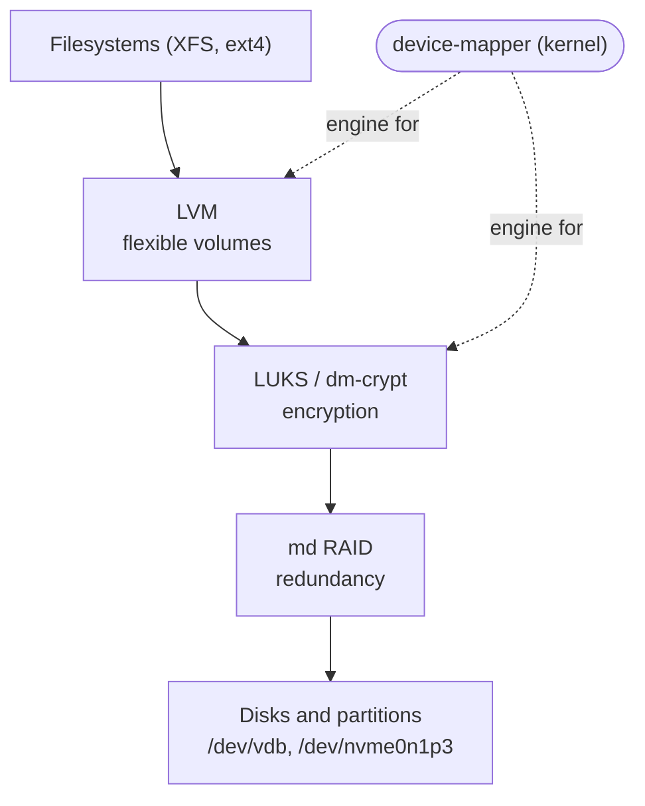
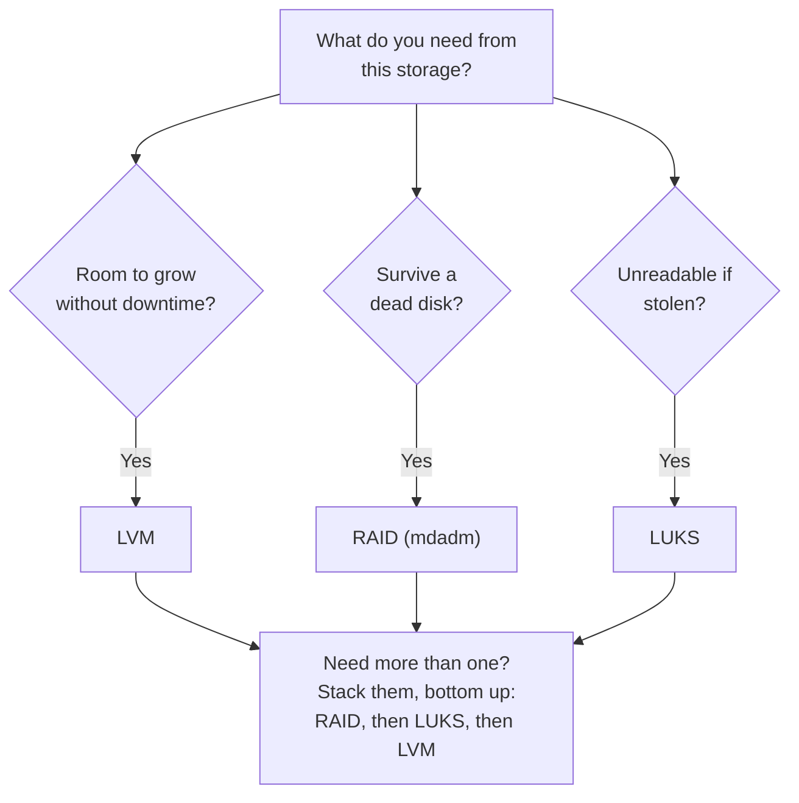
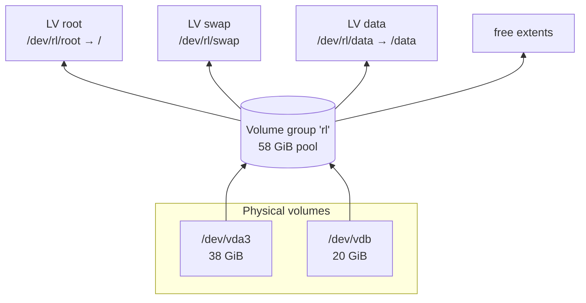
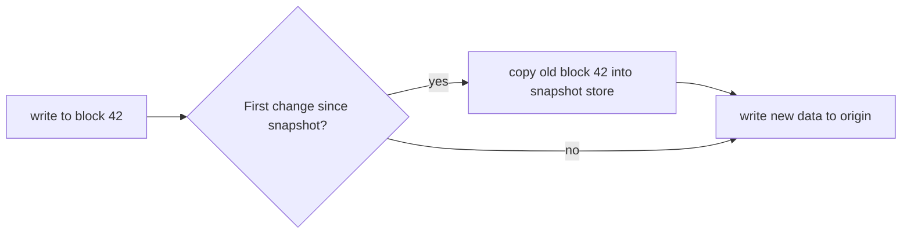
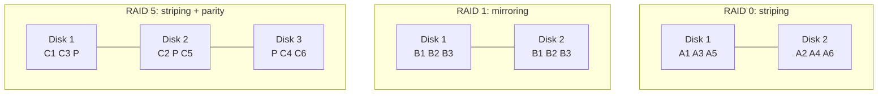
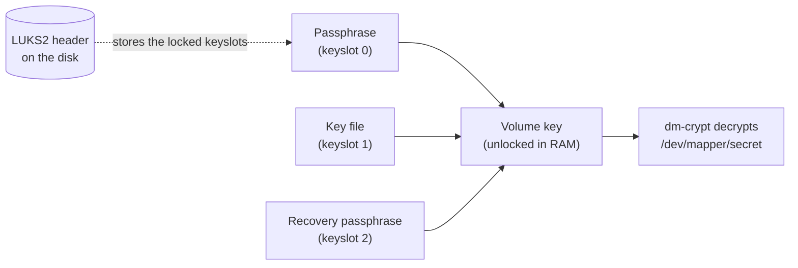

# 10 · LVM, RAID and Encryption

<ul class="module-meta">
  <li>⏱ ~3 hours</li>
  <li>4 labs</li>
  <li>Builds on: 09 · Disks and Filesystems</li>
</ul>

Your database volume is 95% full and the business won't accept downtime. With plain partitions you'd be stuck: partitions can't easily grow past their neighbours. With LVM you add a disk and grow the filesystem in two commands while the database keeps running. This module covers the three tools that turn raw disks into flexible, resilient, private storage: **LVM**, **software RAID**, and **LUKS encryption**. Every lab runs on loop devices, so you can do them on any VM without risking a real disk.

!!! abstract "What you'll learn"
    - Explain physical volumes, volume groups and logical volumes, and read Rocky's default `rl` layout.
    - Create, grow, and add disks to LVM storage online, with `lvextend -r`.
    - Take a classic LVM snapshot, roll back with it, and explain why a full snapshot dies.
    - Use thin provisioning safely, watching both data and metadata usage.
    - Build and repair a software RAID 1 array with `mdadm`, and choose a RAID level.
    - Encrypt a volume with LUKS2, manage keyslots, and unlock it at boot with `/etc/crypttab`.
    - See how device-mapper ties LVM and LUKS together, and stack all three layers.

## The big picture

### Three tools in one sentence

Here is the whole idea:

> **Each tool takes disks in and hands one new disk out. LVM pools disks so volumes can grow, RAID copies data across disks so one can die, and LUKS scrambles a disk so a thief reads only noise. Because each one outputs "a disk", you can stack them like bricks.**

Everything else in this module is detail around that sentence: **pool, copy, scramble, stack**.

In [Module 09](09-disks-and-filesystems.md) a filesystem sat directly on a partition. That's rigid: the filesystem can never be bigger than its partition, and the partition can't grow into space owned by its neighbour. The fix is to put a **virtualization layer** between disks and filesystems. Linux has one built in, called **device-mapper**, and three popular tools drive it or sit beside it.



Each layer takes one or more block devices and presents a new block device. The layer above can't tell the difference. That's what makes them stackable: you can encrypt a RAID array and carve it into LVM volumes, and the filesystem on top just sees "a disk".

### Which tool solves which problem

Pick the tool by the problem you have. Most real storage needs are one of these three.

| The problem | The tool | What you get | The command to remember |
|---|---|---|---|
| **"This volume is full and I can't take it offline"** | **LVM** (pool) | Volumes that grow online, across several disks | `lvextend -r -L +3G /dev/data/app` |
| **"If a disk dies, the server must keep running"** | **md RAID** (copy) | An array that survives a failed disk | `mdadm --create /dev/md0 --level=1 …`, then watch `/proc/mdstat` |
| **"If this disk is stolen, nobody may read it"** | **LUKS** (scramble) | Data that is unreadable without a passphrase or key | `cryptsetup luksFormat`, then `cryptsetup open` |



The questions aren't either/or. A database server often answers yes to all three, which is what [Stacking it all together](#stacking-it-all-together) shows.

### Words you'll see

| Word | Plain meaning |
|---|---|
| **PV** (physical volume) | A disk or partition handed to LVM |
| **VG** (volume group) | LVM's pool of space, made from one or more PVs |
| **LV** (logical volume) | A slice of the pool that acts like a partition. You put a filesystem on it |
| **extent** | The fixed-size chunk (4 MiB by default) LVM builds every LV from |
| **snapshot** | A frozen view of an LV at one moment |
| **thin pool** | An LVM pool that hands out space only when it's written, so you can promise more than you have |
| **device-mapper** | The kernel engine under LVM and LUKS. It makes new block devices from rules |
| **RAID level** | How RAID spreads data: 0 (stripe), 1 (mirror), 5/6 (parity), 10 (mirror + stripe) |
| **resync** / **rebuild** | RAID copying data so every disk matches, after creation / after a disk is replaced |
| **LUKS header** | The area at the start of an encrypted disk that holds the locked keyslots |
| **keyslot** | One locked copy of the volume key, opened by one passphrase or key file |
| **crypttab** | `/etc/crypttab`, the list of encrypted devices to unlock at boot |

### Practise: read the stack from `lsblk`

The core skill in this module is looking at a machine and seeing which bricks it's built from. `lsblk` shows them in its `TYPE` column: `disk` and `part` are real, `raid1` is md RAID, `crypt` is LUKS, `lvm` is an LVM logical volume. Read the tree from the top down, and each indent is one brick sitting on the one above it.

> **Read each line as "this `TYPE` sits on the line above it". The brick you need to touch is the one whose job matches your problem.**

**Machine A:** `/` is full. Which brick do you work on, and is there room?

```console
$ lsblk -o NAME,TYPE,SIZE,MOUNTPOINTS /dev/vda
NAME        TYPE  SIZE MOUNTPOINTS
vda         disk   40G
├─vda1      part  600M /boot/efi
├─vda2      part    1G /boot
└─vda3      part 38.4G
  ├─rl-root lvm  34.4G /
  └─rl-swap lvm     4G [SWAP]
$ sudo vgs
  VG #PV #LV #SN Attr   VSize   VFree
  rl   1   2   0 wz--n- <38.41g    0
```

??? success "Answer A"
    `/` is `rl-root`, `TYPE lvm`, so it's an LVM logical volume and the brick to touch is LVM. But `vgs` shows `VFree 0`: the pool is empty. You can't `lvextend` yet. Add a disk to the pool first (`pvcreate` + `vgextend rl`), then `lvextend -r`. That's exactly the [Add a disk to the pool](#add-a-disk-to-the-pool) flow.

**Machine B:** you're asked to add a new `/srv/logs` volume. Will it be encrypted? Will it survive a disk failure?

```console
$ lsblk -o NAME,TYPE,SIZE,MOUNTPOINTS /dev/vdb
NAME               TYPE   SIZE MOUNTPOINTS
vdb                disk    20G
└─md0              raid1   20G
  └─cryptraid      crypt   20G
    ├─vault-db     lvm     12G /var/lib/pgsql
    └─vault-files  lvm      6G /srv/files
```

??? success "Answer B"
    Yes to both. Read upwards from the LVs: they sit on `cryptraid` (`crypt`, LUKS), which sits on `md0` (`raid1`, a mirror). A new LV created in the `vault` VG lands on the same stack, so it's mirrored and encrypted automatically. You only touch the LVM brick: `lvcreate -n logs -L 1G vault`.

**Machine C:** monitoring says "RAID degraded". What does this mean, and is data lost?

```text
md0 : active raid1 vdb[0]
      10476544 blocks super 1.2 [2/1] [U_]
```

??? success "Answer C"
    `[2/1]` means two devices expected, one present. `[U_]` means the first is **U**p and the second is missing. The array is **degraded**: still working, data intact, but with no safety net. Nothing is lost yet. Replace the dead disk (`--fail`, `--remove`, `--add`, as in Lab 3) before a second one fails.

## LVM: the core idea

**LVM** (Logical Volume Manager) has three building blocks:

- A **physical volume (PV)** is a disk or partition that you've handed to LVM. `pvcreate` writes a small label on it.
- A **volume group (VG)** is a pool of storage made from one or more PVs. It's one big bucket of space.
- A **logical volume (LV)** is a slice of the pool that acts like a partition. You put a filesystem on it.

??? question "Under the hood: extents, the unit LVM counts in"
    LVM cuts every PV into fixed-size chunks called **physical extents** (4 MiB by default). An LV is just a list of extents, which can come from any PV in the group, in any order. Growing an LV means adding extents to the list. That's why `lvextend` output reports sizes in extents as well as GiB, and why `-l` takes an extent count.



!!! analogy "Think of it like a shared bank account"
    Each disk (PV) is a paycheck deposited into one joint account (the VG). Logical volumes are budgets you allocate from that account: "34 GB for root, 4 GB for swap". Need a bigger budget? Allocate more from the balance, or deposit another paycheck (add a disk). The analogy breaks in one place: money is fungible, but data isn't, so shrinking a budget means first shrinking the filesystem that's using it.

### Rocky's default layout

The Rocky installer uses LVM by default. It creates a VG named **`rl`** with LVs `root` and `swap`, plus `home` on larger disks. You've already seen this in `lsblk`. The LVM tools show it from LVM's point of view:

```console
$ sudo pvs
  PV         VG Fmt  Attr PSize   PFree
  /dev/vda3  rl lvm2 a--  <38.41g    0
$ sudo vgs
  VG #PV #LV #SN Attr   VSize   VFree
  rl   1   2   0 wz--n- <38.41g    0
$ sudo lvs
  LV   VG Attr       LSize   Pool Origin Data%  Meta%  Move Log Cpy%Sync Convert
  root rl -wi-ao---- <34.41g
  swap rl -wi-ao----   4.00g
```

Every LV has three names that all point to the same device:

| Name | Example |
|------|---------|
| VG/LV path | `/dev/rl/root` |
| Device-mapper name | `/dev/mapper/rl-root` (VG and LV joined with `-`) |
| Kernel name | `/dev/dm-0` |

Use the first two in configs and commands. `dm-0` numbers can change between boots.

The `pvs`/`vgs`/`lvs` commands give one-line summaries. Their siblings `pvdisplay`, `vgdisplay` and `lvdisplay` give long, detailed output. `lvs -a -o +devices` shows which PVs each LV actually lives on.

??? question "Under the hood: where LVM keeps its brain, and the undo button"
    LVM's metadata (which extents belong to which LV) is plain text, stored in a small area near the start of every PV. You can read it: `sudo vgcfgbackup -f /tmp/rl.txt rl && less /tmp/rl.txt` shows each LV as a list of segments with PV names and extent ranges.

    Every LVM command that changes metadata also saves a copy of the *previous* version in `/etc/lvm/archive/` and the current one in `/etc/lvm/backup/`. That's an undo button most admins never learn about. If someone runs `lvremove` on the wrong volume and nothing has overwritten its extents yet, `sudo vgcfgrestore --list rl` shows the archived versions with the command that created each, and `vgcfgrestore -f /etc/lvm/archive/rl_000NN-….vg rl` puts the old layout back (deactivate the VG's affected LVs first, and read [[man:vgcfgrestore(8)]] before you try it on a server). The data was never touched; only the map was.

!!! version "Rocky 9 vs 10: the LVM devices file"
    Since Rocky 9, LVM only looks at devices listed in **`/etc/lvm/devices/system.devices`**. `pvcreate` and `vgcreate` add new devices automatically, but if you move a disk from another machine its VG won't appear until you import it with `sudo vgimportdevices VGNAME` (or `lvmdevices --adddev /dev/X`). List the file's contents with `sudo lvmdevices`. This prevents LVM from grabbing disks that belong to virtual machines or other hosts. The same file explains a classic "my VG vanished" moment after cloning a VM or swapping a disk controller: the devices file identifies disks by their WWID or serial, and if those change, LVM ignores the disk until you run `vgimportdevices` again.

## Working with LVM

### Build it from scratch

```console
$ sudo pvcreate /dev/vdb
  Physical volume "/dev/vdb" successfully created.
$ sudo vgcreate data /dev/vdb
  Volume group "data" successfully created
$ sudo lvcreate -n app -L 5G data
  Logical volume "app" created.
$ sudo mkfs.xfs -q /dev/data/app
$ sudo mkdir -p /srv/app && sudo mount /dev/data/app /srv/app
```

`-L 5G` gives an exact size. `-l` takes extents or percentages instead: `-l 100%FREE` uses everything left in the VG, `-l 50%VG` uses half the group.

### Grow a volume while it's in use

**The story:** the app volume at `/srv/app` is filling up and the app can't stop. `df -h /srv/app` shows 5 GiB, nearly used. The VG has free space. The fix is one command.

Growing is two steps: make the LV bigger, then make the filesystem fill it. The `-r` (`--resizefs`) flag does both in one go, calling `xfs_growfs` or `resize2fs` for you:

```console
$ sudo lvextend -r -L +3G /dev/data/app
  Size of logical volume data/app changed from 5.00 GiB (1280 extents) to 8.00 GiB (2048 extents).
  Extending file system xfs to 8.00 GiB (8589934592 bytes) on data/app...
  …
  Extended file system xfs on data/app.
  Logical volume data/app successfully resized.
$ df -h /srv/app
Filesystem            Size  Used Avail Use% Mounted on
/dev/mapper/data-app  8.0G   90M  7.9G   2% /srv/app
```

No unmount, no downtime. `-L +3G` adds 3 GiB; `-L 20G` sets an absolute size; `-l +100%FREE` takes all remaining space.

!!! pitfall "Forgot the -r?"
    If you run `lvextend` without `-r`, the LV grows but `df` shows the old size. Nothing is broken. Finish the job with `sudo xfs_growfs /srv/app` (XFS, takes the mount point) or `sudo resize2fs /dev/data/app` (ext4).

### Add a disk to the pool

When the VG runs out of free extents, add another PV:

```console
$ sudo pvcreate /dev/vdc
$ sudo vgextend data /dev/vdc
  Volume group "data" successfully extended
$ sudo vgs data
  VG   #PV #LV #SN Attr   VSize  VFree
  data   2   1   0 wz--n- 39.99g 31.99g
```

Now any LV in `data` can grow into the new space. Going the other way, `pvmove /dev/vdb` migrates all extents off a disk (online), then `vgreduce data /dev/vdb` removes it from the group. That's how you replace a disk with zero downtime.

Try the whole "add a disk and grow" routine:

<div class="terminal-sim" data-title="Grow a full volume" data-prompt="[alex@db01 ~]$ " markdown>

<div class="task" data-expect="sudo vgs" data-match="sudo vgs( data)?" data-hint="The one-line volume group summary command, as root." markdown>

**Step 1.** `/srv/app` is full. Check whether its volume group `data` has free space.

```text
  VG   #PV #LV #SN Attr   VSize   VFree
  data   1   1   0 wz--n- <10.00g    0 
  rl     1   2   0 wz--n- <38.41g    0 
```

</div>

<div class="task" data-expect="sudo pvcreate /dev/vdc" data-hint="Label the new disk /dev/vdc as an LVM physical volume." markdown>

**Step 2.** No free space. A new 20 GB disk, `/dev/vdc`, has been attached. Make it a physical volume.

```text
  Physical volume "/dev/vdc" successfully created.
```

</div>

<div class="task" data-expect="sudo vgextend data /dev/vdc" data-hint="vgextend takes the VG name then the new PV." markdown>

**Step 3.** Add it to the `data` volume group.

```text
  Volume group "data" successfully extended
```

</div>

<div class="task" data-expect="sudo lvextend -r -l +100%FREE /dev/data/app||sudo lvextend -r -l +100%FREE data/app||sudo lvextend --resizefs -l +100%FREE /dev/data/app" data-hint="lvextend with -r (resize the filesystem too) and -l +100%FREE." markdown>

**Step 4.** Grow the `app` LV *and its filesystem* by all the free space in the group.

```text
  Size of logical volume data/app changed from <10.00 GiB (2559 extents) to 29.99 GiB (7678 extents).
  Extending file system xfs to 29.99 GiB (32199671808 bytes) on data/app...
  Extended file system xfs on data/app.
  Logical volume data/app successfully resized.
```

</div>

<div class="task" data-expect="df -h /srv/app" data-hint="df, human readable, for the mount point." markdown>

**Step 5.** Confirm the filesystem sees the new space.

```text
Filesystem            Size  Used Avail Use% Mounted on
/dev/mapper/data-app   30G  9.9G   21G  33% /srv/app
```

</div>

</div>

### Shrinking (carefully)

You can shrink an LV only if its filesystem can shrink first. XFS can't (see Module 09), so this is ext4 only. `lvreduce -r` shrinks the filesystem and then the LV, in the right order:

```console
$ sudo lvreduce -r -L 4G /dev/data/oldext4
```

!!! danger "Never shrink an LV without -r"
    `lvreduce` without `-r` cuts extents off the end of the volume regardless of what the filesystem has stored there. The data in those extents is gone. Always use `-r`, and have a backup.

<div class="quiz" data-answer="2" markdown>

`vgs` shows `VFree 0` for `rl`, and `/` is full. You attach a new 20 GB disk `/dev/vdb`. What's the right sequence?

- `lvextend -r -L +20G /dev/rl/root`, then `pvcreate /dev/vdb`
- `pvcreate /dev/vdb`, `vgextend rl /dev/vdb`, `lvextend -r -l +100%FREE /dev/rl/root`
- `mkfs.xfs /dev/vdb`, then `xfs_growfs /`
- `vgcreate rl /dev/vdb`, then `lvextend -r /dev/rl/root`

Correct. The disk becomes a PV, joins the existing group, and then the LV and its filesystem grow into the new free extents. `vgcreate rl` would fail because `rl` already exists.

</div>

## Snapshots

A **snapshot** is a frozen, point-in-time view of an LV. You take one before a risky change (a big upgrade, a schema migration) so you can roll back, or to get a consistent copy for a backup while the original stays in use.

### Classic copy-on-write snapshots

A classic LVM snapshot doesn't copy the volume up front. It starts nearly empty and uses **copy-on-write (COW)**: the first time a block of the original changes, LVM first copies the *old* block into the snapshot's own storage, then lets the write happen. The snapshot therefore only stores blocks that have changed since it was taken.

<div class="stepper" markdown>

<div class="step" data-title="Take the snapshot" markdown>

You give the snapshot its own space for changed blocks, here 1 GiB. Creating it is instant.

```console
$ sudo lvcreate -s -n app_snap -L 1G /dev/data/app
  Logical volume "app_snap" created.
```

At this moment the snapshot's storage is empty. Reading the snapshot just reads the original.

</div>

<div class="step" data-title="Origin block changes" markdown>

An application overwrites block 42 on `app`. Before the new data lands, LVM copies the old block 42 into `app_snap`'s storage. Now the snapshot still shows the old content for block 42.



</div>

<div class="step" data-title="The snapshot fills up" markdown>

Every *first* change to a block uses snapshot space. Watch the `Data%` column:

```console
$ sudo lvs data
  LV       VG   Attr       LSize Pool Origin Data%
  app      data owi-aos--- 8.00g
  app_snap data swi-a-s--- 1.00g      app    37.52
```

`o` in the origin's attributes means "origin of a snapshot", `s` means "snapshot".

</div>

<div class="step" data-title="It overflows and dies" markdown>

If more than 1 GiB of distinct blocks change, there's nowhere left to save old blocks. LVM marks the snapshot **invalid**. It can't be read or merged any more and must be removed. The origin is unharmed.

```console
$ sudo lvs data
  LV       VG   Attr       LSize Pool Origin Data%
  app_snap data swi-I-s--- 1.00g      app    100.00
```

The capital `I` means Invalid. Size snapshots for the amount of change you expect, and keep them short-lived.

</div>

<div class="step" data-title="Roll back or remove" markdown>

To **roll back** the origin to the snapshot's state, merge it. If the origin is in use, the merge happens the next time it's activated (for example, after unmount and `lvchange -an`/`-ay`, or a reboot):

```console
$ sudo lvconvert --merge data/app_snap
```

To **keep the changes** and discard the snapshot: `sudo lvremove data/app_snap`.

</div>

</div>

!!! warning "Classic snapshots slow down writes"
    Every first write to a block becomes a read plus two writes. With several snapshots of the same origin, each write is copied to each one. Fine for an hour during an upgrade; bad as a permanent backup scheme.

??? question "Under the hood: one snapshot, four device-mapper devices"
    A classic snapshot is built from several hidden device-mapper devices. Take one and look:

    ```console
    $ sudo dmsetup ls | grep data
    data-app	(253:2)
    data-app-real	(253:3)
    data-app_snap	(253:4)
    data-app_snap-cow	(253:5)
    ```

    `app-real` is the original data, `app_snap-cow` is the snapshot's store, `app` itself becomes a `snapshot-origin` target that copies old blocks into the store before each first write, and `app_snap` is a `snapshot` target that reads from the store first and falls back to `-real`. `sudo dmsetup table` shows those target names. This is why `lsblk` suddenly grows extra branches after `lvcreate -s`, and why the copy-on-write cost lands on every write to the *origin*, not the snapshot.

!!! pitfall "Mounting an XFS snapshot fails with 'duplicate UUID'"
    The snapshot has the same filesystem UUID as the origin, and XFS refuses to mount two filesystems with the same UUID. Mount the snapshot with `-o nouuid` (add `ro` for a backup): `sudo mount -o ro,nouuid /dev/data/app_snap /mnt/snap`.

### Thin provisioning

**Thin provisioning** lets you create volumes whose *advertised* size is bigger than the space that actually exists. A **thin pool** holds the real storage; **thin volumes** take blocks from the pool only when data is first written. Ten 100 GB thin volumes can share a 200 GB pool, as long as they don't all fill up.

```console
$ sudo lvcreate --type thin-pool -L 2G -n pool data
$ sudo lvcreate -V 10G --thinpool data/pool -n web
$ sudo lvs -a data
  LV              VG   Attr       LSize  Pool Origin Data%  Meta%
  pool            data twi-aotz--  2.00g             0.00   10.64
  web             data Vwi-a-tz-- 10.00g pool        0.00
  [pool_tdata]    data Twi-ao----  2.00g
  [pool_tmeta]    data ewi-ao---- 4.00m
  …
```

Thin pools give you much better snapshots too: a thin snapshot (`lvcreate -s data/web -n web_snap`, no size needed) shares blocks with its origin, takes no extra space up front, and doesn't slow down writes the way classic snapshots do.

!!! danger "Running a thin pool out of space"
    When you **overprovision** (promise more than you have), the pool can fill while every volume still thinks it has room. Writes then fail or hang, for *every* thin volume at once. If the pool's **metadata** fills, the pool can go read-only and need offline repair. Watch both `Data%` and `Meta%` in `lvs`, and enable auto-extension in `/etc/lvm/lvm.conf`:

    ```ini title="/etc/lvm/lvm.conf (activation section)"
    thin_pool_autoextend_threshold = 80
    thin_pool_autoextend_percent = 20
    ```

    With these, when the pool hits 80% full, LVM grows it by 20% (as long as the VG has free extents).

<div class="quiz" data-answer="3" markdown>

A classic snapshot of a 50 GB LV was created with `-L 2G` before a large data import. The import rewrote 6 GB of data. What's the state now?

- The origin is corrupted
- The snapshot grew automatically to 6 GB
- The snapshot is invalid; the origin is fine
- The import failed with "No space left on device"

Right. The snapshot only had 2 GB to store old blocks. Once full, it's invalidated (`I` in `lvs` attributes) and is useless. The origin keeps working normally.

</div>

## Device-mapper: the engine underneath

This is the "how" behind "each tool hands one new disk out". You don't need it day to day, but it's the ground truth when tools disagree.

LVM is a set of user-space tools. The kernel doesn't know what a "volume group" is. What it knows is **device-mapper (dm)**: a generic kernel framework that creates virtual block devices from a **table** of rules like "sectors 0 to 1,000,000 of this device go to sectors 2,048 onwards of `/dev/vda3`".

Each kind of rule is a **target**: `linear` (plain mapping, used by most LVs), `striped`, `snapshot`, `thin`, `raid`, and `crypt` (encryption, used by LUKS). LVM and cryptsetup are just friendly front-ends that write these tables for you.

```console
$ sudo dmsetup ls
rl-root	(253:0)
rl-swap	(253:1)
$ sudo dmsetup table rl-root
0 72155136 linear 252:3 8390656
```

That one line *is* your root volume: 72,155,136 sectors, mapped linearly onto device `252:3` (`vda3`) starting at sector 8,390,656. You'll rarely need `dmsetup` directly, but it's the ground truth when LVM tools are confused, and it's how you see that a LUKS volume and an LVM volume are the same kind of thing.

`lsblk` shows the stacking clearly, including the `dm` devices:

```console
$ lsblk -o NAME,TYPE,SIZE,MOUNTPOINTS /dev/vda
NAME        TYPE  SIZE MOUNTPOINTS
vda         disk   40G
├─vda1      part  600M /boot/efi
├─vda2      part    1G /boot
└─vda3      part 38.4G
  ├─rl-root lvm  34.4G /
  └─rl-swap lvm     4G [SWAP]
```

## Software RAID with mdadm

This is the **copy** brick.

**RAID** (Redundant Array of Independent Disks) combines several disks so that the array survives a disk failure, gets faster, or both. Linux has software RAID built in, called **md** (multiple devices), managed with `mdadm`. Arrays appear as `/dev/md0`, `/dev/md/name`, and so on.

### The RAID levels



| Level | Min disks | Usable space | Survives | Good for |
|-------|-----------|--------------|----------|----------|
| **0** (stripe) | 2 | 100% | **No** disk failures | Scratch space where speed matters and data is disposable |
| **1** (mirror) | 2 | 50% | All but one disk | Boot and OS disks, small important volumes |
| **5** (parity) | 3 | (N−1)/N | 1 disk | Read-heavy bulk storage on smaller disks |
| **6** (double parity) | 4 | (N−2)/N | 2 disks | Large arrays of big disks |
| **10** (mirror + stripe) | 4 | 50% | 1 per mirror pair | Databases, anything write-heavy |

**Parity** is extra data calculated from the data blocks (with XOR) so that any one missing block can be recomputed. RAID 5 spreads one parity block per stripe across all disks; RAID 6 stores two.

!!! warning "RAID is not a backup"
    RAID protects against a disk dying. It does not protect against `rm -rf`, ransomware, a bad application write, or a fire. Every one of those is faithfully mirrored to all disks. You still need backups.

!!! note "Why RAID 5 is falling out of favour"
    When a RAID 5 disk fails, rebuilding reads every sector of every surviving disk. With modern multi-terabyte disks, that takes many hours, and a second failure or unreadable sector during the rebuild loses the array. For big disks, RAID 6 or RAID 10 is the safer choice.

### Building and watching an array

```console
$ sudo mdadm --create /dev/md0 --level=1 --raid-devices=2 /dev/vdb /dev/vdc
mdadm: Note: this array has metadata at the start and
    may not be suitable as a boot device. …
Continue creating array? y
mdadm: Defaulting to version 1.2 metadata
mdadm: array /dev/md0 started.
$ cat /proc/mdstat
Personalities : [raid1]
md0 : active raid1 vdc[1] vdb[0]
      10476544 blocks super 1.2 [2/2] [UU]
      [=====>...............]  resync = 27.4% (2871232/10476544) finish=0.6min speed=205088K/sec

unused devices: <none>
```

`[2/2] [UU]` means two devices expected, two present, both **U**p. A failed disk shows as `_`, as in `[U_]`. The array is usable immediately; the initial **resync** runs in the background.

`mdadm --detail /dev/md0` gives the full status. To make the array assemble with the same name at boot, record it:

```console
$ sudo mdadm --detail --scan | sudo tee -a /etc/mdadm.conf
ARRAY /dev/md0 metadata=1.2 UUID=8c6b0f4e:1d2a…
```

Replacing a failed disk is three commands, covered hands-on in Lab 3: `--fail`, `--remove`, then `--add` the replacement, which triggers a **rebuild** (called "recovery" in `/proc/mdstat`).

!!! tip "LVM can do RAID too"
    LVM has its own RAID support using the same kernel md code: `lvcreate --type raid1 -m 1 -L 10G -n mirror data` creates a mirrored LV inside an ordinary VG. It's convenient when you already use LVM. `mdadm` remains the more common choice for whole-disk arrays and is what you'll meet on most servers.

### Stratis, briefly

**Stratis** is a newer, higher-level storage manager on Rocky (packages `stratisd` and `stratis-cli`; RHEL has fully supported it since 9.3). It combines pooling, thin provisioning, snapshots and encryption behind one simple command, `stratis`, and always formats its filesystems as XFS:

```console
$ sudo dnf install stratisd stratis-cli
$ sudo systemctl enable --now stratisd
$ sudo stratis pool create pool1 /dev/vdd
$ sudo stratis filesystem create pool1 fs1
$ sudo mount /dev/stratis/pool1/fs1 /mnt
```

It's convenient for simple setups, but LVM is far more common in the wild, so this course focuses on LVM. If you put a Stratis filesystem in fstab, add `x-systemd.requires=stratis-fstab-setup@POOL_UUID.service` to the options (the pool UUID comes from `stratis pool list`).

## Encryption with LUKS2

This is the **scramble** brick.

A stolen laptop, a decommissioned disk sent for recycling, a cloud volume snapshot copied by the wrong person: all of these leak data unless it's encrypted **at rest** (while stored). Linux does this at the block layer with **dm-crypt**, the device-mapper `crypt` target. **LUKS** (Linux Unified Key Setup) is the standard on-disk format that stores how the data is encrypted and who may unlock it. Rocky uses **LUKS2**, managed with `cryptsetup`.

### How LUKS keys work

The data is encrypted with one random **volume key** (also called the master key). You never type it. Instead, LUKS stores copies of the volume key in **keyslots**, each locked with a different passphrase or key file. LUKS2 has up to 32 keyslots.



This design has nice consequences. Changing a passphrase only rewrites one keyslot, not the whole disk. You can give a server a key file and an admin a recovery passphrase. And if the **header** is damaged, all keyslots are gone and the data is unrecoverable, which is why you back it up.

LUKS2 defaults on Rocky: cipher `aes-xts-plain64` with a 512-bit key, and **Argon2id** to turn passphrases into keys. Argon2id deliberately uses lots of memory, which makes brute-forcing passphrases on GPUs expensive.

### The basic workflow

```console
$ sudo cryptsetup luksFormat /dev/vdd

WARNING!
========
This will overwrite data on /dev/vdd irrevocably.

Are you sure? (Type 'yes' in capital letters): YES
Enter passphrase for /dev/vdd:
Verify passphrase:
$ sudo cryptsetup open /dev/vdd secret
Enter passphrase for /dev/vdd:
$ ls -l /dev/mapper/secret
lrwxrwxrwx. 1 root root 7 Oct 15 10:21 /dev/mapper/secret -> ../dm-2
$ sudo mkfs.xfs -q /dev/mapper/secret
$ sudo mount /dev/mapper/secret /mnt/secret
```

`luksFormat` writes the header (destroying whatever was there). `open` asks for a passphrase and creates the decrypted device `/dev/mapper/secret`. Everything written there is encrypted before it hits `/dev/vdd`. When finished: `sudo umount /mnt/secret && sudo cryptsetup close secret`.

Inspect the header with `luksDump`:

```console
$ sudo cryptsetup luksDump /dev/vdd
LUKS header information
Version:       	2
…
Data segments:
  0: crypt
	offset: 16777216 [bytes]
	length: (whole device)
	cipher: aes-xts-plain64
	sector: 4096 [bytes]

Keyslots:
  0: luks2
	Key:        512 bits
	Priority:   normal
	Cipher:     aes-xts-plain64
	Cipher key: 512 bits
	PBKDF:      argon2id
…
```

### Managing keyslots

| Task | Command |
|------|---------|
| Add a passphrase (asks for an existing one first) | `cryptsetup luksAddKey /dev/vdd` |
| Add a key file | `cryptsetup luksAddKey /dev/vdd /etc/cryptsetup-keys.d/secret.key` |
| Change a passphrase | `cryptsetup luksChangeKey /dev/vdd` |
| Remove a passphrase | `cryptsetup luksRemoveKey /dev/vdd` |
| Wipe a specific slot | `cryptsetup luksKillSlot /dev/vdd 2` |
| Back up the header | `cryptsetup luksHeaderBackup /dev/vdd --header-backup-file vdd.hdr` |

!!! danger "Back up the header, store it somewhere else"
    Lose the header and the data is gone forever, even with the right passphrase. Store the header backup off the machine. Treat it like a key: anyone with the header backup and an *old* passphrase can unlock the disk, even if you later removed that passphrase from the live header.

### Unlocking at boot: /etc/crypttab

`/etc/crypttab` is to encrypted devices what `/etc/fstab` is to filesystems. At boot, `systemd-cryptsetup-generator` turns each line into a unit that unlocks the device; then fstab mounts the result.

```text title="/etc/crypttab"
secret  UUID=5a1f3c2e-8b4d-4e61-9a0f-2d7c6b1e4f90  none                   luks
backup  UUID=c0e8d1a2-3f47-4b5c-8e9d-1a2b3c4d5e6f  /root/keys/backup.key  luks,nofail
```

The four fields are: the **name** to create under `/dev/mapper/`, the **device** (use the LUKS UUID from `blkid`), the **key** (`none` means ask for a passphrase at boot), and **options**. Then reference `/dev/mapper/secret` in `/etc/fstab` as usual.

??? question "Under the hood: key file lookup and TRIM through LUKS"
    If the key field in crypttab is `none` or empty, systemd first looks for a key file named after the volume in `/etc/cryptsetup-keys.d/NAME.key` (and `/run/cryptsetup-keys.d/`), and only asks for a passphrase if there isn't one. That's why the keyslot table above puts key files there.

    By default dm-crypt does **not** pass discard (TRIM) requests down to the SSD, because the pattern of freed blocks leaks some information (which areas are empty, roughly what filesystem is inside). On SSDs and thin-provisioned SAN or cloud volumes that means freed space is never returned to the device. If you accept that leak, add the `discard` option in crypttab (or `cryptsetup open --allow-discards`, or `cryptsetup refresh --allow-discards --persistent NAME` to store the flag in the LUKS2 header). `sudo dmsetup table NAME` shows `allow_discards` when it's on.

A key file stored on the same machine only makes sense for secondary volumes when the root filesystem is itself encrypted; otherwise anyone with the disk has the key. For unattended unlocking of the root volume, Rocky supports **Clevis** (network-bound unlocking with a Tang server) and TPM2 binding (`systemd-cryptenroll`), both beyond this module.

<div class="quiz" data-answer="1" markdown>

A LUKS2 volume has a passphrase in keyslot 0. A colleague who knew it leaves the company. What's the right response?

- Add a new passphrase with `luksAddKey`, then remove keyslot 0 with `luksKillSlot`
- Re-run `luksFormat` with a new passphrase, keeping the data
- Nothing; LUKS passphrases expire automatically
- Run `cryptsetup close` and `open` with a new passphrase

Correct. Keyslots are independent, so you add the new one first (so you're never locked out) and then kill the old one. The volume key and data don't change. `luksFormat` would destroy the data. If they might have a header backup, you'd need full re-encryption (`cryptsetup reencrypt`).

</div>

## Stacking it all together

Real servers often combine all three. A common, sensible order from the bottom up is: **RAID** for redundancy, **LUKS** to encrypt the whole array once, then **LVM** on top to carve flexible volumes, then filesystems.

<div class="layers" data-hint="Click each layer of a fully stacked server volume." data-open="0" markdown>

<div class="layer" data-label="XFS filesystems" data-tag="/srv, /var/lib/pgsql" markdown>

Each LV gets its own filesystem, so a runaway log can't fill the database volume. Grown online with `lvextend -r`.

</div>

<div class="layer" data-label="LVM logical volumes" data-tag="/dev/vault/db, /dev/vault/files" markdown>

`vgcreate vault /dev/mapper/cryptraid` turns the decrypted array into a pool. LVs carved from it are all encrypted, because everything below is.

</div>

<div class="layer" data-label="LUKS2 (dm-crypt)" data-tag="/dev/mapper/cryptraid" markdown>

`cryptsetup luksFormat /dev/md0` then `open /dev/md0 cryptraid`. One passphrase or key unlocks every volume above. Listed in `/etc/crypttab`.

</div>

<div class="layer" data-label="md RAID 1" data-tag="/dev/md0" markdown>

`mdadm --create /dev/md0 --level=1 …` across two disks. If one dies, everything above keeps running.

</div>

<div class="layer" data-label="Physical disks" data-tag="/dev/vdb, /dev/vdc" markdown>

Two identical disks. Neither holds readable data on its own: each is half of a mirror of ciphertext.

</div>

</div>

Why this order? RAID at the bottom means a failed disk is replaced without touching encryption or LVM. Encrypting *below* LVM means one unlock covers every volume, and new LVs are automatically encrypted. Putting LUKS *above* LVM instead (one LUKS per LV) is also valid when different volumes need different keys.

`lsblk` on such a machine shows the whole stack:

```console
$ lsblk -o NAME,TYPE,SIZE,MOUNTPOINTS /dev/vdb
NAME               TYPE   SIZE MOUNTPOINTS
vdb                disk    20G
└─md0              raid1   20G
  └─cryptraid      crypt   20G
    ├─vault-db     lvm     12G /var/lib/pgsql
    └─vault-files  lvm      6G /srv/files
```

## Labs

Every lab creates image files in `/var/tmp`, attaches them as loop devices, and removes them at the end. They're safe on any VM. Run `lsblk` between steps to watch the layers appear. The LVM cleanups also remove the loop devices from the LVM devices file (`lvmdevices --deldev`), so they leave nothing behind.

!!! lab "Lab 1: Build an LVM pool and grow it online"

    **Goal:** Create a VG from two fake disks, make an LV, fill it, then grow it while mounted.

    **You'll need:** sudo, about 2 GB free in `/var/tmp`.

    1. Create two 1 GiB fake disks:

        ```console
        $ truncate -s 1G /var/tmp/pv1.img /var/tmp/pv2.img
        $ L1=$(sudo losetup -f --show /var/tmp/pv1.img)
        $ L2=$(sudo losetup -f --show /var/tmp/pv2.img)
        $ echo $L1 $L2
        ```

    2. Turn the first into a PV and VG, and make a 600 MiB LV with XFS:

        ```console
        $ sudo pvcreate $L1
        $ sudo vgcreate labvg $L1
        $ sudo lvcreate -y -n data -L 600M labvg
        $ sudo mkfs.xfs -q /dev/labvg/data
        $ sudo mkdir -p /mnt/lab && sudo mount /dev/labvg/data /mnt/lab
        ```

    3. Fill it partway and check the sizes:

        ```console
        $ sudo dd if=/dev/zero of=/mnt/lab/fill bs=1M count=400 status=none
        $ df -h /mnt/lab; sudo vgs labvg
        ```

    4. Grow the LV by more than the VG has free. It fails:

        ```console
        $ sudo lvextend -r -L +1G /dev/labvg/data
          Insufficient free space: 256 extents needed, but only 105 available
        ```

    5. Add the second disk to the pool and try again:

        ```console
        $ sudo pvcreate $L2
        $ sudo vgextend labvg $L2
        $ sudo lvextend -r -L +1G /dev/labvg/data
        $ df -h /mnt/lab
        $ sudo lvs -o +devices labvg
        ```

    **Check your work:** `df -h /mnt/lab` shows about 1.6 GB, the file is still there, and `lvs -o +devices` shows `data` spanning both loop devices.

    ??? success "What just happened?"
        The LV is now a list of extents from two different PVs. XFS has no idea; it sees one bigger device and `xfs_growfs` (called by `-r`) extended it into the new space while it stayed mounted.

    **Clean up:**

    ```console
    $ sudo umount /mnt/lab && sudo rmdir /mnt/lab
    $ sudo vgremove -y labvg
    $ sudo pvremove $L1 $L2
    $ for d in $L1 $L2; do sudo lvmdevices --deldev $d 2>/dev/null; done
    $ sudo losetup -d $L1 $L2
    $ rm -f /var/tmp/pv1.img /var/tmp/pv2.img
    ```

!!! lab "Lab 2: Snapshot, roll back, and watch one die"

    **Goal:** Use a snapshot to undo a "bad upgrade", then deliberately overflow a snapshot.

    **You'll need:** sudo.

    1. Set up a VG with a 300 MiB ext4 volume containing a known file:

        ```console
        $ truncate -s 1G /var/tmp/snap.img
        $ L=$(sudo losetup -f --show /var/tmp/snap.img)
        $ sudo vgcreate snapvg $L
        $ sudo lvcreate -y -n app -L 300M snapvg
        $ sudo mkfs.ext4 -q /dev/snapvg/app
        $ sudo mkdir -p /mnt/app && sudo mount /dev/snapvg/app /mnt/app
        $ echo "version 1" | sudo tee /mnt/app/config.txt
        ```

    2. Take a snapshot, then "upgrade" badly:

        ```console
        $ sudo lvcreate -s -n app_pre -L 100M /dev/snapvg/app
        $ echo "version 2 (broken)" | sudo tee /mnt/app/config.txt
        ```

    3. Roll back. Unmount, merge, and remount:

        ```console
        $ sudo umount /mnt/app
        $ sudo lvconvert --merge snapvg/app_pre
        $ sudo mount /dev/snapvg/app /mnt/app
        $ cat /mnt/app/config.txt
        version 1
        $ sudo lvs snapvg
        ```

        The merge runs in the background. When `lvs` no longer lists `app_pre`, it's finished (on a volume this small, that's a second or two). You can't take a new snapshot of `app` until it's done.

    4. Now overflow a snapshot. Make a tiny 20 MiB one and write 100 MB to the origin:

        ```console
        $ sudo lvcreate -s -n tiny -L 20M /dev/snapvg/app
        $ sudo dd if=/dev/urandom of=/mnt/app/big bs=1M count=100 status=none; sync
        $ sudo lvs snapvg
        ```

    **Check your work:** after step 3, `config.txt` says `version 1` and `app_pre` no longer exists (merging consumes the snapshot). After step 4, `tiny` shows `I` in its attributes, and `/mnt/app/big` is perfectly readable.

    ??? tip "Hint: the journal shows the death notice"
        `sudo journalctl -k -n 20` shows a device-mapper message that the snapshot is invalidated, and `dmeventd` may log it too.

    **Clean up:**

    ```console
    $ sudo umount /mnt/app && sudo rmdir /mnt/app
    $ sudo vgremove -y snapvg && sudo pvremove $L
    $ sudo lvmdevices --deldev $L 2>/dev/null
    $ sudo losetup -d $L && rm -f /var/tmp/snap.img
    ```

!!! lab "Lab 3: Break and rebuild a RAID 1 mirror"

    **Goal:** Build a mirror, fail a disk, prove the data survives, and rebuild onto a replacement.

    **You'll need:** sudo, `mdadm` (`sudo dnf install -y mdadm` if missing).

    1. Create three fake disks: two for the mirror, one spare:

        ```console
        $ for i in 1 2 3; do truncate -s 500M /var/tmp/md$i.img; done
        $ D1=$(sudo losetup -f --show /var/tmp/md1.img)
        $ D2=$(sudo losetup -f --show /var/tmp/md2.img)
        $ D3=$(sudo losetup -f --show /var/tmp/md3.img)
        ```

    2. Build the mirror (answer `y` to the boot-device note) and put a file on it:

        ```console
        $ sudo mdadm --create /dev/md/lab --level=1 --raid-devices=2 $D1 $D2
        $ sudo mkfs.xfs -q /dev/md/lab
        $ sudo mkdir -p /mnt/md && sudo mount /dev/md/lab /mnt/md
        $ echo "survive this" | sudo tee /mnt/md/important.txt
        $ cat /proc/mdstat
        ```

    3. Simulate a disk failure, then remove the dead disk:

        ```console
        $ sudo mdadm /dev/md/lab --fail $D1
        $ cat /proc/mdstat        # look for [_U] or [U_]
        $ cat /mnt/md/important.txt
        $ sudo mdadm /dev/md/lab --remove $D1
        ```

    4. Add the replacement and watch it rebuild:

        ```console
        $ sudo mdadm /dev/md/lab --add $D3
        $ watch -n1 cat /proc/mdstat     # Ctrl+C when recovery finishes
        $ sudo mdadm --detail /dev/md/lab | grep -E 'State|Active|Failed'
        ```

    **Check your work:** the file stayed readable throughout, and after recovery `/proc/mdstat` shows `[2/2] [UU]` with `$D3` as a member.

    **Clean up:**

    ```console
    $ sudo umount /mnt/md && sudo rmdir /mnt/md
    $ sudo mdadm --stop /dev/md/lab
    $ sudo mdadm --zero-superblock $D1 $D2 $D3
    $ sudo losetup -d $D1 $D2 $D3
    $ rm -f /var/tmp/md{1,2,3}.img
    ```

!!! lab "Lab 4: An encrypted volume with two keys"

    **Goal:** Create a LUKS2 volume, unlock it with a passphrase and a key file, then revoke the passphrase.

    **You'll need:** sudo.

    1. Create a fake disk and format it as LUKS2. Type `YES` and pick a throwaway passphrase. (The image is 512 MiB because LUKS2 uses 16 MiB for its header and `mkfs.xfs` refuses filesystems smaller than 300 MB.)

        ```console
        $ truncate -s 512M /var/tmp/crypt.img
        $ C=$(sudo losetup -f --show /var/tmp/crypt.img)
        $ sudo cryptsetup luksFormat $C
        $ sudo cryptsetup luksDump $C | grep -E 'Version|cipher|PBKDF|^  [0-9]+: luks2'
        ```

    2. Open it, make a filesystem, write a secret, close it:

        ```console
        $ sudo cryptsetup open $C labsecret
        $ sudo mkfs.xfs -q /dev/mapper/labsecret
        $ sudo mkdir -p /mnt/secret && sudo mount /dev/mapper/labsecret /mnt/secret
        $ echo "the eagle lands at noon" | sudo tee /mnt/secret/msg.txt
        $ sudo umount /mnt/secret && sudo cryptsetup close labsecret
        ```

    3. Prove the raw disk is unreadable:

        ```console
        $ sudo grep -q "eagle" $C && echo "FOUND" || echo "not found in raw device"
        ```

    4. Add a key file in a new keyslot (you'll be asked for the passphrase), then unlock with the file alone:

        ```console
        $ sudo dd if=/dev/urandom of=/root/lab.key bs=64 count=1 status=none
        $ sudo chmod 400 /root/lab.key
        $ sudo cryptsetup luksAddKey $C /root/lab.key
        $ sudo cryptsetup open --key-file /root/lab.key $C labsecret
        $ sudo dmsetup table labsecret      # note the 'crypt' target
        ```

    5. Revoke the passphrase in slot 0 using the key file to authorize it:

        ```console
        $ sudo cryptsetup luksKillSlot --key-file /root/lab.key $C 0
        $ sudo cryptsetup luksDump $C | grep -A1 '^Keyslots'
        ```

    **Check your work:** `grep` finds no plaintext in the raw device, `luksDump` lists only keyslot 1, and `/dev/mapper/labsecret` still opens with the key file.

    ??? success "What just happened?"
        Both keyslots held a copy of the same volume key, locked differently. Removing slot 0 didn't touch the data or the other slot. The `dmsetup table` output starts with a `crypt` target: LUKS is just device-mapper with a key management header.

    **Clean up:**

    ```console
    $ sudo cryptsetup close labsecret
    $ sudo losetup -d $C
    $ rm -f /var/tmp/crypt.img; sudo rm -f /root/lab.key; sudo rmdir /mnt/secret
    ```

## Common pitfalls

| Symptom | Cause | Fix |
|---------|-------|-----|
| `lvextend` succeeded but `df` shows the old size | Forgot `-r` | `xfs_growfs MOUNTPOINT` or `resize2fs DEV` |
| `Insufficient free space` | The VG has no free extents | Add a PV with `vgextend`, or free space in another LV |
| A VG from another server doesn't appear | It isn't in the LVM devices file | `vgimportdevices VGNAME` |
| Snapshot shows `I` in `lvs` | Snapshot store overflowed; snapshot is dead | `lvremove` it; next time size it bigger or use thin snapshots |
| XFS snapshot won't mount | Duplicate filesystem UUID | `mount -o ro,nouuid` |
| All thin volumes hang or error at once | Thin pool data or metadata is full | `lvextend` the pool; set `thin_pool_autoextend_threshold` |
| md array comes up as `/dev/md127` after reboot | Array not in `/etc/mdadm.conf` | `mdadm --detail --scan >> /etc/mdadm.conf`, rebuild the initramfs with `dracut -f` |
| Boot waits forever for a passphrase on a secondary disk | crypttab entry without `nofail` for a disk that's gone | Add `nofail` in crypttab and fstab |
| Data "lost" after a header overwrite | LUKS header destroyed | Only recoverable from a `luksHeaderBackup` |

!!! pitfall "Running pvcreate on the wrong disk"
    `pvcreate` and `luksFormat` both write over the start of a device. Before running either, run `lsblk -f` and confirm the target has no filesystem, no mount point, and the size you expect.

## Cheat sheet

| Command | What it does |
|---------|-------------|
| `pvs`, `vgs`, `lvs` | One-line summaries of PVs, VGs, LVs |
| `pvcreate DEV` | Make a device an LVM physical volume |
| `vgcreate VG DEV…` | Create a volume group |
| `vgextend VG DEV` | Add a PV to a VG |
| `lvcreate -n LV -L SIZE VG` | Create a logical volume |
| `lvextend -r -L +SIZE VG/LV` | Grow an LV and its filesystem |
| `lvreduce -r -L SIZE VG/LV` | Shrink an LV and its (ext4) filesystem |
| `pvmove DEV` / `vgreduce VG DEV` | Evacuate and remove a disk |
| `lvcreate -s -n SNAP -L SIZE VG/LV` | Classic snapshot |
| `lvconvert --merge VG/SNAP` | Roll the origin back to a snapshot |
| `lvcreate --type thin-pool -L SIZE -n POOL VG` | Create a thin pool |
| `lvcreate -V SIZE --thinpool VG/POOL -n LV` | Create a thin volume |
| `lvmdevices`, `vgimportdevices VG` | Manage the LVM devices file |
| `dmsetup ls`, `dmsetup table NAME` | Show device-mapper devices and their mappings |
| `mdadm --create /dev/mdN --level=L --raid-devices=N DEV…` | Create a RAID array |
| `cat /proc/mdstat`, `mdadm --detail DEV` | RAID status |
| `mdadm DEV --fail/--remove/--add DISK` | Replace a RAID member |
| `cryptsetup luksFormat DEV` | Create a LUKS2 volume (destroys data) |
| `cryptsetup open DEV NAME` / `close NAME` | Unlock / lock |
| `cryptsetup luksDump DEV` | Show header, keyslots, cipher |
| `cryptsetup luksAddKey` / `luksKillSlot` | Manage keyslots |
| `cryptsetup luksHeaderBackup DEV --header-backup-file F` | Back up the header |

## Flashcards

<div class="flashcards" markdown>

<div class="card" markdown>

LVM, RAID and LUKS in one sentence?

Each takes disks in and hands one new disk out: LVM pools so volumes can grow, RAID copies so a disk can die, LUKS scrambles so a thief reads noise. Because each outputs a disk, they stack.

</div>

<div class="card" markdown>

In `lsblk`, what do `TYPE` values `lvm`, `raid1` and `crypt` tell you?

`lvm` is an LVM logical volume, `raid1` is an md RAID mirror, `crypt` is an open LUKS device. Each line sits on the line above it in the tree.

</div>

<div class="card" markdown>

PV, VG, LV in one line each?

PV: a disk or partition given to LVM. VG: a pool built from PVs. LV: a slice of the pool used like a partition.

</div>

<div class="card" markdown>

What is a physical extent?

The fixed-size chunk (4 MiB by default) LVM cuts PVs into. An LV is a list of extents.

</div>

<div class="card" markdown>

What does `-r` do on `lvextend` and `lvreduce`?

Resizes the filesystem together with the LV, in the safe order (grow LV then FS; shrink FS then LV).

</div>

<div class="card" markdown>

What happens when a classic snapshot's COW space fills up?

It's invalidated (`I` in `lvs` attributes) and becomes useless. The origin is unaffected.

</div>

<div class="card" markdown>

Two numbers to watch on a thin pool?

`Data%` and `Meta%` in `lvs`. Either reaching 100% breaks every thin volume in the pool.

</div>

<div class="card" markdown>

Which kernel framework sits under both LVM and LUKS?

device-mapper. `dmsetup table` shows the raw mapping (`linear`, `crypt`, `thin`, …).

</div>

<div class="card" markdown>

What does `[2/2] [UU]` in `/proc/mdstat` mean?

The array expects 2 devices, has 2, and both are up. A failed member shows as `_`.

</div>

<div class="card" markdown>

RAID 1, 5, 6, 10: how many disk failures survive?

1: all but one disk. 5: one. 6: two. 10: one per mirror pair.

</div>

<div class="card" markdown>

What do LUKS keyslots protect?

Copies of the single volume key, each locked by a different passphrase or key file. Up to 32 in LUKS2.

</div>

<div class="card" markdown>

Which file unlocks encrypted volumes at boot?

`/etc/crypttab`: name, device, key (`none` = prompt), options.

</div>

</div>

## Recap

!!! recap "Key takeaways"
    - The one idea: LVM (pool), RAID (copy) and LUKS (scramble) each take disks in and hand one disk out, so they stack. Read the stack from the `TYPE` column of `lsblk`.
    - LVM pools disks (PVs) into volume groups and carves them into logical volumes made of 4 MiB extents.
    - Rocky installs onto LVM by default: VG `rl`, LVs `root`, `swap`, and sometimes `home`.
    - Grow online with `lvextend -r`; add disks with `pvcreate` + `vgextend`. Shrink only ext4, only with `-r`.
    - Classic snapshots are copy-on-write and die when their store fills; thin snapshots are cheaper but thin pools must be monitored.
    - Device-mapper is the kernel engine under LVM and LUKS; `dmsetup table` shows the raw mapping.
    - `mdadm` builds RAID 0/1/5/6/10; `/proc/mdstat` shows health. RAID is not a backup.
    - LUKS2 encrypts a block device with one volume key protected by up to 32 keyslots. Back up the header.
    - The layers stack freely: RAID, then LUKS, then LVM, then filesystems is a common, sensible order.

## Go deeper

- Man pages: [[man:lvm(8)]] [[man:lvcreate(8)]] [[man:lvextend(8)]] [[man:lvmthin(7)]] [[man:lvmdevices(8)]] [[man:dmsetup(8)]] [[man:mdadm(8)]] [[man:cryptsetup(8)]] [[man:crypttab(5)]] [[man:stratis(8)]]
- [Red Hat: Configuring and managing logical volumes (RHEL 10)](https://docs.redhat.com/en/documentation/red_hat_enterprise_linux/10/html/configuring_and_managing_logical_volumes/index)
- [Red Hat: Managing storage devices (RHEL 10)](https://docs.redhat.com/en/documentation/red_hat_enterprise_linux/10/html/managing_storage_devices/index), including RAID and Stratis
- [cryptsetup project and LUKS2 documentation](https://gitlab.com/cryptsetup/cryptsetup)
- [Kernel docs: device-mapper](https://docs.kernel.org/admin-guide/device-mapper/index.html)

**Next:** [11 · Networking](11-networking.md)
