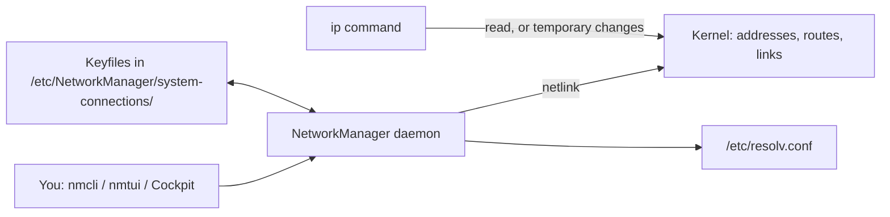
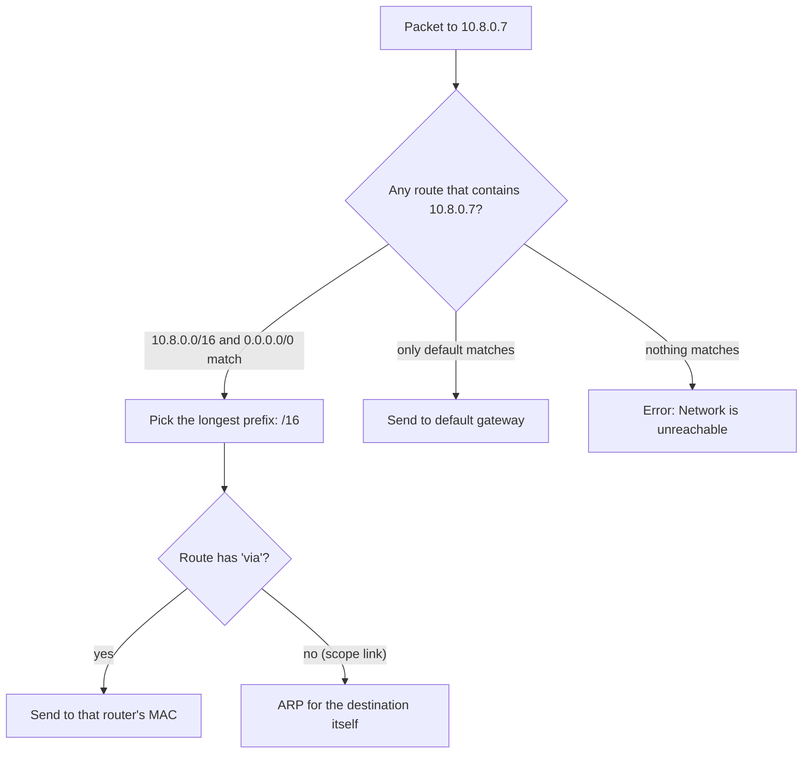
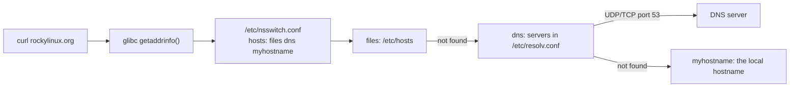
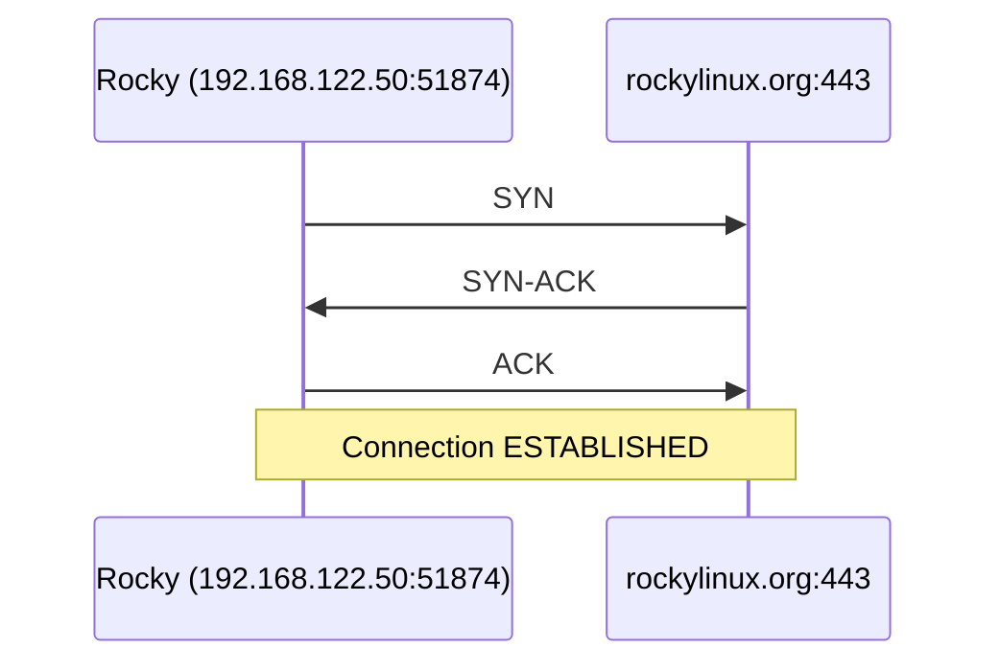
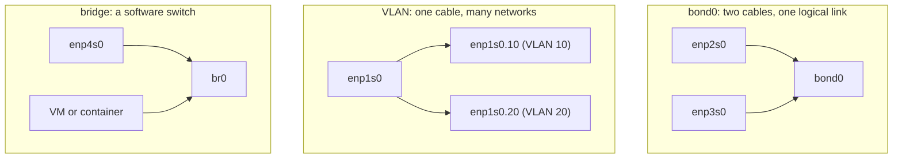

# 11 · Networking

<ul class="module-meta">
  <li>⏱ ~3 hours</li>
  <li>5 labs</li>
  <li>Builds on: 07 · systemd and Services</li>
</ul>

A developer pings you: "The new server can't reach the database. Is the network down?" Maybe it is. Or maybe DNS is pointing somewhere stale, the default route is missing, or a firewall is quietly dropping the packets. This module gives you a clear mental model of how a Rocky Linux machine talks to the world, the one right way to configure it (NetworkManager), and a step-by-step toolkit to find out exactly where a connection is failing.

!!! abstract "What you'll learn"
    - Explain the layers a packet passes through and name the Linux command that shows each one.
    - Read an IP address and prefix (`/24`) and work out the network, the broadcast address, and who is "local".
    - Read a routing table and predict which way a packet will leave with `ip route get`.
    - Create, change, and activate connections with `nmcli`, and know where NetworkManager stores them.
    - Trace how a hostname becomes an IP address, and tell the difference between `getent hosts` and `dig`.
    - Build bridges, VLANs, bonds, and network namespaces at a basic level.
    - Troubleshoot "I can't reach the server" methodically, layer by layer.

## The big picture

Networking is a stack of layers. Each layer solves one problem and trusts the layer below it to solve the rest. Your browser does not care about cables, and the network card does not care about web pages.

On Linux, the bottom layers (the network card driver, Ethernet, IP, TCP and UDP) live in the **kernel**. Programs like `curl` and `sshd` live in user space and talk to the kernel through **sockets**, which are like phone handsets the kernel hands out. Configuration (which IP address, which gateway, which DNS server) is managed by one service: **NetworkManager**.

Click each layer to see what it does and which command shows it.

<div class="layers" data-hint="Click a layer to see what it does and how to inspect it." data-open="0" markdown>

<div class="layer" data-label="Application" data-tag="curl, sshd, dnf" markdown>

**What it does:** the program that wants to talk. It speaks a protocol like HTTP, SSH or DNS, and it asks the kernel for a socket to send bytes through.

**Address used:** a hostname such as `rockylinux.org`, turned into an IP by the resolver.

```console
$ curl -sI https://rockylinux.org | head -1
HTTP/2 200
```

</div>

<div class="layer" data-label="Transport: TCP and UDP" data-tag="ports" markdown>

**What it does:** gets data to the right *program* on a machine. A **port** is a number from 0 to 65535 that identifies a conversation endpoint. **TCP** gives a reliable, ordered stream (SSH, HTTPS). **UDP** sends individual messages with no guarantee (DNS, NTP, video calls).

```console
$ ss -tln
State   Recv-Q  Send-Q   Local Address:Port   Peer Address:Port
LISTEN  0       128            0.0.0.0:22          0.0.0.0:*
LISTEN  0       4096         127.0.0.1:631         0.0.0.0:*
```

</div>

<div class="layer" data-label="Network: IP" data-tag="addresses, routes" markdown>

**What it does:** gets a packet to the right *machine*, possibly across many networks. Every interface has an **IP address**; the **routing table** decides where each packet goes next.

```console
$ ip -br addr
lo               UNKNOWN        127.0.0.1/8 ::1/128
enp1s0           UP             192.168.122.50/24 fe80::5054:ff:fe3a:91c2/64
$ ip route
default via 192.168.122.1 dev enp1s0 proto dhcp src 192.168.122.50 metric 100
192.168.122.0/24 dev enp1s0 proto kernel scope link src 192.168.122.50 metric 100
```

</div>

<div class="layer" data-label="Link: Ethernet and MAC" data-tag="neighbours" markdown>

**What it does:** gets a frame to the next device on the *same* physical (or virtual) network segment. Each network card has a 48-bit **MAC address**. The kernel uses **ARP** (IPv4) or **NDP** (IPv6) to find the MAC that belongs to a local IP.

```console
$ ip neigh
192.168.122.1 dev enp1s0 lladdr 52:54:00:9c:1e:7a REACHABLE
```

</div>

<div class="layer" data-label="Physical: the NIC" data-tag="enp1s0" markdown>

**What it does:** the **NIC** (network interface card) and its driver turn frames into electrical, optical or radio signals. In a VM, the "card" is virtual (often `virtio_net`), but the kernel treats it the same way.

```console
$ ip -br link
lo               UNKNOWN        00:00:00:00:00:00 <LOOPBACK,UP,LOWER_UP>
enp1s0           UP             52:54:00:3a:91:c2 <BROADCAST,MULTICAST,UP,LOWER_UP>
$ ethtool -i enp1s0 | head -2
driver: virtio_net
version: 1.0.0
```

</div>

</div>

!!! analogy "Think of it like sending a parcel"
    The IP address is the street address of a building. The port is the apartment number inside it. The MAC address is like the license plate of the delivery van for the *current leg* of the trip only: every time the parcel changes vans (crosses a router), the MAC addresses change, but the street address stays the same.

Here is how the configuration side fits together. You talk to NetworkManager; NetworkManager talks to the kernel.



The `ip` command talks to the kernel directly. That makes it perfect for *looking*, but anything you change with `ip` is temporary and NetworkManager does not know about it. For anything you want to keep, use `nmcli`.

## Interfaces and their names

A **network interface** is anything the kernel can send packets through: a real card, a virtual card in a VM, the **loopback** interface `lo` (the machine talking to itself at `127.0.0.1`), or software devices like bridges and VLANs.

Old Linux called cards `eth0`, `eth1` in the order the drivers loaded. That order could change between boots, and suddenly your public IP was on the private card. Modern systems use **predictable interface names** generated by systemd's udev rules from where the card physically sits:

| Prefix | Meaning | Example |
|---|---|---|
| `en` | Ethernet | |
| `eno<N>` | Onboard card, index from firmware | `eno1` |
| `ens<N>` | Hot-plug slot number from firmware | `ens3` |
| `enp<B>s<S>` | PCI bus and slot | `enp1s0` |
| `wl…` | Wi-Fi | `wlp2s0` |
| `eth0` | Kernel name, used when nothing better is known (some clouds) | `eth0` |

A typical Rocky 10 VM on KVM has `enp1s0`. On other hypervisors you will see `ens3`, `ens192` or similar. The name is stable as long as the hardware stays in the same slot.

```console
$ ip -br link
lo               UNKNOWN        00:00:00:00:00:00 <LOOPBACK,UP,LOWER_UP>
enp1s0           UP             52:54:00:3a:91:c2 <BROADCAST,MULTICAST,UP,LOWER_UP>
$ ip -s link show enp1s0
2: enp1s0: <BROADCAST,MULTICAST,UP,LOWER_UP> mtu 1500 qdisc fq_codel state UP mode DEFAULT group default qlen 1000
    link/ether 52:54:00:3a:91:c2 brd ff:ff:ff:ff:ff:ff
    RX:  bytes packets errors dropped  missed   mcast
      48211934   41022      0       0       0       0
    TX:  bytes packets errors dropped carrier collsns
       2318845   19307      0       0       0       0
```

The flags matter. `UP` means the interface is administratively enabled. `LOWER_UP` means the cable (or virtual cable) is connected. **MTU** (maximum transmission unit) is the biggest packet the link carries, usually 1500 bytes. The error and drop counters are the first place to look when a link is "slow".

!!! tip "Use `-br` for brief output"
    `ip -br addr` and `ip -br link` give one line per interface. Add `-c` for color. You will type `ip -br a` hundreds of times.

## IP addresses and subnets

An **IPv4 address** is a 32-bit number written as four bytes: `192.168.122.50`. On its own it does not say which other machines are "next door". That is the job of the **prefix length**, written after a slash: `/24`.

The prefix says how many bits, from the left, are the **network part**. The rest is the **host part**. With `/24`, the first 24 bits (`192.168.122`) name the network and the last 8 bits name the host. Every address that shares those first 24 bits is on the same **subnet**, so you can reach it directly without a router.

Two addresses in each IPv4 subnet are special:

- The **network address** has all host bits set to 0 (`192.168.122.0`). It names the subnet itself.
- The **broadcast address** has all host bits set to 1 (`192.168.122.255`). A packet sent there reaches every host on the subnet.

So a `/24` has 256 addresses and 254 usable hosts. A `/25` splits that in half, a `/16` is 256 times bigger. The older way to write the prefix is a **netmask**: `/24` is `255.255.255.0`.

Try it. Type any address and prefix and watch the bits split into network and host parts.

<div class="widget-subnet" data-cidr="192.168.122.50/24"></div>

**Private ranges.** Three ranges are reserved for internal networks and never appear on the public internet: `10.0.0.0/8`, `172.16.0.0/12` and `192.168.0.0/16`. Your home router hands these out, and **NAT** (network address translation) rewrites them to a public address on the way out. `127.0.0.0/8` is loopback, and `169.254.0.0/16` is **link-local**, which a machine gives itself when DHCP fails. Seeing a `169.254.x.x` address is a strong hint that DHCP did not answer.

**IPv6** works the same way with 128-bit addresses written in hex (`2001:db8::50/64`). Every IPv6 interface also gets a **link-local** address starting with `fe80::`, which is why you see one on `enp1s0` even if you never configured IPv6. Subnets in IPv6 are almost always `/64`.

<div class="quiz" data-answer="3" markdown>

Your server is `10.20.30.40/22`. Which of these addresses is on the same subnet, so it can be reached without a router?

- `10.20.36.1`
- `10.20.27.9`
- `10.20.31.200`
- `10.21.30.40`

Right. A `/22` covers four consecutive `/24` blocks that start on a multiple of 4: `10.20.28.0` to `10.20.31.255`. Only `10.20.31.200` falls inside. Paste `10.20.30.40/22` into the calculator above to see it.

</div>

## Routing: how a packet picks a way out

When the kernel sends a packet, it asks one question: **"Where do I hand this next?"** The answer comes from the **routing table**, a list of destinations and the interface (and maybe the next router) to use for each.

```console
$ ip route
default via 192.168.122.1 dev enp1s0 proto dhcp src 192.168.122.50 metric 100
192.168.122.0/24 dev enp1s0 proto kernel scope link src 192.168.122.50 metric 100
```

Read each line as a sentence:

1. "For **anything else** (`default`), send it to the router `192.168.122.1` through `enp1s0`. This route came from DHCP."
2. "For `192.168.122.0/24`, send it straight out of `enp1s0`; the destination is directly reachable (`scope link`). The kernel added this route automatically when the address was assigned."

The router named in the `default` line is the **default gateway**: the door to everything that is not local. No default route means you can talk to your own subnet and nothing else.

When several routes match, the kernel picks the **longest prefix match**: the most specific route wins. A `/32` beats a `/24`, which beats `default` (which is `0.0.0.0/0`). If two routes are equally specific, the lower **metric** wins.



You do not have to do this in your head. Ask the kernel:

```console
$ ip route get 1.1.1.1
1.1.1.1 via 192.168.122.1 dev enp1s0 src 192.168.122.50 uid 1000
    cache
$ ip route get 192.168.122.10
192.168.122.10 dev enp1s0 src 192.168.122.50 uid 1000
    cache
```

The first goes through the gateway (`via`). The second is local, so it goes straight to the target. `ip route get` is the single most useful routing command: it answers "which interface and source address would be used?" for any destination, including tricky multi-homed servers.

!!! note "Forwarding is off by default"
    A Rocky machine routes its *own* traffic but does not forward packets between interfaces for others unless you set `net.ipv4.ip_forward = 1`. Container runtimes and firewalld masquerading turn this on when they need it. See [Firewalls with firewalld](12-firewalld.md).

<div class="quiz" data-answer="2" markdown>

A host has these routes:

```text
default via 10.0.0.1 dev ens3
10.0.0.0/24 dev ens3
172.16.0.0/16 via 10.0.0.254 dev ens3
```

Where does a packet for `172.16.4.9` go first?

- To `10.0.0.1`, the default gateway
- To `10.0.0.254`, because `/16` is more specific than `default`
- Directly to `172.16.4.9` over `ens3`

Right. Both `default` and `172.16.0.0/16` contain the address, and the longest prefix wins. The packet goes to the router at `10.0.0.254`.

</div>

## Neighbours: ARP and the MAC address

Routing decides the next hop's **IP**. But Ethernet delivers frames by **MAC**. So before the first packet leaves, the kernel must learn the MAC of the next hop (the gateway, or the local target). It shouts on the subnet: "Who has 192.168.122.1? Tell 192.168.122.50." The owner answers with its MAC. This is **ARP** (Address Resolution Protocol). IPv6 does the same job with **NDP** (Neighbor Discovery).

Answers are cached in the **neighbour table**:

```console
$ ip neigh
192.168.122.1 dev enp1s0 lladdr 52:54:00:9c:1e:7a REACHABLE
192.168.122.10 dev enp1s0 lladdr 52:54:00:11:22:33 STALE
fe80::5054:ff:fe9c:1e7a dev enp1s0 lladdr 52:54:00:9c:1e:7a router STALE
```

`REACHABLE` was confirmed recently. `STALE` is cached but will be re-checked on next use. `FAILED` or `INCOMPLETE` means nobody answered, which usually means the target is down, on a different VLAN, or the IP is wrong. That is a powerful clue: if the gateway's entry is `FAILED`, the problem is below IP, not in DNS or a firewall far away.

## NetworkManager: the one way to configure networking

On Rocky Linux 10, **NetworkManager** (`NetworkManager.service`) is the only supported way to configure networking. It reads connection profiles, applies them to devices, runs DHCP, writes DNS settings, and reacts to cables being plugged in.

Two words you must keep straight:

- A **device** is a network interface the kernel knows about: `enp1s0`, `lo`, `br0`.
- A **connection** (or connection profile) is a saved set of settings: "use DHCP", "static 10.0.0.5/24 with gateway 10.0.0.1". A connection is *applied to* a device.

You can have several connections for one device (say "office" and "lab"), but only one is active on it at a time.

```console
$ nmcli device status
DEVICE  TYPE      STATE                   CONNECTION
enp1s0  ethernet  connected               enp1s0
lo      loopback  connected (externally)  lo
$ nmcli connection show
NAME    UUID                                  TYPE      DEVICE
enp1s0  0f3c6d8e-5a2b-3c41-9f0e-2d7c1b4a8e65  ethernet  enp1s0
lo      9d1e2f3a-4b5c-4d6e-8f70-a1b2c3d4e5f6  loopback  lo
```

To see everything about one connection, including what DHCP handed out:

```console
$ nmcli connection show enp1s0 | grep -E '^(ipv4|IP4)'
ipv4.method:                            auto
ipv4.dns:                               --
ipv4.addresses:                         --
ipv4.gateway:                           --
…
IP4.ADDRESS[1]:                         192.168.122.50/24
IP4.GATEWAY:                            192.168.122.1
IP4.ROUTE[1]:                           dst = 192.168.122.0/24, nh = 0.0.0.0, mt = 100
IP4.DNS[1]:                             192.168.122.1
```

Lowercase `ipv4.*` are the **settings** you configured. Uppercase `IP4.*` are the **live values** currently applied. With `ipv4.method auto` (DHCP), the settings are empty and the live values come from the DHCP server.

### Static vs DHCP

**DHCP** (Dynamic Host Configuration Protocol) lets a server hand out address, gateway and DNS automatically. It is the default and great for desktops and cloud VMs. Servers that others must find often get a **static** address (`ipv4.method manual`) so it never changes.

Here are the same static settings two ways.

=== "nmcli"

    ```console
    $ sudo nmcli connection modify enp1s0 \
        ipv4.method manual \
        ipv4.addresses 192.168.122.50/24 \
        ipv4.gateway 192.168.122.1 \
        ipv4.dns "192.168.122.1 1.1.1.1" \
        ipv4.dns-search example.lan
    $ sudo nmcli connection up enp1s0
    Connection successfully activated (D-Bus active path: /org/freedesktop/NetworkManager/ActiveConnection/3)
    ```

=== "Keyfile"

    ```ini title="/etc/NetworkManager/system-connections/enp1s0.nmconnection"
    [connection]
    id=enp1s0
    uuid=0f3c6d8e-5a2b-3c41-9f0e-2d7c1b4a8e65
    type=ethernet
    interface-name=enp1s0

    [ethernet]

    [ipv4]
    method=manual
    address1=192.168.122.50/24
    gateway=192.168.122.1
    dns=192.168.122.1;1.1.1.1;
    dns-search=example.lan;

    [ipv6]
    method=auto
    ```

    If you edit a keyfile by hand, it must be owned by root with mode `600`, and you must tell NetworkManager to re-read it: `sudo nmcli connection reload` then `sudo nmcli connection up enp1s0`.

!!! warning "`modify` does not apply until you bring the connection up"
    `nmcli connection modify` only changes the saved profile. The device keeps its old settings until you run `nmcli connection up <name>` (or `nmcli device reapply <device>`). Doing this over SSH on the interface you are connected through can drop your session if you typo the address. Have console access ready.

Useful `nmcli` patterns:

```console
$ sudo nmcli connection modify enp1s0 +ipv4.addresses 192.168.122.51/24   # add a second IP
$ sudo nmcli connection modify enp1s0 ipv4.ignore-auto-dns yes            # keep DHCP IP, use my DNS
$ sudo nmcli connection modify enp1s0 +ipv4.routes "10.50.0.0/16 192.168.122.254"
$ sudo nmcli connection modify enp1s0 connection.autoconnect yes
$ sudo nmcli connection down enp1s0 && sudo nmcli connection up enp1s0
$ nmcli -f GENERAL.STATE,IP4.ADDRESS device show enp1s0
```

`nmcli` has excellent tab completion: type `nmcli connection modify enp1s0 ipv4.` and press ++tab++ twice to see every setting.

**nmtui** is a text menu for the same job. It is handy on a console when you do not remember the property names: `sudo nmtui`, then "Edit a connection". It comes in the `NetworkManager-tui` package.

!!! version "Rocky 9 vs 10"
    Rocky 9 already stored new connections as keyfiles in `/etc/NetworkManager/system-connections/`, but it could still *read* legacy `ifcfg-*` files from `/etc/sysconfig/network-scripts/`. **Rocky 10 removed ifcfg support entirely**, along with the `NetworkManager-initscripts-updown` package (the old `ifup`/`ifdown` wrappers) and the `dhclient` DHCP client (NetworkManager's built-in client is used). Old guides that tell you to edit `ifcfg-eth0` do not apply. On a Rocky 9 machine you can convert with `nmcli connection migrate` before upgrading.

### Hostnames

The **hostname** is the machine's own name. `hostnamectl` shows and sets it, and NetworkManager keeps it in `/etc/hostname`.

```console
$ hostnamectl
     Static hostname: web01.example.lan
           Icon name: computer-vm
             Chassis: vm 🖴
          Machine ID: 4c3b2a1f0e9d8c7b6a5f4e3d2c1b0a99
             Boot ID: 7e8d9c0b1a2f3e4d5c6b7a8f9e0d1c2b
      Virtualization: kvm
    Operating System: Rocky Linux 10.1 (Red Quartz)
         CPE OS Name: cpe:/o:rocky:rocky:10::baseos
              Kernel: Linux 6.12.0-124.8.1.el10_1.x86_64
        Architecture: x86-64
$ sudo hostnamectl set-hostname db01.example.lan
```

Setting the hostname does **not** create a DNS record. Other machines only find `db01` by name if your DNS server (or their `/etc/hosts`) knows about it.

## Names: how `rockylinux.org` becomes an IP

Programs almost never use DNS directly. They call a C library function (`getaddrinfo`), and glibc decides where to look based on **`/etc/nsswitch.conf`** (the Name Service Switch). The `hosts:` line lists the sources in order:

```console
$ grep ^hosts: /etc/nsswitch.conf
hosts:      files dns myhostname
```



1. **`files`** means `/etc/hosts`, a simple static list. It wins over DNS.
2. **`dns`** means ask the servers listed in **`/etc/resolv.conf`**.
3. **`myhostname`** makes the machine's own hostname always resolve.

On Rocky, **NetworkManager writes `/etc/resolv.conf`** from the DNS settings of your active connections. Do not edit it by hand: your change will be overwritten on the next DHCP renewal or reconnect. Change the connection instead (`ipv4.dns`, `ipv4.dns-search`).

```console
$ cat /etc/resolv.conf
# Generated by NetworkManager
search example.lan
nameserver 192.168.122.1
nameserver 1.1.1.1
```

The `search` line lets you type a short name: `ping db01` tries `db01.example.lan`.

### `getent hosts` vs `dig`

These two answer different questions, and the difference solves real tickets.

- **`getent hosts <name>`** asks glibc, following `nsswitch.conf`, exactly like your applications do. It sees `/etc/hosts`.
- **`dig <name>`** (from the `bind-utils` package) talks *only* to DNS servers. It ignores `/etc/hosts` and `nsswitch.conf`. It is the right tool to troubleshoot the DNS server itself.

```console
$ getent hosts rockylinux.org
2606:4700:3036::ac43:a9e9 rockylinux.org
$ dig +short rockylinux.org
104.21.21.232
172.67.169.233
$ dig rockylinux.org @1.1.1.1 | grep -A3 'ANSWER SECTION'
;; ANSWER SECTION:
rockylinux.org.		300	IN	A	104.21.21.232
rockylinux.org.		300	IN	A	172.67.169.233
```

The `300` is the **TTL** (time to live) in seconds: how long resolvers may cache the answer. `host rockylinux.org` is a friendlier one-line alternative, also from `bind-utils`. `@1.1.1.1` sends the question to a specific server, which is how you prove "our internal DNS is wrong but the public one is right".

<div class="quiz" data-answer="1" markdown>

`/etc/hosts` has `10.0.0.99 api.example.com`. Public DNS says `api.example.com` is `203.0.113.10`. A developer runs `dig +short api.example.com` and `curl http://api.example.com`. What does each one use?

- `dig` shows `203.0.113.10`; `curl` connects to `10.0.0.99`
- Both use `10.0.0.99`, because `/etc/hosts` always wins
- Both use `203.0.113.10`, because DNS is authoritative

Right. `curl` resolves through glibc and `nsswitch.conf`, where `files` comes first. `dig` bypasses all of that and asks a DNS server directly. Use `getent hosts` to see what applications will really get.

</div>

## Sockets and ports with `ss`

A **socket** is the kernel object a program uses to send and receive data. A **listening** socket waits for new connections on a port; an **established** socket is one live conversation. `ss` (socket statistics) lists them. It replaced the old `netstat`.

```console
$ sudo ss -tulpn
Netid State  Recv-Q Send-Q  Local Address:Port  Peer Address:Port Process
udp   UNCONN 0      0           127.0.0.1:323        0.0.0.0:*     users:(("chronyd",pid=812,fd=5))
tcp   LISTEN 0      128           0.0.0.0:22         0.0.0.0:*     users:(("sshd",pid=1023,fd=3))
tcp   LISTEN 0      511                 *:80               *:*     users:(("httpd",pid=1450,fd=4))
tcp   LISTEN 0      128              [::]:22            [::]:*     users:(("sshd",pid=1023,fd=4))
```

The flags spell **t**cp, **u**dp, **l**istening, **p**rocess, **n**umeric. The local address tells you *who can connect*:

- `0.0.0.0:22` or `*:80` or `[::]:22`: listening on all addresses, so reachable from the network (if the firewall allows).
- `127.0.0.1:323`: loopback only. Nobody outside this machine can connect, no matter what the firewall says.

That distinction is the answer to many "the service is running but I can't connect" tickets. Filters make `ss` precise:

```console
$ ss -tn state established '( dport = :443 or sport = :443 )'
Recv-Q Send-Q   Local Address:Port    Peer Address:Port
0      0       192.168.122.50:51874  104.21.21.232:443
$ ss -s
Total: 182
TCP:   9 (estab 2, closed 1, orphaned 0, timewait 1)
…
```

## The life of a packet: `curl https://rockylinux.org`

Now put every layer together. Step through what happens between pressing ++enter++ and seeing the page.

<div class="stepper" markdown>

<div class="step" data-title="1. Resolve the name" markdown>

`curl` calls `getaddrinfo("rockylinux.org")`. glibc reads `nsswitch.conf`, checks `/etc/hosts` (no match), then sends a DNS query over UDP port 53 to the first `nameserver` in `/etc/resolv.conf`.

```console
$ getent ahostsv4 rockylinux.org | head -1
104.21.21.232   STREAM rockylinux.org
```

That DNS query is itself a packet, so it goes through steps 2 and 3 first.

</div>

<div class="step" data-title="2. Choose a route" markdown>

The kernel looks up `104.21.21.232` in the routing table. Only `default` matches, so the packet goes to the gateway via `enp1s0`, with source address `192.168.122.50`.

```console
$ ip route get 104.21.21.232
104.21.21.232 via 192.168.122.1 dev enp1s0 src 192.168.122.50 uid 1000
    cache
```

</div>

<div class="step" data-title="3. Find the gateway's MAC" markdown>

To put a frame on the wire, the kernel needs the gateway's MAC. If it is not in the neighbour table, it sends an ARP broadcast and waits for the reply.

```text
ARP, Request who-has 192.168.122.1 tell 192.168.122.50
ARP, Reply 192.168.122.1 is-at 52:54:00:9c:1e:7a
```

The frame's destination MAC is the **gateway's**, while the destination IP is **rockylinux.org's**. That is the parcel and the delivery van from the analogy.

</div>

<div class="step" data-title="4. TCP handshake" markdown>

`curl` calls `connect()` to port 443. The kernel picks a random local **ephemeral port** and performs the three-way handshake. The firewall's connection tracking notes the new connection so that replies are allowed back in.



</div>

<div class="step" data-title="5. TLS handshake" markdown>

Now `curl` (through OpenSSL) negotiates encryption. It sends a ClientHello with the name it wants (SNI), the server proves its identity with a certificate, and both agree on keys. The allowed algorithms come from the system-wide crypto policy (see [Security Hardening](17-security-hardening.md)).

```console
$ curl -sv -o /dev/null https://rockylinux.org 2>&1 | grep -E '^\* (SSL|TLS|Server cert|  subject)'
* TLSv1.3 (OUT), TLS handshake, Client hello (1):
* TLSv1.3 (IN), TLS handshake, Server hello (2):
…
* SSL connection using TLSv1.3 / TLS_AES_256_GCM_SHA384 / x25519 / id-ecPublicKey
```

</div>

<div class="step" data-title="6. Request and response" markdown>

Inside the encrypted tunnel, `curl` sends `GET / HTTP/2`. The reply comes back through every layer in reverse: NIC, Ethernet, IP (to `192.168.122.50`), TCP (to port 51874), and finally the socket that `curl` is reading.

Each router along the way only looked at the IP header and swapped the MAC addresses for the next hop. `tracepath` shows those routers.

</div>

<div class="step" data-title="7. Close" markdown>

When `curl` is done, both sides exchange FIN packets. Your side keeps the socket in `TIME-WAIT` for a short while so stray late packets are not confused with a new connection. You can see them with `ss -tan state time-wait`.

</div>

</div>

## Bonds, VLANs and bridges

Servers often need more than "one cable, one IP". NetworkManager builds the common virtual devices for you. You define a **controller** connection (the virtual device) and **port** connections (the real interfaces that join it).



**Bond.** A **bond** combines several NICs into one logical interface for redundancy (`active-backup`) or more bandwidth (`802.3ad`/LACP, which needs switch support).

```console
$ sudo nmcli connection add type bond con-name bond0 ifname bond0 \
    bond.options "mode=active-backup,miimon=100" \
    ipv4.method manual ipv4.addresses 10.0.0.5/24 ipv4.gateway 10.0.0.1
$ sudo nmcli connection add type ethernet port-type bond controller bond0 ifname enp2s0
$ sudo nmcli connection add type ethernet port-type bond controller bond0 ifname enp3s0
$ cat /proc/net/bonding/bond0
```

!!! version "Rocky 9 vs 10"
    **Network teaming is gone in Rocky 10.** The `teamd` service and `libteam` library were removed. Use bonds instead. If a Rocky 9 machine uses a team, convert it to a bond before upgrading.

**VLAN.** A **VLAN** (virtual LAN) lets one physical cable carry several separate networks. Each frame carries a tag (a number from 1 to 4094), and the switch port must be configured as a "trunk" to pass tagged frames.

```console
$ sudo nmcli connection add type vlan con-name vlan10 dev enp1s0 id 10 \
    ipv4.method manual ipv4.addresses 192.168.10.5/24
$ ip -d link show enp1s0.10 | grep vlan
    vlan protocol 802.1Q id 10 <REORDER_HDR> …
```

**Bridge.** A **bridge** is a software Ethernet switch inside the kernel. You attach a real NIC and virtual NICs (VMs, containers) to it, and they all appear on the same LAN. KVM hosts use bridges so guests get addresses from the real network.

```console
$ sudo nmcli connection add type bridge con-name br0 ifname br0 \
    ipv4.method manual ipv4.addresses 192.168.1.20/24 ipv4.gateway 192.168.1.1
$ sudo nmcli connection add type ethernet port-type bridge controller br0 ifname enp4s0
$ bridge link
```

!!! danger "Moving your only NIC into a bond or bridge drops its IP"
    When `enp4s0` becomes a bridge port, its IP moves to `br0`. If you do this over SSH through `enp4s0`, plan for the session to drop. Configure the controller with the right address first, and keep console access.

## Network namespaces: private network stacks

A **network namespace** is a complete, separate copy of the network stack: its own interfaces, addresses, routes, firewall rules and ports. A process inside it sees only that copy. This is how every container gets its own `eth0` and its own port 80.

A **veth pair** is a virtual cable with two ends: whatever goes in one end comes out the other. Put one end in a namespace and keep the other on the host, and the two can talk.

```console
$ sudo ip netns add red
$ sudo ip link add veth-host type veth peer name veth-red
$ sudo ip link set veth-red netns red
$ sudo ip addr add 10.200.0.1/24 dev veth-host && sudo ip link set veth-host up
$ sudo ip netns exec red ip addr add 10.200.0.2/24 dev veth-red
$ sudo ip netns exec red ip link set veth-red up
$ sudo ip netns exec red ip -br addr
lo               DOWN
veth-red@if5     UP             10.200.0.2/24 fe80::8c1a:4dff:fe2e:7b11/64
```

Notice the namespace's `lo` is down and it has no default route: it is a blank network stack. Container runtimes do exactly these steps, plus a bridge and NAT. You will build a container from scratch in [Containers from the Ground Up](18-containers.md).

These `ip` commands are fine here because a lab namespace is meant to be temporary. NetworkManager ignores interfaces inside other namespaces.

## Troubleshooting: "I can't reach the server"

Work from the bottom of the stack up. Each layer depends on the one below, so the lowest broken layer is the real problem. Your toolkit:

| Tool | Layer | What it tells you |
|---|---|---|
| `ip -br link`, `ethtool enp1s0` | Physical / link | Is the cable up? Speed? Errors? |
| `ip -br addr` | IP | Do I have the right address? |
| `ip route get <ip>` | IP | Which way would a packet go? |
| `ip neigh` | Link | Did the gateway answer ARP? |
| `ping -c3 <ip>` | IP | Is the host alive and reachable (if ICMP allowed)? |
| `tracepath <host>` / `traceroute` | IP | Which router along the path stops answering? |
| `mtr <host>` | IP | Live per-hop loss and latency (`dnf install mtr`) |
| `getent hosts`, `dig` | DNS | Does the name resolve, and to what? |
| `ss -tlnp` | Transport | Is the service listening, and on which address? |
| `curl -v`, `openssl s_client` | Application | Does the protocol (and TLS) work? |
| `tcpdump -ni enp1s0 port 443` | All | What packets actually leave and arrive? |

`tracepath` comes with `iputils` and needs no root. `traceroute` is a separate package. Both show each **hop** (router) between you and the target.

```console
$ tracepath -n 1.1.1.1
 1?: [LOCALHOST]                      pmtu 1500
 1:  192.168.122.1                                         0.412ms
 2:  10.0.0.1                                              1.833ms
 3:  100.64.0.1                                            8.120ms
…
 7:  1.1.1.1                                              12.004ms reached
     Resume: pmtu 1500 hops 7 back 7
```

**`tcpdump`** captures packets so you can see the truth instead of guessing. `-n` skips name lookups, `-i` picks the interface, and the last part is a filter.

```console
$ sudo tcpdump -ni enp1s0 -c 4 'tcp port 443 and host 104.21.21.232'
dropped privs to tcpdump
listening on enp1s0, link-type EN10MB (Ethernet), snapshot length 262144 bytes
10:14:02.118 IP 192.168.122.50.51874 > 104.21.21.232.443: Flags [S], seq 2914…, length 0
10:14:02.131 IP 104.21.21.232.443 > 192.168.122.50.51874: Flags [S.], seq 7731…, ack 2914…, length 0
10:14:02.131 IP 192.168.122.50.51874 > 104.21.21.232.443: Flags [.], ack 1, length 0
10:14:02.132 IP 192.168.122.50.51874 > 104.21.21.232.443: Flags [P.], seq 1:518, ack 1, length 517
```

`[S]` is SYN, `[S.]` is SYN-ACK, `[.]` is ACK, `[P.]` is data. If you see your SYNs going out and nothing coming back, the problem is on the path or the remote side. If you see `[R]` (reset) come back, the remote host is reachable but nothing is listening on that port.

Follow the tree. It is the same order an experienced admin uses.

<div class="decision" markdown>

<div class="node" data-id="start" markdown>

**Does `ip -br link` show the interface `UP` with `LOWER_UP`?**

<button data-goto="addr">Yes</button> <button data-goto="link">No</button>

</div>

<div class="node" data-id="link" markdown>

**Link problem.** Check `nmcli device status`. If the device is `disconnected`, run `sudo nmcli connection up <name>`. If it is `unavailable`, the cable is unplugged (or the VM's virtual NIC is disconnected in the hypervisor). Check `ethtool <dev>` for `Link detected: no`.

</div>

<div class="node" data-id="addr" markdown>

**Does `ip -br addr` show the IP and prefix you expect?**

<button data-goto="gw">Yes</button> <button data-goto="noaddr">No</button>

</div>

<div class="node" data-id="noaddr" markdown>

**Addressing problem.** A `169.254.x.x` address or no address means DHCP failed: check `journalctl -u NetworkManager -b | grep -i dhcp`. A wrong static address means the connection profile is wrong: `nmcli connection show <name> | grep ipv4`.

</div>

<div class="node" data-id="gw" markdown>

**Does `ping -c3` to your default gateway work?** (Find it with `ip route`.)

<button data-goto="remote">Yes</button> <button data-goto="nogw">No</button>

</div>

<div class="node" data-id="nogw" markdown>

**Local network problem.** Check `ip neigh`: if the gateway is `FAILED`, it is not answering ARP. Wrong VLAN, wrong subnet, or a switch problem. Confirm with `sudo tcpdump -ni <dev> arp` while you ping.

</div>

<div class="node" data-id="remote" markdown>

**Does `ping -c3` to the target's IP address (not its name) work?**

<button data-goto="dns">Yes</button> <button data-goto="path">No</button>

</div>

<div class="node" data-id="path" markdown>

**Routing or path problem.** Run `ip route get <ip>` to confirm the route, then `tracepath -n <ip>` to see where the path stops. Note: many hosts block ping, so also try the real port (`curl -v telnet://<ip>:<port>`) before concluding.

</div>

<div class="node" data-id="dns" markdown>

**Does `getent hosts <name>` return the right IP?**

<button data-goto="port">Yes</button> <button data-goto="dnsbad">No</button>

</div>

<div class="node" data-id="dnsbad" markdown>

**Name resolution problem.** Check `/etc/hosts` for a stale entry, then `cat /etc/resolv.conf` for the servers in use. Compare `dig <name>` with `dig <name> @1.1.1.1`. Fix DNS servers with `nmcli connection modify <con> ipv4.dns …`, not by editing `resolv.conf`.

</div>

<div class="node" data-id="port" markdown>

**Does `curl -v` to the service's port connect?**

<button data-goto="app">Yes</button> <button data-goto="blocked">No</button>

</div>

<div class="node" data-id="blocked" markdown>

**Port problem.** "Connection refused" means you reached the host but nothing listens: on the server, check `ss -tlnp` (is it bound to `127.0.0.1` only?). A timeout usually means a firewall is dropping it: check `firewall-cmd --list-all` on the server ([module 12](12-firewalld.md)) and SELinux port labels ([module 16](16-selinux.md)).

</div>

<div class="node" data-id="app" markdown>

**The network works.** The problem is in the application: TLS certificate, HTTP status, authentication. Read the `curl -v` output and the service's logs with `journalctl -u <service>`.

</div>

</div>

<div class="quiz" data-answer="3" markdown>

`curl http://10.0.0.20:8080` from a client fails instantly with "Connection refused". On the server, `ss -tlnp` shows `LISTEN 0 4096 127.0.0.1:8080`. What is wrong?

- A firewall is blocking port 8080
- DNS points to the wrong server
- The application only listens on loopback, so remote clients cannot connect
- The default route is missing

Right. "Refused" means the packet arrived and the kernel answered with a reset, because no socket listens on `10.0.0.20:8080`. The app must bind to `0.0.0.0` or the server's real IP. A firewall drop usually causes a *timeout* instead.

</div>

## Labs

!!! lab "Lab 1: Map your machine's network"

    **Goal:** Collect every layer's facts about your VM and explain each one.

    **You'll need:** a Rocky 10 VM with network access.

    1. Install the tools used in this module:

        ```bash
        sudo dnf install -y bind-utils tcpdump traceroute
        ```

    2. Record the facts, one layer at a time:

        ```bash
        ip -br link
        ip -br addr
        ip route
        ip neigh
        nmcli device status
        nmcli connection show
        cat /etc/resolv.conf
        sudo ss -tulpn
        ```

    3. Ask the kernel how it would reach three destinations:

        ```bash
        ip route get 1.1.1.1
        ip route get "$(ip route | awk '/default/ {print $3}')"
        ip route get 127.0.0.1
        ```

    **Check your work:** you can say, without looking, your interface name, IP and prefix, default gateway, DNS servers, whether you got your address from DHCP (`proto dhcp` in `ip route`), and which services listen on the network versus loopback only.

    ??? success "What just happened?"
        The loopback lookup uses `dev lo` and the special `local` routing table, which is why it never appears in plain `ip route`. Run `ip route show table local` to see it.

    **Clean up:** nothing to undo; you only looked.

!!! lab "Lab 2: Create and change a connection safely"

    **Goal:** Practise `nmcli` add, modify, up and delete without risking your real network, by using a **dummy** interface (a virtual NIC that goes nowhere).

    **You'll need:** a Rocky 10 VM, sudo.

    1. Create a dummy connection with a static address:

        ```bash
        sudo nmcli connection add type dummy ifname dummy0 con-name lab-dummy \
            ipv4.method manual ipv4.addresses 10.99.0.1/24 ipv6.method disabled
        ```

    2. Look at what NetworkManager created, both live and on disk:

        ```bash
        nmcli connection show
        ip -br addr show dummy0
        ip route | grep dummy0
        sudo ls -l /etc/NetworkManager/system-connections/
        sudo cat /etc/NetworkManager/system-connections/lab-dummy.nmconnection
        ```

    3. Add a second address. Notice it does not appear until you bring the connection up again:

        ```bash
        sudo nmcli connection modify lab-dummy +ipv4.addresses 10.99.0.2/24
        ip -br addr show dummy0
        sudo nmcli connection up lab-dummy
        ip -br addr show dummy0
        ```

    4. Make a temporary change with `ip` and watch NetworkManager undo it:

        ```bash
        sudo ip addr add 10.99.0.3/24 dev dummy0
        ip -br addr show dummy0
        sudo nmcli connection up lab-dummy
        ip -br addr show dummy0
        ```

    **Check your work:** after step 3, `dummy0` has `10.99.0.1/24` and `10.99.0.2/24`. After step 4, `10.99.0.3` is gone again. The keyfile is mode `600` and owned by root.

    ??? success "What just happened?"
        `nmcli connection modify` changed the profile only. `up` re-applied the profile, which replaced the device's whole configuration, including the address you added behind NetworkManager's back with `ip`. This is why `ip` changes are for experiments only.

    **Clean up:** `sudo nmcli connection delete lab-dummy` (this also removes the keyfile and the `dummy0` device).

!!! lab "Lab 3: Follow the name resolution path"

    **Goal:** Prove that applications and `dig` take different paths to an answer.

    **You'll need:** Lab 1's `bind-utils`, sudo.

    1. Compare the two tools for a real name:

        ```bash
        getent hosts rockylinux.org
        dig +short rockylinux.org
        ```

    2. Override the name locally with `/etc/hosts`:

        ```bash
        echo "10.99.99.99 rockylinux.org" | sudo tee -a /etc/hosts
        getent hosts rockylinux.org
        dig +short rockylinux.org
        curl -m 3 -sv http://rockylinux.org 2>&1 | grep -i trying
        ```

    3. Ask a specific DNS server and look at the TTL:

        ```bash
        dig rockylinux.org @1.1.1.1 +noall +answer
        ```

    **Check your work:** in step 2, `getent` and `curl` use `10.99.99.99`, while `dig` still shows the real addresses. `curl` times out trying `10.99.99.99`.

    ??? success "What just happened?"
        `nsswitch.conf` lists `files` before `dns`, so `/etc/hosts` wins for any program that uses glibc. `dig` is a DNS client and never reads `/etc/hosts`. When "DNS looks fine but the app goes to the wrong place", check `/etc/hosts` first.

    **Clean up:** `sudo sed -i '/^10.99.99.99 rockylinux.org$/d' /etc/hosts`

!!! lab "Lab 4: Watch a TCP handshake with tcpdump"

    **Goal:** See the SYN, SYN-ACK, ACK sequence and a reset with your own eyes.

    **You'll need:** two terminals on the VM, `tcpdump` installed.

    1. In terminal 1, capture traffic to port 22 and 2222 on loopback:

        ```bash
        sudo tcpdump -ni lo -c 10 'tcp port 22 or tcp port 2222'
        ```

    2. In terminal 2, connect to a port that listens, then to one that does not:

        ```bash
        curl -m 2 -s telnet://127.0.0.1:22 </dev/null | head -1
        curl -m 2 -s telnet://127.0.0.1:2222 ; echo "exit: $?"
        ```

    **Check your work:** for port 22 you see `[S]`, `[S.]`, `[.]`, then the SSH banner (`SSH-2.0-OpenSSH_…`). For port 2222 you see `[S]` answered by `[R.]`, and `curl` exits with code 7 ("Failed to connect").

    ??? success "What just happened?"
        A reset is the kernel saying "nobody is listening here". That is "Connection refused". If a firewall silently dropped the SYN instead, you would see only repeated `[S]` lines and `curl` would time out (exit 28).

    **Clean up:** press ++ctrl+c++ in terminal 1 if `tcpdump` is still running.

!!! lab "Lab 5: Build a private network with a namespace"

    **Goal:** Create an isolated network stack, wire it to the host with a veth pair, and give it a route out.

    **You'll need:** a Rocky 10 VM, sudo.

    1. Create the namespace and the virtual cable:

        ```bash
        sudo ip netns add lab
        sudo ip link add veth-host type veth peer name veth-lab
        sudo ip link set veth-lab netns lab
        sudo ip addr add 10.200.0.1/24 dev veth-host
        sudo ip link set veth-host up
        sudo ip netns exec lab ip addr add 10.200.0.2/24 dev veth-lab
        sudo ip netns exec lab ip link set veth-lab up
        sudo ip netns exec lab ip link set lo up
        ```

    2. Explore the namespace. It has its own everything:

        ```bash
        sudo ip netns exec lab ip -br addr
        sudo ip netns exec lab ip route
        sudo ip netns exec lab ss -tln
        sudo ip netns exec lab ping -c2 10.200.0.1
        ```

    3. Try to reach the internet from inside, then add a default route and try again:

        ```bash
        sudo ip netns exec lab ping -c1 -W1 1.1.1.1
        sudo ip netns exec lab ip route add default via 10.200.0.1
        sudo ip netns exec lab ip route get 1.1.1.1
        ```

    **Check your work:** step 2's ping succeeds. In step 3, the first ping fails with "Network is unreachable"; after adding the route, `ip route get` shows `via 10.200.0.1`. (Pings to the internet still fail: the host is not forwarding or NATing for `10.200.0.0/24`. That is the job of [firewalld masquerading](12-firewalld.md).)

    **Clean up:** `sudo ip netns delete lab` (deleting the namespace destroys `veth-lab`, which also destroys its peer `veth-host`).

## Common pitfalls

| Symptom | Cause | Fix |
|---|---|---|
| DNS change "reverts" after a while | You edited `/etc/resolv.conf`; NetworkManager rewrote it | `nmcli connection modify <con> ipv4.dns …` then `nmcli connection up <con>` |
| Address you added is gone after reboot | You used `ip addr add`, which is runtime only | Use `nmcli connection modify … +ipv4.addresses` |
| `nmcli connection modify` "did nothing" | The profile changed but was not re-applied | `nmcli connection up <con>` or `nmcli device reapply <dev>` |
| Tutorial says edit `ifcfg-eth0` | Rocky 10 has no ifcfg support | Use `nmcli` or keyfiles |
| Interface has `169.254.x.x` | DHCP got no answer | Check the VM network / DHCP server; `journalctl -u NetworkManager` |
| `dig` works but the app goes to the wrong IP | Stale entry in `/etc/hosts` | Use `getent hosts`; remove the entry |
| "Connection refused" from remote, works on server | Service bound to `127.0.0.1` | Change the service's listen address; check with `ss -tlnp` |
| Timeouts to one port only | Firewall drop, or SELinux port label | `firewall-cmd --list-all`; `semanage port -l` |
| Lost SSH while changing the network | Re-applied the profile of the interface you were on | Use console access; `nmcli` changes with care; test on a second NIC |
| Teaming config fails on Rocky 10 | `teamd` was removed | Use a bond (`type bond`) |

!!! pitfall "Ping is not a reachability test for services"
    Many networks block ICMP. A failed ping does not prove the host is down, and a working ping does not prove the service port is open. Test the real port with `curl -v telnet://host:port` or the actual client.

## Cheat sheet

| Command | What it does |
|---|---|
| `ip -br link` / `ip -br addr` | Interfaces, state, MACs / addresses, one line each |
| `ip route` / `ip -6 route` | Routing table |
| `ip route get <ip>` | Which route, interface and source address would be used |
| `ip neigh` | ARP/NDP neighbour cache |
| `nmcli device status` | Devices and their active connections |
| `nmcli connection show [name]` | List profiles, or all settings of one |
| `nmcli connection add type … con-name … ifname …` | Create a profile |
| `nmcli connection modify <con> ipv4.addresses …` | Change a profile (not yet applied) |
| `nmcli connection up <con>` / `down <con>` | Apply / deactivate a profile |
| `nmcli connection reload` | Re-read keyfiles edited by hand |
| `nmtui` | Text menu for NetworkManager |
| `hostnamectl set-hostname <name>` | Set the hostname |
| `getent hosts <name>` | Resolve like applications do (nsswitch) |
| `dig <name> [@server]` / `host <name>` | Query DNS directly |
| `ss -tulpn` | Listening sockets with processes |
| `ss -tn state established` | Live TCP connections |
| `ping -c3 <ip>` | ICMP echo test |
| `tracepath -n <host>` / `traceroute <host>` | Routers along the path |
| `mtr <host>` | Continuous per-hop loss and latency |
| `tcpdump -ni <dev> <filter>` | Capture packets |
| `curl -v <url>` | Connect and show every step, including TLS |
| `ip netns add/exec/delete` | Manage network namespaces |

## Recap

!!! recap "Key takeaways"
    - A packet passes through layers: application, TCP/UDP ports, IP routing, Ethernet/MAC, and the NIC. Diagnose from the bottom up.
    - The prefix (`/24`) decides who is local. Everything else goes to a router, chosen by longest prefix match; `ip route get` shows the decision.
    - ARP maps the next hop's IP to its MAC; `FAILED` neighbours point to a local network problem.
    - NetworkManager is the only configuration path on Rocky 10. Profiles live as keyfiles in `/etc/NetworkManager/system-connections/`; ifcfg files and teaming are gone.
    - `nmcli connection modify` changes the profile; `nmcli connection up` applies it. `ip` changes are temporary.
    - Names resolve through `nsswitch.conf`: `/etc/hosts` first, then the DNS servers NetworkManager writes into `/etc/resolv.conf`. `getent` follows that path, `dig` does not.
    - "Refused" means nothing listens; "timeout" usually means something drops.

## Go deeper

- Man pages: [[man:ip(8)]] [[man:ip-route(8)]] [[man:nmcli(1)]] [[man:nm-settings-nmcli(5)]] [[man:nm-settings-keyfile(5)]] [[man:nsswitch.conf(5)]] [[man:resolv.conf(5)]] [[man:ss(8)]] [[man:tcpdump(8)]] [[man:systemd.net-naming-scheme(7)]]
- [RHEL 10: Configuring and managing networking](https://docs.redhat.com/en/documentation/red_hat_enterprise_linux/10/html/configuring_and_managing_networking/index)
- [RHEL 10: Considerations in adopting RHEL 10, networking chapter](https://docs.redhat.com/en/documentation/red_hat_enterprise_linux/10/html/considerations_in_adopting_rhel_10/networking)
- [NetworkManager documentation](https://networkmanager.dev/docs/)
- [Rocky Linux documentation](https://docs.rockylinux.org/)

**Next:** [12 · Firewalls with firewalld](12-firewalld.md)
