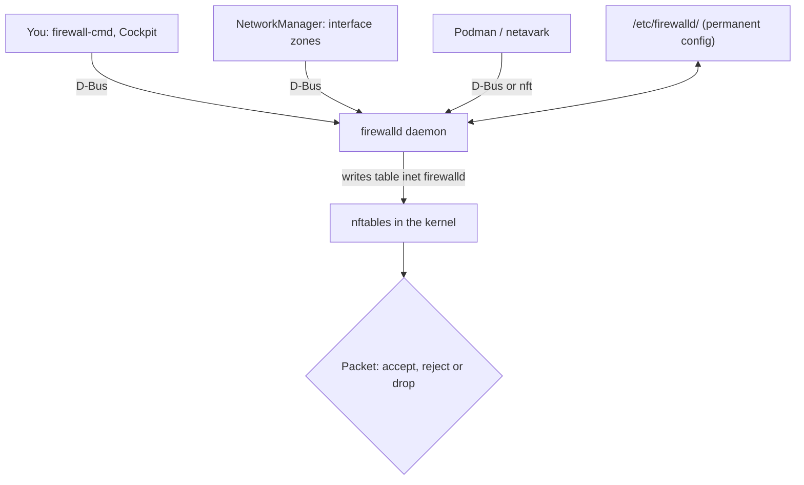
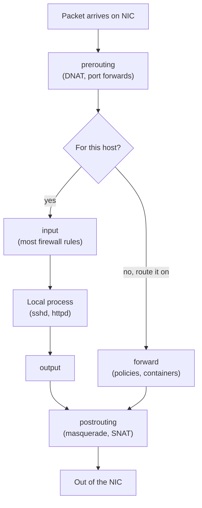
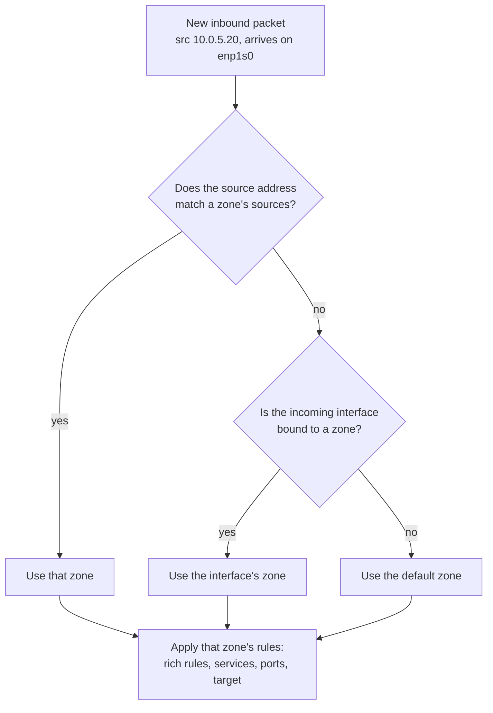
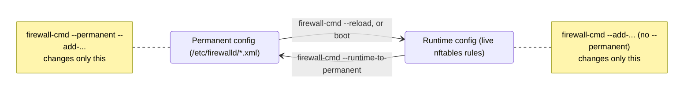
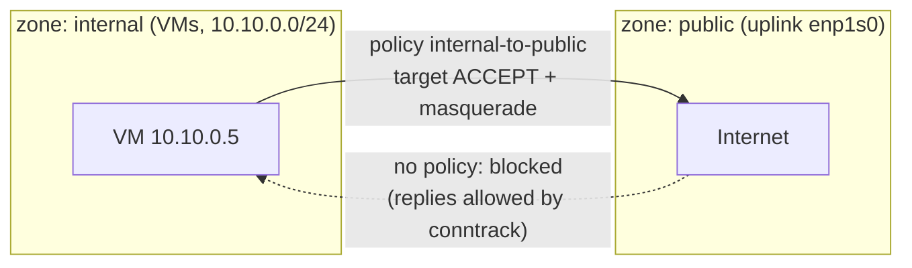

# 12 · Firewalls with firewalld

<ul class="module-meta">
  <li>⏱ ~2.5 hours</li>
  <li>5 labs</li>
  <li>Builds on: 11 · Networking</li>
</ul>

You install a web server, start it, and `curl localhost` works perfectly. From your laptop, the browser spins and times out. Nothing is wrong with the web server: the firewall is doing its job. Then you open the port, everything works, and after the next reboot it is broken again. This module explains what the firewall is, how it decides which packets get in, and how to change it so that your changes are correct, minimal, and still there tomorrow.

!!! abstract "What you'll learn"
    - Explain why a server needs a host firewall even behind a network firewall.
    - Describe how firewalld (the manager) drives nftables (the engine) in the kernel.
    - Predict which **zone** a packet lands in, from its source address and incoming interface.
    - Open services and ports, and avoid the runtime vs permanent trap.
    - Write rich rules, port forwards, masquerading and inter-zone policies.
    - Create a custom service, log denied packets, and read the live nftables ruleset.
    - Understand how Podman containers interact with firewalld.

## The big picture

A **firewall** is a set of rules that decides, for every packet, whether to let it through. A **host firewall** runs on the server itself, as opposed to a network firewall in a router or cloud security group.

Why have both? Because a network firewall only sees traffic that crosses it. It cannot protect you from another machine on the same subnet, from a compromised neighbour VM, or from the database you accidentally started listening on `0.0.0.0` instead of `127.0.0.1`. A host firewall is a second, independent wall. That idea, **defense in depth**, runs through the whole security part of this course.

On Rocky Linux, the firewall has two parts:

- **netfilter** is the packet filtering framework inside the kernel. **nftables** is the modern way to program it: a set of tables, chains and rules that the kernel evaluates for each packet. This is the *engine*.
- **firewalld** is a daemon that *manages* those rules for you. You describe what you want in high-level terms ("allow the `https` service in the `public` zone") and firewalld writes the nftables rules. This is the *driver*.



!!! analogy "Think of it like a building's security desk"
    The kernel's netfilter is the turnstile: fast, dumb, and it does exactly what its rule list says. firewalld is the security manager who writes that list from policies like "visitors to the lobby may go to reception, staff badges may go anywhere". You talk to the manager, not the turnstile. If you start taping notes directly onto the turnstile (raw `nft` commands), the manager will rewrite the list on the next reload and your notes vanish.

Rules on the inbound path generally fall into three verdicts. **Accept** lets the packet in. **Reject** throws it away and tells the sender ("connection refused" or an ICMP "administratively prohibited"), so clients fail fast. **Drop** throws it away silently, so clients wait until they time out. firewalld's default for unknown inbound traffic in most zones is reject.

## Netfilter and nftables: the engine

Netfilter gives the kernel a handful of **hooks**, which are checkpoints a packet passes on its way through the network stack. Rules attach to hooks.



- **prerouting** sees every arriving packet first. Port forwarding (rewriting the destination) happens here.
- **input** is for packets addressed to this machine. This is where "is port 443 open?" is decided.
- **forward** is for packets passing *through* this machine to somewhere else (a router, or a host for containers and VMs).
- **output** is for packets this machine creates.
- **postrouting** is the last stop. **Masquerading** (rewriting the source to the host's address) happens here.

One more kernel feature makes firewalls practical: **connection tracking** (conntrack). The kernel remembers every connection it has seen. When your server makes an outgoing request, the reply is recognised as part of an **established** connection and allowed back in automatically. That is why you only write rules for *new* inbound connections.

!!! note "One manager only"
    On Rocky 10, firewalld uses nftables as its backend (an iptables backend still exists but is deprecated and slated for removal). Do not run the `nftables.service` with your own ruleset, or `iptables` scripts, alongside firewalld: they would fight over the same kernel tables. Pick firewalld (the default) and use its features. You can still *read* the result with `nft list ruleset` (see below).

## Zones: trust levels for traffic

A **zone** is a named set of rules that expresses how much you trust a group of traffic. Every packet that arrives is assigned to exactly one zone, and that zone's rules decide its fate.

Rocky ships these zones, from least to most trusting:

| Zone | Default behaviour for new inbound connections |
|---|---|
| `drop` | Silently drop everything. Outgoing still works. |
| `block` | Reject everything with an ICMP "prohibited" message. |
| `public` | The default. Only selected services (`ssh`, `cockpit`, `dhcpv6-client`). |
| `external` | For a router's outside interface. Masquerading on, `ssh` only. |
| `dmz` | For exposed servers with limited access to your network. `ssh` only. |
| `work` / `home` / `internal` | More trusting LAN zones with a few more services. |
| `nm-shared` | Used by NetworkManager connection sharing. |
| `trusted` | Accept everything. |

The **default zone** (usually `public`) is used for any interface or source not explicitly assigned elsewhere.

```console
$ sudo firewall-cmd --state
running
$ sudo firewall-cmd --get-default-zone
public
$ sudo firewall-cmd --get-active-zones
public (default)
  interfaces: enp1s0
$ sudo firewall-cmd --list-all
public (default, active)
  target: default
  ingress-priority: 0
  egress-priority: 0
  icmp-block-inversion: no
  interfaces: enp1s0
  sources:
  services: cockpit dhcpv6-client ssh
  ports:
  protocols:
  forward: yes
  masquerade: no
  forward-ports:
  source-ports:
  icmp-blocks:
  rich rules:
```

`target: default` means "anything not explicitly allowed is rejected, except ICMP, which is allowed". Other possible targets are `ACCEPT`, `DROP` and `%%REJECT%%`.

### How a packet is assigned to a zone

This is the part most people get wrong, so take it slowly. firewalld can bind a zone to two kinds of things:

- A **source**: an IP address or subnet (`--add-source=10.0.5.0/24`).
- An **interface**: a network device (`enp1s0`).

When a new packet arrives, firewalld checks **sources first**, then interfaces, then falls back to the default zone.



This lets you say "everyone on `enp1s0` is `public`, but my admin subnet `10.0.5.0/24` is `internal` and may reach more services", all on one NIC.

```console
$ sudo firewall-cmd --zone=internal --add-source=10.0.5.0/24
success
$ sudo firewall-cmd --get-active-zones
internal
  sources: 10.0.5.0/24
public (default)
  interfaces: enp1s0
```

**Interfaces and NetworkManager.** For interfaces managed by NetworkManager, the zone is part of the connection profile. The cleanest way to move an interface is through NetworkManager, so the setting lives with the rest of the interface's configuration:

```console
$ sudo nmcli connection modify enp1s0 connection.zone internal
$ sudo nmcli connection up enp1s0
$ sudo firewall-cmd --get-zone-of-interface=enp1s0
internal
```

<div class="quiz" data-answer="2" markdown>

`enp1s0` is in zone `public` (only `ssh` allowed). Zone `trusted` has source `192.168.50.0/24`. A packet from `192.168.50.7` arrives on `enp1s0` for port 5432. What happens?

- Rejected, because `enp1s0` is in `public`
- Accepted, because source bindings are checked before interface bindings
- Accepted only if 5432 is also open in `public`

Right. The source matches `trusted`, so that zone handles the packet and its target is `ACCEPT`. Source bindings are powerful: binding a wide subnet to `trusted` can quietly expose everything.

</div>

??? question "Under the hood: zone drifting, and why old answers on forums are wrong"
    Before firewalld 1.0, a packet that matched a *source* zone but was not accepted there could "drift" on to the *interface* zone and be accepted by that zone's rules instead. A subnet you meant to restrict could still reach everything the `public` zone allowed. This was called **zone drifting** and was controlled by `AllowZoneDrifting=` in `firewalld.conf`.

    firewalld 1.0 removed it. On Rocky 9 and 10 a packet is handled by **exactly one** zone, and if that zone does not allow it, it is rejected. If you copy a `firewalld.conf` from a Rocky 8 system or follow an old guide that sets `AllowZoneDrifting`, do not expect the old drifting behaviour: it is gone.

    The consequence in practice: when you bind a source subnet to a zone, that subnet loses whatever the interface's zone allowed. If admins from `10.0.5.0/24` are moved to `internal` and `internal` does not list `ssh`, they can no longer SSH in. Check what a source will get with `firewall-cmd --zone=<z> --list-all` before you bind it.

## Services and ports

You can open a raw port (`--add-port=8443/tcp`), but firewalld prefers **services**: named definitions that bundle one or more ports and helpers. A service name says *why* a port is open, which makes the config readable months later.

```console
$ sudo firewall-cmd --get-services | tr ' ' '\n' | grep -E '^(http|https|ssh|nfs|samba|postgresql)$'
http
https
nfs
postgresql
samba
ssh
$ sudo firewall-cmd --info-service=samba
samba
  ports: 139/tcp 445/tcp
  protocols:
  source-ports:
  modules:
  destination:
  includes: samba-client
  helpers:
```

The built-in definitions live in `/usr/lib/firewalld/services/` as XML. Services can include other services: `samba` opens 139/tcp and 445/tcp itself and pulls in `samba-client` (138/udp), which in turn includes `netbios-ns` (137/udp plus the `netbios-ns` connection-tracking **helper**, kernel code that understands a protocol well enough to let its reply packets back in). One name, four ports and a helper, which is much better than remembering the port list.

```console
$ sudo firewall-cmd --add-service=https
success
$ sudo firewall-cmd --add-port=8443/tcp
success
$ sudo firewall-cmd --list-services
cockpit dhcpv6-client https ssh
$ sudo firewall-cmd --list-ports
8443/tcp
$ sudo firewall-cmd --remove-port=8443/tcp
success
```

Without `--zone`, commands act on the default zone. On a server with several zones, always write `--zone=` explicitly so you know where the rule lands.

!!! tip "Do you even need to open it?"
    A port only needs to be open if remote clients must reach it. If `ss -tlnp` shows a service listening on `127.0.0.1` only, the firewall is irrelevant for it. The best rule is the one you never had to write.

## Runtime vs permanent: the number one pitfall

firewalld keeps **two configurations**:

- The **runtime** configuration is what the kernel is enforcing *right now*. It is lost on reload, service restart, or reboot.
- The **permanent** configuration is stored in XML files under `/etc/firewalld/`. It is loaded at boot and on `--reload`. Changing it does **not** change what is enforced right now.

Every `firewall-cmd` change without `--permanent` touches runtime only. Every change *with* `--permanent` touches the stored config only.



There are two good workflows. Pick one and use it every time.

=== "Try, then save"

    Change runtime, test it, and when it works, save it:

    ```console
    $ sudo firewall-cmd --zone=public --add-service=http
    success
    $ curl -sI http://web01.example.lan | head -1     # test from a client
    HTTP/1.1 200 OK
    $ sudo firewall-cmd --runtime-to-permanent
    success
    ```

    The bonus: if your change locks you out, a reload or reboot restores the last saved config.

=== "Write permanent, then reload"

    Change the stored config, then load it:

    ```console
    $ sudo firewall-cmd --permanent --zone=public --add-service=http
    success
    $ sudo firewall-cmd --reload
    success
    ```

    Good for scripts and configuration management. `--reload` keeps established connections (like your SSH session) alive.

!!! tip "Changes that undo themselves"
    `--timeout` adds a runtime rule that expires on its own: `sudo firewall-cmd --add-service=http --timeout=10m`. Perfect for "let me test this for a moment" without leaving a hole open.

To check whether runtime and permanent differ, compare them:

```console
$ sudo firewall-cmd --zone=public --list-services
cockpit dhcpv6-client http ssh
$ sudo firewall-cmd --permanent --zone=public --list-services
cockpit dhcpv6-client ssh
```

Here `http` is open *now* but will vanish at the next reload. That is the bug from this module's opening story.

### Where the permanent config lives

The permanent configuration is just XML files, and you can read them to prove what will survive a reboot. Shipped defaults live in `/usr/lib/firewalld/` and are never edited; the first time you change a zone permanently, firewalld writes a full copy of it to `/etc/firewalld/zones/`, and that copy wins from then on.

```console
$ sudo ls /etc/firewalld/ /etc/firewalld/zones/
firewalld.conf  helpers  icmptypes  ipsets  policies  services  zones
public.xml
$ sudo cat /etc/firewalld/zones/public.xml
<?xml version="1.0" encoding="utf-8"?>
<zone>
  <short>Public</short>
  <description>For use in public areas. You do not trust the other computers on networks to not harm your computer. Only selected incoming connections are accepted.</description>
  <service name="ssh"/>
  <service name="dhcpv6-client"/>
  <service name="cockpit"/>
  <service name="http"/>
  <forward/>
</zone>
$ sudo grep -E '^(DefaultZone|FirewallBackend|LogDenied)=' /etc/firewalld/firewalld.conf
DefaultZone=public
FirewallBackend=nftables
LogDenied=off
```

Want to reset a zone to the shipped default? Delete its file from `/etc/firewalld/zones/` and run `sudo firewall-cmd --reload`. Configuration management tools (Ansible's `firewalld` module, for example) simply drive the same `--permanent` interface or drop these XML files in place.

??? question "Under the hood: reload, complete reload, and offline changes"
    `firewall-cmd --reload` rebuilds firewalld's nftables table from the permanent config but keeps connection-tracking state, so established sessions (your SSH) survive. `firewall-cmd --complete-reload` also throws away that state. Established connections that are no longer allowed can be cut, which is why you should never reach for it over SSH.

    When firewalld is **not running** (a kickstart `%post` script, an image build, a rescue shell), `firewall-cmd` cannot talk to the daemon. Use `firewall-offline-cmd` instead. It takes the same options and edits the permanent XML files directly:

    ```console
    $ sudo firewall-offline-cmd --zone=public --add-service=https
    success
    ```

    And remember where interface zones really live: for NetworkManager-managed devices, `nmcli connection modify <con> connection.zone internal` writes `zone=internal` into the `[connection]` section of the keyfile. That is why the interface does not appear in `/etc/firewalld/zones/*.xml` and `--permanent --list-all` shows an empty `interfaces:` line.

??? question "For the curious: what does conntrack actually remember?"
    Install `conntrack-tools` and list the kernel's connection table. Each entry stores both directions of a flow, its state, and a timeout:

    ```console
    $ sudo dnf install -y conntrack-tools
    $ sudo conntrack -L -p tcp --dport 22
    tcp      6 431999 ESTABLISHED src=192.168.122.1 dst=192.168.122.50 sport=50412 dport=22 src=192.168.122.50 dst=192.168.122.1 sport=22 dport=50412 [ASSURED] mark=0 use=1
    …
    ```

    `431999` is the seconds left before an idle established TCP flow is forgotten (five days by default). This entry is why removing the `ssh` service does not cut your current session: the packets match `ct state established` before any zone rule is consulted.

<div class="quiz" data-answer="3" markdown>

You run `sudo firewall-cmd --permanent --add-port=9000/tcp` and test from a client. It still fails. Why?

- `--permanent` rules only apply to IPv6
- You must restart the service listening on 9000
- The permanent config changed, but the runtime config (what the kernel enforces) did not
- Ports above 8999 need a rich rule

Right. Run `sudo firewall-cmd --reload` to load the permanent config into runtime, or add the same rule again without `--permanent`.

</div>

## Following one packet through firewalld

Now combine zones, services, connection tracking and the default target. Step through a packet from a client at `203.0.113.9` to port 80 on your server.

<div class="stepper" markdown>

<div class="step" data-title="Arrives: prerouting" markdown>

The packet enters `enp1s0`. In the prerouting hook, firewalld checks for **forward ports** in the zone. If one matched (say, 80 to 8080), the destination would be rewritten here, before anything else. No match, so nothing changes.

</div>

<div class="step" data-title="Connection tracking" markdown>

The input chain first asks conntrack: is this part of a connection we already know? Replies to our own outgoing requests and later packets of an accepted connection are `established` and accepted immediately. Garbage packets that belong to no valid connection (`invalid`) are dropped. Loopback traffic (`lo`) is always accepted.

This is a **new** connection (a TCP SYN), so it continues.

</div>

<div class="step" data-title="Pick the zone" markdown>

Does `203.0.113.9` match any zone's **sources**? No. Is `enp1s0` bound to a zone? Yes: `public`. So the `public` zone's rules apply.

</div>

<div class="step" data-title="Policies and rich rules" markdown>

Any **policies** that apply to traffic from `public` to `HOST` (this machine) are evaluated. (Internally, firewalld implements zones as policies too, which is why policies can be ordered before or after them with a priority.) Then come the zone's **rich rules**, in a fixed order: log rules, then deny rules, then allow rules. A rich rule might say "reject everything from 203.0.113.0/24". None matches here.

</div>

<div class="step" data-title="Services and ports" markdown>

The zone's allowed **services** and **ports** are checked. If `http` (80/tcp) is listed, the packet is accepted and handed to `httpd`.

</div>

<div class="step" data-title="The zone target" markdown>

Nothing allowed it, so the zone's **target** decides. For `public` (`target: default`), the packet is rejected with an ICMP "administratively prohibited" message, so the client fails quickly. If **LogDenied** is enabled, a log line is written first.

```text
filter_IN_public_REJECT: IN=enp1s0 OUT= SRC=203.0.113.9 DST=192.168.122.50 … PROTO=TCP SPT=51234 DPT=80 …
```

</div>

</div>

### Practice: open a service the safe way

<div class="terminal-sim" data-title="firewall-cmd drill" data-prompt="[alex@web01 ~]$ " markdown>

<div class="task" data-expect="sudo firewall-cmd --get-active-zones" data-match="(sudo )?firewall-cmd --get-active-zones" data-hint="firewall-cmd has a --get-active-zones option." markdown>

**Step 1.** Find out which zones are in use and which interfaces they own.

```text
public (default)
  interfaces: enp1s0
```

</div>

<div class="task" data-expect="sudo firewall-cmd --list-services" data-match="(sudo )?firewall-cmd (--zone=public )?--list-services" data-hint="--list-services shows the services of the default zone." markdown>

**Step 2.** List the services the default zone currently allows.

```text
cockpit dhcpv6-client ssh
```

</div>

<div class="task" data-expect="sudo firewall-cmd --add-service=https" data-match="(sudo )?firewall-cmd (--zone=public )?--add-service[= ]https( --zone=public)?" data-hint="--add-service=https, without --permanent, changes runtime only." markdown>

**Step 3.** Allow `https` in runtime only, so you can test it first.

```text
success
```

</div>

<div class="task" data-expect="sudo firewall-cmd --runtime-to-permanent" data-match="(sudo )?firewall-cmd --runtime-to-permanent" data-hint="One option copies the whole runtime config to permanent." markdown>

**Step 4.** It works. Save the current runtime configuration so it survives a reboot.

```text
success
```

</div>

<div class="task" data-expect="sudo firewall-cmd --permanent --list-services" data-match="(sudo )?firewall-cmd (--permanent (--zone=public )?|(--zone=public )?--permanent )--list-services" data-hint="Add --permanent to a --list command to read the stored config." markdown>

**Step 5.** Prove it: list the services in the *permanent* config.

```text
cockpit dhcpv6-client https ssh
```

</div>

</div>

## Rich rules: when a service is not enough

A **rich rule** expresses conditions that plain services cannot: "allow this service only from that subnet", "rate-limit and log", "reject one bad address". The syntax reads like a sentence.

```console
$ sudo firewall-cmd --zone=public --add-rich-rule='rule family="ipv4" source address="10.0.5.0/24" service name="postgresql" accept'
success
$ sudo firewall-cmd --zone=public --add-rich-rule='rule family="ipv4" source address="198.51.100.23" reject'
success
$ sudo firewall-cmd --zone=public --add-rich-rule='rule service name="ssh" log prefix="ssh-new: " level="info" limit value="3/m" accept'
success
$ sudo firewall-cmd --zone=public --list-rich-rules
rule family="ipv4" source address="10.0.5.0/24" service name="postgresql" accept
rule family="ipv4" source address="198.51.100.23" reject
rule service name="ssh" log prefix="ssh-new: " level="info" limit value="3/m" accept
```

The parts are: an optional `family`, an optional `source`/`destination`, one element (`service`, `port`, `protocol`, `icmp-block`, `icmp-type`, `masquerade`, `forward-port`, `source-port`), optional `log` (or `nflog`) and `audit`, and an action (`accept`, `reject`, `drop`, `mark`). To remove a rich rule, repeat it exactly with `--remove-rich-rule`.

!!! tip "Source zone or rich rule?"
    "Admins from 10.0.5.0/24 may reach PostgreSQL" works either way. If a subnet needs access to several services, binding the subnet to its own zone is cleaner. If it is one exception, a rich rule is fine.

??? question "Under the hood: blocking 10,000 addresses without 10,000 rules"
    Each rich rule becomes at least one nftables rule, and rules are checked one after another. A blocklist of thousands of addresses as rich rules makes every new connection slower and every `--reload` painfully long.

    Use an **ipset** instead. firewalld turns it into an nftables **set**, a hash table the kernel checks in a single lookup no matter how many entries it holds:

    ```console
    $ sudo firewall-cmd --permanent --new-ipset=blocklist --type=hash:net
    success
    $ sudo firewall-cmd --permanent --ipset=blocklist --add-entries-from-file=/root/bad-nets.txt
    success
    $ sudo firewall-cmd --permanent --zone=drop --add-source=ipset:blocklist
    success
    $ sudo firewall-cmd --reload
    success
    $ sudo nft list set inet firewalld blocklist | head -4
    table inet firewalld {
    	set blocklist {
    		type ipv4_addr
    		flags interval
    ```

    Binding the ipset as a *source* of the `drop` zone means "anything from these networks is handled by `drop`", which silently discards it. The file holds one address or CIDR per line.

## Port forwarding and masquerading

**Port forwarding** rewrites the destination of incoming packets. Two common uses:

- Redirect a port on the same host: clients connect to 80, the app listens on 8080.
- Send traffic on to another machine: clients connect to this host's port 2222, it goes to `10.0.0.20:22`.

```console
$ sudo firewall-cmd --zone=public --add-forward-port=port=80:proto=tcp:toport=8080
success
$ sudo firewall-cmd --zone=public --add-forward-port=port=2222:proto=tcp:toport=22:toaddr=10.0.0.20
success
```

Notice that you do not need to open port 8080 separately: firewalld accepts packets whose destination it has rewritten (`ct status dnat accept`).

**Masquerading** is the reverse direction. It rewrites the *source* of packets leaving through a zone to the host's own address, so machines on a private network can reach the outside world and replies come back to the host, which un-rewrites them. It is a form of **NAT**. Forwarding to another machine (`toaddr=`) usually needs masquerading too, so the reply comes back through this host.

```console
$ sudo firewall-cmd --zone=external --add-masquerade
success
$ sudo firewall-cmd --zone=external --query-masquerade
yes
```

When you enable masquerading or remote port forwarding, firewalld turns on kernel IP forwarding for you.

## Policies: rules between zones

Zones describe traffic *into this host*. But a host that routes traffic (a gateway, a hypervisor, a container host) also needs rules for traffic *passing through* it, from one zone to another. That is what **policies** are for.

A policy has **ingress zones** (where traffic comes from), **egress zones** (where it goes), and its own services, ports, rich rules, masquerade and a **target**. Two special zone names exist for policies: `HOST` (this machine itself) and `ANY` (any zone).



```console
$ sudo firewall-cmd --permanent --new-policy internal-to-public
success
$ sudo firewall-cmd --permanent --policy internal-to-public --add-ingress-zone internal
success
$ sudo firewall-cmd --permanent --policy internal-to-public --add-egress-zone public
success
$ sudo firewall-cmd --permanent --policy internal-to-public --set-target ACCEPT
success
$ sudo firewall-cmd --permanent --policy internal-to-public --add-masquerade
success
$ sudo firewall-cmd --reload
success
$ sudo firewall-cmd --info-policy internal-to-public
internal-to-public (active)
  disable: no
  priority: -1
  target: ACCEPT
  ingress-zones: internal
  egress-zones: public
  services:
  ports:
  protocols:
  masquerade: yes
  forward-ports:
  source-ports:
  icmp-blocks:
  rich rules:
```

A policy whose ingress zone is `HOST` filters traffic the host *sends*, which is how you restrict outbound connections. A policy's default target is `CONTINUE`, meaning "if nothing in me matched, carry on to the next policy or zone".

## Custom services

When your application uses ports firewalld does not know about, define a service instead of opening anonymous ports. Your definitions live in `/etc/firewalld/services/`, next to (and overriding) the built-in ones in `/usr/lib/firewalld/services/`.

```console
$ sudo firewall-cmd --permanent --new-service=myapp
success
$ sudo firewall-cmd --permanent --service=myapp --set-short="My App"
success
$ sudo firewall-cmd --permanent --service=myapp --set-description="Internal API and metrics"
success
$ sudo firewall-cmd --permanent --service=myapp --add-port=9000/tcp
success
$ sudo firewall-cmd --permanent --service=myapp --add-port=9100/tcp
success
$ sudo firewall-cmd --reload
success
$ sudo firewall-cmd --zone=internal --add-service=myapp
success
```

```xml title="/etc/firewalld/services/myapp.xml"
<?xml version="1.0" encoding="utf-8"?>
<service>
  <short>My App</short>
  <description>Internal API and metrics</description>
  <port port="9000" protocol="tcp"/>
  <port port="9100" protocol="tcp"/>
</service>
```

You can also drop such an XML file in place by hand (or from Ansible), then run `sudo firewall-cmd --reload`. Check your XML with `sudo firewall-cmd --check-config` first.

!!! tip "Customising a built-in service"
    To change a shipped service (say, run SSH on 2222), copy `/usr/lib/firewalld/services/ssh.xml` to `/etc/firewalld/services/ssh.xml` and edit the copy. The file in `/etc` wins, and package updates never touch it. Remember SELinux also needs to know about the new port: see [SELinux ports](16-selinux.md).

## Logging denied packets

By default, firewalld rejects silently from the admin's point of view: the client sees an error, but nothing appears in your logs. When you are hunting a "why is this blocked?" problem, turn on **LogDenied**.

```console
$ sudo firewall-cmd --get-log-denied
off
$ sudo firewall-cmd --set-log-denied=unicast
success
$ sudo journalctl -k -f --grep='_REJECT|_DROP'
Oct 15 10:22:41 web01 kernel: filter_IN_public_REJECT: IN=enp1s0 OUT= MAC=52:54:00:3a:91:c2:52:54:00:9c:1e:7a:08:00 SRC=192.168.122.1 DST=192.168.122.50 LEN=60 TOS=0x00 PREC=0x00 TTL=64 ID=40211 DF PROTO=TCP SPT=48872 DPT=8080 WINDOW=64240 RES=0x00 SYN URGP=0
```

The options are `all`, `unicast`, `broadcast`, `multicast` and `off`. `unicast` is usually what you want. The setting is stored in `/etc/firewalld/firewalld.conf` (`LogDenied=`) and is applied immediately. Read the log line like a story: zone `public` rejected a TCP SYN from `192.168.122.1` to port `8080` arriving on `enp1s0`. Turn it back `off` when you are done, because busy hosts can log a lot.

## Panic mode

**Panic mode** drops *all* incoming and outgoing packets immediately. It exists for one situation: you believe the machine is under active attack or is compromised and you need to cut it off now.

```console
$ sudo firewall-cmd --panic-on
success
$ sudo firewall-cmd --query-panic
yes
$ sudo firewall-cmd --panic-off
success
```

!!! danger "Panic mode will cut your SSH session"
    Everything is dropped, including your established SSH connection. Only use it with console access (hypervisor console, iDRAC/iLO, cloud serial console), because that is the only way to run `--panic-off`.

## Looking under the hood with nft

firewalld writes its rules into one nftables table called `inet firewalld` (`inet` means it handles IPv4 and IPv6 together). You can read it at any time. Treat it as **read-only**: edit through firewalld, look through `nft`.

```console
$ sudo nft list tables
table inet firewalld
$ sudo nft list chain inet firewalld filter_INPUT
table inet firewalld {
	chain filter_INPUT {
		type filter hook input priority filter + 10; policy accept;
		ct state { established, related } accept
		ct status dnat accept
		iifname "lo" accept
		ct state invalid drop
		jump filter_INPUT_POLICIES
		reject with icmpx admin-prohibited
	}
}
$ sudo nft list ruleset | grep -A4 'chain filter_IN_public_allow'
	chain filter_IN_public_allow {
		tcp dport 22 accept
		ip6 daddr fe80::/64 udp dport 546 accept
		tcp dport 9090 accept
	}
```

You can see every idea from this module in plain text: established traffic first, DNATed (forwarded) traffic accepted, loopback accepted, invalid dropped, then the zones and policies, then a final reject. Port 9090 is the `cockpit` service, 546/udp is `dhcpv6-client`. Exact chain names vary between firewalld versions, but the shape is the same.

Other tables may appear too, for example one created by Podman's network tool. That is normal.

!!! version "Rocky 9 vs 10"
    Rocky 9 ships firewalld 1.x and Rocky 10 ships firewalld 2.x. Day-to-day commands are the same. Rocky 10's firewalld adds the `StrictForwardPorts` option (see the next section). On both, nftables is the backend; the old iptables backend is deprecated and should not be used.

## firewalld and containers

Containers add a twist: when you publish a port with Podman (`podman run -p 8080:80 …`), the container's network tool, **netavark**, writes its own nftables rules to forward that host port to the container. Those forwarding rules act in the prerouting hook, *before* firewalld's zone filtering, so **a published container port is reachable even if firewalld's zone does not list it**. Many people are surprised by this.

```console
$ podman run -d --name web -p 8080:80 docker.io/library/nginx
$ sudo firewall-cmd --list-ports

$ curl -sI http://192.168.122.50:8080 | head -1     # from another machine
HTTP/1.1 200 OK
```

What else happens:

- When firewalld is running, Podman's container subnets (for example `10.88.0.0/16` for rootful containers) are added to firewalld's `trusted` zone so containers can reach out. Check with `sudo firewall-cmd --zone=trusted --list-sources`.
- Rootless containers use a different network path (`pasta`), where published ports are ordinary listening sockets owned by your user, so normal zone rules apply to them.
- A `firewall-cmd --reload` rebuilds firewalld's rules; netavark ships a small service (`netavark-firewalld-reload`) that re-adds its rules afterwards.

If you want firewalld to stay the single gatekeeper, firewalld 2.x on Rocky 10 has an option for that:

```ini title="/etc/firewalld/firewalld.conf"
# Block published container ports unless firewalld also forwards them
StrictForwardPorts=yes
```

With `StrictForwardPorts=yes`, firewalld no longer accepts traffic that something else DNATed, so rootful Podman port publishing stops working: current netavark refuses to start a container with `-p` or `-P`. You start containers without published ports and forward the port yourself with `firewall-cmd --add-forward-port`. Rootless Podman is unaffected. It is off (`no`) by default because it changes how containers behave. After enabling it, restart firewalld and test a published port from another machine: the netavark in Rocky 10.0 did not detect the setting and published ports silently. Containers are covered in depth in [Containers from the Ground Up](18-containers.md).

<div class="quiz" data-answer="1" markdown>

A rootful Podman container was started with `-p 5432:5432`. The `public` zone lists only `ssh`. A colleague can still connect to PostgreSQL from another machine. Why?

- Podman's own nftables rules forward the published port before firewalld's zone rules filter it
- firewalld automatically adds every listening port to the default zone
- PostgreSQL uses UDP, which firewalld does not filter

Right. Publishing a port is itself a "please expose this" instruction. Bind it to a specific address (`-p 127.0.0.1:5432:5432`) if it should be local only, or use `StrictForwardPorts=yes` to make firewalld the gatekeeper.

</div>

## Labs

!!! note "Lab setup: a client to test from"
    Traffic from the server to itself uses the loopback interface, which firewalld always accepts. To test the firewall properly on one VM, create a tiny **client** in a network namespace (you built one in [module 11](11-networking.md)). Run this once before the labs:

    ```bash
    sudo ip netns add client
    sudo ip link add veth-srv type veth peer name veth-cli
    sudo ip link set veth-cli netns client
    sudo ip addr add 10.200.0.1/24 dev veth-srv
    sudo ip link set veth-srv up
    sudo ip netns exec client ip addr add 10.200.0.2/24 dev veth-cli
    sudo ip netns exec client ip link set veth-cli up
    sudo ip netns exec client ip link set lo up
    ```

    `veth-srv` is not bound to any zone, so traffic from the client lands in the **default zone** (`public`). Remove everything at the very end with `sudo ip netns delete client`.

!!! lab "Lab 1: Open a port the right way"

    **Goal:** See the firewall block a service, open it in runtime, and make it permanent.

    **You'll need:** the lab setup above, `python3` (installed by default).

    1. Start a throwaway web server on port 8080 in a second terminal:

        ```bash
        mkdir -p ~/fwlab && echo "hello from the server" > ~/fwlab/index.html
        cd ~/fwlab && python3 -m http.server 8080
        ```

    2. From the client namespace, try to reach it:

        ```bash
        sudo ip netns exec client curl -m 3 -s http://10.200.0.1:8080/ ; echo "exit: $?"
        ```

    3. Open the port in runtime and try again:

        ```bash
        sudo firewall-cmd --zone=public --add-port=8080/tcp
        sudo ip netns exec client curl -m 3 -s http://10.200.0.1:8080/
        ```

    4. Reload, and watch the rule vanish. Then add it back and save it:

        ```bash
        sudo firewall-cmd --reload
        sudo ip netns exec client curl -m 3 -s http://10.200.0.1:8080/ ; echo "exit: $?"
        sudo firewall-cmd --zone=public --add-port=8080/tcp
        sudo firewall-cmd --runtime-to-permanent
        sudo firewall-cmd --reload
        sudo firewall-cmd --zone=public --list-ports
        ```

    **Check your work:** step 2 fails quickly with exit code 7 (rejected, not a timeout). Step 3 prints "hello from the server". After the final reload, `--list-ports` still shows `8080/tcp`.

    ??? success "What just happened?"
        The `public` zone's default target rejects with ICMP "admin prohibited", which `curl` reports as "Could not connect", exit 7. `--reload` replaced runtime with permanent, which did not have your port yet. `--runtime-to-permanent` copied the working runtime state to disk.

    **Clean up:** `sudo firewall-cmd --permanent --zone=public --remove-port=8080/tcp && sudo firewall-cmd --reload`. Stop the Python server with ++ctrl+c++. Keep `~/fwlab` for the next labs.

!!! lab "Lab 2: Zones by source address"

    **Goal:** Give one client more access than everyone else by binding its address to a different zone.

    **You'll need:** the lab setup, the Python server from Lab 1 running again on 8080.

    1. Confirm the client is rejected, then bind its address to the `internal` zone and allow the port only there:

        ```bash
        sudo ip netns exec client curl -m 3 -s http://10.200.0.1:8080/ ; echo "exit: $?"
        sudo firewall-cmd --zone=internal --add-source=10.200.0.2/32
        sudo firewall-cmd --zone=internal --add-port=8080/tcp
        sudo firewall-cmd --get-active-zones
        sudo ip netns exec client curl -m 3 -s http://10.200.0.1:8080/
        ```

    2. Add a second client address to the namespace. It is not in the source list, so it falls back to `public`:

        ```bash
        sudo ip netns exec client ip addr add 10.200.0.3/24 dev veth-cli
        sudo ip netns exec client curl -m 3 -s --interface 10.200.0.3 http://10.200.0.1:8080/ ; echo "exit: $?"
        ```

    **Check your work:** `--get-active-zones` lists `internal` with `sources: 10.200.0.2/32`. The request from `.2` succeeds; the request from `.3` fails with exit 7.

    ??? success "What just happened?"
        Source bindings are checked before interfaces and the default zone. Same NIC, same port, different zone purely based on who is asking.

    **Clean up:**

    ```bash
    sudo firewall-cmd --zone=internal --remove-port=8080/tcp
    sudo firewall-cmd --zone=internal --remove-source=10.200.0.2/32
    sudo ip netns exec client ip addr del 10.200.0.3/24 dev veth-cli
    ```

!!! lab "Lab 3: A custom service with logging"

    **Goal:** Define a service for your app, watch denied packets in the log, then allow the service with a rich rule.

    **You'll need:** the lab setup and the Python server on 8080.

    1. Create a permanent custom service and load it:

        ```bash
        sudo firewall-cmd --permanent --new-service=fwlab
        sudo firewall-cmd --permanent --service=fwlab --set-short="Firewall lab app"
        sudo firewall-cmd --permanent --service=fwlab --add-port=8080/tcp
        sudo firewall-cmd --reload
        sudo cat /etc/firewalld/services/fwlab.xml
        sudo firewall-cmd --info-service=fwlab
        ```

    2. Turn on denied-packet logging, then make a blocked request and find it in the journal:

        ```bash
        sudo firewall-cmd --set-log-denied=unicast
        sudo ip netns exec client curl -m 3 -s http://10.200.0.1:8080/ ; echo "exit: $?"
        sudo journalctl -k --since "-2min" --grep='_REJECT' | tail -3
        ```

    3. Allow the service only from the client's address with a rich rule:

        ```bash
        sudo firewall-cmd --zone=public --add-rich-rule='rule family="ipv4" source address="10.200.0.2" service name="fwlab" accept'
        sudo ip netns exec client curl -m 3 -s http://10.200.0.1:8080/
        ```

    **Check your work:** the journal shows a line containing `filter_IN_public_REJECT`, `SRC=10.200.0.2` and `DPT=8080`. After step 3 the request succeeds.

    **Clean up:**

    ```bash
    sudo firewall-cmd --zone=public --remove-rich-rule='rule family="ipv4" source address="10.200.0.2" service name="fwlab" accept'
    sudo firewall-cmd --set-log-denied=off
    sudo firewall-cmd --permanent --delete-service=fwlab
    sudo firewall-cmd --reload
    ```

!!! lab "Lab 4: Port forwarding"

    **Goal:** Let clients use port 80 while the app keeps listening on 8080.

    **You'll need:** the lab setup and the Python server on 8080 (no port open in `public`).

    1. Add a forward port in the default zone and test it:

        ```bash
        sudo firewall-cmd --zone=public --add-forward-port=port=80:proto=tcp:toport=8080
        sudo ip netns exec client curl -m 3 -s http://10.200.0.1/
        sudo ip netns exec client curl -m 3 -s http://10.200.0.1:8080/ ; echo "exit: $?"
        ```

    2. Find the rewrite in the live ruleset:

        ```bash
        sudo nft list ruleset | grep -n 'dnat\|redirect'
        ```

    **Check your work:** port 80 answers with "hello from the server", while direct access to 8080 is still rejected (exit 7). The ruleset shows a rule mentioning port 80 and 8080.

    ??? success "What just happened?"
        The forward port rewrote the destination in prerouting, before the input chain ran. The input chain accepts packets with `ct status dnat`, so 8080 did not need to be open, and it still is not open for direct access.

    **Clean up:** `sudo firewall-cmd --reload` (the forward port was runtime only).

!!! lab "Lab 5: Give the namespace internet access with a policy"

    **Goal:** Make this VM act as a tiny router: the client namespace reaches the internet through a policy with masquerading.

    **You'll need:** the lab setup and a VM with internet access through `enp1s0` (adjust the zone if your uplink is not in `public`).

    1. Give the client a default route and confirm it cannot reach out yet:

        ```bash
        sudo ip netns exec client ip route add default via 10.200.0.1
        sudo ip netns exec client ping -c2 -W2 1.1.1.1
        ```

    2. Create an empty policy (it must exist in the permanent config), then put `veth-srv` in the `internal` zone and fill the policy in runtime:

        ```bash
        sudo firewall-cmd --permanent --new-policy fwlab-out
        sudo firewall-cmd --reload
        sudo firewall-cmd --zone=internal --add-interface=veth-srv
        sudo firewall-cmd --policy fwlab-out --add-ingress-zone internal
        sudo firewall-cmd --policy fwlab-out --add-egress-zone public
        sudo firewall-cmd --policy fwlab-out --set-target ACCEPT
        sudo firewall-cmd --policy fwlab-out --add-masquerade
        ```

    3. Test again and look at the policy:

        ```bash
        sudo ip netns exec client ping -c2 1.1.1.1
        sudo firewall-cmd --info-policy fwlab-out
        sudo sysctl net.ipv4.ip_forward
        ```

    **Check your work:** the ping in step 1 fails; in step 3 it succeeds. `net.ipv4.ip_forward = 1`.

    ??? success "What just happened?"
        A policy must exist in the permanent config before you can change it in runtime, which is why you created it with `--permanent` and reloaded first. The policy allowed forwarding from `internal` to `public`, masquerading rewrote the client's `10.200.0.2` to the VM's address, and conntrack let replies back. This is what a container host or home router does.

    **Clean up:**

    ```bash
    sudo firewall-cmd --permanent --delete-policy fwlab-out
    sudo firewall-cmd --reload
    sudo ip netns delete client
    rm -rf ~/fwlab
    ```

    firewalld turned on `net.ipv4.ip_forward` for the masquerade but does not turn it off again. If it was `0` before the lab (and nothing else on the VM, such as rootful containers, needs it), run `sudo sysctl -w net.ipv4.ip_forward=0`, or simply reboot.

## Common pitfalls

| Symptom | Cause | Fix |
|---|---|---|
| Works until reboot or reload | Change made in runtime only | `--runtime-to-permanent`, or repeat with `--permanent` |
| `--permanent` change "does nothing" | Permanent config not loaded | `firewall-cmd --reload` |
| Rule added but still blocked | Added to the wrong zone (default zone, not the one the traffic lands in) | `--get-active-zones`, then always use `--zone=` |
| A subnet can reach everything | That subnet is bound as a source to `trusted` | `firewall-cmd --zone=trusted --list-sources` |
| Hand-made `nft` rules disappear | firewalld rebuilds its table on reload | Use firewalld features (rich rules, policies) |
| Container port open to the world | Published ports bypass zone rules | `-p 127.0.0.1:…`, or `StrictForwardPorts=yes` |
| Service on new port still fails after opening it | SELinux port label missing | `semanage port -a -t <type> -p tcp <port>` ([module 16](16-selinux.md)) |
| Testing from the server itself "works" | Loopback is always accepted | Test from another machine or a namespace |
| SSH dropped during a change | Removed `ssh` or ran `--panic-on` | Use console access; test with `--timeout` first |

!!! pitfall "Removing `ssh` from your own zone"
    `firewall-cmd --remove-service=ssh` in runtime does not kill your *established* session (conntrack keeps it), which makes it feel safe. Then you disconnect and cannot come back. If you must change SSH access, add the new rule first, test a fresh login from a second terminal, and only then remove the old one.

## Cheat sheet

| Command | What it does |
|---|---|
| `firewall-cmd --state` | Is firewalld running? |
| `firewall-cmd --get-active-zones` | Zones in use, with their interfaces and sources |
| `firewall-cmd --list-all [--zone=z]` | Everything a zone allows |
| `firewall-cmd --get-default-zone` / `--set-default-zone=z` | Show / change the default zone |
| `firewall-cmd --zone=z --add-service=s` | Allow a service (runtime) |
| `firewall-cmd --zone=z --add-port=8080/tcp` | Allow a port (runtime) |
| `firewall-cmd --permanent …` | Make the change in the stored config only |
| `firewall-cmd --reload` | Load permanent config into runtime |
| `firewall-cmd --runtime-to-permanent` | Save current runtime config |
| `firewall-cmd --add-service=s --timeout=10m` | Temporary rule that expires |
| `firewall-cmd --zone=z --add-source=CIDR` | Bind a source subnet to a zone |
| `nmcli connection modify c connection.zone z` | Bind an interface's profile to a zone |
| `firewall-cmd --info-service=s` | Show what a service opens |
| `firewall-cmd --add-rich-rule='rule …'` | Add a rich rule |
| `firewall-cmd --add-forward-port=port=80:proto=tcp:toport=8080` | Port forward |
| `firewall-cmd --add-masquerade` | Enable NAT for traffic leaving a zone |
| `firewall-cmd --permanent --new-policy p` | Create an inter-zone policy |
| `firewall-cmd --set-log-denied=unicast` | Log rejected and dropped packets |
| `firewall-cmd --panic-on` / `--panic-off` | Drop all traffic / restore |
| `firewall-cmd --check-config` | Validate permanent XML config |
| `nft list ruleset` | Read the live kernel rules (read-only) |

## Flashcards

<div class="flashcards" markdown>

<div class="card" markdown>

firewalld vs nftables: who does what?

nftables (netfilter) is the kernel engine that filters packets. firewalld is the daemon that generates and manages those rules from zones, services and policies.

</div>

<div class="card" markdown>

In what order does firewalld pick a zone for a new packet?

Matching source address first, then the incoming interface's zone, then the default zone.

</div>

<div class="card" markdown>

What is the difference between runtime and permanent config?

Runtime is what the kernel enforces now and is lost on reload or reboot. Permanent is stored in `/etc/firewalld/` and loaded at boot or `--reload`.

</div>

<div class="card" markdown>

Two ways to make a working runtime change permanent?

`firewall-cmd --runtime-to-permanent`, or repeat the command with `--permanent` (then `--reload` is not needed for that rule, since runtime already has it).

</div>

<div class="card" markdown>

Why can you remove the `ssh` service without losing your current session?

Established connections are accepted by connection tracking before zone rules are checked. New logins will fail, though.

</div>

<div class="card" markdown>

What is a firewalld policy?

A rule set for traffic *between* zones (ingress zones to egress zones), including the special `HOST` and `ANY` zones. Used for routing, NAT and outbound filtering.

</div>

<div class="card" markdown>

Where do custom service definitions go?

`/etc/firewalld/services/<name>.xml`. Files there override same-named services in `/usr/lib/firewalld/services/`.

</div>

<div class="card" markdown>

How do you see packets firewalld rejects?

`firewall-cmd --set-log-denied=unicast`, then `journalctl -k` and look for prefixes like `filter_IN_public_REJECT`.

</div>

<div class="card" markdown>

Why can a published Podman port be reachable even if the zone does not allow it?

netavark forwards published ports with its own nftables rules in prerouting, before firewalld's zone filtering. `StrictForwardPorts=yes` changes that.

</div>

</div>

## Recap

!!! recap "Key takeaways"
    - A host firewall is a second wall that protects each server on its own, even from its neighbours.
    - nftables in the kernel enforces rules; firewalld manages them. Make changes through firewalld and only *read* with `nft`.
    - Each new inbound packet lands in exactly one zone: matching source first, then interface, then the default zone.
    - Prefer named services over raw ports, and custom services in `/etc/firewalld/services/` for your apps.
    - Runtime is what is enforced; permanent is what survives. Use `--runtime-to-permanent` or `--permanent` plus `--reload`, every time.
    - Rich rules add conditions; forward ports and masquerade rewrite addresses; policies control traffic between zones.
    - Published Podman ports bypass zone rules unless you use `StrictForwardPorts=yes`.

## Go deeper

- Man pages: [[man:firewall-cmd(1)]] [[man:firewalld(1)]] [[man:firewalld.zone(5)]] [[man:firewalld.richlanguage(5)]] [[man:firewalld.policy(5)]] [[man:firewalld.conf(5)]] [[man:nft(8)]]
- [firewalld documentation](https://firewalld.org/documentation/)
- [firewalld blog: Strict Forward Ports](https://firewalld.org/2024/11/strict-forward-ports)
- [RHEL 10: Configuring firewalls and packet filters](https://docs.redhat.com/en/documentation/red_hat_enterprise_linux/10/html/configuring_firewalls_and_packet_filters/index)
- [nftables wiki](https://wiki.nftables.org/)

**Next:** [13 · File Sharing: NFS and Samba](13-nfs-and-samba.md)
