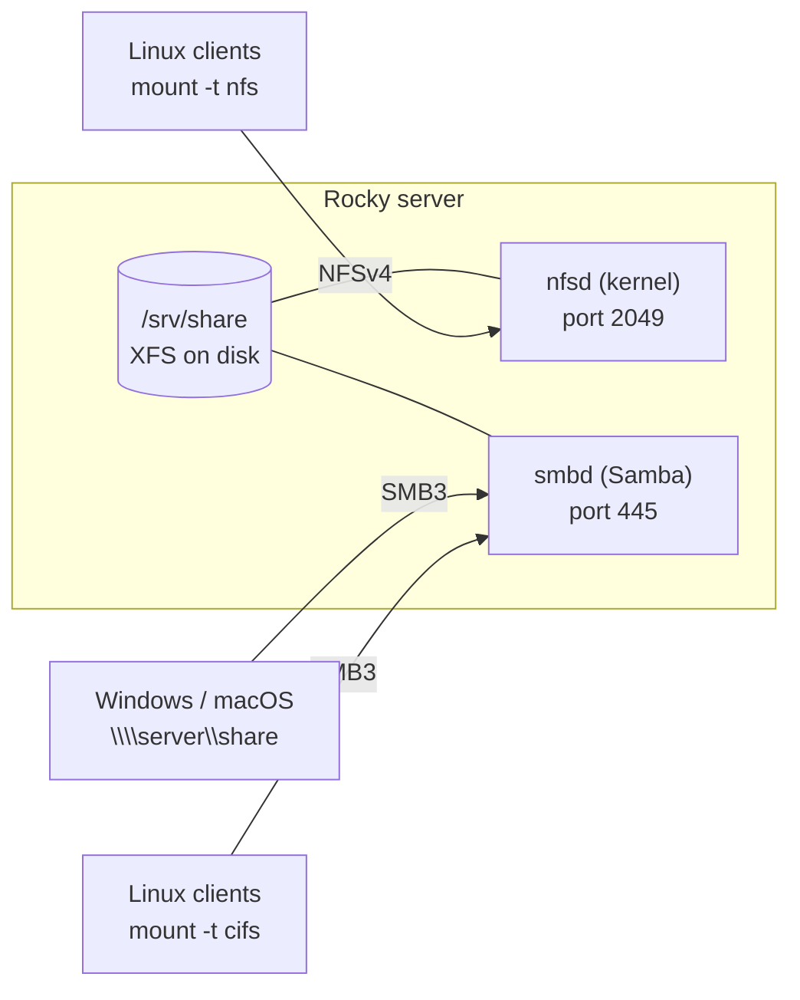
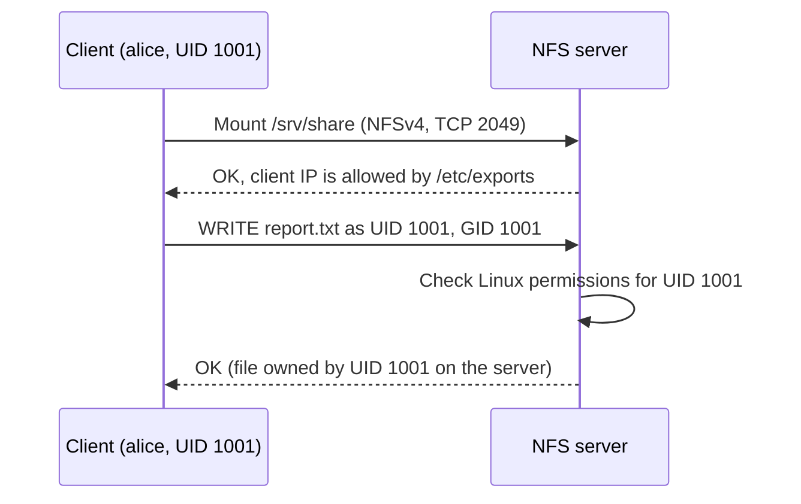
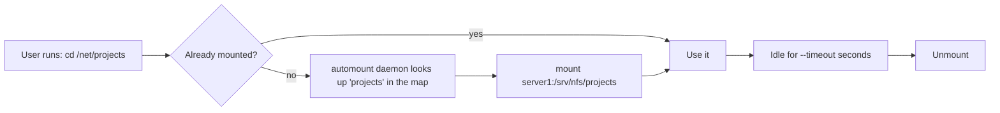
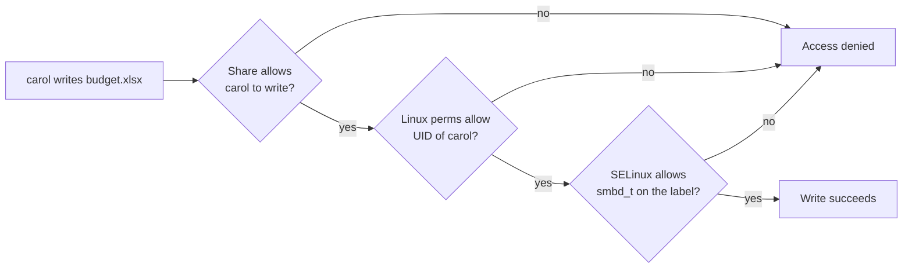

# 13 · File Sharing: NFS and Samba

<ul class="module-meta">
  <li>⏱ ~3 hours</li>
  <li>4 labs</li>
  <li>Builds on: 04 · Permissions and ACLs, 09 · Disks and Filesystems, 12 · Firewalls with firewalld</li>
</ul>

"Can you set up a shared folder?" sounds like a five-minute job. Then the Linux web servers can't write to it, the Windows users get "Access denied", and root on the client can't even read its own files. File sharing touches permissions, identities, firewalls and SELinux all at once, and each one can quietly say no. This module shows you how **NFS** (for Linux and Unix clients) and **Samba** (for Windows and macOS clients) work on Rocky Linux, and gives you a systematic way to find which layer is refusing access.

!!! abstract "What you'll learn"
    - Export a directory over NFS, mount it on a client, and make the mount permanent or on-demand with autofs.
    - Explain `root_squash` and why NFS clients and servers must agree on UIDs.
    - Configure a Samba share, add Samba users, and test it with `testparm` and `smbclient`.
    - Explain why access is the combination of share rules, Linux permissions, and SELinux.
    - Open the right firewalld services and set the right SELinux labels and booleans.
    - Describe at a high level how a Rocky server joins Active Directory.
    - Troubleshoot "the client can't access the share" layer by layer.

## The big picture

Both NFS and SMB let a client use a directory that physically lives on another machine as if it were local. They come from different worlds and make different assumptions.



| | NFS | SMB (Samba) |
|--|-----|------------|
| Native clients | Linux, Unix | Windows, macOS (and Linux) |
| Server on Rocky | Kernel `nfsd`, package `nfs-utils` | User-space `smbd`, package `samba` |
| Who is the user? | By default the client **tells** the server a UID number | The client **logs in** with a username and password (or Kerberos) |
| Port | 2049/tcp (NFSv4) | 445/tcp |
| firewalld service | `nfs` | `samba` |
| SELinux label for shared files | Default labels usually work | `samba_share_t` |

That "who is the user?" row is the most important difference, and it explains most of the surprises in this module.

## NFS: how it works

**NFS** (Network File System) was designed for Unix machines on a trusted network sharing the same set of users. By default (security mode `sec=sys`), the client sends the **numeric UID and GID** of the process making each request, and the server simply believes it. There is no password. The server's protection is choosing *which machines* may mount the export.



The consequence: **UIDs must match** across machines. If alice is UID 1001 on the client but UID 1001 is bob on the server, alice's files show up as bob's. In real environments a central directory (FreeIPA, Active Directory, LDAP via SSSD) keeps UIDs consistent. For stronger security, NFS supports Kerberos (`sec=krb5`, `krb5i`, `krb5p`), where users really authenticate; that needs a Kerberos realm and is beyond this module.

### NFS versions on Rocky

**NFSv4** (with minor versions 4.1 and 4.2) is the modern protocol. It uses one TCP port, 2049, and has built-in locking. The older **NFSv3** needs several helper services (`rpcbind` on port 111, `rpc.mountd`, `rpc.statd`) on extra ports, which makes firewalls harder.

On Rocky 10, the NFS server enables both NFSv3 and NFSv4 out of the box, and clients negotiate the highest version both sides support (normally 4.2). Unless you have old clients that need v3, turn v3 off: fewer services, one port.

```ini title="/etc/nfs.conf (excerpt)"
[nfsd]
vers3=n
```

```console
$ sudo systemctl restart nfs-server
$ cat /proc/fs/nfsd/versions
-3 +4 +4.1 +4.2
```

The `-3` confirms v3 is off. For a strict v4-only server, Red Hat's documentation also masks the v3 helpers: `sudo systemctl mask --now rpc-statd.service rpcbind.service rpcbind.socket`.

## Setting up an NFS server

### /etc/exports

The list of shared directories, called **exports**, lives in `/etc/exports` or in files ending in `.exports` under `/etc/exports.d/`. Each line is a directory followed by who may mount it and with which options:

```text title="/etc/exports.d/projects.exports"
/srv/nfs/projects   192.168.122.0/24(rw,sync)   10.0.5.17(ro)
/srv/nfs/public     *(ro,all_squash)
```

Read the first line as: share `/srv/nfs/projects` with the network `192.168.122.0/24`, read-write and synchronous, and with `10.0.5.17`, read-only. The options in parentheses belong to the client written directly in front of them, with **no space** in between.

!!! danger "The space that changes everything"
    `192.168.122.0/24(rw)` means "that network gets read-write". `192.168.122.0/24 (rw)`, with a space, means "that network gets the *defaults* (read-only), and **everyone else in the world** gets read-write". `exportfs -v` shows what was really applied; check it every time.

Clients can be a single IP, a network in CIDR form, a hostname, a wildcard like `*.lab.example.com`, or `*` for anyone.

The options you'll actually use:

| Option | Meaning |
|--------|---------|
| `ro` / `rw` | Read-only (default) or read-write |
| `sync` | Reply only after data is safely on disk (default; keep it) |
| `root_squash` | Treat client root as the anonymous user (default) |
| `no_root_squash` | Trust client root as server root. Dangerous; only for specific needs like diskless boot. |
| `all_squash` | Treat *every* client user as anonymous. Good for public read-only shares. |
| `anonuid=N,anongid=N` | Which UID/GID the anonymous user maps to (default 65534, `nobody`) |
| `sec=krb5p` | Require Kerberos with encryption |

<div class="quiz" data-answer="3" markdown>

`/etc/exports` contains `/srv/data 10.0.0.0/24 (rw)`. What does `exportfs -v` show?

- `10.0.0.0/24` gets read-write, nobody else can mount
- The line is rejected as a syntax error
- `10.0.0.0/24` gets the defaults (read-only), and every other host (`*`) gets read-write
- Every host gets read-only

Right. The space splits it into two clients: `10.0.0.0/24` with no options (so `ro`) and `(rw)` with no host, which means "everyone". Always check `exportfs -v`.

</div>

### Root squash

Imagine any machine allowed to mount the export. Whoever has root there can create a user with any UID, so they can already act as any regular user. But if the server also trusted their root, they could read every file and plant setuid-root programs on the server's disk. **Root squash** prevents that: requests from UID 0 on the client are treated as the unprivileged user `nobody` (UID 65534).

```console
client$ sudo touch /mnt/projects/rootfile
touch: cannot touch '/mnt/projects/rootfile': Permission denied
client$ ls -ld /mnt/projects
drwxrwsr-x. 2 alice devs 6 Oct 15 10:02 /mnt/projects
```

Client root is now "nobody", which isn't alice and isn't in `devs`. This surprises everyone the first time.

### Publishing exports

Install, start, and apply:

```console
$ sudo dnf install -y nfs-utils
$ sudo mkdir -p /srv/nfs/projects
$ sudo systemctl enable --now nfs-server
$ sudo exportfs -rav
exporting 192.168.122.0/24:/srv/nfs/projects
$ sudo exportfs -v
/srv/nfs/projects
		192.168.122.0/24(sync,wdelay,hide,no_subtree_check,sec=sys,rw,secure,root_squash,no_all_squash)
```

`exportfs -r` re-reads the exports files and syncs the kernel's export table; `-a` all, `-v` verbose. You don't need to restart `nfs-server` after editing exports. Notice the defaults that appeared: `secure` (clients must use a source port below 1024), `root_squash`, `no_subtree_check`.

### Firewall and SELinux

```console
$ sudo firewall-cmd --permanent --add-service=nfs
$ sudo firewall-cmd --reload
```

For NFSv3 clients you'd also add `rpc-bind` and `mountd`. See [12 · Firewalls with firewalld](12-firewalld.md).

SELinux on the **server** is usually happy out of the box, because two booleans are on by default:

```console
$ getsebool nfs_export_all_ro nfs_export_all_rw
nfs_export_all_ro --> on
nfs_export_all_rw --> on
```

These let `nfsd` share any file regardless of its SELinux type. On the **client**, NFS files appear with the type `nfs_t`, and *confined services* reading them need permission. Common client booleans: `httpd_use_nfs` (Apache serving from NFS) and `use_nfs_home_dirs` (home directories on NFS). Details in [16 · SELinux](16-selinux.md).

## NFS clients

### Mounting by hand and in fstab

```console
$ sudo dnf install -y nfs-utils
$ sudo mkdir -p /mnt/projects
$ sudo mount -t nfs server1:/srv/nfs/projects /mnt/projects
$ nfsstat -m
/mnt/projects from server1:/srv/nfs/projects
 Flags:	rw,relatime,vers=4.2,rsize=262144,wsize=262144,namlen=255,hard,proto=tcp,timeo=600,retrans=2,sec=sys,clientaddr=192.168.122.20,local_lock=none,addr=192.168.122.10
```

`nfsstat -m` (or `findmnt -t nfs4`) shows what was negotiated: version 4.2, TCP, and **`hard`**. A **hard** mount retries forever if the server disappears, so programs touching the mount freeze until it returns. That's the safe default: a `soft` mount gives up and returns errors, which can silently corrupt data in programs that don't expect write errors.

For a permanent mount, add a line to `/etc/fstab`:

```text title="/etc/fstab"
server1:/srv/nfs/projects  /mnt/projects  nfs  defaults,vers=4.2,nofail  0 0
```

systemd recognises `nfs` as a network filesystem and waits for the network automatically. `nofail` keeps the boot going if the server is down. As always, test with `sudo mount -a` before rebooting.

### autofs: mount on demand

A permanent mount of a server that's down can hang logins and scripts. **autofs** mounts a share only when someone accesses its path, and unmounts it after a period of inactivity. It's also handy for hundreds of home directories, where you don't want hundreds of permanent mounts.



autofs uses two kinds of files. The **master map** says which directories autofs controls and which map file describes each. A **map** lists the keys (subdirectory names) and what to mount for each.

```text title="/etc/auto.master.d/net.autofs"
/net   /etc/auto.net-shares   --timeout=300
```

```text title="/etc/auto.net-shares"
projects   -rw,vers=4.2   server1:/srv/nfs/projects
public     -ro            server1:/srv/nfs/public
```

```console
$ sudo dnf install -y autofs
$ sudo systemctl enable --now autofs
$ ls /net
$ ls /net/projects
report.txt  roadmap.md
$ ls /net
projects
```

`/net` looks empty at first: the subdirectory appears only when you access it by name. For home directories, a **wildcard map** does the whole set in one line: `*  -rw  server1:/home/&` mounts `server1:/home/alice` when someone accesses `/home/alice`.

!!! tip "The systemd alternative"
    For a single share, `x-systemd.automount` in fstab gives similar on-demand behaviour without autofs: `server1:/srv/nfs/projects /mnt/projects nfs defaults,x-systemd.automount,x-systemd.idle-timeout=300 0 0`.

!!! version "Rocky 9 vs 10"
    The NFS and autofs workflow is the same on Rocky 9 and 10. On Rocky 9 and earlier you'll still find `/etc/sysconfig/nfs` mentioned in old guides; all server settings now live in `/etc/nfs.conf`.

<div class="quiz" data-answer="2" markdown>

On an NFS client, alice (UID 1001) can write to `/mnt/projects`, but `sudo touch /mnt/projects/x` fails with "Permission denied". Why?

- The client's SELinux policy blocks root
- The export uses root squash, so client root acts as `nobody` on the server
- NFS doesn't support root at all
- sudo doesn't work on network filesystems

Right. `root_squash` (the default) maps UID 0 to the anonymous user. That's a security feature. Use alice's account, or adjust ownership on the server.

</div>

## Samba: SMB on Linux

**SMB** (Server Message Block) is the file-sharing protocol built into Windows, also used by macOS. It's sometimes called **CIFS**, an old name for its 1990s version. **Samba** is the open-source implementation of SMB that runs on Linux. On Rocky, Samba speaks SMB2 and SMB3; the insecure SMB1 is disabled by default.

Unlike NFS, SMB is **session-based**: the client logs in with a username and password, and every operation after that runs as that user. That's better security, but it means Samba needs to know about users and their passwords.

The pieces:

| Piece | What it is |
|-------|-----------|
| `smbd` (service `smb`) | The file server daemon. One process per connected client. |
| `nmbd` (service `nmb`) | Old-style NetBIOS name service and network browsing. Usually not needed on modern networks. |
| `winbindd` (service `winbind`) | Maps domain users to Linux users when joined to Active Directory. |
| `/etc/samba/smb.conf` | The configuration file |
| `smbclient` | Command-line client, like an FTP client for SMB (package `samba-client`) |
| `mount.cifs` | Mounts an SMB share into the Linux filesystem (package `cifs-utils`) |

### smb.conf anatomy

`smb.conf` is an INI-style file. The **`[global]`** section configures the server and sets defaults; every other `[section]` is a **share**, and the section name is the share name clients see.

```ini title="/etc/samba/smb.conf"
[global]
    workgroup = SAMBA  # (1)!
    security = user  # (2)!
    passdb backend = tdbsam  # (3)!

[finance]
    comment = Finance team files
    path = /srv/samba/finance  # (4)!
    valid users = @finance  # (5)!
    read only = no  # (6)!
    create mask = 0660  # (7)!
    directory mask = 2770
    force group = finance  # (8)!
```

1. The Windows workgroup (or short domain name). Mostly cosmetic for a standalone server.
2. Clients must log in as a user Samba knows. This is the default.
3. Where Samba stores its own password database: a local file (`/var/lib/samba/private/passdb.tdb`).
4. The directory on the server that this share exposes.
5. Who may connect. `@finance` means members of the Linux group `finance`.
6. Shares are read-only by default. `read only = no` (same as `writable = yes`) allows writes.
7. Permissions for new files are ANDed with this mask. Here: group read-write, nothing for others.
8. New files get group `finance`, whoever creates them, so the team can always share them.

The default `smb.conf` on Rocky also contains `[homes]` (each user automatically gets a share of their home directory) and printer sections.

### Users: Linux account plus Samba password

SMB authentication uses a different password hash than Linux does (the Windows "NT hash"). Samba can't use `/etc/shadow`, so it keeps its own password database, the **passdb**. Every Samba user therefore needs **two** things:

1. A Linux account, so files have an owner (UID) and Linux permissions can be checked.
2. A Samba password in the passdb, so they can log in over SMB.

```console
$ sudo useradd -M -s /sbin/nologin carol    # Linux account, no home, no shell login
$ sudo smbpasswd -a carol                    # Samba password
New SMB password:
Retype new SMB password:
Added user carol.
$ sudo pdbedit -L
carol:1003:
```

The two passwords are independent: changing one with `passwd` doesn't change the other. `smbpasswd -x` deletes a Samba user; `-d` and `-e` disable and enable.

!!! pitfall "\"I created the user but the login fails\""
    The most common Samba ticket. Either `smbpasswd -a` was never run (check `pdbedit -L`), or the user isn't in the group listed in `valid users`. Remember that changing a Linux password doesn't set the Samba one.

### Permissions: share rules AND Linux permissions AND SELinux

A request from carol to write `/srv/samba/finance/budget.xlsx` must pass **every** layer. The strictest layer wins. Click through them in the order Samba checks:

<div class="layers" data-hint="A write must pass every layer. Click each one." data-open="0" markdown>

<div class="layer" data-label="Firewall" data-tag="firewalld: samba" markdown>

Can the client reach TCP 445 at all? If not, the client sees a timeout, not "access denied".

```console
$ sudo firewall-cmd --list-services
```

</div>

<div class="layer" data-label="Authentication" data-tag="passdb" markdown>

Is carol in the passdb, and is the password right? Failure: `NT_STATUS_LOGON_FAILURE`.

```console
$ sudo pdbedit -L | grep carol
```

</div>

<div class="layer" data-label="Share rules" data-tag="smb.conf" markdown>

Is carol allowed by `valid users`? Is the share writable (`read only = no`) or is she in `write list`? Failure: `NT_STATUS_ACCESS_DENIED` on connect, or read-only behaviour.

```console
$ testparm -s --section-name=finance
```

</div>

<div class="layer" data-label="Linux permissions" data-tag="owner, group, mode, ACLs" markdown>

`smbd` now acts **as carol's Linux UID**. Does that UID have write permission on the directory and file? This is a hard ceiling: no share setting or Windows "Full control" can exceed it.

```console
$ ls -ld /srv/samba/finance
drwxrws---. 2 root finance 6 Oct 15 10:30 /srv/samba/finance
```

See [04 · Permissions and ACLs](04-permissions-and-acls.md).

</div>

<div class="layer" data-label="SELinux" data-tag="samba_share_t" markdown>

Is the directory labelled so `smbd` may touch it? Without `samba_share_t` you get "access denied" even when everything above is perfect.

```console
$ ls -Zd /srv/samba/finance
system_u:object_r:samba_share_t:s0 /srv/samba/finance
```

</div>

</div>



### Setting up the share, step by step

```console
$ sudo dnf install -y samba samba-client
$ sudo groupadd finance
$ sudo usermod -aG finance carol
$ sudo mkdir -p /srv/samba/finance
$ sudo chgrp finance /srv/samba/finance
$ sudo chmod 2770 /srv/samba/finance
$ sudo semanage fcontext -a -t samba_share_t "/srv/samba/finance(/.*)?"
$ sudo restorecon -Rv /srv/samba/finance
Relabeled /srv/samba/finance from unconfined_u:object_r:var_t:s0 to unconfined_u:object_r:samba_share_t:s0
$ sudo firewall-cmd --permanent --add-service=samba && sudo firewall-cmd --reload
$ sudo systemctl enable --now smb
```

The `2` in `2770` is the **setgid** bit on the directory: new files inherit the directory's group (`finance`). `semanage fcontext` records the label permanently so it survives a relabel; `restorecon` applies it. (`semanage` comes from the `policycoreutils-python-utils` package.)

Related SELinux booleans:

| Boolean | Use when |
|---------|----------|
| `samba_enable_home_dirs` | You share users' home directories with `[homes]` |
| `samba_export_all_ro` / `samba_export_all_rw` | You must share a directory you can't relabel (it lets `smbd` read or write *anything*, so prefer labels) |
| `samba_share_nfs` | You re-share an NFS mount over SMB |

!!! warning "Don't label system directories samba_share_t"
    Relabelling `/home`, `/etc`, or `/var` as `samba_share_t` breaks other confined services that expect their own labels. Share dedicated directories like `/srv/samba/…`, or use the booleans.

<div class="quiz" data-answer="2" markdown>

You created `/data/share`, set `chmod 2770` and the right group, added the share to `smb.conf`, and `testparm` is happy. Users connect but get "access denied", and `ausearch -m avc` shows `smbd_t` denied on `default_t`. What's the proper fix?

- `setenforce 0`
- `semanage fcontext -a -t samba_share_t "/data/share(/.*)?"` then `restorecon -Rv /data/share`
- `chmod 777 /data/share`
- `setsebool -P samba_enable_home_dirs on`

Correct. The directory has the wrong SELinux type. A permanent rule plus `restorecon` labels it `samba_share_t`, and SELinux stays on. `samba_enable_home_dirs` is only for home directories.

</div>

### Test, inspect, connect

**`testparm`** checks `smb.conf` for errors and prints the effective config. Run it after every edit:

```console
$ testparm -s
Load smb config files from /etc/samba/smb.conf
Loaded services file OK.
Server role: ROLE_STANDALONE

# Global parameters
[global]
	security = USER
	workgroup = SAMBA
	…
[finance]
	comment = Finance team files
	create mask = 0660
	directory mask = 02770
	force group = finance
	path = /srv/samba/finance
	read only = No
	valid users = @finance
```

Then reload Samba (`sudo systemctl reload smb`; existing connections keep running).

**`smbclient`** is the quickest test, run on the server itself or any Linux client:

```console
$ smbclient -L //localhost -U carol
Password for [SAMBA\carol]:

	Sharename       Type      Comment
	---------       ----      -------
	finance         Disk      Finance team files
	IPC$            IPC       IPC Service (Samba 4.22.4)
	carol           Disk      Home directory of carol
$ smbclient //localhost/finance -U carol -c 'put /etc/hosts hosts.txt; ls'
putting file /etc/hosts as \hosts.txt (…)
  .                                   D        0  Thu Oct 15 10:44:02 2026
  ..                                  D        0  Thu Oct 15 10:30:11 2026
  hosts.txt                           A      158  Thu Oct 15 10:44:02 2026
```

**`smbstatus`** shows who is connected right now, to which shares, with which protocol, and what files are locked:

```console
$ sudo smbstatus
Samba version 4.22.4
PID     Username     Group        Machine                                    Protocol Version  Encryption   Signing
---------------------------------------------------------------------------------------------------------------------
4211    carol        carol        192.168.122.20 (ipv4:192.168.122.20:50122) SMB3_11           -            partial(AES-128-GMAC)

Service      pid     Machine         Connected at                     Encryption   Signing
-------------------------------------------------------------------------------------------
finance      4211    192.168.122.20  Thu Oct 15 10:42:11 AM 2026 UTC  -            -

No locked files
```

To mount an SMB share on a Linux client, use `mount.cifs` with a root-only credentials file so the password isn't in fstab or your shell history:

```console
$ sudo dnf install -y cifs-utils
$ sudo tee /root/.smb-finance <<'EOF'
username=carol
password=Secret123!
EOF
$ sudo chmod 600 /root/.smb-finance
$ sudo mount -t cifs //server1/finance /mnt/finance -o credentials=/root/.smb-finance,uid=carol,gid=finance
```

<div class="quiz" data-answer="4" markdown>

A share has `read only = no` and `valid users = @finance`. carol is in `finance` and logs in fine, but can't create files. `ls -ld` shows the directory as `drwxr-xr-x root finance`. What's wrong?

- carol needs to be added to `write list`
- SMB1 is disabled
- The firewall is blocking writes
- Linux permissions: the group `finance` only has `r-x` on the directory

Correct. Samba allowed the write, then acted as carol's UID, and Linux said no. Fix with `chmod 2770` (or 2775). Linux permissions are the ceiling for every Samba share.

</div>

Practice a layer-by-layer Samba diagnosis:

<div class="terminal-sim" data-title="Debug an SMB share" data-prompt="[alex@files01 ~]$ " markdown>

<div class="task" data-expect="testparm -s||sudo testparm -s" data-hint="testparm checks smb.conf; -s skips the 'press enter' prompt." markdown>

**Step 1.** A user says the new `[reports]` share doesn't work. Check that `smb.conf` loads and see the effective settings.

```text
Load smb config files from /etc/samba/smb.conf
Unknown parameter encountered: "vaild users"
Ignoring unknown parameter "vaild users"
Loaded services file OK.
Server role: ROLE_STANDALONE
…
```

</div>

<div class="task" data-expect="sudo pdbedit -L" data-hint="pdbedit lists Samba accounts with -L." markdown>

**Step 2.** `testparm` caught a misspelled `vaild users`, which Samba silently ignored (so the share was open to any user; you'd fix it in `smb.conf`). Next, check that the user `frank` has a Samba password.

```text
carol:1003:
dana:1004:
```

</div>

<div class="task" data-expect="sudo smbpasswd -a frank" data-hint="smbpasswd with -a adds a user to the passdb." markdown>

**Step 3.** `frank` is missing. Add him to the Samba password database.

```text
New SMB password:
Retype new SMB password:
Added user frank.
```

</div>

<div class="task" data-expect="ls -Zd /srv/samba/reports||ls -dZ /srv/samba/reports" data-hint="ls with -Z shows SELinux labels, -d shows the directory itself." markdown>

**Step 4.** frank can log in now but gets access denied listing files. Check the SELinux label on `/srv/samba/reports`.

```text
unconfined_u:object_r:var_t:s0 /srv/samba/reports
```

</div>

<div class="task" data-expect="sudo restorecon -Rv /srv/samba/reports" data-hint="A semanage rule already exists for this path. Apply it recursively and verbosely with restorecon." markdown>

**Step 5.** It should be `samba_share_t`. A `semanage fcontext` rule for this path already exists; apply it.

```text
Relabeled /srv/samba/reports from unconfined_u:object_r:var_t:s0 to unconfined_u:object_r:samba_share_t:s0
```

</div>

</div>

## Joining Active Directory (high level)

In companies, users already exist in **Active Directory** (AD), Microsoft's directory service. Instead of creating local accounts and Samba passwords, you join the Rocky server to the AD domain. Domain users then log in with their normal credentials, and authentication happens via **Kerberos** against the domain controllers.

The usual tool is **realmd** (command `realm`), which discovers the domain, joins it, and configures the system for you:

```console
$ sudo dnf install -y realmd
$ realm discover ad.example.com
ad.example.com
  type: kerberos
  realm-name: AD.EXAMPLE.COM
  domain-name: ad.example.com
  configured: no
  server-software: active-directory
  client-software: sssd
  required-package: sssd
  …
```

There are two "client software" choices, and picking the right one matters:

| | SSSD | winbind |
|--|------|---------|
| Best for | Users logging into the Linux machine (SSH, sudo, console) | A **Samba file server** that serves shares to domain users |
| Join command | `realm join ad.example.com -U Administrator` | `realm join --membership-software=samba --client-software=winbind ad.example.com -U Administrator` |
| Daemon | `sssd` | `winbindd` alongside `smbd` |

Red Hat's guidance: if the machine runs Samba shares for AD users, use **winbind**, because `smbd` relies on features winbind provides. If the machine only needs AD logins, use **SSSD** (the default). After joining, `id 'AD\alice'` (winbind) or `id alice@ad.example.com` (SSSD) should show a domain user with a UID.

The detail that bites later is **ID mapping**: AD identifies users by SIDs, Linux needs UIDs. Every Samba server in the domain must map each SID to the same UID, or files appear owned by the wrong people across servers. The `idmap config` lines in `smb.conf` control this. The Red Hat guide in Go deeper covers the choices (`rid`, `ad`, `autorid`).

## Troubleshooting: the client can't access the share

<div class="decision" markdown>

<div class="node" data-id="start" markdown>

**Which protocol is the share?**

<button data-goto="nfs1">NFS</button> <button data-goto="smb1">SMB (Samba)</button>

</div>

<div class="node" data-id="nfs1" markdown>

**Does the mount itself fail, or does it mount but files are denied?**

<button data-goto="nfsmount">Mount fails or hangs</button> <button data-goto="nfsperm">Mounts, but access is denied</button>

</div>

<div class="node" data-id="nfsmount" markdown>

**Is TCP 2049 reachable?** From the client: `timeout 3 bash -c '</dev/tcp/server1/2049' && echo open`.

<button data-goto="nfsfw">No / times out</button> <button data-goto="nfsexport">Yes, it's open</button>

</div>

<div class="node" data-id="nfsfw" markdown>

On the server: is `nfs-server` running (`systemctl status nfs-server`)? Is the `nfs` service in the active firewall zone (`firewall-cmd --list-services`)? Add it with `--permanent` and `--reload`.

</div>

<div class="node" data-id="nfsexport" markdown>

"access denied by server while mounting": the client's IP isn't allowed. Run `sudo exportfs -v` on the server and compare with the client's address (`ip -br addr`). Look for the space-before-parenthesis mistake. Run `sudo exportfs -rav` after edits. If the client asks for NFSv3 and the server is v4-only, mount with `-o vers=4.2`.

</div>

<div class="node" data-id="nfsperm" markdown>

**Are you root on the client?**

<button data-goto="squash">Yes</button> <button data-goto="uids">No, a regular user</button>

</div>

<div class="node" data-id="squash" markdown>

**Root squash.** Client root is `nobody` on the server. Act as the owning user instead, or change ownership on the server. Avoid `no_root_squash` unless you understand the risk.

</div>

<div class="node" data-id="uids" markdown>

**Compare UIDs.** Run `id` on the client and `ls -ln` on the server directory. If numbers differ, the server sees a different user. Fix UID consistency (central identity, or matching local UIDs). If UIDs match, check the mode and ACLs on the server, and `ro` vs `rw` in `exportfs -v`.

</div>

<div class="node" data-id="smb1" markdown>

**What does `smbclient -L //server -U user` say?**

<button data-goto="smbconn">Connection timeout / refused</button> <button data-goto="smbauth">NT_STATUS_LOGON_FAILURE</button> <button data-goto="smbshare">Lists shares fine</button>

</div>

<div class="node" data-id="smbconn" markdown>

Network or service problem. On the server: `systemctl status smb`, `ss -tlnp | grep 445`, and `firewall-cmd --list-services` should include `samba`.

</div>

<div class="node" data-id="smbauth" markdown>

Authentication. Check the user exists in the passdb (`sudo pdbedit -L`), reset with `sudo smbpasswd -a user`, and make sure the account isn't disabled. Logs: `/var/log/samba/` and `journalctl -u smb`.

</div>

<div class="node" data-id="smbshare" markdown>

**Connecting to the share: `smbclient //server/share -U user -c ls`. What happens?**

<button data-goto="smbvalid">NT_STATUS_ACCESS_DENIED on connect</button> <button data-goto="smbwrite">Connects, but can't read or write files</button>

</div>

<div class="node" data-id="smbvalid" markdown>

Share-level rules. Check `valid users`, `invalid users`, and `hosts allow` with `testparm -s`. Is the user really in the group (`id user`)? Also check the `path` exists. A wrong SELinux label on the share root can also deny the connect.

</div>

<div class="node" data-id="smbwrite" markdown>

Check, in order: `read only` / `write list` in `testparm -s`; Linux permissions with `ls -ld` and `getfacl` on the path (as the user's UID); SELinux with `ls -Zd path` (needs `samba_share_t`) and `sudo ausearch -m avc -ts recent`. The first layer that says no is your answer.

</div>

</div>

## Labs

These labs use one Rocky 10 VM as both server and client, connecting to `localhost`. Everything works the same between two machines; just open the firewall on the server.

!!! lab "Lab 1: Export and mount with NFSv4"

    **Goal:** Share a directory over NFSv4 only, mount it, and see root squash in action.

    **You'll need:** a Rocky 10 VM, sudo.

    1. Install and turn off NFSv3:

        ```console
        $ sudo dnf install -y nfs-utils
        $ sudo cp /etc/nfs.conf /etc/nfs.conf.lab-backup
        $ sudo sed -i 's/^# *vers3=.*/vers3=n/' /etc/nfs.conf
        $ grep -n '^vers3' /etc/nfs.conf || echo -e '[nfsd]\nvers3=n' | sudo tee -a /etc/nfs.conf
        $ sudo systemctl enable --now nfs-server
        $ cat /proc/fs/nfsd/versions
        ```

    2. Create a directory owned by your user and export it to localhost:

        ```console
        $ sudo mkdir -p /srv/nfs/lab
        $ sudo chown $USER: /srv/nfs/lab
        $ echo "/srv/nfs/lab  127.0.0.1(rw,sync)" | sudo tee /etc/exports.d/lab.exports
        $ sudo exportfs -rav
        $ sudo exportfs -v
        ```

    3. Mount it and write as yourself:

        ```console
        $ sudo mkdir -p /mnt/nfslab
        $ sudo mount -t nfs 127.0.0.1:/srv/nfs/lab /mnt/nfslab
        $ nfsstat -m
        $ echo "hello over nfs" > /mnt/nfslab/me.txt
        $ ls -l /srv/nfs/lab
        ```

    4. Try as root:

        ```console
        $ sudo touch /mnt/nfslab/root.txt
        ```

    **Check your work:** `/proc/fs/nfsd/versions` shows `-3`, `nfsstat -m` shows `vers=4.2`, your file appears in `/srv/nfs/lab`, and `sudo touch` is denied.

    ??? success "What just happened?"
        Your write arrived as your UID, which owns the directory. Root's write arrived as UID 0 and was squashed to `nobody` (65534), which has no write permission on a `drwxr-xr-x` directory owned by you.

    **Clean up:**

    ```console
    $ sudo umount /mnt/nfslab && sudo rmdir /mnt/nfslab
    $ sudo rm /etc/exports.d/lab.exports && sudo exportfs -rav
    $ sudo rm -rf /srv/nfs/lab
    $ sudo mv /etc/nfs.conf.lab-backup /etc/nfs.conf
    $ sudo systemctl disable --now nfs-server
    ```

!!! lab "Lab 2: On-demand mounts with autofs"

    **Goal:** Make an NFS share appear automatically when accessed, and disappear when idle.

    **You'll need:** Lab 1's server setup (redo steps 1 and 2 if you cleaned up).

    1. Install autofs and write a master map entry and a map:

        ```console
        $ sudo dnf install -y autofs
        $ echo "/net-lab  /etc/auto.lab  --timeout=20" | sudo tee /etc/auto.master.d/lab.autofs
        $ echo "share  -rw,vers=4.2  127.0.0.1:/srv/nfs/lab" | sudo tee /etc/auto.lab
        $ sudo systemctl enable --now autofs
        ```

    2. Look, then touch the key:

        ```console
        $ ls /net-lab
        $ ls /net-lab/share
        $ findmnt /net-lab/share
        ```

    3. Wait about 30 seconds without using it, then check again:

        ```console
        $ sleep 30; findmnt /net-lab/share || echo "unmounted (idle)"
        ```

    **Check your work:** `/net-lab` starts empty, `/net-lab/share` mounts on first access (`findmnt` shows `nfs4`), and it unmounts after the timeout.

    **Clean up:**

    ```console
    $ sudo systemctl disable --now autofs
    $ sudo rm /etc/auto.master.d/lab.autofs /etc/auto.lab
    ```

    Then run Lab 1's clean up if you haven't.

!!! lab "Lab 3: A team share with Samba"

    **Goal:** Build a Samba share for a group, with correct Linux permissions and SELinux labels, and test it.

    **You'll need:** sudo.

    1. Install packages and create a group and two users:

        ```console
        $ sudo dnf install -y samba samba-client policycoreutils-python-utils
        $ sudo groupadd labteam
        $ sudo useradd -M -s /sbin/nologin -G labteam dana
        $ sudo useradd -M -s /sbin/nologin erik
        $ printf 'Passw0rd!\nPassw0rd!\n' | sudo smbpasswd -s -a dana
        $ printf 'Passw0rd!\nPassw0rd!\n' | sudo smbpasswd -s -a erik
        ```

    2. Create the directory with setgid and the Samba label:

        ```console
        $ sudo mkdir -p /srv/samba/lab
        $ sudo chgrp labteam /srv/samba/lab && sudo chmod 2770 /srv/samba/lab
        $ sudo semanage fcontext -a -t samba_share_t "/srv/samba/lab(/.*)?"
        $ sudo restorecon -Rv /srv/samba/lab
        ```

    3. Add the share and check the config:

        ```console
        $ sudo cp /etc/samba/smb.conf /etc/samba/smb.conf.lab-backup
        $ sudo tee -a /etc/samba/smb.conf <<'EOF'

        [lab]
            path = /srv/samba/lab
            valid users = @labteam
            read only = no
            create mask = 0660
            directory mask = 2770
        EOF
        $ testparm -s --section-name=lab
        $ sudo systemctl enable --now smb
        ```

    4. Test as both users:

        ```console
        $ smbclient //localhost/lab -U dana%'Passw0rd!' -c 'put /etc/os-release os.txt; ls'
        $ smbclient //localhost/lab -U erik%'Passw0rd!' -c 'ls'
        $ ls -l /srv/samba/lab
        ```

    **Check your work:** dana uploads `os.txt` and it appears owned by `dana:labteam` with mode `-rw-rw----`. erik gets `NT_STATUS_ACCESS_DENIED` because he isn't in `labteam`.

    **Clean up:** leave everything in place for Lab 4.

!!! lab "Lab 4: Break it three ways, then fix it"

    **Goal:** Practise the layer-by-layer diagnosis from the decision tree.

    **You'll need:** Lab 3 completed.

    1. **Break SELinux.** Give the directory a wrong label, then try to list it as dana:

        ```console
        $ sudo chcon -t var_t /srv/samba/lab
        $ smbclient //localhost/lab -U dana%'Passw0rd!' -c 'ls'
        $ sudo ausearch -m avc -ts recent | grep smbd | tail -2
        $ sudo restorecon -Rv /srv/samba/lab
        ```

        The AVC denial names `smbd_t` and `var_t`. `restorecon` puts back the label from the `semanage` rule.

    2. **Break Linux permissions.** Remove group write:

        ```console
        $ sudo chmod 2750 /srv/samba/lab
        $ smbclient //localhost/lab -U dana%'Passw0rd!' -c 'put /etc/hostname h.txt'
        $ sudo chmod 2770 /srv/samba/lab
        ```

        The share is writable, but Linux says no: `NT_STATUS_ACCESS_DENIED`.

    3. **Break authentication.** Disable dana's Samba account:

        ```console
        $ sudo smbpasswd -d dana
        $ smbclient //localhost/lab -U dana%'Passw0rd!' -c 'ls'
        $ sudo smbpasswd -e dana
        ```

        This one fails at login with an account-disabled or logon-failure status, before any share rule is checked.

    4. See what's connected while a session is open:

        ```console
        $ smbclient //localhost/lab -U dana%'Passw0rd!' -c 'ls; !sleep 5' &
        $ sleep 1; sudo smbstatus -b
        ```

    **Check your work:** you saw three different failures, each at a different layer, and after each fix dana can list and write again.

    **Clean up:**

    ```console
    $ sudo systemctl disable --now smb
    $ sudo mv /etc/samba/smb.conf.lab-backup /etc/samba/smb.conf
    $ sudo smbpasswd -x dana; sudo smbpasswd -x erik
    $ sudo userdel dana; sudo userdel erik; sudo groupdel labteam
    $ sudo semanage fcontext -d "/srv/samba/lab(/.*)?"
    $ sudo rm -rf /srv/samba/lab
    ```

## Common pitfalls

| Symptom | Cause | Fix |
|---------|-------|-----|
| NFS mount hangs forever | Server down or firewall dropping 2049; `hard` mount keeps retrying | Fix connectivity; use autofs or `nofail` for non-critical mounts |
| "access denied by server while mounting" | Client not matched by `/etc/exports` | `exportfs -v`; check client IP and the space before `(` |
| Files on NFS owned by the wrong user | UIDs differ between client and server | Central identity (IdM/AD via SSSD) or matching UIDs |
| Root can't write on NFS | `root_squash` (default) | Expected. Use a normal user. |
| `showmount -e` fails | `showmount` uses NFSv3 helpers, off on a v4-only server | Mount the server's `/` with NFSv4 and browse, or check `exportfs -v` on the server |
| Samba login fails for a new user | No passdb entry | `smbpasswd -a user` |
| Samba "access denied" though `smb.conf` looks right | Linux permissions or SELinux label | `ls -ld`, `ls -Zd`, `ausearch -m avc` |
| Edits to smb.conf seem ignored | Typo in a parameter name, silently skipped | `testparm -s` |
| New files not editable by teammates | `create mask` default `0744` strips group write | `create mask = 0660`, setgid directory, `force group` |

!!! pitfall "Turning SELinux off to \"fix\" Samba"
    `setenforce 0` makes the symptom disappear and hides the real problem: a missing `samba_share_t` label. Label the directory with `semanage fcontext` + `restorecon` instead. It's one command and keeps the protection.

## Cheat sheet

| Command | What it does |
|---------|-------------|
| `systemctl enable --now nfs-server` | Start the NFS server |
| `exportfs -rav` | Re-read exports and apply them |
| `exportfs -v` | Show active exports with all options |
| `cat /proc/fs/nfsd/versions` | NFS versions the server offers |
| `mount -t nfs SERVER:/PATH DIR` | Mount an NFS export |
| `nfsstat -m` | Show NFS mounts and negotiated options |
| `firewall-cmd --permanent --add-service=nfs` | Open NFSv4 in the firewall |
| `getsebool -a` and `grep nfs` | List NFS-related SELinux booleans |
| `systemctl enable --now autofs` | Start the automounter |
| `systemctl enable --now smb` | Start Samba |
| `testparm -s` | Check smb.conf and show effective settings |
| `smbpasswd -a USER` | Add a Samba password for an existing Linux user |
| `pdbedit -L` | List Samba users |
| `smbclient -L //HOST -U USER` | List shares on a server |
| `smbclient //HOST/SHARE -U USER` | Interactive SMB client |
| `smbstatus` | Current connections, shares, and locks |
| `mount -t cifs //HOST/SHARE DIR -o credentials=FILE` | Mount an SMB share |
| `semanage fcontext -a -t samba_share_t "DIR(/.*)?"` then `restorecon -Rv DIR` | Label a directory for Samba |
| `firewall-cmd --permanent --add-service=samba` | Open SMB in the firewall |
| `realm discover DOMAIN` / `realm join DOMAIN` | Find and join an AD domain |

## Flashcards

<div class="flashcards" markdown>

<div class="card" markdown>

How does an NFS server know who the user is (default `sec=sys`)?

The client sends the numeric UID and GID, and the server trusts them. So UIDs must match across machines.

</div>

<div class="card" markdown>

What does `root_squash` do?

Treats requests from client root (UID 0) as the anonymous user `nobody` (65534). It's on by default.

</div>

<div class="card" markdown>

Command to apply changes to `/etc/exports`?

`sudo exportfs -rav` (and `exportfs -v` to see what's active).

</div>

<div class="card" markdown>

How do you make an NFS server v4-only on Rocky?

Set `vers3=n` under `[nfsd]` in `/etc/nfs.conf` and restart `nfs-server`. Check `/proc/fs/nfsd/versions`.

</div>

<div class="card" markdown>

What does autofs do?

Mounts a share when its path is first accessed and unmounts it after an idle timeout.

</div>

<div class="card" markdown>

Two things every standalone Samba user needs?

A Linux account (for the UID) and a Samba password in the passdb (`smbpasswd -a`).

</div>

<div class="card" markdown>

Samba effective access is the combination of which layers?

Share rules in smb.conf AND Linux permissions AND SELinux. The strictest wins.

</div>

<div class="card" markdown>

SELinux type for a Samba share directory?

`samba_share_t`, set with `semanage fcontext -a -t samba_share_t "DIR(/.*)?"` then `restorecon -Rv DIR`.

</div>

<div class="card" markdown>

firewalld services for NFSv4 and Samba?

`nfs` (TCP 2049) and `samba` (TCP 445, plus legacy NetBIOS ports).

</div>

<div class="card" markdown>

SSSD or winbind for an AD-joined Samba file server?

winbind. SSSD is the default for machines that only need AD logins.

</div>

</div>

## Recap

!!! recap "Key takeaways"
    - NFS trusts the client's UID numbers (with `sec=sys`); access control is by client address in `/etc/exports`. UIDs must match across machines.
    - Prefer NFSv4 only: one port (2049), `vers3=n` in `/etc/nfs.conf`, firewalld service `nfs`.
    - `root_squash` (default) turns client root into `nobody`. That's a feature.
    - autofs mounts shares on first access and unmounts them when idle, which avoids hung boots and logins.
    - Samba users need a Linux account *and* a Samba password (`smbpasswd -a`).
    - Samba access = share rules AND Linux permissions AND SELinux (`samba_share_t`). The strictest layer wins.
    - Always run `testparm` after editing `smb.conf`; use `smbclient` and `smbstatus` to test and inspect.
    - Join AD with `realm`: SSSD for login-only machines, winbind for Samba file servers.

## Go deeper

- Man pages: [[man:exports(5)]] [[man:exportfs(8)]] [[man:nfs(5)]] [[man:nfs.conf(5)]] [[man:auto.master(5)]] [[man:autofs(5)]] [[man:smb.conf(5)]] [[man:smbpasswd(8)]] [[man:testparm(1)]] [[man:smbclient(1)]] [[man:smbstatus(1)]] [[man:mount.cifs(8)]] [[man:realm(8)]]
- [Red Hat: Configuring and using network file services (RHEL 10)](https://docs.redhat.com/en/documentation/red_hat_enterprise_linux/10/html/configuring_and_using_network_file_services/index), covering NFS and Samba including AD membership and ID mapping
- [Samba Wiki: Setting up Samba as a standalone server](https://wiki.samba.org/index.php/Setting_up_Samba_as_a_Standalone_Server)
- [Linux NFS wiki](https://linux-nfs.org/wiki/index.php/Main_Page)

**Next:** [14 · The Boot Process](14-the-boot-process.md)
