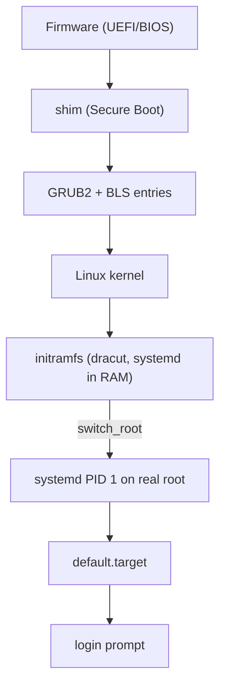
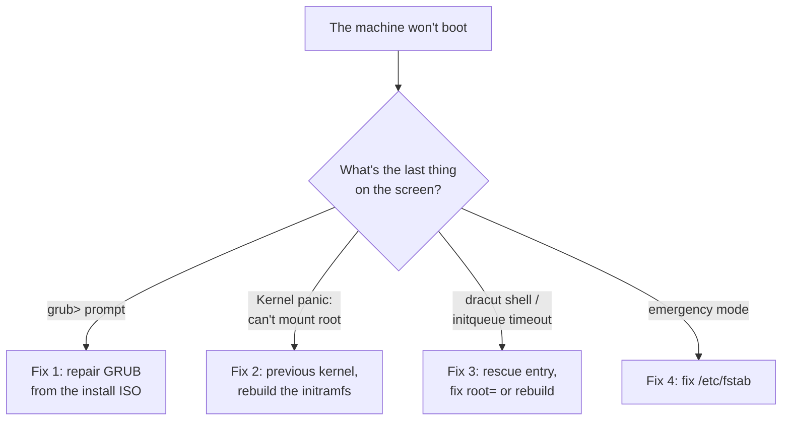
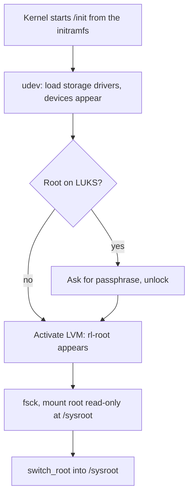

# 14 · The Boot Process

<ul class="module-meta">
  <li>⏱ ~3 hours</li>
  <li>5 labs</li>
  <li>Builds on: 07 · systemd and Services, 10 · LVM, RAID and Encryption</li>
</ul>

A server rebooted for patching and never came back. The console shows
`You are in emergency mode`, or `dracut-initqueue timeout`, or a bare
`grub>` prompt. Each message means the boot stopped at a different stage, and
each stage has its own fix. This module walks the whole chain from power-on to
login prompt, shows you how to inspect and change each link (kernel
arguments, the default kernel, the initramfs), and gives you the break-glass
skills: rescue targets, the root password reset, and repairing a bad
`/etc/fstab`.

!!! abstract "What you'll learn"
    - Name each stage of a Rocky Linux boot and what hands off to what.
    - Explain Secure Boot's chain of trust (firmware, shim, GRUB2, kernel).
    - Read BLS boot entries and change kernel arguments and the default
      kernel with `grubby`.
    - Explain why the initramfs exists, inspect it with `lsinitrd`, and
      rebuild it with `dracut`.
    - Boot into rescue or emergency mode and repair a broken `/etc/fstab`.
    - Reset a forgotten root password with `rd.break`, including the SELinux
      relabel step.
    - Measure boot time with `systemd-analyze` and recognise common boot
      failures by where they stop.

## The big picture

Booting is a relay race. Each runner is small and knows just enough to find
and start the next, more capable runner. The firmware can't read XFS or LVM,
so it starts a bootloader. The bootloader can find a kernel but can't
assemble an encrypted LVM volume, so the kernel brings along a tiny RAM
filesystem (the **initramfs**) whose only job is to find the real root
filesystem. Then systemd takes over and starts everything else.



!!! analogy "Think of it like a relay race"
    Each runner carries the baton (control of the CPU) only as far as it can,
    then hands it to the next. Each handoff is a place the race can be
    dropped, and the error message tells you which runner dropped it.

### The boot in one sentence

Here is the whole idea:

> **Booting is a relay race of small programs, each just smart enough to start the next one: firmware, GRUB, the kernel, the initramfs, then systemd. When a boot fails, the last thing on the screen tells you which runner dropped the baton, and each runner has its own fix.**

Everything else in this module is detail about one of those runners: how to
see it working, how to change it, and how to fix it when it drops the baton.

### The few fixes that solve most problems

Most boot failures you'll meet are one of these. The left column is what you
see; the rest follows from it.

| What you see | Runner that dropped it | The fix |
|---|---|---|
| **1.** A `grub>` or `grub rescue>` prompt | GRUB (stage 3) | Boot the install ISO in rescue mode, reinstall the boot packages, regenerate `grub.cfg` |
| **2.** Kernel panic, "VFS: Unable to mount root fs" | Kernel (stage 4): no usable initramfs | Boot the previous kernel, then `dracut -f --kver <version>`; check `df -h /boot` |
| **3.** dracut emergency shell, "initqueue timeout" | Initramfs (stage 5): root device never appeared | Boot the rescue entry, fix `root=` / `rd.lvm.lv=` with `grubby` or rebuild with `dracut -f` |
| **4.** "You are in emergency mode" | systemd (stage 7): a required mount failed | Log in, fix `/etc/fstab`, `systemctl daemon-reload`, `mount -a` |
| **5.** Boots fine, but nobody knows the root password | (not a failure) | `rd.break` at the GRUB menu, reset the password, relabel for SELinux |



### Words you'll see

| Word | Plain meaning |
|---|---|
| **firmware** (**UEFI** / **BIOS**) | The code in the motherboard that starts first. UEFI is modern; BIOS is the old way |
| **ESP** | EFI System Partition: a small FAT partition, mounted at `/boot/efi`, holding the `.efi` boot programs |
| **Secure Boot** / **shim** | Firmware only runs signed code / the small Microsoft-signed loader that lets Rocky's own key take over |
| **MOK** | Machine Owner Key: your own key, enrolled so the kernel trusts modules you sign |
| **GRUB2** | The bootloader: shows the menu, loads the kernel and initramfs |
| **BLS entry** | One small file per installed kernel in `/boot/loader/entries/`. Each is one menu line |
| **kernel command line** | Options passed to the kernel at boot, like `root=` and `ro`. Visible in `/proc/cmdline` |
| **`grubby`** | The tool for changing boot entries and kernel arguments safely |
| **initramfs** | A tiny Linux system in RAM whose only job is to find and mount the real root filesystem |
| **dracut** | The tool that builds the initramfs |
| **`switch_root`** | The handover from the initramfs to the real root filesystem |
| **PID 1** / **target** | systemd, the first process / a group of units that marks a boot milestone |
| **rescue** / **emergency** | Minimal systemd modes for repairs. Emergency is the smaller one |
| **`rd.break`** | A kernel argument that stops the boot inside the initramfs, before the real system starts |

## The boot, step by step

Click through each stage. The commands in each step show you the evidence
of that stage on a running system.

<div class="stepper" markdown>

<div class="step" data-title="Firmware" markdown>

**What happens:** you press power. The **firmware** (code in a chip on the
motherboard, or the hypervisor's virtual firmware) tests the hardware
(**POST**, power-on self test) and looks for something to boot.

Modern machines use **UEFI**. UEFI understands GPT partition tables and FAT
filesystems, and it boots a *file*: an `.efi` program stored on the **EFI
System Partition (ESP)**, a small FAT partition Rocky mounts at `/boot/efi`.
Which file, in which order, is stored in firmware variables (**NVRAM**).
Older machines use **BIOS**, which runs the first 512 bytes of the disk (the
MBR) instead.

```console
$ [ -d /sys/firmware/efi ] && echo UEFI || echo BIOS
UEFI
$ sudo efibootmgr
BootCurrent: 0004
BootOrder: 0004,0001,0000
Boot0000* UiApp
Boot0001* UEFI QEMU HARDDISK QM00001
Boot0004* Rocky Linux	HD(1,GPT,6c1f…,0x800,0x12c000)/File(\EFI\rocky\shimx64.efi)
```

The `Rocky Linux` entry points at `shimx64.efi` on the ESP.

</div>

<div class="step" data-title="shim and Secure Boot" markdown>

**What happens:** with **Secure Boot** on, UEFI only runs programs signed by
a key it trusts, which on most hardware means Microsoft's. Microsoft won't
sign every distribution's GRUB and kernel, so distributions use **shim**: a
tiny loader that Microsoft signs once, carrying the distribution's own
certificate inside it. Shim checks GRUB's signature against that certificate,
GRUB asks shim to check the kernel, and the kernel checks every module it
loads. That's the **chain of trust**.

```console
$ sudo ls /boot/efi/EFI/rocky/
BOOTX64.CSV  grub.cfg  grubx64.efi  mmx64.efi  shim.efi  shimx64.efi
$ mokutil --sb-state
SecureBoot enabled
```

`mmx64.efi` is **MokManager**: it lets *you* add your own key (a **MOK**,
Machine Owner Key) to sign third-party kernel modules. Enrolling a key with
`mokutil --import` needs a confirmation at the console on the next reboot,
so malware with root can't do it silently.

</div>

<div class="step" data-title="GRUB2 and BLS" markdown>

**What happens:** **GRUB2**, the bootloader, shows the menu, reads the
chosen entry, and loads two files from `/boot` into memory: the kernel
(`vmlinuz-…`) and the initramfs (`initramfs-….img`). It passes the kernel a
**command line** of options.

On Rocky, each menu entry is a separate small file following the **Boot
Loader Specification (BLS)**, in `/boot/loader/entries/`, one per installed
kernel. Installing a kernel adds a file; removing one deletes it.

```console
$ sudo cat /boot/loader/entries/$(cat /etc/machine-id)-$(uname -r).conf
title Rocky Linux (6.12.0-55.14.1.el10_0.x86_64) 10.0 (Red Quartz)
version 6.12.0-55.14.1.el10_0.x86_64
linux /vmlinuz-6.12.0-55.14.1.el10_0.x86_64
initrd /initramfs-6.12.0-55.14.1.el10_0.x86_64.img
options root=/dev/mapper/rl-root ro resume=/dev/mapper/rl-swap rd.lvm.lv=rl/root rd.lvm.lv=rl/swap crashkernel=…
grub_users $grub_users
grub_arg --unrestricted
```

The `options` line is the kernel command line. The real GRUB config,
`/boot/grub2/grub.cfg`, just says "load all BLS entries". On UEFI,
`/boot/efi/EFI/rocky/grub.cfg` is a four-line stub that points GRUB at
`/boot/grub2`.

</div>

<div class="step" data-title="The kernel" markdown>

**What happens:** the kernel decompresses itself, detects CPUs and memory,
initialises built-in drivers, and reads its command line. It unpacks the
initramfs into a RAM filesystem, mounts it as `/`, and runs `/init` from it,
which on Rocky is systemd.

```console
$ cat /proc/cmdline
BOOT_IMAGE=(hd0,gpt2)/vmlinuz-6.12.0-55.14.1.el10_0.x86_64 root=/dev/mapper/rl-root ro resume=/dev/mapper/rl-swap rd.lvm.lv=rl/root rd.lvm.lv=rl/swap crashkernel=…
$ journalctl -k -b | head -2
Oct 15 09:02:09 rocky10 kernel: Linux version 6.12.0-55.14.1.el10_0.x86_64 (mockbuild@…) …
Oct 15 09:02:09 rocky10 kernel: Command line: BOOT_IMAGE=(hd0,gpt2)/vmlinuz-6.12.0-55.14.1.el10_0.x86_64 root=/dev/mapper/rl-root ro …
```

`root=` tells the initramfs which device to mount as the real root; `ro`
says mount it read-only at first (so it can be checked).

</div>

<div class="step" data-title="The initramfs" markdown>

**What happens:** the **initramfs** is a compressed archive of a mini Linux
system: systemd, udev, a few tools (`lvm`, `cryptsetup`, `fsck`), and just the
kernel modules this machine needs. Its whole purpose is to **find and mount
the real root filesystem**. It loads storage drivers, waits for disks to
appear, asks for a LUKS passphrase if needed, activates LVM, and mounts root
read-only at `/sysroot`.

Rocky builds it with **dracut**.

```console
$ lsinitrd -m | sed -n '/dracut modules/,$p' | head -8
dracut modules:
bash
systemd
systemd-initrd
i18n
lvm
kernel-modules
…
```

</div>

<div class="step" data-title="switch_root" markdown>

**What happens:** with the real root mounted at `/sysroot`, the initramfs
hands over. `switch_root` deletes the initramfs contents to free the RAM,
makes `/sysroot` the new `/`, and replaces itself with the real
`/usr/lib/systemd/systemd`, still as **PID 1**. There's no going back.

```console
$ systemd-analyze
Startup finished in 2.034s (firmware) + 1.512s (loader) + 1.873s (kernel) + 3.104s (initrd) + 9.412s (userspace) = 17.937s
multi-user.target reached after 9.380s in userspace.
```

The `(initrd)` figure is how long step 5 took.

</div>

<div class="step" data-title="systemd and targets" markdown>

**What happens:** systemd on the real root reads `/etc/fstab` (turning each
line into a `.mount` unit), remounts root read-write, and works toward
`default.target`. Along the way it passes synchronisation points:


```console
$ systemctl get-default
multi-user.target
```

Units and targets are covered in
[07 · systemd and Services](07-systemd-and-services.md).

</div>

<div class="step" data-title="Login" markdown>

**What happens:** `getty@tty1.service` runs `agetty` on the console,
which prints the login prompt and hands you to `login`. Over the network,
`sshd` does the job. On a desktop, `gdm` shows the graphical login.

```console
$ systemctl status getty@tty1 --no-pager | head -3
● getty@tty1.service - Getty on tty1
     Loaded: loaded (/usr/lib/systemd/system/getty@.service; enabled; preset: enabled)
     Active: active (running) since Thu 2026-10-15 09:02:21 UTC; 4h ago
```

The boot is done.

</div>

</div>

## Reading where the boot stopped

This is the core skill of the module. Before you change anything, name the
runner. Use this template:

> **"The last runner that spoke was `<runner>`, so every runner before it worked. The problem is in `<runner>`, or in what it was trying to hand to the next one."**

Two tricks help. First, look at the *last* message, not the scariest one:
earlier warnings are often harmless. Second, ask what that runner was trying
to *find*: GRUB looks for `/boot`, the kernel looks for an initramfs, the
initramfs looks for the root device, systemd looks for every required mount
in `/etc/fstab`.

### Practise: name the runner

Decide the runner and the fix before you open each answer.

**Case A.** A kernel update was interrupted by a power cut. On the next boot
the screen ends with a kernel panic, "VFS: Unable to mount root fs".
`/boot` was nearly full before the update.

??? success "Answer A"
    The kernel started (it printed a panic), so firmware and GRUB worked. The
    kernel couldn't reach root, which means it had no usable initramfs: the
    update ran out of space or was cut off before the image was written.
    **Fix 2:** choose the previous kernel in GRUB, free space in `/boot`
    (`df -h /boot`), then `sudo dracut -f --kver <broken version>`.

**Case B.** You added a new data disk to `/etc/fstab` yesterday. Today the
disk was removed for repair, and after a reboot the console shows "You are
in emergency mode".

??? success "Answer B"
    "Emergency mode" is systemd talking, so firmware, GRUB, kernel and
    initramfs all did their jobs and the real root is mounted. systemd
    couldn't mount something marked as required: the missing disk. **Fix 4:**
    log in, remount root read-write, comment out or fix the line, and add
    `nofail` for a disk that isn't essential.

**Case C.** A VM was moved to a new hypervisor that presents its disks
through a different storage controller. The boot now waits, then drops into
the dracut emergency shell after an "initqueue timeout".

??? success "Answer C"
    The dracut shell means the initramfs was running and gave up waiting for
    the root device. The disk is fine, but the default **host-only**
    initramfs only contains the drivers this machine needed *before* the
    move. **Fix 3:** boot the rescue entry (its generic initramfs has drivers
    for nearly everything), then rebuild with `dracut -f`.

Notice the pattern: each message proves that every runner *before* it
worked. That alone rules out most of the chain.

## Firmware and Secure Boot in practice

Most of the time the firmware stage just works. Two things are worth
knowing for troubleshooting:

- **UEFI or BIOS?** If `/sys/firmware/efi` exists, you booted UEFI. This
  decides where GRUB lives and how you reinstall it.
- **Secure Boot blocks unsigned code.** A third-party driver (for example a
  GPU driver built with DKMS) won't load until its signing key is enrolled
  with `mokutil`. The kernel log says `Key was rejected by service` or
  `module verification failed`. Fix it by enrolling a key, not by
  disabling Secure Boot.

```console
$ sudo dmesg | grep -i 'secure boot'
[    0.000000] secureboot: Secure boot enabled
```

??? question "Under the hood: kernel lockdown"
    ```console
    $ cat /sys/kernel/security/lockdown
    none [integrity] confidentiality
    ```

    The kernel **lockdown** mode `integrity` (switched on automatically with
    Secure Boot) stops even root from doing things that could modify the
    running kernel, like loading unsigned modules or writing to `/dev/mem`.

## GRUB2, BLS, and grubby

Never hand-edit `/boot/grub2/grub.cfg` or the BLS files. Use **`grubby`**,
which understands BLS and also keeps future kernels consistent.

### See what's installed

```console
$ sudo grubby --info=ALL | grep -E '^(index|kernel|args)'
index=0
kernel="/boot/vmlinuz-6.12.0-55.14.1.el10_0.x86_64"
args="ro resume=/dev/mapper/rl-swap rd.lvm.lv=rl/root rd.lvm.lv=rl/swap crashkernel=…"
index=1
kernel="/boot/vmlinuz-6.12.0-55.12.1.el10_0.x86_64"
args="ro resume=/dev/mapper/rl-swap rd.lvm.lv=rl/root rd.lvm.lv=rl/swap crashkernel=…"
index=2
kernel="/boot/vmlinuz-0-rescue-2b1e…"
…
$ sudo grubby --default-kernel
/boot/vmlinuz-6.12.0-55.14.1.el10_0.x86_64
```

The **rescue** entry boots a generic kernel and initramfs that include
drivers for nearly everything. It's your fallback if the normal initramfs
is broken.

DNF keeps the last three kernels by default (`installonly_limit=3` in
`/etc/dnf/dnf.conf`), so a bad kernel update can always be undone by booting
the previous one.

??? question "Under the hood: the rescue entry is frozen in time"
    The `0-rescue` kernel and its generic initramfs are created **once**, when
    the system is installed (by the `dracut-config-rescue` package's
    `kernel-install` hook), and are not refreshed when you update the kernel.
    On a server that has been patched for three years, the rescue entry is
    still the install-day kernel. It still boots almost anything, but it may
    lack drivers for hardware added since, and it won't match the modules in
    `/lib/modules`. If you want a fresh one, delete the two `*-rescue-*`
    files in `/boot` and the matching BLS entry, then run
    `sudo kernel-install add $(uname -r) /lib/modules/$(uname -r)/vmlinuz`.

??? question "Under the hood: where the default kernel choice is stored"
    `grubby --set-default` doesn't edit any BLS file. It writes the chosen
    entry's ID into GRUB's small environment block, `/boot/grub2/grubenv`:

    ```console
    $ sudo grub2-editenv list
    saved_entry=2b1e…-6.12.0-55.12.1.el10_0.x86_64
    boot_success=1
    ```

    `GRUB_DEFAULT=saved` in `/etc/default/grub` tells GRUB to read it. When
    the "default kernel" mysteriously ignores what you set, look here. A
    `saved_entry` that names a kernel you've since removed makes GRUB fall
    back to the first entry. `boot_success` is part of the logic that shows
    the menu automatically after a failed boot.

### Change kernel arguments

```console
$ sudo grubby --update-kernel=ALL --args="console=tty0 console=ttyS0,115200"
$ sudo grubby --info=DEFAULT | grep args
args="ro resume=/dev/mapper/rl-swap rd.lvm.lv=rl/root rd.lvm.lv=rl/swap crashkernel=… console=tty0 console=ttyS0,115200"
$ sudo grubby --update-kernel=ALL --remove-args="console=tty0 console=ttyS0,115200"
```

Use `--update-kernel=ALL` for permanent changes. It updates every BLS entry
and also `GRUB_CMDLINE_LINUX` in `/etc/default/grub`, so a later
`grub2-mkconfig` doesn't undo your change. To test an argument on just one
boot instead, edit it at the GRUB menu (next section).

### Change the default kernel

```console
$ sudo grubby --set-default=/boot/vmlinuz-6.12.0-55.12.1.el10_0.x86_64
The default is /boot/loader/entries/2b1e…-6.12.0-55.12.1.el10_0.x86_64.conf with index 1 and kernel /boot/vmlinuz-6.12.0-55.12.1.el10_0.x86_64
```

### Edit at the boot menu, for one boot

At the GRUB menu, highlight an entry and press ++e++. Find the line starting
`linux` and add or remove words at its end, then press ++ctrl+x++ to boot.
Nothing is saved: the next boot is back to normal. This is how you reach
rescue modes and reset passwords. A Rocky server shows the menu for five
seconds (`GRUB_TIMEOUT=5` in `/etc/default/grub`); press an arrow key to stop
the countdown. If someone has hidden the menu, hold ++shift++ (BIOS) or press
++esc++ repeatedly (UEFI) while the machine starts.

!!! tip "Useful one-boot kernel arguments"
    | Argument | Effect |
    |---|---|
    | `systemd.unit=rescue.target` | Boot to rescue mode |
    | `systemd.unit=emergency.target` | Boot to emergency mode |
    | `rd.break` | Stop inside the initramfs, before switching to the real root |
    | `enforcing=0` | Boot with SELinux permissive (for diagnosis only) |
    | `rd.debug` | Very verbose initramfs logging |
    | `systemd.log_level=debug` | Very verbose systemd logging |
    | `nomodeset` | Basic graphics, for display driver trouble |

<div class="quiz" data-answer="2" markdown>

You need a new kernel argument to stay on this machine for good, including
after the next kernel update. What do you run?

- Edit the `linux` line at the GRUB menu and press Ctrl+X
- `sudo grubby --update-kernel=ALL --args="…"`
- Edit `/boot/grub2/grub.cfg` by hand
- `sudo grubby --update-kernel=DEFAULT --args="…"`

Right. `ALL` updates every entry and the defaults that new kernels inherit.
Editing at the menu lasts one boot, `grub.cfg` on a BLS system doesn't hold
the kernel lines at all, and `DEFAULT` changes only the current default
entry.

</div>

## The initramfs and dracut

### Why it exists

The kernel needs to mount the root filesystem, but your root might be on LVM,
inside LUKS encryption, on software RAID, on iSCSI, or on a disk whose driver
is a loadable module. The tools to set all that up (`lvm`, `cryptsetup`,
the module files) live *on the root filesystem*. Chicken and egg. The
initramfs breaks the loop: it carries exactly those tools in RAM.



### Looking inside

`lsinitrd` lists the image for the running kernel (or any file you name):

```console
$ lsinitrd | head -5
Image: /boot/initramfs-6.12.0-55.14.1.el10_0.x86_64.img: 37M
========================================================================
Early CPIO image
========================================================================
drwxr-xr-x   3 root     root            0 Oct 13 08:58 .
$ lsinitrd | grep -E 'lvm$|cryptsetup$|xfs.ko'
-rwxr-xr-x   1 root     root      2621000 Oct 13 08:58 usr/sbin/lvm
-rw-r--r--   1 root     root       681340 Oct 13 08:58 usr/lib/modules/6.12.0-55.14.1.el10_0.x86_64/kernel/fs/xfs/xfs.ko.xz
```

The **early CPIO** part at the front is a separate, uncompressed archive
holding CPU **microcode** updates, which the kernel applies before anything
else.

### Host-only images

By default dracut builds a **host-only** image: only the drivers and tools
*this* machine needs. It's small and fast, but if you move the disk to
different hardware (or change a VM's disk controller from SATA to
VirtIO), the needed driver may be missing and boot stops in the initramfs.
The rescue entry uses a generic, non-host-only image, which is why it often
boots when the normal one doesn't.

### Rebuilding

The kernel RPM builds an initramfs automatically when it's installed. You
rebuild by hand after changing anything the initramfs carries: storage
layout, `/etc/crypttab`, multipath config, drivers, or dracut settings.

```console
$ sudo dracut -f                                # rebuild for the running kernel
$ sudo dracut -f --kver 6.12.0-55.12.1.el10_0.x86_64   # for another installed kernel
$ sudo dracut -f --regenerate-all               # every installed kernel
```

Settings go in drop-in files, not on the command line, so they survive the
next automatic rebuild:

```bash title="/etc/dracut.conf.d/50-virtio.conf"
add_drivers+=" virtio_blk virtio_scsi "
```

Note the spaces inside the quotes: `+=` glues strings together, and without
the spaces two names would merge into one nonexistent driver.

!!! warning "Keep a fallback"
    `dracut -f` overwrites the image in place. Before experimenting, copy it
    (`sudo cp /boot/initramfs-$(uname -r).img{,.bak}`), and remember the
    previous kernel and the rescue entry in the GRUB menu.

??? question "For the curious: what runs inside the initramfs?"
    The initramfs runs a real systemd with its own units. dracut adds
    **hook points**: shell scripts run by units at fixed moments.

    | Hook | Runs | Typical job |
    |---|---|---|
    | `cmdline` | First | Parse `rd.*` options from the kernel command line |
    | `pre-udev` | Before udev starts | Load essential modules |
    | `pre-trigger` | Before udev replays all devices | Last chance to set udev rules or properties |
    | `initqueue` | In a loop | Retry until root's device exists |
    | `pre-mount` | Before mounting root | Last checks |
    | `mount` | Mounting root | Mount at `/sysroot` |
    | `pre-pivot` / `cleanup` | Before `switch_root` | Final tidy-up |

    **udev** is the daemon that reacts to devices appearing: it loads
    drivers, applies rules, and creates names like
    `/dev/disk/by-uuid/…` and `/dev/mapper/rl-root`. When it starts,
    dracut "triggers" udev so every device already present announces itself
    (a **coldplug**).

    The **initqueue** is a loop, not a single step. Disks, especially on SANs
    and networks, appear whenever they're ready, so dracut keeps checking
    "is the root device here yet?". After a while (`rd.retry`, default 180
    seconds) it gives up and drops you into the **dracut emergency shell**
    with a message like `Warning: dracut-initqueue: timeout, still waiting for
    following initqueue hooks` and a `/dev/disk/by-uuid/… does not exist`
    line naming the missing device.

    In that shell, `/run/initramfs/rdsosreport.txt` holds a full report:
    command line, kernel log, which devices exist, and LVM state. Add
    `rd.debug` to the command line to make it trace every script. The
    hooks themselves live under `/usr/lib/dracut/hooks/` in the image, and
    `lsinitrd -m` shows which dracut modules (from
    `/usr/lib/dracut/modules.d/`) supplied them.

<div class="quiz" data-answer="3" markdown>

You moved a VM's disk from a SATA controller to a VirtIO controller. It now
stops with a dracut timeout saying the root device doesn't exist. What's the
likely cause?

- GRUB can't find the kernel
- `/etc/fstab` has a typo
- The host-only initramfs doesn't contain the VirtIO storage driver
- Secure Boot rejected the new controller

Right. Host-only images include only the drivers the machine had when they
were built. Boot the rescue entry (generic image), then rebuild with the
driver: `sudo dracut -f --add-drivers "virtio_blk virtio_scsi"`, or add it
in `/etc/dracut.conf.d/`.

</div>

## Rescue and emergency targets

When the system boots but something in the normal startup is broken, systemd
offers two minimal modes. Both ask for the **root password** (see the locked-root pitfall below).

| Mode | Kernel argument | You get | Use it when |
|---|---|---|---|
| **Rescue** | `systemd.unit=rescue.target` | Root shell, all local filesystems mounted, no network services | A service hangs boot, you need to disable it |
| **Emergency** | `systemd.unit=emergency.target` | Root shell, root mounted **read-only**, nothing else | Rescue mode itself fails, e.g. a bad `/etc/fstab` |
| **Initramfs shell** | `rd.break` | Shell *inside the initramfs*; real root at `/sysroot`, read-only | Root password reset; before the real system runs at all |

systemd also drops into emergency mode on its own when a filesystem marked as
required in `/etc/fstab` fails to mount:

```text
You are in emergency mode. After logging in, type "journalctl -xb" to view
system logs, "systemctl reboot" to reboot, or "exit"
to continue bootup.
Give root password for maintenance
(or press Control-D to continue):
```

### Worked story: the disk that wasn't there

**Symptom.** After a reboot, the console shows the emergency mode message
above. **Evidence:** once you've logged in, `journalctl -xb -p err` names
the mount that failed, and `/etc/fstab` has a line for a disk that `lsblk`
doesn't show. **Reasoning:** systemd (stage 7) treats every fstab line
without `nofail` as required, so a missing disk stops the boot. **Fix and
check:** the workflow below, ending with `mount -a` succeeding and the boot
continuing. Lab 4 has you break and repair exactly this.

The fix workflow, once you've logged in:

```console
# journalctl -xb -p err                # what failed?
# mount -o remount,rw /                # root is read-only in emergency mode
# vi /etc/fstab                        # fix or comment out the bad line
# systemctl daemon-reload              # regenerate mount units from fstab
# mount -a                             # prove every line mounts now
# systemctl default                    # continue booting (or reboot)
```

!!! tip "Use `nofail` for non-essential disks"
    Add `nofail` to the options of data disks and network mounts in
    `/etc/fstab`. If the disk is missing, boot continues without it
    instead of stopping in emergency mode. Always run `sudo mount -a` and
    `sudo findmnt --verify` after editing fstab, *before* you reboot.

!!! pitfall "Cannot open access to console, the root account is locked"
    If root has no password (the Rocky installer's default when you create
    an admin user and don't set one for root), rescue and emergency mode
    print this message and give you no shell. Your options: `rd.break` (next
    section), which doesn't ask for the root password at all; booting the
    installation media in rescue mode; or the opt-in override below. Setting
    a strong root password on servers you maintain at the console avoids the
    problem.

??? question "Under the hood: who asks for the root password, and how to skip it"
    `emergency.service` and `rescue.service` run
    `systemd-sulogin-shell`, which runs `sulogin`. `sulogin` reads the root
    hash from `/etc/shadow`; a locked hash (`!` or `*`) means it refuses.
    systemd has an escape hatch: if the environment variable
    `SYSTEMD_SULOGIN_FORCE=1` is set, it calls `sulogin --force`, which
    gives a root shell without a password when root is locked. You can set
    it for one boot from the GRUB editor:

    ```text
    systemd.unit=emergency.target systemd.setenv=SYSTEMD_SULOGIN_FORCE=1
    ```

    or permanently with a drop-in for `emergency.service` and
    `rescue.service`. That second option means anyone at the console gets
    root, so treat it as a deliberate policy decision (protect GRUB with a
    password if you use it).

## Resetting a lost root password

You have console access (physical, VM console, or out-of-band like iLO) but
no root password. The Rocky way is to stop the boot inside the initramfs,
before the real system starts, and change the password from there.

<div class="stepper" markdown>

<div class="step" data-title="Interrupt GRUB" markdown>

Reboot. At the GRUB menu press ++e++ on the default entry. Go to the end of
the line starting with `linux` and add:

```text
rd.break
```

Press ++ctrl+x++ to boot with it. (If the disk is encrypted, you'll still be
asked for the LUKS passphrase: this method doesn't bypass encryption.)

</div>

<div class="step" data-title="You're in the initramfs" markdown>

You land at a `switch_root:/#` prompt. This is the initramfs. The real root
filesystem is mounted, read-only, at `/sysroot`:

```console
switch_root:/# mount | grep sysroot
/dev/mapper/rl-root on /sysroot type xfs (ro,relatime,seclabel,attr2,inode64,…)
```

</div>

<div class="step" data-title="Make it writable, enter it" markdown>

```console
switch_root:/# mount -o remount,rw /sysroot
switch_root:/# chroot /sysroot
sh-5.2#
```

`chroot` makes `/sysroot` look like `/` for this shell, so `passwd` edits
the real `/etc/shadow`.

</div>

<div class="step" data-title="Change the password" markdown>

```console
sh-5.2# passwd root
New password:
Retype new password:
passwd: all authentication tokens updated successfully.
```

</div>

<div class="step" data-title="Schedule an SELinux relabel" markdown>

```console
sh-5.2# touch /.autorelabel
```

**Don't skip this.** SELinux policy isn't loaded at this point, so the new
`/etc/shadow` is written without its proper SELinux label. On the next boot,
with SELinux enforcing, nothing would be allowed to read it, and *nobody*
could log in. `/.autorelabel` tells the next boot to relabel the whole
filesystem (this takes a few minutes and reboots once more on its own).

</div>

<div class="step" data-title="Leave and continue" markdown>

```console
sh-5.2# exit
switch_root:/# exit
```

The first `exit` leaves the chroot; the second leaves the initramfs shell and
boot continues. Watch for the relabel, let it reboot, and log in with the new
password.

</div>

</div>

!!! note "Plan B: `init=/bin/bash`"
    `rd.break` normally gives you a shell with no password prompt, because
    the initramfs carries no copy of `/etc/shadow` to check against. Some
    builds have asked for the root password here anyway (early RHEL 9.0 did,
    and showed `Cannot open access to console, the root account is locked`
    when root had none). If that happens, replace `rd.break` with
    `init=/bin/bash` on the `linux` line. The initramfs still mounts the
    real root, but then runs bash instead of systemd. Run
    `mount -o remount,rw /`, `passwd root`, `touch /.autorelabel`, and
    `sync`. Then `exec /sbin/init` to continue a normal boot (which runs the
    relabel), or `/usr/sbin/reboot -f`.

??? question "Under the hood: a faster alternative to a full relabel"
    `/.autorelabel` relabels **every** file. On a multi-terabyte root
    filesystem that can take a long time, during which the machine is down.
    Only one file actually needs fixing, so on big systems some admins skip
    the full relabel: they boot once with `enforcing=0` added at the GRUB
    menu, log in, run `sudo restorecon -v /etc/shadow`, check
    `ls -Z /etc/shadow` shows `shadow_t`, and reboot. If you changed other
    files from the chroot (for example `/etc/passwd` with `usermod`), run
    `restorecon` on those too. When in doubt, the full relabel is the safe
    choice.

!!! danger "Console access is root access"
    Anyone at the console can do this. Protect servers with physical
    security, a GRUB password (`grub2-setpassword`), and disk encryption.
    See [17 · Security Hardening](17-security-hardening.md).

<div class="quiz" data-answer="4" markdown>

You reset the root password with `rd.break` but forgot `touch /.autorelabel`.
After reboot, the new password is "wrong", and so is every other account's.
Why?

- `passwd` inside a chroot doesn't really save the password
- `rd.break` resets all passwords
- The initramfs had an old copy of `/etc/shadow`
- `/etc/shadow` was rewritten without its SELinux label, so login can't read it

Exactly. Fix it by booting with `enforcing=0` once, logging in, and running
`sudo restorecon -v /etc/shadow` (or touching `/.autorelabel` and rebooting).

</div>

## How long did boot take?

```console
$ systemd-analyze
Startup finished in 2.034s (firmware) + 1.512s (loader) + 1.873s (kernel) + 3.104s (initrd) + 9.412s (userspace) = 17.937s
multi-user.target reached after 9.380s in userspace.
$ systemd-analyze critical-chain
multi-user.target @9.380s
└─kdump.service @8.170s +1.204s
  └─network-online.target @8.166s
    └─NetworkManager-wait-online.service @2.252s +5.912s
      └─NetworkManager.service @2.101s +148ms
        └─basic.target @2.084s
…
$ systemd-analyze plot > boot.svg      # a timeline you can open in a browser
```

Read the first line left to right: each number is one runner in the relay.
`critical-chain` shows what actually delayed reaching the target; `blame`
lists everything by duration, including things that ran in parallel and
delayed nothing. `@` is when a unit became active, `+` how long it took to
start.

??? question "Under the hood: why kdump shows up in critical-chain"
    `kdump.service` loads a second, small "crash kernel" into reserved memory
    (that's the `crashkernel=` argument). If the main kernel panics, the
    crash kernel boots and saves a memory dump to `/var/crash` for analysis.
    It has its own initramfs (`initramfs-<version>kdump.img`, in `/boot` or,
    on some layouts, `/var/lib/kdump/`), built by `kdumpctl`, not
    `dracut -f`. At boot, `kdump.service` loads the crash kernel with
    `kexec`, and first rebuilds that image if the kernel or
    `/etc/kdump.conf` changed, which is why it sometimes shows up in
    `critical-chain`.
    Covered in [15 · The Kernel](15-the-kernel.md).

## Common boot failures

Where the boot stops tells you which stage failed. Use this to narrow it
down:

<div class="decision" markdown>

<div class="node" data-id="start" markdown>

**What's on the screen when it stops?**

<button data-goto="grub">A `grub>` or `grub rescue>` prompt</button>
<button data-goto="panic">Kernel panic: "VFS: Unable to mount root fs"</button>
<button data-goto="dracut">dracut emergency shell / "initqueue timeout"</button>
<button data-goto="emerg">"You are in emergency mode"</button>
<button data-goto="job">"A start job is running for…" then a long wait</button>

</div>

<div class="node" data-id="grub" markdown>

**Stage 3, GRUB.** GRUB started but can't find its config or `/boot`.
Typical causes: `/boot` was resized, moved, or its partition damaged. Boot
the Rocky installation ISO, choose **Troubleshooting → Rescue a Rocky Linux
system**, `chroot /mnt/sysroot`, then reinstall the boot packages (on UEFI:
`dnf reinstall shim-x64 grub2-efi-x64`) and regenerate the config with
`grub2-mkconfig -o /boot/grub2/grub.cfg`.

</div>

<div class="node" data-id="panic" markdown>

**Stage 4, kernel.** The kernel has no way to reach root, usually because
the initramfs is missing or broken (an interrupted kernel update, a full
`/boot`). Pick the previous kernel or the rescue entry in GRUB, then
`sudo dracut -f --kver <broken version>` and check `df -h /boot`.

</div>

<div class="node" data-id="dracut" markdown>

**Stage 5, initramfs.** The root device never appeared. Read the message for
the missing device, then check `/run/initramfs/rdsosreport.txt`. Common
causes: a `root=` or `rd.lvm.lv=` argument that doesn't match the real
names (renamed volume group), a storage driver missing from a host-only
image (moved disk, changed VM controller), or a SAN path that isn't
there. Boot the rescue entry and rebuild with `dracut -f` (adding the driver
if needed), or fix the arguments with `grubby`.

</div>

<div class="node" data-id="emerg" markdown>

**Stage 7, systemd.** The real root mounted, but something required failed,
almost always a line in `/etc/fstab` (wrong UUID, removed disk, typo). Log in
with the root password, run `journalctl -xb -p err`, remount root
read-write, fix fstab, `systemctl daemon-reload`, `mount -a`. Add `nofail`
for disks that aren't essential.

</div>

<div class="node" data-id="job" markdown>

**Stage 5 or 7, waiting for a device.** systemd is waiting for a disk or
mount that hasn't appeared. If it says "no limit", it'll wait forever. Note
the device name in the message: if it's root, it's an initramfs problem; if
it's a data disk, fix `/etc/fstab` (add `nofail` or
`x-systemd.device-timeout=10s`).

</div>

</div>

## Labs

!!! lab "Lab 1: Map your own boot chain"

    **Goal:** Find the evidence of every boot stage on a running system.
    Read-only and safe.

    **You'll need:** a Rocky 10 VM, sudo.

    1. Firmware: `[ -d /sys/firmware/efi ] && echo UEFI || echo BIOS`, then
       `sudo efibootmgr` (UEFI only) and `mokutil --sb-state`.
    2. Bootloader files: `sudo ls /boot/efi/EFI/rocky/` (UEFI) and
       `ls /boot/`.
    3. Boot entries: `sudo ls /boot/loader/entries/` and
       `sudo grubby --info=DEFAULT`.
    4. The command line the running kernel got: `cat /proc/cmdline`.
    5. The initramfs: `lsinitrd | head -20` and `lsinitrd -m`.
    6. Timing: `systemd-analyze` and `systemd-analyze critical-chain`.
    7. The target you reached: `systemctl get-default`.

    **Check your work:** you can name, for your VM, the shim/GRUB path (or
    "BIOS"), the default kernel version, the `root=` device, three dracut
    modules in the initramfs, and how long each stage took.

    ??? success "What just happened?"
        Each command showed one runner in the relay: firmware variables, the
        ESP files shim and GRUB live in, the BLS entries GRUB reads, the
        command line it passed, the initramfs contents, and systemd's
        timings for everything after.

    **Clean up:** nothing to clean up.

!!! lab "Lab 2: Change kernel arguments the right way"

    **Goal:** Add a kernel argument permanently, prove it reached the kernel,
    then remove it.

    **You'll need:** a Rocky 10 VM, sudo, permission to reboot.

    1. Add a harmless argument to every entry. `panic=30` makes the kernel
       reboot 30 seconds after a panic instead of hanging:

        ```console
        $ sudo grubby --update-kernel=ALL --args="panic=30"
        $ sudo grubby --info=ALL | grep -c 'panic=30'
        $ grep GRUB_CMDLINE_LINUX /etc/default/grub
        ```

    2. Reboot, then prove it:

        ```console
        $ grep -o 'panic=30' /proc/cmdline
        panic=30
        $ cat /proc/sys/kernel/panic
        30
        ```

    3. Remove it:

        ```console
        $ sudo grubby --update-kernel=ALL --remove-args="panic=30"
        $ sudo grubby --info=ALL | grep -c 'panic=30'
        0
        ```

    **Check your work:** after the reboot `/proc/sys/kernel/panic` is `30`;
    after step 3, no entry contains it.

    ??? success "What just happened?"
        grubby edited the `options` line in every BLS file and
        `GRUB_CMDLINE_LINUX`. GRUB passed the new line to the kernel, which
        applied `panic=30` to the same setting you can read in `/proc/sys`
        (see [15 · The Kernel](15-the-kernel.md)).

    **Clean up:** step 3 already removed it; it disappears from
    `/proc/cmdline` at the next reboot.

!!! lab "Lab 3: Rebuild the initramfs and prove what's in it"

    **Goal:** Add a file to the initramfs with a dracut drop-in, rebuild, find
    it, then undo.

    **You'll need:** a Rocky 10 VM, sudo.

    1. Back up the current image:

        ```console
        $ sudo cp /boot/initramfs-$(uname -r).img /root/initramfs-$(uname -r).img.bak
        ```

    2. Create a marker file and tell dracut to include it:

        ```bash
        echo "built by lab 3 on $(date)" | sudo tee /etc/lab3-marker
        echo 'install_items+=" /etc/lab3-marker "' | sudo tee /etc/dracut.conf.d/99-lab3.conf
        ```

    3. Rebuild and look:

        ```console
        $ sudo dracut -f
        $ lsinitrd -f etc/lab3-marker
        built by lab 3 on Thu Oct 15 14:40:12 UTC 2026
        ```

    4. Optional: reboot to prove the rebuilt image still boots.

    **Check your work:** `lsinitrd -f etc/lab3-marker` prints your line.

    ??? success "What just happened?"
        dracut read every file in `/etc/dracut.conf.d/`, added your file to
        the list of items to copy, and regenerated the image for the running
        kernel. This is exactly how real changes (an extra driver, a config
        file the early boot needs) get into the initramfs.

    **Clean up:**
    `sudo rm /etc/dracut.conf.d/99-lab3.conf /etc/lab3-marker && sudo dracut -f && sudo rm /root/initramfs-*.img.bak`

!!! lab "Lab 4: Break /etc/fstab and fix it from emergency mode"

    **Goal:** Experience emergency mode and repair the system by hand.

    **You'll need:** a Rocky 10 **throwaway** VM with console access, a root
    password set (`sudo passwd root`), and a snapshot taken first.

    1. Add a line for a disk that doesn't exist. The short device timeout
       keeps the wait to 10 seconds:

        ```bash
        sudo cp /etc/fstab /etc/fstab.bak
        echo 'UUID=00000000-0000-0000-0000-000000000000 /mnt/broken xfs defaults,x-systemd.device-timeout=10s 0 0' | sudo tee -a /etc/fstab
        sudo mkdir -p /mnt/broken
        sudo systemctl daemon-reload
        ```

    2. Reboot from the **console**. After the timeout you'll see
       `You are in emergency mode`. Enter the root password.
    3. Diagnose: `journalctl -xb -p err | tail -20`. Look for
       `Timed out waiting for device` and `Dependency failed for /mnt/broken`.
    4. Repair:

        ```console
        # mount -o remount,rw /
        # cp /etc/fstab.bak /etc/fstab
        # systemctl daemon-reload
        # mount -a
        # systemctl default
        ```

    **Check your work:** the system reaches the normal login prompt, and
    `systemctl --failed` is empty.

    ??? success "What just happened?"
        systemd turned the bad fstab line into a `mnt-broken.mount` unit
        required by `local-fs.target`. When the device never showed up, the
        mount failed, `local-fs.target` failed, and systemd isolated
        `emergency.target`. Adding `nofail` would have let boot continue.

    **Clean up:** `sudo rmdir /mnt/broken; sudo rm -f /etc/fstab.bak`, or
    revert the snapshot.

!!! lab "Lab 5: Reset the root password with rd.break"

    **Goal:** Do the full root password reset, including the SELinux
    relabel.

    **You'll need:** a Rocky 10 **throwaway** VM with console access and a
    snapshot taken first.

    1. Reboot, press ++e++ at the GRUB menu, add `rd.break` to the end of the
       `linux` line, press ++ctrl+x++.
    2. At `switch_root:/#`, run:

        ```console
        switch_root:/# mount -o remount,rw /sysroot
        switch_root:/# chroot /sysroot
        sh-5.2# passwd root
        sh-5.2# touch /.autorelabel
        sh-5.2# exit
        switch_root:/# exit
        ```

    3. Let the relabel run and the VM reboot. Log in as root with the new
       password.
    4. Confirm the label is correct:

        ```console
        # ls -Z /etc/shadow
        system_u:object_r:shadow_t:s0 /etc/shadow
        ```

    **Check your work:** you can log in with the new password, and
    `/etc/shadow` has the `shadow_t` type.

    ??? success "What just happened?"
        `rd.break` paused the boot right before `switch_root`, with the real
        root at `/sysroot`. You changed `/etc/shadow` through a chroot.
        Because SELinux wasn't loaded yet, the relabel on the next boot put
        back the right label. If you were asked for a root password at
        step 2 instead of getting a prompt, use the `init=/bin/bash` method
        from the note above.

    **Clean up:** set the root password back to what you want (or lock it
    again with `sudo passwd -l root`), or revert the snapshot.

## Common pitfalls

| Symptom | Cause | Fix |
|---|---|---|
| Kernel argument change gone after kernel update | Edited one BLS file or `grub.cfg` by hand | `grubby --update-kernel=ALL --args=…` |
| `grub2-mkconfig` "fixed" nothing | On BLS, kernel lines live in `/boot/loader/entries/` | Use `grubby` |
| Boot stops in emergency mode | Bad or missing disk in `/etc/fstab` | Fix fstab; use `nofail`; test with `mount -a` |
| Nobody can log in after password reset | Forgot `touch /.autorelabel` | Boot `enforcing=0`, `restorecon -v /etc/shadow` |
| Drops to dracut shell after moving a VM disk | Host-only initramfs lacks the new driver | Boot rescue entry, add driver, `dracut -f` |
| Kernel panic "Unable to mount root fs" after update | Missing/incomplete initramfs (often full `/boot`) | Boot previous kernel, free space, `dracut -f --kver …` |
| Third-party module won't load, "Key was rejected" | Secure Boot, unsigned module | Sign it and enroll the key with `mokutil --import` |
| `dracut -f` fixed only one kernel | It rebuilds only the running kernel by default | `dracut -f --regenerate-all` |
| Rescue mode says root account is locked | No root password, so `sulogin` refuses | `rd.break` (no password needed), installation media rescue, or `systemd.setenv=SYSTEMD_SULOGIN_FORCE=1` |

## Cheat sheet

| Command | What it does |
|---|---|
| `[ -d /sys/firmware/efi ]` | Test for UEFI boot |
| `efibootmgr` | Show/edit UEFI boot entries |
| `mokutil --sb-state` | Secure Boot on or off |
| `cat /proc/cmdline` | Kernel command line used this boot |
| `ls /boot/loader/entries/` | BLS boot entries |
| `grubby --info=ALL` | All entries with kernels and arguments |
| `grubby --default-kernel` / `--set-default=<kernel>` | Show / set default |
| `grubby --update-kernel=ALL --args="…"` | Add kernel arguments permanently |
| `grubby --update-kernel=ALL --remove-args="…"` | Remove kernel arguments |
| `lsinitrd`, `lsinitrd -m`, `lsinitrd -f <file>` | List initramfs, its modules, print a file from it |
| `dracut -f` / `--regenerate-all` | Rebuild initramfs (running / all kernels) |
| `/etc/dracut.conf.d/*.conf` | Persistent dracut settings |
| `systemctl get-default` / `set-default` | Default boot target |
| `systemd.unit=rescue.target` / `emergency.target` | Kernel args for rescue / emergency |
| `rd.break` | Stop in the initramfs before `switch_root` |
| `touch /.autorelabel` | Relabel SELinux on next boot |
| `systemd-analyze` / `critical-chain` / `plot` | Boot timing |
| `findmnt --verify` | Check `/etc/fstab` for mistakes |
| `grub2-setpassword` | Protect GRUB menu editing |

## Practice

<div class="terminal-sim" data-title="Inspect the boot" markdown>

<div class="task" data-expect="cat /proc/cmdline" data-hint="The kernel publishes its command line as a file under /proc." markdown>

**Step 1.** Which kernel arguments did this boot use?

```text
BOOT_IMAGE=(hd0,gpt2)/vmlinuz-6.12.0-55.14.1.el10_0.x86_64 root=/dev/mapper/rl-root ro resume=/dev/mapper/rl-swap rd.lvm.lv=rl/root rd.lvm.lv=rl/swap
```

</div>

<div class="task" data-expect="sudo grubby --default-kernel||grubby --default-kernel" data-hint="grubby has an option that prints the default kernel." markdown>

**Step 2.** Which kernel will boot by default next time?

```text
/boot/vmlinuz-6.12.0-55.14.1.el10_0.x86_64
```

</div>

<div class="task" data-expect="lsinitrd -m||sudo lsinitrd -m" data-hint="lsinitrd has a short option that lists only the dracut modules." markdown>

**Step 3.** List just the dracut modules inside the current initramfs.

```text
dracut modules:
bash
systemd
systemd-initrd
lvm
kernel-modules
…
```

</div>

<div class="task" data-expect="sudo grubby --update-kernel=ALL --args=panic=30" data-match="(sudo )?grubby +--update-kernel[= ]ALL +--args[= ]['\x22]?panic=30['\x22]?" data-hint="Use grubby with --update-kernel=ALL and --args=..." markdown>

**Step 4.** Permanently add `panic=30` to every boot entry.

```text
(no output: check with sudo grubby --info=ALL)
```

</div>

<div class="task" data-expect="systemd-analyze critical-chain" data-hint="systemd-analyze has a verb that shows the chain that gated boot." markdown>

**Step 5.** Which chain of units actually delayed reaching the default target?

```text
multi-user.target @9.380s
└─kdump.service @8.170s +1.204s
  └─network-online.target @8.166s
    └─NetworkManager-wait-online.service @2.252s +5.912s
```

</div>

</div>

## Flashcards

<div class="flashcards" markdown>

<div class="card" markdown>

Explain the boot in one sentence.

A relay race of small programs, each just smart enough to start the next: firmware, GRUB, kernel, initramfs, systemd. The last message on the screen tells you which runner dropped the baton.

</div>

<div class="card" markdown>

The console shows a dracut emergency shell after an "initqueue timeout". Which runner failed, and what was it looking for?

The initramfs (stage 5). It was looking for the root device and never found it: a wrong `root=` / `rd.lvm.lv=`, or a driver missing from a host-only image.

</div>

<div class="card" markdown>

What is shim, and why does Rocky need it?

A small first-stage bootloader signed by Microsoft that carries Rocky's own certificate, so Secure Boot firmware will run it, and it can then verify Rocky's GRUB and kernel.

</div>

<div class="card" markdown>

Where are Rocky's GRUB menu entries stored?

As BLS files in `/boot/loader/entries/`, one per installed kernel. Manage them with `grubby`.

</div>

<div class="card" markdown>

Why does the initramfs exist?

To find and mount the real root filesystem: load storage drivers, unlock LUKS, activate LVM or RAID. The tools for that live on root, so they have to be in RAM first.

</div>

<div class="card" markdown>

What does `switch_root` do?

Frees the initramfs, makes `/sysroot` the new `/`, and starts the real systemd as PID 1.

</div>

<div class="card" markdown>

Rescue versus emergency target?

Rescue: local filesystems mounted, no network services. Emergency: root mounted read-only and almost nothing else. Both need the root password.

</div>

<div class="card" markdown>

What's the most common cause of "You are in emergency mode"?

A bad or missing device in `/etc/fstab`. Fix the line, `systemctl daemon-reload`, and `mount -a`. Use `nofail` for non-essential disks.

</div>

<div class="card" markdown>

What are the root password reset steps after `rd.break`?

`mount -o remount,rw /sysroot`, `chroot /sysroot`, `passwd root`, `touch /.autorelabel`, `exit`, `exit`.

</div>

<div class="card" markdown>

Why `touch /.autorelabel` after changing a password from `rd.break`?

SELinux wasn't loaded, so `/etc/shadow` lost its label. Without a relabel, nobody can log in under enforcing mode.

</div>

<div class="card" markdown>

`systemd-analyze blame` or `critical-chain` to speed up boot?

`critical-chain`: it shows what actually delayed the target. `blame` includes slow units that ran in parallel and delayed nothing.

</div>

</div>

## Recap

!!! recap "Key takeaways"
    - The boot in one sentence: a relay race (firmware, GRUB, kernel, initramfs, systemd), and the last message on screen names the runner that dropped the baton.
    - Boot is a relay: firmware → shim → GRUB2 → kernel → initramfs →
      `switch_root` → systemd → targets → login. Where it stops tells you
      what broke.
    - Secure Boot verifies each stage: firmware trusts shim, shim trusts
      Rocky's GRUB and kernel, the kernel trusts signed modules.
    - Boot entries are BLS files; change arguments and the default kernel
      with `grubby`, permanently with `--update-kernel=ALL`.
    - The initramfs, built by dracut, exists to assemble and mount root.
      Inspect it with `lsinitrd`, rebuild with `dracut -f`, configure in
      `/etc/dracut.conf.d/`.
    - Emergency mode usually means `/etc/fstab`; test fstab with `mount -a`
      and `findmnt --verify` before rebooting.
    - Root password reset: `rd.break`, remount `/sysroot` rw, chroot,
      `passwd`, `touch /.autorelabel`.
    - `systemd-analyze critical-chain` shows what really slows boot.

## Go deeper

- Man pages: [[man:bootup(7)]] [[man:grubby(8)]] [[man:dracut(8)]]
  [[man:dracut.conf(5)]] [[man:dracut.cmdline(7)]] [[man:lsinitrd(1)]]
  [[man:systemd-analyze(1)]] [[man:kernel-command-line(7)]]
  [[man:systemd.special(7)]] [[man:mokutil(1)]] [[man:efibootmgr(8)]]
- [The Boot Loader Specification](https://uapi-group.org/specifications/specs/boot_loader_specification/):
  the format of the files in `/boot/loader/entries/`.
- [dracut documentation](https://github.com/dracut-ng/dracut-ng):
  the upstream project behind Rocky's initramfs.
- [Kernel parameters reference](https://docs.kernel.org/admin-guide/kernel-parameters.html):
  every argument you can put on the kernel command line.
- [Rocky Linux documentation](https://docs.rockylinux.org/):
  guides for Rocky-specific procedures.

**Next:** [15 · The Kernel](15-the-kernel.md)
