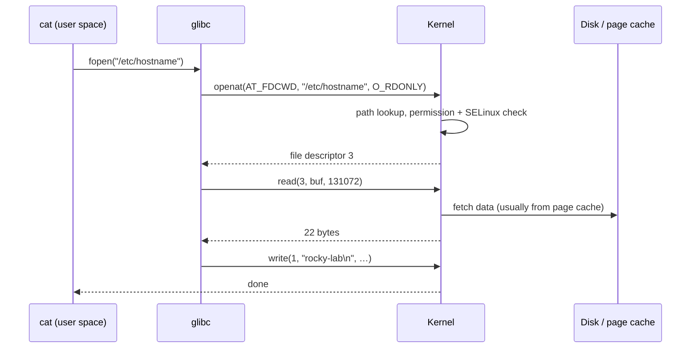
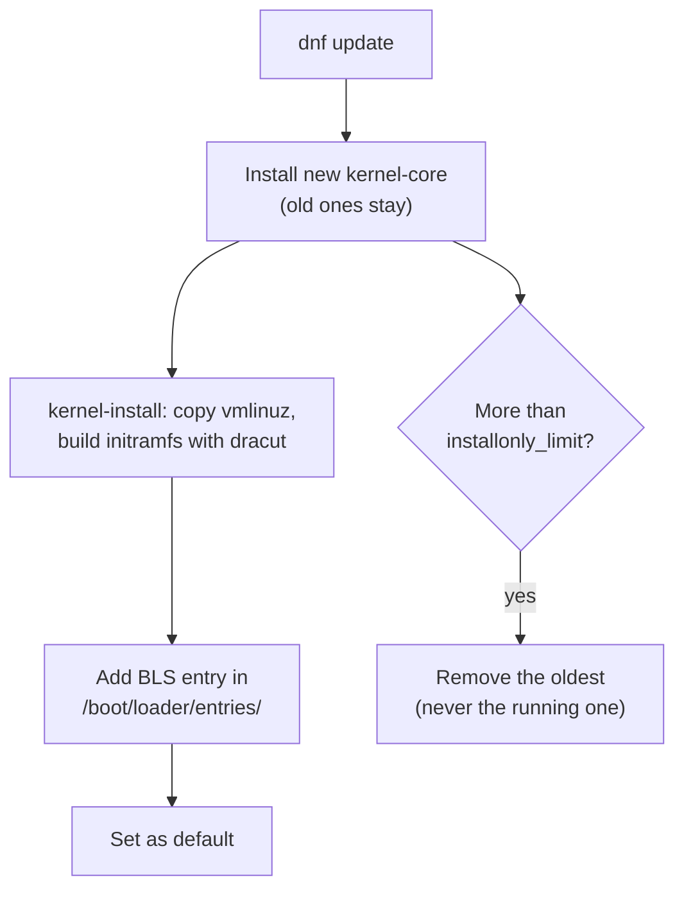
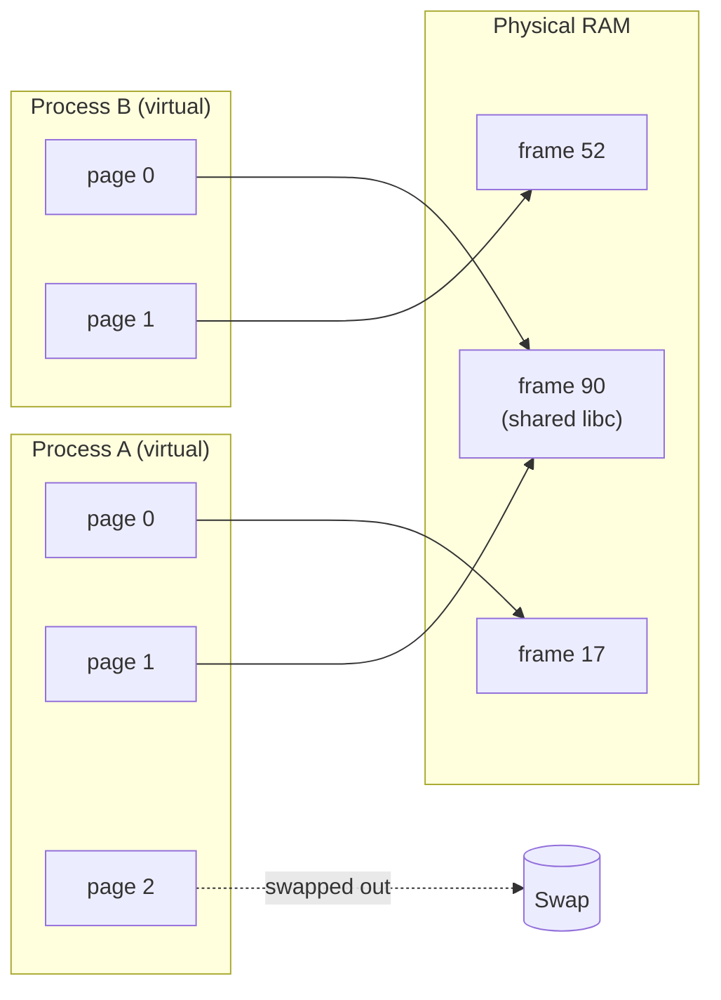

# 15 · The Kernel

<ul class="module-meta">
  <li>⏱ ~3 hours</li>
  <li>4 labs</li>
  <li>Builds on: 01 · How Linux Works, 06 · Processes and Signals, 14 · The Boot Process</li>
</ul>

At 2 a.m. your database vanishes. No error in its own log, no crash message, it's just gone. The answer is in one line of the kernel log: `Out of memory: Killed process 4122 (postgres)`. The kernel is the program that decides who gets memory, CPU time, and hardware, and when it steps in, it usually doesn't ask. This module shows you what the kernel does, how Rocky packages and updates it, and how to inspect, tune, and debug it from the command line. No kernel source required.

!!! abstract "What you'll learn"
    - Name the kernel's main jobs and explain the boundary between user space and kernel space.
    - Watch a program's system calls with `strace`.
    - Read Rocky kernel package names, see how updates install side by side, and pick the boot kernel.
    - Load, inspect, configure, and blacklist kernel modules.
    - Find your way around `/proc` and `/sys`, and tune the kernel safely with `sysctl`.
    - Explain virtual memory, RSS, page cache, swap, overcommit, and why the OOM killer chose its victim.
    - Read kernel messages, set up kdump to capture crashes, and understand tainted kernels and live patching.

## The big picture

The **kernel** is the one program that runs with full control of the hardware. Everything else (your shell, systemd, databases) runs in a restricted mode and has to *ask* the kernel for anything involving hardware or other processes. Click each subsystem to see what it does and where you can watch it work.

<div class="layers" data-hint="Click a kernel subsystem to see what it does and how to observe it." data-open="0" markdown>

<div class="layer" data-label="System call interface" data-tag="the front door" markdown>

**What it does:** the only entry point from programs into the kernel. A program puts a number (which call) and arguments in CPU registers and executes a special instruction; the CPU switches into kernel mode and jumps to the kernel's handler.

```console
$ strace -c true
```

</div>

<div class="layer" data-label="Process scheduler" data-tag="CPU time" markdown>

**What it does:** decides which thread runs on which CPU, and for how long. On Rocky 10 (kernel 6.12) the default is the **EEVDF** scheduler, which aims to give each runnable task a fair share with low latency.

```console
$ cat /proc/loadavg
0.42 0.31 0.25 2/214 5310
$ ps -o pid,ni,pri,psr,comm -p $$
```

`psr` is the CPU the process last ran on. Covered in [06 · Processes and Signals](06-processes-and-signals.md).

</div>

<div class="layer" data-label="Memory manager" data-tag="RAM, swap, page cache" markdown>

**What it does:** gives each process its own private virtual address space, maps it onto physical RAM in 4 KiB **pages**, caches file data, swaps out idle pages, and, as a last resort, kills processes when memory runs out.

```console
$ grep -E 'MemTotal|MemAvailable|Cached|SwapTotal' /proc/meminfo
```

</div>

<div class="layer" data-label="VFS and filesystems" data-tag="files" markdown>

**What it does:** gives every filesystem (XFS, ext4, NFS, `/proc`) the same `open`/`read`/`write` interface. See [09 · Disks and Filesystems](09-disks-and-filesystems.md).

```console
$ cat /proc/filesystems | grep -v nodev
```

</div>

<div class="layer" data-label="Networking stack" data-tag="sockets, TCP/IP, netfilter" markdown>

**What it does:** sockets, TCP/IP, routing, and the netfilter hooks that firewalld programs. See [11 · Networking](11-networking.md).

```console
$ ss -s
```

</div>

<div class="layer" data-label="Security" data-tag="SELinux, capabilities, namespaces" markdown>

**What it does:** checks permissions, SELinux policy, capabilities; provides namespaces and cgroups for containers. See [16 · SELinux](16-selinux.md).

```console
$ cat /sys/kernel/security/lsm
```

</div>

<div class="layer" data-label="Device drivers" data-tag="mostly modules" markdown>

**What it does:** talks to hardware: disks, NICs, GPUs, USB. Most drivers are **modules** loaded on demand.

```console
$ lsmod | head
```

</div>

</div>

!!! analogy "Think of it like a hotel"
    Guests (processes) never walk into the kitchen, the boiler room, or other guests' rooms. They call the front desk (system calls), and staff (the kernel) do the work, check that the guest is allowed, and keep everyone apart. The hotel can fit in more guests than it has rooms by quietly moving luggage to storage (swap). When it truly overflows, the manager evicts someone (the OOM killer).

## User space, kernel space, and system calls

The CPU itself enforces two privilege levels. Code in **kernel space** can touch any memory and any device. Code in **user space** can only touch its own memory and must use a **system call** (syscall) for everything else: opening files, allocating memory, creating processes, sending network packets.



You can watch this with **`strace`**, which prints every system call a program makes (install it with `sudo dnf install -y strace`):

```console
$ strace -e trace=openat,read,write cat /etc/hostname
openat(AT_FDCWD, "/etc/ld.so.cache", O_RDONLY|O_CLOEXEC) = 3
openat(AT_FDCWD, "/lib64/libc.so.6", O_RDONLY|O_CLOEXEC) = 3
read(3, "\177ELF\2\1\1\3\0\0\0\0\0\0\0\0\3\0>\0\1\0\0\0\0\0\0\0\0\0\0\0"..., 832) = 832
openat(AT_FDCWD, "/etc/hostname", O_RDONLY) = 3
read(3, "rocky-lab\n", 131072)          = 10
write(1, "rocky-lab\n", 10rocky-lab
)             = 10
read(3, "", 131072)                     = 0
+++ exited with 0 +++
```

Even `cat` loads the C library first, then opens the file, reads it, and writes to file descriptor 1 (your terminal). The number after `=` is the return value; errors show as `-1 ENOENT (No such file or directory)` and the like. `strace -c` gives a summary table instead, and `strace -f -p PID` attaches to a running process. When a program fails with a vague message, `strace` often shows the exact file or permission it tripped on.

!!! tip "Why syscalls are worth knowing"
    Each syscall costs a switch into kernel mode and back. A program that reads a file one byte at a time makes millions of them, which is why it's slow. `strace -c` exposes that kind of problem in seconds. Deeper performance tools are in [19 · Performance and Observability](19-performance-and-observability.md).

<div class="quiz" data-answer="3" markdown>

A web app fails with "cannot load config". Its log says nothing more. What's the fastest way to see which file it tried to open?

- Read the kernel source for `openat`
- Reboot with `debug` on the kernel command line
- Run it under `strace -f -e trace=openat` and look for `ENOENT` or `EACCES`
- Check `lsmod`

Right. `strace` shows every path the program tried and the exact error the kernel returned.

</div>

## The kernel on Rocky: versions and packages

### Reading the version

```console
$ uname -r
6.12.0-124.8.1.el10_1.x86_64
$ uname -a
Linux rocky-lab 6.12.0-124.8.1.el10_1.x86_64 #1 SMP PREEMPT_DYNAMIC … x86_64 GNU/Linux
```

Read `6.12.0-124.8.1.el10_1.x86_64` from left to right:

| Part | Meaning |
|------|---------|
| `6.12.0` | The upstream kernel version it's based on. Rocky 10 stays on 6.12 for its whole life. |
| `124.8.1` | The distribution's build number. It increases with every update. |
| `el10_1` | Built for Enterprise Linux 10, minor release 10.1 |
| `x86_64` | CPU architecture |

Enterprise kernels don't chase new upstream versions. Instead, fixes, security patches, and selected new features are **backported** into the 6.12 base. So a Rocky 10.1 kernel contains much code that is newer than "6.12" suggests. Never judge a Rocky kernel's security by its upstream number alone; check the package changelog (`rpm -q --changelog kernel-core | less`) or the Rocky errata.

!!! version "Rocky 9 vs 10"
    Rocky 9 is based on kernel 5.14 (`5.14.0-…el9_x`), Rocky 10 on 6.12. Both follow the same packaging and update model described here.

### The kernel packages

The kernel is split into several RPMs:

| Package | Contains |
|---------|----------|
| `kernel` | An empty "meta" package that pulls in the others |
| `kernel-core` | The kernel image (`vmlinuz`) and boot files; requires `kernel-modules-core` |
| `kernel-modules-core` | The modules most servers and VMs need: virtio, storage and RAID controllers, filesystems, common wired network cards, USB storage, and helpers such as `dummy` |
| `kernel-modules` | Less common hardware drivers (Wi-Fi, sound, cameras and media, USB serial and network adapters, InfiniBand, …) |
| `kernel-modules-extra` | Rarely used drivers and protocols, not installed by default |
| `kernel-devel`, `kernel-headers` | Files for building out-of-tree modules and compiling programs |

The files land in predictable places:

```console
$ ls /boot
config-6.12.0-124.8.1.el10_1.x86_64          loader
efi                                          symvers-6.12.0-124.8.1.el10_1.x86_64.xz
grub2                                        System.map-6.12.0-124.8.1.el10_1.x86_64
initramfs-6.12.0-124.8.1.el10_1.x86_64.img   vmlinuz-6.12.0-124.8.1.el10_1.x86_64
…
$ ls /lib/modules/
6.12.0-55.39.1.el10_0.x86_64  6.12.0-124.8.1.el10_1.x86_64
```

To find which package owns a module, ask RPM: `rpm -qf $(modinfo -n xfs)`.

`vmlinuz-*` is the compressed kernel, `initramfs-*` the early boot environment ([14 · The Boot Process](14-the-boot-process.md)), `config-*` the exact build options (`grep CONFIG_XFS_FS /boot/config-$(uname -r)`), and `/lib/modules/VERSION/` the modules for each installed kernel.

### Updates install side by side

Most packages are *replaced* when you update them. The kernel is different: it's an **install-only package**. `dnf update` installs the new kernel *next to* the old ones, adds a boot entry, and makes it the default. If the new kernel doesn't boot, you pick the previous one in the GRUB menu.



How many are kept is set in `/etc/dnf/dnf.conf`:

```ini title="/etc/dnf/dnf.conf"
[main]
installonly_limit=3
```

```console
$ rpm -q kernel-core
kernel-core-6.12.0-55.39.1.el10_0.x86_64
kernel-core-6.12.0-124.8.1.el10_1.x86_64
$ sudo grubby --default-kernel
/boot/vmlinuz-6.12.0-124.8.1.el10_1.x86_64
$ sudo grubby --set-default /boot/vmlinuz-6.12.0-55.39.1.el10_0.x86_64
```

`grubby --info=ALL` lists all boot entries. A new kernel only runs after a reboot. `sudo dnf needs-restarting -r` tells you whether a reboot is needed to pick up updates.

<div class="quiz" data-answer="2" markdown>

`installonly_limit=3` and you have three kernels installed. You're running the oldest one because the newer two have a driver problem. What happens on the next kernel update?

- dnf removes the running kernel, since it's the oldest
- dnf removes the oldest kernel that isn't running, so you keep the running one
- dnf refuses to update
- All old kernels are removed

Correct. dnf never removes the running kernel. Here it removes the oldest *non-running* one. If you need to keep a specific kernel forever, use `dnf versionlock` or raise the limit.

</div>

## Kernel modules

A **kernel module** is a piece of kernel code (usually a driver) stored in a separate file, a `.ko` file, that can be loaded into the running kernel and removed again. This keeps the kernel image small: it only loads drivers for hardware you actually have. Modules live under `/lib/modules/$(uname -r)/kernel/`, usually compressed (`.ko.xz`).

Most of the time you don't load modules by hand. When udev sees a device, it looks up the device's ID in a table of **aliases** (`modules.alias`) and loads the matching driver automatically.

```console
$ lsmod | head -6
Module                  Size  Used by
xfs                  3489792  2
virtio_net             77824  0
net_failover           24576  1 virtio_net
failover               12288  1 net_failover
virtio_blk             36864  3
```

`Used by` is how many things are using the module (and which modules depend on it). A module in use can't be removed.

`modinfo` tells you everything about a module, including its **parameters**, the settings it accepts:

```console
$ modinfo dummy
filename:       /lib/modules/6.12.0-124.8.1.el10_1.x86_64/kernel/drivers/net/dummy.ko.xz
alias:          rtnl-link-dummy
description:    Dummy netdevice driver which discards all packets sent to it
license:        GPL
…
signer:         Rocky Linux kernel signing key
…
parm:           numdummies:Number of dummy pseudo devices (int)
```

| Task | Command |
|------|---------|
| Load a module (and its dependencies) | `sudo modprobe dummy` |
| Load with a parameter | `sudo modprobe dummy numdummies=2` |
| Unload | `sudo modprobe -r dummy` |
| Current parameter values | `grep -r . /sys/module/NAME/parameters/` (only parameters the driver chose to expose; `dummy`'s isn't) |
| Show what `modprobe` would do | `modprobe -n -v dummy` |

Use `modprobe`, not the low-level `insmod`/`rmmod`: `modprobe` resolves dependencies (from `modules.dep`) and applies your configuration.

??? question "Under the hood: how the kernel loads a module by itself"
    There are two automatic paths, and both end in the same user-space program.

    1. **Hardware appears.** The kernel sends a uevent with a `MODALIAS` string describing the device (for a PCI card, vendor and device IDs). udev runs the equivalent of `modprobe <modalias>`, which matches it against the wildcards in `/lib/modules/$(uname -r)/modules.alias`. Try `cat /sys/class/net/eth0/device/modalias`, then `modprobe -R "$(cat /sys/class/net/eth0/device/modalias)"` to see which module that resolves to.
    2. **A feature is requested.** When a program asks for something not yet loaded (a filesystem type in `mount`, a network protocol family, `ip link add type dummy`), the kernel itself calls the program named in `/proc/sys/kernel/modprobe` (normally `/sbin/modprobe`) with an alias such as `fs-xfs` or `rtnl-link-dummy`. That's the `alias:` line in the `modinfo` output above.

    Hardened systems use this knowledge: `sysctl kernel.modules_disabled=1` blocks *all* further module loading until reboot, a one-way switch you flip once boot has finished loading what it needs.

### Configuring modules permanently

Module configuration lives in `/etc/modprobe.d/*.conf`. Modules to load at every boot are listed in `/etc/modules-load.d/*.conf` (read by `systemd-modules-load.service`).

```ini title="/etc/modprobe.d/lab.conf"
# Set a default parameter whenever the module loads
options dummy numdummies=2

# Stop automatic loading by alias (e.g. when hardware appears)
blacklist floppy

# Stop ALL loading, even an explicit "modprobe usb-storage"
install usb-storage /bin/false
```

The difference between the last two trips up a lot of people. `blacklist` only stops **automatic** loading through aliases. A human, a script, or another module's dependency can still load it. To block a module completely (for example, USB storage on a hardened server), add an `install … /bin/false` line, which makes `modprobe` run `/bin/false` instead of loading it.

!!! warning "Modules inside the initramfs"
    Storage and some network drivers load from the **initramfs**, before `/etc/modprobe.d` on your root filesystem is even visible. After blacklisting or setting options for such a module, rebuild the initramfs with `sudo dracut -f` (for the running kernel). To block a module from the kernel command line for one boot, add `modprobe.blacklist=NAME` at the GRUB menu.

### Signed modules and Secure Boot

Rocky's modules are signed with Rocky's key (the `signer` field in `modinfo`). When the machine boots with **UEFI Secure Boot** on, the kernel enters **lockdown** mode and refuses to load modules that aren't signed by a trusted key. Third-party drivers (some GPU, storage, or security agents) must be signed with a key you enroll in the firmware with `mokutil`, or they won't load. Check the state with `mokutil --sb-state`.

## Tainted kernels

If something unusual has happened to the running kernel, it marks itself **tainted**. Taint isn't an error. It's a flag that says "bug reports from this kernel may be unreliable", because code nobody can review has run inside it, or a serious warning already happened.

```console
$ cat /proc/sys/kernel/tainted
0
```

`0` means clean. Any other number is a sum of flags. The common ones:

| Value | Letter | Meaning |
|-------|--------|---------|
| 1 | `P` | A proprietary (non-GPL) module was loaded |
| 512 | `W` | The kernel has printed a warning (`WARNING:` in `dmesg`) |
| 4096 | `O` | An out-of-tree module (not shipped with this kernel) was loaded |
| 8192 | `E` | An unsigned module was loaded |
| 32768 | `K` | The kernel has been live patched |

The letters also appear in oops and warning messages, as in `Tainted: P  O`. This one-liner decodes the number:

```console
$ t=$(cat /proc/sys/kernel/tainted); for b in $(seq 0 18); do (( t >> b & 1 )) && echo "bit $b set"; done
```

Vendor support teams often ask whether the problem reproduces on an untainted kernel, so knowing *why* yours is tainted matters. The full list is in the kernel's "Tainted kernels" documentation (Go deeper).

## Tour of /proc and /sys

The kernel exposes its state as files in two **pseudo-filesystems**: nothing in them is stored on disk; the kernel generates the content when you read it.

**`/proc`** is the older one. It started as "information about processes", one directory per PID, and collected lots of system-wide information along the way.

| Path | What's there |
|------|-------------|
| `/proc/PID/` | Everything about one process: `status`, `cmdline`, `environ`, `fd/`, `maps`, `limits` |
| `/proc/self/` | Shortcut to the process reading it |
| `/proc/cmdline` | The kernel command line this boot used |
| `/proc/meminfo` | Detailed memory accounting |
| `/proc/cpuinfo` | CPU model, flags, cores |
| `/proc/loadavg` | Load averages |
| `/proc/mounts` | Mounted filesystems (a link to `self/mounts`) |
| `/proc/sys/` | Tunable kernel settings (sysctl), next section |

```console
$ cat /proc/cmdline
BOOT_IMAGE=(hd0,gpt2)/vmlinuz-6.12.0-124.8.1.el10_1.x86_64 root=/dev/mapper/rl-root ro crashkernel=… resume=/dev/mapper/rl-swap rd.lvm.lv=rl/root rd.lvm.lv=rl/swap
$ grep -E '^(Name|State|VmRSS|Threads)' /proc/self/status
Name:	grep
State:	R (running)
VmRSS:	    2304 kB
Threads:	1
```

**`/sys`** (sysfs) is newer and more orderly: a tree of the kernel's objects (devices, drivers, modules, buses) with one value per file.

| Path | What's there |
|------|-------------|
| `/sys/class/net/eth0/` | A network interface: `address`, `mtu`, `operstate`, `statistics/` |
| `/sys/block/vda/` | A disk: `size`, `queue/scheduler`, `queue/rotational` |
| `/sys/module/NAME/parameters/` | A loaded module's current parameters |
| `/sys/fs/cgroup/` | The cgroup v2 tree (resource control for services and containers) |
| `/sys/kernel/mm/transparent_hugepage/` | Transparent huge page settings |
| `/sys/firmware/efi/` | Present only if the machine booted with UEFI |

```console
$ cat /sys/class/net/eth0/operstate /sys/class/net/eth0/mtu
up
1500
$ cat /sys/block/vda/queue/rotational
0
```

`rotational` is `1` for spinning disks and `0` for SSDs and most virtual disks. A quick `[ -d /sys/firmware/efi ] && echo UEFI || echo BIOS` tells you how the machine booted.

<div class="quiz" data-answer="1" markdown>

You change `/sys/block/vda/queue/scheduler` with `echo mq-deadline > …` and it works. After a reboot it's back to `none`. Why?

- `/sys` lives in kernel memory; nothing written there survives a reboot
- The disk rejected the scheduler
- SELinux reverted it
- You needed `sync` after the echo

Right. `/proc` and `/sys` are views of live kernel state. To make a change permanent, use the proper mechanism: `sysctl.d` for `/proc/sys`, a udev rule or tuned profile for most `/sys` settings, `modprobe.d` for module parameters.

</div>

## Tuning with sysctl

Everything under `/proc/sys/` is a **kernel parameter** you can read and (as root) change at runtime. The `sysctl` command uses dotted names that map to those paths: `net.ipv4.ip_forward` is `/proc/sys/net/ipv4/ip_forward`.

```console
$ sysctl net.ipv4.ip_forward
net.ipv4.ip_forward = 0
$ sudo sysctl -w net.ipv4.ip_forward=1
net.ipv4.ip_forward = 1
$ sysctl -a 2>/dev/null | wc -l
1132
```

`sysctl -w` changes the value **until reboot**. To make it permanent, put it in a file under `/etc/sysctl.d/` and apply it:

```ini title="/etc/sysctl.d/90-router.conf"
# This box routes between the lab networks
net.ipv4.ip_forward = 1
```

```console
$ sudo sysctl --system
* Applying /usr/lib/sysctl.d/10-default-yama-scope.conf ...
* Applying /usr/lib/sysctl.d/50-default.conf ...
…
* Applying /etc/sysctl.d/90-router.conf ...
net.ipv4.ip_forward = 1
```

At boot, `systemd-sysctl.service` applies files from `/usr/lib/sysctl.d/` (package defaults), `/run/sysctl.d/`, and `/etc/sysctl.d/` (yours), sorted by file name, so later files win. A file in `/etc/sysctl.d/` with the same name as one in `/usr/lib/sysctl.d/` replaces it entirely. Name your files with a high number like `90-` so they apply last.

A few knobs you'll actually meet:

| Parameter | Default (typical) | What it does |
|-----------|-------------------|-------------|
| `net.ipv4.ip_forward` | `0` | Route packets between interfaces (routers, container hosts) |
| `vm.swappiness` | `60` | How eagerly to swap out anonymous memory vs dropping page cache (0 to 200) |
| `vm.overcommit_memory` | `0` | Memory overcommit policy (see next section) |
| `vm.dirty_ratio` / `vm.dirty_background_ratio` | `20` / `10` | % of memory that may hold unwritten file data before writers are throttled / background flushing starts |
| `fs.inotify.max_user_watches` | depends on RAM | Files one user can watch for changes (raise for IDEs, sync tools) |
| `kernel.pid_max` | `4194304` (set by systemd) | Highest process ID |
| `net.core.somaxconn` | `4096` | Max queue of pending connections for a listening socket |
| `kernel.panic` | `0` | Seconds before auto-reboot after a panic (`0` = hang) |

!!! warning "tuned may set these too"
    Rocky runs **tuned**, which applies a performance profile at boot (`tuned-adm active` shows it, often `virtual-guest` on VMs). Profiles set sysctls such as `vm.swappiness` and `vm.dirty_ratio`. If your value "doesn't stick", check whether tuned is overriding it, and consider a custom tuned profile instead. More in [19 · Performance and Observability](19-performance-and-observability.md).

??? question "Under the hood: sysctls that must be set before userspace starts"
    `systemd-sysctl.service` runs early, but not before the initramfs or before modules load. Two consequences bite people:

    - **Per-interface or per-module settings** (for example `net.ipv4.conf.eth1.rp_filter`, or anything under `net.bridge.`) don't exist until the interface or module appears. If the file applies first, the setting fails with "No such file or directory". systemd re-applies matching `sysctl.d` entries when a network device appears, but for module-owned keys the reliable fix is to load the module first (`/etc/modules-load.d/`).
    - **Settings needed during early boot** can go on the kernel command line: since kernel 5.8, any `sysctl.NAME=VALUE` argument (for example `sysctl.vm.swappiness=10`) is applied by the kernel itself before PID 1 starts. Add it with `sudo grubby --update-kernel=ALL --args="sysctl.vm.swappiness=10"`.

!!! tip "Change one thing at a time"
    Copying a "Linux performance tuning" list of 40 sysctls from a blog post is a classic way to create problems you can't explain. Change one parameter, measure, and write down why in a comment in the `.conf` file.

## Memory in plain terms

### Virtual memory

Every process gets its own **virtual address space**: a private map that starts at zero and looks like it belongs to the process alone. The kernel and the CPU's memory management unit translate each virtual address to a physical location in RAM, one **page** (4 KiB on x86_64) at a time. This is why one process can't read another's memory, and why a process can *reserve* far more memory than it uses.



Pages can be shared (the C library is loaded once and mapped into every process), not yet allocated, or pushed out to swap.

### VSZ vs RSS

`ps` shows two sizes, and only one usually matters:

```console
$ ps -o pid,vsz,rss,comm -C sshd,chronyd
    PID    VSZ   RSS COMMAND
    812  84584  4096 chronyd
    901  17132 10240 sshd
```

- **VSZ** (virtual size) is everything the process has *mapped*, including memory it reserved but never touched and shared libraries. It's often huge and mostly meaningless.
- **RSS** (resident set size) is how much of it is actually in RAM right now. Shared pages are counted in every process that uses them, so adding up RSS overstates the total.

For a fair per-service total, look at the cgroup: `systemctl status sshd` shows a `Memory:` line, or read `/sys/fs/cgroup/system.slice/sshd.service/memory.current`.

### Page cache, swap, and swappiness

Recall from Module 09 that the kernel keeps file data in RAM as the **page cache**. When memory gets tight, the kernel has two kinds of pages to reclaim:

- **File-backed pages** (page cache): clean ones can be dropped instantly, since the data is still on disk.
- **Anonymous pages** (a program's heap and stack): these have no file behind them, so the only place to put them is **swap**.

`vm.swappiness` biases that choice. Lower values protect application memory and drop cache first; higher values swap idle application memory more readily to keep useful cache. Swapping a little is healthy. Constant swapping in and out (watch the `si`/`so` columns of `vmstat 1`) means you need more RAM or fewer things running.

### Overcommit

Programs often ask for more memory than they'll use (`malloc` a big buffer and touch a little). Linux lets them, because physical pages are only assigned when first written. This is **overcommit**, controlled by `vm.overcommit_memory`:

| Value | Policy |
|-------|--------|
| `0` (default) | Heuristic: refuse only obviously impossible requests |
| `1` | Always say yes (some scientific and Redis-style workloads want this) |
| `2` | Strict: total commitments may not exceed swap + `vm.overcommit_ratio`% of RAM |

The catch: if programs actually *use* everything they were promised, the memory runs out after the promises were made. Something has to give.

??? question "Under the hood: see memory trouble coming with PSI"
    Swap activity and free memory are lagging signals. **Pressure stall information** (PSI) measures what users feel: the share of time tasks were stalled waiting for memory (or CPU, or I/O).

    Rocky's kernel is built with PSI but switches it **off by default** (`CONFIG_PSI_DEFAULT_DISABLED=y`), so `/proc/pressure/` doesn't exist on a stock install. Turn it on with a boot argument and reboot:

    ```console
    $ sudo grubby --update-kernel=ALL --args="psi=1"
    $ sudo reboot
    …
    $ cat /proc/pressure/memory
    some avg10=0.00 avg60=0.00 avg300=0.00 total=1849021
    full avg10=0.00 avg60=0.00 avg300=0.00 total=402117
    ```

    `some` is the percentage of time at least one task was stalled on memory, `full` the percentage when *all* non-idle tasks were. A healthy box sits near zero; a box heading for an OOM kill shows `full` climbing for minutes beforehand. Every cgroup then has its own copy, so `cat /sys/fs/cgroup/system.slice/postgresql.service/memory.pressure` tells you whether one service is starving. Monitoring agents and `systemd-oomd` base their decisions on exactly these numbers.

### The OOM killer

When the kernel can't free enough memory any other way, it runs the **OOM killer** (out of memory). It picks the process whose death frees the most memory, weighted by an adjustable score, and kills it with `SIGKILL`. The process gets no warning and no chance to log anything, which is why the evidence is in the *kernel* log:

```console
$ journalctl -k | grep -iE 'out of memory|oom-kill'
Oct 15 02:03:11 db01 kernel: oom-kill:constraint=CONSTRAINT_NONE,…,task=postgres,pid=4122,uid=26
Oct 15 02:03:11 db01 kernel: Out of memory: Killed process 4122 (postgres) total-vm:9218340kB, anon-rss:7340032kB, file-rss:0kB, shmem-rss:0kB, UID:26 pgtables:14520kB oom_score_adj:0
```

Each process has a score in `/proc/PID/oom_score` (higher = more likely to be chosen) and an adjustment in `/proc/PID/oom_score_adj` from `-1000` (never kill) to `1000` (kill first). For services, set it in the unit file rather than by hand:

```ini title="systemctl edit postgresql (drop-in)"
[Service]
OOMScoreAdjust=-500
```

There are two kinds of OOM event. A **system-wide OOM** means the whole machine ran out. A **cgroup OOM** means a service hit its own limit (`MemoryMax=` in its unit) and the kernel killed something *inside that service* only. The log line says `constraint=CONSTRAINT_MEMCG` for the second kind. Lab 4 shows a cgroup OOM safely.

??? question "What about huge pages?"
    Normal pages are 4 KiB. Programs with very large memory (databases, JVMs, VMs) spend real CPU time on the page tables that track millions of small pages. **Huge pages** (2 MiB or 1 GiB on x86_64) reduce that overhead. There are two kinds:

    - **Transparent huge pages (THP)**: the kernel uses huge pages automatically where it can. Check the mode with `cat /sys/kernel/mm/transparent_hugepage/enabled` (the bracketed word is active). Some databases recommend `madvise` or `never`; follow your vendor's guidance.
    - **Explicit huge pages (HugeTLB)**: a pool reserved up front with `vm.nr_hugepages`, used by software that asks for it (Oracle DB, DPDK). See `HugePages_Total` in `/proc/meminfo`.

<div class="quiz" data-answer="4" markdown>

A Java service was killed overnight. Its own log just stops. `journalctl -k` shows `Memory cgroup out of memory: Killed process … (java)` with `constraint=CONSTRAINT_MEMCG`. What happened?

- The machine ran out of RAM and swap
- A user ran `kill -9`
- The JVM crashed with a segfault
- The service hit its own cgroup memory limit, and the kernel killed it inside that limit

Exactly. `CONSTRAINT_MEMCG` means a cgroup limit (such as `MemoryMax=` on the unit) was reached. Check `systemctl show SERVICE -p MemoryMax` and either raise the limit or reduce the heap.

</div>

## Kernel messages: dmesg and the journal

The kernel writes messages to a ring buffer in memory: hardware detection, driver errors, filesystem problems, OOM kills, segfaults. Two ways to read them:

```console
$ sudo dmesg -T --level=err,warn | tail -3
[Thu Oct 15 08:12:44 2026] XFS (vdb1): Metadata corruption detected at xfs_dinode_verify+0x…
[Thu Oct 15 08:12:44 2026] XFS (vdb1): Unmount and run xfs_repair
[Thu Oct 15 09:40:02 2026] python3[5120]: segfault at 0 ip 00007f3c… sp 00007ffe… error 4 in libfoo.so
$ journalctl -k -b -1 -p warning
```

- `dmesg -T` shows human-readable timestamps, `--level` filters by severity, `-w` follows new messages. The ring buffer is limited in size and is lost at reboot.
- `journalctl -k` reads kernel messages that journald captured, so `-b -1` (the previous boot) works if the journal is persistent. See [08 · Logging and the Journal](08-logging-and-the-journal.md).

Things worth grepping for: `error`, `I/O error`, `oom`, `segfault`, `hung_task` (a process stuck in uninterruptible I/O for over 2 minutes), `soft lockup`, `Call Trace`, and `WARNING:`.

Practice the common kernel-inspection commands:

<div class="terminal-sim" data-title="Interrogate the kernel" markdown>

<div class="task" data-expect="uname -r" data-hint="uname with the option for the kernel release." markdown>

**Step 1.** Print the release of the running kernel.

```text
6.12.0-124.8.1.el10_1.x86_64
```

</div>

<div class="task" data-expect="cat /proc/cmdline" data-hint="The kernel command line is a file in /proc." markdown>

**Step 2.** Show the command line this kernel booted with.

```text
BOOT_IMAGE=(hd0,gpt2)/vmlinuz-6.12.0-124.8.1.el10_1.x86_64 root=/dev/mapper/rl-root ro crashkernel=… rd.lvm.lv=rl/root rd.lvm.lv=rl/swap
```

</div>

<div class="task" data-expect="modinfo -p dummy||modinfo dummy" data-hint="modinfo shows a module's details; -p lists only its parameters." markdown>

**Step 3.** Find out which parameters the `dummy` module accepts.

```text
numdummies:Number of dummy pseudo devices (int)
```

</div>

<div class="task" data-expect="sysctl vm.swappiness||cat /proc/sys/vm/swappiness" data-hint="Use sysctl with the dotted name vm.swappiness." markdown>

**Step 4.** Read the current value of `vm.swappiness`.

```text
vm.swappiness = 30
```

</div>

<div class="task" data-expect="cat /proc/sys/kernel/tainted" data-hint="The taint flags are in /proc/sys/kernel/." markdown>

**Step 5.** Is this kernel tainted?

```text
0
```

</div>

<div class="task" data-expect="journalctl -k -p err||journalctl -k -p 3||sudo journalctl -k -p err||sudo dmesg --level=err||dmesg --level=err||sudo dmesg -l err" data-hint="journalctl -k shows kernel messages; -p err filters by priority." markdown>

**Step 6.** Show only kernel messages at error priority.

```text
Oct 15 08:12:44 rocky-lab kernel: XFS (vdb1): Metadata corruption detected at xfs_dinode_verify+0x…
Oct 15 08:12:44 rocky-lab kernel: XFS (vdb1): Unmount and run xfs_repair
```

</div>

</div>

## When the kernel crashes: kdump

A **kernel panic** is the kernel stopping because it hit a problem it can't safely recover from. The screen shows a trace for a moment, then the machine hangs or reboots, and the evidence disappears. **kdump** captures it: when the kernel panics, a second, tiny kernel boots and saves the crashed kernel's memory to disk as a **vmcore** file that you (or your support vendor) can analyse later.

<div class="stepper" markdown>

<div class="step" data-title="Reserve memory at boot" markdown>

The `crashkernel=` option on the kernel command line reserves a block of RAM that the normal kernel never uses. The installer sets it, using a value that scales with installed RAM. On Rocky 10 x86_64 the default is:

```console
$ grep -o 'crashkernel=[^ ]*' /proc/cmdline
crashkernel=2G-64G:256M,64G-:512M
$ sudo kdumpctl get-default-crashkernel
2G-64G:256M,64G-:512M
```

Read it as "RAM from 2 to 64 GiB: reserve 256 MiB; 64 GiB or more: reserve 512 MiB". Below 2 GiB of RAM nothing is reserved, so **kdump doesn't work on a 2 GiB lab VM** out of the box. To reset the value to the recommended default for the installed kernel: `sudo kdumpctl reset-crashkernel` (takes effect after a reboot).

</div>

<div class="step" data-title="Preload the capture kernel" markdown>

`kdump.service` (package `kdump-utils` on Rocky 10, `kexec-tools` on Rocky 9) uses **kexec** to load a second kernel and a small special initramfs into that reserved memory, ready to go.

```console
$ sudo systemctl status kdump --no-pager
● kdump.service - Crash recovery kernel arming
     Active: active (exited) since …
$ sudo kdumpctl status
kdump: Kdump is operational
```

</div>

<div class="step" data-title="Panic" markdown>

The main kernel panics. Instead of going through firmware (which would wipe RAM), it jumps straight into the preloaded capture kernel with kexec. The crashed kernel's memory is left untouched.

</div>

<div class="step" data-title="Save the vmcore" markdown>

The capture kernel boots in the reserved memory, mounts the dump target, and copies the old memory with `makedumpfile`, which filters out useless pages (free memory, page cache) and compresses the rest.

```ini title="/etc/kdump.conf (defaults)"
path /var/crash
core_collector makedumpfile -l --message-level 7 -d 31
```

</div>

<div class="step" data-title="Reboot and analyse" markdown>

The machine reboots normally. The dump is waiting:

```console
$ ls /var/crash/
127.0.0.1-2026-10-15-02:03:44
$ ls /var/crash/127.0.0.1-2026-10-15-02:03:44/
kexec-dmesg.log  vmcore  vmcore-dmesg.txt
```

Start with `vmcore-dmesg.txt`: the kernel log up to the panic, often enough to see the cause. Deep analysis uses the `crash` tool with matching `kernel-debuginfo`, or you upload the vmcore to your support provider.

</div>

</div>

!!! version "Rocky 9 vs 10: kdump"
    Rocky 9 shipped kdump inside `kexec-tools`; Rocky 10 splits it into `kexec-tools`, `kdump-utils` (the service and `kdumpctl`) and `makedumpfile`. Rocky 9's default was `1G-4G:192M,4G-64G:256M,64G-:512M`; that string is not supported on Rocky 10, so kickstarts and Ansible roles that hard-code it need updating. The old `crashkernel=auto` from Rocky 8 is gone on both.

!!! tip "Make sure there's room"
    A vmcore can be several GB on a big machine. Make sure `/var/crash` (or the target in `/etc/kdump.conf`) has free space, or send dumps to another disk or over NFS/SSH. Test kdump once per server build, in a maintenance window, so you know it works before you need it.

## Live patching

Rebooting to apply a kernel security fix means downtime. **Live patching** applies fixes to the running kernel's code in memory, with no reboot. On RHEL, Red Hat ships prebuilt live patches as `kpatch-patch-*` packages for subscribers.

On Rocky, the `kpatch` tool (and its systemd service) is rebuilt from RHEL and available in the repositories, but Rocky does not build or publish any `kpatch-patch-*` packages. So `dnf search kpatch-patch` finds nothing and, out of the box, there are no live patches to apply. Rocky users who need rebootless kernel fixes either buy a commercial live-patching service for Rocky or build patches themselves with `kpatch-build`, which takes real expertise and a matching debuginfo kernel.

The kernel side is the same either way. A live patch is a special module; once loaded it shows up under `/sys/kernel/livepatch/` and the kernel is tainted with `K`. Even with live patching, plan regular reboots: live patches cover selected security fixes, not every update.

## Labs

!!! lab "Lab 1: Watch the kernel at work with strace"

    **Goal:** See the system calls behind everyday commands, and use `strace` to find a missing file.

    **You'll need:** a Rocky 10 VM, `sudo dnf install -y strace`.

    1. Count the syscalls a simple command makes:

        ```console
        $ strace -c ls /etc > /dev/null
        ```

        Note the most frequent calls (`openat`, `read`, `getdents64`, `mmap`).

    2. Write a tiny script that reads a config file that doesn't exist, and run it under `strace`:

        ```console
        $ printf '#!/bin/bash\nsource /etc/myapp/app.conf 2>/dev/null || { echo "cannot load config"; exit 1; }\n' > /tmp/myapp.sh
        $ chmod +x /tmp/myapp.sh
        $ /tmp/myapp.sh
        cannot load config
        $ strace -f -e trace=openat /tmp/myapp.sh 2>&1 | grep -v 'ENOENT.*locale' | grep ENOENT
        ```

    3. Compare reading a file in big vs tiny chunks:

        ```console
        $ dd if=/dev/zero of=/tmp/blob bs=1M count=20 status=none
        $ strace -c -e trace=read dd if=/tmp/blob of=/dev/null bs=1M 2>&1 | tail -3
        $ strace -c -e trace=read dd if=/tmp/blob of=/dev/null bs=512 2>&1 | tail -3
        ```

    **Check your work:** step 2 shows `openat(…, "/etc/myapp/app.conf", …) = -1 ENOENT`, naming exactly the missing file. Step 3 shows about 20 `read` calls with 1 MiB blocks and about 40,000 with 512-byte blocks.

    ??? success "What just happened?"
        Every `read` is a trip into the kernel. The small-block version does 2,000 times more trips for the same data, which is why buffer size matters so much for I/O-heavy programs.

    **Clean up:** `rm -f /tmp/myapp.sh /tmp/blob`

!!! lab "Lab 2: Load, configure, and block a module"

    **Goal:** Load a harmless module with parameters, make the parameters permanent, then block it two different ways.

    **You'll need:** sudo. The `dummy` network driver creates fake interfaces and touches no hardware. It ships in `kernel-modules-core`, so it's on every Rocky 10 system (check with `rpm -qf $(modinfo -n dummy)`).

    1. Inspect and load it:

        ```console
        $ modinfo -p dummy
        $ sudo modprobe dummy numdummies=2
        $ lsmod | grep dummy
        $ ip -br link show type dummy
        ```

    2. Unload it, set the parameter permanently, and load again with no arguments:

        ```console
        $ sudo modprobe -r dummy
        $ echo "options dummy numdummies=3" | sudo tee /etc/modprobe.d/lab-dummy.conf
        $ sudo modprobe dummy && ip -br link show type dummy
        $ sudo modprobe -r dummy
        ```

    3. Blacklist it, then load it explicitly:

        ```console
        $ echo "blacklist dummy" | sudo tee -a /etc/modprobe.d/lab-dummy.conf
        $ sudo modprobe dummy && lsmod | grep dummy
        $ sudo modprobe -r dummy
        ```

        It still loads. `blacklist` only stops automatic loading.

    4. Block it completely:

        ```console
        $ echo "install dummy /bin/false" | sudo tee -a /etc/modprobe.d/lab-dummy.conf
        $ sudo modprobe dummy; echo "exit code $?"
        $ modprobe -n -v dummy
        ```

    **Check your work:** step 2 created three `dummy` interfaces, step 3 still loaded the module despite the blacklist, and step 4 failed with a non-zero exit code; `modprobe -n -v` shows `install /bin/false`.

    **Clean up:** `sudo rm /etc/modprobe.d/lab-dummy.conf; sudo modprobe -r dummy 2>/dev/null`

!!! lab "Lab 3: A sysctl that survives reboot"

    **Goal:** Change a kernel parameter at runtime, make it permanent the right way, and find out who else sets it.

    **You'll need:** sudo.

    1. Read the current value and where it comes from:

        ```console
        $ sysctl vm.swappiness
        $ grep -r swappiness /usr/lib/sysctl.d/ /etc/sysctl.d/ /etc/sysctl.conf /usr/lib/tuned/ 2>/dev/null
        $ tuned-adm active
        ```

    2. Change it at runtime and verify through `/proc`:

        ```console
        $ sudo sysctl -w vm.swappiness=15
        $ cat /proc/sys/vm/swappiness
        ```

    3. Make it permanent, then prove the file works by resetting the value and re-applying:

        ```console
        $ echo "vm.swappiness = 15" | sudo tee /etc/sysctl.d/90-lab.conf
        $ sudo sysctl -w vm.swappiness=60
        $ sudo sysctl --system | grep -A1 90-lab
        $ sysctl vm.swappiness
        ```

    **Check your work:** after `sysctl --system`, the value is 15 again, and the output shows `/etc/sysctl.d/90-lab.conf` being applied last. Step 1 showed whether your tuned profile also sets `vm.swappiness` (the `virtual-guest` profile sets it to 30).

    ??? tip "Hint: which wins, tuned or sysctl.d?"
        Both apply at boot, and the order isn't something to rely on. If tuned's profile sets the same parameter, change it in a custom tuned profile instead, so there's one source of truth.

    **Clean up:** `sudo rm /etc/sysctl.d/90-lab.conf && sudo sysctl --system > /dev/null && sudo systemctl restart tuned`

!!! lab "Lab 4: Meet the OOM killer (safely) and check kdump"

    **Goal:** Trigger an out-of-memory kill inside a small cgroup without endangering the system, read the evidence, and confirm kdump is ready.

    **You'll need:** sudo.

    1. Run a memory hog inside a transient scope limited to 100 MiB with no swap. `tail /dev/zero` keeps reading zeros looking for a newline, growing forever:

        ```console
        $ sudo systemd-run --scope -p MemoryMax=100M -p MemorySwapMax=0 --unit=oomlab tail /dev/zero
        Running as unit: oomlab.scope; invocation ID: 6a3f…
        Killed
        ```

    2. Find the kernel's account of what happened:

        ```console
        $ journalctl -k --since "-5min" | grep -iE 'oom|killed process'
        ```

    3. Look at OOM scores of some running processes:

        ```console
        $ for p in $(pgrep -x sshd | head -1) $(pgrep -x chronyd) 1; do
            echo "$p $(cat /proc/$p/comm) score=$(cat /proc/$p/oom_score) adj=$(cat /proc/$p/oom_score_adj)"
          done
        ```

    4. Check kdump without crashing anything:

        ```console
        $ sudo kdumpctl status
        $ grep -o 'crashkernel=[^ ]*' /proc/cmdline
        $ sudo kdumpctl showmem
        $ grep -E '^(path|core_collector)' /etc/kdump.conf
        ```

    5. **Optional, on a throwaway VM only.** Force a real panic and collect the dump. Save your work first; the VM will reboot:

        ```console
        $ echo 1 | sudo tee /proc/sys/kernel/sysrq
        $ echo c | sudo tee /proc/sysrq-trigger
        ```

        After it reboots, look in `/var/crash/` and read `vmcore-dmesg.txt` near the end.

    **Check your work:** the journal shows `Memory cgroup out of memory` and `oom-kill:constraint=CONSTRAINT_MEMCG` for `tail`, the rest of the system was unaffected, and `kdumpctl status` reports kdump as operational (on a VM with less than 2 GiB of RAM it won't be, because no `crashkernel` memory is reserved). Step 3 prints a score for each process; whatever PID 1's numbers say, the kernel never picks init as an OOM victim.

    ??? success "What just happened?"
        The OOM killer worked inside the cgroup boundary: only processes in `oomlab.scope` were candidates. That's exactly how systemd's `MemoryMax=` protects the rest of a server from one runaway service.

    **Clean up:** nothing persists from steps 1 to 4. If you did step 5, delete the dump when finished: `sudo rm -rf /var/crash/127.0.0.1-*`.

## Common pitfalls

| Symptom | Cause | Fix |
|---------|-------|-----|
| A process disappears with no log message | OOM killer (`SIGKILL` can't be logged by the victim) | Search `journalctl -k` for `oom`; add RAM, set `MemoryMax=`, lower its usage |
| sysctl change lost after reboot | Used `sysctl -w` or `echo` only | Put it in `/etc/sysctl.d/NN-name.conf` |
| sysctl.d value overridden | tuned profile sets the same parameter | `tuned-adm active`; use a custom tuned profile |
| Blacklisted module still loads | `blacklist` only stops alias autoloading, or the module loads from the initramfs | Add `install NAME /bin/false`; run `dracut -f` |
| Third-party driver won't load: "Key was rejected by service" | Secure Boot lockdown and an unsigned module | Sign it and enroll the key with `mokutil`, or use a vendor-signed driver |
| Machine reboots after a panic with no clue | kdump not configured or not enough `crashkernel` memory | `kdumpctl status`, `kdumpctl reset-crashkernel`, test once |
| `/boot` full during kernel update | Too many old kernels or a small `/boot` | Lower `installonly_limit`, or `dnf remove` an old `kernel-core` (never the running one) |
| Support says "kernel is tainted" | Out-of-tree, proprietary, or unsigned module loaded, or a past warning | Decode `/proc/sys/kernel/tainted`; reproduce without the module |

!!! pitfall "Judging security by the upstream version"
    A scanner flags "kernel 6.12.0 is vulnerable to CVE-…" because upstream fixed it in 6.12.40. Rocky's `6.12.0-124.x` may already contain the backported fix. Check `rpm -q --changelog kernel-core | grep CVE-XXXX-YYYY` or the Rocky errata before panicking.

## Cheat sheet

| Command | What it does |
|---------|-------------|
| `uname -r` | Running kernel release |
| `cat /proc/cmdline` | Kernel command line for this boot |
| `rpm -q kernel-core` | Installed kernels |
| `grubby --default-kernel` / `--set-default PATH` | Show or change the default boot kernel |
| `strace -f -e trace=openat CMD` | Trace selected syscalls of a command |
| `strace -c CMD` | Syscall count summary |
| `lsmod` | Loaded modules |
| `modinfo [-p] MODULE` | Module details or parameters |
| `modprobe MODULE [param=val]` / `modprobe -r MODULE` | Load / unload with dependencies |
| `/etc/modprobe.d/*.conf` | `options`, `blacklist`, `install NAME /bin/false` |
| `/etc/modules-load.d/*.conf` | Modules to load at every boot |
| `dracut -f` | Rebuild the initramfs for the running kernel |
| `sysctl NAME` / `sysctl -w NAME=VAL` | Read / set a kernel parameter until reboot |
| `sysctl --system` | Apply all sysctl.d files now |
| `cat /proc/sys/kernel/tainted` | Taint flags (0 = clean) |
| `dmesg -T --level=err,warn` | Recent kernel errors and warnings |
| `journalctl -k -b -1` | Kernel messages from the previous boot |
| `cat /proc/PID/oom_score` | How likely the OOM killer is to pick a process |
| `kdumpctl status` / `showmem` / `reset-crashkernel` | Check and configure kdump |
| `free -h`, `vmstat 1` | Memory overview, swapping activity |

## Flashcards

<div class="flashcards" markdown>

<div class="card" markdown>

What is a system call?

The only way for a user-space program to ask the kernel to do something privileged: open a file, allocate memory, start a process, send a packet. `strace` shows them.

</div>

<div class="card" markdown>

What does `el10_1` in a kernel version mean?

Built for Enterprise Linux 10, minor release 10.1. The `6.12.0` before it is the upstream base; fixes are backported into it.

</div>

<div class="card" markdown>

Why don't kernel updates replace the running kernel?

The kernel is an install-only package. New versions install side by side (up to `installonly_limit`, default 3) so you can boot an older one if the new one fails.

</div>

<div class="card" markdown>

`blacklist` vs `install NAME /bin/false` in modprobe.d?

`blacklist` stops automatic loading by alias only. `install … /bin/false` stops every load, including an explicit `modprobe`.

</div>

<div class="card" markdown>

How do you make a sysctl change permanent?

Put `name = value` in `/etc/sysctl.d/NN-name.conf` and run `sysctl --system`.

</div>

<div class="card" markdown>

VSZ vs RSS?

VSZ is all mapped virtual memory, mostly irrelevant. RSS is what's actually in RAM right now (shared pages counted in each process).

</div>

<div class="card" markdown>

Where do you find evidence of an OOM kill?

The kernel log: `journalctl -k | grep -i oom`. The victim was killed with SIGKILL and couldn't log anything itself.

</div>

<div class="card" markdown>

What does `oom_score_adj = -1000` mean?

The process is never chosen by the OOM killer. Set it for services with `OOMScoreAdjust=` in the unit.

</div>

<div class="card" markdown>

What does kdump need to work?

Memory reserved with `crashkernel=` on the kernel command line, `kdump.service` running to preload the capture kernel, and space at the dump path (default `/var/crash`).

</div>

<div class="card" markdown>

What does `/proc/sys/kernel/tainted = 0` mean?

The kernel is clean: no proprietary, out-of-tree, or unsigned modules, no warnings, no live patches.

</div>

</div>

## Recap

!!! recap "Key takeaways"
    - The kernel schedules CPUs, manages memory, runs filesystems and networking, enforces security, and drives hardware. Programs reach it only through system calls, which `strace` reveals.
    - Rocky 10 runs kernel 6.12 with backported fixes. Kernels install side by side (`installonly_limit=3`), and `grubby` picks the default.
    - Modules load automatically by alias. Configure them in `/etc/modprobe.d/`; `blacklist` stops autoloading, `install … /bin/false` stops everything. Rebuild the initramfs with `dracut -f` when needed.
    - `/proc` and `/sys` are live views of the kernel. Writes there vanish at reboot; use `sysctl.d`, `modprobe.d`, udev, or tuned for permanent changes.
    - Memory is virtual and overcommitted. RSS is what's in RAM, page cache is reclaimable, swap holds anonymous pages, and the OOM killer is the last resort. Its evidence is in `journalctl -k`.
    - kdump reserves memory at boot and saves a vmcore to `/var/crash` when the kernel panics. Test it before you need it.
    - A tainted kernel isn't broken, but it changes how support treats bug reports. Live patches on Rocky need a third-party source.

## Go deeper

- Man pages: [[man:uname(1)]] [[man:strace(1)]] [[man:modprobe(8)]] [[man:modprobe.d(5)]] [[man:modinfo(8)]] [[man:sysctl(8)]] [[man:sysctl.d(5)]] [[man:proc(5)]] [[man:dmesg(1)]] [[man:kdump.conf(5)]] [[man:kdumpctl(8)]] [[man:grubby(8)]]
- [Red Hat: Managing, monitoring, and updating the kernel (RHEL 10)](https://docs.redhat.com/en/documentation/red_hat_enterprise_linux/10/html/managing_monitoring_and_updating_the_kernel/index)
- [Kernel docs: Tainted kernels](https://docs.kernel.org/admin-guide/tainted-kernels.html)
- [Kernel docs: Documentation for /proc/sys](https://docs.kernel.org/admin-guide/sysctl/index.html)
- [Kernel docs: Out Of Memory handling and memory concepts](https://docs.kernel.org/admin-guide/mm/concepts.html)

**Next:** [16 · SELinux](16-selinux.md)
