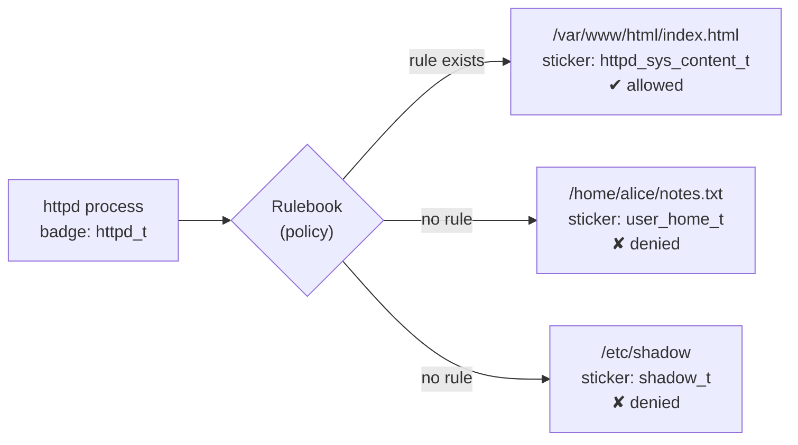
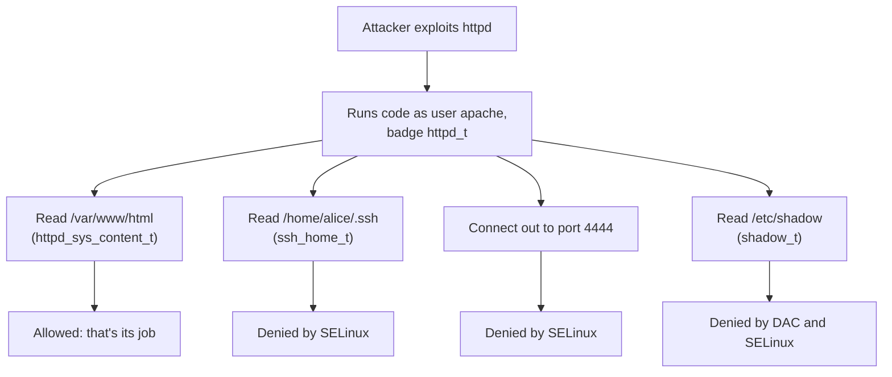
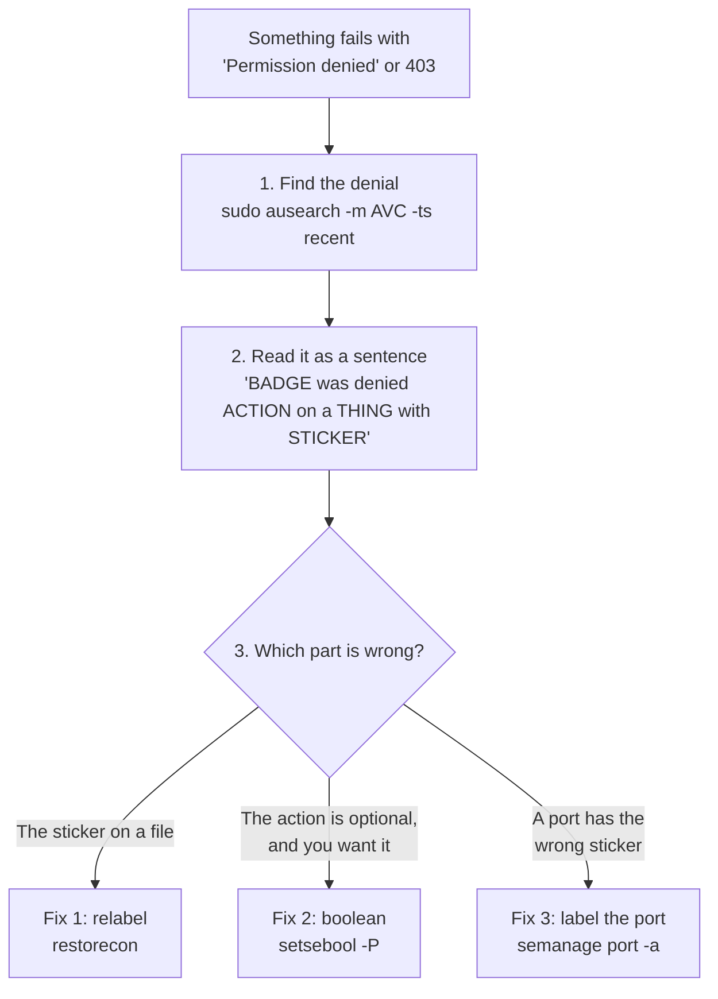
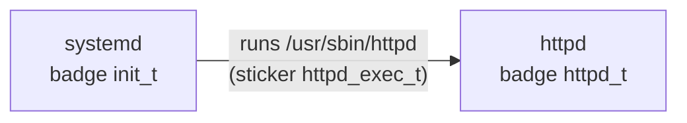
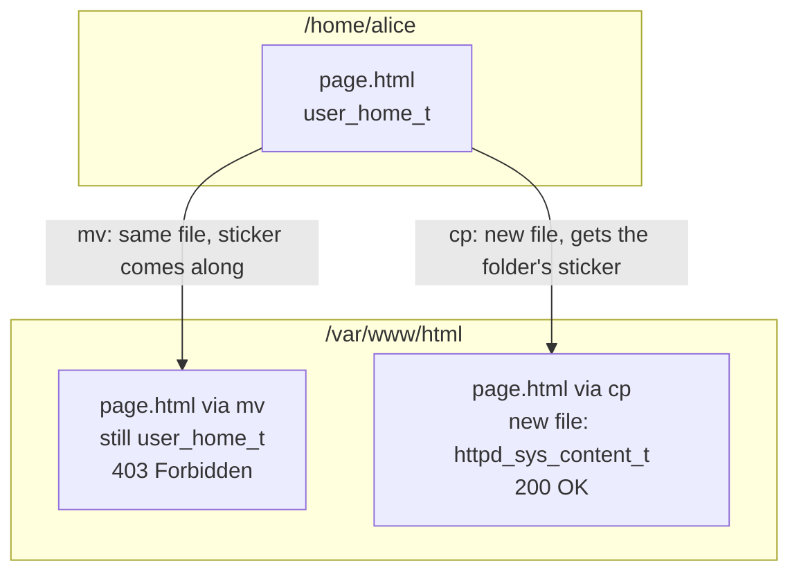

# 16 · SELinux

<ul class="module-meta">
  <li>⏱ ~3 hours</li>
  <li>5 labs</li>
  <li>Builds on: 04 · Permissions and ACLs, 07 · systemd and Services</li>
</ul>

You move a web page into `/var/www/html`, the permissions are `644`, Apache runs fine, and the browser says **403 Forbidden**. Someone on a forum says "just run `setenforce 0`", and it works. Please don't. SELinux just stopped something it was built to stop, and the real fix is one command.

SELinux has a reputation for being hard. It isn't, once you see the one idea underneath it. This module gives you that idea first, then shows you how to read SELinux's error messages as plain sentences, and then walks through the three fixes that solve almost every real problem.

!!! abstract "What you'll learn"
    - Explain SELinux in one sentence: badges, stickers and a rulebook.
    - Find the one part of a label that matters (the **type**) and ignore the rest.
    - Turn any SELinux denial into a plain English sentence, and tell from that sentence what is wrong.
    - Fix the three problems behind almost every denial: a wrong file label, a switch (boolean) that is off, and an unlabeled port.
    - Debug one service in permissive mode while the rest of the system stays protected.
    - Know why `setenforce 0` and blindly running `audit2allow` are the wrong fixes.

## The big picture

### SELinux in one sentence

Here is the whole idea:

> **Every process wears a badge. Every file and port wears a sticker. A rulebook lists which badges may touch which stickers, and anything not in the rulebook is refused.**

That's it. Everything else in this module is detail around that sentence.

- The **badge** on a process is called its **domain**. The web server's badge says `httpd_t`. The SSH server's says `sshd_t`.
- The **sticker** on a file, directory or port is called its **type**. Web pages have the sticker `httpd_sys_content_t`. Files in home directories have `user_home_t`. The password file has `shadow_t`.
- The **rulebook** is the **policy**. It has rules like "`httpd_t` may read `httpd_sys_content_t` files". It comes with Rocky, already written for hundreds of services.

Badges and stickers are both written the same way (a name ending in `_t`, for "type"), so you'll often hear both just called "types". Together, a badge or sticker plus some extra fields is called a **label** or **security context**.



!!! analogy "Think of it like an office building"
    Every employee wears a badge that says what job they do: "kitchen staff", "IT", "accounting". Every door has a sticker that says what's behind it: "kitchen", "server room", "payroll files". The building's security system has a list: "kitchen staff may open kitchen doors", "IT may open server room doors". When you tap your badge, the reader checks the list. Not on the list? The door stays shut, no matter who you are or how politely you ask.

    Where the analogy breaks: in real buildings a manager can override the reader. In SELinux, the rulebook is loaded into the kernel and even root follows it (unless root changes the rulebook itself).

### Why we need it: permissions protect users, not programs

You already know normal Unix permissions (owner, group, other, plus ACLs) from [module 04](04-permissions-and-acls.md). They're called **DAC**, for **discretionary access control**, because the file's owner decides who can use it. And every program runs with *all* the rights of the user who started it.

Now imagine your web server has a bug. An attacker sends a crafted request and gets to run commands as the `apache` user. With DAC alone, they can do anything `apache` can: read every world-readable file on the system, write wherever `apache` can write, connect out to any host to download more tools, and listen on any high port. Permissions were designed to keep *users* apart, not to limit what a *program* may do.

SELinux adds **MAC**, **mandatory access control**. "Mandatory" means the rulebook decides, not the file owner. The web server's badge only opens the doors a web server needs: web content, its logs, web ports. So the hijacked web server is stuck in a very small room.



Both checks must pass. Normal permissions are checked first; if they say no, the answer is no. If they say yes, SELinux gets a second veto. **SELinux can only take access away. It never gives access that permissions deny.**

On Rocky Linux, SELinux is **on and enforcing by default**, using the **targeted** policy. "Targeted" means the rulebook confines network-facing and system services (web servers, DNS, SSH, databases, containers and hundreds more), while you, a logged-in human, run mostly unconfined.

```console
$ getenforce
Enforcing
```

### The good news: three fixes cover almost everything

When SELinux blocks something legitimate, the cause is nearly always one of three things. Learn these and you can fix the vast majority of SELinux problems you'll ever meet.

| What's wrong | In badge-and-sticker terms | The fix |
|---|---|---|
| **1. A file has the wrong label** | The file is wearing the wrong sticker (a web page with a home-directory sticker) | `restorecon` puts the right sticker back. For a new location, teach SELinux with `semanage fcontext` first. |
| **2. A boolean is off** | The rulebook has an optional rule, but its switch is off ("may the web server talk to a database?") | `setsebool -P <name> on` |
| **3. A port has no label** | The service wants a port that doesn't wear its sticker (Apache on port 3131) | `semanage port -a` gives the port the right sticker |

And there's one simple process to find out which of the three you have:



The rest of the module teaches each step. You'll see the labels for yourself, learn to read a denial, then practise each fix.

### Words you'll see

| Word | Plain meaning |
|---|---|
| **label** / **context** | The full SELinux tag on something, like `system_u:object_r:httpd_sys_content_t:s0` |
| **type** | The important part of a label (the third field). On files and ports it's the "sticker" |
| **domain** | The type of a *process*, its "badge". `httpd_t`, `sshd_t` |
| **policy** | The rulebook, loaded into the kernel |
| **AVC denial** | SELinux's log message when it refuses something. AVC is the name of SELinux's decision cache |
| **boolean** | An on/off switch for an optional set of rules |
| **enforcing** / **permissive** | Blocking and logging / only logging |

## Seeing labels: everything wears one

Most commands you already know take a **`-Z`** option that shows labels. Try it.

**Files:**

```console
$ ls -Z /var/www/html/index.html /etc/shadow /home/alice/notes.txt
       system_u:object_r:httpd_sys_content_t:s0 /var/www/html/index.html
            system_u:object_r:shadow_t:s0 /etc/shadow
 unconfined_u:object_r:user_home_t:s0 /home/alice/notes.txt
```

**Processes:**

```console
$ ps -eZ | grep -E 'httpd|sshd|chronyd' | head -4
system_u:system_r:httpd_t:s0        1450 ?        00:00:00 httpd
system_u:system_r:sshd_t:s0-s0:c0.c1023 1023 ? 00:00:00 sshd
system_u:system_r:chronyd_t:s0       812 ?        00:00:00 chronyd
```

**Yourself:**

```console
$ id -Z
unconfined_u:unconfined_r:unconfined_t:s0-s0:c0.c1023
```

**Ports:**

```console
$ sudo semanage port -l | grep -w http_port_t
http_port_t                    tcp      80, 81, 443, 488, 8008, 8009, 8443, 9000
http_port_t                    udp      80, 443
```

A label has four fields separated by colons. **Only the third one matters day to day**:

```text
system_u:object_r:httpd_sys_content_t:s0
                  ^^^^^^^^^^^^^^^^^^^
                  the type: read this, ignore the rest
```

So in the output above: the web page wears `httpd_sys_content_t`, the password file wears `shadow_t`, Alice's notes wear `user_home_t`, the web server's badge is `httpd_t`, and you are `unconfined_t` (no restrictions to speak of). Ports 80 and 443 wear `http_port_t`.

Type names are designed to be read. `httpd_sys_content_t` is "web server system content". `httpd_log_t` is "web server logs". `ssh_port_t` is "SSH port". When you see a type, say it out loud and it usually explains itself.

!!! example "Try it"
    On your VM, run `ls -Z ~` and `ls -Z /etc/hosts /etc/shadow`. Your home files wear `user_home_t` (and dotfiles may have more specific types, like `ssh_home_t` on `~/.ssh`). `/etc/hosts` wears `net_conf_t`. Different stickers for different kinds of data.

??? question "For the curious: the other three fields"
    ```text
    system_u:object_r:httpd_sys_content_t:s0
       │        │             │            │
      user     role          type        level
    ```

    - **user**: an SELinux user, not your Linux login. `system_u` for system things, `unconfined_u` for normal logins.
    - **role**: used for role-based access. Files are always `object_r`. Processes are usually `system_r` or `unconfined_r`.
    - **type**: the badge or sticker. Almost every rule in the targeted policy is written in terms of types.
    - **level**: for MLS/MCS (multi-level and multi-category security). On Rocky it is usually `s0`, plus **categories** like `s0:c123,c456` that keep containers and VMs apart from each other (see "SELinux and containers" below).

??? question "Under the hood: where labels are stored"
    A file's label is stored on disk in an **extended attribute** called `security.selinux`. `ls -Z` is just a friendly way of showing it:

    ```console
    $ getfattr -n security.selinux -d /var/www/html/index.html
    getfattr: Removing leading '/' from absolute path names
    # file: var/www/html/index.html
    security.selinux="system_u:object_r:httpd_sys_content_t:s0"
    ```

    This matters later: a backup or copy tool that doesn't preserve extended attributes loses the sticker. A process's label lives in the kernel instead, and is visible under `/proc`:

    ```console
    $ sudo cat /proc/$(pgrep -o httpd)/attr/current; echo
    system_u:system_r:httpd_t:s0
    ```

    Even sockets show labels: `ss -ltnZ` adds the owning process's context to each listening socket.

## How SELinux decides

### The rulebook is a list of "allow" rules

Every rule in the policy reads like a sentence:

```text
allow   httpd_t   httpd_sys_content_t : file  { read open getattr map };
        badge     sticker               class   actions
```

"A process with badge `httpd_t` may `read`, `open`, `getattr` and `map` **files** with sticker `httpd_sys_content_t`." The **class** says what kind of thing (file, dir, tcp_socket, process…), and the actions (called **permissions**) depend on the class.

The golden rule: **if no rule allows it, it's denied.** There's no rule letting `httpd_t` read `user_home_t` files, so the web server can't read your home directory, whatever `chmod` says.

You can ask the rulebook directly with `sesearch` (package `setools-console`):

```console
$ sesearch --allow -s httpd_t -t httpd_sys_content_t -c file
allow httpd_t httpd_sys_content_t:file { getattr ioctl lock map open read };
…
$ sesearch --allow -s httpd_t -t user_home_t -c file
$
```

The second search returns nothing. No rule, no access.

### How a process gets its badge

You never assign badges by hand. They come from a **type transition** rule: "when a process with badge A runs a program with sticker B, the new process gets badge C". systemd runs as `init_t`. The Apache binary `/usr/sbin/httpd` wears `httpd_exec_t`. So when systemd starts Apache, the new process gets `httpd_t`.



That's also why starting a service by hand from your shell can behave differently from `systemctl start`: from your unconfined shell, the transition may not happen, so the process runs with your badge instead of the service's. Always test services with `systemctl`.

??? question "Under the hood: your own app is probably not confined at all"
    The targeted policy only confines programs it has rules for. So what happens when systemd starts *your* service, say `/opt/myapp/bin/myapp`? That binary has a generic sticker (`usr_t` under `/opt`, `bin_t` under `/usr/local/bin`). The policy has a catch-all for this case: systemd running a generic binary gives it the badge **`unconfined_service_t`**, which has almost no restrictions.

    ```console
    $ ps -eZ | grep myapp
    system_u:system_r:unconfined_service_t:s0 4410 ?    00:00:02 myapp
    ```

    That is why third-party software "just works" under SELinux, and also why it gets no protection from it. `ps -eZ | grep unconfined_service_t` lists every service running unconfined. To confine one, `sepolicy generate --init /opt/myapp/bin/myapp` (package `policycoreutils-devel`) writes a starting policy. Iterating on it is a project, not a quick fix, but for an internet-facing app it is worth it.

??? question "For the curious: where does the policy live?"
    The policy is built from hundreds of **modules** (roughly one per service) stored under `/var/lib/selinux/targeted/`. At boot the combined binary policy in `/etc/selinux/targeted/policy/` is loaded into the kernel, which exposes it under `/sys/fs/selinux/`. `semodule -l` lists the modules, and `seinfo` (from `setools-console`) prints counts of types, rules and booleans:

    ```console
    $ sudo semodule -l | grep -E '^(apache|container|ssh)$'
    apache
    container
    ssh
    $ ls /etc/selinux/targeted/contexts/files/
    file_contexts  file_contexts.bin  file_contexts.homedirs  file_contexts.homedirs.bin  file_contexts.local  file_contexts.subs  file_contexts.subs_dist  media
    ```

    `file_contexts` is the shipped path-to-label list that `restorecon` and `matchpathcon` read; `file_contexts.local` is where your `semanage fcontext` rules end up. You never edit these files directly: `semanage` writes them and rebuilds the policy.

### What happens on every access

Here's the order of checks when a process opens a file. Click through it.

<div class="stepper" markdown>

<div class="step" data-title="The system call" markdown>

`httpd` (running as user `apache`, badge `httpd_t`) calls `open("/var/www/html/index.html", O_RDONLY)`. The kernel must decide whether to allow it.

</div>

<div class="step" data-title="Permissions first" markdown>

The kernel checks normal permissions and ACLs: is `apache` the owner, in the group, or covered by "other" with read permission? If **no**, the call fails with `Permission denied` right here and SELinux is never asked. No SELinux message is logged.

```console
$ ls -l /var/www/html/index.html
-rw-r--r--. 1 root root 45 Oct 15 09:10 /var/www/html/index.html
```

The trailing `.` after the mode means the file has an SELinux label.

</div>

<div class="step" data-title="SELinux gets a veto" markdown>

Permissions said yes, so the kernel asks SELinux. SELinux looks at four things: the badge (`httpd_t`), the sticker (`httpd_sys_content_t`), the class (`file`) and the action (`read`, `open`).

</div>

<div class="step" data-title="Check the rulebook (cached)" markdown>

Answers are cached in the **AVC** (access vector cache), so most checks take nanoseconds. On a miss, SELinux looks up the policy and caches the answer. That cache is why SELinux's error messages are called "AVC denials".

</div>

<div class="step" data-title="Allow or deny" markdown>

If a rule matches, the `open()` succeeds. If not:

- In **enforcing** mode, the call fails with `Permission denied` and an AVC denial is written to the audit log.
- In **permissive** mode, the call *succeeds*, but the same AVC denial is still logged.

</div>

<div class="step" data-title="The evidence" markdown>

```text
type=AVC msg=audit(1792055001.112:892): avc:  denied  { read } for  pid=1452
comm="httpd" name="index.html" dev="vda4" ino=3412290
scontext=system_u:system_r:httpd_t:s0
tcontext=unconfined_u:object_r:user_home_t:s0 tclass=file permissive=0
```

To the application, a permissions denial and an SELinux denial look identical: `Permission denied`. The audit log is how you tell them apart.

</div>

</div>

<div class="quiz" data-answer="2" markdown>

A file is mode `600` owned by `root`, and labeled `httpd_sys_content_t`. `httpd` (user `apache`) tries to read it. What happens, and is an AVC denial logged?

- Allowed, because the SELinux type is correct
- Denied by normal permissions; no AVC is logged because SELinux is never asked
- Denied by SELinux; an AVC is logged
- Allowed, because SELinux overrides normal permissions

Right. Permissions are checked first and already say no (`apache` is "other", which has no permissions). SELinux can only ever *take away* access; it never grants what permissions deny.

</div>

## Reading a denial as a sentence

This is the most useful skill in the whole module. SELinux denials look scary, but every one of them fits the same sentence:

> **"`<badge>` was denied `<action>` on a `<class>` wearing `<sticker>`."**

### Finding denials

Denials go to the audit log, `/var/log/audit/audit.log`. Don't grep it by hand; use `ausearch` right after you reproduce the problem:

```console
$ sudo ausearch -m AVC -ts recent
----
time->Thu Oct 15 10:03:21 2026
type=PROCTITLE msg=audit(1792058601.448:1021): proctitle=2F7573722F7362696E2F6874747064002D44464F524547524F554E44
type=SYSCALL msg=audit(1792058601.448:1021): arch=c000003e syscall=257 success=no exit=-13 … comm="httpd" exe="/usr/sbin/httpd" subj=system_u:system_r:httpd_t:s0 key=(null)
type=AVC msg=audit(1792058601.448:1021): avc:  denied  { read } for  pid=1452 comm="httpd" name="page.html" dev="vda4" ino=3412290 scontext=system_u:system_r:httpd_t:s0 tcontext=unconfined_u:object_r:user_home_t:s0 tclass=file permissive=0
```

`-m AVC` picks SELinux denials and `-ts recent` means the last 10 minutes (`-ts today` and `-ts boot` also work). Add `-c httpd` to filter by program. Ignore the `PROCTITLE` and `SYSCALL` lines for now; the `type=AVC` line is the one you want.

### Pulling out the five words

You only need five pieces of that long line:

```text
avc:  denied  { read } for … comm="httpd" name="page.html" …
                 ▲               ▲             ▲
              ACTION           WHO         WHAT (name)

scontext=system_u:system_r:httpd_t:s0  tcontext=unconfined_u:object_r:user_home_t:s0  tclass=file
                           ▲                                          ▲                       ▲
                     BADGE (source)                          STICKER (target)             CLASS
```

| Field | In this example | Meaning |
|---|---|---|
| `denied { … }` | `read` | The **action** that was refused |
| `scontext` (3rd field) | `httpd_t` | The **badge**: who tried. "s" for source |
| `tcontext` (3rd field) | `user_home_t` | The **sticker**: what they tried to touch. "t" for target |
| `tclass` | `file` | What kind of thing it was |
| `comm`, `name` | `httpd`, `page.html` | The program and the file name, to help you find it |
| `permissive` | `0` | `0` = really blocked, `1` = only logged |

Now say it as a sentence: "**`httpd_t` was denied `read` on a `file` wearing `user_home_t`.**"

Then ask one question: **does that make sense?** Should the web server read a file with a *home directory* sticker? No. Should a web page in `/var/www/html` be wearing a home-directory sticker? Also no. The sticker is wrong. That's fix 1, a relabel. You've diagnosed the problem without touching anything.

### Practise: translate three denials

Read each denial, say the sentence, and decide which fix it needs before opening the answer.

**Denial A:**

```text
avc:  denied  { name_bind } for  pid=3310 comm="httpd" src=3131 scontext=system_u:system_r:httpd_t:s0 tcontext=system_u:object_r:unreserved_port_t:s0 tclass=tcp_socket permissive=0
```

??? success "Answer A"
    "`httpd_t` was denied `name_bind` (listening) on a `tcp_socket` wearing `unreserved_port_t`." The web server tried to listen on port 3131 (`src=3131`), and that port wears the generic "nobody's port" sticker, not `http_port_t`. **Fix 3: label the port** with `sudo semanage port -a -t http_port_t -p tcp 3131`.

**Denial B:**

```text
avc:  denied  { name_connect } for  pid=2207 comm="php-fpm" dest=5432 scontext=system_u:system_r:httpd_t:s0 tcontext=system_u:object_r:postgresql_port_t:s0 tclass=tcp_socket permissive=0
```

??? success "Answer B"
    "`httpd_t` was denied `name_connect` (connecting out) to a `tcp_socket` wearing `postgresql_port_t`." Your PHP app (PHP-FPM runs with the web server's badge) tried to connect to PostgreSQL on port 5432. The port's sticker is *correct*: it really is the PostgreSQL port. What's missing is permission for web apps to talk to databases, which is optional because many web servers should never do it. **Fix 2: a boolean**, `sudo setsebool -P httpd_can_network_connect_db on`.

**Denial C:**

```text
avc:  denied  { getattr } for  pid=1452 comm="httpd" path="/srv/site/index.html" dev="vda4" ino=3412411 scontext=system_u:system_r:httpd_t:s0 tcontext=unconfined_u:object_r:var_t:s0 tclass=file permissive=0
```

??? success "Answer C"
    "`httpd_t` was denied `getattr` (looking at) a `file` wearing `var_t`." `var_t` is the generic sticker for "something under `/var` or another place SELinux knows nothing about". The files in `/srv/site` are web content but SELinux has no rule saying so. **Fix 1, the "new location" version:** teach SELinux with `semanage fcontext`, then `restorecon`.

Notice the pattern. **A generic or wrong-looking sticker** (`user_home_t`, `var_t`, `default_t`, `unreserved_port_t`) on something the service legitimately uses means a labeling fix. **A correct sticker** but a missing permission means look for a boolean.

### setroubleshoot: denials in plain English

If you'd rather have a computer do the translation, install `setroubleshoot-server`. It analyses each denial and writes a summary with suggested fixes to the journal:

```console
$ sudo dnf install -y setroubleshoot-server
$ sudo journalctl -t setroubleshoot --since today
Oct 15 10:03:23 web01 setroubleshoot[2210]: SELinux is preventing /usr/sbin/httpd from read access on the file page.html. For complete SELinux messages run: sealert -l 6d1c0f3e-91a2-4b5e-9c1d-7e0a3b2f4c11
$ sudo sealert -l 6d1c0f3e-91a2-4b5e-9c1d-7e0a3b2f4c11
SELinux is preventing /usr/sbin/httpd from read access on the file page.html.

*****  Plugin restorecon (92.2 confidence) suggests   ************************

If you want to fix the label.
/var/www/html/page.html default label should be httpd_sys_content_t.
Then you can run restorecon. …
# /sbin/restorecon -v /var/www/html/page.html
…
```

The suggestions are ranked by confidence. The top one is usually right. The last one is almost always "generate a local policy module", which is rarely what you want.

!!! note "The denial you cannot see"
    If `auditd` isn't running, denials go to the kernel log instead: `journalctl -k --grep='avc:  denied'`. And some harmless denials are marked **dontaudit** in the policy, so they're blocked but never logged (to avoid noise). If you're sure something is blocked but `ausearch` shows nothing, temporarily turn off dontaudit rules with `sudo semodule -DB`, reproduce the problem, read the new denials, then restore them with `sudo semodule -B`.

## Fix 1: the file has the wrong label

Most real SELinux problems are files wearing the wrong sticker. To fix them, you need to know where stickers come from.

1. **A list of paths and labels.** The policy includes a list of path patterns and the sticker each should have: "anything under `/var/www` gets `httpd_sys_content_t`". `semanage fcontext -l` shows it.
2. **New files copy their folder.** A newly *created* file normally gets the sticker of the directory it's created in.
3. **`restorecon`** sets a file's sticker to whatever the list says it should be.

```console
$ sudo semanage fcontext -l | grep '^/var/www(/'
/var/www(/.*)?                                     all files          system_u:object_r:httpd_sys_content_t:s0
$ matchpathcon /var/www/html/index.html
/var/www/html/index.html	system_u:object_r:httpd_sys_content_t:s0
```

`matchpathcon` answers "what *should* this path wear?" without changing anything. `restorecon -nv` does the same for a whole tree as a dry run.

### Example: the `mv` trap

This is the classic. You write a page in your home directory and move it into the web root:



- **`mv`** (within one filesystem) just renames the file. It's the same file, still wearing its `user_home_t` sticker, and `httpd_t` can't read that.
- **`cp`** creates a *new* file, which gets the sticker for its new location. (Unless you use `cp -a` or `--preserve=context`, which deliberately copies the old sticker.)

The fix is one command, `restorecon`:

```console
$ ls -Z /var/www/html/page.html
unconfined_u:object_r:user_home_t:s0 /var/www/html/page.html
$ sudo restorecon -v /var/www/html/page.html
Relabeled /var/www/html/page.html from unconfined_u:object_r:user_home_t:s0 to unconfined_u:object_r:httpd_sys_content_t:s0
```

The same thing happens when you restore from a backup made without extended attributes, or extract a tarball without `--selinux`. When in doubt, `sudo restorecon -Rv` the directory. It's always safe: it only puts back the stickers the policy says should be there.

### Example: serving files from a new location

When you serve content from somewhere SELinux has never heard of, like `/srv/site`, the list has no rule for it, so files get a generic sticker (`var_t` or `default_t`) that `httpd_t` can't read. `restorecon` alone won't help, because as far as the list knows, `var_t` *is* correct.

So first teach SELinux the rule, then apply it:

```console
$ sudo semanage fcontext -a -t httpd_sys_content_t '/srv/site(/.*)?'
$ sudo restorecon -Rv /srv/site
Relabeled /srv/site from unconfined_u:object_r:var_t:s0 to unconfined_u:object_r:httpd_sys_content_t:s0
Relabeled /srv/site/index.html from unconfined_u:object_r:var_t:s0 to unconfined_u:object_r:httpd_sys_content_t:s0
$ sudo semanage fcontext -l -C
SELinux fcontext                                   type               Context

/srv/site(/.*)?                                    all files          system_u:object_r:httpd_sys_content_t:s0
```

Two steps, always in this order: **`semanage fcontext` writes the rule, `restorecon` applies it.** `-C` lists only your own additions. The pattern `'/srv/site(/.*)?'` is a regular expression meaning "the directory and everything under it". Quote it, or the shell may mangle it.

**Which sticker should you pick?** Choose the one that matches what the service does with the files. For the web server: `httpd_sys_content_t` for read-only content, `httpd_sys_rw_content_t` for directories the app writes to (uploads, caches), `httpd_log_t` for logs. Every confined service has a man page listing its types: `man httpd_selinux`, `man samba_selinux` and so on (install `selinux-policy-doc` for these).

!!! pitfall "`chcon` is temporary"
    `chcon -t httpd_sys_content_t file` changes the sticker right now and appears to fix things. But the list still says something else, so the next `restorecon` (or a full relabel) silently puts the old sticker back, and the outage returns weeks later. Use `chcon` only for quick experiments. For anything real, use `semanage fcontext` + `restorecon`.

??? question "Under the hood: equivalence rules and what restorecon leaves alone"
    If a new location should be labeled *exactly like* an existing one (a second web root, `/home` moved to `/data/home`), an **equivalence rule** is better than copying patterns. It tells SELinux "treat this path as if it were that path", including every sub-rule underneath:

    ```console
    $ sudo semanage fcontext -a -e /var/www /srv/www
    $ matchpathcon /srv/www/cgi-bin/app.cgi
    /srv/www/cgi-bin/app.cgi	system_u:object_r:httpd_sys_script_exec_t:s0
    ```

    Two `restorecon` details that surprise people. By default it only fixes the **type** and leaves the SELinux user (`unconfined_u` vs `system_u`) alone; `restorecon -F` forces the whole context. And some types are **customizable** (listed in `/etc/selinux/targeted/contexts/customizable_types`): `restorecon` won't overwrite them without `-F`, because an admin presumably set them on purpose. To relabel an entire system at the next boot, run `sudo fixfiles -F onboot` (or `sudo touch /.autorelabel`) and reboot.

<div class="quiz" data-answer="3" markdown>

You ran `sudo mv ~/report.pdf /var/www/html/` and the web server returns 403. Permissions are `644`. What is the best fix?

- `sudo setenforce 0`
- `sudo chmod 777 /var/www/html/report.pdf`
- `sudo restorecon -v /var/www/html/report.pdf`
- `sudo semanage fcontext -a -t httpd_sys_content_t /var/www/html/report.pdf`

Right. SELinux already knows what files under `/var/www` should wear; the file just kept its old home-directory sticker because `mv` keeps it. `restorecon` puts the right one back. A new `fcontext` rule is only needed for locations SELinux doesn't already know.

</div>

## Fix 2: a boolean is off

Some behaviour is fine on one server and dangerous on another. Should the web server be allowed to connect to a database? To read users' `~/public_html`? To use files on NFS? The policy authors wrote these rules in advance and put each set behind an on/off switch called a **boolean**. You flip the switch; you don't write any policy.

### Example: a web app that can't reach its database

Your PHP app shows "could not connect to server: Permission denied", even though PostgreSQL is running and the firewall is open. You find this denial (it's Denial B from earlier):

```text
avc:  denied  { name_connect } for  pid=2207 comm="php-fpm" dest=5432 scontext=system_u:system_r:httpd_t:s0 tcontext=system_u:object_r:postgresql_port_t:s0 tclass=tcp_socket permissive=0
```

The sentence: "`httpd_t` was denied connecting to a port wearing `postgresql_port_t`." Nothing is mislabeled. The web server simply isn't allowed to connect to databases until you say so. `audit2why` (more on it below) confirms it and names the switches:

```console
$ sudo ausearch -m AVC -ts recent -c php-fpm | audit2why
…
	Was caused by:
	One of the following booleans was set incorrectly.
	Description:
	Allow httpd to can network connect db

	Allow access by executing:
	# setsebool -P httpd_can_network_connect_db 1
	Description:
	Allow httpd to can network connect

	Allow access by executing:
	# setsebool -P httpd_can_network_connect 1
```

It offers two switches. **Pick the narrowest one.** `httpd_can_network_connect_db` allows connecting to database ports only. `httpd_can_network_connect` allows connecting to *any* port, which is far more than your app needs. So:

```console
$ getsebool -a | grep ^httpd_can_network
httpd_can_network_connect --> off
httpd_can_network_connect_cobbler --> off
httpd_can_network_connect_db --> off
httpd_can_network_memcache --> off
httpd_can_network_redis --> off
httpd_can_network_relay --> off
$ sudo setsebool -P httpd_can_network_connect_db on
$ sudo semanage boolean -l | grep httpd_can_network_connect_db
httpd_can_network_connect_db   (on   ,  off)  Allow httpd to can network connect db
```

The `(on , off)` columns are "current value" and "default". **Always use `-P`** (persistent). Without it the switch flips back at reboot and the problem returns.

Some other common booleans: `httpd_use_nfs` (web content on NFS), `httpd_enable_homedirs` (serve `~/public_html`), `samba_enable_home_dirs`, `use_nfs_home_dirs`, `container_manage_cgroup`. To browse what exists for a service, `getsebool -a | grep <service>`, or read its `man <service>_selinux` page.

## Fix 3: the port has no label

Ports wear stickers too. `httpd_t` may listen on ports wearing `http_port_t`, `sshd_t` on `ssh_port_t`, and so on. This stops a hijacked service from opening a backdoor on some random port. It's also why moving a service to a new port fails even after you open the firewall.

### Example: Apache on port 3131

You add `Listen 3131` to Apache's config and restart it. It fails to start:

```text
(13)Permission denied: AH00072: make_sock: could not bind to address [::]:3131
```

The denial is Denial A from earlier: "`httpd_t` was denied `name_bind` on a `tcp_socket` wearing `unreserved_port_t`". Port 3131 wears the generic sticker for ports nobody has claimed. Give it the web sticker:

```console
$ sudo semanage port -l | grep -E '^(http_port_t|ssh_port_t) '
http_port_t                    tcp      80, 81, 443, 488, 8008, 8009, 8443, 9000
http_port_t                    udp      80, 443
ssh_port_t                     tcp      22
$ sudo semanage port -a -t http_port_t -p tcp 3131
$ sudo semanage port -l -C
SELinux Port Type              Proto    Port Number

http_port_t                    tcp      3131
```

Restart Apache and it binds. If a port already wears another service's sticker, `-a` fails with "already defined"; use `-m` (modify) instead. Remove your addition with `semanage port -d -t http_port_t -p tcp 3131`.

!!! tip "Moving SSH to another port"
    You need three things: `Port 2222` in an sshd drop-in, `sudo semanage port -a -t ssh_port_t -p tcp 2222`, and a firewall rule ([module 12](12-firewalld.md)). Miss the SELinux step and `sshd` fails to start with "Bind to port 2222 … failed: Permission denied".

<div class="quiz" data-answer="3" markdown>

You changed PostgreSQL to listen on port 5433, opened it in firewalld, and now `postgresql.service` fails with "could not bind … Permission denied". `ausearch` shows `denied { name_bind }` with `tcontext=…unreserved_port_t`. What is the fix?

- `sudo setsebool -P postgresql_can_bind on`
- `sudo restorecon -Rv /var/lib/pgsql`
- `sudo semanage port -a -t postgresql_port_t -p tcp 5433`
- `sudo chcon -t postgresql_port_t /etc/services`

Right. The port wears the generic `unreserved_port_t` sticker. Labeling it `postgresql_port_t` lets `postgresql_t` listen on it. Files aren't involved, and there's no such boolean.

</div>

## When none of the three fit: audit2why and audit2allow

**`audit2why`** reads denials and explains *why* they happened: a missing allow rule, or a boolean that would allow it. It's useful, but it has a blind spot. Watch what it says about the `mv` trap from Fix 1:

```console
$ sudo ausearch -m AVC -ts recent | audit2why
type=AVC msg=audit(1792058601.448:1021): avc:  denied  { read } for  pid=1452 comm="httpd" name="page.html" … tclass=file permissive=0

	Was caused by:
	The boolean httpd_read_user_content was set incorrectly.
	Description:
	Allow httpd to read user content

	Allow access by executing:
	# setsebool -P httpd_read_user_content 1
```

It found a switch that *would* make the error go away: let the web server read every user's home files. That works, and it's completely the wrong fix. The file is simply wearing the wrong sticker. **Tools tell you what would allow the access. Only you can decide whether the access should happen.** That's why you read the denial as a sentence first.

**`audit2allow`** goes one step further and writes rules that allow whatever was denied:

```console
$ sudo ausearch -m AVC -ts recent | audit2allow

#============= httpd_t ==============

#!!!! This avc can be allowed using the boolean 'httpd_read_user_content'
allow httpd_t user_home_t:file read;
```

Loading that rule would let the web server read *every* `user_home_t` file on the system, which is exactly the attack from the start of the module. Blindly running `audit2allow -M` and loading the result is the SELinux version of `chmod 777`.

So always work through the fixes in this order:

1. **Is a sticker wrong?** `restorecon`, or `semanage fcontext` + `restorecon` for new locations.
2. **Is it an optional behaviour you want?** Set the narrowest boolean.
3. **Is it a port?** `semanage port`.
4. **Only then**, if the application really does something the policy never anticipated, write a small custom module.

<div class="quiz" data-answer="2" markdown>

`audit2allow` suggests `allow httpd_t var_t:file { read open };` for your app's files in `/srv/app/data`. What should you do?

- Load it with `audit2allow -M` and `semodule -i`; the tool knows best
- Label the directory properly with `semanage fcontext` and `restorecon`, because the rule would let httpd read every `var_t` file
- Switch to permissive mode, since the app clearly needs the access

Right. A rule on a broad, generic sticker like `var_t` is the signature of a labeling problem. Give the files a web content sticker and the existing policy allows the access.

</div>

### A custom policy module, as a last resort

If you've ruled out the three fixes, build a module from the denials, *read it*, and keep it as small as possible:

```console
$ sudo ausearch -m AVC -c myapp -ts today | audit2allow -M myapp_local
******************** IMPORTANT ***********************
To make this policy package active, execute:

semodule -i myapp_local.pp

$ cat myapp_local.te

module myapp_local 1.0;

require {
	type myapp_t;
	type var_lib_t;
	class dir { add_name write };
}

#============= myapp_t ==============
allow myapp_t var_lib_t:dir { add_name write };
$ sudo semodule -i myapp_local.pp
$ sudo semodule -l | grep myapp
myapp_local
$ sudo semodule -r myapp_local       # remove it again
```

The `.te` file is the human-readable source; review every line. If a rule targets a broad sticker like `var_lib_t`, `etc_t` or `user_home_t`, stop: you're probably looking at a labeling problem. Keep the `.te` file in version control so the module can be rebuilt.

## Modes: enforcing, permissive, disabled

SELinux has three modes:

- **Enforcing**: denials are blocked and logged. The default, and the only mode you want in production.
- **Permissive**: denials are logged but *not* blocked. A diagnostic mode: "tell me everything you would have blocked".
- **Disabled**: SELinux isn't running at all. Files created while disabled get no stickers.

```console
$ getenforce
Enforcing
$ sudo setenforce 0          # permissive until reboot
$ getenforce
Permissive
$ sudo setenforce 1          # back to enforcing
```

The boot-time mode is set in `/etc/selinux/config`:

```ini title="/etc/selinux/config"
SELINUX=enforcing
SELINUXTYPE=targeted
```

### Better than `setenforce 0`: one permissive domain

`setenforce 0` turns off protection for *every* service on the machine, and it's easy to forget to turn it back on. If you need to debug one service, make only its badge permissive:

```console
$ sudo semanage permissive -a httpd_t
$ sudo semanage permissive -l

Customized Permissive Types

httpd_t
$ sudo semanage permissive -d httpd_t
```

Everything else stays enforcing, and `httpd_t` denials are logged with `permissive=1` so you can collect them all in one go.

??? question "Under the hood: why permissive mode logs each denial only once"
    In enforcing mode, a denied access is denied (and usually logged) every time. In permissive mode, after logging a denial the kernel records that access in the AVC as allowed, so the *same* badge, sticker, class and action isn't reported again. You get one line per distinct problem instead of a flood.

    Two consequences. First, a permissive run gives you a compact, complete list of what the application needs, which is exactly what `audit2allow` wants. Second, if you fix something and retest in permissive mode, an old denial won't reappear even if your fix didn't work. Reloading the policy (for example `sudo semodule -R`) or a reboot clears the cache.

!!! warning "Do not disable SELinux"
    Since Rocky 9, setting `SELINUX=disabled` in `/etc/selinux/config` is no longer the supported way to turn SELinux off; the supported way is the `selinux=0` kernel argument. Either way, disabling is almost always the wrong answer. While SELinux is disabled, new files get no stickers, so turning it back on later forces a full **relabel** of every file at boot (`/.autorelabel`), which can take a long time on big filesystems. If you must, use permissive mode, and better still, a permissive domain.

### Practice: the 403 drill

Put the whole process together: confirm SELinux is on, look at the sticker, read the denial, fix, test.

<div class="terminal-sim" data-title="Fix a 403 the right way" data-prompt="[alex@web01 ~]$ " markdown>

<div class="task" data-expect="getenforce" data-match="getenforce|sestatus|sudo sestatus" data-hint="One short command prints the current SELinux mode." markdown>

**Step 1.** A page returns 403. First, is SELinux enforcing?

```text
Enforcing
```

</div>

<div class="task" data-expect="ls -Z /var/www/html/page.html" data-match="ls -[lZ]*Z[lZ]* /var/www/html/page.html|ls -Z /var/www/html/?" data-hint="ls has a -Z option that shows the SELinux context." markdown>

**Step 2.** Look at the label on `/var/www/html/page.html`.

```text
unconfined_u:object_r:user_home_t:s0 /var/www/html/page.html
```

</div>

<div class="task" data-expect="sudo ausearch -m AVC -ts recent" data-match="(sudo )?ausearch -m (AVC|avc) -ts recent( -c httpd)?|(sudo )?ausearch -m (AVC|avc)( -c httpd)? -ts recent" data-hint="ausearch with -m AVC selects denials; -ts recent limits it to the last 10 minutes." markdown>

**Step 3.** Confirm it with the audit log: show recent AVC denials.

```text
----
time->Thu Oct 15 10:03:21 2026
type=AVC msg=audit(1792058601.448:1021): avc:  denied  { read } for  pid=1452 comm="httpd" name="page.html" dev="vda4" ino=3412290 scontext=system_u:system_r:httpd_t:s0 tcontext=unconfined_u:object_r:user_home_t:s0 tclass=file permissive=0
```

</div>

<div class="task" data-expect="sudo restorecon -v /var/www/html/page.html" data-match="(sudo )?restorecon (-v |-Rv |-vR |-R -v |-v -R )?/var/www/html(/page.html|/)?" data-hint="restorecon resets a file to the label the policy database says it should have. Add -v to see what changed." markdown>

**Step 4.** "`httpd_t` was denied read on a file wearing `user_home_t`": the sticker is wrong. Put the right one back.

```text
Relabeled /var/www/html/page.html from unconfined_u:object_r:user_home_t:s0 to unconfined_u:object_r:httpd_sys_content_t:s0
```

</div>

<div class="task" data-expect="curl http://localhost/page.html" data-match="curl (-s |-sS |-i |-I |-v )?(http://)?localhost/page.html" data-hint="Request the page again with curl." markdown>

**Step 5.** Test the page again.

```text
<h1>Quarterly report</h1>
```

</div>

</div>

## SELinux and containers

Containers are where SELinux earns its keep on modern hosts. Podman gives every container process the badge **`container_t`**, and container files wear `container_file_t`. That alone would let one container read another's files, since they share the same badge and sticker. So each container also gets a unique pair of **categories** in the fourth field of its label, such as `s0:c412,c837`. A process can only touch files whose categories match its own.

Think of it as the same badge with a different room number printed on it.

```console
$ podman run -d --name web1 docker.io/library/nginx
$ ps -eZ | grep nginx | head -2
system_u:system_r:container_t:s0:c412,c837 23011 ? 00:00:00 nginx
system_u:system_r:container_t:s0:c412,c837 23040 ? 00:00:00 nginx
```

When you mount a host directory into a container, its files usually wear a host sticker like `user_home_t` or `var_t`, which `container_t` may not touch. Podman can relabel the directory for you with a volume option:

- **`:Z`** (uppercase): relabel the content as private to *this* container (with its categories). Other containers can't use it.
- **`:z`** (lowercase): relabel as shared, usable by all containers.

```console
$ mkdir -p ~/site && echo hi > ~/site/index.html
$ podman run --rm -v ~/site:/usr/share/nginx/html:Z docker.io/library/nginx ls -Z /usr/share/nginx/html
system_u:object_r:container_file_t:s0:c95,c710 index.html
```

!!! danger "Never use `:Z` on system or shared directories"
    `:Z` relabels the host directory in place. Running a container with `-v /home:/home:Z` or `-v /usr:/usr:Z` would relabel those trees for one container and break logins or the whole system. Only relabel directories that exist for the container.

More on how containers are built from namespaces, cgroups and SELinux in [Containers from the Ground Up](18-containers.md).

## Is it SELinux? A decision tree

When something fails with "Permission denied" (or a service won't start, or a page returns 403), use this tree before touching any setting.

<div class="decision" markdown>

<div class="node" data-id="start" markdown>

**Do you see a fresh AVC denial?** Run `sudo ausearch -m AVC -ts recent` right after reproducing the problem.

<button data-goto="avc">Yes, there is a denial</button> <button data-goto="noavc">No denial</button>

</div>

<div class="node" data-id="noavc" markdown>

**Does the problem go away in permissive mode for that domain?** Try `sudo semanage permissive -a <domain>_t` (find the domain with `ps -eZ`), reproduce, then remove it again with `-d`.

<button data-goto="dontaudit">Yes, it works when permissive</button> <button data-goto="notselinux">No, still broken</button>

</div>

<div class="node" data-id="notselinux" markdown>

**It is not SELinux.** Check the usual suspects: permissions and ownership along the whole path (`namei -l /path`), ACLs, the firewall, the application's own config, and its logs (`journalctl -u <service>`).

</div>

<div class="node" data-id="dontaudit" markdown>

**It is SELinux, hidden by dontaudit.** Run `sudo semodule -DB`, reproduce, then `sudo ausearch -m AVC -ts recent`. Now you will see the denial. Restore with `sudo semodule -B` and continue with the denial branch.

</div>

<div class="node" data-id="avc" markdown>

**Say the sentence, then look at the sticker (`tcontext` type). Is it the sticker this file, directory or port *should* wear?** Compare with `matchpathcon <path>` or the service's man page (`man httpd_selinux`).

<button data-goto="label">No, the sticker looks wrong</button> <button data-goto="labelok">Yes, the sticker is right</button>

</div>

<div class="node" data-id="label" markdown>

**Fix 1: fix the label.** If `matchpathcon` already gives the right type: `sudo restorecon -Rv <path>`. If the location is new to the policy: `sudo semanage fcontext -a -t <type> '<path>(/.*)?'` then `sudo restorecon -Rv <path>`.

</div>

<div class="node" data-id="labelok" markdown>

**Is the target a port the service listens on (`tclass=tcp_socket` or `udp_socket` with `name_bind`)?**

<button data-goto="port">Yes, a listening port</button> <button data-goto="bool">No</button>

</div>

<div class="node" data-id="port" markdown>

**Fix 3: label the port:** `sudo semanage port -a -t <service>_port_t -p tcp <port>`.

</div>

<div class="node" data-id="bool" markdown>

**Does `audit2why` name a boolean, and is that behaviour something you actually want?** (Outgoing connections, `name_connect`, usually land here.)

<button data-goto="setbool">Yes, and I want it</button> <button data-goto="module">No suitable boolean</button>

</div>

<div class="node" data-id="setbool" markdown>

**Fix 2: set it persistently:** `sudo setsebool -P <boolean> on`. Pick the narrowest boolean that solves the problem.

</div>

<div class="node" data-id="module" markdown>

**Last resort: a small local module.** Collect all denials (a permissive domain helps), run `audit2allow -M`, *read the `.te` file*, make sure no rule targets a broad type, and load it with `semodule -i`. Consider reporting the case upstream so the policy can cover it.

</div>

</div>


## Labs

!!! note "Lab setup"
    Use a throwaway Rocky 10 VM in enforcing mode (`getenforce` prints `Enforcing`). Install the tools and a web server once:

    ```bash
    sudo dnf install -y httpd policycoreutils-python-utils setools-console setroubleshoot-server
    sudo systemctl enable --now httpd
    echo "it works" | sudo tee /var/www/html/index.html
    curl -s http://localhost/index.html
    ```

    `curl` prints "it works". Taking a VM snapshot now is a good idea.

!!! lab "Lab 1: Explore labels and domains"

    **Goal:** See labels on files, processes, ports and yourself, and find the rules that connect them.

    1. Look at labels everywhere:

        ```bash
        id -Z
        ls -Z /var/www/html/index.html /etc/shadow ~
        ps -eZ | grep -E 'httpd|sshd' | head -3
        sudo semanage port -l | grep -w http_port_t
        ```

    2. Ask the policy what `httpd_t` may do with web content and with shadow files:

        ```bash
        sesearch --allow -s httpd_t -t httpd_sys_content_t -c file
        sesearch --allow -s httpd_t -t shadow_t -c file
        ```

    3. Find out how `httpd` gets its domain:

        ```bash
        ls -Z /usr/sbin/httpd
        sesearch --type_transition -s init_t -t httpd_exec_t
        ```

    **Check your work:** you can name the type of the web page (`httpd_sys_content_t`), the web server's domain (`httpd_t`), your own domain (`unconfined_t`), and the executable's type (`httpd_exec_t`). The `shadow_t` search returns no rules.

    ??? success "What just happened?"
        The type transition rule says: when `init_t` (systemd) executes a file of type `httpd_exec_t`, the new process enters `httpd_t`. The domain then decides everything the process can touch.

    **Clean up:** nothing to undo.

!!! lab "Lab 2: The mv trap"

    **Goal:** Cause the most common SELinux problem on purpose, diagnose it from the audit log, and fix it correctly.

    1. Create a page in your home directory and move it into the web root:

        ```bash
        echo "moved page" > ~/moved.html
        echo "copied page" > ~/copied.html
        sudo mv ~/moved.html /var/www/html/
        sudo cp ~/copied.html /var/www/html/
        sudo chmod 644 /var/www/html/moved.html /var/www/html/copied.html
        ls -Z /var/www/html/
        ```

    2. Request both:

        ```bash
        curl -s -o /dev/null -w '%{http_code}\n' http://localhost/copied.html
        curl -s -o /dev/null -w '%{http_code}\n' http://localhost/moved.html
        ```

    3. Find the evidence and let the tools explain it:

        ```bash
        sudo ausearch -m AVC -ts recent -c httpd
        sudo ausearch -m AVC -ts recent -c httpd | audit2why
        sudo journalctl -t setroubleshoot --since "-5min"
        ```

    4. Fix it the right way and test again:

        ```bash
        sudo restorecon -v /var/www/html/moved.html
        curl -s http://localhost/moved.html
        ```

    **Check your work:** before the fix, `copied.html` returns `200` and `moved.html` returns `403`, and the AVC shows `tcontext=…user_home_t`. After `restorecon`, `moved.html` returns "moved page".

    ??? success "What just happened?"
        `mv` kept the inode and therefore the `user_home_t` label. `cp` created a new file that inherited `httpd_sys_content_t` from the directory. `audit2why` suggested the `httpd_read_user_content` boolean, which would have "worked" by letting the web server read every home directory. Fixing the label was the precise fix.

    **Clean up:** `sudo rm /var/www/html/moved.html /var/www/html/copied.html ~/copied.html`

!!! lab "Lab 3: Serve content from a new directory"

    **Goal:** Teach SELinux a permanent labeling rule for a non-standard path, and see why `chcon` is not enough.

    1. Create the content and point Apache at it with an alias:

        ```bash
        sudo mkdir -p /srv/site
        echo "hello from /srv/site" | sudo tee /srv/site/index.html
        sudo tee /etc/httpd/conf.d/site.conf >/dev/null <<'EOF'
        Alias /site /srv/site
        <Directory /srv/site>
            Require all granted
        </Directory>
        EOF
        sudo systemctl reload httpd
        ls -Zd /srv/site /srv/site/index.html
        curl -s -o /dev/null -w '%{http_code}\n' http://localhost/site/
        ```

    2. Try the temporary fix, then watch it get undone:

        ```bash
        sudo chcon -R -t httpd_sys_content_t /srv/site
        curl -s http://localhost/site/
        sudo restorecon -Rv /srv/site
        curl -s -o /dev/null -w '%{http_code}\n' http://localhost/site/
        ```

    3. Apply the permanent fix:

        ```bash
        sudo semanage fcontext -a -t httpd_sys_content_t '/srv/site(/.*)?'
        sudo restorecon -Rv /srv/site
        curl -s http://localhost/site/
        sudo semanage fcontext -l -C
        ```

    **Check your work:** step 1 returns `403` (label `var_t`). `chcon` makes it work, `restorecon` breaks it again. After step 3 it works, and survives another `sudo restorecon -Rv /srv/site`.

    **Clean up:**

    ```bash
    sudo semanage fcontext -d '/srv/site(/.*)?'
    sudo rm -rf /srv/site /etc/httpd/conf.d/site.conf
    sudo systemctl reload httpd
    ```

!!! lab "Lab 4: A service on a new port"

    **Goal:** See SELinux stop a service from binding to an unlabeled port, and fix it with a port label.

    1. Make Apache also listen on port 3131 and restart it:

        ```bash
        echo "Listen 3131" | sudo tee /etc/httpd/conf.d/port3131.conf
        sudo systemctl restart httpd
        sudo systemctl status httpd --no-pager | tail -5
        ```

    2. Read the denial:

        ```bash
        sudo ausearch -m AVC -ts recent -c httpd | grep name_bind
        sudo semanage port -l | grep -w 3131
        ```

    3. Label the port and try again:

        ```bash
        sudo semanage port -a -t http_port_t -p tcp 3131
        sudo systemctl restart httpd
        curl -s http://localhost:3131/index.html
        ```

    **Check your work:** step 1 fails with `(13)Permission denied: AH00072: make_sock: could not bind to address [::]:3131` in the status output. The AVC shows `denied { name_bind }` with `tcontext=…unreserved_port_t` and `tclass=tcp_socket`. After step 3, `curl` prints "it works".

    **Clean up:**

    ```bash
    sudo rm /etc/httpd/conf.d/port3131.conf
    sudo semanage port -d -t http_port_t -p tcp 3131
    sudo systemctl restart httpd
    ```

!!! lab "Lab 5: Booleans and a permissive domain"

    **Goal:** Use a boolean to allow outbound connections from the web server, and use a permissive domain to collect denials safely.

    1. Check the boolean, then ask the policy which outbound-connection rules exist for `httpd_t`, and which ones only exist when the boolean is on:

        ```bash
        getsebool httpd_can_network_connect
        sesearch --allow -s httpd_t -t port_type -c tcp_socket -p name_connect | head
        sesearch --allow -s httpd_t -c tcp_socket -p name_connect -b httpd_can_network_connect
        ```

    2. Flip the boolean at runtime only, check it, and flip it back:

        ```bash
        sudo setsebool httpd_can_network_connect on
        getsebool httpd_can_network_connect
        sudo semanage boolean -l | grep -w httpd_can_network_connect
        sudo setsebool httpd_can_network_connect off
        ```

    3. Make `httpd_t` permissive, repeat Lab 2's mistake, and see the access succeed but still get logged:

        ```bash
        sudo semanage permissive -a httpd_t
        echo "permissive test" > ~/p.html && sudo mv ~/p.html /var/www/html/ && sudo chmod 644 /var/www/html/p.html
        curl -s http://localhost/p.html
        sudo ausearch -m AVC -ts recent -c httpd | grep -o 'permissive=[01]' | sort | uniq -c
        getenforce
        ```

    **Check your work:** in step 2 the `semanage boolean -l` line shows `(on , off)`: on now, off by default. In step 3 the page is served, the AVC shows `permissive=1`, and `getenforce` still says `Enforcing` for the rest of the system.

    ??? success "What just happened?"
        The `-b` search showed rules that only exist while the boolean is on. Setting it without `-P` changed only the running policy. The permissive domain let `httpd_t` do everything while logging what *would* have been denied, which is how you gather the complete list of denials for an application in one pass.

    **Clean up:**

    ```bash
    sudo semanage permissive -d httpd_t
    sudo rm /var/www/html/p.html /var/www/html/index.html
    sudo systemctl disable --now httpd
    ```

## Common pitfalls

| Symptom | Cause | Fix |
|---|---|---|
| 403 after moving files into the web root | `mv` kept the old label | `restorecon -Rv <dir>` |
| Fix works, then breaks weeks later | Used `chcon`, later undone by `restorecon` or relabel | `semanage fcontext -a` + `restorecon` |
| Boolean fix lost after reboot | `setsebool` without `-P` | `setsebool -P` |
| Service will not start on a new port | Port not labeled for that domain | `semanage port -a -t <type>_port_t -p tcp <port>` |
| Files broken after restoring a backup | Backup tool dropped extended attributes | `restorecon -Rv`; use `tar --selinux` or `rsync -X` next time |
| "Permission denied" but no AVC | DAC denial, or a dontaudit rule | Check `namei -l <path>`; try `semodule -DB` |
| `audit2allow` module "fixed" it | You probably granted far too much | Remove with `semodule -r`; fix the label or boolean instead |
| Service works from your shell but not via systemd | Manual start ran unconfined; systemd start ran in its domain | Always test with `systemctl` |
| Container cannot read a bind mount | Host files labeled for the host | `:Z` or `:z` volume option (only on dedicated dirs) |

!!! pitfall "`setenforce 0` as a fix"
    It makes the symptom disappear and removes protection from every service on the machine. Worse, it is often forgotten. If you need permissive for debugging, use `semanage permissive -a <domain>` and remove it when done.

## Cheat sheet

| Command | What it does |
|---|---|
| `getenforce` / `sestatus` | Current mode / full status |
| `setenforce 0` / `setenforce 1` | Permissive / enforcing until reboot |
| `semanage permissive -a <domain>` | Make one domain permissive (`-d` to undo) |
| `ls -Z`, `ps -eZ`, `id -Z`, `ss -Z` | Show labels of files, processes, yourself, sockets |
| `matchpathcon <path>` | What label should this path have? |
| `restorecon -Rv <path>` | Reset labels to the database default |
| `semanage fcontext -a -t <type> '<path>(/.*)?'` | Add a permanent labeling rule |
| `semanage fcontext -l -C` | List your local labeling rules |
| `chcon -t <type> <file>` | Temporary label change (experiments only) |
| `getsebool -a` / `semanage boolean -l` | List booleans (with descriptions) |
| `setsebool -P <bool> on` | Set a boolean persistently |
| `semanage port -l` / `-a -t <type> -p tcp <port>` | List / add port labels |
| `ausearch -m AVC -ts recent` | Recent denials |
| `sealert -l <id>` / `journalctl -t setroubleshoot` | Plain-English analysis |
| `audit2why` | Explain why a denial happened |
| `audit2allow -M <name>` | Generate a module (review before loading) |
| `semodule -i <name>.pp` / `-r <name>` / `-l` | Install / remove / list modules |
| `semodule -DB` / `semodule -B` | Disable / restore dontaudit rules |
| `sesearch --allow -s <domain> -t <type>` | Search the loaded policy |

## Flashcards

<div class="flashcards" markdown>

<div class="card" markdown>

Explain SELinux in one sentence.

Every process wears a badge (its domain), every file and port wears a sticker (its type), and the policy lists which badges may touch which stickers. Anything not listed is denied.

</div>

<div class="card" markdown>

What are the three fixes behind almost every SELinux denial?

1. Wrong file label: `restorecon` (plus `semanage fcontext` for new locations). 2. Optional behaviour switched off: `setsebool -P`. 3. Unlabeled port: `semanage port -a`.

</div>

<div class="card" markdown>

Turn this into a sentence: `denied { read } … scontext=…httpd_t… tcontext=…user_home_t… tclass=file`

"`httpd_t` was denied read on a file wearing `user_home_t`." A web server reading a home-directory sticker makes no sense, so the file's label is wrong.

</div>

<div class="card" markdown>

What does DAC fail to protect against that SELinux handles?

A compromised program. DAC lets it do anything its user can; SELinux limits each service's domain to what its job needs.

</div>

<div class="card" markdown>

Which field of `system_u:object_r:httpd_sys_content_t:s0` matters most day to day?

The third one, the **type**. Almost all targeted-policy rules are written in terms of types.

</div>

<div class="card" markdown>

Which check runs first, DAC or SELinux?

DAC. If permissions deny the access, SELinux is never consulted and no AVC is logged.

</div>

<div class="card" markdown>

Why does `mv` cause SELinux problems when `cp` usually doesn't?

`mv` keeps the inode and its label. `cp` creates a new file that gets the label for its new location.

</div>

<div class="card" markdown>

`chcon` vs `semanage fcontext` + `restorecon`?

`chcon` changes the label now but is undone by the next relabel. `semanage fcontext` records the rule in the database, `restorecon` applies it, and it lasts.

</div>

<div class="card" markdown>

What does `-P` do in `setsebool -P`?

Makes the boolean change persistent across reboots. Without it, the change is runtime only.

</div>

<div class="card" markdown>

How do you let `httpd` listen on port 3131?

`semanage port -a -t http_port_t -p tcp 3131` (plus the `Listen` directive and a firewall rule).

</div>

<div class="card" markdown>

How do you debug one service without turning SELinux off for everything?

`semanage permissive -a <domain>_t`. Only that domain becomes permissive; remove with `-d`.

</div>

<div class="card" markdown>

Why is blindly loading `audit2allow -M` output dangerous?

It allows whatever was denied, often on broad types like `user_home_t`, which can open the exact hole SELinux was closing. Fix labels, booleans and ports first.

</div>

<div class="card" markdown>

What do `:Z` and `:z` do on a Podman volume?

Relabel the host directory to `container_file_t`: `:Z` privately for one container (unique categories), `:z` shared by all containers.

</div>

</div>

## Recap

!!! recap "Key takeaways"
    - SELinux in one sentence: every process wears a badge (domain), every file and port wears a sticker (type), and a rulebook (policy) lists which badges may touch which stickers. Anything not listed is refused.
    - DAC lets a compromised service do anything its user can. SELinux confines each service to what its job requires.
    - Every process and object has a context; the **type** (third field) drives almost every decision.
    - Read every denial as a sentence: "`<badge>` was denied `<action>` on a `<class>` wearing `<sticker>`". A wrong or generic sticker means relabel; a correct sticker means look for a boolean or a port label.
    - Access needs DAC *and* SELinux to agree. SELinux never grants what permissions deny.
    - Most problems are labels: `restorecon` for known locations, `semanage fcontext` + `restorecon` for new ones. `mv` keeps labels, `cp` does not.
    - Booleans (`setsebool -P`) and port labels (`semanage port`) cover the common supported variations.
    - Read denials with `ausearch -m AVC`, `audit2why` and `sealert`, then decide whether the access *should* happen. `audit2allow` is a last resort.
    - Use a permissive domain for debugging, never `setenforce 0` or disabling.

## Go deeper

- Man pages: [[man:selinux(8)]] [[man:semanage(8)]] [[man:semanage-fcontext(8)]] [[man:restorecon(8)]] [[man:setsebool(8)]] [[man:ausearch(8)]] [[man:audit2allow(1)]] [[man:sealert(8)]] [[man:httpd_selinux(8)]]
- [RHEL 10: Using SELinux](https://docs.redhat.com/en/documentation/red_hat_enterprise_linux/10/html/using_selinux/index)
- [The SELinux Notebook](https://github.com/SELinuxProject/selinux-notebook)
- [SELinux Project on GitHub](https://github.com/SELinuxProject)
- [Rocky Linux documentation](https://docs.rockylinux.org/)

**Next:** [17 · Security Hardening](17-security-hardening.md)
