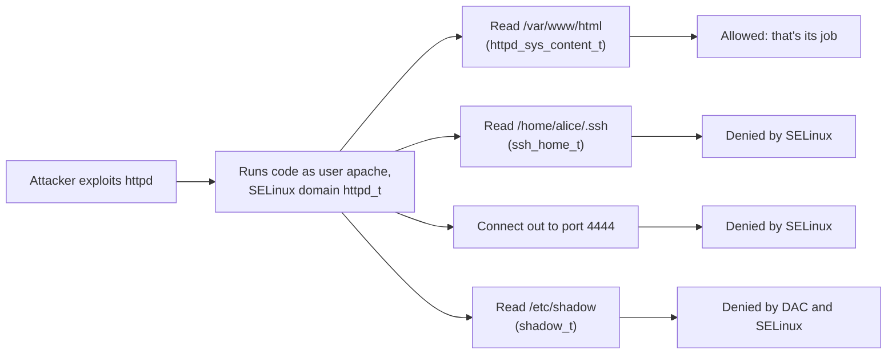
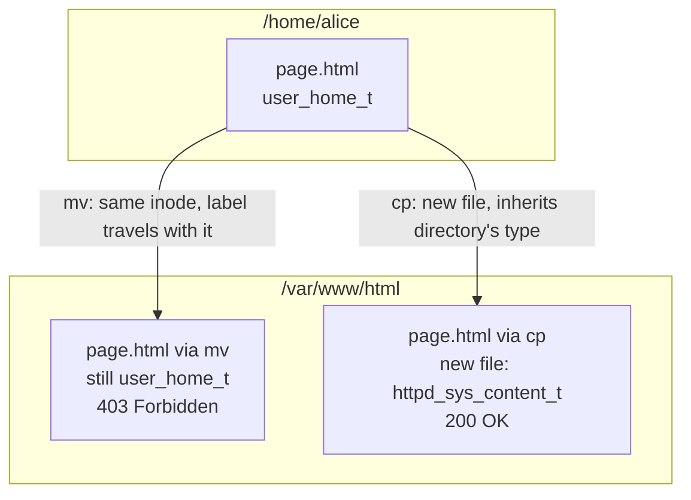

# 16 · SELinux

<ul class="module-meta">
  <li>⏱ ~3 hours</li>
  <li>5 labs</li>
  <li>Builds on: 04 · Permissions and ACLs, 07 · systemd and Services</li>
</ul>

You move a web page into `/var/www/html`, the permissions are `644`, Apache runs fine, and the browser says **403 Forbidden**. Someone on a forum says "just run `setenforce 0`", and it works. Please don't. SELinux just stopped something it was built to stop, and the real fix is one command. This module takes the fear out of SELinux: you will learn what it protects, how it decides, and how to read its messages so that the fix is quick, correct and small.

!!! abstract "What you'll learn"
    - Explain why normal Unix permissions cannot contain a compromised service, and how SELinux can.
    - Read an SELinux **context** and find the **type** that matters.
    - Describe how an access check works: permissions first, then SELinux policy.
    - Switch modes safely, including making one service permissive while the rest stays enforcing.
    - Fix the three most common problems: wrong file labels, a boolean that is off, and an unlabeled port.
    - Read an AVC denial, use `audit2why`, and know why blindly running `audit2allow` is a bad idea.
    - Work out quickly whether a problem is SELinux at all.

## The big picture

### Why permissions are not enough

Classic Unix permissions (owner, group, other, plus ACLs) are called **DAC**, for **discretionary access control**. "Discretionary" means the *owner* of a file decides who can use it. And every program runs with the full rights of the user who started it.

Now imagine your web server has a bug. An attacker sends a crafted request and gets to run commands as the `apache` user. With DAC alone, what can they do? Anything `apache` can do: read every world-readable file on the system (`/etc/passwd`, users' home directories with sloppy permissions, other apps' config files), write wherever `apache` can write, connect out to any host to download more tools, and listen on any high port. Permissions were designed to separate *users* from each other, not to limit what a *program* is allowed to do.

**SELinux** (Security-Enhanced Linux) adds **MAC**, **mandatory access control**. Mandatory means the rules come from a central **policy** loaded into the kernel, and no user (not even the file owner, and not even root in most cases) can wave them away. The policy says, in effect: "the web server process may read web content, write its logs, and listen on web ports. Nothing else." The compromised web server is now locked in a small box.



!!! analogy "Think of it like hotel keycards"
    DAC is like the lock on each room door, which the guest controls. SELinux is the hotel's keycard system: every card (process) is programmed for a role, like "housekeeping, floors 2 to 4" or "kitchen staff". Even if someone steals a kitchen card, it will not open the guest rooms, because the central system says kitchen cards don't open guest rooms. Where the analogy breaks: in SELinux, *both* checks must pass. Having the right keycard does not help if the door's own lock (DAC) says no.

On Rocky Linux, SELinux is **enabled and enforcing by default**, with the **targeted** policy. "Targeted" means the policy confines the network-facing and system services (web server, DNS, SSH, databases, containers and hundreds more), while ordinary logged-in users run mostly **unconfined**.

```console
$ sestatus
SELinux status:                 enabled
SELinuxfs mount:                /sys/fs/selinux
SELinux root directory:         /etc/selinux
Loaded policy name:             targeted
Current mode:                   enforcing
Mode from config file:          enforcing
Policy MLS status:              enabled
Policy deny_unknown status:     allowed
Memory protection checking:     actual (secure)
Max kernel policy version:      33
```

## Labels: everything gets a context

SELinux makes decisions by comparing **labels**. Every process and every object (file, directory, port, socket, device) has one. A label is also called a **security context** and has four colon-separated fields:

```text
system_u:object_r:httpd_sys_content_t:s0
   │        │             │            │
  user     role          type        level
```

- **user**: an SELinux user (not your Linux login). `system_u` for system things, `unconfined_u` for normal logins.
- **role**: used for role-based access. Files are always `object_r`. Processes are usually `system_r` or `unconfined_r`.
- **type**: the important one. Almost every rule in the targeted policy is about types. A process's type is also called its **domain**.
- **level**: for MLS/MCS (multi-level and multi-category security). On Rocky it is usually `s0`, plus **categories** like `s0:c123,c456` that isolate containers and VMs from each other.

For day-to-day work, **read the third field and ignore the rest**. Most commands take a `-Z` option to show labels:

```console
$ ls -Z /var/www/html/index.html /etc/shadow /home/alice/notes.txt
       system_u:object_r:httpd_sys_content_t:s0 /var/www/html/index.html
            system_u:object_r:shadow_t:s0 /etc/shadow
 unconfined_u:object_r:user_home_t:s0 /home/alice/notes.txt
$ ps -eZ | grep -E 'httpd|sshd|chronyd' | head -4
system_u:system_r:httpd_t:s0        1450 ?        00:00:00 httpd
system_u:system_r:sshd_t:s0-s0:c0.c1023 1023 ? 00:00:00 sshd
system_u:system_r:chronyd_t:s0       812 ?        00:00:00 chronyd
$ id -Z
unconfined_u:unconfined_r:unconfined_t:s0-s0:c0.c1023
$ ss -ltnZ | grep ':22 '
LISTEN 0 128 0.0.0.0:22 0.0.0.0:* users:(("sshd",pid=1023,proc_ctx=system_u:system_r:sshd_t:s0-s0:c0.c1023,fd=3))
```

The labels on files are stored in **extended attributes** on disk (the `security.selinux` attribute). That is important later: copying a file with a tool that does not preserve extended attributes loses its label.

You can prove it by reading the raw attribute. `ls -Z` is just a pretty way of showing this:

```console
$ getfattr -n security.selinux -d /var/www/html/index.html
getfattr: Removing leading '/' from absolute path names
# file: var/www/html/index.html
security.selinux="system_u:object_r:httpd_sys_content_t:s0"
```

A process's label lives in the kernel, not on disk, and is visible under `/proc`:

```console
$ sudo cat /proc/$(pgrep -o httpd)/attr/current; echo
system_u:system_r:httpd_t:s0
```

## Type enforcement: rules for who can touch what

**Type enforcement** (TE) is the core of SELinux. The policy is a big list of `allow` rules of the form:

```text
allow   httpd_t   httpd_sys_content_t : file  { read open getattr map };
        domain    target type           class   permissions
```

Read it as: "a process in domain `httpd_t` may `read`, `open`, `getattr` and `map` objects of class `file` that have type `httpd_sys_content_t`." The **class** says what kind of object (file, dir, tcp_socket, process…), and the permissions are specific to that class.

The golden rule: **anything not explicitly allowed is denied.** There is no rule letting `httpd_t` read `user_home_t` files, so it cannot, no matter what `chmod` says.

You can search the loaded policy with `sesearch` (from `setools-console`):

```console
$ sesearch --allow -s httpd_t -t httpd_sys_content_t -c file
allow httpd_t httpd_sys_content_t:file { getattr ioctl lock map open read };
…
$ sesearch --allow -s httpd_t -t user_home_t -c file
$
```

The second search returns nothing: no rule, so no access (unless a boolean adds one, as you will see).

??? question "For the curious: where does the policy live?"
    The policy is compiled from hundreds of **modules** (one per service, roughly) stored under `/var/lib/selinux/targeted/`. At boot, the combined binary policy in `/etc/selinux/targeted/policy/` is loaded into the kernel, which exposes it under `/sys/fs/selinux/`. `semodule -l` lists the modules, and `seinfo` (from `setools-console`) prints counts of types, rules and booleans in the loaded policy:

    ```console
    $ sudo semodule -l | grep -E '^(apache|container|ssh)$'
    apache
    container
    ssh
    $ ls /etc/selinux/targeted/contexts/files/
    file_contexts  file_contexts.bin  file_contexts.homedirs  file_contexts.homedirs.bin  file_contexts.local  file_contexts.subs  file_contexts.subs_dist  media
    ```

    Run `seinfo` yourself: the policy has thousands of types and tens of thousands of allow rules. `file_contexts` is the shipped path-to-label database that `restorecon` and `matchpathcon` read; `file_contexts.local` is where your `semanage fcontext` rules end up. You never edit these files directly: `semanage` writes them and rebuilds the policy.

**How does a process get its domain?** Through **type transitions**: rules that say "when a process in domain A executes a file of type B, the new process runs in domain C". systemd runs in `init_t`; when it executes `/usr/sbin/httpd` (type `httpd_exec_t`), the new process enters `httpd_t`. That is why starting a service by hand from your shell can behave differently from starting it with `systemctl`: from an unconfined shell, the transition may not happen.

??? question "Under the hood: your own app is probably not confined at all"
    The targeted policy only confines programs it has a policy for. So what happens when systemd starts *your* service, say `/opt/myapp/bin/myapp`? That binary has a generic type (`usr_t` under `/opt`, `bin_t` under `/usr/local/bin`). The policy has a catch-all transition for exactly this case: systemd executing a generic binary lands it in **`unconfined_service_t`**, a domain with almost no restrictions.

    ```console
    $ ps -eZ | grep myapp
    system_u:system_r:unconfined_service_t:s0 4410 ?    00:00:02 myapp
    ```

    That is why third-party software "just works" under SELinux, and also why it gets no protection from it. Audit your servers for it: `ps -eZ | grep unconfined_service_t` lists every service running unconfined. To confine one, generate a starting policy with `sepolicy generate --init /opt/myapp/bin/myapp` (package `policycoreutils-devel`), which writes a `.te`, `.fc` and build script. Running it in permissive first and iterating on the denials is a project, not a quick fix, but for an internet-facing app it is worth it.

### What happens on every access

Here is the order of checks when a process opens a file. Click through it.

<div class="stepper" markdown>

<div class="step" data-title="The system call" markdown>

`httpd` (running as user `apache`, domain `httpd_t`) calls `open("/var/www/html/index.html", O_RDONLY)`. The kernel must decide whether to allow it.

</div>

<div class="step" data-title="DAC first" markdown>

The kernel checks normal permissions and ACLs: is `apache` the owner, in the group, or covered by "other" with read permission? If **no**, the call fails with `Permission denied` right here and SELinux is never asked. No AVC message is logged.

```console
$ ls -l /var/www/html/index.html
-rw-r--r--. 1 root root 45 Oct 15 09:10 /var/www/html/index.html
```

The trailing `.` after the mode means the file has an SELinux label.

</div>

<div class="step" data-title="SELinux hook" markdown>

DAC said yes, so the kernel calls the SELinux security hook. SELinux gathers the **source** context (the process: `httpd_t`), the **target** context (the file: `httpd_sys_content_t`), the **class** (`file`) and the **permission** (`read`, `open`).

</div>

<div class="step" data-title="Ask the cache (AVC)" markdown>

Decisions are cached in the **AVC** (access vector cache), so most checks take nanoseconds. On a miss, SELinux looks up the policy and caches the answer. This is why SELinux denial messages are called "AVC denials".

</div>

<div class="step" data-title="Allow or deny" markdown>

If an `allow` rule matches, the `open()` succeeds. If not:

- In **enforcing** mode, the call fails with `EACCES` (`Permission denied`) and an AVC denial is written to the audit log.
- In **permissive** mode, the call *succeeds*, but the same AVC denial is still logged.

</div>

<div class="step" data-title="The evidence" markdown>

```text
type=AVC msg=audit(1760519001.112:892): avc:  denied  { read } for  pid=1452
comm="httpd" name="index.html" dev="vda4" ino=3412290
scontext=system_u:system_r:httpd_t:s0
tcontext=unconfined_u:object_r:user_home_t:s0 tclass=file permissive=0
```

From the application's side, a DAC denial and an SELinux denial look identical: `Permission denied`. The audit log is how you tell them apart.

</div>

</div>

<div class="quiz" data-answer="2" markdown>

A file is mode `600` owned by `root`, and labeled `httpd_sys_content_t`. `httpd` (user `apache`) tries to read it. What happens, and is an AVC denial logged?

- Allowed, because the SELinux type is correct
- Denied by DAC; no AVC is logged because SELinux is never consulted
- Denied by SELinux; an AVC is logged
- Allowed, because SELinux overrides DAC

Right. DAC is checked first and already says no (`apache` is "other", which has no permissions). SELinux can only ever *further restrict* access; it never grants what DAC denied.

</div>

## Modes: enforcing, permissive, disabled

SELinux has three modes:

- **Enforcing**: denials are blocked and logged. The default and the only mode you want in production.
- **Permissive**: denials are logged but *not* blocked. A diagnostic mode.
- **Disabled**: SELinux is not running at all. Files created while disabled get no labels.

```console
$ getenforce
Enforcing
$ sudo setenforce 0          # permissive until reboot
$ getenforce
Permissive
$ sudo setenforce 1          # back to enforcing
```

The boot-time mode is set in `/etc/selinux/config`:

```ini title="/etc/selinux/config"
SELINUX=enforcing
SELINUXTYPE=targeted
```

### Better than global permissive: one permissive domain

Switching the whole machine to permissive turns off protection for *every* service. If you need to debug one service, make only its domain permissive:

```console
$ sudo semanage permissive -a httpd_t
$ sudo semanage permissive -l

Customized Permissive Types

httpd_t
$ sudo semanage permissive -d httpd_t
```

Everything else stays enforcing, and `httpd_t` denials are logged with `permissive=1` so you can collect them all in one go.

??? question "Under the hood: why permissive mode logs each denial only once"
    In enforcing mode, a denied access is denied (and usually logged) every time. In permissive mode, after logging a denial the kernel records that access in the AVC as allowed, so the *same* source, target, class and permission is not reported again. You get one line per distinct problem instead of a flood.

    Two consequences. First, a permissive run gives you a compact, complete list of what the application needs, which is exactly the input `audit2allow` wants. Second, if you fix something and retest in permissive mode, an old denial will not reappear even if your fix did not work. Reloading the policy (for example `sudo semodule -R`) or a reboot clears the cache.

!!! warning "Do not disable SELinux"
    Since Rocky 9, setting `SELINUX=disabled` in `/etc/selinux/config` is no longer the supported way to turn SELinux off; the supported way is the `selinux=0` kernel argument. Either way, disabling is almost always the wrong answer. While SELinux is disabled, new files get no labels, so turning it back on later forces a full **relabel** of every file at boot (`/.autorelabel`), which can take a long time on big filesystems. If you must, use permissive mode, and better still, a permissive domain.

## File labels: where they come from and how to fix them

Most SELinux problems in real life are **wrong file labels**. To fix them, you need to know where labels come from.

1. **The file context database.** The policy contains a list of path patterns and the label each should have. `semanage fcontext -l` shows it.
2. **Inheritance.** A newly *created* file normally gets the type of the directory it is created in (or a type set by a transition rule, for example files `httpd` creates in `/var/log/httpd`).
3. **Explicit relabeling.** `restorecon` sets a file's label to whatever the database says it should be. `chcon` sets a label by hand, temporarily.

```console
$ sudo semanage fcontext -l | grep '^/var/www(/'
/var/www(/.*)?                                     all files          system_u:object_r:httpd_sys_content_t:s0
$ matchpathcon /var/www/html/index.html
/var/www/html/index.html	system_u:object_r:httpd_sys_content_t:s0
```

`matchpathcon` answers "what *should* this path be labeled?" without changing anything. `restorecon -nv` does the same for a whole tree as a dry run.

### The `mv` vs `cp` trap

This is the classic. You write a page in your home directory and move it into the web root:



- **`mv`** (within one filesystem) just renames the file. The inode and its label move along unchanged, so the file keeps `user_home_t`, and `httpd_t` cannot read it.
- **`cp`** creates a *new* file, which gets the label for its new location. (Unless you use `cp -a` or `--preserve=context`, which deliberately copies the old label.)

The fix in either case is `restorecon`:

```console
$ ls -Z /var/www/html/page.html
unconfined_u:object_r:user_home_t:s0 /var/www/html/page.html
$ sudo restorecon -v /var/www/html/page.html
Relabeled /var/www/html/page.html from unconfined_u:object_r:user_home_t:s0 to unconfined_u:object_r:httpd_sys_content_t:s0
```

The same thing happens when you restore from a backup made without extended attributes, or extract a tarball without `--selinux`. When in doubt, `restorecon -Rv` the directory.

### Teaching SELinux about a new location

When you serve content from a non-standard place like `/srv/site`, the database has no rule for it, so files get a generic type (`var_t` or `default_t`) that `httpd_t` cannot read. Add a rule with `semanage fcontext`, then apply it with `restorecon`:

```console
$ sudo semanage fcontext -a -t httpd_sys_content_t '/srv/site(/.*)?'
$ sudo restorecon -Rv /srv/site
Relabeled /srv/site from unconfined_u:object_r:var_t:s0 to unconfined_u:object_r:httpd_sys_content_t:s0
Relabeled /srv/site/index.html from unconfined_u:object_r:var_t:s0 to unconfined_u:object_r:httpd_sys_content_t:s0
$ sudo semanage fcontext -l -C
SELinux fcontext                                   type               Context

/srv/site(/.*)?                                    all files          system_u:object_r:httpd_sys_content_t:s0
```

`-C` lists only your local customizations. The pattern `'/srv/site(/.*)?'` is a regular expression meaning "the directory and everything under it". Quote it, or the shell may mangle it.

??? question "Under the hood: equivalence rules and what restorecon leaves alone"
    If a new location should be labeled *exactly like* an existing one (a second web root, `/home` moved to `/data/home`), an **equivalence rule** is better than copying patterns. It tells the labeling database "treat this path as if it were that path", including every sub-rule underneath:

    ```console
    $ sudo semanage fcontext -a -e /var/www /srv/www
    $ matchpathcon /srv/www/cgi-bin/app.cgi
    /srv/www/cgi-bin/app.cgi	system_u:object_r:httpd_sys_script_exec_t:s0
    ```

    Two `restorecon` details that surprise people. By default it only fixes the **type** and leaves the SELinux user (`unconfined_u` vs `system_u`) alone; `restorecon -F` forces the whole context. And some types are **customizable** (listed in `/etc/selinux/targeted/contexts/customizable_types`): `restorecon` will not overwrite them without `-F`, because an admin presumably set them on purpose. To relabel an entire system at the next boot, run `sudo fixfiles -F onboot` (or `sudo touch /.autorelabel`) and reboot.

Pick the type that matches what the service should do. For the web server: `httpd_sys_content_t` for read-only content, `httpd_sys_rw_content_t` for directories the app writes to (uploads, caches), `httpd_log_t` for logs. Find the types a policy offers with `man httpd_selinux` (install `selinux-policy-doc` for these per-service man pages).

!!! pitfall "`chcon` is temporary"
    `chcon -t httpd_sys_content_t file` changes the label right now and appears to fix things. But the database still says something else, so the next `restorecon` (or a full relabel) silently reverts it, and the outage comes back weeks later. Use `chcon` only for quick experiments; use `semanage fcontext` + `restorecon` for anything real.

<div class="quiz" data-answer="3" markdown>

You ran `sudo mv ~/report.pdf /var/www/html/` and the web server returns 403. Permissions are `644`. What is the best fix?

- `sudo setenforce 0`
- `sudo chmod 777 /var/www/html/report.pdf`
- `sudo restorecon -v /var/www/html/report.pdf`
- `sudo semanage fcontext -a -t httpd_sys_content_t /var/www/html/report.pdf`

Right. The database already knows what files under `/var/www` should be labeled; the file just kept its old home-directory label because `mv` preserves it. `restorecon` resets it to the correct type. A new `fcontext` rule is only needed for locations the policy does not already know.

</div>

## Booleans: switches built into the policy

Some behaviours are legitimate for some sites and dangerous for others. Should the web server be allowed to make outbound network connections (to talk to an API or a remote database)? Should it read users' `~/public_html`? The policy authors wrote those rules in advance and put them behind **booleans**: on/off switches you can flip without writing any policy.

```console
$ getsebool -a | grep ^httpd_can_network
httpd_can_network_connect --> off
httpd_can_network_connect_cobbler --> off
httpd_can_network_connect_db --> off
httpd_can_network_memcache --> off
httpd_can_network_relay --> off
$ sudo semanage boolean -l | grep httpd_can_network_connect_db
httpd_can_network_connect_db   (off  ,  off)  Allow httpd to can network connect db
$ sudo setsebool -P httpd_can_network_connect_db on
$ getsebool httpd_can_network_connect_db
httpd_can_network_connect_db --> on
```

The `(off , off)` columns are the current value and the default. **Always use `-P`** (persistent) unless you are only testing. Without it, the change is lost at reboot and the problem returns.

Choose the narrowest boolean. A PHP app that talks to PostgreSQL needs `httpd_can_network_connect_db`, not the much broader `httpd_can_network_connect` (any port). Other common ones: `httpd_use_nfs`, `httpd_enable_homedirs`, `samba_enable_home_dirs`, `use_nfs_home_dirs`, `container_manage_cgroup`.

## Ports: which domains may use which ports

Ports have labels too. `httpd_t` may listen on ports labeled `http_port_t`, `sshd_t` on `ssh_port_t`, and so on. That stops a compromised service from opening a backdoor on a random port, and it explains why moving a service to a new port fails even after you open the firewall.

```console
$ sudo semanage port -l | grep -E '^(http_port_t|ssh_port_t) '
http_port_t                    tcp      80, 81, 443, 488, 8008, 8009, 8443, 9000
ssh_port_t                     tcp      22
$ sudo semanage port -a -t http_port_t -p tcp 3131
$ sudo semanage port -l -C
SELinux Port Type              Proto    Port Number

http_port_t                    tcp      3131
```

If a port already belongs to another type, `-a` fails with "already defined"; use `-m` (modify) instead. Remove your addition with `semanage port -d -t http_port_t -p tcp 3131`.

!!! tip "Moving SSH to another port"
    You need three things: `Port 2222` in an sshd drop-in, `sudo semanage port -a -t ssh_port_t -p tcp 2222`, and a firewall rule ([module 12](12-firewalld.md)). Miss the SELinux step and `sshd` fails to start with "Bind to port 2222 … failed: Permission denied".

<div class="quiz" data-answer="3" markdown>

You changed PostgreSQL to listen on port 5433, opened it in firewalld, and now `postgresql.service` fails with "could not bind … Permission denied". `ausearch` shows `denied { name_bind }` with `tcontext=…unreserved_port_t`. What is the fix?

- `sudo setsebool -P postgresql_can_bind on`
- `sudo restorecon -Rv /var/lib/pgsql`
- `sudo semanage port -a -t postgresql_port_t -p tcp 5433`
- `sudo chcon -t postgresql_port_t /etc/services`

Right. The port has the generic `unreserved_port_t` type. Labeling it `postgresql_port_t` lets `postgresql_t` bind to it. Files are not involved, and there is no such boolean.

</div>

## Reading AVC denials

When SELinux blocks something, it writes an **AVC record** to the audit log, `/var/log/audit/audit.log`, through `auditd`. Do not grep that file by hand; use `ausearch`:

```console
$ sudo ausearch -m AVC -ts recent
----
time->Thu Oct 15 10:03:21 2026
type=PROCTITLE msg=audit(1760522601.448:1021): proctitle=2F7573722F7362696E2F6874747064002D44464F524547524F554E44
type=SYSCALL msg=audit(1760522601.448:1021): arch=c000003e syscall=257 success=no exit=-13 … comm="httpd" exe="/usr/sbin/httpd" subj=system_u:system_r:httpd_t:s0 key=(null)
type=AVC msg=audit(1760522601.448:1021): avc:  denied  { read } for  pid=1452 comm="httpd" name="page.html" dev="vda4" ino=3412290 scontext=system_u:system_r:httpd_t:s0 tcontext=unconfined_u:object_r:user_home_t:s0 tclass=file permissive=0
```

`-ts recent` means the last 10 minutes; `-ts today` and `-ts boot` also work. Add `-c httpd` to filter by command, and `-i` to translate numbers into names (it decodes the hex `proctitle` into the real command line, `/usr/sbin/httpd -DFOREGROUND`). Here is how to read the AVC line:

| Field | Value | Meaning |
|---|---|---|
| `denied { read }` | `read` | The permission that was refused |
| `comm`, `exe` | `httpd` | The program that tried |
| `name`, `ino` | `page.html` | The object it tried to access |
| `scontext` | `httpd_t` | The **source** domain (who) |
| `tcontext` | `user_home_t` | The **target** type (what) |
| `tclass` | `file` | The kind of object |
| `permissive` | `0` | `0` = actually blocked, `1` = only logged |

Say it as a sentence: "**httpd_t** was denied **read** on a **file** of type **user_home_t**." Then ask: is the *source* right (is it really the web server?), and is the *target* type right (should a web page be `user_home_t`)? Here the target is wrong, so the fix is a relabel.

If `auditd` is not running, denials go to the kernel log instead: `journalctl -k --grep='avc:  denied'`.

### setroubleshoot: denials in plain English

The `setroubleshoot-server` package analyses each denial and writes a friendly summary to the journal, with suggested fixes:

```console
$ sudo dnf install -y setroubleshoot-server
$ sudo journalctl -t setroubleshoot --since today
Oct 15 10:03:23 web01 setroubleshoot[2210]: SELinux is preventing /usr/sbin/httpd from read access on the file page.html. For complete SELinux messages run: sealert -l 6d1c0f3e-91a2-4b5e-9c1d-7e0a3b2f4c11
$ sudo sealert -l 6d1c0f3e-91a2-4b5e-9c1d-7e0a3b2f4c11
SELinux is preventing /usr/sbin/httpd from read access on the file page.html.

*****  Plugin restorecon (92.2 confidence) suggests   ************************

If you want to fix the label.
/var/www/html/page.html default label should be httpd_sys_content_t.
Then you can run restorecon. …
# /sbin/restorecon -v /var/www/html/page.html
…
```

The suggestions are ranked by confidence. Read them critically: the top suggestion is usually right, but the last one is almost always "generate a local policy module", which is rarely what you want.

!!! note "The denial you cannot see"
    Some harmless denials are marked **dontaudit** in the policy, so they are blocked but never logged (to avoid noise). If you are sure something is being blocked but `ausearch` shows nothing, temporarily turn off dontaudit rules with `sudo semodule -DB`, reproduce the problem, read the new denials, then restore them with `sudo semodule -B`.

## audit2why, audit2allow, and custom modules

**`audit2why`** reads denials and explains *why* they happened: a missing allow rule, a boolean that would allow it, or a constraint.

```console
$ sudo ausearch -m AVC -ts recent | audit2why
type=AVC msg=audit(1760522601.448:1021): avc:  denied  { read } for  pid=1452 comm="httpd" name="page.html" … tclass=file permissive=0

	Was caused by:
	The boolean httpd_read_user_content was set incorrectly.
	Description:
	Allow httpd to read user content

	Allow access by executing:
	# setsebool -P httpd_read_user_content 1
```

Notice what just happened. `audit2why` found a boolean that *would* make the error go away: let the web server read every user's home files. That is technically a fix, and completely the wrong one. The file is simply mislabeled. **Tools tell you what would allow the access; only you can decide whether the access should happen.**

**`audit2allow`** goes one step further and writes policy rules that allow whatever was denied:

```console
$ sudo ausearch -m AVC -ts recent | audit2allow

#============= httpd_t ==============

#!!!! This avc can be allowed using the boolean 'httpd_read_user_content'
allow httpd_t user_home_t:file read;
```

Loading that rule would let the web server read *every* `user_home_t` file on the system, which is exactly the attack the opening story described. That is why blindly running `audit2allow -M` and loading the result is the SELinux equivalent of `chmod 777`.

Work through the fixes in this order:

1. **Is the label wrong?** Fix it with `restorecon`, or `semanage fcontext` + `restorecon` for new locations.
2. **Is it a supported variation?** Find and set the narrowest boolean.
3. **Is it a port?** Use `semanage port`.
4. **Only then**, if the application really does something the policy never anticipated, write a small custom module.

<div class="quiz" data-answer="2" markdown>

`audit2allow` suggests `allow httpd_t var_t:file { read open };` for your app's files in `/srv/app/data`. What should you do?

- Load it with `audit2allow -M` and `semodule -i`; the tool knows best
- Label the directory properly with `semanage fcontext` and `restorecon`, because the rule would let httpd read every `var_t` file
- Switch to permissive mode, since the app clearly needs the access

Right. A rule on a broad, generic type like `var_t` is the signature of a labeling problem. Give the files a web content type and the existing policy allows the access.

</div>

### A custom policy module, as a last resort

If you have exhausted the options above, build a module from the denials, *read it*, and keep it as small as possible:

```console
$ sudo ausearch -m AVC -c myapp -ts today | audit2allow -M myapp_local
******************** IMPORTANT ***********************
To make this policy package active, execute:

semodule -i myapp_local.pp

$ cat myapp_local.te

module myapp_local 1.0;

require {
	type myapp_t;
	type var_lib_t;
	class dir { add_name write };
}

#============= myapp_t ==============
allow myapp_t var_lib_t:dir { add_name write };
$ sudo semodule -i myapp_local.pp
$ sudo semodule -l | grep myapp
myapp_local
$ sudo semodule -r myapp_local       # remove it again
```

The `.te` file is the human-readable source; review every line. If a rule targets a broad type like `var_lib_t`, `etc_t` or `user_home_t`, stop: you are probably looking at a labeling problem. Keep the `.te` file in version control so the module can be rebuilt.

### Practice: the 403 drill

<div class="terminal-sim" data-title="Fix a 403 the right way" data-prompt="[alex@web01 ~]$ " markdown>

<div class="task" data-expect="getenforce" data-match="getenforce|sestatus|sudo sestatus" data-hint="One short command prints the current SELinux mode." markdown>

**Step 1.** A page returns 403. First, is SELinux enforcing?

```text
Enforcing
```

</div>

<div class="task" data-expect="ls -Z /var/www/html/page.html" data-match="ls -[lZ]*Z[lZ]* /var/www/html/page.html|ls -Z /var/www/html/?" data-hint="ls has a -Z option that shows the SELinux context." markdown>

**Step 2.** Look at the label on `/var/www/html/page.html`.

```text
unconfined_u:object_r:user_home_t:s0 /var/www/html/page.html
```

</div>

<div class="task" data-expect="sudo ausearch -m AVC -ts recent" data-match="(sudo )?ausearch -m (AVC|avc) -ts recent( -c httpd)?|(sudo )?ausearch -m (AVC|avc)( -c httpd)? -ts recent" data-hint="ausearch with -m AVC selects denials; -ts recent limits it to the last 10 minutes." markdown>

**Step 3.** Confirm it with the audit log: show recent AVC denials.

```text
----
time->Thu Oct 15 10:03:21 2026
type=AVC msg=audit(1760522601.448:1021): avc:  denied  { read } for  pid=1452 comm="httpd" name="page.html" dev="vda4" ino=3412290 scontext=system_u:system_r:httpd_t:s0 tcontext=unconfined_u:object_r:user_home_t:s0 tclass=file permissive=0
```

</div>

<div class="task" data-expect="sudo restorecon -v /var/www/html/page.html" data-match="(sudo )?restorecon (-v |-Rv |-vR |-R -v |-v -R )?/var/www/html(/page.html|/)?" data-hint="restorecon resets a file to the label the policy database says it should have. Add -v to see what changed." markdown>

**Step 4.** The type is wrong for web content. Reset the file's label to the policy default.

```text
Relabeled /var/www/html/page.html from unconfined_u:object_r:user_home_t:s0 to unconfined_u:object_r:httpd_sys_content_t:s0
```

</div>

<div class="task" data-expect="curl http://localhost/page.html" data-match="curl (-s |-sS |-i |-I |-v )?(http://)?localhost/page.html" data-hint="Request the page again with curl." markdown>

**Step 5.** Test the page again.

```text
<h1>Quarterly report</h1>
```

</div>

</div>

## SELinux and containers

Containers are where SELinux earns its keep on modern hosts. Podman runs container processes in the **`container_t`** domain, and each container gets a unique pair of **MCS categories**, such as `s0:c412,c837`. Container files are labeled `container_file_t` with the same categories. A process in one container cannot touch another container's files, because the categories do not match, even though both have the same type and, often, the same UID.

```console
$ podman run -d --name web1 docker.io/library/nginx
$ ps -eZ | grep nginx | head -2
system_u:system_r:container_t:s0:c412,c837 23011 ? 00:00:00 nginx
system_u:system_r:container_t:s0:c412,c837 23040 ? 00:00:00 nginx
```

When you mount a host directory into a container, its files usually have a host type like `user_home_t` or `var_t`, which `container_t` may not touch. Podman can relabel the directory for you with a volume option:

- **`:Z`** (uppercase): relabel the content as private to *this* container (with its categories). Other containers cannot use it.
- **`:z`** (lowercase): relabel as shared, usable by all containers.

```console
$ mkdir -p ~/site && echo hi > ~/site/index.html
$ podman run --rm -v ~/site:/usr/share/nginx/html:Z docker.io/library/nginx ls -Z /usr/share/nginx/html
system_u:object_r:container_file_t:s0:c95,c710 index.html
```

!!! danger "Never use `:Z` on system or shared directories"
    `:Z` relabels the host directory in place. Running a container with `-v /home:/home:Z` or `-v /usr:/usr:Z` would relabel those trees for one container and break logins or the whole system. Only relabel directories that exist for the container.

More on how containers are built from namespaces, cgroups and SELinux in [Containers from the Ground Up](18-containers.md).

## Is it SELinux? A decision tree

When something fails with "Permission denied" (or a service fails to start, or a page returns 403), use this tree before touching any setting.

<div class="decision" markdown>

<div class="node" data-id="start" markdown>

**Do you see a fresh AVC denial?** Run `sudo ausearch -m AVC -ts recent` right after reproducing the problem.

<button data-goto="avc">Yes, there is a denial</button> <button data-goto="noavc">No denial</button>

</div>

<div class="node" data-id="noavc" markdown>

**Does the problem go away in permissive mode for that domain?** Try `sudo semanage permissive -a <domain>_t` (find the domain with `ps -eZ`), reproduce, then remove it again with `-d`.

<button data-goto="dontaudit">Yes, it works when permissive</button> <button data-goto="notselinux">No, still broken</button>

</div>

<div class="node" data-id="notselinux" markdown>

**It is not SELinux.** Check the usual suspects: DAC permissions and ownership along the whole path (`namei -l /path`), ACLs, the firewall, the application's own config, and its logs (`journalctl -u <service>`).

</div>

<div class="node" data-id="dontaudit" markdown>

**It is SELinux, hidden by dontaudit.** Run `sudo semodule -DB`, reproduce, then `sudo ausearch -m AVC -ts recent`. Now you will see the denial. Restore with `sudo semodule -B` and continue with the denial branch.

</div>

<div class="node" data-id="avc" markdown>

**Look at the `tcontext` type. Is it the type this file, directory or port *should* have?** Compare with `matchpathcon <path>` or the service's man page (`man httpd_selinux`).

<button data-goto="label">No, the label looks wrong</button> <button data-goto="labelok">Yes, the label is right</button>

</div>

<div class="node" data-id="label" markdown>

**Fix the label.** If `matchpathcon` already gives the right type: `sudo restorecon -Rv <path>`. If the location is new to the policy: `sudo semanage fcontext -a -t <type> '<path>(/.*)?'` then `sudo restorecon -Rv <path>`.

</div>

<div class="node" data-id="labelok" markdown>

**Is the target a port (`tclass=tcp_socket` or `udp_socket`, `name_bind` or `name_connect`)?**

<button data-goto="port">Yes, a port</button> <button data-goto="bool">No</button>

</div>

<div class="node" data-id="port" markdown>

**Label the port** (for listening): `sudo semanage port -a -t <service>_port_t -p tcp <port>`. For *outgoing* connections (`name_connect`), look for a boolean such as `httpd_can_network_connect_db` first.

</div>

<div class="node" data-id="bool" markdown>

**Does `audit2why` name a boolean, and is that behaviour something you actually want?**

<button data-goto="setbool">Yes, and I want it</button> <button data-goto="module">No suitable boolean</button>

</div>

<div class="node" data-id="setbool" markdown>

**Set it persistently:** `sudo setsebool -P <boolean> on`. Pick the narrowest boolean that solves the problem.

</div>

<div class="node" data-id="module" markdown>

**Last resort: a small local module.** Collect all denials (a permissive domain helps), run `audit2allow -M`, *read the `.te` file*, make sure no rule targets a broad type, and load it with `semodule -i`. Consider reporting the case upstream so the policy can cover it.

</div>

</div>

## Labs

!!! note "Lab setup"
    Use a throwaway Rocky 10 VM in enforcing mode (`getenforce` prints `Enforcing`). Install the tools and a web server once:

    ```bash
    sudo dnf install -y httpd policycoreutils-python-utils setools-console setroubleshoot-server
    sudo systemctl enable --now httpd
    echo "it works" | sudo tee /var/www/html/index.html
    curl -s http://localhost/index.html
    ```

    `curl` prints "it works". Taking a VM snapshot now is a good idea.

!!! lab "Lab 1: Explore labels and domains"

    **Goal:** See labels on files, processes, ports and yourself, and find the rules that connect them.

    1. Look at labels everywhere:

        ```bash
        id -Z
        ls -Z /var/www/html/index.html /etc/shadow ~
        ps -eZ | grep -E 'httpd|sshd' | head -3
        sudo semanage port -l | grep -w http_port_t
        ```

    2. Ask the policy what `httpd_t` may do with web content and with shadow files:

        ```bash
        sesearch --allow -s httpd_t -t httpd_sys_content_t -c file
        sesearch --allow -s httpd_t -t shadow_t -c file
        ```

    3. Find out how `httpd` gets its domain:

        ```bash
        ls -Z /usr/sbin/httpd
        sesearch --type_trans -s init_t -t httpd_exec_t
        ```

    **Check your work:** you can name the type of the web page (`httpd_sys_content_t`), the web server's domain (`httpd_t`), your own domain (`unconfined_t`), and the executable's type (`httpd_exec_t`). The `shadow_t` search returns no rules.

    ??? success "What just happened?"
        The type transition rule says: when `init_t` (systemd) executes a file of type `httpd_exec_t`, the new process enters `httpd_t`. The domain then decides everything the process can touch.

    **Clean up:** nothing to undo.

!!! lab "Lab 2: The mv trap"

    **Goal:** Cause the most common SELinux problem on purpose, diagnose it from the audit log, and fix it correctly.

    1. Create a page in your home directory and move it into the web root:

        ```bash
        echo "moved page" > ~/moved.html
        echo "copied page" > ~/copied.html
        sudo mv ~/moved.html /var/www/html/
        sudo cp ~/copied.html /var/www/html/
        sudo chmod 644 /var/www/html/moved.html /var/www/html/copied.html
        ls -Z /var/www/html/
        ```

    2. Request both:

        ```bash
        curl -s -o /dev/null -w '%{http_code}\n' http://localhost/copied.html
        curl -s -o /dev/null -w '%{http_code}\n' http://localhost/moved.html
        ```

    3. Find the evidence and let the tools explain it:

        ```bash
        sudo ausearch -m AVC -ts recent -c httpd
        sudo ausearch -m AVC -ts recent -c httpd | audit2why
        sudo journalctl -t setroubleshoot --since "-5min"
        ```

    4. Fix it the right way and test again:

        ```bash
        sudo restorecon -v /var/www/html/moved.html
        curl -s http://localhost/moved.html
        ```

    **Check your work:** before the fix, `copied.html` returns `200` and `moved.html` returns `403`, and the AVC shows `tcontext=…user_home_t`. After `restorecon`, `moved.html` returns "moved page".

    ??? success "What just happened?"
        `mv` kept the inode and therefore the `user_home_t` label. `cp` created a new file that inherited `httpd_sys_content_t` from the directory. `audit2why` suggested the `httpd_read_user_content` boolean, which would have "worked" by letting the web server read every home directory. Fixing the label was the precise fix.

    **Clean up:** `sudo rm /var/www/html/moved.html /var/www/html/copied.html ~/copied.html`

!!! lab "Lab 3: Serve content from a new directory"

    **Goal:** Teach SELinux a permanent labeling rule for a non-standard path, and see why `chcon` is not enough.

    1. Create the content and point Apache at it with an alias:

        ```bash
        sudo mkdir -p /srv/site
        echo "hello from /srv/site" | sudo tee /srv/site/index.html
        sudo tee /etc/httpd/conf.d/site.conf >/dev/null <<'EOF'
        Alias /site /srv/site
        <Directory /srv/site>
            Require all granted
        </Directory>
        EOF
        sudo systemctl reload httpd
        ls -Zd /srv/site /srv/site/index.html
        curl -s -o /dev/null -w '%{http_code}\n' http://localhost/site/
        ```

    2. Try the temporary fix, then watch it get undone:

        ```bash
        sudo chcon -R -t httpd_sys_content_t /srv/site
        curl -s http://localhost/site/
        sudo restorecon -Rv /srv/site
        curl -s -o /dev/null -w '%{http_code}\n' http://localhost/site/
        ```

    3. Apply the permanent fix:

        ```bash
        sudo semanage fcontext -a -t httpd_sys_content_t '/srv/site(/.*)?'
        sudo restorecon -Rv /srv/site
        curl -s http://localhost/site/
        sudo semanage fcontext -l -C
        ```

    **Check your work:** step 1 returns `403` (label `var_t`). `chcon` makes it work, `restorecon` breaks it again. After step 3 it works, and survives another `sudo restorecon -Rv /srv/site`.

    **Clean up:**

    ```bash
    sudo semanage fcontext -d '/srv/site(/.*)?'
    sudo rm -rf /srv/site /etc/httpd/conf.d/site.conf
    sudo systemctl reload httpd
    ```

!!! lab "Lab 4: A service on a new port"

    **Goal:** See SELinux stop a service from binding to an unlabeled port, and fix it with a port label.

    1. Make Apache also listen on port 3131 and restart it:

        ```bash
        echo "Listen 3131" | sudo tee /etc/httpd/conf.d/port3131.conf
        sudo systemctl restart httpd
        sudo systemctl status httpd --no-pager | tail -5
        ```

    2. Read the denial:

        ```bash
        sudo ausearch -m AVC -ts recent -c httpd | grep name_bind
        sudo semanage port -l | grep -w 3131
        ```

    3. Label the port and try again:

        ```bash
        sudo semanage port -a -t http_port_t -p tcp 3131
        sudo systemctl restart httpd
        curl -s http://localhost:3131/index.html
        ```

    **Check your work:** step 1 fails with `(13)Permission denied: AH00072: make_sock: could not bind to address [::]:3131` in the status output. The AVC shows `denied { name_bind }` with `tcontext=…unreserved_port_t` and `tclass=tcp_socket`. After step 3, `curl` prints "it works".

    **Clean up:**

    ```bash
    sudo rm /etc/httpd/conf.d/port3131.conf
    sudo semanage port -d -t http_port_t -p tcp 3131
    sudo systemctl restart httpd
    ```

!!! lab "Lab 5: Booleans and a permissive domain"

    **Goal:** Use a boolean to allow outbound connections from the web server, and use a permissive domain to collect denials safely.

    1. Check the boolean, then ask the policy which outbound-connection rules exist for `httpd_t`, and which ones only exist when the boolean is on:

        ```bash
        getsebool httpd_can_network_connect
        sesearch --allow -s httpd_t -t port_type -c tcp_socket -p name_connect | head
        sesearch --allow -s httpd_t -c tcp_socket -p name_connect -b httpd_can_network_connect
        ```

    2. Flip the boolean at runtime only, check it, and flip it back:

        ```bash
        sudo setsebool httpd_can_network_connect on
        getsebool httpd_can_network_connect
        sudo semanage boolean -l | grep -w httpd_can_network_connect
        sudo setsebool httpd_can_network_connect off
        ```

    3. Make `httpd_t` permissive, repeat Lab 2's mistake, and see the access succeed but still get logged:

        ```bash
        sudo semanage permissive -a httpd_t
        echo "permissive test" > ~/p.html && sudo mv ~/p.html /var/www/html/ && sudo chmod 644 /var/www/html/p.html
        curl -s http://localhost/p.html
        sudo ausearch -m AVC -ts recent -c httpd | grep -o 'permissive=[01]' | sort | uniq -c
        getenforce
        ```

    **Check your work:** in step 2 the `semanage boolean -l` line shows `(on , off)`: on now, off by default. In step 3 the page is served, the AVC shows `permissive=1`, and `getenforce` still says `Enforcing` for the rest of the system.

    ??? success "What just happened?"
        The `-b` search showed rules that only exist while the boolean is on. Setting it without `-P` changed only the running policy. The permissive domain let `httpd_t` do everything while logging what *would* have been denied, which is how you gather the complete list of denials for an application in one pass.

    **Clean up:**

    ```bash
    sudo semanage permissive -d httpd_t
    sudo rm /var/www/html/p.html /var/www/html/index.html
    sudo systemctl disable --now httpd
    ```

## Common pitfalls

| Symptom | Cause | Fix |
|---|---|---|
| 403 after moving files into the web root | `mv` kept the old label | `restorecon -Rv <dir>` |
| Fix works, then breaks weeks later | Used `chcon`, later undone by `restorecon` or relabel | `semanage fcontext -a` + `restorecon` |
| Boolean fix lost after reboot | `setsebool` without `-P` | `setsebool -P` |
| Service will not start on a new port | Port not labeled for that domain | `semanage port -a -t <type>_port_t -p tcp <port>` |
| Files broken after restoring a backup | Backup tool dropped extended attributes | `restorecon -Rv`; use `tar --selinux` or `rsync -X` next time |
| "Permission denied" but no AVC | DAC denial, or a dontaudit rule | Check `namei -l <path>`; try `semodule -DB` |
| `audit2allow` module "fixed" it | You probably granted far too much | Remove with `semodule -r`; fix the label or boolean instead |
| Service works from your shell but not via systemd | Manual start ran unconfined; systemd start ran in its domain | Always test with `systemctl` |
| Container cannot read a bind mount | Host files labeled for the host | `:Z` or `:z` volume option (only on dedicated dirs) |

!!! pitfall "`setenforce 0` as a fix"
    It makes the symptom disappear and removes protection from every service on the machine. Worse, it is often forgotten. If you need permissive for debugging, use `semanage permissive -a <domain>` and remove it when done.

## Cheat sheet

| Command | What it does |
|---|---|
| `getenforce` / `sestatus` | Current mode / full status |
| `setenforce 0` / `setenforce 1` | Permissive / enforcing until reboot |
| `semanage permissive -a <domain>` | Make one domain permissive (`-d` to undo) |
| `ls -Z`, `ps -eZ`, `id -Z`, `ss -Z` | Show labels of files, processes, yourself, sockets |
| `matchpathcon <path>` | What label should this path have? |
| `restorecon -Rv <path>` | Reset labels to the database default |
| `semanage fcontext -a -t <type> '<path>(/.*)?'` | Add a permanent labeling rule |
| `semanage fcontext -l -C` | List your local labeling rules |
| `chcon -t <type> <file>` | Temporary label change (experiments only) |
| `getsebool -a` / `semanage boolean -l` | List booleans (with descriptions) |
| `setsebool -P <bool> on` | Set a boolean persistently |
| `semanage port -l` / `-a -t <type> -p tcp <port>` | List / add port labels |
| `ausearch -m AVC -ts recent` | Recent denials |
| `sealert -l <id>` / `journalctl -t setroubleshoot` | Plain-English analysis |
| `audit2why` | Explain why a denial happened |
| `audit2allow -M <name>` | Generate a module (review before loading) |
| `semodule -i <name>.pp` / `-r <name>` / `-l` | Install / remove / list modules |
| `semodule -DB` / `semodule -B` | Disable / restore dontaudit rules |
| `sesearch --allow -s <domain> -t <type>` | Search the loaded policy |

## Flashcards

<div class="flashcards" markdown>

<div class="card" markdown>

What does DAC fail to protect against that SELinux handles?

A compromised program. DAC lets it do anything its user can; SELinux limits each service's domain to what its job needs.

</div>

<div class="card" markdown>

Which field of `system_u:object_r:httpd_sys_content_t:s0` matters most day to day?

The third one, the **type**. Almost all targeted-policy rules are written in terms of types.

</div>

<div class="card" markdown>

Which check runs first, DAC or SELinux?

DAC. If permissions deny the access, SELinux is never consulted and no AVC is logged.

</div>

<div class="card" markdown>

Why does `mv` cause SELinux problems when `cp` usually doesn't?

`mv` keeps the inode and its label. `cp` creates a new file that gets the label for its new location.

</div>

<div class="card" markdown>

`chcon` vs `semanage fcontext` + `restorecon`?

`chcon` changes the label now but is undone by the next relabel. `semanage fcontext` records the rule in the database, `restorecon` applies it, and it lasts.

</div>

<div class="card" markdown>

What does `-P` do in `setsebool -P`?

Makes the boolean change persistent across reboots. Without it, the change is runtime only.

</div>

<div class="card" markdown>

How do you let `httpd` listen on port 3131?

`semanage port -a -t http_port_t -p tcp 3131` (plus the `Listen` directive and a firewall rule).

</div>

<div class="card" markdown>

How do you debug one service without turning SELinux off for everything?

`semanage permissive -a <domain>_t`. Only that domain becomes permissive; remove with `-d`.

</div>

<div class="card" markdown>

Why is blindly loading `audit2allow -M` output dangerous?

It allows whatever was denied, often on broad types like `user_home_t`, which can open the exact hole SELinux was closing. Fix labels, booleans and ports first.

</div>

<div class="card" markdown>

What do `:Z` and `:z` do on a Podman volume?

Relabel the host directory to `container_file_t`: `:Z` privately for one container (unique categories), `:z` shared by all containers.

</div>

</div>

## Recap

!!! recap "Key takeaways"
    - DAC lets a compromised service do anything its user can. SELinux confines each service to what its job requires.
    - Every process and object has a context; the **type** (third field) drives almost every decision.
    - Access needs DAC *and* SELinux to agree. SELinux never grants what permissions deny.
    - Most problems are labels: `restorecon` for known locations, `semanage fcontext` + `restorecon` for new ones. `mv` keeps labels, `cp` does not.
    - Booleans (`setsebool -P`) and port labels (`semanage port`) cover the common supported variations.
    - Read denials with `ausearch -m AVC`, `audit2why` and `sealert`, then decide whether the access *should* happen. `audit2allow` is a last resort.
    - Use a permissive domain for debugging, never `setenforce 0` or disabling.

## Go deeper

- Man pages: [[man:selinux(8)]] [[man:semanage(8)]] [[man:semanage-fcontext(8)]] [[man:restorecon(8)]] [[man:setsebool(8)]] [[man:ausearch(8)]] [[man:audit2allow(1)]] [[man:sealert(8)]] [[man:httpd_selinux(8)]]
- [RHEL 10: Using SELinux](https://docs.redhat.com/en/documentation/red_hat_enterprise_linux/10/html/using_selinux/index)
- [The SELinux Notebook](https://github.com/SELinuxProject/selinux-notebook)
- [SELinux Project on GitHub](https://github.com/SELinuxProject)
- [Rocky Linux documentation](https://docs.rockylinux.org/)

**Next:** [17 · Security Hardening](17-security-hardening.md)
