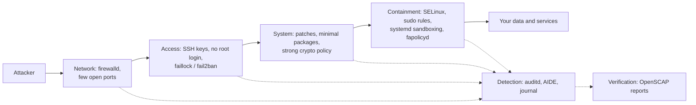
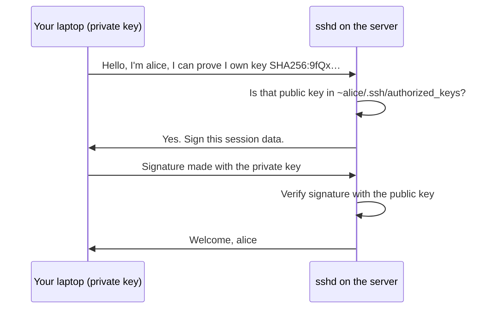
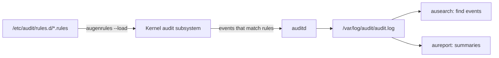

# 17 · Security Hardening

<ul class="module-meta">
  <li>⏱ ~3 hours</li>
  <li>5 labs</li>
  <li>Builds on: 03 · Users, Groups and sudo, 12 · Firewalls with firewalld, 16 · SELinux</li>
</ul>

A new server goes on the internet at 10:00. By 10:05 its SSH port is being hammered by password-guessing bots, and by next week a critical OpenSSL advisory will be published. Security is not one setting you switch on; it is a set of small, boring, verifiable habits stacked on top of each other. In this module you will build that stack on Rocky Linux 10 and, just as important, learn how to *prove* each layer is doing its job.

!!! abstract "What you'll learn"
    - Explain defense in depth and map Rocky's security tools onto it.
    - Find and apply security updates by advisory (`RLSA`) and severity, and automate them.
    - Harden SSH with keys and drop-in config, and verify the effective settings.
    - Keep sudo tidy, and lock out password guessers with faillock or fail2ban.
    - Read and change the system-wide crypto policy, including Rocky 10's post-quantum defaults.
    - Record security-relevant events with auditd and detect file tampering with AIDE.
    - Scan a system against a CIS or STIG profile with OpenSCAP, and know when fapolicyd and USBGuard help.

## The big picture

No single control stops every attack. A firewall does not help once an attacker has a valid password; SELinux does not help if you never install the patch for a remote exploit. **Defense in depth** means stacking independent layers so that each one catches what the others miss, and an attacker must beat *all* of them.



Read it left to right: each layer reduces what reaches the next. The dotted lines are just as important: **detection** tells you when a layer was bypassed, and **verification** tells you the layers are still configured the way you think.

Click through the layers to see which Rocky tool covers each one and where this course explains it.

<div class="layers" data-hint="Click a layer to see the tools that cover it." data-open="0" markdown>

<div class="layer" data-label="Network exposure" data-tag="module 12" markdown>

**Goal:** expose as little as possible. Only the ports that must be reachable are open, and only to the networks that need them.

**Tools:** `firewalld` zones and rich rules, `ss -tulpn` to see what listens. See [Firewalls with firewalld](12-firewalld.md).

</div>

<div class="layer" data-label="Authentication" data-tag="SSH, faillock" markdown>

**Goal:** make it hard to log in as someone you are not. Keys instead of passwords, no direct root login, lockouts for guessers.

**Tools:** `sshd` drop-ins, `ssh-keygen`, `pam_faillock`, `fail2ban` (EPEL).

</div>

<div class="layer" data-label="Privilege" data-tag="sudo" markdown>

**Goal:** people and services get only the rights they need. Admin actions are attributable to a named person.

**Tools:** `sudo` and `/etc/sudoers.d/`, groups. See [Users, Groups and sudo](03-users-groups-and-sudo.md).

</div>

<div class="layer" data-label="Software and crypto" data-tag="dnf, crypto-policies" markdown>

**Goal:** no known holes, nothing installed that is not needed, no weak algorithms.

**Tools:** `dnf updateinfo`, `dnf upgrade --security`, `dnf-automatic`, `update-crypto-policies`, minimal installs.

</div>

<div class="layer" data-label="Containment" data-tag="module 16" markdown>

**Goal:** if a service is compromised, the damage stays inside it.

**Tools:** SELinux, `systemd` sandboxing options, `fapolicyd`, `USBGuard`. See [SELinux](16-selinux.md).

</div>

<div class="layer" data-label="Detection and verification" data-tag="auditd, AIDE, OpenSCAP" markdown>

**Goal:** notice when something changes or goes wrong, and prove the other layers are in place.

**Tools:** `auditd` with `ausearch`/`aureport`, AIDE, the journal, `oscap` with the SCAP Security Guide.

</div>

</div>

## Start small: minimal installs and unused services

Every installed package is code that might have a vulnerability, and every running service is a door. The cheapest hardening is to not have the thing at all. Rocky's "Minimal Install" environment is a good base for servers; add only what the server's job requires.

First, find out what is running and listening:

```console
$ systemctl list-unit-files --type=service --state=enabled
UNIT FILE                    STATE   PRESET
auditd.service               enabled enabled
chronyd.service              enabled enabled
cockpit.socket               enabled enabled
crond.service                enabled enabled
firewalld.service            enabled enabled
NetworkManager.service       enabled enabled
rsyslog.service              enabled enabled
sshd.service                 enabled enabled
…
$ sudo ss -tulpn
Netid State  Recv-Q Send-Q Local Address:Port Peer Address:Port Process
udp   UNCONN 0      0          127.0.0.1:323       0.0.0.0:*     users:(("chronyd",pid=812,fd=5))
tcp   LISTEN 0      128          0.0.0.0:22        0.0.0.0:*     users:(("sshd",pid=1023,fd=3))
tcp   LISTEN 0      4096               *:9090            *:*     users:(("systemd",pid=1,fd=58))
```

Port 9090 is **Cockpit**, the web console, activated through a socket by systemd. If you do not use it, turn it off and close its firewall service. If a package is not needed at all, remove it:

```console
$ sudo systemctl disable --now cockpit.socket
Removed '/etc/systemd/system/sockets.target.wants/cockpit.socket'.
$ sudo firewall-cmd --permanent --remove-service=cockpit && sudo firewall-cmd --reload
success
success
$ sudo dnf remove telnet-server       # example: anything you do not need
```

`systemctl mask` goes one step further and makes a unit impossible to start, even as a dependency. See [systemd and Services](07-systemd-and-services.md).

## Keeping patched

Most real-world compromises use **known** vulnerabilities for which a fix already exists. Patching quickly is the single most effective control on this page.

When Red Hat fixes a security issue in RHEL, Rocky rebuilds the package and publishes a **Rocky Linux Security Advisory** with an ID like `RLSA-2026:1234`. Each advisory has a **severity** (Critical, Important, Moderate, Low) and lists the **CVEs** it fixes. (A **CVE** is a public, numbered vulnerability, such as `CVE-2026-12345`.) DNF downloads this metadata along with the repositories, so you can ask questions about it:

```console
$ dnf updateinfo summary
Updates Information Summary: available
    5 Security notice(s)
        2 Important Security notice(s)
        3 Moderate Security notice(s)
    3 Bugfix notice(s)
    1 Enhancement notice(s)
$ dnf updateinfo list --security
RLSA-2026:1234 Important/Sec.  openssl-libs-1:3.5.1-4.el10_1.x86_64
RLSA-2026:1234 Important/Sec.  openssl-1:3.5.1-4.el10_1.x86_64
RLSA-2026:1251 Important/Sec.  kernel-6.12.0-124.21.1.el10_1.x86_64
RLSA-2026:1260 Moderate/Sec.   libxml2-2.12.5-9.el10_1.x86_64
…
$ dnf updateinfo info RLSA-2026:1234
===============================================================================
  Important: openssl security update
===============================================================================
  Update ID: RLSA-2026:1234
       Type: security
    Updated: 2026-10-12 10:14:33
       CVEs: CVE-2026-12345
           : CVE-2026-12346
Description: …
   Severity: Important
```

Apply only security fixes, or one specific advisory:

```console
$ sudo dnf upgrade --security
$ sudo dnf upgrade --advisory=RLSA-2026:1234
$ sudo dnf upgrade --security --sec-severity=Critical
```

An updated library only protects you once programs using it are restarted, and a new kernel only once you reboot. `dnf needs-restarting` (from `dnf-plugins-core`, installed by default) tells you what is still running old code:

```console
$ sudo dnf needs-restarting -r
Core libraries or services have been updated since boot-up:
  * kernel
  * openssl-libs

Reboot is required to fully utilize these updates.
More information: https://access.redhat.com/solutions/27943
$ sudo dnf needs-restarting -s
sshd.service
httpd.service
```

`-r` asks "is a reboot needed?" and `-s` lists services to restart.

<div class="quiz" data-answer="2" markdown>

You installed the fix for an OpenSSL advisory an hour ago. A scanner still reports the long-running `httpd` as vulnerable. Why?

- The scanner is wrong; installing the package is enough
- `httpd` still has the old OpenSSL library loaded in memory until it is restarted
- DNF only downloaded the update, it did not install it

Right. Files on disk changed, but running processes keep the version they loaded at start. `dnf needs-restarting -s` lists services to restart; for the kernel, reboot.

</div>

### Automating security updates

For many servers, applying security updates automatically is safer than waiting for a human. The `dnf-automatic` package does exactly that from a systemd timer.

```console
$ sudo dnf install -y dnf-automatic
$ sudo grep -E '^(upgrade_type|apply_updates)' /etc/dnf/automatic.conf
upgrade_type = default
apply_updates = no
```

```ini title="/etc/dnf/automatic.conf (changed lines)"
[commands]
upgrade_type = security   # (1)!
apply_updates = yes       # (2)!
```

1. Only install updates that fix security advisories.
2. Install them, not just download them.

```console
$ sudo systemctl enable --now dnf-automatic.timer
$ systemctl list-timers dnf-automatic.timer
NEXT                        LEFT     LAST PASSED UNIT                ACTIVATES
Fri 2026-10-16 06:23:11 UTC 19h left -    -      dnf-automatic.timer dnf-automatic.service
```

By default `dnf-automatic` does not reboot. Pair it with a maintenance window (or the `reboot = when-needed` option in `automatic.conf` if your service can tolerate it) and monitor `needs-restarting -r`.

??? question "Under the hood: four timers, and only one reads your settings"
    The package ships four timer units: `dnf-automatic.timer`, `dnf-automatic-download.timer`, `dnf-automatic-install.timer` and `dnf-automatic-notifyonly.timer`. They all run the same program, but the three specialised ones pass command-line flags that **override** `download_updates` and `apply_updates` in `automatic.conf`. Only plain `dnf-automatic.timer` obeys the file.

    So if a colleague enabled `dnf-automatic-install.timer`, updates are installed no matter what `apply_updates` says. Check which are active with `systemctl list-timers 'dnf-automatic*'`. The schedule (daily around 06:00 with a random delay) is in the timer unit; change it with `sudo systemctl edit dnf-automatic.timer`, not by editing the packaged file.

## SSH hardening

SSH is the front door of almost every Linux server, so it gets the most attention from attackers. Three changes stop the vast majority of attacks: use keys instead of passwords, never log in directly as root, and make sure the server really runs the config you think it does.

### Keys instead of passwords

With **public key authentication**, you hold a **private key** that never leaves your machine, and the server holds the matching **public key** in `~/.ssh/authorized_keys`. The server sends a challenge only the private key can sign. No secret ever crosses the network, and there is nothing to guess.



Use the **Ed25519** algorithm: short keys, fast, and strong. Protect the private key with a passphrase (and an agent, so you type it once).

```console
$ ssh-keygen -t ed25519 -C "alice@laptop"
Generating public/private ed25519 key pair.
Enter file in which to save the key (/home/alice/.ssh/id_ed25519):
Enter passphrase (empty for no passphrase):
…
$ ssh-copy-id alice@web01.example.lan
Number of key(s) added: 1
$ ssh alice@web01.example.lan      # should not ask for the account password now
```

On the server, the permissions must be strict, or `sshd` ignores the file: `~/.ssh` is `700` and `authorized_keys` is `600`, both owned by the user. The files are labeled `ssh_home_t` by SELinux; `restorecon -Rv ~/.ssh` fixes them if you created them oddly.

### Configure sshd with drop-ins

The main config is `/etc/ssh/sshd_config`, but on Rocky you should not edit it. It starts with `Include /etc/ssh/sshd_config.d/*.conf`, and you put your settings in your own file there. Two rules make this work:

1. Drop-ins are read in **alphabetical order**.
2. For most options, sshd uses the **first** value it reads and ignores later ones.

So a file whose name sorts first wins. Rocky ships `50-redhat.conf` with its defaults; name your file with a lower number, like `10-hardening.conf`, so your settings take priority.

```ini title="/etc/ssh/sshd_config.d/10-hardening.conf"
PermitRootLogin no                 # (1)!
PasswordAuthentication no          # (2)!
KbdInteractiveAuthentication no
PermitEmptyPasswords no
MaxAuthTries 3                     # (3)!
LoginGraceTime 30
AllowGroups wheel sshusers         # (4)!
X11Forwarding no
```

1. No direct root logins at all. Admins log in as themselves and use `sudo`, so every action is tied to a person.
2. Only keys. Bots guessing passwords now have nothing to guess.
3. Disconnect after three failed attempts per connection.
4. Only members of these groups may log in over SSH. Make sure your own account is in one of them first.

Always validate before reloading, then check the **effective** configuration:

```console
$ sudo sshd -t && echo "config OK"
config OK
$ sudo systemctl reload sshd
$ sudo sshd -T | grep -E '^(permitrootlogin|passwordauthentication|maxauthtries) '
permitrootlogin no
passwordauthentication no
maxauthtries 3
```

`sshd -T` prints the configuration sshd will actually use, after merging all files. It is the only reliable way to know which value won.

??? question "Under the hood: Match blocks, and the new sshd-session process"
    Plain `sshd -T` shows the settings for a connection that matches no `Match` block. If you use `Match Group contractors` or `Match Address 10.0.5.0/24` to give some users different rules, test the result for a specific connection with `-C`:

    ```console
    $ sudo sshd -T -C user=bob,host=laptop.example.lan,addr=10.0.5.20 | grep -E '^(passwordauthentication|allowtcpforwarding) '
    passwordauthentication no
    allowtcpforwarding no
    ```

    Rocky 10 ships OpenSSH 9.9, where the server is split in two. The listening `sshd` daemon only accepts connections, and each connection is handled by a separate **`sshd-session`** program. You will see it in `ps` and, importantly, in the journal: login and failure messages are now tagged `sshd-session[PID]` rather than `sshd[PID]`. Scripts, log alerts and fail2ban filters that match only `sshd` miss them. `journalctl -u sshd` still finds everything, because the unit is the same.

!!! danger "Do not lock yourself out"
    Before disabling passwords, confirm key login works in a **new** terminal while your current session stays open. A reload does not drop existing sessions, so the old one is your safety net. On a remote server, know how to reach the console (hypervisor, cloud serial console, BMC) before you start.

!!! version "Rocky 9 vs 10: root login defaults"
    On both versions, OpenSSH's default is `PermitRootLogin prohibit-password`: root may log in with a key but never with a password. A default Rocky 10 installation also leaves the root account itself **disabled** unless you enable it in the installer, and expects an administrator user in the `wheel` group. If you (or a compliance tool) changed this, look for drop-ins like `01-permitrootlogin.conf` or `00-complianceascode-hardening.conf` in `/etc/ssh/sshd_config.d/`; they sort first and win.

<div class="quiz" data-answer="1" markdown>

`/etc/ssh/sshd_config.d/` contains `01-permitrootlogin.conf` with `PermitRootLogin yes` and your `90-hardening.conf` with `PermitRootLogin no`. What does `sshd -T` report?

- `permitrootlogin yes`, because `01-` is read first and the first value wins
- `permitrootlogin no`, because the last file read wins
- sshd refuses to start because of the conflict

Right. For most sshd options the first value read wins, and drop-ins are read in alphabetical order. Rename yours (for example `00-` or `10-` and remove the old file) and check with `sshd -T`.

</div>

## sudo hygiene

`sudo` decides who may run what as whom, and it logs every use. Good habits (the details are in [Users, Groups and sudo](03-users-groups-and-sudo.md)):

- **Named accounts plus `wheel`.** Admins log in as themselves and are members of `wheel`, which Rocky's `/etc/sudoers` already allows. Nobody shares a root password.
- **Least privilege for everyone else.** Grant specific commands, not `ALL`. Put each rule in its own file in `/etc/sudoers.d/` and always edit with `visudo`.
- **Be careful with `NOPASSWD`.** It is fine for a narrow automation command, dangerous as `ALL=(ALL) NOPASSWD: ALL`, because then anyone who steals that account's session owns the machine.
- **Watch for shell escapes.** Allowing `vim`, `less`, `find` or `tar` as root effectively allows a root shell, since they can run other commands.

```console
$ sudo visudo -f /etc/sudoers.d/webops
$ sudo cat /etc/sudoers.d/webops
%webops ALL=(root) /usr/bin/systemctl restart httpd, /usr/bin/systemctl status httpd
Defaults:%webops !visiblepw
$ sudo visudo -c
/etc/sudoers: parsed OK
/etc/sudoers.d/webops: parsed OK
$ sudo -l -U bob
User bob may run the following commands on web01:
    (root) /usr/bin/systemctl restart httpd, /usr/bin/systemctl status httpd
$ journalctl _COMM=sudo --since today | tail -2
Oct 15 11:02:44 web01 sudo[3121]:      bob : TTY=pts/1 ; PWD=/home/bob ; USER=root ; COMMAND=/usr/bin/systemctl restart httpd
Oct 15 11:02:44 web01 sudo[3121]: pam_unix(sudo:session): session opened for user root(uid=0) by bob(uid=1002)
```

## Stopping password guessers: faillock and fail2ban

Even with SSH keys, local and console logins, Cockpit and other services may still accept passwords. Two tools limit guessing, at different layers.

**faillock** is a PAM module (`pam_faillock`) built into Rocky. It counts failed logins per *user account* and locks the account after too many. It works for every PAM service (console, SSH passwords, Cockpit, `su`). Enable it with `authselect`, which manages the PAM stack for you:

```console
$ sudo authselect enable-feature with-faillock
$ sudo grep -E '^\s*(deny|unlock_time|fail_interval)' /etc/security/faillock.conf
$ sudo vi /etc/security/faillock.conf      # set deny = 5, unlock_time = 900
$ sudo faillock --user bob
bob:
When                Type  Source                                           Valid
2026-10-15 11:10:02 RHOST 203.0.113.50                                         V
2026-10-15 11:10:09 RHOST 203.0.113.50                                         V
$ sudo faillock --user bob --reset
```

**fail2ban** (from the **EPEL** repository, see [Software: RPM and DNF](05-software-rpm-and-dnf.md)) works at the network layer instead. It watches logs for failures and bans the *source IP address* with a firewall rule for a while. It protects the server from noisy scanners but cannot stop an attacker who rotates addresses.

```console
$ sudo dnf install -y epel-release
$ sudo dnf install -y fail2ban fail2ban-firewalld
$ sudo tee /etc/fail2ban/jail.d/sshd.local >/dev/null <<'EOF'
[sshd]
enabled = true
backend = systemd
maxretry = 5
findtime = 10m
bantime = 1h
EOF
$ sudo systemctl enable --now fail2ban
$ sudo fail2ban-client status sshd
Status for the jail: sshd
|- Filter
|  |- Currently failed:	1
|  |- Total failed:	14
|  `- Journal matches:	…
`- Actions
   |- Currently banned:	1
   |- Total banned:	2
   `- Banned IP list:	203.0.113.50
```

| | faillock | fail2ban |
|---|---|---|
| Where | PAM, inside Rocky | Separate daemon, EPEL |
| Counts failures per | User account | Source IP address |
| Action | Lock the account | Firewall ban of the IP |
| Risk | Attacker can lock out a real user on purpose | Attacker can rotate IPs |
| Best for | Compliance, local and console logins | Cutting noise on internet-facing SSH |

If SSH allows keys only, password guessing against SSH simply fails, and fail2ban becomes mostly log-noise reduction. Disabling passwords is the real fix.

## System-wide crypto policies

Dozens of programs do cryptography: OpenSSH, OpenSSL (used by `curl`, `httpd`, Python), GnuTLS, NSS, Kerberos, Java. Configuring allowed algorithms in each one separately would be error-prone. Rocky solves this with **system-wide cryptographic policies**: you pick one policy level, and `update-crypto-policies` writes a matching config file for every library into `/etc/crypto-policies/back-ends/`.

```console
$ update-crypto-policies --show
DEFAULT
$ ls /etc/crypto-policies/back-ends/
bind.config  gnutls.config  java.config  krb5.config  libreswan.config  libssh.config  nss.config  openssh.config  opensshserver.config  openssl.config  …
```

The policy levels are:

| Policy | Use it when |
|---|---|
| `DEFAULT` | Almost always. Secure settings that still talk to the modern world. |
| `LEGACY` | You must talk to very old systems. Weakens everything; use only temporarily. |
| `FUTURE` | You want stronger, forward-looking settings and can accept that many peers will fail. On Rocky 10.1 it allows **only** hybrid post-quantum key exchange, which most of the internet does not offer yet. Lab and isolated networks only. |
| `FIPS` | Required by regulation, together with a FIPS-mode installation (see below). |

You can also add **subpolicies** to adjust one aspect, written with a colon: `DEFAULT:NO-SHA1` or `DEFAULT:SHA1`. The available modules are in `/usr/share/crypto-policies/policies/modules/`. Prefer a narrow subpolicy over switching the whole machine to `LEGACY`.

```console
$ sudo update-crypto-policies --set FUTURE
Setting system policy to FUTURE
Note: System-wide crypto policies are applied on application start-up.
It is recommended to restart the system for the change of policies
to fully take place.
$ sudo update-crypto-policies --set DEFAULT
```

Note the message: running programs keep the old settings until restarted. Switch back to `DEFAULT` right away on a lab VM: under `FUTURE` on Rocky 10.1, even `dnf` may fail to reach mirrors that do not offer post-quantum key exchange.

??? question "Under the hood: what a policy really is"
    A policy is a small text file of algorithm lists (`/usr/share/crypto-policies/policies/DEFAULT.pol`) plus optional subpolicy modules (`.pmod`). `update-crypto-policies` compiles them into one config snippet per library, in that library's own syntax, under `/etc/crypto-policies/back-ends/`. Each library is patched to read its snippet. For example, OpenSSH's `/etc/ssh/ssh_config.d/50-redhat.conf` includes `/etc/crypto-policies/back-ends/openssh.config`.

    That design gives you two escape hatches that are much better than `LEGACY`:

    - A **custom subpolicy**: write `/etc/crypto-policies/policies/modules/MYCOMPANY.pmod` (for example `cipher@SSH = -AES-128-CBC`) and apply `DEFAULT:MYCOMPANY`.
    - A **per-application override**: an application config that sets its own algorithms explicitly wins over the back-end file. Use it sparingly, because it silently stops following future policy updates.

    `update-crypto-policies --check` tells you whether the generated back-ends still match the configured policy (someone may have hand-edited them).

!!! version "Rocky 10: post-quantum cryptography and FIPS"
    Large future quantum computers could break today's key exchange algorithms, and an attacker can record traffic now to decrypt it later. **Post-quantum cryptography** (PQC) uses new algorithms, such as **ML-KEM** for key exchange, that resist this. In Rocky 10.0 PQC was a preview you had to switch on yourself. In **Rocky 10.1 and later, the predefined policies (including `DEFAULT`) enable and prefer hybrid ML-KEM key exchange** for TLS and SSH where both sides support it. If an old peer chokes on it, the `NO-PQ` subpolicy turns it off (`DEFAULT:NO-PQ`). You can see the preference in the SSH client's effective settings:

    ```console
    $ ssh -G localhost | grep '^kexalgorithms'
    kexalgorithms mlkem768x25519-sha256,curve25519-sha256,curve25519-sha256@libssh.org,…
    ```

    The first entry is the hybrid post-quantum exchange, offered first. (`ssh -Q kex` only lists what the binary *supports*, not what the policy *allows*.)

    **FIPS mode** also changed: on Rocky 10, the `fips-mode-setup` tool is gone and switching an installed system to FIPS mode is not supported. Enable FIPS by booting the installer with the `fips=1` kernel argument. Check with `cat /proc/sys/crypto/fips_enabled` (`1` means FIPS mode). Setting the `FIPS` crypto policy alone does not make a system FIPS-compliant.

## Auditing with auditd

The journal records what services *say*. The **Linux audit system** records what the *kernel sees*: which user changed `/etc/shadow`, who ran a command as root, every SELinux denial. Its records are written by `auditd` to `/var/log/audit/audit.log`, and each record carries the **audit UID** (`auid`), the account the person originally logged in with, which stays the same even after `sudo` or `su`. That is how you answer "who really did this?".



Rules live in `/etc/audit/rules.d/`. `augenrules` merges them into `/etc/audit/audit.rules` and loads them. Two kinds of rules cover most needs:

```bash title="/etc/audit/rules.d/50-hardening.rules"
# Watch files: -w path -p permissions(r,w,x,a=attribute change) -k key
-w /etc/passwd -p wa -k identity
-w /etc/shadow -p wa -k identity
-w /etc/group -p wa -k identity
-w /etc/sudoers -p wa -k sudoers
-w /etc/sudoers.d/ -p wa -k sudoers
-w /etc/ssh/sshd_config.d/ -p wa -k sshd_config

# Syscall rule: log every command run as root by a real (logged-in) user
-a always,exit -F arch=b64 -S execve -F euid=0 -F auid>=1000 -F auid!=unset -k root_cmds
```

The `-k` **key** is a label you choose so you can search for the events later.

```console
$ sudo augenrules --load
$ sudo auditctl -l
-w /etc/passwd -p wa -k identity
-w /etc/shadow -p wa -k identity
…
-a always,exit -F arch=b64 -S execve -F euid=0 -F auid>=1000 -F auid!=-1 -F key=root_cmds
$ sudo useradd audittest
$ sudo ausearch -k identity -i -ts recent | grep -m1 type=SYSCALL
type=SYSCALL msg=audit(10/15/2026 11:31:07.412:2210) : arch=x86_64 syscall=openat success=yes exit=5 … auid=alice uid=root … comm=useradd exe=/usr/sbin/useradd … key=identity
```

`-i` translates numbers into names (`auid=alice`, even though the command ran as root). `aureport` gives summaries:

```console
$ sudo aureport --summary | head -12

Summary Report
======================
Range of time in logs: 10/15/2026 09:12:40.112 - 10/15/2026 11:31:07.412
Selected time for report: 10/15/2026 09:12:40 - 10/15/2026 11:31:07.412
Number of changes in configuration: 14
Number of changes to accounts, groups, or roles: 3
Number of logins: 4
Number of failed logins: 9
Number of authentications: 12
Number of failed authentications: 9
$ sudo aureport --login --failed | tail -3
```

!!! warning "Immutable audit rules"
    Many hardening guides end the rules with `-e 2`, which makes the loaded rules **immutable** until the next reboot: nobody, not even root, can change or delete them. That is the point (an intruder cannot quietly turn auditing off), but it also means your own fixes need a reboot. Also note that on Red Hat family systems `auditd.service` has historically set `RefuseManualStop=yes`, so `systemctl restart auditd` is refused and `sudo service auditd restart` is the supported way (check with `systemctl cat auditd | grep Refuse`). You rarely need it: `augenrules --load` reloads rules without restarting the daemon.

<div class="quiz" data-answer="3" markdown>

Alice logs in over SSH, runs `sudo -i`, and edits `/etc/passwd`. Which field in the audit record still identifies Alice?

- `uid`, which is Alice's UID
- `euid`, which is Alice's UID
- `auid`, the login UID, which `sudo` does not change
- None; after `sudo -i` everything is root

Right. `uid` and `euid` are `0` (root) after `sudo`, but `auid` was set at login and follows the session. `ausearch -i` prints it as `auid=alice`.

</div>

??? question "Under the hood: who sets the auid, and why services have none"
    The `auid` is stored per process in `/proc/<pid>/loginuid`. It is written exactly once, at login, by the `pam_loginuid` PAM module (it is in the `sshd` and `login` PAM stacks), and child processes inherit it. With the default kernel settings it cannot be changed afterwards, which is what makes it trustworthy.

    ```console
    $ cat /proc/self/loginuid; echo
    1000
    $ sudo cat /proc/1/loginuid; echo
    4294967295
    ```

    `4294967295` is `-1` as an unsigned number, shown by `ausearch -i` as `unset`. Services started by systemd at boot never went through a login, so their `auid` is unset. That is why the rule above filters on `auid>=1000 -F auid!=unset`: it captures root commands typed by *people* and skips the thousands of commands that daemons and timers run.

## File integrity with AIDE

If an attacker replaces `/usr/bin/ssh` with a password-stealing copy, how would you notice? **AIDE** (Advanced Intrusion Detection Environment) takes a **baseline**: checksums, permissions, owners and SELinux labels of important files. Later it compares the system against that baseline and reports every difference.

```console
$ sudo dnf install -y aide
$ sudo aide --init
Start timestamp: 2026-10-15 11:40:02 +0000 (AIDE 0.18.6)
AIDE initialized database at /var/lib/aide/aide.db.new.gz
…
$ sudo mv /var/lib/aide/aide.db.new.gz /var/lib/aide/aide.db.gz
$ sudo aide --check
AIDE found differences between database and filesystem!!

Summary:
  Total number of entries:	61842
  Added entries:		1
  Removed entries:		0
  Changed entries:		2
…
```

Below the summary, AIDE lists every added, removed and changed file, and then a detailed section per file showing which attributes changed (size, checksum, permissions, SELinux context) with old and new values.

What is checked is defined in `/etc/aide.conf`. Two rules make AIDE trustworthy:

- **Protect the baseline.** An attacker with root could update the database too. Copy `aide.db.gz` somewhere read-only or off the host after each `--init` or `--update`.
- **Re-baseline after legitimate changes.** After patching, run `sudo aide --update` and review the report, then promote the new database. Otherwise every check is a wall of expected noise and real changes get missed.

Run `aide --check` regularly, for example from a systemd timer, and send the result somewhere a human reads it.

## Compliance scanning with OpenSCAP

You have now seen dozens of individual settings. Organisations usually need to prove they match a published **benchmark**: the **CIS** Benchmarks, or the US government's **DISA STIG**. Checking hundreds of rules by hand is not realistic.

**SCAP** is a standard format for machine-readable security checks. **OpenSCAP** (`oscap`) is the scanner, and the **SCAP Security Guide** (`scap-security-guide` package, built from the ComplianceAsCode project) provides the content: rules and profiles for Rocky and RHEL.

```console
$ sudo dnf install -y openscap-scanner scap-security-guide
$ ls /usr/share/xml/scap/ssg/content/
```

The content is a **datastream** file named after the distribution and version: `ssg-<product>-ds.xml`. Rocky's builds use an `rl` tag (Rocky 9 has `ssg-rl9-ds.xml`), so on Rocky 10 look for `ssg-rl10-ds.xml`. Use the file that matches your release, and list its **profiles** (sets of rules):

```console
$ DS=/usr/share/xml/scap/ssg/content/ssg-rl10-ds.xml    # use the file you found above
$ oscap info --profiles "$DS"
xccdf_org.ssgproject.content_profile_cis_server_l1:CIS … Benchmark for Level 1 - Server
xccdf_org.ssgproject.content_profile_cis:CIS … Benchmark for Level 2 - Server
xccdf_org.ssgproject.content_profile_stig:DISA STIG …
…
```

The exact profile list depends on the content version; for very new releases, some profiles (STIG in particular) may still be drafts. Now scan:

```console
$ sudo oscap xccdf eval \
    --profile xccdf_org.ssgproject.content_profile_cis_server_l1 \
    --results /tmp/cis-results.xml \
    --report /tmp/cis-report.html \
    "$DS"
Title   Ensure /tmp Located On Separate Partition
Rule    xccdf_org.ssgproject.content_rule_partition_for_tmp
Result  fail

Title   Disable SSH Root Login
Rule    xccdf_org.ssgproject.content_rule_sshd_disable_root_login
Result  pass
…
```

Open the HTML report in a browser: every rule has a description, a rationale, the result, and remediation steps. `oscap` exits with code `2` when some rules fail, which is normal for a first scan.

??? question "Under the hood: why a scan says notapplicable for everything"
    Every rule in a datastream carries a **CPE** platform check: "this rule applies to Red Hat Enterprise Linux 10", for example. `oscap` first asks "is this machine that platform?" by looking at files such as `/etc/os-release`. If you scan a Rocky machine with the RHEL datastream (`ssg-rhel10-ds.xml`), many rules come back `notapplicable` instead of `pass` or `fail`, and the report looks oddly clean. It is a common "OpenSCAP is broken" report on the Rocky forums.

    The fix is to use the datastream built for your distribution. If you see a wall of `notapplicable`, check which file you passed. The datastream is just XML: `oscap info "$DS"` shows its product, version and generation date, which also tells you whether your content is older than the benchmark revision an auditor is asking about.

OpenSCAP can also *generate* fixes as a Bash script or Ansible playbook:

```console
$ oscap xccdf generate fix --fix-type ansible \
    --profile xccdf_org.ssgproject.content_profile_cis_server_l1 \
    --output cis-fix.yml "$DS"
```

!!! warning "Read before you remediate"
    Profiles are written for a generic server, not yours. Blindly applying a full remediation can disable services you need or change SSH access in ways that lock you out (CIS remediation writes its own `00-complianceascode-hardening.conf` SSH drop-in, for example). Review the playbook, apply it to a test VM first, and record intentional exceptions.

## Two more containment tools

**fapolicyd** (file access policy daemon) decides which programs may *execute*. By default it trusts files installed by RPM packages and denies running untrusted binaries, so a tool an attacker downloaded into `/tmp` does not run, even if the permissions allow it.

```console
$ sudo dnf install -y fapolicyd
$ sudo systemctl enable --now fapolicyd
$ sudo fapolicyd-cli --list | head -3
$ sudo fapolicyd-cli --file add /opt/myapp/bin/myapp --trust-file myapp
$ sudo fapolicyd-cli --update
```

Locally built or vendor tools outside RPM must be added to the trust database, as shown. Test in permissive mode (`permissive = 1` in `/etc/fapolicyd/fapolicyd.conf`) before enforcing it on a production host.

**USBGuard** blocks USB devices that are not on an allow list, protecting physical machines from rogue keyboards and storage sticks.

```console
$ sudo dnf install -y usbguard
$ sudo sh -c 'usbguard generate-policy > /etc/usbguard/rules.conf'
$ sudo systemctl enable --now usbguard
$ sudo usbguard list-devices
```

Generate the policy *before* starting the service, while your keyboard is plugged in, or you may block it.

## systemd sandboxing: hardening one service at a time

systemd can confine a service with options in its unit file: a read-only view of the OS, a private `/tmp`, no access to home directories, no new privileges. These stack on top of SELinux, and need no policy writing. `systemd-analyze security` scores how exposed each service is:

```console
$ systemd-analyze security --no-pager | head -6
UNIT                                 EXPOSURE PREDICATE HAPPY
auditd.service                            8.7 EXPOSED   🙁
chronyd.service                           3.9 OK        🙂
crond.service                             9.6 UNSAFE    😨
httpd.service                             9.2 UNSAFE    😨
sshd.service                              9.6 UNSAFE    😨
```

Lower is better. Add options in a drop-in (`sudo systemctl edit httpd`), never in the packaged unit:

```ini title="/etc/systemd/system/httpd.service.d/override.conf"
[Service]
ProtectSystem=full
ProtectHome=true
PrivateTmp=true
NoNewPrivileges=true
ProtectKernelTunables=true
ProtectKernelModules=true
ProtectControlGroups=true
```

Then `sudo systemctl restart httpd` and run `systemd-analyze security httpd.service` again to see the score drop and the details for each setting. Test the service thoroughly: an option like `ProtectHome=true` breaks a web server that serves `~/public_html`.

## A hardening run, step by step

Here is the whole module as an order of operations for a fresh server. Click through it.

<div class="stepper" markdown>

<div class="step" data-title="Inventory" markdown>

Know what you have before changing anything.

```console
$ sudo ss -tulpn
$ systemctl list-unit-files --type=service --state=enabled
$ getenforce
$ update-crypto-policies --show
```

</div>

<div class="step" data-title="Patch" markdown>

```console
$ sudo dnf upgrade --security
$ sudo dnf needs-restarting -r
```

Then enable `dnf-automatic.timer` with `upgrade_type = security`.

</div>

<div class="step" data-title="Reduce" markdown>

Disable and remove what the server does not need. Close the matching firewall services. Confirm with `ss -tulpn` that only intended ports listen.

</div>

<div class="step" data-title="Lock the doors" markdown>

Install your SSH key, test it, then add `/etc/ssh/sshd_config.d/10-hardening.conf` (no root, no passwords, `AllowGroups`). Validate with `sshd -t`, reload, verify with `sshd -T`. Tidy `/etc/sudoers.d/`. Enable faillock.

</div>

<div class="step" data-title="Contain" markdown>

Keep SELinux enforcing and fix denials properly ([module 16](16-selinux.md)). Add systemd sandboxing to exposed services. Consider fapolicyd and USBGuard where they fit.

</div>

<div class="step" data-title="Watch" markdown>

Add audit rules for identity files, sudoers and SSH config. Build the AIDE baseline and schedule checks. Make sure logs leave the host (central logging, [module 08](08-logging-and-the-journal.md)).

</div>

<div class="step" data-title="Prove it" markdown>

Run an OpenSCAP scan against the profile your organisation uses. Fix what matters, document the exceptions, and re-scan on a schedule so drift is caught.

</div>

</div>

### Practice: check a server's security posture

<div class="terminal-sim" data-title="Security posture check" data-prompt="[alex@web01 ~]$ " markdown>

<div class="task" data-expect="dnf updateinfo list --security" data-match="(sudo )?dnf updateinfo (list )?--security( list)?|(sudo )?dnf updateinfo list sec" data-hint="dnf updateinfo can list advisories; filter with --security." markdown>

**Step 1.** List the security advisories that apply to this machine.

```text
RLSA-2026:1234 Important/Sec.  openssl-libs-1:3.5.1-4.el10_1.x86_64
RLSA-2026:1251 Important/Sec.  kernel-6.12.0-124.21.1.el10_1.x86_64
```

</div>

<div class="task" data-expect="sudo dnf upgrade --security" data-match="(sudo )?dnf (upgrade|update) --security( -y)?|(sudo )?dnf -y (upgrade|update) --security" data-hint="dnf upgrade with the --security filter." markdown>

**Step 2.** Install only the security updates.

```text
Upgraded:
  kernel-6.12.0-124.21.1.el10_1.x86_64   openssl-libs-1:3.5.1-4.el10_1.x86_64 …
Complete!
```

</div>

<div class="task" data-expect="sudo dnf needs-restarting -r" data-match="(sudo )?dnf needs-restarting -r" data-hint="dnf needs-restarting with -r answers 'is a reboot needed?'." markdown>

**Step 3.** Is a reboot needed to use the new kernel and libraries?

```text
Core libraries or services have been updated since boot-up:
  * kernel
  * openssl-libs

Reboot is required to fully utilize these updates.
```

</div>

<div class="task" data-expect="update-crypto-policies --show" data-hint="The crypto policy tool has a --show option." markdown>

**Step 4.** Which system-wide crypto policy is active?

```text
DEFAULT
```

</div>

<div class="task" data-expect="sudo sshd -T" data-match="(sudo )?sshd -T( .*)?" data-hint="sshd -T prints the effective, merged configuration." markdown>

**Step 5.** Show the SSH server's *effective* configuration (you can pipe it to `grep` on a real system).

```text
permitrootlogin no
passwordauthentication no
maxauthtries 3
…
```

</div>

</div>

## Labs

!!! lab "Lab 1: Security update inventory"

    **Goal:** Find out exactly which security fixes your VM is missing, and what they fix.

    **You'll need:** a Rocky 10 VM with repository access, sudo.

    1. Summarise and list security advisories:

        ```bash
        dnf updateinfo summary
        dnf updateinfo list --security
        dnf updateinfo list --security --sec-severity=Important
        ```

    2. Pick one advisory ID from the list and read it:

        ```bash
        dnf updateinfo info RLSA-XXXX:NNNN     # replace with a real ID from step 1
        ```

    3. See which installed package would change, without installing:

        ```bash
        sudo dnf upgrade --security --assumeno
        ```

    4. Check what is running stale code right now:

        ```bash
        sudo dnf needs-restarting -r
        sudo dnf needs-restarting -s
        ```

    **Check your work:** you can name at least one advisory, its severity, its CVE IDs, and the packages it updates. If your VM is fully patched, `updateinfo list --security` is empty and that is a valid result.

    ??? success "What just happened?"
        DNF matched the advisory metadata from the Rocky repositories against your installed package versions. `--assumeno` showed the transaction and then declined it.

    **Clean up:** nothing to undo. Applying the updates (`sudo dnf upgrade --security`) is a good idea on a lab VM anyway.

!!! lab "Lab 2: Keys only, no root"

    **Goal:** Switch SSH to key-only authentication with a drop-in, prove which settings are effective, and prove passwords are refused.

    **You'll need:** a Rocky 10 VM, sudo, two terminals (keep one logged in as a safety net).

    1. Create a key for yourself and authorize it on this same machine:

        ```bash
        mkdir -p -m 700 ~/.ssh
        ssh-keygen -t ed25519 -N '' -f ~/.ssh/lab_ed25519 -C "lab key"
        cat ~/.ssh/lab_ed25519.pub >> ~/.ssh/authorized_keys
        chmod 700 ~/.ssh && chmod 600 ~/.ssh/authorized_keys
        restorecon -R ~/.ssh
        ssh -i ~/.ssh/lab_ed25519 -o StrictHostKeyChecking=accept-new localhost whoami
        ```

    2. Look at the current effective settings:

        ```bash
        sudo sshd -T | grep -E '^(permitrootlogin|passwordauthentication|maxauthtries) '
        ls /etc/ssh/sshd_config.d/
        ```

    3. Add a hardening drop-in, validate, and reload:

        ```bash
        sudo tee /etc/ssh/sshd_config.d/10-lab-hardening.conf >/dev/null <<'EOF'
        PermitRootLogin no
        PasswordAuthentication no
        KbdInteractiveAuthentication no
        MaxAuthTries 3
        EOF
        sudo sshd -t && sudo systemctl reload sshd
        sudo sshd -T | grep -E '^(permitrootlogin|passwordauthentication|maxauthtries) '
        ```

    4. Prove keys work and passwords are refused:

        ```bash
        ssh -i ~/.ssh/lab_ed25519 localhost whoami
        ssh -o PubkeyAuthentication=no -o PreferredAuthentications=password localhost whoami
        ```

    **Check your work:** step 3 shows `permitrootlogin no`, `passwordauthentication no`, `maxauthtries 3`. In step 4 the key login prints your username, and the password attempt fails immediately with `Permission denied (publickey,gssapi-keyex,gssapi-with-mic).` without ever asking for a password.

    ??? success "What just happened?"
        Your `10-` file sorts before `50-redhat.conf`, and sshd keeps the first value it reads, so your settings won. `sshd -T` proved it. The "Permission denied" list shows the only methods the server now offers; `password` is no longer one of them.

    **Clean up:**

    ```bash
    sudo rm /etc/ssh/sshd_config.d/10-lab-hardening.conf
    sudo sshd -t && sudo systemctl reload sshd
    sed -i '/lab key$/d' ~/.ssh/authorized_keys
    rm -f ~/.ssh/lab_ed25519 ~/.ssh/lab_ed25519.pub
    ```

!!! lab "Lab 3: Who changed the user database?"

    **Goal:** Write audit rules, trigger them, and trace the change back to the person who made it.

    **You'll need:** a Rocky 10 VM, sudo. `auditd` is running by default.

    1. Add watch rules and load them:

        ```bash
        sudo tee /etc/audit/rules.d/50-lab.rules >/dev/null <<'EOF'
        -w /etc/passwd -p wa -k lab_identity
        -w /etc/group -p wa -k lab_identity
        -w /etc/sudoers.d/ -p wa -k lab_sudoers
        EOF
        sudo augenrules --load
        sudo auditctl -l | grep lab_
        ```

    2. Make some changes as root through sudo:

        ```bash
        sudo useradd labaudit
        echo 'labaudit ALL=(root) /usr/bin/id' | sudo tee /etc/sudoers.d/labaudit
        ```

    3. Find the events and the real person behind them:

        ```bash
        sudo ausearch -k lab_identity -i -ts recent | grep -E 'type=SYSCALL' | head -3
        sudo ausearch -k lab_sudoers -i -ts recent | grep -E 'type=SYSCALL' | head -3
        sudo aureport -k --summary
        ```

    **Check your work:** the SYSCALL records show `comm=useradd` and `comm=tee`, `uid=root`, and `auid=` your own login name. `aureport -k --summary` lists `lab_identity` and `lab_sudoers` with counts.

    ??? success "What just happened?"
        The kernel matched writes on the watched files and logged them with your login UID (`auid`), which `sudo` does not change. That is what makes audit logs useful for accountability: "root changed /etc/passwd" becomes "alice, using sudo, ran useradd".

    **Clean up:**

    ```bash
    sudo userdel -r labaudit
    sudo rm /etc/sudoers.d/labaudit /etc/audit/rules.d/50-lab.rules
    sudo augenrules --load
    ```

!!! lab "Lab 4: Catch a tampered file with AIDE"

    **Goal:** Build a baseline, change files, and watch AIDE report exactly what changed.

    **You'll need:** a Rocky 10 VM, sudo, a few minutes for the initial scan.

    1. Install AIDE and build the baseline:

        ```bash
        sudo dnf install -y aide
        sudo aide --init
        sudo mv /var/lib/aide/aide.db.new.gz /var/lib/aide/aide.db.gz
        ```

    2. Simulate tampering: change a file's content, another file's permissions and SELinux label, and drop a new file into `/etc`:

        ```bash
        sudo cp -a /etc/hosts /root/hosts.bak
        echo "203.0.113.66 updates.example.com" | sudo tee -a /etc/hosts
        sudo chmod 666 /etc/motd
        sudo chcon -t user_home_t /etc/motd
        sudo touch /etc/lab-dropped-file
        ```

    3. Check once, save the report, and read it:

        ```bash
        sudo aide --check > /tmp/aide-report.txt; echo "exit: $?"
        sed -n '/^Summary/,/^$/p' /tmp/aide-report.txt
        grep -E ': /etc/(hosts|motd|lab-dropped-file)$' /tmp/aide-report.txt
        grep -A6 'File: /etc/motd' /tmp/aide-report.txt
        ```

    **Check your work:** the summary shows at least 1 added and 2 changed entries. `/etc/lab-dropped-file` is listed as added, `/etc/hosts` as changed (size and checksum), and the detail section for `/etc/motd` shows the old and new permissions and SELinux context. The exit status is non-zero (AIDE uses it as a bit mask of what kind of differences it found).

    ??? success "What just happened?"
        AIDE compared checksums, metadata and labels against the baseline. A real attacker with root could also update `/var/lib/aide/aide.db.gz`, which is why production setups keep a copy of the baseline off the host.

    **Clean up:**

    ```bash
    sudo cp -a /root/hosts.bak /etc/hosts && sudo rm /root/hosts.bak
    sudo chmod 644 /etc/motd
    sudo restorecon -v /etc/motd
    sudo rm -f /etc/lab-dropped-file /tmp/aide-report.txt /var/lib/aide/aide.db.gz
    ```

!!! lab "Lab 5: Scan against a CIS profile"

    **Goal:** Run a real compliance scan, read the report, and review generated fixes without applying them.

    **You'll need:** a Rocky 10 VM, sudo, a browser (or copy the report to your workstation).

    1. Install the scanner and content, and find your datastream:

        ```bash
        sudo dnf install -y openscap-scanner scap-security-guide
        ls /usr/share/xml/scap/ssg/content/
        DS=$(ls /usr/share/xml/scap/ssg/content/ssg-rl10-ds.xml /usr/share/xml/scap/ssg/content/ssg-rhel10-ds.xml 2>/dev/null | head -1); echo "$DS"
        oscap info --profiles "$DS"
        ```

    2. Scan with the CIS Level 1 Server profile (pick the matching ID from the list if it differs):

        ```bash
        sudo oscap xccdf eval \
            --profile xccdf_org.ssgproject.content_profile_cis_server_l1 \
            --results /tmp/cis-results.xml --report /tmp/cis-report.html \
            "$DS" > /tmp/cis-scan.txt; echo "exit: $?"
        grep -c 'Result.*pass' /tmp/cis-scan.txt
        grep -c 'Result.*fail' /tmp/cis-scan.txt
        grep -B2 'Result.*fail' /tmp/cis-scan.txt | grep Title | head -10
        ```

    3. Generate (but do not run) an Ansible remediation, and look at what it would do to SSH:

        ```bash
        oscap xccdf generate fix --fix-type ansible \
            --profile xccdf_org.ssgproject.content_profile_cis_server_l1 \
            --output /tmp/cis-fix.yml "$DS"
        grep -n 'sshd_config' /tmp/cis-fix.yml | head
        ```

    **Check your work:** the scan exits with `2` (some rules failed), you can count passes and failures, and `/tmp/cis-report.html` opens in a browser with a score and per-rule explanations.

    ??? success "What just happened?"
        `oscap` evaluated every rule in the profile against the live system. Compliance content is a checklist plus automation; the report is the evidence auditors ask for. Reviewing the generated playbook before running it is how you avoid hardening yourself out of your own server.

    **Clean up:** `rm -f /tmp/cis-results.xml /tmp/cis-report.html /tmp/cis-scan.txt /tmp/cis-fix.yml` (optionally `sudo dnf remove openscap-scanner scap-security-guide`).

## Common pitfalls

| Symptom | Cause | Fix |
|---|---|---|
| Locked out after an SSH change | Disabled passwords before testing keys, or `AllowGroups` missed your group | Keep a session open; test in a new terminal; use console access to fix |
| SSH setting "ignored" | An earlier-sorting drop-in sets it first | `sshd -T` to see the effective value; rename your file (`10-…`) |
| Updates installed, still vulnerable | Old library still loaded, old kernel still running | `dnf needs-restarting -r` / `-s`; restart or reboot |
| Audit rules cannot be changed | Rules loaded with `-e 2` (immutable) | Edit the files, then reboot |
| `systemctl restart auditd` refused | auditd's unit forbids manual stop | `sudo service auditd restart`, or `augenrules --load` for rules |
| AIDE report is pages of noise | Baseline never updated after patching | `aide --update` after reviewing, then promote the new DB |
| Old client cannot connect after policy change | `FUTURE` (or no SHA-1) rejects its algorithms | Upgrade the client; use a narrow subpolicy if you must |
| `fips-mode-setup: command not found` | Removed in Rocky 10 | Reinstall with `fips=1` on the installer kernel command line |
| A real user is locked out | faillock counted someone else's guesses | `faillock --user <name> --reset`; prefer keys and fail2ban for internet-facing SSH |
| OpenSCAP remediation broke a service | Applied a generic profile blindly | Test on a VM first; record exceptions |

!!! pitfall "Hardening by checklist without verification"
    A setting you "applied" but never verified is a guess. For every control in this module there is a command that proves it: `sshd -T`, `update-crypto-policies --show`, `auditctl -l`, `aide --check`, `oscap … eval`, `systemd-analyze security`. Use them, and save the output as evidence.

## Cheat sheet

| Command | What it does |
|---|---|
| `dnf updateinfo summary` / `list --security` | Overview / list of security advisories |
| `dnf updateinfo info <RLSA-ID>` | Details and CVEs for one advisory |
| `dnf upgrade --security` / `--advisory=<ID>` | Install security fixes / one advisory |
| `dnf needs-restarting -r` / `-s` | Reboot needed? / services to restart |
| `systemctl enable --now dnf-automatic.timer` | Automatic updates (configure `/etc/dnf/automatic.conf`) |
| `ssh-keygen -t ed25519` / `ssh-copy-id user@host` | Create a key / install it on a server |
| `sshd -t` / `sshd -T` | Validate config / show effective config |
| `visudo -f /etc/sudoers.d/<file>` / `visudo -c` | Edit a sudo rule safely / check all files |
| `sudo -l -U <user>` | What may this user run? |
| `authselect enable-feature with-faillock` | Turn on account lockout |
| `faillock --user <u>` / `--reset` | Show / clear a user's failures |
| `fail2ban-client status sshd` | Banned IPs for the SSH jail |
| `update-crypto-policies --show` / `--set <POLICY>` | Show / change crypto policy |
| `augenrules --load` / `auditctl -l` | Load / list audit rules |
| `ausearch -k <key> -i` | Find audit events by key, with names |
| `aureport --summary` / `--login --failed` | Audit summaries |
| `aide --init` / `--check` / `--update` | Baseline / compare / re-baseline |
| `oscap info --profiles <ds>` | List compliance profiles |
| `oscap xccdf eval --profile <id> --report r.html <ds>` | Run a compliance scan |
| `systemd-analyze security [unit]` | Service exposure score |
| `fapolicyd-cli --file add <path>` / `--update` | Trust a binary for fapolicyd |
| `usbguard list-devices` | USB devices and their allow/block state |

## Flashcards

<div class="flashcards" markdown>

<div class="card" markdown>

What is defense in depth?

Stacking independent security layers (network, authentication, privilege, patching, containment, detection) so an attacker must defeat all of them, and a failure in one is caught by another.

</div>

<div class="card" markdown>

What is an RLSA?

A Rocky Linux Security Advisory, such as `RLSA-2026:1234`. It has a severity and lists the CVEs fixed. `dnf updateinfo` shows them.

</div>

<div class="card" markdown>

Why does a security update not always protect you right away?

Running programs keep the old library in memory and the old kernel runs until reboot. Check with `dnf needs-restarting -r` and `-s`.

</div>

<div class="card" markdown>

How do SSH drop-ins in `/etc/ssh/sshd_config.d/` interact?

They are read in alphabetical order and, for most options, the first value wins. Name yours to sort before `50-redhat.conf` and verify with `sshd -T`.

</div>

<div class="card" markdown>

faillock vs fail2ban?

faillock (PAM, built in) locks *accounts* after failures. fail2ban (EPEL) bans *source IPs* with firewall rules after failures in the logs.

</div>

<div class="card" markdown>

What changed in Rocky 10.1's DEFAULT crypto policy?

It enables and prefers post-quantum hybrid key exchange (ML-KEM) for TLS and SSH where both ends support it.

</div>

<div class="card" markdown>

How do you enable FIPS mode on Rocky 10?

At installation, with `fips=1` on the installer's kernel command line. `fips-mode-setup` was removed and switching after install is not supported.

</div>

<div class="card" markdown>

What is the audit UID (`auid`)?

The ID of the account the person originally logged in with. It survives `sudo` and `su`, so audit records show who really made a change.

</div>

<div class="card" markdown>

Why must you protect AIDE's database?

An attacker with root could update the baseline to hide their changes. Keep a copy read-only or off the host.

</div>

<div class="card" markdown>

What do OpenSCAP and the SCAP Security Guide each provide?

`oscap` is the scanner. `scap-security-guide` provides the content: rules and profiles such as CIS and STIG, as datastream files in `/usr/share/xml/scap/ssg/content/`.

</div>

</div>

## Recap

!!! recap "Key takeaways"
    - Security is layers: expose little, authenticate strongly, grant little, patch fast, contain damage, detect changes, and verify all of it.
    - Patch by advisory with `dnf updateinfo` and `dnf upgrade --security`, automate with `dnf-automatic`, and restart what `needs-restarting` reports.
    - SSH: Ed25519 keys, no root login, no passwords, settings in an early-sorting drop-in, proven with `sshd -T`.
    - Keep sudo rules narrow and in `/etc/sudoers.d/`; use faillock for accounts and fail2ban for noisy IPs.
    - One crypto policy configures every library. Rocky 10.1's DEFAULT prefers post-quantum key exchange, and FIPS mode is an install-time choice.
    - auditd records who did what (by `auid`); AIDE records what changed; OpenSCAP proves compliance against CIS or STIG.
    - fapolicyd, USBGuard and systemd sandboxing add containment where they fit.

## Go deeper

- Man pages: [[man:sshd_config(5)]] [[man:update-crypto-policies(8)]] [[man:crypto-policies(7)]] [[man:auditctl(8)]] [[man:ausearch(8)]] [[man:aureport(8)]] [[man:aide(1)]] [[man:oscap(8)]] [[man:faillock(8)]] [[man:dnf-automatic(8)]]
- [RHEL 10: Security hardening](https://docs.redhat.com/en/documentation/red_hat_enterprise_linux/10/html/security_hardening/index)
- [Red Hat blog: What's new in post-quantum cryptography in RHEL 10.1](https://www.redhat.com/en/blog/whats-new-post-quantum-cryptography-rhel-101)
- [ComplianceAsCode project (SCAP Security Guide)](https://github.com/ComplianceAsCode/content)
- [Rocky Linux documentation](https://docs.rockylinux.org/)

**Next:** [18 · Containers from the Ground Up](18-containers.md)
