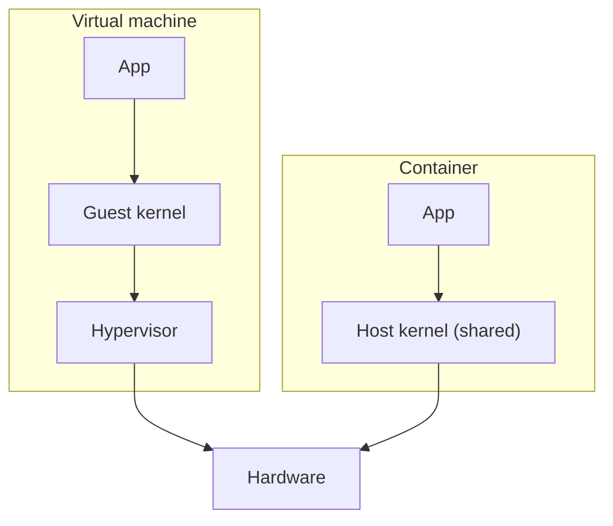
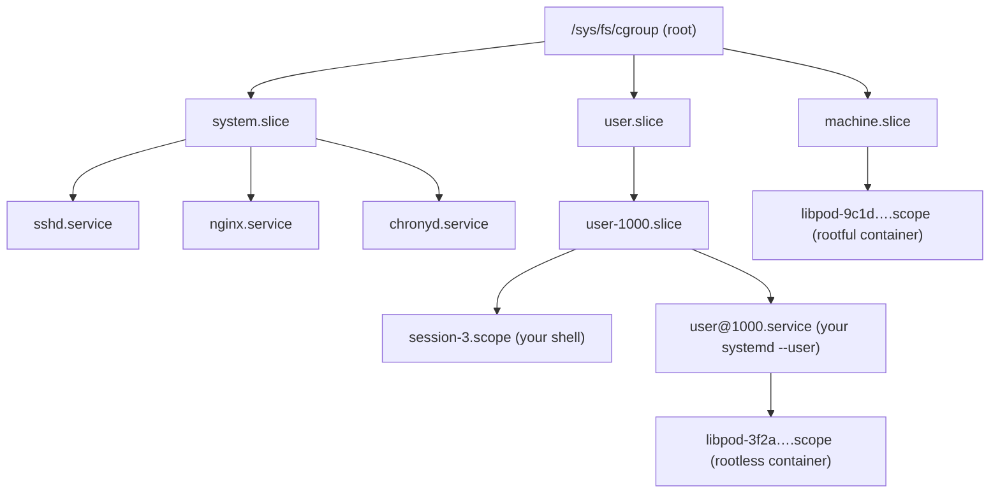
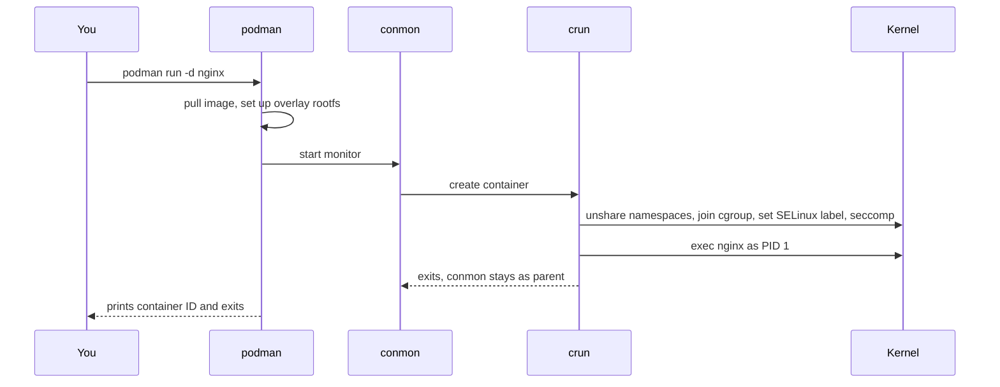
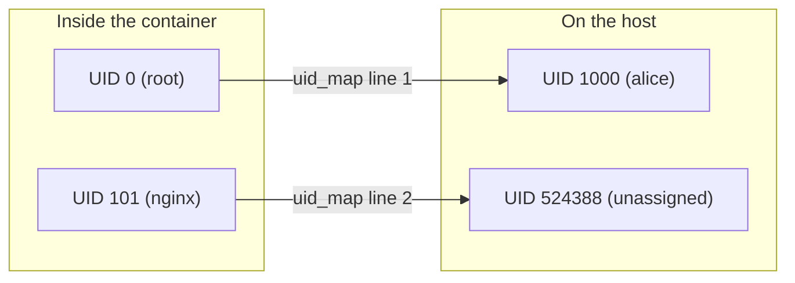
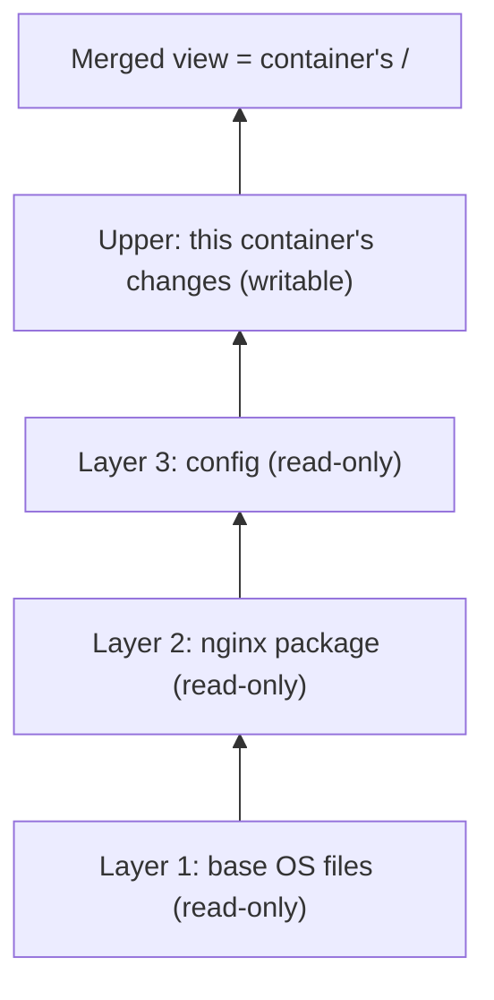

# 18 · Containers from the Ground Up

<ul class="module-meta">
  <li>⏱ ~3 hours</li>
  <li>4 labs</li>
  <li>Builds on: 06 · Processes, 07 · systemd, 16 · SELinux</li>
</ul>

Someone on your team says "just put it in a container" as if a container were a
tiny virtual machine. Then a container eats all the memory on the host, or a
volume mount gives `Permission denied` even though the files are mode `777`,
and nobody knows where to look. This module takes the magic out. You will build
a container by hand with ordinary Linux commands, then see that Podman is doing
exactly the same thing, only faster and more safely.

!!! abstract "What you'll learn"
    - Explain what a container really is: a normal process plus namespaces,
      cgroups, a filesystem image, and security restrictions.
    - Create and inspect namespaces with `unshare`, `lsns` and `nsenter`.
    - Read the cgroup v2 tree and cap a service's memory and CPU with
      `systemd-run -p MemoryMax=` and unit properties.
    - Run rootless containers with Podman and explain how user namespaces,
      `/etc/subuid` and overlayfs layers make that safe.
    - Fix SELinux volume denials with `:Z` and group containers into pods.
    - Run a container as a proper systemd service with a Quadlet `.container` file.
    - Build an image from a `Containerfile` and copy images with `skopeo`.

## The big picture

A **container** is not a thing the kernel knows about. There is no "container"
object anywhere in Linux. A container is an ordinary process (the same kind you
met in [06 · Processes and Signals](06-processes-and-signals.md)) that the
kernel has been told to treat specially in four ways:

1. **Namespaces** change what the process can *see*: its own process list,
   hostname, network interfaces and mount table.
2. **cgroups** change how much it can *use*: memory, CPU, I/O, number of processes.
3. A **filesystem image** changes what files it finds at `/`.
4. **Security** layers (SELinux, seccomp, capabilities) change what it is
   *allowed to do*, even as "root".

Click each layer to see what it contributes. Read it top to bottom: your app
sits on top, and every layer below wraps it a bit tighter.

<div class="layers" data-hint="Click a layer to see what it does for the container." data-open="0" markdown>

<div class="layer" data-label="Your application" data-tag="nginx, postgres, your app" markdown>

**What it is:** a normal Linux program. It calls the same system calls and
uses the same kernel as every other process on the host. That is why a
container starts in milliseconds: there is no second kernel to boot.

```console
$ podman run -d --name web docker.io/library/nginx:latest
$ ps -o pid,user,comm -C nginx
    PID USER     COMMAND
   4120 alice    nginx
   4135 524388   nginx
```

From the host, the containerized nginx is just a process in `ps`.

</div>

<div class="layer" data-label="Security: SELinux, seccomp, capabilities" data-tag="what it may do" markdown>

**What it does:** limits what the process may do even if it runs as root
inside the container. SELinux labels it `container_t` with a unique category
pair, **seccomp** blocks risky system calls, and only a small set of root
**capabilities** is kept.

```console
$ ps -eZ | grep nginx
system_u:system_r:container_t:s0:c214,c739 4120 ? 00:00:00 nginx
```

</div>

<div class="layer" data-label="Filesystem image (overlayfs)" data-tag="what it sees at /" markdown>

**What it does:** gives the process its own root directory, built from
read-only image layers stacked with **overlayfs** plus one thin writable layer
on top. The process sees Debian or Rocky userland, but the kernel is still the
host's.

</div>

<div class="layer" data-label="cgroups v2" data-tag="how much it may use" markdown>

**What it does:** puts the process in its own group in `/sys/fs/cgroup` so the
kernel can count and cap its memory, CPU, I/O and process count.

```console
$ cat /proc/4120/cgroup
0::/user.slice/user-1000.slice/user@1000.service/user.slice/libpod-3f2a…e1.scope/container
```

</div>

<div class="layer" data-label="Namespaces" data-tag="what it can see" markdown>

**What they do:** give the process private views of global resources: PIDs,
network, hostname, mounts, users, IPC, cgroups and time. Inside, `ps` shows
only the container's processes and `ip link` shows only its interfaces.

</div>

<div class="layer" data-label="The host kernel" data-tag="shared by everyone" markdown>

**What it is:** one Linux kernel (6.12 on Rocky 10) shared by the host and
every container. A kernel bug or a kernel panic affects all of them. This is
the big difference from a virtual machine.

</div>

</div>

!!! analogy "Think of it like an apartment building"
    The kernel is the building: one foundation, one set of pipes. Namespaces
    are the walls, so each tenant sees only their own rooms. cgroups are the
    utility meters with breakers, so one tenant cannot use all the water. The
    image is the furniture each tenant moves in. Security is the lease that
    says what tenants may not do. A virtual machine, by contrast, is a separate
    house with its own foundation.



## Namespaces: private views of a shared system

### The problem

Every process normally sees the whole machine: every PID, every network
interface, every mount. If you want to run two copies of a web server that both
think they own port 80 and PID 1, you need to lie to them. A **namespace** is
that lie, told consistently by the kernel: a wrapper around one kind of global
resource so that processes inside see their own private copy.

### The eight namespace types

| Namespace | Isolates | What it looks like inside |
|-----------|----------|---------------------------|
| `mnt` | The mount table | Its own `/`, its own mounts that the host does not see |
| `uts` | Hostname and domain name | `hostname web1` changes only this namespace |
| `ipc` | System V IPC, POSIX message queues | Shared memory segments are private |
| `pid` | Process IDs | The first process is PID 1; host processes are invisible |
| `net` | Interfaces, routes, firewall rules, ports | Starts with only `lo`, which is down |
| `user` | User and group IDs | You can be UID 0 inside while being UID 1000 outside |
| `cgroup` | The view of the cgroup tree | `/proc/self/cgroup` shows `/` as its root |
| `time` | The boot and monotonic clocks | Uptime can differ from the host's |

Every process's namespaces are listed as symbolic links in `/proc/<pid>/ns/`.
The number in brackets is the namespace's identity. Two processes with the same
number share that namespace.

```console
$ ls -l /proc/$$/ns
lrwxrwxrwx. 1 alice alice 0 Oct 15 09:20 cgroup -> 'cgroup:[4026531835]'
lrwxrwxrwx. 1 alice alice 0 Oct 15 09:20 ipc -> 'ipc:[4026531839]'
lrwxrwxrwx. 1 alice alice 0 Oct 15 09:20 mnt -> 'mnt:[4026531841]'
lrwxrwxrwx. 1 alice alice 0 Oct 15 09:20 net -> 'net:[4026531840]'
lrwxrwxrwx. 1 alice alice 0 Oct 15 09:20 pid -> 'pid:[4026531836]'
lrwxrwxrwx. 1 alice alice 0 Oct 15 09:20 pid_for_children -> 'pid:[4026531836]'
lrwxrwxrwx. 1 alice alice 0 Oct 15 09:20 time -> 'time:[4026531834]'
lrwxrwxrwx. 1 alice alice 0 Oct 15 09:20 time_for_children -> 'time:[4026531834]'
lrwxrwxrwx. 1 alice alice 0 Oct 15 09:20 user -> 'user:[4026531837]'
lrwxrwxrwx. 1 alice alice 0 Oct 15 09:20 uts -> 'uts:[4026531838]'
```

### Creating namespaces with unshare

`unshare` runs a command in new namespaces. Each flag adds one. Start with the
easiest, the UTS namespace, which only holds the hostname:

```console
$ sudo unshare --uts bash
# hostname container-a
# hostname
container-a
# exit
$ hostname
rocky10
```

The hostname change stayed inside. The host never noticed.

Now a PID namespace. Two extra flags matter here. `--fork` makes `unshare`
fork a child so the child becomes PID 1 in the new namespace (the process that
calls `unshare` itself stays in the old one). `--mount-proc` creates a new
mount namespace and mounts a fresh `/proc` there, so tools like `ps`, which read
`/proc`, show the new namespace instead of the host.

```console
$ sudo unshare --pid --fork --mount-proc bash
# ps -ef
UID          PID    PPID  C STIME TTY          TIME CMD
root           1       0  0 09:24 pts/0    00:00:00 bash
root          14       1  0 09:24 pts/0    00:00:00 ps -ef
# exit
```

Your shell is PID 1 and the hundreds of host processes are gone from view. They
still exist; this shell simply cannot name them.

??? question "Why does `--pid` without `--fork` act strangely?"
    A process's PID never changes, so the process that calls `unshare` cannot
    move into the new PID namespace. Only its *children* go there. Without
    `--fork`, `bash` would be exec'd in the old namespace and its first child
    would become PID 1; when that child exits, the namespace dies and later
    commands fail with `fork: Cannot allocate memory`. `--fork` avoids the
    confusion by making the child the shell.

A network namespace starts empty, apart from a loopback device that is down:

```console
$ sudo unshare --net bash
# ip -brief link
lo               DOWN           00:00:00:00:00:00 <LOOPBACK>
# ping -c1 1.1.1.1
ping: connect: Network is unreachable
# exit
```

That is why every container runtime has to build networking for its containers
by plugging in a virtual cable (a **veth pair**), which you will do by hand in
Lab 1.

### Seeing and entering namespaces: lsns and nsenter

`lsns` lists the namespaces that exist and which process holds each one:

```console
$ sudo lsns -t net
        NS TYPE NPROCS   PID USER    NETNSID NSFS COMMAND
4026531840 net     187     1 root  unassigned      /usr/lib/systemd/systemd --switched-root --system --deserialize=46
4026532301 net       2  4120 alice unassigned      nginx: master process nginx -g daemon off;
```

`nsenter` does the opposite of `unshare`: it runs a command *inside* the
namespaces of an existing process. This is the most useful debugging trick in
the module. Your container image may not have `ip` or `ss`, but the host does,
and `nsenter -n` runs the host's tool inside the container's network namespace:

```console
$ PID=$(podman inspect -f '{{.State.Pid}}' web)
$ sudo nsenter -t "$PID" -n ss -tlnp
State   Recv-Q  Send-Q   Local Address:Port   Peer Address:Port  Process
LISTEN  0       511            0.0.0.0:80          0.0.0.0:*      users:(("nginx",pid=4120,fd=6))
```

| `nsenter` flag | Enter this namespace |
|----------------|----------------------|
| `-t PID` | Target process whose namespaces you want |
| `-n` | network |
| `-m` | mount |
| `-p` | PID |
| `-u` | UTS |
| `-U` | user |
| `-a` | all of them |

<div class="quiz" data-answer="3" markdown>

You run `sudo unshare --net bash` and then `ip link`. What do you see?

- All of the host's interfaces, because `unshare` copies them
- Nothing at all, not even loopback
- Only `lo`, and it is down
- Only `eth0`, because it is the default route

Right. A new network namespace contains just a loopback device in the DOWN
state. Interfaces must be moved or created in it explicitly.

</div>

### The user namespace: root that isn't

The **user namespace** is what makes rootless containers possible. It maps a
range of user IDs inside the namespace to a different range outside. Inside you
can be UID 0 with full capabilities *over the namespace's own resources*, while
the kernel treats you as plain UID 1000 for everything on the host.

```console
$ unshare --user --map-root-user bash
# id
uid=0(root) gid=0(root) groups=0(root),65534(nobody)
# cat /proc/self/uid_map
         0       1000          1
# cat /etc/shadow
cat: /etc/shadow: Permission denied
# exit
```

Note there is no `sudo`. Any user can create a user namespace. The map line
reads: "inside UID 0, maps to outside UID 1000, for a range of 1 ID". You are
root in name only; the host still sees UID 1000 and refuses `/etc/shadow`.

A real container image contains files owned by many users (root, `nginx`,
`postgres`), so one mapped UID is not enough. That is where `/etc/subuid` comes
in, covered in the Podman section below.

## cgroups v2: meters and breakers

### The problem

Namespaces hide things; they do not limit anything. A process in its own PID
namespace can still allocate all the RAM on the host. A **control group**
(**cgroup**) is a group of processes that the kernel accounts for and limits
together. Rocky 10 uses only **cgroup v2**, the "unified hierarchy": a single
tree of directories mounted at `/sys/fs/cgroup`.

```console
$ stat -fc %T /sys/fs/cgroup
cgroup2fs
$ cat /sys/fs/cgroup/cgroup.controllers
cpuset cpu io memory hugetlb pids rdma misc
```

!!! version "Rocky 9 vs 10"
    Rocky 9 already defaults to cgroup v2, but you could switch back to the
    old v1 layout with a kernel argument. Rocky 10 (like RHEL 10) removes
    cgroup v1 support from systemd entirely. Old tools or images that expect
    `/sys/fs/cgroup/memory/` directories will not work.

### systemd owns the tree

You almost never create cgroups by hand. systemd (from
[07 · systemd and Services](07-systemd-and-services.md)) builds the tree for
you, and every unit gets its own cgroup. The tree has three kinds of nodes:

- A **slice** is a branch that groups other units for resource sharing:
  `system.slice` for services, `user.slice` for logged-in users,
  `machine.slice` for VMs and rootful containers.
- A **service** is a cgroup holding the processes of one service unit.
- A **scope** holds processes that systemd did not start itself but was told to
  track, such as your login session or a container.



Every process's cgroup is in `/proc/<pid>/cgroup`. On v2 there is a single
line beginning `0::`:

```console
$ cat /proc/self/cgroup
0::/user.slice/user-1000.slice/session-3.scope
```

### Looking at the tree: systemd-cgls and systemd-cgtop

`systemd-cgls` prints the tree with the processes in each cgroup:

```console
$ systemd-cgls --no-pager
Control group /:
-.slice
├─user.slice
│ └─user-1000.slice
│   ├─user@1000.service …
│   │ └─init.scope
│   │   ├─1502 /usr/lib/systemd/systemd --user
│   │   └─1505 (sd-pam)
│   └─session-3.scope
│     ├─1498 sshd-session: alice [priv]
│     ├─1510 -bash
│     └─1688 systemd-cgls --no-pager
├─init.scope
│ └─1 /usr/lib/systemd/systemd --switched-root --system --deserialize=46
└─system.slice
  ├─sshd.service
  │ └─1031 "sshd: /usr/sbin/sshd -D [listener] 0 of 10-100 startups"
  ├─chronyd.service
  │ └─812 /usr/sbin/chronyd -F 2
…
```

`systemd-cgtop` is `top` for cgroups. It shows which group is using CPU,
memory and I/O right now, which is often the fastest answer to "which service
is eating the box?":

```console
$ systemd-cgtop -1
Control Group                            Tasks   %CPU   Memory  Input/s Output/s
/                                          212   38.2     1.4G        -        -
system.slice                                89   35.9   811.2M        -        -
system.slice/backup.service                  3   33.1   402.7M        -        -
user.slice                                  14    1.9   301.5M        -        -
system.slice/sshd.service                    1    0.0     4.1M        -        -
…
```

### The control files

Inside each cgroup directory are files you read for stats and write for
limits. The ones you will use most:

| File | Meaning |
|------|---------|
| `cgroup.procs` | PIDs in this group (write a PID here to move it) |
| `memory.current` | Memory in use right now, in bytes |
| `memory.max` | Hard limit; the kernel OOM-kills inside the group above this |
| `memory.high` | Soft limit; the kernel slows the group down and reclaims memory |
| `memory.events` | Counters, including `oom_kill` |
| `cpu.max` | `quota period` in microseconds; `50000 100000` means half a CPU |
| `cpu.weight` | Relative share when CPUs are contended (default 100) |
| `cpu.stat` | Usage and `nr_throttled` / `throttled_usec` |
| `pids.max` | Maximum number of processes (stops fork bombs) |
| `io.max` | Per-device bandwidth and IOPS caps |

### Setting limits the systemd way

Writing to those files by hand works, but systemd will overwrite them the next
time it touches the unit. The right tool is a unit property. Each property maps
directly to a cgroup file:

| systemd property | cgroup file it writes |
|------------------|-----------------------|
| `MemoryMax=512M` | `memory.max` |
| `MemoryHigh=400M` | `memory.high` |
| `CPUQuota=50%` | `cpu.max` = `50000 100000` |
| `CPUWeight=200` | `cpu.weight` |
| `TasksMax=100` | `pids.max` |
| `IOReadBandwidthMax=/dev/vda 10M` | `io.max` |

For a quick experiment, `systemd-run` starts any command as a transient
service with properties attached:

```console
$ sudo systemd-run --unit=burn -p CPUQuota=20% sha1sum /dev/zero
Running as unit: burn.service; invocation ID: 6f1b2c…
$ cat /sys/fs/cgroup/system.slice/burn.service/cpu.max
20000 100000
$ top -b -n1 | grep sha1sum
   2231 root      20   0  223984   1792   1664 R  20.0   0.0   0:03.21 sha1sum
$ sudo systemctl stop burn
```

For a permanent limit on a real service, use a drop-in:

```console
$ sudo systemctl set-property httpd.service MemoryMax=1G CPUQuota=150%
$ systemctl show httpd -p MemoryMax -p CPUQuotaPerSecUSec
MemoryMax=1073741824
CPUQuotaPerSecUSec=1.500000s
```

`set-property` writes a drop-in under `/etc/systemd/system.control/` and
applies it immediately, no restart needed.

!!! tip "memory.high before memory.max"
    `memory.max` is a cliff: cross it and something gets killed. `memory.high`
    is a speed bump: the group is throttled and pushed to reclaim memory. For
    services, setting `MemoryHigh=` a bit below `MemoryMax=` gives you a
    warning zone you can see in metrics before the kill happens.

<div class="quiz" data-answer="2" markdown>

A service has `CPUQuota=50%`. On a 4-CPU machine, `top` shows it at exactly
50% and the app feels slow. What is the most likely explanation?

- It is waiting on disk, CPU is not the problem
- It is being throttled: it wants more than half a CPU but the quota stops it
- `top` is wrong, cgroups do not affect CPU
- 50% of 4 CPUs is 2 CPUs, so it has plenty

Right. `CPUQuota=50%` means half of *one* CPU. A process pinned at exactly
its quota is almost always throttled. Confirm with `nr_throttled` in the
cgroup's `cpu.stat`.

</div>

## Podman: containers without a daemon

### Why Podman

**Podman** is the container engine that ships with Rocky Linux. It runs the
same OCI images as Docker and has an almost identical command line
(`alias docker=podman` mostly just works), but it is built differently:

- **Daemonless.** There is no always-running root daemon. `podman run` forks
  the container directly, with a tiny monitor process called **conmon** to
  hold its terminal and exit code. The low-level runtime that actually calls
  `unshare`, sets cgroups and execs your app is **crun**.
- **Rootless.** Ordinary users can run containers, with no root privileges
  anywhere in the chain.
- **systemd-native.** Containers live in systemd scopes, and Quadlet turns
  them into real services.



Install it (it is in AppStream; many Rocky images have it already):

```console
$ sudo dnf install -y podman
$ podman --version
podman version 5.4.0
```

### Rootless containers, user namespaces and subuid

When you run Podman as a normal user, it creates a user namespace for you.
Your own UID becomes root inside, and a block of extra **subordinate UIDs**
(**subuids**) covers every other user the image needs. The blocks are assigned
in `/etc/subuid` and `/etc/subgid`; `useradd` adds an entry automatically for
new users.

```console
$ grep alice /etc/subuid /etc/subgid
/etc/subuid:alice:524288:65536
/etc/subgid:alice:524288:65536
$ podman unshare cat /proc/self/uid_map
         0       1000          1
         1     524288      65536
```

Read that as two rules:

- Container UID 0 is host UID 1000 (alice herself).
- Container UIDs 1 to 65536 are host UIDs 524288 to 589823, which belong to
  nobody real on the host.

So the nginx worker that runs as UID 101 inside the container shows up as host
UID `524388` in `ps` (524288 + 101 - 1). If it escaped, it would be a nobody
with no files and no privileges.



!!! pitfall "Users created without subuid entries"
    Users added by some provisioning tools, or from LDAP/FreeIPA, may have no
    line in `/etc/subuid`. Podman then fails with `cannot find mappings for
    user` or runs with a single UID and breaks on images that `chown` files.
    Fix it with `sudo usermod --add-subuids 600000-665535 --add-subgids
    600000-665535 bob`, then `podman system migrate`.

Rootless containers cannot bind host ports below 1024 by default, and their
networking runs through **pasta**, a user-space network stack that Podman 5
uses as the rootless default. Rootful containers (`sudo podman`) use a real
bridge with nftables rules instead.

??? question "Why is PID 1 inside a container special?"
    On a normal system, PID 1 is systemd, which reaps orphaned zombie
    processes and has sensible signal handling. In a container, PID 1 is
    whatever your `CMD` is, and the kernel treats it specially: signals with
    no handler installed (including `SIGTERM`) are *ignored* for PID 1 of a
    PID namespace. So `podman stop` sends `SIGTERM`, your app ignores it, and
    after 10 seconds Podman falls back to `SIGKILL`. Apps that also spawn
    children may leave zombies, because nothing reaps them. The fix is
    `podman run --init`, which injects a tiny init (`catatonit`) as PID 1 that
    forwards signals and reaps zombies.

??? question "How does rootless networking work without root?"
    A rootless user cannot create a veth pair on the host or add nftables
    rules. So Podman creates the container's network namespace, and
    **pasta** sits in user space with one foot in each namespace: it reads
    packets from a TAP device inside the container and turns them into
    ordinary socket calls on the host (and back). Published ports are just
    sockets pasta opens on the host as you. By default the container even
    gets a copy of the host's IP address, which is why rootless containers
    usually "just work" with no NAT. The cost is some extra CPU per packet
    compared with a kernel bridge, which matters only for heavy network loads.

### Everyday Podman commands

```console
$ podman run -d --name web -p 8080:80 docker.io/library/nginx:latest
Trying to pull docker.io/library/nginx:latest...
…
Writing manifest to image destination
3f2a8c1d77e1b0…
$ podman ps
CONTAINER ID  IMAGE                           COMMAND               CREATED        STATUS        PORTS                 NAMES
3f2a8c1d77e1  docker.io/library/nginx:latest  nginx -g daemon o...  6 seconds ago  Up 6 seconds  0.0.0.0:8080->80/tcp  web
$ curl -sI localhost:8080 | head -1
HTTP/1.1 200 OK
$ podman logs --tail 2 web
10.0.2.100 - - [15/Oct/2026:09:41:02 +0000] "HEAD / HTTP/1.1" 200 0 "-" "curl/8.12.1" "-"
$ podman exec -it web bash
root@3f2a8c1d77e1:/# hostname
3f2a8c1d77e1
root@3f2a8c1d77e1:/# exit
$ podman inspect -f '{{.State.Pid}} {{.HostConfig.Memory}}' web
4120 0
```

| Command | What it does |
|---------|--------------|
| `podman run -d --name N IMAGE` | Create and start a container in the background |
| `podman ps` / `ps -a` | Running containers / all containers |
| `podman logs -f N` | Follow the container's stdout and stderr |
| `podman exec -it N bash` | Run a shell inside a running container |
| `podman inspect N` | Every detail as JSON (use `-f` with a Go template) |
| `podman stop N` / `rm N` | Stop / delete a container |
| `podman stats` | Live CPU and memory per container (from cgroups) |
| `podman top N` | Processes inside, with host and container users |

Practise the inspection workflow before you touch your VM. Assume a
container called `web` is running.

<div class="terminal-sim" data-title="Take a container apart" data-prompt="[alice@rocky-lab ~]$ " markdown>

<div class="task" data-expect="podman ps" data-match="^podman (ps|container ls)( -a)?$" data-hint="Podman lists running containers with a two-letter subcommand, just like ps." markdown>

**Step 1.** List the running containers.

```text
CONTAINER ID  IMAGE                           COMMAND               CREATED        STATUS        PORTS                 NAMES
3f2a8c1d77e1  docker.io/library/nginx:latest  nginx -g daemon o...  2 minutes ago  Up 2 minutes  0.0.0.0:8080->80/tcp  web
```

</div>

<div class="task" data-expect="podman inspect -f '{{.State.Pid}}' web" data-match="^podman inspect (-f|--format) ['&quot;]?\{\{ ?\.State\.Pid ?\}\}['&quot;]? web$" data-hint="Use podman inspect with -f and the Go template {{.State.Pid}}." markdown>

**Step 2.** Print only the host PID of the container's main process.

```text
4120
```

</div>

<div class="task" data-expect="cat /proc/4120/cgroup" data-hint="Every process's cgroup is listed in /proc/PID/cgroup." markdown>

**Step 3.** Which cgroup is PID 4120 in?

```text
0::/user.slice/user-1000.slice/user@1000.service/user.slice/libpod-3f2a8c1d77e1….scope/container
```

</div>

<div class="task" data-expect="sudo lsns -p 4120||lsns -p 4120" data-hint="lsns has a -p option that takes a PID." markdown>

**Step 4.** List the namespaces that PID 4120 belongs to.

```text
        NS TYPE   NPROCS   PID USER  COMMAND
4026531834 time      190     1 root  /usr/lib/systemd/systemd --switched-root --system --deserialize=46
4026532290 user        3  4120 alice nginx: master process nginx -g daemon off;
4026532291 mnt         2  4120 alice nginx: master process nginx -g daemon off;
4026532292 uts         2  4120 alice nginx: master process nginx -g daemon off;
4026532293 ipc         2  4120 alice nginx: master process nginx -g daemon off;
4026532294 pid         2  4120 alice nginx: master process nginx -g daemon off;
4026532295 cgroup      2  4120 alice nginx: master process nginx -g daemon off;
4026532301 net         2  4120 alice nginx: master process nginx -g daemon off;
```

</div>

<div class="task" data-expect="sudo nsenter -t 4120 -n ss -tlnp" data-match="^sudo nsenter (-t 4120 -n|-n -t 4120|--target 4120 --net) ss -[tlnp]{4}$" data-hint="nsenter -t PID -n runs a command in that process's network namespace. Use ss -tlnp." markdown>

**Step 5.** Using the host's `ss`, list listening TCP sockets *inside* the container's network namespace.

```text
State   Recv-Q  Send-Q   Local Address:Port   Peer Address:Port  Process
LISTEN  0       511            0.0.0.0:80          0.0.0.0:*      users:(("nginx",pid=4120,fd=6))
```

</div>

</div>

You can give a container cgroup limits directly; Podman writes the same cgroup
files you saw earlier:

```console
$ podman run -d --name capped --memory 256m --cpus 0.5 docker.io/library/nginx
$ podman inspect -f '{{.HostConfig.Memory}} {{.HostConfig.NanoCpus}}' capped
268435456 500000000
```

!!! note "Short image names"
    Always use fully qualified names like `docker.io/library/nginx` or
    `quay.io/...`. If you type just `nginx`, Podman consults
    `unqualified-search-registries` in `/etc/containers/registries.conf` and
    may ask you which registry you meant. Fully qualified names avoid pulling
    an impostor image from the wrong registry.

### Images, layers and overlayfs

An **image** is a stack of read-only **layers**, each a tarball of the files
one build step added or changed, plus a JSON config (default command, ports,
environment). When you start a container, Podman stacks the layers with
**overlayfs**: a filesystem that merges several directories into one view.

- The image layers are the **lower** directories (read-only, shared by every
  container from that image).
- Each container gets one **upper** directory, where all its writes go.
- When a container modifies a file from a lower layer, overlayfs first copies
  it up into the upper layer (**copy-on-write**).
- The **merged** directory is what the container sees as `/`.



```console
$ podman history docker.io/library/nginx:latest | head -5
ID            CREATED      CREATED BY                                     SIZE        COMMENT
4e1b6bae1e48  3 weeks ago  CMD ["nginx" "-g" "daemon off;"]               0B
<missing>     3 weeks ago  STOPSIGNAL SIGQUIT                             0B
<missing>     3 weeks ago  EXPOSE map[80/tcp:{}]                          0B
<missing>     3 weeks ago  ENTRYPOINT ["/docker-entrypoint.sh"]           0B
$ podman diff web
C /etc
C /etc/nginx/conf.d
C /etc/nginx/conf.d/default.conf
C /run
A /run/nginx.pid
C /var/cache/nginx
A /var/cache/nginx/client_temp
…
```

`podman diff` lists what the container has **A**dded, **C**hanged or
**D**eleted in its upper layer. When you `podman rm` the container, the upper
layer is thrown away. That is why data you care about must live in a volume.

Rootless storage lives in `~/.local/share/containers/storage`; rootful storage
in `/var/lib/containers/storage`. `podman system df` shows how much space images,
containers and volumes use.

### Volumes and the :Z suffix

A **volume** is a directory from outside the container mounted into it, so
data survives the container. Podman has named volumes (`podman volume create
data`, stored under its storage directory) and bind mounts of any host path.

Here is the classic surprise. You bind-mount a directory and the container
gets `Permission denied`, even with mode `777`:

```console
$ mkdir ~/site && echo hello > ~/site/index.html
$ podman run -d --name w2 -p 8081:80 -v ~/site:/usr/share/nginx/html docker.io/library/nginx
$ curl -s localhost:8081 | grep -o '<title>.*</title>'
<title>403 Forbidden</title>
$ sudo ausearch -m AVC -ts recent | grep -o 'denied.*' | head -1
denied  { read } for  pid=4410 comm="nginx" name="index.html" … scontext=system_u:system_r:container_t:s0:c51,c902 tcontext=unconfined_u:object_r:user_home_t:s0 tclass=file permissive=0
```

SELinux (from [16 · SELinux](16-selinux.md)) blocks `container_t` from reading
`user_home_t` files. Unix permissions were never the problem. Add a suffix and
Podman relabels the directory for you:

| Suffix | Effect | Use when |
|--------|--------|----------|
| `:Z` | Relabel with *this container's* private categories | Only this container uses the data |
| `:z` | Relabel with a shared label any container can read | Several containers share the data |

```console
$ podman rm -f w2
$ podman run -d --name w2 -p 8081:80 -v ~/site:/usr/share/nginx/html:Z docker.io/library/nginx
$ curl -s localhost:8081
hello
$ ls -Z ~/site/index.html
system_u:object_r:container_file_t:s0:c87,c612 /home/alice/site/index.html
```

!!! danger "Never use :Z on system directories"
    `-v /home:/home:Z` or `-v /etc:/etc:Z` relabels the host's files with a
    container-only label. Logins and services then fail with SELinux denials
    on the host. Only relabel directories that exist for the container.

<div class="quiz" data-answer="1" markdown>

A rootless nginx container serves a bind-mounted directory and returns 403.
The files are mode 644 and the directory 755. `ausearch -m AVC` shows a
denial with `tcontext=...user_home_t`. What is the fix?

- Re-run the container with `-v dir:/path:Z`
- `chmod -R 777` the directory
- `setenforce 0` permanently
- Run the container with `sudo`

Right. The denial is SELinux type enforcement, not permissions. `:Z` relabels
the directory `container_file_t` with this container's categories.

</div>

### How the security layer looks

Every container gets three kinds of restriction automatically:

- **SELinux:** the process runs as `container_t` with a random **MCS**
  (Multi-Category Security) pair like `s0:c214,c739`. Two containers get
  different pairs, so even if both are `container_t`, neither can read the
  other's files.
- **seccomp:** a filter that blocks system calls a container should never
  need, such as loading kernel modules or rebooting. The default profile is
  `/usr/share/containers/seccomp.json`.
- **Capabilities:** root's powers are split into about 40 **capabilities**
  (like `CAP_NET_ADMIN` or `CAP_SYS_ADMIN`). Containers keep only a short
  default list from `containers.conf`, including `CHOWN`, `KILL`,
  `NET_BIND_SERVICE`, `SETUID` and `SETGID`.

```console
$ podman run --rm docker.io/library/nginx grep CapEff /proc/self/status
CapEff:	00000000800405fb
$ capsh --decode=00000000800405fb
0x00000000800405fb=cap_chown,cap_dac_override,cap_fowner,cap_fsetid,cap_kill,cap_setgid,cap_setuid,cap_setpcap,cap_net_bind_service,cap_sys_chroot,cap_setfcap
```

Add one with `--cap-add=NET_ADMIN`; drop all with `--cap-drop=all`. Avoid
`--privileged`, which turns all three layers off.

### Pods: containers that share a network

A **pod** is a group of containers that share a network namespace (and
optionally others), exactly like a Kubernetes pod. Containers in a pod reach
each other on `localhost`. Each pod has a tiny **infra** container that holds
the namespaces open.

```console
$ podman pod create --name blog -p 8082:80
$ podman run -d --pod blog --name db -e MARIADB_ROOT_PASSWORD=s3cret docker.io/library/mariadb:11
$ podman run -d --pod blog --name app docker.io/library/nginx
$ podman pod ps
POD ID        NAME   STATUS   CREATED         INFRA ID      # OF CONTAINERS
a81c4e0f2b19  blog   Running  12 seconds ago  0d3e5c7a9b21  3
$ podman ps --pod --format '{{.Names}}  {{.PodName}}'
a81c4e0f2b19-infra  blog
db  blog
app  blog
```

Ports are published on the pod, not on individual containers.
`podman kube generate blog > blog.yaml` writes the pod as Kubernetes YAML, and
`podman kube play blog.yaml` recreates it.

## Quadlet: containers as systemd services

### The problem

`podman run -d` is great for experiments, but nothing restarts the container
after a reboot, nothing collects its logs in the journal, and nothing orders it
after the network. You want a container to be a real systemd service.

**Quadlet** solves this. You write a short `.container` file in an INI format
that looks like a unit file. At boot (and on `systemctl daemon-reload`), a
systemd **generator** reads it and writes a full `.service` unit that runs the
right `podman run` command.

| Scope | Directory | Manage with |
|-------|-----------|-------------|
| Rootful (system) | `/etc/containers/systemd/` | `sudo systemctl …` |
| Rootless (your user) | `~/.config/containers/systemd/` | `systemctl --user …` |

```ini title="/etc/containers/systemd/web.container"
[Unit]
Description=Static website
After=network-online.target

[Container]
Image=docker.io/library/nginx:latest  # (1)!
ContainerName=web
PublishPort=8080:80
Volume=/srv/web:/usr/share/nginx/html:Z  # (2)!
AutoUpdate=registry  # (3)!

[Service]
Restart=always
MemoryMax=256M  # (4)!

[Install]
WantedBy=multi-user.target  # (5)!
```

1. The image to run. Pulled automatically if missing.
2. Same syntax as `podman run -v`, including `:Z`.
3. Lets `podman auto-update` pull newer images and restart the service.
4. Ordinary systemd properties work: this sets `memory.max` on the service.
5. Quadlet units cannot be `systemctl enable`d; this section is applied by the
   generator, so the service starts at boot.

```console
$ sudo mkdir -p /srv/web && echo 'served by quadlet' | sudo tee /srv/web/index.html
$ sudo systemctl daemon-reload
$ sudo systemctl start web.service
$ systemctl status web --no-pager | head -4
● web.service - Static website
     Loaded: loaded (/etc/containers/systemd/web.container; generated)
     Active: active (running) since Thu 2026-10-15 10:02:11 UTC; 4s ago
   Main PID: 5120 (conmon)
$ curl -s localhost:8080
served by quadlet
$ journalctl -u web -n 2 --no-pager
```

Note `Loaded: … generated`. To see what Quadlet produced, or why a file is
silently ignored, run the generator in dry-run mode:

```console
$ /usr/libexec/podman/quadlet -dryrun
quadlet-generator[5301]: Loading source unit file /etc/containers/systemd/web.container
---web.service---
…
ExecStart=/usr/bin/podman run --name web --cidfile=%t/%N.cid --replace --rm --cgroups=split --sdnotify=conmon -d -v /srv/web:/usr/share/nginx/html:Z --publish 8080:80 docker.io/library/nginx:latest
…
```

Quadlet also understands `.volume`, `.network`, `.pod`, `.kube` and `.image`
files, so you can describe a whole application stack as unit files.

!!! tip "Rootless services that survive logout"
    A user's systemd instance stops when they log out, taking their containers
    with it. Run `sudo loginctl enable-linger alice` so alice's user services
    start at boot and keep running. Use `WantedBy=default.target` in rootless
    Quadlet files.

<div class="quiz" data-answer="4" markdown>

You create `~/.config/containers/systemd/app.container`, run
`systemctl --user daemon-reload`, and `systemctl --user start app` says
`Unit app.service not found`. What should you check first?

- Whether Docker is installed
- Whether SELinux is enforcing
- Whether you need `systemctl --user enable app` first
- Run `/usr/libexec/podman/quadlet -dryrun -user` to see the parse error

Right. When a Quadlet file has an error, the generator skips it and no unit
appears. The dry run prints the reason, such as an unknown key or a typo in
the `[Container]` section.

</div>

## Building images: Containerfile, Buildah and skopeo

### Containerfile basics

A **Containerfile** (the same format as a Dockerfile) is a recipe: each
instruction adds a layer or sets metadata.

```dockerfile title="Containerfile"
FROM docker.io/rockylinux/rockylinux:10
RUN dnf install -y httpd && dnf clean all
COPY index.html /var/www/html/index.html
EXPOSE 80
CMD ["/usr/sbin/httpd", "-DFOREGROUND"]
```

Line by line:

1. `FROM` picks the base image: the bottom layers.
2. `RUN` runs a command at build time and saves the result as a new layer.
   Cleaning the DNF cache in the same step keeps the layer small.
3. `COPY` copies a file from the build directory into the image.
4. `EXPOSE` is documentation: it says the app listens on port 80. It does
   not publish anything.
5. `CMD` is the default command when a container starts. It must stay in the
   foreground, because when PID 1 exits, the container stops.

```console
$ echo '<h1>built by me</h1>' > index.html
$ podman build -t localhost/myweb:1 .
STEP 1/5: FROM docker.io/rockylinux/rockylinux:10
STEP 2/5: RUN dnf install -y httpd && dnf clean all
…
COMMIT localhost/myweb:1
Successfully tagged localhost/myweb:1
$ podman images
REPOSITORY                       TAG   IMAGE ID      CREATED         SIZE
localhost/myweb                  1     b7d21e93a0c4  8 seconds ago   268 MB
docker.io/rockylinux/rockylinux  10    a3e1f0c51d20  2 weeks ago     196 MB
```

**Buildah** is the library `podman build` uses, also available as its own
command. It can build images step by step from a script, without a
Containerfile:

```console
$ ctr=$(buildah from docker.io/rockylinux/rockylinux:10)
$ buildah run "$ctr" -- dnf install -y nmap-ncat
$ buildah config --cmd '["ncat","-lk","-p","9000","-e","/bin/cat"]' "$ctr"
$ buildah commit "$ctr" localhost/echo:1
$ buildah rm "$ctr"
```

### skopeo: inspect and copy images without pulling them

**skopeo** works with images in registries directly. It can show an image's
metadata without downloading the layers, and copy images between registries
or to a directory (handy for air-gapped servers):

```console
$ skopeo inspect docker://docker.io/library/nginx:latest | jq '.Created, .Architecture, (.Layers|length)'
"2026-09-23T18:11:02Z"
"amd64"
7
$ skopeo copy docker://docker.io/library/nginx:latest oci-archive:/tmp/nginx.tar
```

<div class="quiz" data-answer="2" markdown>

Your image's `CMD` is `["/usr/sbin/httpd"]` (no `-DFOREGROUND`). The
container starts and immediately exits with status 0. Why?

- httpd cannot run without systemd
- httpd forks into the background and the original PID 1 exits, so the container stops
- `EXPOSE` is missing
- The image needs `:Z`

Right. A container lives exactly as long as its PID 1. Daemons must be told
to stay in the foreground.

</div>

## Labs

!!! lab "Lab 1: Build a container by hand"

    **Goal:** Assemble a working "container" from namespaces, a cgroup and a
    root filesystem, using no container runtime at all.

    **You'll need:** a Rocky 10 VM, sudo, and Podman (only to borrow a root
    filesystem).

    1. Get a root filesystem. An image is just a tarball of files, so we let
       Podman add a few tools to a Rocky image and then export the files:

        ```bash
        sudo mkdir -p /srv/byhand/rootfs
        podman run --name rootfs-src docker.io/rockylinux/rockylinux:10 \
          dnf install -y procps-ng iproute hostname
        podman export rootfs-src | sudo tar -x -C /srv/byhand/rootfs
        podman rm rootfs-src
        ls /srv/byhand/rootfs
        ```

    2. Start a shell in new namespaces, inside a new cgroup, with the exported
       files as its root. `systemd-run --scope` creates the cgroup and limits,
       `unshare` creates the namespaces, `chroot` swaps the root directory:

        ```bash
        sudo systemd-run --scope --unit=byhand -p MemoryMax=128M -p TasksMax=50 \
          unshare --uts --ipc --pid --net --mount --fork \
          --mount-proc=/srv/byhand/rootfs/proc \
          bash -c 'hostname byhand; exec chroot /srv/byhand/rootfs /bin/bash'
        ```

    3. You are now "in the container". Look around:

        ```bash
        hostname          # byhand
        ps -ef            # bash is PID 1, nothing from the host
        cat /etc/rocky-release
        ip -brief link    # only lo, and it is DOWN
        ```

    4. In a **second terminal** on the host, find it and inspect it:

        ```bash
        systemd-cgls -u byhand.scope
        cat /sys/fs/cgroup/system.slice/byhand.scope/memory.max
        CPID=$(pgrep -P "$(pgrep -xo unshare)")   # the container's PID 1, as the host sees it
        sudo lsns -p "$CPID"
        ```

    5. Plug in a network cable (a veth pair), still in the second terminal:

        ```bash
        sudo ip link add veth-h type veth peer name veth-c
        sudo ip link set veth-c netns "$CPID"
        sudo ip addr add 10.77.0.1/24 dev veth-h && sudo ip link set veth-h up
        sudo nsenter -t "$CPID" -n ip addr add 10.77.0.2/24 dev veth-c
        sudo nsenter -t "$CPID" -n ip link set veth-c up
        ping -c2 10.77.0.2
        ```

    6. Back in the container, try to start 100 processes. `TasksMax=50`
       stops it near 50 and the host never notices:

        ```bash
        for i in $(seq 100); do sleep 60 & done
        # after ~48: "bash: fork: retry: Resource temporarily unavailable"
        kill $(jobs -p)
        ```

    **Check your work:** `lsns -p` showed different `uts`, `pid`, `net`, `mnt`
    and `ipc` namespaces from PID 1, `memory.max` was `134217728`, and the
    ping crossed your hand-made cable.

    ??? success "What just happened?"
        `systemd-run --scope` created a cgroup and applied the limits.
        `unshare` created five namespaces. `chroot` swapped the root
        directory to the image's files. That is three of the four building
        blocks. The missing one is security: this "container" runs as real
        root with every capability and no SELinux confinement, which is
        exactly why you use Podman in real life. (Real runtimes also use
        `pivot_root` instead of `chroot`, which is harder to escape.)

    **Clean up:** type `exit` in the container shell, then
    `sudo ip link del veth-h 2>/dev/null; sudo rm -rf /srv/byhand`.

!!! lab "Lab 2: Compare your container with Podman's"

    **Goal:** Show that a Podman container is made of the same building blocks
    as Lab 1, plus the security layer.

    1. Start a rootless container:

        ```bash
        podman run -d --name cmp --memory 128m docker.io/rockylinux/rockylinux:10 sleep infinity
        PID=$(podman inspect -f '{{.State.Pid}}' cmp)
        ```

    2. Namespaces: compare to your shell. Note the extra `user` namespace,
       which Lab 1 did not have:

        ```bash
        for ns in pid net mnt uts ipc user cgroup; do
          printf '%-7s host=%s  ctr=%s\n' $ns "$(readlink /proc/$$/ns/$ns)" "$(readlink /proc/$PID/ns/$ns)"
        done
        ```

    3. cgroup: find it and read the limit Podman wrote. The process sits in
       a `container` sub-group; the limit is set on its parent scope:

        ```bash
        cat /proc/$PID/cgroup
        cg=$(cut -d: -f3 /proc/$PID/cgroup)
        cat /sys/fs/cgroup${cg%/container}/memory.max
        ```

    4. Filesystem: see the overlay mount:

        ```bash
        podman unshare podman mount cmp
        podman inspect -f '{{.GraphDriver.Name}}' cmp
        ```

    5. Security: the label, the capabilities and the UID map:

        ```bash
        ps -o label,pid,user,cmd -p $PID
        podman exec cmp grep -E 'CapEff|Seccomp:' /proc/self/status
        podman exec cmp cat /proc/self/uid_map
        ```

    **Check your work:** every namespace except possibly `time` differs, the
    memory limit reads `134217728`, the driver is `overlay`, the label is
    `container_t` with categories, and `Seccomp:` is `2` (filter mode).

    **Clean up:** `podman rm -f cmp`

!!! lab "Lab 3: Cap a hungry process with cgroups"

    **Goal:** Watch the kernel enforce `MemoryMax=` and see the evidence.

    1. Start a process that tries to use 400 MB under a 100 MB limit:

        ```bash
        sudo systemd-run --unit=memhog -p MemoryMax=100M -p MemorySwapMax=0 \
          python3 -c "a = b'x' * (400*1024*1024); import time; time.sleep(30)"
        ```

    2. Check what happened:

        ```bash
        systemctl status memhog --no-pager
        journalctl -k -n 5 --no-pager | grep -i oom
        ```

    3. Now run a CPU burner capped at 25% and look at the throttling counters:

        ```bash
        sudo systemd-run --unit=burn -p CPUQuota=25% sha1sum /dev/zero
        sleep 5
        grep -E 'nr_throttled|throttled_usec' /sys/fs/cgroup/system.slice/burn.service/cpu.stat
        systemd-cgtop -1 | grep burn
        ```

    **Check your work:** `memhog` ended with `Result: oom-kill`, the kernel
    log names the `memhog.service` memory cgroup, and `burn` sits near 25%
    CPU with a growing `nr_throttled`.

    **Clean up:** `sudo systemctl stop burn; sudo systemctl reset-failed memhog burn`

!!! lab "Lab 4: Run a rootless web container as a Quadlet service"

    **Goal:** Turn a container into a user service that starts at boot.

    1. Allow your user services to run without a login, and create content:

        ```bash
        sudo loginctl enable-linger "$USER"
        mkdir -p ~/quadsite ~/.config/containers/systemd
        echo 'hello from quadlet' > ~/quadsite/index.html
        ```

    2. Write the Quadlet file:

        ```bash
        cat > ~/.config/containers/systemd/quadweb.container <<EOF
        [Container]
        Image=docker.io/library/nginx:latest
        PublishPort=8090:80
        Volume=%h/quadsite:/usr/share/nginx/html:Z

        [Service]
        Restart=always

        [Install]
        WantedBy=default.target
        EOF
        ```

    3. Generate and start it:

        ```bash
        /usr/libexec/podman/quadlet -dryrun -user | grep ExecStart
        systemctl --user daemon-reload
        systemctl --user start quadweb
        curl -s localhost:8090
        ```

    4. Kill the container behind systemd's back and watch it come back:

        ```bash
        podman kill systemd-quadweb
        sleep 3; systemctl --user status quadweb --no-pager | head -3
        ```

    **Check your work:** `curl` prints `hello from quadlet`, and after the kill
    the service is `active (running)` again with a newer start time.

    ??? tip "Hint: container name"
        Without `ContainerName=`, Quadlet names the container
        `systemd-<unit name>`. `podman ps` shows it.

    **Clean up:**
    `systemctl --user stop quadweb; rm ~/.config/containers/systemd/quadweb.container; systemctl --user daemon-reload; rm -rf ~/quadsite; sudo loginctl disable-linger "$USER"`

## Common pitfalls

| Symptom | Cause | Fix |
|---------|-------|-----|
| `Permission denied` on a bind mount, even with `777` | SELinux label is not `container_file_t` | Add `:Z` (private) or `:z` (shared) to the volume |
| Rootless container: `cannot find mappings for user` | No entry in `/etc/subuid` / `/etc/subgid` | `usermod --add-subuids … --add-subgids …`, then `podman system migrate` |
| Container exits immediately with code 0 | PID 1 daemonized and exited | Run the app in the foreground (`-DFOREGROUND`, `daemon off;`) |
| Rootless containers die when you log out | No lingering for the user | `loginctl enable-linger USER` |
| `Error: rootlessport cannot expose privileged port 80` | Unprivileged users cannot bind below 1024 | Publish a high port (`-p 8080:80`) or use a rootful container |
| Quadlet unit "not found" | Syntax error; generator skipped the file | `/usr/libexec/podman/quadlet -dryrun` (add `-user` for rootless) |
| Files in a volume owned by odd UIDs like `524388` | User namespace mapping | Use `podman unshare chown` or `--userns=keep-id` |
| `systemctl enable` fails on a Quadlet unit | Generated units cannot be enabled | Use the `[Install]` section in the `.container` file |
| Container sees all host memory in `free` | `free` reads `/proc/meminfo`, which is not namespaced | Read `memory.max` in the cgroup instead |

!!! pitfall "Treating a container as a security boundary like a VM"
    Containers share the host kernel. A kernel exploit inside one container
    reaches the host. Keep SELinux enforcing, prefer rootless, never use
    `--privileged` casually, and use a VM when you must run untrusted code.

## Cheat sheet

| Command | What it does |
|---------|--------------|
| `unshare --pid --fork --mount-proc bash` | Shell in a new PID namespace (as root) |
| `unshare --user --map-root-user bash` | Become "root" in a user namespace, no sudo |
| `lsns [-t net] [-p PID]` | List namespaces |
| `nsenter -t PID -n ss -tlnp` | Run a host tool in a container's network namespace |
| `systemd-cgls` / `systemd-cgtop` | Show the cgroup tree / live usage per cgroup |
| `systemd-run -p MemoryMax=… -p CPUQuota=… CMD` | Run a command with cgroup limits |
| `systemctl set-property UNIT MemoryMax=1G` | Permanently limit a service |
| `podman run -d --name N -p H:C IMAGE` | Start a container |
| `podman ps -a`, `logs -f`, `exec -it`, `inspect` | Inspect and interact with containers |
| `podman unshare cat /proc/self/uid_map` | Show your rootless UID mapping |
| `podman history IMAGE` / `podman diff N` | Image layers / container's changes |
| `-v host:ctr:Z` | Bind mount with private SELinux relabel |
| `podman pod create --name P -p H:C` | Create a pod |
| `/etc/containers/systemd/*.container` | Rootful Quadlet units |
| `~/.config/containers/systemd/*.container` | Rootless Quadlet units |
| `/usr/libexec/podman/quadlet -dryrun` | Show generated units and parse errors |
| `podman build -t NAME .` | Build from a Containerfile |
| `skopeo inspect docker://IMAGE` | Inspect a remote image without pulling |

## Flashcards

<div class="flashcards" markdown>

<div class="card" markdown>

What four building blocks make up a container?

Namespaces (what it sees), cgroups (what it uses), a filesystem image (what is at `/`), and security restrictions: SELinux, seccomp and capabilities (what it may do).

</div>

<div class="card" markdown>

What does `unshare --pid --fork --mount-proc bash` do?

Starts bash as PID 1 in a new PID namespace (`--fork`), with a fresh `/proc` in a new mount namespace so `ps` shows only that namespace.

</div>

<div class="card" markdown>

What is `nsenter` for?

Running a command inside the namespaces of an existing process, for example the host's `ss` in a container's network namespace: `nsenter -t PID -n ss -tlnp`.

</div>

<div class="card" markdown>

`memory.high` vs `memory.max`?

`memory.high` throttles and reclaims (a speed bump). `memory.max` is a hard limit: above it, the kernel OOM-kills inside the cgroup.

</div>

<div class="card" markdown>

What do `/etc/subuid` and `/etc/subgid` do?

Give each user a block of extra UIDs/GIDs that rootless Podman maps into the container's user namespace, so image users other than root have somewhere to map to.

</div>

<div class="card" markdown>

`:Z` vs `:z` on a volume?

`:Z` relabels the content for this container only (private MCS categories). `:z` relabels it so all containers can share it.

</div>

<div class="card" markdown>

Where do Quadlet files go?

`/etc/containers/systemd/` for system (rootful) services, `~/.config/containers/systemd/` for rootless user services. Then `systemctl daemon-reload`.

</div>

<div class="card" markdown>

Why do changes inside a container disappear after `podman rm`?

They live in the container's writable overlayfs upper layer, which is deleted with the container. Persistent data belongs in a volume.

</div>

</div>

## Recap

!!! recap "Key takeaways"
    - A container is a normal process with namespaces (what it sees), cgroups
      (what it uses), an image (what is at `/`) and security restrictions
      (what it may do). The kernel is shared.
    - `unshare` creates namespaces, `lsns` lists them, and `nsenter` lets you
      run host tools inside a container's namespaces.
    - cgroup v2 is a single tree under `/sys/fs/cgroup` that systemd manages.
      Set limits with unit properties like `MemoryMax=` and `CPUQuota=`.
    - Rootless Podman uses a user namespace and `/etc/subuid` ranges, so
      "root" in the container is an unprivileged UID on the host.
    - Images are read-only overlayfs layers; each container adds a writable
      layer that disappears with it. Keep data in volumes, labelled `:Z`.
    - Quadlet turns a short `.container` file into a real systemd service
      with restarts, logs in the journal and start at boot.

## Go deeper

- Man pages: [[man:namespaces(7)]] [[man:unshare(1)]] [[man:nsenter(1)]]
  [[man:lsns(8)]] [[man:user_namespaces(7)]] [[man:cgroups(7)]]
  [[man:systemd.resource-control(5)]] [[man:podman-run(1)]]
  [[man:podman-systemd.unit(5)]] [[man:containers-storage.conf(5)]]
- [Control Group v2, kernel documentation](https://docs.kernel.org/admin-guide/cgroup-v2.html)
- [Podman documentation](https://docs.podman.io/en/latest/)
- [Rocky Linux containers guides](https://docs.rockylinux.org/guides/containers/)
- [Red Hat: Building, running, and managing containers (RHEL 10)](https://docs.redhat.com/en/documentation/red_hat_enterprise_linux/10/html/building_running_and_managing_containers/index)

**Next:** [19 · Performance and Observability](19-performance-and-observability.md)
