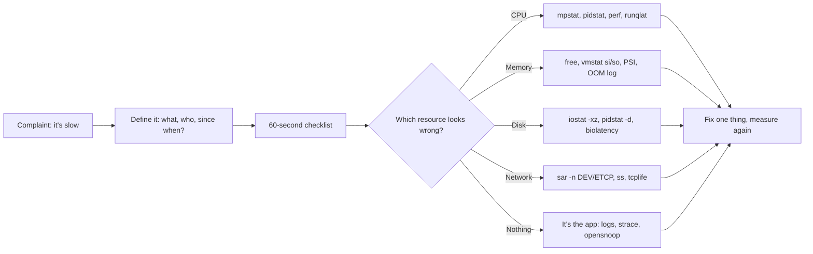
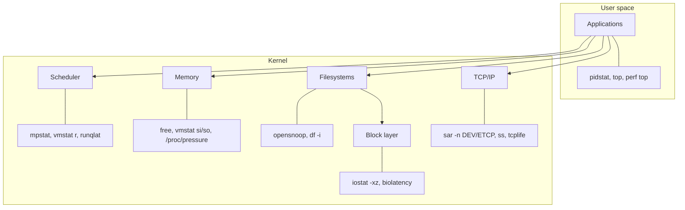
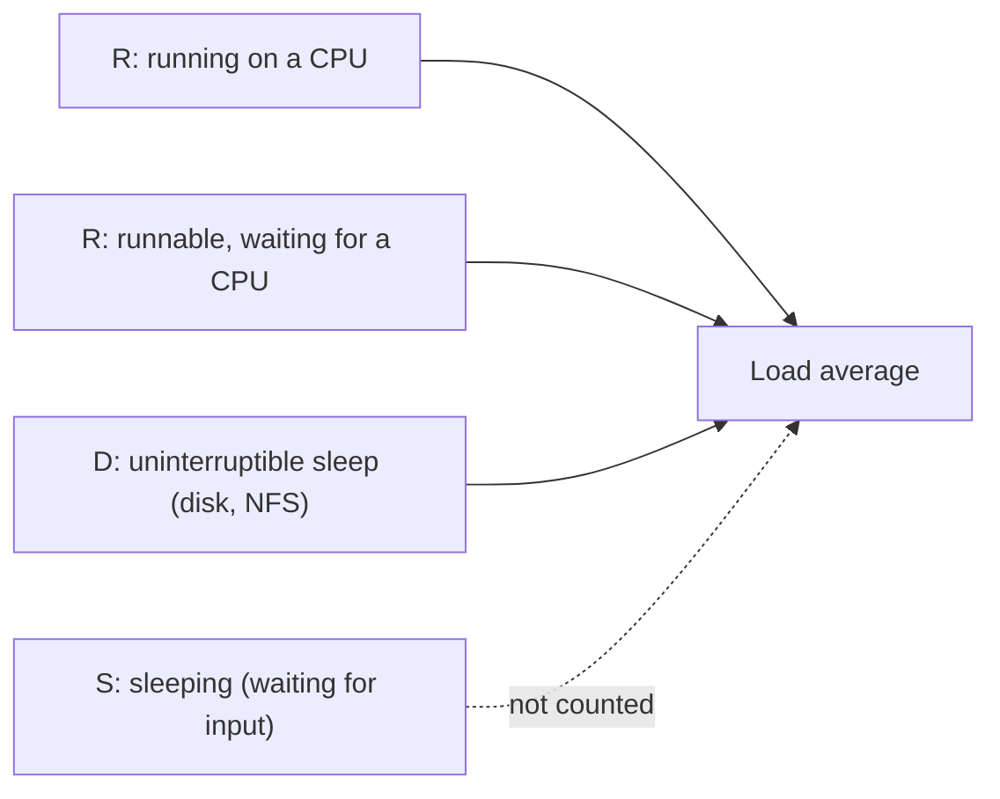

# 19 · Performance and Observability

<ul class="module-meta">
  <li>⏱ ~3 hours</li>
  <li>4 labs</li>
  <li>Builds on: 06 · Processes, 09 · Disks, 11 · Networking, 18 · Containers</li>
</ul>

"The server is slow." It is the most common complaint you will ever get and
the least specific. Slow how? Since when? For whom? Engineers without a method
open `top`, see nothing obvious, and start restarting things. This module gives
you a method: a fixed sequence of checks that finds the busy, saturated or
broken resource in a few minutes, and then a set of precision tools (sar, PCP,
perf and eBPF) to prove exactly what is going on.

!!! abstract "What you'll learn"
    - Apply the USE method (utilization, saturation, errors) to CPU, memory,
      disk and network.
    - Run the 60-second checklist on Rocky Linux and read every line of its
      output.
    - Explain what load average really measures on Linux, and why it can be
      high while the CPUs are idle.
    - Use `sar` to answer "what was happening at 3am yesterday?"
    - Pick and apply a `tuned` profile, and take a first look with `perf`.
    - Use bcc-tools and bpftrace one-liners to see exactly which process is
      opening, executing, or waiting on what.

## The big picture

Performance work is detective work. You do not start by guessing a culprit;
you start by checking every resource for three simple signals, then zoom into
the one that looks wrong.



The tools fall into three groups, and you will use them in this order:

| Group | Answers | Tools |
|-------|---------|-------|
| **Counters right now** | What is busy at this moment? | `uptime`, `vmstat`, `mpstat`, `iostat`, `free`, `top` |
| **History** | What happened earlier, and what is normal? | `sar` (sysstat), PCP (`pmlogger`, `pmrep`), Cockpit |
| **Tracing** | Exactly which event, process or file? | `perf`, bcc-tools, `bpftrace` |



## A method first: USE

The **USE method** (from Brendan Gregg) says: for every resource, check three
things.

- **Utilization:** how busy is it, as a percentage of time or capacity?
  "The disk was busy 95% of the last second."
- **Saturation:** is work queuing up because the resource is full?
  "12 processes are waiting for a CPU."
- **Errors:** is anything failing? "The NIC dropped 4,000 packets."

Saturation is usually the real signal. A CPU at 100% utilization with nothing
waiting is just a busy, healthy CPU. A CPU at 70% with a long run queue means
someone is waiting, and waiting is what users feel as "slow".

!!! analogy "Think of it like a supermarket checkout"
    Utilization is how much of the time the cashier is scanning. Saturation is
    the length of the queue. Errors are dropped bags. A cashier scanning 100%
    of the time with no queue is fine. A queue out the door is a problem even
    if the cashier takes short breaks.

Here is the USE checklist for a Rocky server. Bookmark it.

| Resource | Utilization | Saturation | Errors |
|----------|-------------|------------|--------|
| **CPU** | `mpstat -P ALL 1`: `%idle` near 0 | `vmstat 1`: `r` above CPU count; load average; `/proc/pressure/cpu` | `dmesg` for machine check or thermal throttling |
| **Memory** | `free -m`: `available` low | `vmstat 1`: `si`/`so` (swapping) non-zero; `/proc/pressure/memory` | OOM kills in `journalctl -k` |
| **Disk** | `iostat -xz 1`: `%util` | `iostat`: `aqu-sz` above 1, high `r_await`/`w_await`; `vmstat` `b` | `dmesg` I/O errors; `smartctl` |
| **Network** | `sar -n DEV 1`: rx/tx kB/s versus link speed | `ss -tn`: large `Send-Q`; `nstat` overflows | `ip -s link`: errors, drops; `sar -n ETCP 1`: retransmits |
| **Filesystem** | `df -h` | `df -i` (inodes) | `dmesg` filesystem errors |

## Load average, explained properly

`uptime` prints three numbers that everyone quotes and few people understand:

```console
$ uptime
 10:14:02 up 12 days,  3:41,  2 users,  load average: 3.92, 2.10, 0.84
```

The **load average** is the average number of tasks that were either
**running or runnable** (state `R`, on a CPU or waiting for one) **or in
uninterruptible sleep** (state `D`, usually waiting on disk or NFS), measured
over roughly the last 1, 5 and 15 minutes. The averages are exponentially
damped, so recent seconds count more.

Three rules for reading it:

1. **Compare it to the number of CPUs.** A load of 4 on a 16-CPU box is
   relaxed. A load of 4 on a 1-CPU box means three tasks are always waiting.
   Check with `nproc`.
2. **Read the trend.** `3.92, 2.10, 0.84` means load is climbing: something
   started in the last few minutes. `0.84, 2.10, 3.92` means it is calming down.
3. **Linux counts `D` state.** This is a Linux-specific choice. Classic Unix
   counted only CPU demand. So a high load with idle CPUs nearly always means
   tasks stuck on I/O, not a CPU problem.



??? question "How is the load average actually calculated?"
    Every 5 seconds the kernel counts tasks that are runnable or in `D`
    state, then updates three **exponentially weighted moving averages**.
    Each new sample nudges the old value toward the current count, with a
    different weight for the 1, 5 and 15 minute figures. That is why a sudden
    burst of 10 tasks does not show as 10 immediately: after one minute the
    1-minute average has covered only about 63% of the distance. It also
    means the "1-minute" number still remembers a little of what happened
    five minutes ago. You can read the raw values, plus the count of
    currently runnable tasks, in `/proc/loadavg`.

??? question "Why %iowait is a weak signal"
    `%iowait` is *idle* time during which some I/O was outstanding. It does
    not mean "the CPU was busy waiting". If a CPU-bound job starts on the
    same box, `%iowait` can drop to zero even though the disk is just as slow,
    because the CPU is no longer idle. Use it as a hint, then confirm disk
    problems with `iostat` latency and PSI `io` pressure.

To find which kind of load you have, count process states:

```console
$ ps -eo state= | sort | uniq -c
      2 D
      3 R
    201 S
      1 Z
```

!!! tip "Pressure stall information: load average's smarter cousin"
    **PSI** (Pressure Stall Information) tells you the percentage of time tasks
    were *stalled* waiting for a resource, separately for CPU, memory and I/O:

    ```console
    $ cat /proc/pressure/io
    some avg10=42.17 avg60=18.33 avg300=5.02 total=96112354
    full avg10=31.80 avg60=12.91 avg300=3.40 total=70388921
    ```

    `some` means at least one task was waiting; `full` means every non-idle
    task was. Here, in the last 10 seconds, all running work was stalled on
    I/O 31.8% of the time. Every cgroup has the same files (`io.pressure`,
    `memory.pressure`, `cpu.pressure`), so you can see pressure per service.

<div class="quiz" data-answer="3" markdown>

A 4-CPU server shows `load average: 18.40, 17.95, 16.10`, but `mpstat`
shows the CPUs 92% idle. What is the most likely explanation?

- The load average is broken and should be ignored
- A CPU-bound process is hiding from `mpstat`
- Many tasks are in `D` state, blocked on disk or a hung NFS mount
- The machine needs more CPUs

Right. Linux load includes uninterruptible sleep. High load with idle CPUs
means tasks are waiting on I/O. Look for `D` with `ps` and check `iostat`
and your NFS mounts.

</div>

## The 60-second checklist

Brendan Gregg's famous list of ten commands, adapted to Rocky Linux. Most come
from the **sysstat** package, which is not installed by default:

```console
$ sudo dnf install -y sysstat
```

Run them in order. Each takes a few seconds and each rules something in or out.

<div class="stepper" markdown>

<div class="step" data-title="1. uptime" markdown>

```console
$ uptime
 10:14:02 up 12 days,  3:41,  2 users,  load average: 3.92, 2.10, 0.84
```

**Look for:** load compared with `nproc`, and the trend. Here, load is rising.
Something changed in the last 5 minutes.

</div>

<div class="step" data-title="2. dmesg / journalctl -k" markdown>

```console
$ journalctl -k -p warning --since "-1h" --no-pager
Oct 15 10:09:51 web1 kernel: Out of memory: Killed process 4471 (java) total-vm:6123508kB, anon-rss:3881020kB, …
Oct 15 10:11:03 web1 kernel: nfs: server files1 not responding, still trying
```

**Look for:** OOM kills, I/O errors, NFS timeouts, TCP drops, hardware errors.
Kernel messages often name the problem outright. (`dmesg -T | tail` shows the
same buffer.)

</div>

<div class="step" data-title="3. vmstat 1" markdown>

```console
$ vmstat 1 5
procs -----------memory---------- ---swap-- -----io---- -system-- -------cpu-------
 r  b   swpd   free   buff  cache   si   so    bi    bo   in   cs us sy id wa st gu
 5  0      0 412044   5120 2190312    0    0    12    40  812 1450 88 10  2  0  0  0
 6  0      0 411820   5120 2190340    0    0     0     0  905 1562 90  9  1  0  0  0
 4  1      0 411512   5120 2190360    0    0     0   120  880 1498 89 10  1  0  0  0
…
```

**Columns that matter:** `r` runnable tasks (above CPU count means CPU
saturation), `b` blocked in `D`, `si`/`so` swap in/out (non-zero means memory
pressure), `us`/`sy` user and system CPU, `wa` I/O wait, `st` time stolen by
the hypervisor. Ignore the first line: it is the average since boot.

</div>

<div class="step" data-title="4. mpstat -P ALL 1" markdown>

```console
$ mpstat -P ALL 1 1
10:15:12 AM  CPU    %usr   %nice    %sys %iowait    %irq   %soft  %steal  %guest  %gnice   %idle
10:15:13 AM  all   49.75    0.00    1.00    0.00    0.00    0.25    0.00    0.00    0.00   49.00
10:15:13 AM    0  100.00    0.00    0.00    0.00    0.00    0.00    0.00    0.00    0.00    0.00
10:15:13 AM    1    0.99    0.00    1.98    0.00    0.00    0.99    0.00    0.00    0.00   96.04
…
```

**Look for:** imbalance. One CPU at 100% while others idle is a
single-threaded bottleneck: the box is "50% busy" but the app can go no
faster. High `%sys` suggests kernel work (syscalls, networking); high
`%iowait` points at storage.

</div>

<div class="step" data-title="5. pidstat 1" markdown>

```console
$ pidstat 1 1
10:15:30 AM   UID       PID    %usr %system  %guest   %wait    %CPU   CPU  Command
10:15:31 AM  1001      3120   99.00    1.00    0.00    0.00  100.00     0  report-gen
10:15:31 AM     0       812    0.00    1.00    0.00    0.00    1.00     1  chronyd
```

**Look for:** which process is using the CPU, as a rolling log rather than a
redrawn screen. `%wait` is time the process wanted a CPU but waited. Use
`pidstat -d 1` for disk I/O per process and `pidstat -r 1` for memory.

</div>

<div class="step" data-title="6. iostat -xz 1" markdown>

```console
$ iostat -xz 1 2
Device   r/s   rkB/s  r_await  rareq-sz    w/s     wkB/s  w_await  wareq-sz  aqu-sz  %util
vda     2.00    16.0     0.50      8.00   3.00      44.0     1.33     14.67    0.01    0.40
vdb   310.00  9920.0    48.20     32.00  410.00  52480.0    95.70    128.00   54.18   99.80
```

(Some columns trimmed.) **Look for:** `%util` near 100 (busy), `aqu-sz` well
above 1 (requests queuing), and `r_await`/`w_await` in milliseconds. On SSD or
NVMe, a few ms is normal and tens of ms is bad. Here `vdb` is saturated: 54
requests queued and writes take 96 ms.

</div>

<div class="step" data-title="7. free -m" markdown>

```console
$ free -m
               total        used        free      shared  buff/cache   available
Mem:            7682        5940         402          28        1621        1742
Swap:           2047         312        1735
```

**Look for:** the `available` column, not `free`. Linux uses spare RAM as
cache, so `free` is always small on a healthy box. `available` estimates how
much can be handed to programs without swapping. Worry when it is a small
fraction of `total` *and* `vmstat` shows `si`/`so` activity.

</div>

<div class="step" data-title="8. sar -n DEV 1" markdown>

```console
$ sar -n DEV 1 1
10:16:40 AM     IFACE   rxpck/s   txpck/s    rxkB/s    txkB/s   rxcmp/s   txcmp/s  rxmcst/s   %ifutil
10:16:41 AM        lo     12.00     12.00      1.02      1.02      0.00      0.00      0.00      0.00
10:16:41 AM    enp1s0  81240.00  79810.00 115320.11   6102.47      0.00      0.00      0.00     94.47
```

**Look for:** throughput against the link speed (`ethtool enp1s0 | grep
Speed`). `%ifutil` near 100 means the link is full. Here a 1 Gb/s link is
receiving about 115 MB/s: saturated.

</div>

<div class="step" data-title="9. sar -n TCP,ETCP 1" markdown>

```console
$ sar -n TCP,ETCP 1 1
10:17:02 AM  active/s passive/s    iseg/s    oseg/s
10:17:03 AM      2.00    310.00   9120.00   9644.00

10:17:02 AM  atmptf/s  estres/s retrans/s isegerr/s   orsts/s
10:17:03 AM      0.00      1.00    148.00      0.00     22.00
```

**Look for:** `active/s` outbound connections, `passive/s` inbound
connections (a rough request rate), and `retrans/s`. Retransmits are a sign
of packet loss or an overloaded peer; here about 1.5% of segments are
retransmitted, which users will feel.

</div>

<div class="step" data-title="10. top" markdown>

```console
$ top -b -n1 | head -12
top - 10:17:30 up 12 days,  3:44,  2 users,  load average: 4.10, 2.61, 1.12
Tasks: 207 total,   3 running, 203 sleeping,   0 stopped,   1 zombie
%Cpu(s): 49.6 us,  1.2 sy,  0.0 ni, 48.9 id,  0.0 wa,  0.0 hi,  0.3 si,  0.0 st
MiB Mem :   7682.4 total,    401.9 free,   5940.1 used,   1621.3 buff/cache
MiB Swap:   2048.0 total,   1735.2 free,    312.8 used.   1742.3 avail Mem

    PID USER      PR  NI    VIRT    RES    SHR S  %CPU  %MEM     TIME+ COMMAND
   3120 report    20   0  812044 402312  10244 R 100.0   5.1  12:01.33 report-gen
…
```

**Look for:** a final sanity check that ties everything together. By now you
should already know what you are looking for; `top` confirms it.

</div>

</div>

### Practise the checklist

<div class="terminal-sim" data-title="Sixty seconds on a slow box" data-prompt="[alex@rocky-lab ~]$ " markdown>

<div class="task" data-expect="uptime" data-hint="One word: how long has the system been up, and how loaded is it?" markdown>

**Step 1.** Check the load averages and their trend.

```text
 10:14:02 up 12 days,  3:41,  2 users,  load average: 7.92, 5.10, 1.84
```

</div>

<div class="task" data-expect="nproc" data-hint="A coreutils command that prints the number of processing units." markdown>

**Step 2.** A load of 7.9 means nothing without the CPU count. Get it.

```text
2
```

</div>

<div class="task" data-expect="vmstat 1" data-match="^vmstat 1( \d+)?$" data-hint="vmstat with a 1-second interval (optionally a count)." markdown>

**Step 3.** Load is four times the CPU count. CPU or I/O? Watch `vmstat` every second.

```text
 r  b   swpd   free   buff  cache   si   so    bi    bo   in   cs us sy id wa st gu
 8  0      0 512044   5120 2190312    0    0     0    12 1210 2450 96  4  0  0  0  0
 7  0      0 511820   5120 2190340    0    0     0     0 1185 2390 97  3  0  0  0  0
```

</div>

<div class="task" data-expect="pidstat 1" data-match="^pidstat 1( \d+)?$" data-hint="pidstat from sysstat, with a 1-second interval." markdown>

**Step 4.** `r` is 7 to 8 and `id` is 0: CPU saturation. Who is using it? Use `pidstat`.

```text
10:15:31 AM   UID       PID    %usr %system  %guest   %wait    %CPU   CPU  Command
10:15:31 AM  1001      3120   96.00    1.00    0.00   72.00   97.00     0  report-gen
10:15:31 AM  1001      3121   95.00    2.00    0.00   70.00   97.00     1  report-gen
…
```

</div>

</div>

Diagnosis: several `report-gen` workers saturate both CPUs, and the high
`%wait` shows each spends most of its time waiting for a CPU.

!!! version "Rocky 9 vs 10"
    The checklist is the same on both. Rocky 10 ships a newer `procps-ng`, so
    `vmstat` has an extra `gu` (guest) CPU column, and a newer sysstat whose
    `iostat -x` prints separate discard and flush columns. Read columns by name,
    not position, in scripts.

## Reading each resource

### CPU

**What healthy looks like:** `%idle` with some headroom, `vmstat r` at or
below the CPU count, low `%steal`.

**What bad looks like:**

| Signal | Meaning | Next step |
|--------|---------|-----------|
| `r` consistently above `nproc` | CPU saturation: tasks waiting | `pidstat 1`, `runqlat` |
| One CPU at 100%, others idle | Single-threaded bottleneck | `pidstat -t 1` to find the thread |
| High `%sys` | Lots of kernel work (syscalls, interrupts) | `perf top`, `syscount` |
| High `%steal` | The hypervisor gives your VM's CPU to others | Talk to the platform team, resize |
| Process pinned at a round number like 50% | cgroup CPU quota throttling | `cpu.stat` `nr_throttled`, see [18 · Containers](18-containers.md) |

### Memory

**What healthy looks like:** `available` comfortably above your peak need,
zero `si`/`so`, no OOM messages.

The kernel's last resort when memory runs out is the **OOM killer**, which
picks a victim process (usually the biggest) and kills it with `SIGKILL`. It
always leaves a message:

```console
$ journalctl -k --grep 'killed process' --no-pager
Oct 15 10:09:51 web1 kernel: Out of memory: Killed process 4471 (java) total-vm:6123508kB, anon-rss:3881020kB, file-rss:1024kB, shmem-rss:0kB, UID:1001 pgtables:8412kB oom_score_adj:0
```

If the line says `Memory cgroup out of memory`, the process hit its service or
container `MemoryMax=` limit, not the machine's limit. That changes the fix:
raise the limit or fix the leak, rather than add RAM. How the kernel
decides what to reclaim, overcommit and `systemd-oomd` are covered in
[25 · Memory Deep Dive](25-memory-deep-dive.md).

```console
$ grep -E 'MemTotal|MemAvailable|SwapTotal|SwapFree|Dirty' /proc/meminfo
MemTotal:        7866776 kB
MemAvailable:    1784012 kB
SwapTotal:       2097148 kB
SwapFree:        1776884 kB
Dirty:              2140 kB
$ ps -eo pid,rss,comm --sort=-rss | head -4
    PID   RSS COMMAND
   4502 3906112 java
   1288  402312 report-gen
    977  112840 firewalld
```

**RSS** (resident set size) is the RAM a process is using right now.

### Disk

**What healthy looks like:** `await` in single-digit ms on SSDs,
`aqu-sz` below 1, `%util` with headroom.

!!! warning "%util lies on fast devices"
    `%util` means "the device had at least one request in flight", not "the
    device is at capacity". NVMe drives and RAID arrays serve many requests in
    parallel and can show 100% while still having lots of headroom. On those,
    trust `await` and `aqu-sz` more.

To find who is doing the I/O:

```console
$ pidstat -d 1 1
10:20:11 AM   UID       PID   kB_rd/s   kB_wr/s kB_ccwr/s iodelay  Command
10:20:12 AM     0      5530      0.00  51200.00      0.00     140  rsync
```

`iodelay` is time the process spent waiting for I/O, in clock ticks.

### Network

**What healthy looks like:** throughput below link speed, retransmits near
zero, no drops.

```console
$ ip -s link show enp1s0
2: enp1s0: <BROADCAST,MULTICAST,UP,LOWER_UP> mtu 1500 qdisc fq_codel state UP mode DEFAULT group default qlen 1000
    link/ether 52:54:00:3a:91:0c brd ff:ff:ff:ff:ff:ff
    RX:  bytes  packets errors dropped  missed   mcast
    8829172310  9123456      0    4210       0       0
    TX:  bytes  packets errors dropped carrier collsns
     512302112  3301256      0       0       0       0
$ ss -s
Total: 412
TCP:   1310 (estab 296, closed 998, orphaned 0, timewait 991)
…
```

Rising `dropped` on RX means packets arrived faster than the system could take
them. Many `timewait` sockets usually just mean lots of short connections. See
[11 · Networking](11-networking.md) for `ss` in depth.

<div class="quiz" data-answer="2" markdown>

`free -m` shows `free 180` and `available 5900` on an 8 GB server, and
`vmstat` shows `si` and `so` at 0. Is the server short of memory?

- Yes, only 180 MB is free
- No, most memory is reclaimable cache and nothing is swapping
- Yes, Linux should keep at least half the memory free
- Can't tell without rebooting

Right. Free memory is wasted memory, so Linux fills it with cache. The
`available` column and swap activity are what matter, and both look healthy.

</div>

## History with sar

The checklist shows *now*. Problems often happened *earlier*. sysstat can
record a snapshot every 10 minutes into `/var/log/sa/saDD` (DD is the day of
the month), keeping about four weeks. Turn on collection once:

```console
$ sudo systemctl enable --now sysstat
$ systemctl list-timers 'sysstat*' --no-pager
NEXT                        LEFT     LAST  PASSED  UNIT                    ACTIVATES
Thu 2026-10-15 10:30:00 UTC 9min     -     -       sysstat-collect.timer   sysstat-collect.service
Fri 2026-10-16 00:07:00 UTC 13h      -     -       sysstat-summary.timer   sysstat-summary.service
```

Then `sar` reads the history. The same flags as live mode, plus a file and a
time window:

```console
$ sar -q -f /var/log/sa/sa14 -s 02:00:00 -e 04:00:00
02:00:01 AM   runq-sz  plist-sz   ldavg-1   ldavg-5  ldavg-15   blocked
02:10:01 AM         1       412      0.42      0.38      0.31         0
02:20:01 AM        14       455     11.80      6.20      2.51         9
02:30:01 AM        15       461     14.91     10.33      5.12        11
02:40:01 AM         1       418      1.10      4.80      4.40         0
Average:            8       437      7.06      5.43      3.09         5
```

At 02:20 yesterday, run queue and blocked tasks jumped for about 20 minutes.
Now check disks for the same window with `sar -d -p -f /var/log/sa/sa14 -s
02:00:00 -e 04:00:00` and you will probably find the nightly backup.

| `sar` flag | Shows |
|------------|-------|
| `-u` | CPU utilization |
| `-q` | Run queue and load average |
| `-r` | Memory |
| `-S` | Swap usage; `-W` swapping activity |
| `-d -p` | Per-disk I/O with readable device names |
| `-n DEV` / `-n EDEV` | Network throughput / errors |
| `-n TCP,ETCP` | TCP connections and retransmits |
| `-A` | Everything |

## Performance Co-Pilot (PCP) in brief

**PCP** is a bigger, more modern metrics framework. A daemon (`pmcd`) exposes
thousands of metrics, `pmlogger` archives them, and many tools (including
Cockpit and Grafana) read them. The quickest way to start it with sensible
defaults:

```console
$ sudo dnf install -y pcp-zeroconf
$ pmstat -s 3
@ Thu Oct 15 10:24:01 2026
 loadavg                      memory      swap        io    system         cpu
   1 min   swpd   free   buff  cache   pi   po   bi   bo   in   cs  us  sy  id
    0.31   312m   402m   5120  1621m    0    0    0   12  812 1450   2   1  97
…
$ pmrep -t 2 -s 3 kernel.all.load mem.util.available
```

`pminfo | wc -l` lists how many metrics exist (thousands). PCP's strength is
that the same metric names work live and in archives, across many hosts.

## Cockpit: metrics at a glance

**Cockpit** is a web console for Rocky that shows CPU, memory, disk and
network graphs, plus services, logs and storage. It is great for a quick visual
check or for colleagues who prefer a browser.

```console
$ sudo dnf install -y cockpit
$ sudo systemctl enable --now cockpit.socket
$ sudo firewall-cmd --permanent --add-service=cockpit && sudo firewall-cmd --reload
```

Browse to `https://your-server:9090` and log in with a normal Linux account.
The **Overview** page has live usage; **Metrics and history** shows the past,
using PCP (Cockpit offers to install what it needs).

## tuned: profiles instead of hand tuning

Hundreds of kernel and device settings affect performance. **tuned** is a
service that applies a coherent set of them, called a **profile**, for a
workload type. Rocky enables it by default.

```console
$ tuned-adm active
Current active profile: virtual-guest
$ tuned-adm recommend
virtual-guest
$ tuned-adm list
Available profiles:
- accelerator-performance     - Throughput performance based tuning with disabled higher latency STOP states
- balanced                    - General non-specialized tuned profile
- desktop                     - Optimize for the desktop use-case
- latency-performance         - Optimize for deterministic performance at the cost of increased power consumption
- network-latency             - Optimize for deterministic performance at the cost of increased power consumption, focused on low latency network performance
- network-throughput          - Optimize for streaming network throughput, generally only necessary on older CPUs or 40G+ networks
- powersave                   - Optimize for low power consumption
- throughput-performance      - Broadly applicable tuning that provides excellent performance across a variety of common server workloads
- virtual-guest               - Optimize for running inside a virtual guest
- virtual-host                - Optimize for running KVM guests
…
$ sudo tuned-adm profile throughput-performance
$ tuned-adm verify
Verification succeeded, current system settings match the preset profile.
```

Profiles live in `/usr/lib/tuned/` (shipped) and `/etc/tuned/` (yours). A
custom profile can `include=throughput-performance` and override a few
settings. Always measure before and after: a profile is a good default, not a
guarantee.

## perf: where is the CPU time going?

When `pidstat` says a process is burning CPU, `perf` tells you *which
functions* inside it. It works by **sampling**: many times per second, it
records what each CPU was executing.

```console
$ sudo dnf install -y perf
$ sudo perf top
Samples: 42K of event 'cpu-clock:ppp', 4000 Hz, Event count (approx.): 9918234511
Overhead  Shared Object        Symbol
  38.12%  libz.so.1.3.1        [.] deflate_slow
  21.40%  report-gen           [.] build_row
   9.85%  [kernel]             [k] clear_page_erms
   4.02%  libc.so.6            [.] __memmove_avx_unaligned_erms
…
```

`[.]` is user space, `[k]` is the kernel. Here, compression dominates. To
record and analyse later:

```console
$ sudo perf record -F 99 -g -p 3120 -- sleep 10
[ perf record: Woken up 1 times to write data ]
[ perf record: Captured and wrote 0.412 MB perf.data (990 samples) ]
$ sudo perf report --stdio | head -20
$ sudo perf stat -p 3120 -- sleep 5
```

`-g` records call stacks so you see who called the hot function. `perf stat`
counts events such as instructions and context switches. Run `perf` as root, and
note that symbols are only readable if the program was not stripped; install
debuginfo packages for more detail.

## eBPF tools: precise answers, low overhead

### Why eBPF

Counters tell you *how much*. Sometimes you need *which*: which file is being
opened 10,000 times a second, which short-lived process keeps spawning, which
disk requests take 200 ms. **eBPF** lets small, verified programs run inside
the kernel on events (a syscall, a disk completion, a TCP state change) and
summarize them in place. It is safe for production because the kernel checks
every program before loading it, and cheap because only summaries are copied
out.

You rarely write eBPF yourself. You use two toolkits:

- **bcc-tools:** dozens of ready-made tools. Install with
  `sudo dnf install -y bcc-tools`; they live in `/usr/share/bcc/tools/`.
- **bpftrace:** a tiny awk-like language for one-liners. Install with
  `sudo dnf install -y bpftrace`.

```console
$ export PATH=$PATH:/usr/share/bcc/tools
$ ls /usr/share/bcc/tools | head -8
argdist
bashreadline
bindsnoop
biolatency
biosnoop
biotop
bitesize
btrfsdist
```

### The five tools to learn first

**execsnoop** shows every new process, including ones that live for a few
milliseconds and never appear in `top`:

```console
$ sudo execsnoop
PCOMM            PID     PPID    RET ARGS
check_disk.sh    7021    1       0   /usr/local/bin/check_disk.sh
df               7022    7021    0   /usr/bin/df -P /var
awk              7023    7021    0   /usr/bin/awk {print $5}
curl             7024    7021    0   /usr/bin/curl -s http://10.0.0.5/alert
…
```

**opensnoop** shows files being opened, with errors. Great for "what config
file is this program actually reading?" and "why does it say not found?":

```console
$ sudo opensnoop -n httpd
PID     COMM               FD ERR PATH
2210    httpd              -1   2 /var/www/html/favicon.ico
2210    httpd              14   0 /var/www/html/index.html
2210    httpd              -1  13 /var/www/html/private/report.pdf
```

`ERR 2` is "No such file", `ERR 13` is "Permission denied".

**biolatency** draws a histogram of disk I/O latency:

```console
$ sudo biolatency 10 1
Tracing block device I/O... Hit Ctrl-C to end.

     usecs               : count     distribution
         0 -> 1          : 0        |                                        |
         2 -> 3          : 0        |                                        |
        64 -> 127        : 812      |****************************************|
       128 -> 255        : 501      |************************                |
       256 -> 511        : 77       |***                                     |
     16384 -> 32767      : 40       |*                                       |
     32768 -> 65535      : 112      |*****                                   |
```

Two humps: most I/O is fast (under 0.5 ms), but a second group takes 16 to 65
ms. That second hump is what users feel. An average would have hidden it.

**tcplife** logs each TCP connection when it closes, with duration and bytes:

```console
$ sudo tcplife
PID   COMM       LADDR           LPORT RADDR           RPORT TX_KB RX_KB MS
2210  httpd      10.0.0.12       443   203.0.113.9     51122     4     1 2.11
4502  java       10.0.0.12       41820 10.0.0.30       5432      0     2 3011.40
```

**runqlat** shows how long tasks wait in the CPU run queue: a direct
measurement of CPU saturation.

```console
$ sudo runqlat 5 1
     usecs               : count     distribution
         0 -> 1          : 1203     |*************                           |
         2 -> 3          : 3510     |****************************************|
         4 -> 7          : 912      |**********                              |
      8192 -> 16383      : 284      |***                                     |
```

### bpftrace one-liners

bpftrace programs read as `probe /filter/ { action }`. These one-liners are
safe to run and stop with ++ctrl+c++:

```bash
# Which processes are making the most system calls?
sudo bpftrace -e 'tracepoint:raw_syscalls:sys_enter { @[comm] = count(); }'

# Every file opened, by whom
sudo bpftrace -e 'tracepoint:syscalls:sys_enter_openat { printf("%s %s\n", comm, str(args.filename)); }'

# Sample on-CPU processes 99 times a second
sudo bpftrace -e 'profile:hz:99 { @[comm] = count(); }'

# Histogram of disk request sizes
sudo bpftrace -e 'tracepoint:block:block_rq_issue { @bytes = hist(args.bytes); }'

# Count new processes by parent name
sudo bpftrace -e 'tracepoint:sched:sched_process_fork { @[comm] = count(); }'
```

`@` is a map (an in-kernel table) that bpftrace prints when you stop it.
`comm` is the process name, `args` are the tracepoint's fields. List
available probes with `sudo bpftrace -l 'tracepoint:syscalls:*open*'`.

!!! warning "strace is not a production tool"
    `strace` stops the traced process at every system call. That can slow a
    busy service down by 10 to 100 times. For a live production process,
    prefer the eBPF equivalent, which filters in the kernel and barely
    disturbs it. `strace` is still excellent for a single command on a test box.

<div class="quiz" data-answer="1" markdown>

A cron job seems to spawn something every minute that briefly spikes CPU, but
it never shows up in `top`. Which tool shows it?

- `execsnoop`
- `biolatency`
- `free -m`
- `tuned-adm recommend`

Right. `execsnoop` traces every `exec()` as it happens, so it catches
processes that live for only milliseconds.

</div>

## A real investigation: "the app is slow"

Here is how the method plays out on a real complaint. Step through it.

<div class="stepper" markdown>

<div class="step" data-title="Define the problem" markdown>

The ticket: "Order page slow since about 10:00." You ask questions first.
Slow for everyone? Yes. How slow? Pages that took 200 ms take 3 to 5 seconds.
Anything changed? "Nothing" (it is always "nothing"). Now you have a time and
a measurable symptom.

</div>

<div class="step" data-title="uptime and the kernel log" markdown>

```console
$ uptime
 10:31:44 up 40 days,  2:01,  1 user,  load average: 9.12, 8.70, 6.02
$ nproc
4
$ journalctl -k --since 09:45 -p warning --no-pager
-- No entries --
```

Load is more than twice the CPU count and has been high for a while. The
kernel is not complaining about OOM or hardware.

</div>

<div class="step" data-title="vmstat: CPU or I/O?" markdown>

```console
$ vmstat 1 3
 r  b   swpd   free   buff  cache   si   so    bi    bo   in   cs us sy id wa st gu
 1  8      0 812044   5120 4190312    0    0  9820 48212 2210 3120  6  4 41 49  0  0
 0  9      0 811820   5120 4190340    0    0 10240 51200 2301 3290  5  4 40 51  0  0
```

`r` is low but `b` is 8 to 9, and `wa` is around 50%. CPUs are not busy; tasks
are blocked on I/O. That explains the high load. Disk is the suspect.

</div>

<div class="step" data-title="iostat: which disk?" markdown>

```console
$ iostat -xz 1 2 | grep -E 'Device|vd'
Device   r/s   rkB/s  r_await    w/s     wkB/s  w_await  aqu-sz  %util
vda     4.00    40.0     0.81   6.00     52.0     1.10    0.01    0.70
vdb   290.00 10240.0    61.30 402.00  51200.0   112.40   62.33   99.90
```

`vdb` (the database volume) is saturated: 62 requests queued, writes taking
over 100 ms. Something is writing about 50 MB/s.

</div>

<div class="step" data-title="pidstat -d: who is writing?" markdown>

```console
$ pidstat -d 1 1
Average:      UID       PID   kB_rd/s   kB_wr/s kB_ccwr/s iodelay  Command
Average:        0     14402      0.00  49920.00      0.00     310  rsync
Average:       27      2290   10200.00   1280.00      0.00     980  mariadbd
```

An `rsync` is writing 50 MB/s to the same disk, and MariaDB is spending most
of its time waiting (`iodelay`).

</div>

<div class="step" data-title="Confirm with history and tracing" markdown>

```console
$ ps -o pid,lstart,cmd -p 14402
    PID                  STARTED CMD
  14402 Thu Oct 15 09:58:02 2026 rsync -a /srv/archive/ /var/lib/mysql-backup/
$ sudo biolatency -D 5 1
```

It started at 09:58, two minutes before the complaints. `biolatency -D` shows
`vdb` latency with a big hump at 64 to 128 ms. A colleague added an archive
copy to the database volume this morning. "Nothing changed" changed.

</div>

<div class="step" data-title="Fix one thing and measure" markdown>

Short term: lower the copy's I/O priority, or pause it.

```console
$ sudo ionice -c3 -p 14402
```

Long term: run it as a service with an I/O limit (`IOWriteBandwidthMax=`), at
night, to a different volume. Then measure again: `iostat` shows `vdb`
`w_await` back to 2 ms, the page loads in 200 ms. Write down what you found in
the ticket.

</div>

</div>

## Labs

!!! lab "Lab 1: Run the 60-second checklist on a loaded system"

    **Goal:** Generate CPU, memory and disk load, and identify each from the
    checklist alone.

    **You'll need:** a Rocky 10 VM with at least 2 CPUs, sudo.

    1. Install the tools: `sudo dnf install -y sysstat`
    2. Start three kinds of load as transient services so they are easy to stop:

        ```bash
        sudo systemd-run --unit=load-cpu sha1sum /dev/zero
        sudo systemd-run --unit=load-disk bash -c 'while true; do dd if=/dev/zero of=/var/tmp/ddtest bs=1M count=1024 oflag=direct status=none; done'
        sudo systemd-run --unit=load-mem python3 -c "a = b'x' * (512*1024*1024); import time; time.sleep(600)"
        ```

    3. Without looking at the commands above, run `uptime`, `vmstat 1 5`,
       `mpstat -P ALL 1 1`, `pidstat 1 1`, `iostat -xz 1 2`, `free -m` and
       `pidstat -d 1 1`. For each, write down which load it reveals.

    **Check your work:** you should see one CPU near 100% in `mpstat`
    (`sha1sum`), `w/s` and `wkB/s` high on your root disk in `iostat` with
    `dd` at the top of `pidstat -d`, and `used` about 512 MB higher in
    `free -m` with `python3` near the top of `pidstat -r 1 1`.

    **Clean up:**
    `sudo systemctl stop load-cpu load-disk load-mem; sudo rm -f /var/tmp/ddtest`

!!! lab "Lab 2: Read the past with sar"

    **Goal:** Turn on history collection and find an event after the fact.

    1. Enable collection: `sudo systemctl enable --now sysstat`
    2. Force a sample now, create load for a few minutes, then sample again:

        ```bash
        sudo /usr/lib64/sa/sa1 1 1
        sudo systemd-run --unit=spike sha1sum /dev/zero
        sleep 180
        sudo /usr/lib64/sa/sa1 1 1
        sudo systemctl stop spike
        ```

    3. Read today's file:

        ```bash
        sar -u -f /var/log/sa/sa$(date +%d)
        sar -q -f /var/log/sa/sa$(date +%d)
        ```

    **Check your work:** the `%user` and `ldavg-1` values in the last sample
    are clearly higher than in the first.

    ??? tip "Hint: no file yet?"
        `sa1` writes the binary file. If `sar` says the file does not exist,
        check `ls /var/log/sa/` and that the `sysstat` service is active.

    **Clean up:** nothing to remove. To stop collection,
    `sudo systemctl disable --now sysstat`.

!!! lab "Lab 3: Catch invisible activity with bcc-tools"

    **Goal:** Use eBPF tools to see short-lived processes, file opens and
    disk latency.

    1. Install: `sudo dnf install -y bcc-tools`
    2. In terminal A, run `sudo /usr/share/bcc/tools/execsnoop`.
       In terminal B, run `for i in 1 2 3; do date >/dev/null; ls /tmp >/dev/null; done`.
       Watch every `date` and `ls` appear in terminal A. Stop with ++ctrl+c++.
    3. In terminal A, run `sudo /usr/share/bcc/tools/opensnoop -n cat`.
       In terminal B, run `cat /etc/hostname /etc/nosuchfile /etc/shadow`.
    4. In terminal A, run `sudo /usr/share/bcc/tools/biolatency 10 1`.
       In terminal B, run
       `dd if=/dev/zero of=/var/tmp/bl bs=4k count=20000 oflag=direct`.

    **Check your work:** `opensnoop` shows three opens by `cat`: one with
    `ERR 0`, one with `ERR 2` (no such file) and one with `ERR 13` (permission
    denied). `biolatency` prints a histogram with a clear peak.

    **Clean up:** `rm -f /var/tmp/bl`

!!! lab "Lab 4: Switch tuned profiles and see what changes"

    **Goal:** See that a tuned profile is just a set of concrete settings.

    1. Record the current profile and two settings it controls:

        ```bash
        tuned-adm active
        sysctl vm.dirty_ratio vm.swappiness
        ```

    2. Switch to `throughput-performance` and look again:

        ```bash
        sudo tuned-adm profile throughput-performance
        sysctl vm.dirty_ratio vm.swappiness
        grep -A3 '^\[sysctl\]' /usr/lib/tuned/profiles/throughput-performance/tuned.conf 2>/dev/null \
          || grep -A3 '^\[sysctl\]' /usr/lib/tuned/throughput-performance/tuned.conf
        ```

    3. Try `tuned-adm verify` to confirm the system matches the profile.

    **Check your work:** `vm.dirty_ratio` and `vm.swappiness` match the
    `[sysctl]` section of the profile file.

    **Clean up:** `sudo tuned-adm profile "$(tuned-adm recommend)"`

## Common pitfalls

!!! pitfall "Looking at averages instead of distributions"
    A 5 ms average disk latency can hide 2% of requests taking 500 ms. Users
    remember the slow ones. Use histograms (`biolatency`, `runqlat`) when the
    average looks fine but users complain.

!!! pitfall "Changing several things at once"
    You raise a limit, switch a tuned profile and restart the app, and it gets
    better. Which one helped? Now you do not know, and one of the changes may
    hurt later. Change one thing, measure, then decide.

| Symptom | Common misreading | Reality |
|---------|-------------------|---------|
| `free` column tiny | "Out of memory" | Cache. Check `available` and `si`/`so` |
| High load, idle CPU | "Need more CPUs" | Tasks in `D` state: disk or NFS |
| `%util` 100% on NVMe | "Disk saturated" | Maybe not. Check `await` and `aqu-sz` |
| `sar` says "No such file" | "sar is broken" | Collection was never enabled: `systemctl enable --now sysstat` |
| App at exactly 50% CPU | "Half idle, fine" | Possibly cgroup-throttled or single-threaded on 2 CPUs |
| High `%steal` | "Our app is slow" | The hypervisor host is oversubscribed |

## Cheat sheet

| Command | What it does |
|---------|--------------|
| `uptime`, `nproc` | Load average and CPU count |
| `journalctl -k -p warning` | Kernel warnings (OOM, I/O errors) |
| `vmstat 1` | Run queue, blocked tasks, swap, CPU split |
| `mpstat -P ALL 1` | Per-CPU utilization |
| `pidstat 1` / `-d` / `-r` / `-t` | Per-process CPU / disk / memory / threads |
| `iostat -xz 1` | Per-disk utilization, queue, latency |
| `free -m` | Memory; read `available` |
| `sar -n DEV 1`, `sar -n TCP,ETCP 1` | Network throughput, TCP and retransmits |
| `cat /proc/pressure/{cpu,memory,io}` | Pressure stall information |
| `sar -q -f /var/log/sa/saDD -s HH:MM:SS` | Historical run queue and load |
| `pmstat`, `pmrep` | PCP live and archived metrics |
| `tuned-adm active` / `recommend` / `profile NAME` | Manage tuning profiles |
| `perf top`, `perf record -g`, `perf report` | CPU profiling |
| `execsnoop`, `opensnoop`, `biolatency`, `tcplife`, `runqlat` | bcc-tools in `/usr/share/bcc/tools` |
| `bpftrace -e '…'` | eBPF one-liners |
| `systemctl enable --now cockpit.socket` | Web console on port 9090 |

## Flashcards

<div class="flashcards" markdown>

<div class="card" markdown>

What are the three letters of the USE method?

Utilization (how busy), Saturation (how much work is queued), Errors (what is failing). Check all three for every resource.

</div>

<div class="card" markdown>

What does the Linux load average count?

Tasks that are running, waiting for a CPU, or in uninterruptible sleep (`D` state), averaged over about 1, 5 and 15 minutes.

</div>

<div class="card" markdown>

Which `free` column matters?

`available`: memory that can be given to programs without swapping. `free` is always small because Linux uses spare RAM as cache.

</div>

<div class="card" markdown>

In `vmstat 1`, what do `r`, `b`, `si`/`so` and `wa` mean?

Runnable tasks, blocked (`D`) tasks, swap-in/swap-out, and CPU idle time with I/O outstanding.

</div>

<div class="card" markdown>

In `iostat -xz`, which numbers show a saturated disk?

High `aqu-sz` (queue depth) and high `r_await`/`w_await` (milliseconds per request). `%util` alone can mislead on SSD/NVMe.

</div>

<div class="card" markdown>

How do you make `sar` history available?

`dnf install sysstat` then `systemctl enable --now sysstat`. Data goes to `/var/log/sa/saDD`.

</div>

<div class="card" markdown>

Which bcc tool catches short-lived processes?

`execsnoop`, in `/usr/share/bcc/tools/`. It prints every `exec()` as it happens.

</div>

<div class="card" markdown>

What does PSI `full avg10=30` in `/proc/pressure/io` mean?

For 30% of the last 10 seconds, every non-idle task was stalled waiting on I/O.

</div>

</div>

## Recap

!!! recap "Key takeaways"
    - Start with a method, not a tool: define the problem, then check
      utilization, saturation and errors for every resource.
    - The 60-second checklist (`uptime`, kernel log, `vmstat`, `mpstat`,
      `pidstat`, `iostat`, `free`, `sar -n`, `top`) finds most problems.
    - Linux load average counts running, runnable *and* `D`-state tasks;
      compare it to `nproc` and check CPU idle before blaming the CPU.
    - Read `available`, not `free`. Swapping (`si`/`so`) and PSI are the real
      memory pressure signals.
    - Enable sysstat so `sar` can answer questions about the past.
    - perf shows where CPU time goes; bcc-tools and bpftrace answer "which
      process, file or request" with little overhead.

## Go deeper

- Man pages: [[man:vmstat(8)]] [[man:mpstat(1)]] [[man:pidstat(1)]]
  [[man:iostat(1)]] [[man:sar(1)]] [[man:tuned-adm(8)]] [[man:perf(1)]]
  [[man:bpftrace(8)]] [[man:proc(5)]]
- [Linux Performance Analysis in 60,000 Milliseconds (Netflix TechBlog)](https://netflixtechblog.com/linux-performance-analysis-in-60-000-milliseconds-accc10403c55)
- [The USE Method, Brendan Gregg](https://www.brendangregg.com/usemethod.html)
- [Linux Load Averages: Solving the Mystery, Brendan Gregg](https://www.brendangregg.com/blog/2017-08-08/linux-load-averages.html)
- [BCC tools repository](https://github.com/iovisor/bcc)
- [Pressure Stall Information, kernel documentation](https://docs.kernel.org/accounting/psi.html)

**Next:** [20 · Troubleshooting Playbook](20-troubleshooting-playbook.md)
