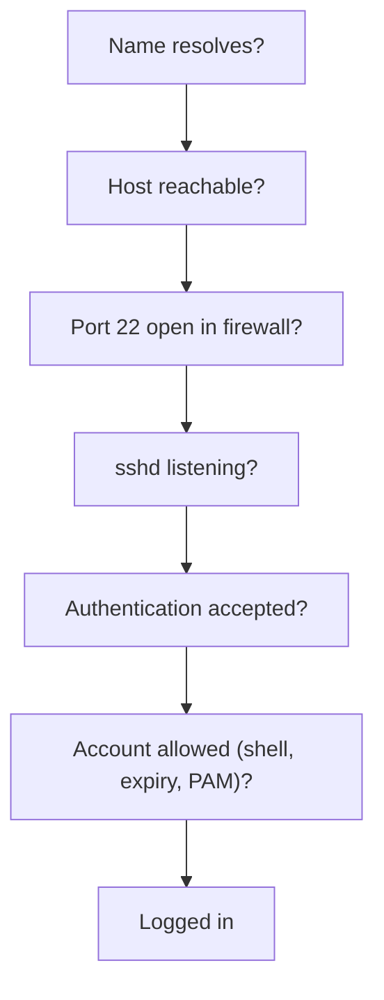
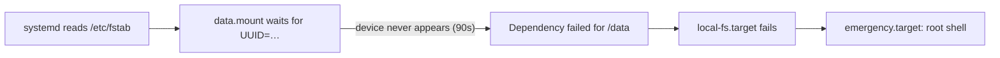

# 20 · Troubleshooting Playbook

<ul class="module-meta">
  <li>⏱ ~3.5 hours</li>
  <li>5 break-fix labs</li>
  <li>Builds on: everything so far</li>
</ul>

This is the capstone. Everything you learned in the earlier modules now meets
the moment that matters: something is broken, someone is waiting, and you have
a shell prompt. Good troubleshooters are not people who have memorized every
error. They are people who follow a method, gather evidence before they act,
and know where each kind of evidence lives. This module gives you the method,
then walks through ten failures you *will* meet on Rocky Linux. At the end, you
break your own VM on purpose and fix it.

!!! abstract "What you'll learn"
    - Apply a five-step troubleshooting method and keep notes as you go.
    - Know the "first five minutes" commands that rule out the common causes.
    - Diagnose and fix services that will not start, full disks, SSH lockouts,
      broken DNS, emergency-mode boots and lost root passwords.
    - Tell apart high load from CPU work and high load from stuck I/O.
    - Read OOM kills, broken DNF repositories and web server 403s correctly,
      including when SELinux (and not permissions) is the cause.
    - Practise all of it safely on a VM you break yourself.

## The big picture

Every scenario in this module follows the same loop. The loop is the skill;
the scenarios are practice.


1. **Define the problem.** Turn "it's broken" into a precise statement: *what*
   fails, for *whom*, *since when*, and *what changed*. "Since the 10:00
   patch, `curl localhost` returns 403 for every page" is a problem you can
   solve. "The website is down" is not yet.
2. **Gather evidence.** Logs, status, error messages, timestamps. Read the
   *whole* error message; it usually names the cause. Do not change anything
   yet.
3. **Form a hypothesis.** One specific, testable explanation: "httpd cannot
   read the file because its SELinux type is wrong".
4. **Test one change at a time.** Change one thing, check the result, and undo
   it if it did not help. Changing five things at once leaves you not knowing
   which one mattered, or which one broke something else.
5. **Write it down.** What you saw, what you tried, what fixed it. Your notes
   become the next person's runbook (and yours, at 3am, in six months).

!!! analogy "Think of it like a doctor"
    A good doctor does not start with surgery. They ask when the pain started,
    take your temperature, order one test, and read the result before deciding.
    "Restart it and see" is the equivalent of surgery without a diagnosis:
    sometimes it works, and you learn nothing.

### The first five minutes

Before diving into a specific scenario, run these. Together they rule out the
most common causes in under a minute.

```console
$ systemctl --failed                      # any failed units?
$ journalctl -p err -b --no-pager | tail -20   # errors since boot
$ df -h; df -i                            # space and inodes
$ free -m; uptime                         # memory and load
$ sudo ausearch -m AVC -ts recent         # recent SELinux denials
$ sudo ss -tlnp                           # what is listening, and by whom
```

Drill them now. The scenario: users say "the server is acting weird".

<div class="terminal-sim" data-title="The first five minutes" data-prompt="[alex@rocky-lab ~]$ " markdown>

<div class="task" data-expect="systemctl --failed" data-match="^(sudo )?systemctl (--failed|list-units --failed|list-units --state=failed)$" data-hint="systemctl has an option that lists only failed units." markdown>

**Step 1.** Are any units in a failed state?

```text
  UNIT           LOAD   ACTIVE SUB    DESCRIPTION
● httpd.service  loaded failed failed The Apache HTTP Server

1 loaded units listed.
```

</div>

<div class="task" data-expect="journalctl -xeu httpd||journalctl -xeu httpd.service||journalctl -u httpd||journalctl -u httpd.service" data-match="^(sudo )?journalctl (-[xe]*u ?|-u )httpd(\.service)?( -[xeb]+)?$" data-hint="journalctl -u selects one unit; -xe jumps to the end with explanations." markdown>

**Step 2.** Read the failed unit's log.

```text
Oct 15 11:02:17 web1 httpd[6120]: (13)Permission denied: AH00072: make_sock: could not bind to address [::]:8095
Oct 15 11:02:17 web1 httpd[6120]: no listening sockets available, shutting down
Oct 15 11:02:17 web1 systemd[1]: httpd.service: Main process exited, code=exited, status=1/FAILURE
```

</div>

<div class="task" data-expect="sudo ausearch -m AVC -ts recent" data-match="^sudo ausearch -m (AVC|avc) -ts recent( -c httpd)?$" data-hint="httpd runs as root and still got Permission denied. Look for recent SELinux AVC records with ausearch." markdown>

**Step 3.** Root got "Permission denied". Check for SELinux denials.

```text
type=AVC msg=audit(1760526137.412:812): avc:  denied  { name_bind } for  pid=6120 comm="httpd" src=8095 scontext=system_u:system_r:httpd_t:s0 tcontext=system_u:object_r:unreserved_port_t:s0 tclass=tcp_socket permissive=0
```

</div>

<div class="task" data-expect="sudo semanage port -a -t http_port_t -p tcp 8095" data-match="^sudo semanage port (-a|--add) -t http_port_t -p tcp 8095$" data-hint="semanage port -a -t TYPE -p tcp PORT. The web server port type is http_port_t." markdown>

**Step 4.** Allow httpd to use port 8095 by labelling the port.

```text
(no output: the port is now labelled http_port_t)
```

</div>

<div class="task" data-expect="sudo systemctl start httpd||sudo systemctl restart httpd||sudo systemctl start httpd.service||sudo systemctl restart httpd.service" data-hint="Start the httpd unit again with sudo systemctl." markdown>

**Step 5.** Start the service again.

```text
(no output: success)
```

</div>

</div>

| Where | What it tells you | Module |
|-------|-------------------|--------|
| `systemctl status UNIT` | State, last log lines, exit code | [07 · systemd](07-systemd-and-services.md) |
| `journalctl -u UNIT -b` | The unit's full log since boot | [08 · Logging](08-logging-and-the-journal.md) |
| `journalctl -k` | Kernel messages: hardware, OOM, filesystems | [15 · The Kernel](15-the-kernel.md) |
| `/var/log/audit/audit.log` | SELinux denials, logins, sudo | [16 · SELinux](16-selinux.md) |
| `/var/log/httpd/`, app logs | Application-specific errors | the app's docs |
| `/var/log/dnf.log` | Package changes ("what changed?") | [05 · RPM and DNF](05-software-rpm-and-dnf.md) |

!!! tip "\"What changed?\" has an answer"
    `dnf history` lists every package transaction with a date.
    `journalctl --since "2 hours ago"` shows everything recent. `rpm -Va`
    lists files changed since their package was installed. `last` and
    `journalctl _COMM=sudo` show who logged in and what they ran as root.

<div class="quiz" data-answer="2" markdown>

A web app is down. You restart the database, raise a kernel limit and edit
the app config, and it starts working. What is the main problem with this
approach?

- It took too long
- You do not know which change fixed it, or whether the others caused new problems
- You should have rebooted instead
- You should have edited the config first

Right. One change at a time is slower in the moment but tells you the cause,
and lets you undo the changes that did nothing.

</div>

## Scenario 1: a service won't start

**Symptoms:** `systemctl start myapp` returns an error, or the service starts
and dies a moment later. `systemctl status` shows `failed`.

```console
$ sudo systemctl start httpd
Job for httpd.service failed because the control process exited with error code.
See "systemctl status httpd.service" and "journalctl -xeu httpd.service" for details.
$ systemctl status httpd --no-pager
× httpd.service - The Apache HTTP Server
     Loaded: loaded (/usr/lib/systemd/system/httpd.service; enabled; preset: disabled)
     Active: failed (Result: exit-code) since Thu 2026-10-15 11:02:17 UTC; 5s ago
    Process: 6120 ExecStart=/usr/sbin/httpd $OPTIONS -DFOREGROUND (code=exited, status=1/FAILURE)
…
Oct 15 11:02:17 web1 httpd[6120]: (98)Address already in use: AH00072: make_sock: could not bind to address [::]:80
Oct 15 11:02:17 web1 httpd[6120]: no listening sockets available, shutting down
```

The status output usually tells you which branch you are on. Walk the tree:

<div class="decision" markdown>

<div class="node" data-id="start" markdown>

**Run `journalctl -xeu UNIT`. What does the error look like?**

<button data-goto="exec">status=203/EXEC or "No such file"</button>
<button data-goto="port">"Address already in use"</button>
<button data-goto="denied">"Permission denied" on a port or file</button>
<button data-goto="config">A config syntax error from the app</button>
<button data-goto="crash">It starts, then dies with a signal (SEGV, ABRT)</button>

</div>

<div class="node" data-id="exec" markdown>

**systemd could not run the `ExecStart=` program.** Check:

```console
$ systemctl cat myapp | grep ExecStart
$ ls -lZ /usr/local/bin/myapp
```

Is the path absolute and correct? Is the file executable (`chmod +x`)? Does a
script have a valid `#!` line? If the binary was copied from a home directory,
its SELinux type may be `user_home_t`: run `sudo restorecon -v` on it.
Other codes: `217/USER` means the `User=` does not exist, `200/CHDIR` means
the `WorkingDirectory=` is missing.

</div>

<div class="node" data-id="port" markdown>

**Something else already owns the port.** Find it:

```console
$ sudo ss -tlnp 'sport = :80'
State  Recv-Q Send-Q Local Address:Port Peer Address:Port Process
LISTEN 0      511          0.0.0.0:80        0.0.0.0:*     users:(("nginx",pid=5110,fd=6))
```

Stop or reconfigure the other service (`systemctl disable --now nginx`), or
move yours to a different port.

</div>

<div class="node" data-id="denied" markdown>

**Running as root and still "Permission denied" means SELinux.** Confirm:

```console
$ sudo ausearch -m AVC -ts recent -c httpd
type=AVC msg=audit(…): avc:  denied  { name_bind } for  pid=6201 comm="httpd" src=8095 scontext=system_u:system_r:httpd_t:s0 tcontext=system_u:object_r:unreserved_port_t:s0 tclass=tcp_socket permissive=0
```

For a non-standard port, label it: `sudo semanage port -a -t http_port_t -p tcp 8095`.
For files, fix the label with `restorecon` or `semanage fcontext`. See
[16 · SELinux](16-selinux.md). Never "fix" it with `setenforce 0`.

</div>

<div class="node" data-id="config" markdown>

**The application rejected its configuration.** Most daemons have a check
mode. Run it and read the line number it gives:

```console
$ sudo httpd -t
AH00526: Syntax error on line 42 of /etc/httpd/conf.d/site.conf:
Invalid command 'Listn', perhaps misspelled or defined by a module not included in the server configuration
```

Others: `sshd -t`, `nginx -t`, `named-checkconf`, `visudo -c`. Also run
`systemd-analyze verify /etc/systemd/system/myapp.service` for unit file typos.

</div>

<div class="node" data-id="crash" markdown>

**The program itself is crashing.** The journal shows something like
`Main process exited, code=dumped, status=11/SEGV`. List the crash dumps:

```console
$ coredumpctl list
TIME                         PID  UID  GID SIG     COREFILE EXE
Thu 2026-10-15 11:20:41 UTC 6311 1001 1001 SIGSEGV present  /opt/myapp/bin/myapp
```

Check recent package updates (`dnf history`) and the app's own log. Reading a
core dump is covered in [24 · Debugging Crashes](24-debugging-crashes.md).

</div>

</div>

??? question "What do the systemd exit codes mean?"
    When systemd itself fails to launch the program, it reports a code from
    its own range (200 and up) rather than the program's exit status. The
    common ones:

    | Code | Name | Meaning |
    |------|------|---------|
    | `200/CHDIR` | CHDIR | `WorkingDirectory=` does not exist |
    | `203/EXEC` | EXEC | `ExecStart=` binary missing, not executable, or blocked |
    | `209/STDOUT` | STDOUT | Could not set up standard output (bad `StandardOutput=`) |
    | `217/USER` | USER | `User=` does not exist |
    | `226/NAMESPACE` | NAMESPACE | Sandboxing setup failed (a path in `ReadWritePaths=` is missing) |

    Codes below 200 come from the program. `status=1/FAILURE` is a generic
    error, and anything reported as a signal (`status=9/KILL`,
    `status=11/SEGV`) means it was killed. The full list is in
    [[man:systemd.exec(5)]] under "Process Exit Codes".

**Root cause in the example above:** nginx had been installed and enabled for a
test and was holding port 80.
**Fix:** `sudo systemctl disable --now nginx && sudo systemctl start httpd`.

!!! tip "Don't forget daemon-reload and reset-failed"
    After editing a unit file, `systemctl daemon-reload` is required or systemd
    keeps using the old version. After many quick failures, systemd may refuse
    with `start request repeated too quickly`; run `systemctl reset-failed
    UNIT` before trying again.

## Scenario 2: the disk is full

**Symptoms:** "No space left on device" from apps, failed `dnf` transactions,
logins that hang, databases refusing writes.

```console
$ df -h /var
Filesystem             Size  Used Avail Use% Mounted on
/dev/mapper/rl-var      20G   20G   20K 100% /var
```

<div class="decision" markdown>

<div class="node" data-id="start" markdown>

**Does `df -h` show the filesystem at 100%?**

<button data-goto="space">Yes, space is full</button>
<button data-goto="inodes">No, there is space, but writes still fail</button>

</div>

<div class="node" data-id="space" markdown>

**Does `du` agree with `df`?** Compare:

```console
$ sudo du -xsh /var
6.2G    /var
```

<button data-goto="deleted">No: du shows much less than df</button>
<button data-goto="findbig">Yes: du accounts for the space</button>

</div>

<div class="node" data-id="deleted" markdown>

**Deleted files that are still open.** When a process has a file open and
someone deletes it, the name disappears (so `du` cannot see it) but the space
is not freed until the process closes it. Classic cause: deleting a huge log
while the service is still writing to it.

```console
$ sudo lsof +L1
COMMAND  PID   USER  FD  TYPE DEVICE    SIZE/OFF NLINK    NODE NAME
java    4502 tomcat  7w   REG  253,2 14212833280     0  131204 /var/log/app/app.log (deleted)
```

Fix: restart the process (`systemctl restart app`), which closes the file. If
you cannot restart, truncate it through `/proc`:
`sudo truncate -s 0 /proc/4502/fd/7`. Next time, truncate logs instead of
deleting them, and use logrotate.

</div>

<div class="node" data-id="findbig" markdown>

**Find the biggest directories, one level at a time:**

```console
$ sudo du -xh --max-depth=1 /var | sort -h | tail -5
512M    /var/cache
1.1G    /var/lib
4.0G    /var/log
14G     /var/tmp
20G     /var
```

Common culprits: `/var/log/journal` (check `journalctl --disk-usage`), old
application logs, `/var/cache/dnf`, container images in
`/var/lib/containers`, core dumps in `/var/lib/systemd/coredump`, forgotten
files in `/var/tmp`.

<button data-goto="journal">It's the journal</button>

</div>

<div class="node" data-id="journal" markdown>

**Shrink the journal and cap it.**

```console
$ journalctl --disk-usage
Archived and active journals take up 3.9G in the file system.
$ sudo journalctl --vacuum-size=500M
Deleted archived journal /var/log/journal/…/system@…journal (128.0M).
…
Vacuuming done, freed 3.4G of archived journals from /var/log/journal/….
```

Make it permanent with a drop-in such as
`/etc/systemd/journald.conf.d/size.conf` containing `[Journal]` and
`SystemMaxUse=1G`, then `sudo systemctl restart systemd-journald`. See
[08 · Logging and the Journal](08-logging-and-the-journal.md).

</div>

<div class="node" data-id="inodes" markdown>

**Out of inodes.** Every file needs an **inode** (the filesystem's record for
one file). Millions of tiny files can use them all while bytes remain.

```console
$ df -i /var
Filesystem           Inodes   IUsed IFree IUse% Mounted on
/dev/mapper/rl-var  1310720 1310720     0  100% /var
$ sudo find /var -xdev -type f | cut -d/ -f2-4 | sort | uniq -c | sort -n | tail -3
   2210 var/cache/dnf
   9811 var/lib/pcp
1288003 var/spool/app-sessions
```

Delete the runaway files (often old sessions or a cache) and fix whatever
creates them. XFS (Rocky's default) allocates inodes dynamically, so this is
rarer than on ext4 but can still happen when the disk is nearly full too.

</div>

</div>

!!! danger "Be careful what you delete under pressure"
    Never `rm -rf` inside `/var/lib/rpm` (on Rocky 10 a symlink to the RPM
    database in `/usr/lib/sysimage/rpm`), `/var/lib/mysql` or similar to "make
    space". Prefer emptying caches (`dnf clean all`), vacuuming the journal and
    removing files you understand. If the root filesystem is on LVM, growing it
    may be the fastest safe fix: see [10 · LVM, RAID and Encryption](10-lvm-raid-and-encryption.md).

## Scenario 3: you can't SSH in

**Symptoms:** `ssh alice@web1` hangs, is refused, or asks for a password and
then says `Permission denied`. The *exact* message tells you which layer
failed, so read it carefully, and add `-v` for detail.



| Client message | Layer | Check (from the console or another session) |
|----------------|-------|---------------------------------------------|
| `Could not resolve hostname` | DNS | Scenario 4; try the IP address |
| Hangs, then `Connection timed out` | Network or firewall drops | `ping`, `ip route`, `sudo firewall-cmd --list-services` |
| `Connection refused` | Nothing listening | `systemctl status sshd`, `ss -tlnp`, `sudo sshd -t` |
| `Permission denied (publickey)` | Key not accepted | Server log, key permissions and SELinux labels |
| `Permission denied, please try again` | Wrong password or root login disabled | Server log, `PermitRootLogin` |
| Logs in, then disconnects immediately | Account or shell problem | `chage -l USER`, `getent passwd USER` |

The server's side of the story is in the journal. It is usually explicit:

```console
$ sudo journalctl -u sshd --since "-15min" --no-pager
Oct 15 11:40:02 web1 sshd-session[7120]: Authentication refused: bad ownership or modes for directory /home/alice/.ssh
Oct 15 11:41:10 web1 sshd-session[7188]: Failed password for root from 10.0.0.50 port 52211 ssh2
```

Common root causes and fixes:

- **Key permissions.** sshd refuses keys if `~/.ssh` is writable by others.
  Fix: `chmod 700 ~/.ssh; chmod 600 ~/.ssh/authorized_keys`, owned by the user.
- **SELinux label on `authorized_keys`.** If the file was created with `mv` or
  restored from a backup, it may have the wrong type and sshd cannot read it.
  Fix: `restorecon -Rv ~/.ssh`.
- **Root password login.** OpenSSH's default is `PermitRootLogin
  prohibit-password`: root can log in only with a key. Log in as a normal user
  and use `sudo`, as you learned in [03 · Users, Groups and sudo](03-users-groups-and-sudo.md).
- **Firewall.** `sudo firewall-cmd --list-services` must include `ssh`; see
  [12 · Firewalls with firewalld](12-firewalld.md).
- **sshd config error after an edit.** `sudo sshd -t` prints the bad line.
  Always run it before `systemctl restart sshd`, and keep an existing session
  open while you test changes.
- **Domain users (FreeIPA, Active Directory).** If local users work but domain
  users do not, the problem is usually SSSD or Kerberos. Check
  `id user@domain` and `journalctl -u sssd`; see
  [26 · Centralized Identity](26-centralized-identity.md).

!!! warning "Always keep a way back in"
    Before changing SSH, firewall or network settings on a remote server, keep
    one session open and know how to reach the console (hypervisor, cloud
    serial console, or Cockpit). Most lockouts are fixed in seconds from the
    console.

## Scenario 4: DNS is broken

**Symptoms:** `ping 1.1.1.1` works but `ping rockylinux.org` says
`Name or service not known`. `dnf` fails to reach mirrors. Some names resolve
and others do not.

<div class="stepper" markdown>

<div class="step" data-title="Separate network from names" markdown>

```console
$ ping -c1 1.1.1.1
64 bytes from 1.1.1.1: icmp_seq=1 ttl=57 time=4.21 ms
$ ping -c1 rockylinux.org
ping: rockylinux.org: Name or service not known
```

The network works; name resolution does not. If the IP ping also fails, this
is a routing problem instead: see [11 · Networking](11-networking.md).

</div>

<div class="step" data-title="Ask the system resolver" markdown>

`getent hosts` resolves exactly the way applications do, following
`/etc/nsswitch.conf` (usually `files` first, then `dns`):

```console
$ getent hosts rockylinux.org
$ grep ^hosts /etc/nsswitch.conf
hosts:      files dns myhostname
```

No output means no answer. Note: `dig` and `nslookup` (from `bind-utils`) go
straight to DNS and skip `/etc/hosts`, so they can disagree with `getent`.

</div>

<div class="step" data-title="Check /etc/hosts" markdown>

```console
$ grep rockylinux /etc/hosts
203.0.113.77  rockylinux.org
```

A stale `/etc/hosts` entry overrides DNS for that one name. That explains
"some names work and others don't" situations.

</div>

<div class="step" data-title="Check which DNS servers are used" markdown>

On Rocky, NetworkManager writes `/etc/resolv.conf`. Do not edit it by hand;
your change will be overwritten.

```console
$ cat /etc/resolv.conf
# Generated by NetworkManager
search example.lan
nameserver 192.0.2.53
$ nmcli dev show enp1s0 | grep DNS
IP4.DNS[1]:                             192.0.2.53
```

</div>

<div class="step" data-title="Test the server directly" markdown>

```console
$ dig @192.0.2.53 rockylinux.org +short
;; communications error to 192.0.2.53#53: timed out
$ dig @1.1.1.1 rockylinux.org +short
…an address…
```

The configured server is not answering, but a public one is.

</div>

<div class="step" data-title="Fix it in NetworkManager" markdown>

```console
$ sudo nmcli con mod enp1s0 ipv4.dns "10.0.0.2 1.1.1.1" ipv4.ignore-auto-dns yes
$ sudo nmcli con up enp1s0
$ getent hosts rockylinux.org
```

Or, if DHCP should be providing DNS, fix the DHCP server and remove
`ignore-auto-dns`. Write down which server was failing.

</div>

</div>

## Scenario 5: the server boots into emergency mode

**Symptoms:** after a reboot, the console shows:

```text
You are in emergency mode. After logging in, type "journalctl -xb" to view
system logs, "systemctl reboot" to reboot, or "exit"
to continue bootup.
Give root password for maintenance
(or press Control-D to continue):
```

Emergency mode means systemd could not reach `local-fs.target`: a filesystem
listed in `/etc/fstab` failed to mount. The usual cause is a mistake in
`/etc/fstab` (a typo, a disk that was removed, a wrong UUID) or a filesystem
that needs repair. The boot process is covered in
[14 · The Boot Process](14-the-boot-process.md).



**Investigation:** enter the root password, then read why:

```console
# journalctl -xb -p err --no-pager
Oct 15 12:01:44 web1 systemd[1]: dev-disk-by\x2duuid-0d1c…device: Job dev-disk-by\x2duuid-0d1c…device/start timed out.
Oct 15 12:01:44 web1 systemd[1]: Timed out waiting for device dev-disk-by\x2duuid-0d1c….device - /dev/disk/by-uuid/0d1c…
Oct 15 12:01:44 web1 systemd[1]: Dependency failed for data.mount - /data.
Oct 15 12:01:44 web1 systemd[1]: Dependency failed for local-fs.target - Local File Systems.
# blkid
/dev/vda1: UUID="7B77-95E7" TYPE="vfat" PARTLABEL="EFI System Partition" …
/dev/vda2: UUID="5f0b…" TYPE="xfs"
/dev/vda3: UUID="b9a2…" TYPE="LVM2_member"
```

The UUID in fstab matches no device.

**Fix:**

```console
# mount -o remount,rw /
# vi /etc/fstab                # fix the UUID, or comment out the line
# systemctl daemon-reload
# findmnt --verify
Success, no errors or warnings detected
# mount -a
# systemctl default            # continue booting
```

**Prevention:** run `sudo findmnt --verify` and `sudo mount -a` after *every*
fstab edit, before rebooting. For non-essential disks, add the `nofail`
option so a missing disk never blocks boot.

!!! pitfall "Cannot open access to console, the root account is locked"
    If root has no password (common on cloud images and when you chose not to
    set one during install), emergency mode cannot give you a shell. Use the
    root password reset method from Scenario 6 to get in, fix fstab from the
    chroot, and then decide whether to set a root password for next time.

## Scenario 6: you forgot the root password

**Symptoms:** nobody knows the root password, no account has `sudo`, or
emergency mode needs a password nobody has. You need console access (physical,
hypervisor or cloud serial console); this cannot be done over SSH.

<div class="stepper" markdown>

<div class="step" data-title="Interrupt GRUB" markdown>

Reboot. When the GRUB menu appears, select the normal kernel and press ++e++
to edit it. Find the line starting with `linux`.

</div>

<div class="step" data-title="Add rd.break" markdown>

Go to the end of the `linux` line and add `rd.break`. This tells the initramfs
to stop and give you a shell *before* switching to the real root filesystem.
On cloud images, also remove any `console=` arguments if you are working on a
graphical console, or the shell may appear on a different console. Press
++ctrl+x++ to boot.

</div>

<div class="step" data-title="Mount the real root read-write" markdown>

You get a `switch_root:/#` prompt. The real system is mounted read-only at
`/sysroot`:

```console
switch_root:/# mount -o remount,rw /sysroot
switch_root:/# chroot /sysroot
sh-5.2#
```

</div>

<div class="step" data-title="Set the password" markdown>

```console
sh-5.2# passwd root
New password:
Retype new password:
passwd: password updated successfully
```

You could instead give a normal user sudo rights:
`usermod -aG wheel alice`.

</div>

<div class="step" data-title="Fix SELinux labels" markdown>

`passwd` replaced `/etc/shadow` while SELinux was not loaded, so the new file
has no proper label. Without a fix, nobody can log in after reboot.

```console
sh-5.2# touch /.autorelabel
```

The next boot relabels the whole filesystem (this can take a few minutes) and
then reboots once more by itself.

??? question "Under the hood: skipping the full relabel on a huge server"
    A full relabel walks every file and can take hours on a server with
    hundreds of millions of files. Red Hat's documented alternative: add
    `enforcing=0` next to `rd.break`, skip `/.autorelabel`, and after the
    system boots (permissive, so the badly labelled `/etc/shadow` is only
    logged, not denied) run `sudo restorecon -v /etc/shadow` and
    `sudo setenforce 1`. Only the one file is fixed, in seconds.

</div>

<div class="step" data-title="Exit and reboot" markdown>

```console
sh-5.2# exit
switch_root:/# exit
```

The boot continues, the relabel runs, and the system reboots. Log in with the
new password.

</div>

</div>

!!! danger "This is why console access must be protected"
    Anyone with console access can do this. That is a reason to protect
    hypervisor and BMC access, to consider a GRUB password, and to use LUKS
    disk encryption on machines that might be physically stolen
    ([17 · Security Hardening](17-security-hardening.md),
    [10 · LVM, RAID and Encryption](10-lvm-raid-and-encryption.md)). With
    LUKS, you need the passphrase before you get anywhere.

<div class="quiz" data-answer="4" markdown>

You reset the root password with `rd.break` and rebooted, but now nobody can
log in, not even with the new password. What step was most likely skipped?

- `mount -o remount,rw /sysroot`
- Removing `rhgb quiet`
- `systemctl daemon-reload`
- `touch /.autorelabel`

Right. The new `/etc/shadow` was created without an SELinux label, so login
programs are denied access to it. A relabel on the next boot fixes it.

</div>

## Scenario 7: high load, but the CPU is idle

**Symptoms:** `uptime` shows a load average of 20 or more on a 4-CPU server,
everything is sluggish, `ls` on some directories hangs forever, but `top`
shows the CPUs mostly idle.

As you saw in [19 · Performance and Observability](19-performance-and-observability.md),
Linux load counts tasks in **uninterruptible sleep** (`D` state): tasks waiting
inside the kernel, usually for disk or network storage. A true `D` task ignores
every signal, even `kill -9`, until the I/O completes.

```console
$ uptime
 13:05:11 up 30 days,  1:12,  2 users,  load average: 24.31, 22.80, 15.02
$ vmstat 1 2 | tail -1
 0 23      0 3120044   5120 2190312    0    0     0     0  210  320  1  1 98  0  0  0
$ ps -eo pid,stat,wchan:25,cmd | awk '$2 ~ /^D/'
   8120 D    rpc_wait_bit_killable     ls /mnt/shared
   8133 D    rpc_wait_bit_killable     df -h
   8201 D    nfs_wait_bit_killable     backup.sh /mnt/shared/db
…
$ journalctl -k --since "-1h" --no-pager | grep -i nfs
Oct 15 12:41:02 web1 kernel: nfs: server files1 not responding, still trying
```

`b` is 23 and the CPU is 98% idle. The blocked processes are all waiting in
NFS (`rpc_…`, `nfs_…` wait channels), and the kernel says the NFS server is not
responding.

??? question "Under the hood: \"killable\" D state and hung-task warnings"
    Notice `_killable` in those wait channels. NFS waits use a variant of
    `D` called `TASK_KILLABLE`: it still shows as `D` and still counts in the
    load average, but a `SIGKILL` *does* end it. So `kill -9 8120` works on a
    process stuck on a dead NFS server, while a process stuck in a local
    disk wait (`io_schedule`) truly cannot be killed. Separately, the kernel's
    **hung task detector** logs `INFO: task backup.sh:8201 blocked for more
    than 122 seconds.` with a stack trace when a task stays in `D` for longer
    than `kernel.hung_task_timeout_secs`. Search `journalctl -k` for
    `blocked for more than`: the stack trace names the exact subsystem
    (`nfs`, `xfs`, `dm`) the task is stuck in.

**Root cause:** the NFS server `files1` (or the network path to it) is down.
With the default `hard` mount option, clients wait forever rather than return
errors, which protects data but freezes anything touching the mount.

**Fix:**

1. Fix the NFS server or the network path. When it comes back, the stuck
   processes resume on their own. This is the best outcome.
2. If the server is gone for good, lazily detach the mount:
   `sudo umount -f -l /mnt/shared`. Processes then get errors instead of hanging.
3. Avoid `df` without `-x nfs4` (or `-l` for local only) while the server is down;
   it hangs too.

**Prevention:** monitor the NFS server, use `_netdev,nofail` in fstab so boot
does not wait on it, or use an automount (`x-systemd.automount`) so it mounts
only on demand. See [13 · File Sharing: NFS and Samba](13-nfs-and-samba.md).

If the `D` processes are waiting on a *local* disk instead (wait channels
mentioning `blk`, `io_schedule`, `xfs`), check `iostat -xz 1` and
`journalctl -k` for disk errors: a failing disk or a saturated volume.

## Scenario 8: processes are being OOM-killed

**Symptoms:** a service dies at random times with no error in its own log.
`systemctl status` says `Failed with result 'oom-kill'`, or a Java or database
process simply vanishes.

```console
$ journalctl -k --grep 'Out of memory|oom-kill' --no-pager
Oct 15 03:12:40 db1 kernel: oom-kill:constraint=CONSTRAINT_NONE,nodemask=(null),cpuset=/,mems_allowed=0,global_oom,task_memcg=/system.slice/mariadb.service,task=mariadbd,pid=2290,uid=27
Oct 15 03:12:40 db1 kernel: Out of memory: Killed process 2290 (mariadbd) total-vm:9120044kB, anon-rss:6810220kB, file-rss:0kB, shmem-rss:0kB, UID:27 pgtables:14212kB oom_score_adj:0
```

The **OOM killer** runs when the kernel cannot free enough memory for a new
allocation. It chooses the process that frees the most memory for the least
"badness" (mostly: the biggest one) and kills it.

<div class="decision" markdown>

<div class="node" data-id="start" markdown>

**What does the kernel message say about the constraint?**

<button data-goto="memcg">CONSTRAINT_MEMCG / "Memory cgroup out of memory"</button>
<button data-goto="global">global_oom / CONSTRAINT_NONE</button>

</div>

<div class="node" data-id="memcg" markdown>

**The process hit its own cgroup limit**, not the machine's. Somebody set
`MemoryMax=` on the service, or `--memory` on the container.

```console
$ systemctl show mariadb -p MemoryMax -p MemoryPeak
MemoryMax=2147483648
MemoryPeak=2147479552
```

Either the limit is too small for the workload (raise it with
`systemctl set-property`), or the app is leaking (fix the app). See
[18 · Containers](18-containers.md) for cgroups.

</div>

<div class="node" data-id="global" markdown>

**The whole machine ran out of memory.** Find who was using it. The kernel
dumps a process table right before the "Killed process" line; look at the
biggest `rss` values. Use `sar -r` for the history of memory use leading up to
the kill.

<button data-goto="growth">Memory grew steadily over hours/days</button>
<button data-goto="spike">Memory spiked suddenly</button>

</div>

<div class="node" data-id="growth" markdown>

**Probably a leak.** Restarting buys time. The real fix is in the app. Protect
the important service in the meantime: give the leaky one a `MemoryMax=` so it
dies alone, and set `OOMScoreAdjust=-500` on the critical one.

</div>

<div class="node" data-id="spike" markdown>

**A burst of demand** (a big query, a batch job, too many worker processes).
Cap workers in the app config, schedule batch jobs separately, add swap as a
buffer, or add RAM. Memory internals (page cache, overcommit, swap,
`systemd-oomd`) are covered in [25 · Memory Deep Dive](25-memory-deep-dive.md).

</div>

</div>

!!! pitfall "Disabling the OOM killer"
    Setting `oom_score_adj` to `-1000` on everything, or turning off
    overcommit without understanding it, does not create memory. It just makes
    the system hang or kill something worse. Fix the demand or the supply.

## Scenario 9: dnf is broken

**Symptoms:** `dnf install` or `dnf update` fails before doing anything.

```console
$ sudo dnf update
Errors during downloading metadata for repository 'internal-tools':
  - Curl error (6): Couldn't resolve host name for https://repo.internal.example/el10/repodata/repomd.xml [Could not resolve host: repo.internal.example]
Error: Failed to download metadata for repo 'internal-tools': Cannot download repomd.xml: Cannot download repodata/repomd.xml: All mirrors were tried
```

One broken repository blocks every transaction. Work through:

1. **Which repo?** The message names it (`internal-tools`). List repos and
   their files with `dnf repolist -v` or `grep -l internal-tools /etc/yum.repos.d/*`.
2. **Is it the network or the repo?** "Couldn't resolve host" is DNS
   (Scenario 4). A `404` means the URL is wrong, often a hard-coded
   `$releasever` or architecture that no longer exists after an upgrade.
3. **Get unstuck now:** `sudo dnf update --disablerepo=internal-tools`.
4. **Fix it properly:** correct the `baseurl`, or disable the repo with
   `sudo dnf config-manager --set-disabled internal-tools`. For a repo that is
   allowed to be offline sometimes, add `skip_if_unavailable=True` to its file.
5. **Stale cache:** `sudo dnf clean all && sudo dnf makecache`.

**GPG errors** look different:

```console
$ sudo dnf install vendor-agent
…
Public key for vendor-agent-3.1-1.el10.x86_64.rpm is not installed. Failing package is: vendor-agent-3.1-1.el10.x86_64
 GPG Keys are configured as: file:///etc/pki/rpm-gpg/RPM-GPG-KEY-vendor
Error: GPG check FAILED
```

DNF verifies every package signature against keys you trust. Here the
vendor's key file is missing. Get the key from the vendor through a trusted
channel, then import it:

```console
$ sudo rpm --import /etc/pki/rpm-gpg/RPM-GPG-KEY-vendor
$ rpm -q gpg-pubkey --qf '%{NAME}-%{VERSION}-%{RELEASE}\t%{SUMMARY}\n'
gpg-pubkey-6fedfc85-…	Release Engineering (Rocky Linux 10) <releng@rockylinux.org> public key
gpg-pubkey-1a2b3c4d-…	Vendor Inc. <security@vendor.example> public key
```

!!! danger "Do not set gpgcheck=0 to make the error go away"
    Signature checks are what stop a tampered or spoofed package from running
    as root on your server. Turning them off "temporarily" tends to become
    permanent. Fix the key. See [05 · Software: RPM and DNF](05-software-rpm-and-dnf.md).

If the RPM database itself is damaged (errors such as `error: sqlite failure`
or `cannot open Packages database`), back up the database directory and
rebuild it:

```console
$ sudo tar -czf /root/rpmdb-backup.tgz /usr/lib/sysimage/rpm
$ sudo rpm --rebuilddb
```

On Rocky 9 and 10 the database is a single SQLite file, `rpmdb.sqlite`, in
`/usr/lib/sysimage/rpm` on Rocky 10 (`/var/lib/rpm` is a symlink to it) and
in `/var/lib/rpm` on Rocky 9. The old Berkeley DB `__db.*` files and
`DB_RUNRECOVERY` errors belong to Rocky 8 and earlier.

## Scenario 10: the web server returns 403 Forbidden

**Symptoms:** httpd is running, but a page returns `403 Forbidden`. The file
exists and "the permissions look fine".

```console
$ curl -sI http://localhost/report.html | head -1
HTTP/1.1 403 Forbidden
$ sudo tail -1 /var/log/httpd/error_log
[Thu Oct 15 14:02:11.120044 2026] [core:error] [pid 9011:tid 9044] (13)Permission denied: [client ::1:51122] AH00035: access to /report.html denied (filesystem path '/var/www/html/report.html') because search permissions are missing on a component of the path
```

httpd reports `Permission denied` the same way whether Unix permissions or
SELinux blocked it, so you must check both.

<div class="decision" markdown>

<div class="node" data-id="start" markdown>

**Is there a recent SELinux denial for httpd?**

```console
$ sudo ausearch -m AVC -ts recent -c httpd
```

<button data-goto="selinux">Yes, an AVC denial appears</button>
<button data-goto="perms">No denials</button>

</div>

<div class="node" data-id="selinux" markdown>

**SELinux blocked it.** Typical denial:

```text
avc:  denied  { getattr } for  pid=9011 comm="httpd" path="/var/www/html/report.html" … tcontext=unconfined_u:object_r:user_home_t:s0 tclass=file
```

The file has type `user_home_t`. It was created in a home directory and then
moved with `mv`, which keeps the original label. httpd may only read
`httpd_sys_content_t`.

```console
$ ls -Z /var/www/html/report.html
unconfined_u:object_r:user_home_t:s0 /var/www/html/report.html
$ sudo restorecon -Rv /var/www/html
Relabeled /var/www/html/report.html from unconfined_u:object_r:user_home_t:s0 to unconfined_u:object_r:httpd_sys_content_t:s0
```

For content outside `/var/www`, add a rule first:
`sudo semanage fcontext -a -t httpd_sys_content_t "/srv/site(/.*)?"` then
`restorecon -Rv /srv/site`. See [16 · SELinux](16-selinux.md).

</div>

<div class="node" data-id="perms" markdown>

**Check Unix permissions on every directory in the path.** httpd runs as user
`apache`, which needs `x` on every directory and `r` on the file. `namei`
shows the whole path at once:

```console
$ namei -l /var/www/html/report.html
f: /var/www/html/report.html
dr-xr-xr-x root  root  /
drwxr-xr-x root  root  var
drwxr-xr-x root  root  www
drwxr-x--- root  root  html
-rw------- alice alice report.html
```

Two problems: `html` is not searchable by others, and the file is readable
only by alice. Fix with `sudo chmod 755 /var/www/html` and
`sudo chmod 644 /var/www/html/report.html`. See
[04 · Permissions and ACLs](04-permissions-and-acls.md).

<button data-goto="config">Permissions are fine too</button>

</div>

<div class="node" data-id="config" markdown>

**It's the httpd configuration.** Look for a `Require all denied` covering the
path, a directory with no `index.html` and `Options -Indexes` (error
`AH01276: Cannot serve directory`), or a `.htaccess` file. Run `sudo httpd -t`
and check `/etc/httpd/conf.d/`.

</div>

</div>

<div class="quiz" data-answer="1" markdown>

You copied `index.html` with `cp ~/index.html /var/www/html/` and it works.
Your colleague used `mv` for `about.html` and gets 403. Why the difference?

- `cp` creates a new file that inherits the directory's SELinux type; `mv` keeps the old label
- `mv` changes the file's owner to root
- `cp` sets the permissions to 777
- `mv` does not work across directories

Right. A new file gets its label from the target directory's rules; a moved
file keeps the label it already had (`user_home_t`). `restorecon` fixes it.

</div>

## Break-fix labs

Now break your own system. Use a **throwaway VM** and take a snapshot first.
Each lab gives you the commands to break something and a symptom. Diagnose it
with the method before you open the hints.

!!! warning "Snapshot first"
    Lab 5 makes the VM unbootable until you fix it. Make sure you have
    hypervisor console access, a known root password (`sudo passwd root`),
    and a snapshot to roll back to.

!!! lab "Lab 1: The service that won't start"

    **Goal:** Diagnose a service failure from its status and journal alone.

    1. Break it:

        ```bash
        sudo dnf install -y httpd nmap-ncat
        sudo systemd-run --unit=squatter ncat -lk 80
        sudo tee /etc/systemd/system/report.service >/dev/null <<'EOF'
        [Unit]
        Description=Nightly report

        [Service]
        ExecStart=/usr/local/bin/report.sh
        EOF
        sudo systemctl daemon-reload
        ```

    2. Symptom: `sudo systemctl start httpd` fails, and
       `sudo systemctl start report` returns quietly but the report never
       runs (`systemctl status report` says `failed`). Find out why, for
       each one.

    ??? tip "Hint"
        `systemctl status` shows an exit code for `report` and a log line for
        `httpd`. One needs `ss`, the other needs `ls`.

    ??? success "Solution"
        `report` fails with `status=203/EXEC`: `/usr/local/bin/report.sh`
        does not exist. httpd fails with `Address already in use`;
        `sudo ss -tlnp 'sport = :80'` shows `ncat` holding the port. Fix:
        `sudo systemctl stop squatter`, then `sudo systemctl start httpd`.

    **Check your work:** `systemctl is-active httpd` prints `active`.

    **Clean up:**
    `sudo systemctl stop httpd squatter; sudo rm /etc/systemd/system/report.service; sudo systemctl daemon-reload; sudo systemctl reset-failed`

!!! lab "Lab 2: The 403 that isn't about permissions"

    **Goal:** Prove a 403 is an SELinux label problem and fix it properly.

    1. Break it:

        ```bash
        sudo dnf install -y httpd
        sudo systemctl start httpd
        echo '<h1>Quarterly report</h1>' > ~/report.html
        chmod 644 ~/report.html
        sudo mv ~/report.html /var/www/html/
        ```

    2. Symptom: `curl -s localhost/report.html` returns a 403 page, yet
       `ls -l` shows mode `644`.

    ??? tip "Hint"
        Run Scenario 10's decision tree. What does `ls -Z` say?

    ??? success "Solution"
        `sudo ausearch -m AVC -ts recent -c httpd` shows a denial with
        `tcontext=…user_home_t`. `mv` preserved the home-directory label.
        `sudo restorecon -v /var/www/html/report.html` fixes it.

    **Check your work:** `curl -s localhost/report.html` prints the heading.

    **Clean up:** `sudo rm /var/www/html/report.html; sudo systemctl stop httpd`

!!! lab "Lab 3: The disk space that won't come back"

    **Goal:** Find space held by a deleted but open file.

    1. Break it:

        ```bash
        sudo systemd-run --unit=holder bash -c \
          'dd if=/dev/zero of=/var/tmp/big.log bs=1M count=1024 status=none; exec 3</var/tmp/big.log; rm /var/tmp/big.log; sleep infinity'
        ```

    2. Symptom: `df -h /var/tmp` shows about 1 GB more used than before, but
       `sudo du -sh /var/tmp` does not account for it and `ls` shows no big
       file.

    ??? tip "Hint"
        Who still has the file open? Try `sudo lsof +L1`, or without lsof:
        `sudo find /proc/*/fd -lname '*(deleted)' 2>/dev/null`.

    ??? success "Solution"
        The `holder` service's processes hold `/var/tmp/big.log (deleted)`
        open. `sudo systemctl stop holder` closes it and `df` drops by 1 GB.

    **Check your work:** `df -h /var/tmp` returns to its starting value.

    **Clean up:** `sudo systemctl stop holder 2>/dev/null; sudo systemctl reset-failed holder 2>/dev/null`

!!! lab "Lab 4: The name that resolves to the wrong place"

    **Goal:** Find why one host name resolves wrongly while DNS is fine.

    1. Break it:

        ```bash
        sudo dnf install -y bind-utils        # provides dig
        echo '203.0.113.77  rockylinux.org' | sudo tee -a /etc/hosts
        ```

    2. Symptom: `curl -sI -m 5 https://rockylinux.org` times out, but
       `dig +short rockylinux.org` returns real addresses.

    ??? tip "Hint"
        Compare `getent hosts rockylinux.org` with `dig`. Which one does
        `curl` use? What does `/etc/nsswitch.conf` say about the order?

    ??? success "Solution"
        `getent` returns `203.0.113.77` because `files` (meaning
        `/etc/hosts`) comes before `dns` in `nsswitch.conf`. `dig` queries DNS
        directly and skips `/etc/hosts`. Remove the bad line with
        `sudo sed -i '/203.0.113.77/d' /etc/hosts`.

    **Check your work:** `getent hosts rockylinux.org` shows the same
    addresses as `dig`.

    **Clean up:** the fix is the clean-up.

!!! lab "Lab 5: The server that won't boot"

    **Goal:** Recover from emergency mode caused by a bad fstab line.

    **You'll need:** console access and a known root password (see the warning above).

    1. Break it:

        ```bash
        sudo cp /etc/fstab /etc/fstab.bak
        echo 'UUID=0d1c2e3f-dead-beef-0000-123456789abc /data xfs defaults 0 0' | sudo tee -a /etc/fstab
        sudo mkdir -p /data
        sudo systemctl daemon-reload
        sudo reboot
        ```

    2. Symptom: after about 90 seconds the console says
       `You are in emergency mode`.

    ??? tip "Hint"
        Log in with the root password. `journalctl -xb -p err` names the unit
        that failed. Compare `/etc/fstab` with `blkid`.

    ??? success "Solution"
        ```bash
        mount -o remount,rw /
        sed -i '/0d1c2e3f-dead-beef/d' /etc/fstab   # or restore /etc/fstab.bak
        systemctl daemon-reload
        findmnt --verify
        systemctl default
        ```

        If the root account was locked, use Scenario 6's `rd.break` method to
        reach a shell, then edit `/sysroot/etc/fstab` after
        `mount -o remount,rw /sysroot`.

    **Check your work:** the system boots normally and `findmnt --verify`
    reports no errors.

    **Clean up:** `sudo rmdir /data; sudo rm /etc/fstab.bak`

## Common pitfalls

!!! pitfall "Disabling the safety system instead of reading it"
    `setenforce 0`, `systemctl stop firewalld`, `gpgcheck=0` and
    `chmod -R 777` all make symptoms disappear and leave the real problem in
    place, plus a new security hole. Use them, if at all, only as a brief test
    to confirm a hypothesis, then undo them and fix the actual cause.

| Symptom | Tempting wrong fix | Right move |
|---------|--------------------|------------|
| `Permission denied` as root | `chmod 777` | Check `ausearch -m AVC`; fix the label |
| Disk full, `du` disagrees | Delete more files | `lsof +L1`; restart the holder |
| Service won't start | Reboot | `journalctl -xeu UNIT`; read the error |
| High load, idle CPU | Add CPUs | Look for `D` state; check NFS and disks |
| Repo error blocks dnf | `gpgcheck=0` or delete `/var/lib/rpm` | Fix or disable that one repo; import the right key |
| Edited fstab | Reboot to test | `findmnt --verify` and `mount -a` first |
| Changed sshd config remotely | Restart and log out | `sshd -t`, keep a session open, test a new login |

## Cheat sheet

| Command | What it does |
|---------|--------------|
| `systemctl --failed` | List failed units |
| `systemctl status UNIT`, `journalctl -xeu UNIT` | Why a unit failed |
| `systemd-analyze verify FILE` | Check a unit file for errors |
| `journalctl -p err -b`, `journalctl -k` | Errors since boot, kernel messages |
| `ausearch -m AVC -ts recent` | Recent SELinux denials |
| `restorecon -Rv PATH` | Reset SELinux labels to policy defaults |
| `semanage port -a -t TYPE -p tcp PORT` | Allow a service on a non-standard port |
| `ss -tlnp` | Listening TCP sockets and their processes |
| `df -h`, `df -i`, `du -xh --max-depth=1 DIR` | Space, inodes, what uses it |
| `lsof +L1` | Deleted files still held open |
| `journalctl --vacuum-size=500M` | Shrink the journal |
| `getent hosts NAME`, `dig NAME` | Resolve like apps do / query DNS directly |
| `findmnt --verify`, `mount -a` | Check fstab before rebooting |
| `rd.break` (kernel argument) | Stop in the initramfs to reset a password |
| `ps -eo pid,stat,wchan:25,cmd` | Process states and what they wait on |
| `dnf history`, `dnf --disablerepo=NAME` | What changed; bypass a broken repo |
| `rpm --import KEYFILE` | Trust a repository signing key |
| `namei -l PATH` | Permissions of every directory in a path |
| `coredumpctl list` | Programs that crashed and dumped core |

## Flashcards

<div class="flashcards" markdown>

<div class="card" markdown>

What are the five steps of the troubleshooting loop?

Define the problem, gather evidence, form one hypothesis, test one change at a time, write it down.

</div>

<div class="card" markdown>

A service fails with `status=203/EXEC`. What does it mean?

systemd could not execute the `ExecStart=` program: wrong path, not executable, bad `#!` line, or an SELinux label problem.

</div>

<div class="card" markdown>

`df` says 100% but `du` adds up to much less. Why?

A deleted file is still held open by a process. Find it with `lsof +L1` and restart that process.

</div>

<div class="card" markdown>

Space is free but "No space left on device" persists. What next?

Check inodes with `df -i`. Millions of tiny files can exhaust them.

</div>

<div class="card" markdown>

Why might `dig` and `getent hosts` disagree?

`getent` follows `/etc/nsswitch.conf`, so `/etc/hosts` usually wins. `dig` asks DNS directly and ignores `/etc/hosts`.

</div>

<div class="card" markdown>

How do you check fstab safely before rebooting?

`findmnt --verify` and `mount -a`. Add `nofail` to optional filesystems.

</div>

<div class="card" markdown>

Which step of the `rd.break` password reset is most often forgotten?

`touch /.autorelabel`, so SELinux relabels the new `/etc/shadow` on the next boot.

</div>

<div class="card" markdown>

High load average with idle CPUs points to what?

Tasks in `D` (uninterruptible) state, usually waiting on a slow disk or an unresponsive NFS server.

</div>

<div class="card" markdown>

httpd gets 403 on a file you moved with `mv`. Likely cause and fix?

The file kept its `user_home_t` SELinux label. `restorecon -Rv /var/www/html`.

</div>

</div>

## Recap

!!! recap "Key takeaways"
    - Follow the loop: define, gather evidence, hypothesize, change one thing,
      write it down. Ask "what changed?" early.
    - The status and the journal almost always contain the answer. Read the
      whole error message before acting.
    - `Permission denied` for root, or with "correct" permissions, means
      SELinux until proven otherwise: check `ausearch`, then `restorecon`.
    - When `df` and `du` disagree, look for deleted open files; when space is
      free but writes fail, check inodes.
    - High load with idle CPU means `D`-state tasks: storage or NFS.
    - Emergency mode is usually fstab: verify fstab before rebooting, use
      `nofail` for optional disks, and keep console access and a way to reset
      root.
    - Never fix a symptom by turning off a safety system (SELinux, firewall,
      GPG checks).

## Go deeper

- Man pages: [[man:systemctl(1)]] [[man:journalctl(1)]] [[man:systemd.exec(5)]]
  [[man:ausearch(8)]] [[man:restorecon(8)]] [[man:lsof(8)]] [[man:findmnt(8)]]
  [[man:dracut.cmdline(7)]] [[man:nsswitch.conf(5)]] [[man:namei(1)]]
- [Red Hat: Configuring and managing logging (RHEL 10)](https://docs.redhat.com/en/documentation/red_hat_enterprise_linux/10/html/configuring_and_managing_logging/index)
- [Red Hat: Using SELinux (RHEL 10)](https://docs.redhat.com/en/documentation/red_hat_enterprise_linux/10/html/using_selinux/index)
- [Rocky Linux documentation](https://docs.rockylinux.org/)
- [The USE Method, Brendan Gregg](https://www.brendangregg.com/usemethod.html)

Deeper electives: [24 · Debugging Crashes](24-debugging-crashes.md) for core
dumps and kernel crashes, [25 · Memory Deep Dive](25-memory-deep-dive.md) for
OOM behaviour, and [26 · Centralized Identity](26-centralized-identity.md) for
SSSD and Kerberos login failures.

**Next:** [Command Cheat Sheet](cheat-sheet.md)
