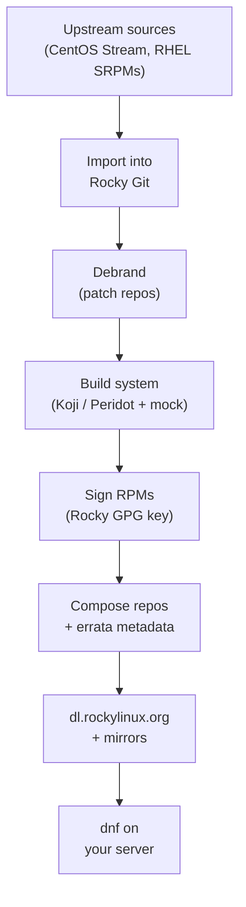
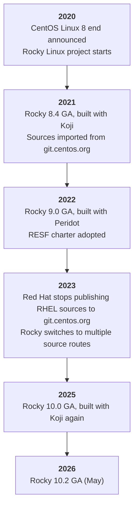
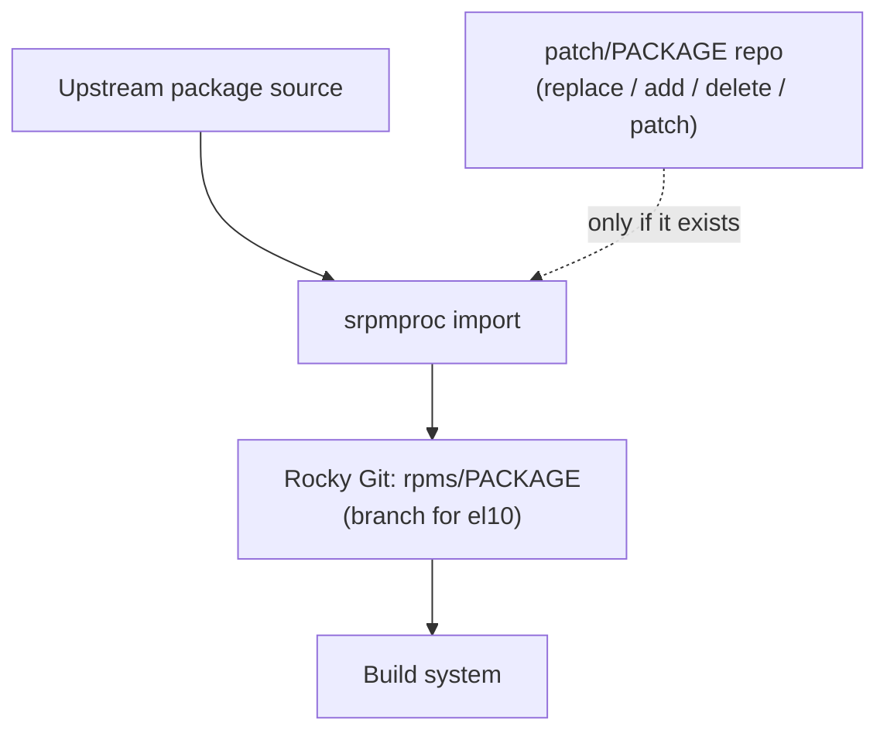
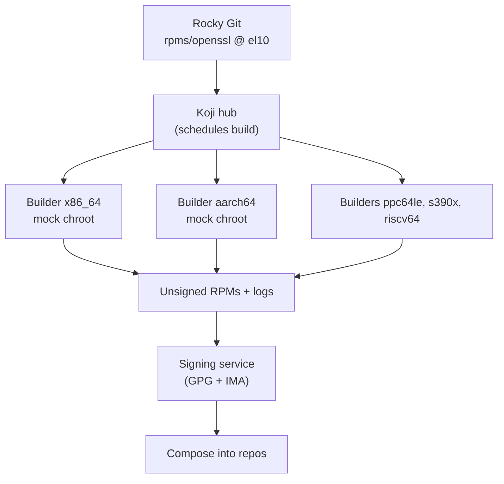
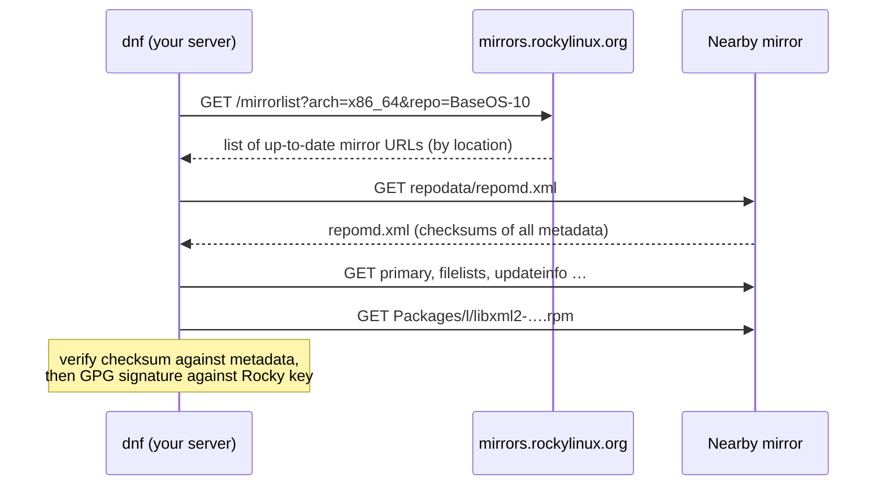
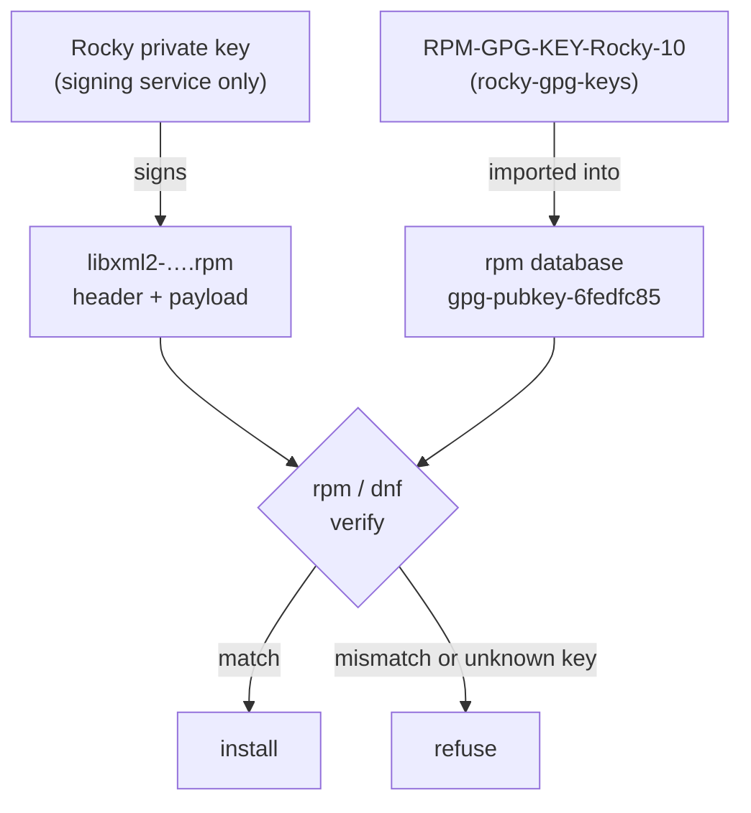
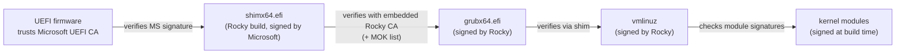
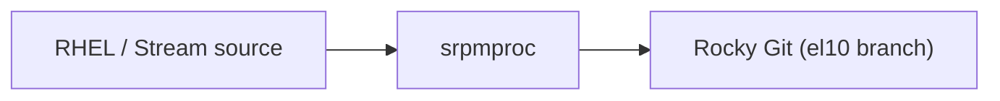

# 21 · Inside Rocky Linux: How It's Built and Delivered

<ul class="module-meta">
  <li>⏱ ~3 hours</li>
  <li>4 labs</li>
  <li>Builds on: 05 · Software: RPM and DNF, 14 · The Boot Process, 17 · Security Hardening</li>
</ul>

A security bulletin lands on Tuesday. Your manager asks three questions: "Are we patched? Where did that patch come from? How do we know nobody tampered with it?" Most admins can answer the first one. This module lets you answer all three with evidence, because you will know how Rocky Linux is built, signed, published and delivered, and which command proves each step.

!!! abstract "What you'll learn"
    - Where Rocky Linux's source code comes from, and how that changed in 2023
    - What "debranding" changes, and how to spot Rocky's fingerprints on a package
    - How the build system (Koji, Peridot, mock) turns sources into signed RPMs
    - The repository layout (BaseOS, AppStream, CRB, extras, add-ons), mirrors, the vault, debug and source repos
    - How to trace any installed package back to its repo, build and security advisory (RLSA)
    - How to verify signatures yourself, from `rpm -K` to the Secure Boot chain
    - What the Special Interest Groups (SIGs) ship, and how Rocky differs from AlmaLinux, Oracle Linux and CentOS Stream

## The big picture

**Rocky Linux** is a **rebuild**: a distribution compiled from the same source code as Red Hat Enterprise Linux (RHEL), with Red Hat's trademarks removed, so that software certified for RHEL runs on it unchanged. Rocky does not write most of the code. Its job is a pipeline: get the sources, remove the branding, build them reproducibly, sign them, and deliver them to millions of machines.



Every arrow in that picture leaves evidence you can inspect on your own server:

| Pipeline stage | Evidence on your machine |
|---|---|
| Sources and debranding | `rpm -qi` shows `Vendor`, URLs, changelog entries mentioning Rocky |
| Build | `rpm -qi` shows `Build Host` and `Build Date`; the release tag ends in `.el10` or `.el10_N` |
| Signing | `rpm -K` and the `Signature` line in `rpm -qi` |
| Repos and errata | `dnf info --installed` shows `From repo`; `dnf updateinfo` maps fixes to advisories |
| Delivery | `/etc/yum.repos.d/*.repo`, the mirror you were sent to in `dnf -v` output |
| Boot | `mokutil --sb-state`, the kernel's loaded X.509 certificates |

!!! analogy "Think of it like a bottling plant"
    Red Hat brews the recipe. Rocky runs an independent bottling plant: it receives the recipe, swaps the labels, bottles it in a clean room, seals every bottle with a tamper-evident cap (the GPG signature), and ships it through a network of distributors (mirrors). You, the customer, can check the seal on every bottle. Where the analogy breaks: Rocky can also add its own bottles (extras, SIGs) and cannot always get the recipe on the same day Red Hat uses it.

## Where the source comes from

### A short history

Rocky exists because of a change of plan. In December 2020, Red Hat announced that CentOS Linux, the free RHEL rebuild many people relied on, would end and be replaced by **CentOS Stream**, a rolling preview of the *next* RHEL minor release. Gregory Kurtzer, a co-founder of the original CentOS project, started Rocky Linux the same week. Rocky 8.4 was the first general release in June 2021.

**How Rocky got its source**



### The 2023 change and Rocky's response

Until mid-2023, Red Hat published the exact source of every RHEL package to **git.centos.org**, and every rebuilder imported from there. In June 2023 Red Hat stopped doing that. The public source of truth became **CentOS Stream**, and the exact RHEL sources were made available only to Red Hat customers, under terms that discourage redistribution.

Rocky's published response ("Keeping Open Source Open") describes gathering sources from several legal routes:

- **CentOS Stream** git repositories, which hold most of the same changes, often before RHEL ships them.
- **RHEL source RPMs** obtained through the **Universal Base Image (UBI)** container images, which are freely redistributable and come with sources.
- **Pay-per-use public cloud RHEL instances**: an automated job starts a RHEL VM, fetches the new source packages, pushes them to Rocky's Git, and destroys the VM. Rocky's position is that the GPL gives a paying customer the right to the source.
- **Pristine upstream** project tarballs where needed.

!!! note "Why this matters to you"
    The sourcing route affects *timing*, not what lands on your disk. A fix that RHEL ships might reach Rocky a little later if its source takes longer to obtain. That is the main reason to watch errata (covered below) rather than assume "same day as Red Hat".

### The ecosystem: who builds what from where

Four distributions share the Enterprise Linux family tree. They differ mainly in where they get source and what compatibility they promise.

| Distribution | Relationship to RHEL | Source | Compatibility goal |
|---|---|---|---|
| **CentOS Stream** | Upstream of RHEL: the next minor release, in development | Red Hat's own development | Preview of what RHEL will become |
| **RHEL** | The product | Red Hat | Reference |
| **Rocky Linux** | Downstream rebuild | CentOS Stream + RHEL SRPMs (UBI, cloud) + upstream | Match RHEL as closely as possible (bug-for-bug) |
| **AlmaLinux** | Downstream rebuild | Mainly CentOS Stream since 2023 | Application binary (ABI) compatible; may ship fixes earlier or differ in small ways |
| **Oracle Linux** | Downstream rebuild | Oracle's own sourcing | RHEL-compatible kernel plus its own UEK kernel option |

In August 2023, CIQ, Oracle and SUSE also formed **OpenELA** (the Open Enterprise Linux Association) to publish Enterprise Linux sources openly. The RESF is not a member. Treat OpenELA as a sibling effort that happens to share a sponsor (CIQ), not as "Rocky's source".

!!! version "Hardware baseline on 10"
    RHEL 10, and therefore Rocky 10, requires the **x86-64-v3** microarchitecture level on Intel/AMD (roughly Haswell-era CPUs and later). AlmaLinux publishes an extra x86-64-v2 build of version 10. Rocky 10 also adds **riscv64** as an architecture. If an old server will not boot Rocky 10, check its CPU level before anything else.

### Who runs Rocky: the RESF

The **Rocky Enterprise Software Foundation (RESF)** is the organisation that owns the Rocky Linux project and its infrastructure. It is a Delaware public benefit corporation with a published charter (adopted November 2022) that limits how much any single company can control the project. Companies such as CIQ sponsor the work and sell support, but the distribution itself is the RESF's. You will see "RESF" in the `VENDOR_NAME` field of `/etc/os-release` and in package `Vendor` fields.

<div class="quiz" data-answer="3" markdown>

After June 2023, which statement about Rocky's sources is accurate?

- Rocky now builds exclusively from CentOS Stream
- Rocky stopped publishing source code
- Rocky collects RHEL sources through several routes (CentOS Stream, UBI images, cloud RHEL instances, upstream)
- Rocky receives sources directly from Red Hat under a partnership

Right. git.centos.org no longer carries every RHEL version, so Rocky assembles the matching sources from several legal routes. It still publishes all of its own sources.

</div>

## Importing and debranding

### What debranding means

RHEL's sources contain Red Hat trademarks: logos, the name "Red Hat Enterprise Linux" in installer screens, release files, URLs pointing to Red Hat's bug tracker and support portal. Redistributing those would violate the trademarks. **Debranding** is the process of replacing them while changing nothing functional.

Most packages need no change at all. A small list (a few dozen) needs patches. Typical changes:

| What | Example |
|---|---|
| Release identity | `redhat-release` is replaced by `rocky-release` (provides `/etc/os-release`, `/etc/rocky-release`) |
| Artwork | `redhat-logos` replaced by `rocky-logos` (boot splash, installer, desktop) |
| Installer branding | Anaconda product name, help links, the installer's product config |
| URLs | Bug report and documentation links pointing at `bugs.rockylinux.org`, `docs.rockylinux.org` |
| Secure Boot | `shim` and the kernel/GRUB signing keys are Rocky's own, not Red Hat's |
| Repository config | `.repo` files pointing at Rocky mirrors, with Rocky's GPG keys |

### How the import works

Rocky's import tool is **srpmproc**. For every package it clones the upstream source, then checks whether a matching **patch repository** exists. A patch repo holds small config files describing actions (`replace` this logo file, `add` a source file, `delete` a file, apply a `patch` diff) plus any replacement files. srpmproc applies them and commits the result to Rocky's own Git, which is the input to the build system.



The good news: you can see the outcome on any installed package.

```console
$ rpm -qi rocky-release
Name        : rocky-release
Version     : 10.2
Release     : 1.2.el10
Architecture: noarch
Install Date: Mon 17 Aug 2026 10:41:17 AM UTC
Group       : Unspecified
Size        : 28316
License     : BSD-3-Clause
Signature   : RSA/SHA256, Fri 14 Aug 2026 10:12:45 AM UTC, Key ID 5b106c736fedfc85
Source RPM  : rocky-release-10.2-1.2.el10.src.rpm
Build Date  : Fri 14 Aug 2026 10:01:15 AM UTC
Build Host  : …
Vendor      : Rocky Enterprise Software Foundation
URL         : https://rockylinux.org
Summary     : Rocky Linux release files
…
```

The `Key ID` ends in `6fedfc85`, the short ID of the Rocky Linux 10 release key. You will verify that key properly later in this module.

!!! tip "Find every non-Rocky package on a system"
    The `Vendor` tag is a quick audit. Anything not from the RESF came from a third party (EPEL, a vendor repo, a hand-built RPM):

    ```console
    $ rpm -qa --qf '%{VENDOR}\t%{NAME}\n' | grep -v '^Rocky Enterprise' | sort | head
    (none)	gpg-pubkey
    Fedora Project	epel-release
    Fedora Project	htop
    ```

    `gpg-pubkey` entries are imported keys, not software, so `(none)` is expected there.

## The build system

### Koji, Peridot and mock

A **build system** takes a source package and produces binary RPMs in a clean, recorded, repeatable way. It keeps track of which exact versions of compilers and libraries were used (the **buildroot**), runs builds in parallel across architectures, and stores the results.

| Rocky version | Build system |
|---|---|
| Rocky 8 | **Koji**, the build system Fedora and CentOS use |
| Rocky 9 | **Peridot**, a cloud-native build system written in Go by the Rocky community |
| Rocky 10 | **Koji** again |

Rocky's 10.0 announcement explains the switch back: the next generation of Peridot ("Peridot Two") was not ready, and Rocky wanted to support **IMA** (the kernel's Integrity Measurement Architecture, which can check per-file signatures at runtime), which Koji's signing integration made practical. Peridot Two is planned as a reimplementation of Koji's XML-RPC API, so Koji clients and builds can move across later. Today Peridot remains only for Rocky 9 and some SIG builds.

??? question "Under the hood: does my Rocky 10 package carry IMA file signatures?"
    Don't take it on trust; ask rpm. IMA signatures live in the package header, one per file, in the `FILESIGNATURES` tag:

    ```console
    $ rpm -q --qf '[%{FILENAMES} %{FILESIGNATURES}\n]' bash | head -3
    ```

    If the second column is empty, the package has no IMA signatures and an IMA appraisal policy would reject its files. If it holds long hex strings, they are there, and `rpm-plugin-ima` writes them into each file's `security.ima` extended attribute at install time (check with `getfattr -m security.ima -d /usr/bin/bash`). Nothing enforces them unless you load an IMA appraisal policy: signing and enforcement are separate decisions.

Underneath both sits **mock**, a tool that creates a fresh minimal chroot, installs only the declared build dependencies, and runs `rpmbuild` inside it. A Koji or Peridot "build" is essentially an orchestrated mock run with careful bookkeeping. You will use mock yourself in [module 22](22-building-rpms.md).



!!! note "Why builds must be clean"
    If a package were built on a developer's laptop, it might accidentally link against some library that happened to be installed there. A clean mock buildroot means the RPM depends only on what its spec file declares. That is what makes a rebuild trustworthy, and what makes "bug-for-bug compatible" possible at all.

### Release tags tell you the minor release

The `Release` field of almost every package ends in a **dist tag** set by the build system's `%{dist}` macro. On Rocky 10 you see two forms:

| Dist tag | Meaning |
|---|---|
| `.el10` | Built for the 10 major release, unchanged since it was introduced |
| `.el10_1`, `.el10_2` | Rebuilt or updated during that minor release's lifecycle |

```console
$ rpm -q kernel libxml2 bash
kernel-6.12.0-124.8.1.el10_1.x86_64
libxml2-2.12.5-9.el10_0.x86_64
bash-5.2.26-6.el10.x86_64
```

<div class="quiz" data-answer="2" markdown>

Why did Rocky Linux 10 move back to Koji after Rocky 9 used Peridot?

- Peridot cannot build RPMs for aarch64
- The next version of Peridot was not ready, and Koji supported the IMA file signing Rocky 10 needed
- Red Hat requires all rebuilds to use Koji
- Koji is the only system that can use mock

Correct. Rocky chose not to "dogfood" an unfinished build system during a major release, and IMA signing integration was a concrete requirement.

</div>

## Release packages and identity files

Three small packages define "this machine is Rocky Linux":

| Package | What it installs |
|---|---|
| `rocky-release` | `/etc/os-release`, `/etc/rocky-release`, the `/etc/redhat-release` and `/etc/system-release` symlinks, presets and macros |
| `rocky-repos` | The `.repo` files in `/etc/yum.repos.d/` and DNF variables in `/etc/dnf/vars/` |
| `rocky-gpg-keys` | Public signing keys in `/etc/pki/rpm-gpg/` |

```console
$ rpm -qf /etc/os-release /etc/yum.repos.d/rocky.repo /etc/pki/rpm-gpg/RPM-GPG-KEY-Rocky-10
rocky-release-10.2-1.2.el10.noarch
rocky-repos-10.2-1.2.el10.noarch
rocky-gpg-keys-10.2-1.2.el10.noarch
$ ls -l /etc/redhat-release /etc/system-release
lrwxrwxrwx. 1 root root 13 Aug 10 00:00 /etc/redhat-release -> rocky-release
lrwxrwxrwx. 1 root root 13 Aug 10 00:00 /etc/system-release -> rocky-release
$ cat /etc/rocky-release
Rocky Linux release 10.2 (Red Quartz)
```

`/etc/os-release` is the machine-readable identity, defined by systemd's [[man:os-release(5)]]. Scripts should read it rather than parse `/etc/redhat-release`:

```console
$ cat /etc/os-release
NAME="Rocky Linux"
VERSION="10.2 (Red Quartz)"
ID="rocky"
ID_LIKE="rhel centos fedora"
VERSION_ID="10.2"
PLATFORM_ID="platform:el10"
PRETTY_NAME="Rocky Linux 10.2 (Red Quartz)"
…
HOME_URL="https://rockylinux.org/"
VENDOR_NAME="RESF"
BUG_REPORT_URL="https://bugs.rockylinux.org/"
SUPPORT_END="2035-05-31"
ROCKY_SUPPORT_PRODUCT="Rocky-Linux-10"
…
$ . /etc/os-release; echo "$ID $VERSION_ID (like: $ID_LIKE)"
rocky 10.2 (like: rhel centos fedora)
```

`ID_LIKE` is what lets installers for "RHEL-like" systems recognise Rocky. `PLATFORM_ID` is what DNF uses to match the platform. `SUPPORT_END` reflects Rocky 10's lifecycle: general support until May 2030 and security fixes until 31 May 2035.

## Repositories, mirrors and the vault

### The repository map

A **repository** is a directory of RPMs plus metadata (`repodata/`) that DNF downloads to know what is available. Rocky splits its content into several, each with a purpose:

<div class="layers" data-open="0" data-hint="Click a repository to see what lives there and when you'd enable it." markdown>

<div class="layer" data-label="BaseOS" data-tag="enabled" markdown>

**Repo ID:** `baseos`. The core operating system: kernel, systemd, glibc, bash, coreutils, openssh, dnf, NetworkManager. Packages here follow the full RHEL lifecycle and are what a minimal install is made of.

</div>

<div class="layer" data-label="AppStream" data-tag="enabled" markdown>

**Repo ID:** `appstream`. Applications, languages, databases and tools: httpd, nginx, postgresql, python3 extras, podman, gcc. On Rocky 10 there are no DNF **modules** in the default content; alternative versions ship as separately named packages.

</div>

<div class="layer" data-label="CRB" data-tag="disabled" markdown>

**Repo ID:** `crb` (CodeReady Linux Builder; called PowerTools on Rocky 8). Development headers and build-time libraries that RHEL ships but does not support for production use. Many EPEL packages require it. Enable with `sudo dnf config-manager --set-enabled crb` or `sudo crb enable` (from `epel-release`).

</div>

<div class="layer" data-label="extras" data-tag="enabled" markdown>

**Repo ID:** `extras`. Rocky-added packages that do not exist in RHEL but do not conflict with it: `epel-release`, SIG release packages (`rocky-release-*`), and similar helpers. Not tested by upstream.

</div>

<div class="layer" data-label="Add-ons" data-tag="disabled" markdown>

**HighAvailability** (Pacemaker, Corosync; see [module 28](28-high-availability.md)), **RT** (real-time kernel), **NFV** (network functions virtualization), **SAP** and **SAPHANA**. These mirror RHEL add-ons. ResilientStorage existed on 8 and 9 but is not part of Rocky 10.

</div>

<div class="layer" data-label="plus" data-tag="disabled" markdown>

**Repo ID:** `plus`. Rocky-built variants of upstream packages with extra features enabled (for example, options RHEL compiles out). Installing from here intentionally diverges from RHEL.

</div>

<div class="layer" data-label="devel" data-tag="disabled" markdown>

**Repo ID:** `devel`. Everything the build system had in its buildroots, including packages RHEL does not ship. Its own name in the repo file warns "FOR BUILDROOT ONLY DO NOT LEAVE ENABLED". Use it with `--enablerepo=devel` for a single build, never permanently.

</div>

<div class="layer" data-label="debuginfo and source" data-tag="disabled" markdown>

Every repo has a debug twin (`baseos-debuginfo`, …) holding the symbols you need for crash analysis ([module 24](24-debugging-crashes.md)), and a source twin (`baseos-source`, …) holding SRPMs. `dnf debuginfo-install` and `dnf download --source` enable these on demand, because they look for repos whose IDs end in `-debuginfo` and `-source`.

</div>

</div>

Check what your system knows about:

```console
$ dnf repolist --all
repo id                    repo name                                       status
appstream                  Rocky Linux 10 - AppStream                      enabled
appstream-debuginfo        Rocky Linux 10 - AppStream - Debug              disabled
appstream-source           Rocky Linux 10 - AppStream - Source             disabled
baseos                     Rocky Linux 10 - BaseOS                         enabled
baseos-debuginfo           Rocky Linux 10 - BaseOS - Debug                 disabled
baseos-source              Rocky Linux 10 - BaseOS - Source                disabled
crb                        Rocky Linux 10 - CRB                            disabled
…
extras                     Rocky Linux 10 - Extras                         enabled
highavailability           Rocky Linux 10 - High Availability              disabled
…
```

!!! tip "Trust the repo IDs on your machine"
    Repo IDs have changed between releases (for example `ha` on Rocky 8), and other tools use their own names: mock's Rocky configs call the debug repo `baseos-debug`. Always copy the ID from `dnf repolist --all` on the system in front of you before scripting `--enablerepo`.

`rocky-repos` splits these across five files: `rocky.repo` (BaseOS, AppStream, CRB and their twins), `rocky-addons.repo` (HighAvailability, RT, NFV, SAP, SAPHANA), `rocky-extras.repo` (extras and plus), `rocky-devel.repo` (devel) and `rocky-security.repo` (`security`, a fast-track security repo added in 10.2, disabled by default). `ls /etc/yum.repos.d/` shows them.

### Anatomy of a repo file

```ini title="/etc/yum.repos.d/rocky.repo (excerpt)"
[baseos]
name=Rocky Linux $releasever - BaseOS
mirrorlist=https://mirrors.rockylinux.org/mirrorlist?arch=$basearch&repo=BaseOS-$releasever$rltype
#baseurl=http://dl.rockylinux.org/$contentdir/$releasever/BaseOS/$basearch/os/
gpgcheck=1
enabled=1
countme=1
metadata_expire=6h
gpgkey=file:///etc/pki/rpm-gpg/RPM-GPG-KEY-Rocky-10
```

1. `mirrorlist=…`: DNF asks the **mirrorlist** service for a list of mirrors near you. `$releasever` is `10` (the major version), so you always get the latest minor release. `$rltype` is a DNF variable from `/etc/dnf/vars/` that lets a variant (for example a cloud image) ask for a different repo flavour; on a normal install it is empty. The debug and source twins use the same URL with `-debug` or `-source` appended to the repo name (and `arch=source` for sources).
2. `#baseurl=…`: The commented-out direct URL. Uncomment it (and comment out `mirrorlist`) to pin a single server, for example an internal mirror.
3. `gpgcheck=1`: Refuse to install any package whose GPG signature does not verify.
4. `countme=1`: Once a week DNF adds an anonymous counter to one request, which is how the project estimates its user count.
5. `gpgkey=…`: The public key used to check signatures, installed by `rocky-gpg-keys`.

DNF variables like `$contentdir` and `$rltype` come from small files:

```console
$ grep -H . /etc/dnf/vars/*
/etc/dnf/vars/contentdir:pub/rocky
…
```

### How mirrors work

Rocky serves content from **dl.rockylinux.org** and from hundreds of volunteer mirrors worldwide. Mirrors register with **MirrorManager** (the same software Fedora uses), which checks that each mirror is up to date and hands DNF a list sorted by proximity.



Because every package is GPG-signed, a malicious or broken mirror cannot slip you a modified package: the signature check fails. The worst a bad mirror can do is serve stale content or nothing at all.

You can see which mirrors DNF is using, how fresh the metadata is, and which file defines the repo:

```console
$ dnf repoinfo baseos
Last metadata expiration check: 0:41:12 ago on Thu 15 Oct 2026 08:02:11 AM UTC.
Repo-id            : baseos
Repo-name          : Rocky Linux 10 - BaseOS
Repo-status        : enabled
Repo-revision      : 1760412345
Repo-updated       : Wed 14 Oct 2026 03:05:45 AM UTC
Repo-pkgs          : 1,083
Repo-available-pkgs: 1,083
Repo-size          : 1.6 G
Repo-mirrors       : https://mirrors.rockylinux.org/mirrorlist?arch=x86_64&repo=BaseOS-10
Repo-baseurl       : https://mirror.example.edu/rocky/10.2/BaseOS/x86_64/os/ (39 more)
Repo-expire        : 21,600 second(s) (last: Thu 15 Oct 2026 08:02:10 AM UTC)
Repo-filename      : /etc/yum.repos.d/rocky.repo
```

### The tree on the server

```text
dl.rockylinux.org/pub/rocky/
└── 10/                       ← symlink to the current minor, e.g. 10.2
    ├── BaseOS/
    │   ├── x86_64/
    │   │   ├── os/           ← the repo DNF uses (Packages/, repodata/)
    │   │   ├── kickstart/    ← frozen GA tree, used by installers
    │   │   └── debug/tree/   ← debuginfo packages
    │   └── source/tree/      ← SRPMs
    ├── AppStream/  CRB/  extras/  plus/  security/  HighAvailability/  RT/  NFV/  SAP/  SAPHANA/  devel/
    └── isos/  images/        ← install ISOs, cloud and container images
dl.rockylinux.org/vault/rocky/
└── 10.0/  10.1/  9.x/ …      ← old minor releases, frozen
dl.rockylinux.org/pub/sig/    ← Special Interest Group repos
```

### The vault

Rocky supports only the **latest minor release** of each major version. When 10.2 ships, 10.1 stops receiving updates and, shortly afterwards, its tree moves to the **vault** at `dl.rockylinux.org/vault/rocky/`. Nothing is deleted: you can still fetch every package ever published, which is invaluable for reproducing an old bug or rolling back. But vault content gets no fixes, so it is for investigation, not for running production.

!!! warning "Pinning a minor release is not a supported way to run Rocky"
    Setting `releasever=10.1` and pointing at the vault keeps you on 10.1 forever, *without* security fixes. If you need longer-lived minor releases, that is a commercial offering (for example, CIQ's LTS products), not something the community repos provide.

<div class="quiz" data-answer="4" markdown>

A teammate wants the exact `openssl` package that shipped with Rocky 10.0, which is no longer current. Where should they look?

- The `devel` repo
- `appstream-source`
- Nowhere; superseded packages are deleted
- `dl.rockylinux.org/vault/rocky/10.0/`

Yes. Superseded minor releases move to the vault, unchanged and still signed.

</div>

## Errata and security advisories

### RLSA, RLBA, RLEA

An **erratum** (plural **errata**) is a published update with a description: what it fixes, which CVEs, which packages. Rocky's errata mirror Red Hat's, with the same numbers:

| Prefix | Type | Red Hat equivalent |
|---|---|---|
| **RLSA** | Security advisory | RHSA |
| **RLBA** | Bug fix advisory | RHBA |
| **RLEA** | Enhancement advisory | RHEA |

So `RLSA-2026:1234` fixes the same problem as `RHSA-2026:1234`. Rocky's errata service (named **Apollo**) clones Red Hat's advisory data, matches it to the packages Rocky actually built, and writes it into each repo's `updateinfo` metadata. You can browse the same data on the web at **errata.rockylinux.org**.

### Querying errata with dnf

```console
$ dnf updateinfo summary
Updates Information Summary: available
    3 Security notice(s)
        1 Important Security notice(s)
        2 Moderate Security notice(s)
    2 Bugfix notice(s)
$ dnf updateinfo list --security
RLSA-2026:4511 Important/Sec. libxml2-2.12.5-10.el10_2.4.x86_64
RLSA-2026:4530 Moderate/Sec.  sudo-1.9.17-10.p2.el10_2.7.x86_64
…
$ dnf updateinfo info RLSA-2026:4511
===============================================================================
  Important: libxml2 security update
===============================================================================
  Update ID: RLSA-2026:4511
       Type: security
    Updated: 2026-10-08 19:22:41
       CVEs: CVE-2026-…
Description: The libxml2 library is a development toolbox providing the
           : implementation of various XML standards.
           : …
   Severity: Important
```

Useful variations:

```console
$ dnf updateinfo list --cve CVE-2026-XXXXX     # which advisory fixes this CVE?
$ sudo dnf upgrade --security                  # install only security updates
$ sudo dnf upgrade --advisory RLSA-2026:4511   # install exactly one advisory
$ dnf updateinfo list --installed --security   # advisories already applied
```

!!! pitfall "\"dnf upgrade --security\" says nothing to do, but plain upgrade finds updates"
    Errata metadata can lag behind the packages themselves, especially just after a minor release. A package may be in the repo before its advisory is attached. If compliance depends on it, run a full `dnf upgrade` on a schedule rather than only `--security`, and cross-check critical CVEs on errata.rockylinux.org.

## Signatures: trusting what you install

### The chain of trust

Every Rocky RPM carries a **GPG signature**: a cryptographic seal made with Rocky's private key, which never leaves the signing service. Your system holds the matching **public key**. If even one byte of the package changes, the signature no longer matches.



The question that matters: how do you know `RPM-GPG-KEY-Rocky-10` itself is genuine? You compare its **fingerprint** with the one Rocky publishes on its website (the "GPG Key Info" page) and in its release announcements, through a channel other than the mirror. The Rocky 10 key fingerprint is:

```text
FC22 6859 C086 0BF0 DDB9  5B08 5B10 6C73 6FED FC85
```

```console
$ gpg --show-keys /etc/pki/rpm-gpg/RPM-GPG-KEY-Rocky-10
pub   rsa4096 2025-05-19 [SCE]
      FC226859C0860BF0DDB95B085B106C736FEDFC85
uid                      Release Engineering (Rocky Linux 10) <releng@rockylinux.org>
```

`gpg --show-keys` reads the key file without importing it anywhere, so it is safe to run on any key you are evaluating.

!!! note "If gpg reports `packet(6) with unknown version 6`"
    Newer `rocky-gpg-keys` packages append a post-quantum v6 key to the same file, and GnuPG cannot parse v6 keys, so it rejects the whole file. Show only the first (RSA) key block instead:

    ```console
    $ sed -n '1,/END PGP/p' /etc/pki/rpm-gpg/RPM-GPG-KEY-Rocky-10 | gpg --show-keys
    ```

### Checking packages by hand

```console
$ dnf download libxml2
$ rpm -K libxml2-2.12.5-9.el10_0.x86_64.rpm
libxml2-2.12.5-9.el10_0.x86_64.rpm: digests signatures OK
$ rpm -Kv libxml2-2.12.5-9.el10_0.x86_64.rpm
libxml2-2.12.5-9.el10_0.x86_64.rpm:
    Header V4 RSA/SHA256 Signature, key ID 6fedfc85: OK
    Header SHA256 digest: OK
    Header SHA1 digest: OK
    Payload SHA256 digest: OK
    Payload SHA256 ALT digest: OK
    MD5 digest: OK
```

**Digests** prove the file is intact. **Signatures** prove who made it. If the key is not imported, you see `NOKEY`; if the file was modified, you see `BAD` or `NOT OK`.

??? question "Under the hood: why there is one signature and five digests"
    An RPM file is four parts in a row: a lead (legacy), a **signature header**, the **main header** (name, dependencies, file list, per-file digests) and the compressed **payload** (the files).

    - `Header V4 RSA/SHA256 Signature` covers only the main header. Because the main header stores the payload's SHA256 digest and every file's digest, a good header signature plus a good `Payload SHA256 digest` vouches for every byte. This is why `dnf` can verify a package before decompressing it.
    - `Payload SHA256 ALT digest` covers the uncompressed payload. The `SHA1` and `MD5` lines are legacy, kept so older rpm versions can still check the file. Older packages could also carry a second, legacy signature over header plus payload; Rocky 10 packages carry only the header signature.
    - After install, the per-file digests are what `rpm -V PKG` compares against your disk. That is how you detect a binary changed after installation, long after the package signature was checked.

    Since the August 2026 `rocky-gpg-keys-10.2-1.2` update, `RPM-GPG-KEY-Rocky-10` also holds a second, post-quantum (PQC) OpenPGP v6 key with the same user ID, appended after the RSA key in the same file. Packages are still signed with the RSA key. `grep -c BEGIN /etc/pki/rpm-gpg/RPM-GPG-KEY-Rocky-10` shows how many keys your copy holds.

Which keys does RPM trust right now?

```console
$ rpm -q gpg-pubkey --qf '%{VERSION}\t%{SUMMARY}\n'
6fedfc85	Release Engineering (Rocky Linux 10) …
e37ed158	Fedora (epel10) <epel@fedoraproject.org>
```

The `VERSION` of a `gpg-pubkey` pseudo-package is the short key ID. To trust a new key (for example, your own repo's, from [module 22](22-building-rpms.md)):

```console
$ sudo rpm --import /path/to/RPM-GPG-KEY-mycorp
$ sudo rpm -e gpg-pubkey-<keyid>      # remove trust again
```

### gpgcheck, localpkg_gpgcheck, repo_gpgcheck

| Option | Where | What it checks |
|---|---|---|
| `gpgcheck=1` | each repo | Every package's signature before install (Rocky default) |
| `localpkg_gpgcheck` | `/etc/dnf/dnf.conf` | Signatures of local files given to `dnf install ./foo.rpm` (off by default) |
| `repo_gpgcheck=1` | each repo | A detached signature on the repo metadata (`repomd.xml.asc`), if the repo publishes one |

!!! danger "Never fix NOKEY with --nogpgcheck"
    `dnf install --nogpgcheck` turns a security control into a formality. If a key is missing, find out why: is the package from a repo you did not intend to trust? Import the vendor's key only after checking its fingerprint out of band.

<div class="quiz" data-answer="1" markdown>

`rpm -Kv` on a downloaded package shows every digest line `OK`, but the signature lines end in `NOKEY`. What does that tell you?

- The file is intact, but its signing key is not in your RPM database, so you cannot yet tell who signed it
- The package has been tampered with
- The package is unsigned
- The mirror is out of date

Right. The digests match, so the file was not damaged. NOKEY means "signed, but by a key I don't trust yet". Find and verify that key before importing it.

</div>

## Secure Boot: the chain before the OS

Signatures protect packages on disk. **Secure Boot** protects the boot path: the firmware runs only code signed by a key it trusts. PC firmware ships trusting Microsoft's keys, and Microsoft will not sign GRUB or Linux kernels directly. The solution is **shim**, a tiny first-stage boot loader.



1. Rocky builds shim with **Rocky's CA certificate embedded**, and Microsoft signs that shim binary after review.
2. The firmware trusts Microsoft, so it runs shim.
3. Shim trusts Rocky's CA, plus any keys you enrolled yourself in the **MOK** (Machine Owner Key) list, so it runs Rocky's GRUB and kernel.
4. The kernel checks signatures on modules it loads. Out-of-tree modules (NVIDIA, ELRepo, your own) need a key you enrolled with `mokutil --import`.

See the boot flow in context in [module 14](14-the-boot-process.md).

```console
$ mokutil --sb-state
SecureBoot enabled
$ mokutil --list-enrolled | grep -E 'Subject:'
        Subject: …O=Rocky Enterprise Software Foundation, CN=Rocky Linux Secure Boot Root CA…
$ sudo keyctl list %:.platform
…: ---lswrv     0     0 asymmetric: Rocky Enterprise Software Foundation: Rocky Linux Secure Boot Root CA: …
…: ---lswrv     0     0 asymmetric: Microsoft Corporation: Microsoft Corporation UEFI CA 2011: …
$ sudo journalctl -k -b | grep -i 'Loaded X.509'
kernel: Loaded X.509 cert 'Rocky … kernel signing key: …'
kernel: integrity: Loaded X.509 cert 'Microsoft Corporation UEFI CA 2011: …'
…
```

`mokutil --db` and `mokutil --kek` show what the firmware itself trusts. The kernel copies the firmware `db` and the MOK list into its **platform keyring** at boot, which `keyctl` shows (from the `keyutils` package); exact certificate names vary between releases, so read them on your own machine.

??? question "Under the hood: why --list-enrolled shows a Rocky CA you never enrolled"
    Shim exports its built-in vendor certificate (Rocky's Secure Boot root CA) into the `MokListRT` UEFI variable alongside anything you enrolled, so the OS can see the whole set shim trusts. That is why `mokutil --list-enrolled` lists Rocky's CA on a fresh install, and also why it can come back **empty** on old shims or some hypervisors: the variable was not exported, but shim still trusts the CA internally. The keys you add with `mokutil --import` only take effect after the next reboot, when the blue **MokManager** screen asks for the one-time password you set. Nobody at the console means the key is never enrolled.

!!! warning "The Microsoft CA transition (2026)"
    Microsoft's original third-party UEFI CA (*Microsoft Corporation UEFI CA 2011*) expired in late June 2026, replaced by the 2023 CAs. In its June 2026 Secure Boot post, Rocky said it ships **dual-signed** shims (signed by both the 2011 and the 2023 CA), so the same shim boots on old firmware that knows only the 2011 CA and new firmware that knows only the 2023 one. Expiry alone does not stop a signed shim from booting; firmware does not check dates. What breaks things is *revocation*: a `dbx` update that revokes the 2011 CA also invalidates dual-signed binaries on most firmware. Keep `shim-x64` updated, check `mokutil --db` for the 2023 CA, and apply firmware updates from your hardware vendor before anyone pushes such a `dbx` update.

!!! example "Try it"
    On a VM with UEFI and Secure Boot enabled, run `mokutil --sb-state` and `sudo dmesg | grep -i secure`. On a BIOS VM, `mokutil` reports that EFI variables are not supported: a quick way to tell how a machine booted.

## Special Interest Groups (SIGs)

Not everything belongs in a RHEL-compatible core. **Special Interest Groups** are community teams that build and maintain extra content on Rocky's infrastructure, published under `dl.rockylinux.org/pub/sig/` and installed via release packages from the `extras` repo.

| SIG | Focus |
|---|---|
| **SIG/AltArch** | Alternative architectures and devices not directly supported, such as Raspberry Pi images |
| **SIG/Cloud** | Running Rocky in and as public/private cloud images |
| **SIG/Kernel** | Alternative kernels (for example mainline or other long-term branches) and drivers |
| **SIG/Security** | Extra security features and hardened override packages |
| Others | Desktop and Gaming, FastTrack, HPC and AI, and more at various stages (the wiki lists which are active) |

```console
$ dnf search rocky-release
…
rocky-release-…  : … SIG repository configuration
…
```

Installing a SIG release package adds a `.repo` file and the SIG's GPG key. Treat SIG content like any third-party repo: it is Rocky infrastructure, but it is not part of the RHEL-compatible promise, and some SIG packages deliberately replace core ones.

!!! tip "Is a package from a SIG?"
    `dnf info --installed PACKAGE` shows `From repo`. A repo ID that is not `baseos`, `appstream`, `crb` or another core repo is your signal that you have left the core distribution.

## Verifying and rebuilding a package yourself

"Trust, but verify" applies to your OS. Because every Rocky source is published, you can inspect and rebuild any package.

```console
$ dnf download --source libxml2       # auto-enables the *-source repos
$ rpm -qpl libxml2-2.12.5-9.el10_0.src.rpm
libxml2-2.12.5.tar.xz
libxml2-2.12.5-CVE-….patch
…
libxml2.spec
$ rpm -qp --changelog libxml2-2.12.5-9.el10_0.src.rpm | head -4
* … - 2.12.5-9
- Fix CVE-…
```

The changelog tells you which CVE patch was added in which release. Rebuilding it in mock ([module 22](22-building-rpms.md)) and comparing the result with the binary from the mirror is how you prove the binary matches its source. Tools like `rpmdiff` (shipped with rpmlint, from EPEL) compare two RPMs file by file and flag differences in content, permissions or dependencies. Expect build timestamps and some embedded paths to differ; functional files should match.

### The journey of a security fix

Put it all together. Step through what happens between a vulnerability being found and the fix running on your server:

<div class="stepper" markdown>

<div class="step" data-title="Disclosure" markdown>

A researcher reports a flaw in, say, libxml2. It gets a **CVE** ID. The upstream project and Red Hat's security team coordinate a fix, often under embargo until a disclosure date.

</div>

<div class="step" data-title="Fix lands upstream" markdown>

Red Hat patches the package. The change usually appears in the CentOS Stream 10 Git repositories and is shipped in RHEL as an **RHSA** advisory with a new release number such as `2.12.5-10.el10_2.4`.

</div>

<div class="step" data-title="Rocky imports the source" markdown>

Rocky's tooling picks up the new source (CentOS Stream, UBI or cloud-instance routes), runs srpmproc, applies any debranding patches, and commits to Rocky Git.



</div>

<div class="step" data-title="Build" markdown>

Koji schedules builds for every architecture. Each builder runs mock with a clean buildroot. Logs and results are stored with the build.

</div>

<div class="step" data-title="Sign" markdown>

The signing service signs each RPM with the Rocky 10 key. Unsigned output never goes to the public repos.

</div>

<div class="step" data-title="Publish and errata" markdown>

The packages are composed into the BaseOS or AppStream repo. Apollo attaches **RLSA-2026:NNNN** to the updateinfo metadata, mirroring the RHSA number. The new tree syncs to dl.rockylinux.org.

</div>

<div class="step" data-title="Mirrors" markdown>

Hundreds of mirrors sync. MirrorManager only hands out mirrors whose content is current, so clients find the update as it propagates.

</div>

<div class="step" data-title="Your server" markdown>

`dnf upgrade --security` (or `dnf-automatic`) downloads the package, checks the checksum against metadata, verifies the GPG signature against `RPM-GPG-KEY-Rocky-10`, installs it, and records the transaction in `dnf history`.

```console
$ sudo dnf needs-restarting -r
```

Finally, restart the affected services (or reboot for kernel and glibc fixes). Until then, the old code is still running in memory.

</div>

</div>

<div class="quiz" data-answer="3" markdown>

You ran `dnf upgrade` for an OpenSSL advisory an hour ago. A scanner still reports the vulnerable library loaded in `nginx`. Most likely reason?

- The mirror served an old package
- The RLSA number doesn't match the RHSA
- nginx is still running with the old library mapped in memory; it needs a restart
- GPG verification silently failed

Exactly. Updating files on disk doesn't change running processes. `dnf needs-restarting` lists processes still using replaced files.

</div>

## Practice

<div class="terminal-sim" data-title="Interrogate a package" data-prompt="[alex@rocky-lab ~]$ " markdown>

<div class="task" data-expect="cat /etc/os-release" data-hint="The machine-readable OS identity lives in /etc/os-release." markdown>

**Step 1.** Print the machine-readable OS identity file.

```text
NAME="Rocky Linux"
VERSION="10.2 (Red Quartz)"
ID="rocky"
ID_LIKE="rhel centos fedora"
VERSION_ID="10.2"
PLATFORM_ID="platform:el10"
…
```

</div>

<div class="task" data-expect="rpm -qf /etc/os-release" data-hint="rpm -qf asks which package owns a file." markdown>

**Step 2.** Which package owns `/etc/os-release`?

```text
rocky-release-10.2-1.2.el10.noarch
```

</div>

<div class="task" data-expect="dnf info --installed libxml2||dnf info installed libxml2" data-match="^dnf info (--installed|installed) libxml2$" data-hint="dnf info with --installed shows the From repo field." markdown>

**Step 3.** Show details of the installed `libxml2`, including which repo it came from.

```text
Installed Packages
Name         : libxml2
Version      : 2.12.5
Release      : 9.el10_0
Architecture : x86_64
From repo    : baseos
…
```

</div>

<div class="task" data-expect="dnf updateinfo list --security" data-match="^dnf updateinfo list (--security|--sec-severity.*)$" data-hint="dnf updateinfo list, filtered with --security." markdown>

**Step 4.** List the available security advisories.

```text
RLSA-2026:4511 Important/Sec. libxml2-2.12.5-10.el10_2.4.x86_64
RLSA-2026:4530 Moderate/Sec.  sudo-1.9.17-10.p2.el10_2.7.x86_64
```

</div>

<div class="task" data-expect="mokutil --sb-state" data-hint="mokutil has an option that reports the Secure Boot state." markdown>

**Step 5.** Is Secure Boot on?

```text
SecureBoot enabled
```

</div>

</div>

## Labs

!!! lab "Lab 1: Verify the chain from fingerprint to package"

    **Goal:** Prove, with your own commands, that a package came from Rocky and was not modified.

    **You'll need:** a Rocky 10 VM with network access.

    1. Check the fingerprint of the key file shipped on your system and compare it with the fingerprint on Rocky's GPG Key Info page (open it in a browser on another machine):

        ```bash
        gpg --show-keys /etc/pki/rpm-gpg/RPM-GPG-KEY-Rocky-10
        ```

    2. Confirm RPM trusts that key:

        ```bash
        rpm -q gpg-pubkey --qf '%{VERSION}\t%{SUMMARY}\n'
        ```

    3. Download a package without installing it and verify it:

        ```bash
        mkdir -p ~/lab21 && cd ~/lab21
        dnf download bash
        rpm -Kv bash-*.rpm
        ```

    4. Now break it on purpose. Copy the file and flip some bytes near the end, then verify again:

        ```bash
        cp bash-*.rpm broken.rpm
        printf 'XXXX' | dd of=broken.rpm bs=1 seek=$(( $(stat -c %s broken.rpm) - 100 )) conv=notrunc
        rpm -K broken.rpm
        ```

    5. Check what DNF would do with each repo: list the `gpgcheck` setting of every enabled repo:

        ```bash
        dnf repoinfo --enabled | grep -E '^Repo-id|^Repo-name'
        grep -H '^gpgcheck' /etc/yum.repos.d/*.repo
        ```

    **Check your work:** the original package shows `digests signatures OK`; `broken.rpm` shows a failed digest (`NOT OK`), and every enabled repo has `gpgcheck=1`.

    ??? success "What just happened?"
        The fingerprint check anchors your trust outside the mirror network. RPM then uses that key to check each package. Corrupting a few bytes of payload breaks the payload digest, which is covered by the signature, so the package would be refused by DNF.

    **Clean up:** `rm -rf ~/lab21`

!!! lab "Lab 2: Trace a package to its repo, transaction and advisory"

    **Goal:** Answer "where did this come from, when, and why?" for an installed package.

    **You'll need:** a Rocky 10 VM that has had at least one `dnf upgrade`.

    1. Pick a package that was updated (for example the kernel or any library) and see where it came from:

        ```bash
        dnf info --installed kernel-core | grep -E 'Version|Release|From repo'
        rpm -qi kernel-core | grep -E 'Signature|Build Date|Vendor'
        ```

    2. Find the transaction that installed it:

        ```bash
        dnf history list kernel-core
        sudo dnf history info <ID from the previous output>
        ```

    3. Find the advisory (if any) that delivered it:

        ```bash
        dnf updateinfo list --installed | grep kernel
        dnf updateinfo info <RLSA or RLBA ID>
        ```

    4. Compare with what the repo offers right now:

        ```bash
        dnf repoquery --show-duplicates kernel-core | tail -5
        ```

    **Check your work:** you can state the repo (`From repo`), the transaction ID and command line from `dnf history info`, and the advisory ID and severity.

    ??? tip "Hint"
        If `updateinfo list --installed` shows nothing for that package, the build may have shipped without an advisory (common at minor release boundaries). The changelog (`rpm -q --changelog kernel-core | head`) is the fallback evidence.

    **Clean up:** nothing to clean up; these are read-only queries.

!!! lab "Lab 3: Inspect the Secure Boot chain"

    **Goal:** See every link of the boot trust chain on a real machine.

    **You'll need:** a Rocky 10 VM booted with UEFI and Secure Boot enabled (with libvirt: `virt-install --boot uefi,firmware.feature0.name=secure-boot,firmware.feature0.enabled=yes …`, or tick "Enable Secure Boot" in your hypervisor).

    1. Check the state and the boot loader packages:

        ```bash
        mokutil --sb-state
        rpm -q shim-x64 grub2-efi-x64 kernel-core
        ls /boot/efi/EFI/rocky/
        ```

    2. See which keys shim and the firmware trust:

        ```bash
        mokutil --list-enrolled | grep -E 'Subject:|Not After'
        mokutil --db | grep -E 'Subject:' | head
        ```

    3. See which certificates the kernel loaded, and confirm that modules are signed:

        ```bash
        sudo journalctl -k -b | grep -i 'x.509'
        modinfo -F signer xfs
        cat /sys/kernel/security/lockdown
        ```

    **Check your work:** `SecureBoot enabled`; the kernel log shows Rocky's kernel signing key loaded; `modinfo` prints a Rocky signer; the lockdown file shows `[integrity]` selected (Secure Boot enables kernel lockdown).

    ??? success "What just happened?"
        You walked the chain from firmware trust (`--db`), through shim's embedded CA (`--list-enrolled`), to the kernel's keyring and module signatures. Kernel **lockdown** is the kernel's way of refusing actions (like loading unsigned modules) that would let root break the chain after boot.

    **Clean up:** nothing to clean up.

!!! lab "Lab 4: Browse the vault and compare minor releases"

    **Goal:** Query an older minor release's repo without changing your system's configuration.

    **You'll need:** a Rocky 10 VM with internet access.

    1. Look at the current `bash` in BaseOS:

        ```bash
        dnf repoquery --repo=baseos bash
        ```

    2. Query the 10.0 BaseOS repo from the vault, using a temporary repo defined on the command line:

        ```bash
        dnf --repofrompath=vault100,https://dl.rockylinux.org/vault/rocky/10.0/BaseOS/x86_64/os/ \
            --repo=vault100 repoquery bash kernel-core
        ```

    3. Download a package from the vault and verify it is signed by the same key:

        ```bash
        mkdir -p ~/lab21v && cd ~/lab21v
        dnf --repofrompath=vault100,https://dl.rockylinux.org/vault/rocky/10.0/BaseOS/x86_64/os/ \
            --repo=vault100 download bash
        rpm -Kv bash-*.rpm
        ```

    4. Notice what `--releasever` does: it only substitutes `$releasever` in the repo URLs. Compare:

        ```bash
        dnf --releasever=10 repoinfo baseos | grep -iE 'mirrors|baseurl'
        ```

    **Check your work:** the vault returns older versions (with `.el10` or `.el10_0` tags) than the current repo, and the vault package verifies with key ID `6fedfc85`.

    ??? question "Why not just use --releasever=10.0?"
        `--releasever=10.0` would ask the mirrorlist for `BaseOS-10.0`, but mirrors only carry the current minor release. Old minors live only in the vault, so you point a temporary repo at the vault URL instead. Nothing is written to `/etc/yum.repos.d/`.

    **Clean up:** `rm -rf ~/lab21v; sudo dnf clean all`

## Common pitfalls

| Symptom | Cause | Fix |
|---|---|---|
| `GPG check FAILED` / `NOKEY` on a third-party package | Vendor key not imported, or package from an unintended repo | Find the repo (`dnf info`), verify the vendor's key fingerprint out of band, `rpm --import` it |
| `dnf upgrade --security` finds nothing right after a release | Errata metadata lags the packages | Run a full `dnf upgrade`; check errata.rockylinux.org |
| Can't install a `-devel` package that "should exist" | It lives in CRB, which is disabled | `sudo dnf config-manager --set-enabled crb` |
| System stuck on an old minor release | `releasever` pinned in `/etc/dnf/vars/releasever` or a vault baseurl left in a repo file | Remove the pin; restore `rocky.repo` with `sudo dnf reinstall rocky-repos` |
| Everything is broken after enabling `devel` | `devel` contains buildroot-only packages that replace core ones | Disable it; `dnf history undo` the transaction |
| Third-party kernel module fails to load with Secure Boot | Module signed with a key shim does not trust | Enroll the vendor key with `mokutil --import`, confirm at the next boot's MOK manager |
| Old server won't boot Rocky 10 | CPU below x86-64-v3 | Run `/lib64/ld-linux-x86-64.so.2 --help` and look for `x86-64-v3 (supported, searched)`; stay on Rocky 9 or replace hardware |

!!! pitfall "Editing rocky.repo by hand"
    `rocky.repo` belongs to `rocky-repos`. Your edits survive upgrades (RPM saves new versions as `.rpmnew`), but you then silently miss repo changes Rocky ships. For an internal mirror, prefer a separate `.repo` file and `enabled=0` on the originals, or use `dnf config-manager --setopt`.

## Cheat sheet

| Command | What it does |
|---|---|
| `cat /etc/os-release` | Machine-readable OS identity (ID, VERSION_ID, SUPPORT_END) |
| `rpm -qf FILE` | Which package owns a file |
| `rpm -qi PKG` | Package details: Vendor, Signature, Build Date, Source RPM |
| `rpm -Kv FILE.rpm` | Verify digests and signature of a package file |
| `rpm -q gpg-pubkey --qf '%{VERSION} %{SUMMARY}\n'` | Keys RPM trusts |
| `gpg --show-keys KEYFILE` | Show a key's fingerprint without importing it |
| `dnf repolist --all` | Every configured repo and whether it's enabled |
| `dnf repoinfo REPO` | Repo details: mirrorlist, metadata age, size |
| `dnf info --installed PKG` | Shows `From repo` for an installed package |
| `dnf history info ID` | What a transaction changed, and the command used |
| `dnf updateinfo list --security` | Pending security advisories (RLSA) |
| `dnf updateinfo info RLSA-…` | Full advisory text and CVEs |
| `dnf upgrade --advisory ID` | Install only one advisory |
| `dnf download --source PKG` | Fetch the SRPM (enables source repos) |
| `dnf --repofrompath=ID,URL --repo=ID …` | Query a one-off repo, e.g. the vault |
| `mokutil --sb-state` | Is Secure Boot enabled? |
| `mokutil --list-enrolled` | Keys in the MOK list |
| `dnf needs-restarting -r` | Does the system need a reboot after updates? |

## Flashcards

<div class="flashcards" markdown>

<div class="card" markdown>

What does RLSA-2026:1234 correspond to?

The Red Hat advisory RHSA-2026:1234. RLSA = security, RLBA = bug fix, RLEA = enhancement.

</div>

<div class="card" markdown>

Which three packages define a Rocky system's identity, repos and keys?

`rocky-release` (os-release), `rocky-repos` (`/etc/yum.repos.d`), `rocky-gpg-keys` (`/etc/pki/rpm-gpg`).

</div>

<div class="card" markdown>

Which build system builds Rocky 8, 9 and 10?

Koji for 8, Peridot for 9, Koji again for 10. All use mock for the actual clean builds.

</div>

<div class="card" markdown>

What is the vault?

`dl.rockylinux.org/vault/rocky/`: frozen trees of superseded minor releases. Signed and complete, but no longer updated.

</div>

<div class="card" markdown>

Why can't a malicious mirror give you a modified package?

Every package is GPG-signed by Rocky, and `gpgcheck=1` makes DNF refuse anything whose signature doesn't verify against the trusted key.

</div>

<div class="card" markdown>

What is shim and why does it exist?

A small first-stage UEFI boot loader signed by Microsoft that carries Rocky's CA, so firmware that trusts only Microsoft can boot Rocky's GRUB and kernel.

</div>

<div class="card" markdown>

What does CRB contain and is it enabled by default?

Build-time libraries and `-devel` packages (CodeReady Linux Builder). Disabled by default; many EPEL packages need it.

</div>

<div class="card" markdown>

Where did Rocky get its sources before and after June 2023?

Before: git.centos.org. After: CentOS Stream, RHEL SRPMs via UBI images and cloud instances, and upstream.

</div>

</div>

## Recap

!!! recap "Key takeaways"
    - Rocky is a rebuild: same sources as RHEL, debranded, rebuilt cleanly, and signed by the RESF.
    - Since 2023 Rocky gathers sources from CentOS Stream, UBI images, cloud RHEL instances and upstream. This affects timing, not content.
    - Debranding touches a small set of packages: release files, logos, installer branding, URLs, repo files and Secure Boot keys.
    - Rocky 10 is built with Koji (Rocky 9 used Peridot); every build runs in a clean mock buildroot.
    - BaseOS and AppStream are the core; CRB, add-ons, extras, plus, devel, debuginfo and source repos each have a purpose. Old minors move to the vault.
    - Every package is signed with the Rocky 10 key (`6fedfc85`); verify the key's fingerprint once, then let `gpgcheck=1` do the rest.
    - `dnf info --installed`, `dnf history info` and `dnf updateinfo` together answer "where did this package come from and why?"
    - Secure Boot runs firmware → Microsoft-signed shim → Rocky-signed GRUB and kernel → signed modules.

## Go deeper

- [[man:rpm(8)]] [[man:rpmkeys(8)]] [[man:dnf(8)]] [[man:dnf.conf(5)]] [[man:os-release(5)]] [[man:mokutil(1)]] [[man:yum-config-manager(1)]]
- [Rocky Linux documentation: repositories, release engineering and guides](https://docs.rockylinux.org/)
- [Rocky Linux GPG key information (official fingerprints)](https://rockylinux.org/keys/)
- [Rocky Linux and the changing Secure Boot landscape (June 2026)](https://rockylinux.org/news/2026-06-02-secure-boot-ca-kek-transition)
- [Keeping Open Source Open: Rocky's 2023 sourcing statement](https://rockylinux.org/news/keeping-open-source-open/)
- [Rocky Linux 10.0 release announcement (build system, IMA)](https://rockylinux.org/news/rocky-linux-10-0-ga-release)
- [Rocky Linux SIG/Core wiki (release engineering)](https://sig-core.rocky.page/)

**Next:** [22 · Building RPM Packages](22-building-rpms.md)
