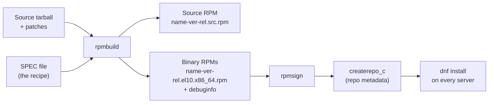
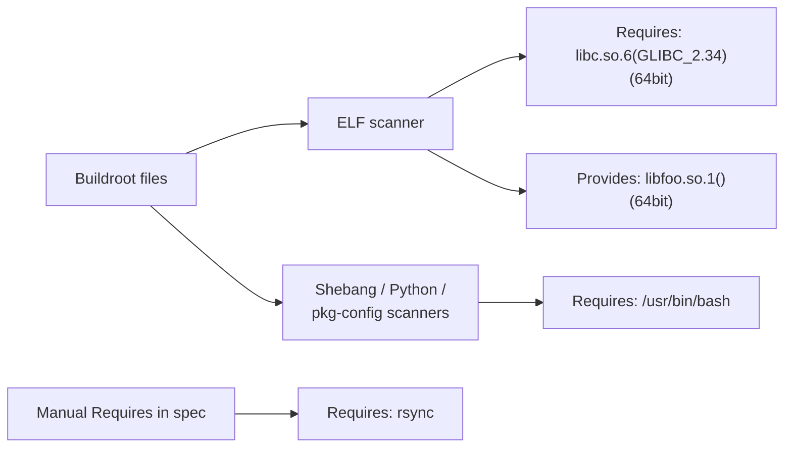
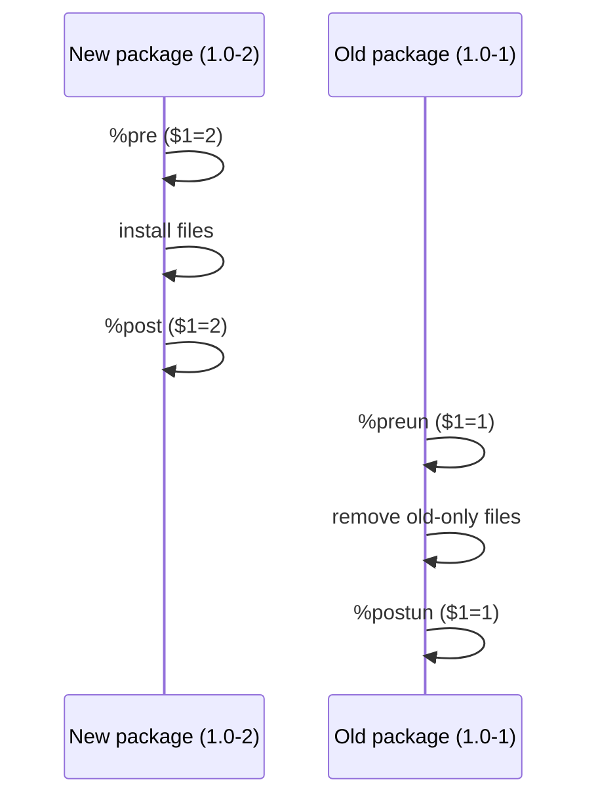
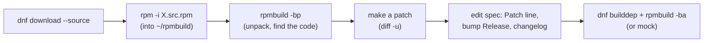
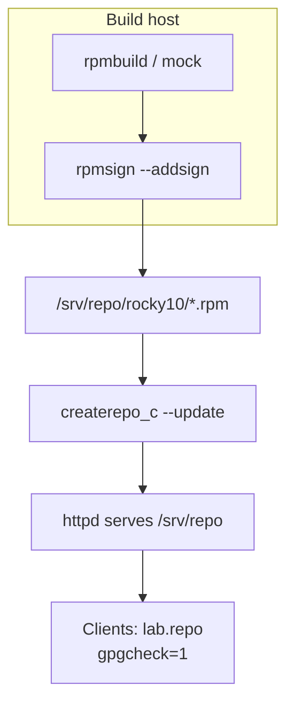

# 22 · Building RPM Packages

<ul class="module-meta">
  <li>⏱ ~3 hours</li>
  <li>4 labs</li>
  <li>Builds on: 05 · Software: RPM and DNF, 07 · systemd and Services, 21 · Inside Rocky Linux</li>
</ul>

A developer hands you a tarball and says "just run `make install` on the 40 web servers." Six months later nobody knows which servers have which version, uninstalling it means guessing which files it dropped, and a security scanner cannot see it at all. Packaging that tarball as an RPM takes about twenty minutes and fixes all of that. This module teaches you to build RPMs properly, rebuild Rocky's own packages with a patch, and ship them through a signed repository of your own.

!!! abstract "What you'll learn"
    - Why an RPM beats `make install`, and what you get for free when you package
    - The anatomy of a spec file: tags, sections, macros and `%files`
    - Build a package from a tarball with `rpmbuild`, and understand what each phase does
    - Rebuild an existing Rocky source RPM with your own patch, versioned so it upgrades cleanly
    - Build in a clean chroot with `mock` and check quality with `rpmlint`
    - Package a systemd service correctly, with scriptlets that run at the right moment
    - Sign your RPMs with GPG and publish them in a repository with `createrepo_c`

## The big picture

An **RPM package** is an archive of files plus a header of metadata: name, version, dependencies, scripts to run, and a signature. You never write that header by hand. You write a **spec file**, a recipe that says where the source is, how to build it, where the files go, and what the package needs. `rpmbuild` follows the recipe.



Two outputs come out of every build:

- A **source RPM (SRPM)**: the tarball, patches and spec bundled together. Anyone can rebuild the binaries from it. This is exactly what Rocky publishes for every package ([module 21](21-inside-rocky-linux.md)).
- One or more **binary RPMs**: what you actually install. One spec can produce several (the main package, `-devel`, `-debuginfo`, and so on).

### Why not just `make install`?

| Question | `make install` | RPM |
|---|---|---|
| What version is on this server? | Nobody knows | `rpm -q myapp` |
| Which files did it install? | Read the Makefile and hope | `rpm -ql myapp` |
| Has anyone modified them? | No way to tell | `rpm -V myapp` |
| How do I remove it cleanly? | Manually, carefully | `dnf remove myapp` |
| Does it need other libraries? | Find out when it crashes | Dependencies resolved by dnf |
| Is it trustworthy? | No provenance | GPG signature, changelog |
| Will config edits survive upgrades? | Overwritten | `%config(noreplace)` keeps them |
| Can I roll out to 40 servers? | ssh loops | `dnf upgrade` from your repo, Ansible, Satellite-style tools |

## Setting up a build environment

Never build packages as root. A broken spec file with a stray `rm -rf` in `%install` can wipe a real system if it runs as root; as a normal user it fails harmlessly.

```console
$ sudo dnf install rpmdevtools rpm-build rpm-sign gcc make systemd-rpm-macros createrepo_c
$ rpmdev-setuptree
$ tree -L 1 ~/rpmbuild
/home/alex/rpmbuild
├── BUILD
├── RPMS
├── SOURCES
├── SPECS
└── SRPMS
$ cat ~/.rpmmacros
%_topdir %(echo $HOME)/rpmbuild
…
```

| Directory | What goes there |
|---|---|
| `SOURCES/` | Tarballs, patches, extra files (unit files, configs) |
| `SPECS/` | Spec files |
| `BUILD/` | Where `%prep` unpacks the source and `%build` compiles it |
| `BUILDROOT/` | Created during the build: a fake root that `%install` populates |
| `RPMS/`, `SRPMS/` | The finished packages |

`rpmdevtools` lives in AppStream. Two other tools you will use, **mock** and **rpmlint**, come from **EPEL** (Extra Packages for Enterprise Linux), which needs CRB enabled:

```console
$ sudo dnf config-manager --set-enabled crb
$ sudo dnf install epel-release
$ sudo dnf install mock rpmlint
```

## Anatomy of a spec file

Here is a complete spec for a tiny C program called `rockyhello`. The numbered notes under it explain each important line.

```bash title="~/rpmbuild/SPECS/rockyhello.spec"
Name:           rockyhello
Version:        1.0
Release:        1%{?dist}
Summary:        Prints a friendly greeting
License:        MIT
URL:            https://example.com/rockyhello
Source0:        %{name}-%{version}.tar.gz

BuildRequires:  gcc
BuildRequires:  make

%description
A tiny program used to learn RPM packaging on Rocky Linux.

%prep
%autosetup

%build
%set_build_flags
%make_build

%install
%make_install PREFIX=%{_prefix}

%check
./rockyhello | grep -q Hello

%files
%license LICENSE
%doc README.md
%{_bindir}/rockyhello

%changelog
* Thu Oct 15 2026 Alex Admin <alex@example.com> - 1.0-1
- Initial package
```

1. `Name: rockyhello`: The package name. Also the base of the file name: `rockyhello-1.0-1.el10.x86_64.rpm`.
2. `Version: 1.0`: The **upstream** version of the software. You don't invent this; it comes from the project.
3. `Release: 1%{?dist}`: The **release**: how many times *you* have packaged this version. Bump it when you change the packaging but not the source. `%{?dist}` appends `.el10` (or `.el10_2`); the `?` means "empty if undefined".
4. `License: MIT`: An SPDX license expression for the packaged code.
5. `Source0: %{name}-%{version}.tar.gz`: Where the source comes from. A full URL works too; rpmbuild uses only the file name and looks for it in `SOURCES/`. `spectool -g` can download URL sources for you.
6. `BuildRequires: gcc`: Packages needed to *build*, installed in the build environment. Runtime dependencies on shared libraries are found automatically (see below).
7. `%autosetup`: Unpack `Source0` into `BUILD/` and `cd` into it, applying any `Patch` lines. Expects the tarball to contain a `rockyhello-1.0/` directory.
8. `%set_build_flags`: Export Rocky's standard compiler and linker hardening flags (`CFLAGS`, `LDFLAGS`) so the Makefile picks them up.
9. `%make_install PREFIX=%{_prefix}`: Install into the **buildroot**, a fake `/` under `BUILDROOT/`, never the real system. `%make_install` runs `make install DESTDIR=%{buildroot}`.
10. `./rockyhello | grep -q Hello`: Optional tests. If `%check` fails, the build fails.
11. `%files`: Every file the package owns. Files installed into the buildroot but not listed here make the build fail ("Installed (but unpackaged) file(s) found"), which protects you from shipping junk or forgetting files.
12. `%changelog`: Human-readable history. Newest entry on top; the version-release at the end of the header line must match.

### Macros: never hard-code paths

**Macros** are variables that rpm expands. Using them keeps your spec correct across architectures and releases.

```console
$ rpm --eval '%{_bindir} %{_libdir} %{_sysconfdir} %{_unitdir} %{dist}'
/usr/bin /usr/lib64 /etc /usr/lib/systemd/system .el10_2
$ rpm --eval '%{make_install}'
/usr/bin/make install DESTDIR=/home/alex/rpmbuild/BUILDROOT/%{NAME}-%{VERSION}-%{RELEASE}.x86_64 INSTALL="/usr/bin/install -p"
```

| Macro | Expands to | Use for |
|---|---|---|
| `%{_bindir}` | `/usr/bin` | Programs |
| `%{_sbindir}` | `/usr/sbin` | Admin programs |
| `%{_libdir}` | `/usr/lib64` (x86_64) | Libraries |
| `%{_sysconfdir}` | `/etc` | Config files |
| `%{_datadir}` | `/usr/share` | Architecture-independent data |
| `%{_unitdir}` | `/usr/lib/systemd/system` | systemd unit files |
| `%{_mandir}` | `/usr/share/man` | Man pages |
| `%{buildroot}` | The fake root for this build | Only inside `%install` |

!!! tip "Why macros matter even for \"obvious\" paths"
    Distributions do move things. Fedora, which RHEL and Rocky descend from, has been unifying `/usr/sbin` into `/usr/bin`, and `%{_libdir}` differs between architectures. A spec that says `%{_sbindir}/myd` keeps working wherever the macro points; one that hard-codes `/usr/sbin/myd` may not. When in doubt, `rpm --eval` the macro on each target release.

### Special file markers in %files

| Marker | Meaning |
|---|---|
| `%config(noreplace) %{_sysconfdir}/myapp.conf` | A config file. On upgrade, if the admin edited it, keep theirs and save the new one as `.rpmnew` |
| `%config %{_sysconfdir}/myapp.conf` | Config file, but replace it on upgrade (the old one is saved as `.rpmsave`) |
| `%doc README.md` | Documentation, installed under `/usr/share/doc/NAME/` |
| `%license LICENSE` | License text, kept even when docs are excluded |
| `%dir %{_datadir}/myapp` | Own the directory itself, not just files in it |
| `%attr(0640,root,myapp) FILE` | Set mode and ownership in the package |
| `%ghost /var/log/myapp.log` | Owned by the package but not shipped (created at runtime) |

<div class="quiz" data-answer="2" markdown>

You fixed a typo in the spec's `%description` but the upstream code is unchanged at version 2.4. What should you change?

- `Version: 2.4` to `Version: 2.5`
- `Release: 1%{?dist}` to `Release: 2%{?dist}`, plus a `%changelog` entry
- Nothing; rpm notices the spec changed
- Add an `Epoch: 1`

Right. Version tracks upstream; Release tracks your packaging. Bumping Release makes the new package sort as newer so `dnf upgrade` picks it up.

</div>

## What rpmbuild actually does

`rpmbuild -ba SPEC` ("build all": source and binary) runs a fixed sequence. Knowing it tells you where a failure happened.

<div class="stepper" markdown>

<div class="step" data-title="Parse" markdown>

rpm reads the spec, expands every macro, and checks that `BuildRequires` are installed. If not, it stops with `Failed build dependencies:` and a list. `sudo dnf builddep SPEC` installs them.

</div>

<div class="step" data-title="%prep" markdown>

Unpack sources into `~/rpmbuild/BUILD/` and apply patches (`%autosetup`). Nothing is compiled yet. Run only this phase with `rpmbuild -bp` to inspect or modify the unpacked tree.

</div>

<div class="step" data-title="%build" markdown>

Compile. Usually `%configure` (for autotools) or `%cmake` and then `%make_build`, which runs `make` with `-j` set to your CPU count. Compiler flags include hardening options (stack protector, `_FORTIFY_SOURCE`, PIE, RELRO).

</div>

<div class="step" data-title="%install" markdown>

Copy the results into `%{buildroot}` (under `~/rpmbuild/BUILDROOT/`), laid out exactly as they will appear on the target system.

```text
BUILDROOT/rockyhello-1.0-1.el10.x86_64/
└── usr/bin/rockyhello
```

</div>

<div class="step" data-title="Post-processing" markdown>

Automatic "brp" (buildroot policy) scripts run: strip debug symbols into a separate **debuginfo** package, compress man pages, fix shebangs and file modes, byte-compile Python. Then dependency generators scan every file to compute `Requires` and `Provides`.

</div>

<div class="step" data-title="%check" markdown>

Run the test suite, if the spec has one. A failure stops the build. Skip it temporarily with `--nocheck` when debugging, never for releases.

</div>

<div class="step" data-title="%files and packaging" markdown>

Compare the buildroot against `%files`. Missing files or unpackaged files are fatal errors. Then write the RPMs:

```text
Wrote: /home/alex/rpmbuild/SRPMS/rockyhello-1.0-1.el10.src.rpm
Wrote: /home/alex/rpmbuild/RPMS/x86_64/rockyhello-1.0-1.el10.x86_64.rpm
Wrote: /home/alex/rpmbuild/RPMS/x86_64/rockyhello-debuginfo-1.0-1.el10.x86_64.rpm
Wrote: /home/alex/rpmbuild/RPMS/x86_64/rockyhello-debugsource-1.0-1.el10.x86_64.rpm
```

</div>

</div>

| Command | Stops after | Produces |
|---|---|---|
| `rpmbuild -bp` | `%prep` | Unpacked, patched source in `BUILD/` |
| `rpmbuild -bc` | `%build` | Compiled tree |
| `rpmbuild -bi` | `%install` and `%files` check | Populated buildroot |
| `rpmbuild -bb` | Binary packages | `RPMS/` only |
| `rpmbuild -bs` | Source package | `SRPMS/` only |
| `rpmbuild -ba` | Everything | Both |
| `rpmbuild --rebuild X.src.rpm` | Everything, from an SRPM | `RPMS/` |

### Automatic dependencies

You did not write `Requires: glibc`, yet the package depends on it. rpm's **dependency generators** inspect every ELF binary, script shebang, Python module and pkg-config file in the buildroot and add the right `Requires:` and `Provides:`.

```console
$ rpm -qp --requires ~/rpmbuild/RPMS/x86_64/rockyhello-1.0-1.el10.x86_64.rpm
libc.so.6()(64bit)
libc.so.6(GLIBC_2.34)(64bit)
rpmlib(CompressedFileNames) <= 3.0.4-1
rpmlib(FileDigests) <= 4.6.0-1
rpmlib(PayloadFilesHavePrefix) <= 4.0-1
rpmlib(PayloadIsZstd) <= 5.4.18-1
rtld(GNU_HASH)
$ rpm -qp --provides ~/rpmbuild/RPMS/x86_64/rockyhello-1.0-1.el10.x86_64.rpm
rockyhello = 1.0-1.el10
rockyhello(x86-64) = 1.0-1.el10
```

DNF never needs to know "glibc"; it asks "who provides `libc.so.6(GLIBC_2.34)(64bit)`?" and finds glibc. Write manual `Requires:` only for things the generators cannot see: a command your script calls (`Requires: rsync`), a data package, or a minimum version.



## Scriptlets: code that runs at install time

**Scriptlets** are small shell scripts embedded in the package that run on the target machine during install, upgrade or removal: creating a user, reloading systemd, rebuilding a cache. They are powerful and the most common source of packaging bugs, mainly because people misjudge *when* they run during an upgrade.

Each scriptlet gets one argument, `$1`: the number of instances of this package that will be installed *after* the operation finishes.

| Scriptlet | Runs | `$1` on install | `$1` on upgrade | `$1` on erase |
|---|---|---|---|---|
| `%pre` | Before files are installed (new package) | 1 | 2 | n/a |
| `%post` | After files are installed (new package) | 1 | 2 | n/a |
| `%preun` | Before files are removed (old package) | n/a | 1 | 0 |
| `%postun` | After files are removed (old package) | n/a | 1 | 0 |
| `%pretrans`, `%posttrans` | Start/end of the whole transaction | | | |

The upgrade order is the surprising part. Step through it:

<div class="stepper" markdown>

<div class="step" data-title="Start" markdown>

`myapp-1.0-1` is installed. You run `dnf upgrade` and `myapp-1.0-2` arrives. Both packages' scriptlets will run.

</div>

<div class="step" data-title="%pretrans (new)" markdown>

Runs once at the very start of the transaction, before anything changes. Rarely needed.

</div>

<div class="step" data-title="%pre (new), $1=2" markdown>

The **new** package's `%pre` runs. `$1` is 2: after this, two versions will briefly be installed. Typical use: create a system user if missing.

</div>

<div class="step" data-title="Install new files" markdown>

The new package's files are written, replacing the old ones (configs follow the `%config` rules).

</div>

<div class="step" data-title="%post (new), $1=2" markdown>

The **new** package's `%post`. Typical use: `systemctl daemon-reload`, via the `%systemd_post` macro.

</div>

<div class="step" data-title="%preun (old), $1=1" markdown>

Now the **old** package's `%preun` runs, with `$1=1` (one version will remain). This is the trap: if your `%preun` says "stop and disable the service" without checking `$1`, every *upgrade* disables the service. Always test `if [ $1 -eq 0 ]` for removal-only actions.

</div>

<div class="step" data-title="Remove old files" markdown>

Files that only the old package owned are removed.

</div>

<div class="step" data-title="%postun (old), $1=1" markdown>

The **old** package's `%postun`. With `$1=1` it is an upgrade: a good moment to restart the service so it runs the new code (`%systemd_postun_with_restart`).

</div>

<div class="step" data-title="%posttrans (new)" markdown>

Runs after everything else in the transaction completes.

</div>

</div>



!!! tip "See a package's scriptlets before you install it"
    `rpm -qp --scripts file.rpm` prints every scriptlet. Make it a habit for third-party RPMs: they run as root.

<div class="quiz" data-answer="3" markdown>

A vendor's package disables its service every time you upgrade it. Its `%preun` contains `systemctl disable --now vendor.service` with no condition. Why does an upgrade trigger it?

- `%preun` only runs on upgrade, never on removal
- dnf runs `%preun` of the new package before installing it
- During an upgrade, the **old** package's `%preun` runs with `$1=1`; without checking `$1 -eq 0`, it can't tell upgrade from removal
- systemd disables services whose unit file changes

Correct. The `%systemd_preun` macro gets this right: it only stops and disables when `$1` is 0.

</div>

## Packaging a systemd service

The systemd macros (from `systemd-rpm-macros`) encapsulate the correct scriptlet logic, including presets and the `$1` checks. Use them instead of writing `systemctl` calls yourself.

```bash title="~/rpmbuild/SPECS/rockyhello.spec (service additions)"
Source1:        rockyhello.service
BuildRequires:  systemd-rpm-macros

%install
%make_install PREFIX=%{_prefix}
install -D -m 0644 %{SOURCE1} %{buildroot}%{_unitdir}/rockyhello.service

%post
%systemd_post rockyhello.service

%preun
%systemd_preun rockyhello.service

%postun
%systemd_postun_with_restart rockyhello.service

%files
%{_bindir}/rockyhello
%{_unitdir}/rockyhello.service
```

1. `%systemd_post rockyhello.service`: On first install, apply the **preset** policy: enable the unit only if a preset file says so (by default, most services stay disabled). Never `systemctl enable` from a spec.
2. `%systemd_preun rockyhello.service`: On final removal (`$1 -eq 0`), stop and disable the unit.
3. `%systemd_postun_with_restart …`: On upgrade (`$1 -ge 1`), restart the unit if it was running, so it picks up the new binary.

See what the macros expand to:

```console
$ rpm --eval '%systemd_postun_with_restart rockyhello.service'

if [ $1 -ge 1 ] && [ -x "/usr/lib/systemd/systemd-update-helper" ]; then
    # Package upgrade, not uninstall
    /usr/lib/systemd/systemd-update-helper mark-restart-system-units rockyhello.service || :
fi
```

The helper marks the unit and systemd restarts it once at the end of the transaction, rather than mid-upgrade.

A matching unit file that needs no user creation, because systemd allocates a transient user at runtime with **DynamicUser** (see [module 07](07-systemd-and-services.md)):

```ini title="~/rpmbuild/SOURCES/rockyhello.service"
[Unit]
Description=Rocky hello greeter (packaging demo)

[Service]
ExecStart=/usr/bin/rockyhello --loop
DynamicUser=yes
Restart=on-failure

[Install]
WantedBy=multi-user.target
```

## Rebuilding an existing Rocky package

Sometimes you need Rocky's package with one change: a backported fix, a compile option, a patch from upstream that is not shipped yet. You do not start from scratch; you rebuild Rocky's own source RPM.



The two rules that matter:

1. **Bump the Release in a way that sorts correctly.** Append a suffix: `Release: 7%{?dist}.mycorp1`. That sorts newer than Rocky's `7.el10`, so it replaces it, but older than Rocky's next update `8.el10`, so the next real fix replaces yours. Decide whether that is what you want (it usually is: you only want to diverge until upstream catches up).
2. **Put the patch in the spec, not in the tarball.** Add a `Patch` line. If the spec uses `%autosetup -p1`, all patches apply automatically. If it uses `%setup` followed by explicit patch lines, add `%patch -P 100 -p1` with your number.

!!! pitfall "The old `%patch1` syntax"
    Old specs apply patches with `%patch1 -p1`. RPM 4.19 (on Rocky 10) deprecates that form and warns; newer RPM removes it. Use `%patch -P 1 -p1`, which works everywhere, or `%autosetup -p1`.

!!! warning "Forking a core package is a commitment"
    The moment you replace a Rocky package with your own build, you own its security updates. Watch for every RLSA touching it, and rebuild promptly, or use `excludepkgs=` and versionlock deliberately. Prefer getting the fix upstream.

## Building cleanly with mock

`rpmbuild` on your workstation uses whatever happens to be installed there. That has two problems: a missing `BuildRequires` goes unnoticed because the package was installed anyway, and the result may link against libraries from EPEL or your own experiments. **mock** fixes this by building inside a fresh chroot containing only a minimal base and the declared build dependencies, exactly what Rocky's build system does ([module 21](21-inside-rocky-linux.md#the-build-system)).

```console
$ sudo usermod -aG mock $USER     # log out and back in afterwards
$ ls /etc/mock/ | grep rocky-10
rocky+epel-10-aarch64.cfg
rocky+epel-10-ppc64le.cfg
rocky+epel-10-s390x.cfg
rocky+epel-10-x86_64.cfg
rocky-10-aarch64.cfg
rocky-10-ppc64le.cfg
rocky-10-riscv64.cfg
rocky-10-s390x.cfg
rocky-10-x86_64.cfg
$ mock -r rocky-10-x86_64 --rebuild ~/rpmbuild/SRPMS/rockyhello-1.0-1.el10.src.rpm
INFO: mock.py version 6.x starting (python version = 3.12…)…
Start: init plugins
…
Start: build phase for rockyhello-1.0-1.el10.src.rpm
…
Finish: rpmbuild rockyhello-1.0-1.el10.src.rpm
INFO: Done(…) Config(rocky-10-x86_64) 1 minutes 12 seconds
INFO: Results and/or logs in: /var/lib/mock/rocky-10-x86_64/result
```

| Config | Builds against |
|---|---|
| `rocky-10-x86_64` | Rocky 10 BaseOS, AppStream, CRB (plus extras) |
| `rocky+epel-10-x86_64` | The same plus EPEL 10, for packages that need EPEL build dependencies |
| `rocky-9-x86_64` | Rocky 9: build for older servers from a Rocky 10 workstation |

The `result/` directory holds the RPMs and three logs: `build.log` (the rpmbuild output), `root.log` (what was installed into the chroot) and `state.log`. When a build fails in mock but works with rpmbuild, `root.log` almost always shows a build dependency you forgot to declare.

!!! tip "Useful mock commands"
    `mock -r CFG --shell` opens a shell in the chroot to poke around. `mock -r CFG --clean` resets it. `mock --scrub=all` removes all cached chroots and frees disk space. Mock caches downloaded packages, so the second build is much faster.

### rpmlint: the packaging linter

`rpmlint` checks packages and specs against packaging conventions: missing license, bad permissions, binaries in the wrong place, hard-coded paths, missing man pages.

```console
$ rpmlint ~/rpmbuild/SPECS/rockyhello.spec ~/rpmbuild/RPMS/x86_64/rockyhello-1.0-1.el10.x86_64.rpm
rockyhello.x86_64: W: no-manual-page-for-binary rockyhello
 1 packages and 1 specfiles checked; 0 errors, 1 warnings…
```

Errors (`E:`) are real problems. Warnings (`W:`) deserve a look; some are judgement calls. `rpmlint -e no-manual-page-for-binary` explains any check.

<div class="quiz" data-answer="1" markdown>

Your package builds fine with `rpmbuild -ba` on your workstation but fails in mock with `fatal error: openssl/ssl.h: No such file or directory`. What is wrong?

- The spec is missing `BuildRequires: openssl-devel`; your workstation had it installed already
- mock does not support OpenSSL
- You need to run mock as root
- The `rocky-10-x86_64` config is broken

Exactly the bug mock exists to catch. Add the missing BuildRequires and the build becomes reproducible anywhere.

</div>

## Signing packages and publishing a repository

### Signing with rpmsign

A signature lets every server prove the package came from you ([module 21](21-inside-rocky-linux.md#signatures-trusting-what-you-install)). You need a GPG key and one macro telling rpm which key to use.

```console
$ gpg --quick-generate-key "Lab Packager <packager@example.com>" rsa4096 sign 2y
$ gpg --list-secret-keys --keyid-format long
sec   rsa4096/8F3C2A1D5E6B7C90 2026-10-15 [SC] [expires: 2028-10-15]
      …
uid                 [ultimate] Lab Packager <packager@example.com>
$ echo '%_gpg_name Lab Packager <packager@example.com>' >> ~/.rpmmacros
$ rpmsign --addsign ~/rpmbuild/RPMS/x86_64/rockyhello-1.0-1.el10.x86_64.rpm
$ rpm -K ~/rpmbuild/RPMS/x86_64/rockyhello-1.0-1.el10.x86_64.rpm
/home/alex/rpmbuild/RPMS/x86_64/rockyhello-1.0-1.el10.x86_64.rpm: digests SIGNATURES NOT OK
```

`NOT OK` in capitals here means "signed with a key I don't know". Export the public key and import it into rpm's keyring (on every server that will install your packages):

```console
$ gpg --export --armor packager@example.com > RPM-GPG-KEY-labpackager
$ sudo rpm --import RPM-GPG-KEY-labpackager
$ rpm -K ~/rpmbuild/RPMS/x86_64/rockyhello-1.0-1.el10.x86_64.rpm
/home/alex/rpmbuild/RPMS/x86_64/rockyhello-1.0-1.el10.x86_64.rpm: digests signatures OK
```

!!! danger "Protect the private key"
    Anyone with your private key can ship packages every one of your servers will install as root. Real setups keep it on a dedicated signing host or hardware token, with a passphrase, and never on build machines. Back up the key and a revocation certificate (`~/.gnupg/openpgp-revocs.d/`).

### Making a repository

A DNF repository is just a directory of RPMs plus a `repodata/` directory describing them. `createrepo_c` builds the metadata.

```console
$ sudo mkdir -p /srv/repo/rocky10
$ sudo cp ~/rpmbuild/RPMS/x86_64/rockyhello-1.0-1.el10.x86_64.rpm /srv/repo/rocky10/
$ sudo createrepo_c /srv/repo/rocky10
Directory walk started
Directory walk done - 1 packages
Temporary output repo path: /srv/repo/rocky10/.repodata/
Preparing sqlite DBs
Pool started (with 5 workers)
Pool finished
$ ls /srv/repo/rocky10/repodata/
…-filelists.xml.zst  …-other.xml.zst  …-primary.xml.zst  repomd.xml
```

After adding packages later, `createrepo_c --update` reuses existing metadata and is much faster. Serve the directory over HTTP (any web server, see the lab) or use it locally with `file://`. Point clients at it with a repo file:

```ini title="/etc/yum.repos.d/lab.repo"
[lab]
name=Lab packages for Rocky $releasever
baseurl=http://repo.example.com/rocky10/
enabled=1
gpgcheck=1
gpgkey=http://repo.example.com/RPM-GPG-KEY-labpackager
```

With `gpgkey=` set, DNF offers to import the key the first time (after showing you its fingerprint), so you do not need to `rpm --import` by hand on every client. For extra protection against a tampered repo, sign the metadata too (`gpg --detach-sign --armor repodata/repomd.xml`) and set `repo_gpgcheck=1`.



## Versions, releases and epochs

DNF decides "newer" by comparing **EVR**: **E**poch, **V**ersion, **R**elease, in that order. The comparison is not plain string or number sorting; rpm splits each field into runs of digits and letters and compares them piece by piece.

```console
$ rpmdev-vercmp 1.10 1.9
1.10 > 1.9
$ rpmdev-vercmp 1.0~rc1 1.0
1.0~rc1 < 1.0
$ rpmdev-vercmp 1.0^20261015git3a2b1c 1.0
1.0^20261015git3a2b1c > 1.0
```

| Situation | Do this | Why |
|---|---|---|
| Pre-release (beta, rc) | `Version: 2.0~rc1` | Tilde sorts *before* the final `2.0`, so the release upgrades it |
| Snapshot after a release | `Version: 2.0^20261015git3a2b1c` | Caret sorts *after* `2.0` but before `2.0.1` |
| Rebuild with a local change | `Release: 7%{?dist}.mycorp1` | Newer than Rocky's `7`, older than Rocky's `8` |
| Upstream version went backwards (2.0 → 1.5) | `Epoch: 1` | Epoch beats any version. Last resort |

!!! danger "Epoch is forever"
    Once a package has `Epoch: 1`, every future version must keep it, and anything that `Requires: foo >= 2.0` must say `foo >= 1:2.0` to be precise. You can never remove an epoch without breaking upgrades. Use it only when there is no other option.

<div class="quiz" data-answer="4" markdown>

You package a beta of version 3.0. Which `Version` lets the final 3.0 release upgrade it automatically?

- `3.0beta1`
- `3.0.beta1`
- `3.0-beta1`
- `3.0~beta1`

Right. `3.0beta1` and `3.0.beta1` both sort *after* `3.0`, so the final release would look like a downgrade. A hyphen isn't allowed in Version at all. The tilde exists for exactly this case.

</div>

## Practice

<div class="terminal-sim" data-title="Packaging toolkit" data-prompt="[alex@rocky-lab ~]$ " markdown>

<div class="task" data-expect="rpmdev-setuptree" data-hint="rpmdevtools has a command that creates the ~/rpmbuild tree." markdown>

**Step 1.** Create the standard build tree in your home directory.

```text
(no output: ~/rpmbuild/{BUILD,RPMS,SOURCES,SPECS,SRPMS} now exist)
```

</div>

<div class="task" data-expect="rpm --eval %{_unitdir}||rpm --eval '%{_unitdir}'" data-match="^rpm --eval '?%\{_unitdir\}'?$" data-hint="rpm --eval expands a macro. The macro for systemd unit files is %{_unitdir}." markdown>

**Step 2.** Ask rpm where systemd unit files belong.

```text
/usr/lib/systemd/system
```

</div>

<div class="task" data-expect="rpm -qp --scripts vendor-agent-2.1-1.x86_64.rpm" data-match="^rpm -qp ?--scripts vendor-agent-2\.1-1\.x86_64\.rpm$" data-hint="Query a package file (-qp) and show its scriptlets (--scripts)." markdown>

**Step 3.** A vendor sent `vendor-agent-2.1-1.x86_64.rpm`. Show its scriptlets before installing it.

```text
preinstall scriptlet (using /bin/sh):
getent passwd vagent >/dev/null || useradd -r -s /sbin/nologin vagent
postinstall scriptlet (using /bin/sh):
systemctl enable --now vendor-agent.service
```

</div>

<div class="task" data-expect="rpm -qp --requires vendor-agent-2.1-1.x86_64.rpm||rpm -qpR vendor-agent-2.1-1.x86_64.rpm" data-hint="Use --requires (or -R) with -qp." markdown>

**Step 4.** What does it depend on?

```text
/bin/sh
libc.so.6()(64bit)
libssl.so.3()(64bit)
…
```

</div>

<div class="task" data-expect="rpmdev-vercmp 2.1~rc2 2.1" data-hint="rpmdev-vercmp compares two version strings." markdown>

**Step 5.** Will `2.1~rc2` be upgraded by `2.1`? Compare them.

```text
2.1~rc2 < 2.1
```

</div>

</div>

## Labs

!!! lab "Lab 1: Package a program from a tarball"

    **Goal:** Build, install, query and remove your first RPM.

    **You'll need:** a Rocky 10 VM, a normal user with sudo, the packages from "Setting up a build environment".

    1. Create the upstream source: a program, a Makefile that honours `DESTDIR`, a README and a LICENSE.

        ```bash
        mkdir -p ~/src/rockyhello-1.0 && cd ~/src/rockyhello-1.0
        cat > rockyhello.c <<'EOF'
        #include <stdio.h>
        #include <string.h>
        #include <unistd.h>
        int main(int argc, char **argv) {
            do {
                printf("Hello from a real RPM!\n");
                fflush(stdout);
                if (argc > 1 && strcmp(argv[1], "--loop") == 0) sleep(60);
            } while (argc > 1 && strcmp(argv[1], "--loop") == 0);
            return 0;
        }
        EOF
        printf 'PREFIX ?= /usr/local\nCFLAGS ?= -O2 -g\n\nrockyhello: rockyhello.c\n\t$(CC) $(CFLAGS) $(LDFLAGS) -o $@ $<\n\ninstall: rockyhello\n\tinstall -D -m 0755 rockyhello $(DESTDIR)$(PREFIX)/bin/rockyhello\n' > Makefile
        echo "# rockyhello" > README.md
        echo "MIT License (lab example)" > LICENSE
        cd ~/src && tar czf ~/rpmbuild/SOURCES/rockyhello-1.0.tar.gz rockyhello-1.0
        ```

    2. Write the spec: copy the spec from "Anatomy of a spec file" into `~/rpmbuild/SPECS/rockyhello.spec`, or start from a template with `rpmdev-newspec ~/rpmbuild/SPECS/rockyhello.spec` and fill it in.

    3. Build it and look at the results:

        ```bash
        rpmbuild -ba ~/rpmbuild/SPECS/rockyhello.spec
        ls ~/rpmbuild/RPMS/x86_64/ ~/rpmbuild/SRPMS/
        rpm -qpil ~/rpmbuild/RPMS/x86_64/rockyhello-1.0-1.el10*.x86_64.rpm
        rpm -qp --requires ~/rpmbuild/RPMS/x86_64/rockyhello-1.0-1.el10*.x86_64.rpm
        ```

    4. Install it, use it, verify it, then remove it:

        ```bash
        sudo dnf install ~/rpmbuild/RPMS/x86_64/rockyhello-1.0-1.el10*.x86_64.rpm
        rockyhello
        rpm -qf /usr/bin/rockyhello
        rpm -V rockyhello && echo "unmodified"
        sudo dnf remove rockyhello
        ```

    **Check your work:** `rockyhello` prints the greeting, `rpm -qf` names the package, and after removal `/usr/bin/rockyhello` is gone.

    ??? tip "Hint: \"Installed (but unpackaged) file(s) found\""
        Something in `%install` put a file in the buildroot that `%files` doesn't list. Either add it to `%files` or stop installing it. The error message names the file.

    ??? tip "Hint: does dnf refuse an unsigned local package?"
        If `dnf install ./file.rpm` complains about a missing signature, check `localpkg_gpgcheck` in `/etc/dnf/dnf.conf`. Unsigned local packages install by default; Lab 4 signs them properly.

    **Clean up:** keep `~/rpmbuild` for the next labs. At the end: `rm -rf ~/rpmbuild ~/src ~/.rpmmacros`.

!!! lab "Lab 2: Rebuild a Rocky package with your own patch"

    **Goal:** Change the `--version` output of Rocky's `which` package, versioned so it upgrades cleanly and yields to the next official update.

    **You'll need:** Lab 1's setup, CRB enabled (some build dependencies live there).

    1. Fetch and unpack the source RPM:

        ```bash
        cd ~ && dnf download --source which
        rpm -i which-*.src.rpm          # installs into ~/rpmbuild, NOT the system
        ls ~/rpmbuild/SOURCES/ | grep which
        grep -nE '^(Version|Release|Source|Patch)|%autosetup|%setup|%patch' ~/rpmbuild/SPECS/which.spec
        ```

    2. Unpack and patch the source to see the code, then make a patch:

        ```bash
        rpmbuild -bp ~/rpmbuild/SPECS/which.spec
        cd ~/rpmbuild/BUILD/
        ls                                  # note the which-2.* directory name
        cp -a which-2.* which.orig
        grep -n 'GNU which v' which-2.*/which.c
        sed -i 's/GNU which v/GNU which (lab build) v/' which-2.*/which.c
        diff -u which.orig/which.c which-2.*/which.c > ~/rpmbuild/SOURCES/which-lab-version.patch
        ```

    3. Fix the paths inside the patch so it applies with `-p1`, then look at it:

        ```bash
        sed -i -e 's#^--- which.orig/#--- a/#' -e 's#^+++ which-[^/]*/#+++ b/#' ~/rpmbuild/SOURCES/which-lab-version.patch
        cat ~/rpmbuild/SOURCES/which-lab-version.patch
        ```

    4. Edit `~/rpmbuild/SPECS/which.spec`:
        - Add `Patch900: which-lab-version.patch` after the existing `Source`/`Patch` lines.
        - If the spec uses `%autosetup -p1`, you're done with patching. If it uses `%setup`, add `%patch -P 900 -p1` after it.
        - Append `.lab1` to the Release: `Release: N%{?dist}.lab1`.
        - Add a `%changelog` entry at the top with the new version-release.

    5. Build and install:

        ```bash
        sudo dnf builddep ~/rpmbuild/SPECS/which.spec
        rpmbuild -ba ~/rpmbuild/SPECS/which.spec
        sudo dnf install ~/rpmbuild/RPMS/x86_64/which-*lab1*.x86_64.rpm
        which --version | head -1
        rpm -q which
        ```

    **Check your work:** `which --version` shows "(lab build)", and `rpm -q which` shows a release ending in `.lab1`. Run `rpmdev-vercmp` against the next Rocky release number to confirm Rocky's next update would replace it.

    ??? tip "Hint: grep finds nothing in step 2"
        The version string may be elsewhere or worded differently in this version. Run `grep -rn 'Copyright' which-2.*/*.c` and pick the line printed by `--version`.

    **Clean up:** restore Rocky's build with `sudo dnf distro-sync which` (or `sudo dnf downgrade which`), then `rm -rf ~/rpmbuild/BUILD/which* ~/which-*.src.rpm`.

!!! lab "Lab 3: Build in mock and lint the result"

    **Goal:** Prove your spec declares all its build dependencies, and fix packaging warnings.

    **You'll need:** Lab 1's SRPM, EPEL enabled, `mock` and `rpmlint` installed.

    1. Join the mock group and start a new login session:

        ```bash
        sudo usermod -aG mock $USER
        newgrp mock
        ```

    2. Break the spec on purpose: remove the `BuildRequires: gcc` line, rebuild the SRPM, and build it in mock:

        ```bash
        sed -i '/^BuildRequires:  gcc/d' ~/rpmbuild/SPECS/rockyhello.spec
        rpmbuild -bs ~/rpmbuild/SPECS/rockyhello.spec
        mock -r rocky-10-x86_64 --rebuild ~/rpmbuild/SRPMS/rockyhello-1.0-1.el10*.src.rpm
        grep -iE 'not found|error' /var/lib/mock/rocky-10-x86_64/result/build.log | head
        ```

    3. Put `BuildRequires: gcc` back, rebuild the SRPM, and run mock again. It should succeed.

    4. Lint the spec and the mock-built RPM:

        ```bash
        rpmlint ~/rpmbuild/SPECS/rockyhello.spec /var/lib/mock/rocky-10-x86_64/result/*.rpm
        ```

    **Check your work:** the first mock build fails because `gcc` (or `cc`) is missing in the chroot, even though it worked with plain `rpmbuild`; the second succeeds. You can explain each rpmlint warning.

    ??? success "What just happened?"
        Your workstation had gcc installed, which hid the missing BuildRequires. mock's chroot only had what the spec asked for. This is exactly how Rocky's build system catches the same mistake.

    **Clean up:** `mock -r rocky-10-x86_64 --scrub=all`

!!! lab "Lab 4: Ship a signed service package through your own repo"

    **Goal:** Package `rockyhello` as a systemd service, sign it, publish it over HTTP, and install it with plain `dnf install` on a client.

    **You'll need:** Labs 1 to 3. A second VM as client is ideal; the same VM works too.

    1. Add the unit file from "Packaging a systemd service" as `~/rpmbuild/SOURCES/rockyhello.service`, merge the service additions into the spec, bump `Release` to `2%{?dist}`, add a changelog entry, and build:

        ```bash
        rpmbuild -ba ~/rpmbuild/SPECS/rockyhello.spec
        rpm -qp --scripts ~/rpmbuild/RPMS/x86_64/rockyhello-1.0-2.el10*.x86_64.rpm
        ```

    2. Create a signing key (no passphrase, lab only), configure rpm and sign:

        ```bash
        gpg --batch --passphrase '' --quick-generate-key "Lab Packager <packager@example.com>" rsa4096 sign 1y
        echo '%_gpg_name Lab Packager <packager@example.com>' >> ~/.rpmmacros
        rpmsign --addsign ~/rpmbuild/RPMS/x86_64/rockyhello-1.0-2.el10*.x86_64.rpm
        ```

    3. Publish a repo with httpd:

        ```bash
        sudo dnf install -y httpd
        sudo mkdir -p /var/www/html/repo/rocky10
        sudo cp ~/rpmbuild/RPMS/x86_64/rockyhello-1.0-2.el10*.x86_64.rpm /var/www/html/repo/rocky10/
        gpg --export --armor packager@example.com | sudo tee /var/www/html/repo/RPM-GPG-KEY-labpackager >/dev/null
        sudo createrepo_c /var/www/html/repo/rocky10
        sudo restorecon -R /var/www/html/repo
        sudo systemctl enable --now httpd
        sudo firewall-cmd --add-service=http
        ```

    4. On the client, add the repo and install (replace `REPOHOST` with the server's IP or `localhost`):

        ```bash
        sudo tee /etc/yum.repos.d/lab.repo <<'EOF'
        [lab]
        name=Lab packages
        baseurl=http://REPOHOST/repo/rocky10/
        enabled=1
        gpgcheck=1
        gpgkey=http://REPOHOST/repo/RPM-GPG-KEY-labpackager
        EOF
        sudo dnf install rockyhello
        systemctl status rockyhello
        sudo systemctl enable --now rockyhello
        journalctl -u rockyhello -n 3
        ```

    **Check your work:** dnf shows the key fingerprint and asks to import it; after you accept, the package installs. `systemctl status` shows the unit installed but disabled (preset policy); after enabling, the journal shows the greeting.

    ??? success "What just happened?"
        You built the complete pipeline Rocky runs, at small scale: build, sign, compose metadata, serve, verify on the client. `%systemd_post` respected presets instead of enabling the service behind your back.

    **Clean up:** on the client: `sudo dnf remove rockyhello; sudo rm /etc/yum.repos.d/lab.repo; sudo rpm -e $(rpm -q gpg-pubkey --qf '%{NAME}-%{VERSION}-%{RELEASE} %{SUMMARY}\n' | awk '/Lab Packager/{print $1}')`. On the server: `sudo systemctl disable --now httpd; sudo firewall-cmd --reload; sudo rm -rf /var/www/html/repo`. Then `rm -rf ~/rpmbuild ~/src ~/.rpmmacros` and, if this key was only for the lab, delete it with `gpg --delete-secret-and-public-key packager@example.com`.

## Common pitfalls

| Symptom | Cause | Fix |
|---|---|---|
| `Installed (but unpackaged) file(s) found` | `%install` created files not in `%files` | List them in `%files`, or don't install them |
| `File not found: …/BUILDROOT/…` | `%files` lists something `%install` didn't create | Check paths and macro expansions with `rpm --eval` |
| `Failed build dependencies` | BuildRequires not installed | `sudo dnf builddep SPEC` (enable CRB for many `-devel` packages) |
| Works with rpmbuild, fails in mock | Missing BuildRequires hidden by your workstation | Read `root.log`/`build.log`, add the dependency |
| Service disabled after every upgrade | Unconditional `%preun` | Use `%systemd_preun`, or test `$1 -eq 0` |
| New package "not an upgrade" | Version or release sorts lower | Check with `rpmdev-vercmp`; use `~` for pre-releases |
| `%patchN is deprecated` warning | Old patch syntax | `%patch -P N -p1` or `%autosetup -p1` |
| Admin's config overwritten on upgrade | `%config` without `noreplace`, or not marked config at all | `%config(noreplace)` for files admins edit |
| Built as root and it deleted real files | `%install` used absolute paths without `%{buildroot}` | Always build as a normal user; always prefix `%{buildroot}` |

!!! pitfall "Your rebuilt package silently disappears"
    You rebuilt `foo` with release `3.el10.mycorp1`. A week later Rocky ships `foo-4.el10` and `dnf upgrade` replaces yours, removing your fix. That is usually correct (upstream got the fix), but if it isn't, either rebuild on top of every update, or pin it with `excludepkgs=foo` in the Rocky repo section, and track that decision.

## Cheat sheet

| Command | What it does |
|---|---|
| `rpmdev-setuptree` | Create `~/rpmbuild` and `~/.rpmmacros` |
| `rpmdev-newspec NAME.spec` | Spec file template |
| `rpm --eval '%{_libdir}'` | Expand a macro |
| `spectool -g -R SPEC` | Download remote Source/Patch URLs into `SOURCES/` |
| `sudo dnf builddep SPEC` | Install BuildRequires |
| `rpmbuild -bp SPEC` | Unpack and patch only |
| `rpmbuild -ba SPEC` | Build source and binary RPMs |
| `rpmbuild --rebuild X.src.rpm` | Rebuild binaries from an SRPM |
| `dnf download --source PKG` | Fetch Rocky's SRPM |
| `rpm -i X.src.rpm` | Unpack an SRPM into `~/rpmbuild` |
| `mock -r rocky-10-x86_64 --rebuild X.src.rpm` | Clean chroot build |
| `rpmlint SPEC RPMS` | Packaging linter |
| `rpm -qp --requires FILE` | Dependencies of a package file |
| `rpm -qp --scripts FILE` | Scriptlets of a package file |
| `rpmsign --addsign FILE` | Sign with the key in `%_gpg_name` |
| `createrepo_c --update DIR` | Build or refresh repo metadata |
| `rpmdev-vercmp A B` | Compare two versions the way rpm does |

## Flashcards

<div class="flashcards" markdown>

<div class="card" markdown>

Version vs Release?

Version is the upstream software version. Release counts your packaging iterations of that version, plus `%{?dist}`.

</div>

<div class="card" markdown>

What does `%{buildroot}` represent?

A fake root directory under `~/rpmbuild/BUILDROOT/` where `%install` puts files exactly as they'll be laid out on the target.

</div>

<div class="card" markdown>

During an upgrade, which package's `%preun` runs, and with what `$1`?

The old package's, with `$1=1`. On full removal it's `$1=0`.

</div>

<div class="card" markdown>

What does `%config(noreplace)` do on upgrade?

If the admin changed the file, keep their version and write the new one as `.rpmnew`.

</div>

<div class="card" markdown>

Why build with mock?

It builds in a fresh chroot with only declared BuildRequires, so missing dependencies and contamination from your workstation are caught.

</div>

<div class="card" markdown>

How do you version a pre-release so the final release upgrades it?

Use a tilde: `2.0~rc1` sorts before `2.0`.

</div>

<div class="card" markdown>

How do you mark a local rebuild of a Rocky package?

Append to Release: `7%{?dist}.mycorp1`. Newer than Rocky's 7, older than Rocky's 8.

</div>

<div class="card" markdown>

Which three commands turn built RPMs into a signed repo?

`rpmsign --addsign`, `createrepo_c`, then serve the directory over HTTP with a `.repo` file using `gpgcheck=1` and `gpgkey=`.

</div>

</div>

## Recap

!!! recap "Key takeaways"
    - A package gives you versioning, file ownership, verification, clean removal, dependencies and signatures: everything `make install` doesn't.
    - The spec file is the recipe: preamble tags, then `%prep`, `%build`, `%install`, `%check`, `%files`, `%changelog`. Use macros, never hard-coded paths.
    - rpm finds library and interpreter dependencies automatically; write `Requires` only for what it cannot see.
    - Scriptlets run in a specific order during upgrades; the old package's `%preun`/`%postun` run *after* the new package is installed. Use the systemd macros.
    - Rebuild Rocky packages from their SRPM with a `Patch` line and a Release suffix like `.mycorp1`.
    - Build in mock to prove your BuildRequires are complete; lint with rpmlint.
    - Sign with `rpmsign`, publish with `createrepo_c`, and let clients verify with `gpgcheck=1`.
    - Versions compare piece by piece: use `~` for pre-releases, and avoid Epoch unless there's no alternative.

## Go deeper

- [[man:rpmbuild(8)]] [[man:rpm(8)]] [[man:rpmsign(8)]] [[man:createrepo_c(8)]] [[man:mock(1)]] [[man:rpmdev-vercmp(1)]]
- [RPM Packaging Guide (rpm-packaging-guide.github.io)](https://rpm-packaging-guide.github.io/)
- [RPM reference manual: spec file format, scriptlets, dependencies](https://rpm-software-management.github.io/rpm/manual/)
- [Fedora Packaging Guidelines (the conventions Rocky's packages inherit)](https://docs.fedoraproject.org/en-US/packaging-guidelines/)
- [Fedora Packaging Guidelines: systemd scriptlets](https://docs.fedoraproject.org/en-US/packaging-guidelines/Scriptlets/)
- [Mock documentation](https://rpm-software-management.github.io/mock/)

**Next:** [23 · Automated Installs: Kickstart, PXE and Image Builder](23-automated-installs.md)
