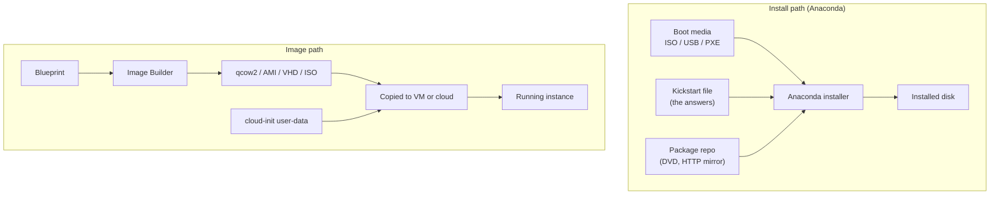
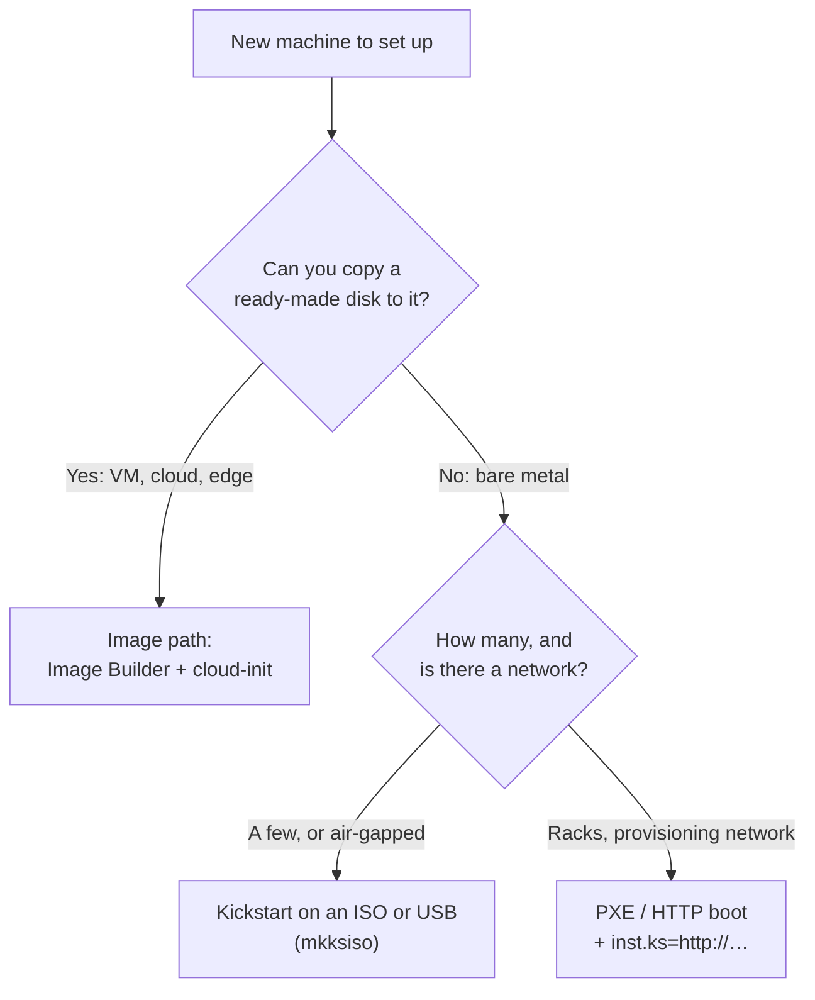
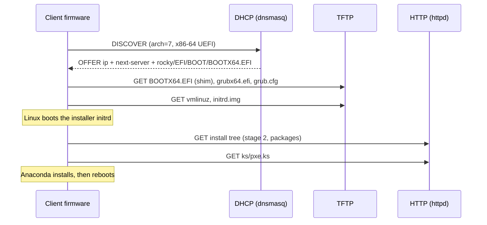
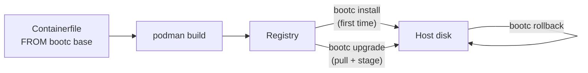

# 23 · Automated Installs: Kickstart, PXE and Image Builder

<ul class="module-meta">
  <li>⏱ ~3.5 hours</li>
  <li>5 labs</li>
  <li>Builds on: 09 · Disks and Filesystems, 10 · LVM, RAID and Encryption, 11 · Networking, 14 · The Boot Process</li>
</ul>

Installing one server by clicking through the installer takes twenty minutes. Installing fifty that way takes a week, and no two of them come out quite the same. Every serious Rocky Linux shop automates this: a text file describes the machine, the installer reads it, and the result is identical every time. This module shows you the whole toolbox, from a single kickstart file to booting bare metal over the network, building golden images, and configuring cloud instances at first boot.

!!! abstract "What you'll learn"
    - How the Anaconda installer works, where it logs, and how to debug it mid-install
    - Read and write kickstart files: partitioning with LVM, packages, users, network, `%pre` and `%post`
    - Validate kickstarts with `ksvalidator` before they waste an install
    - Deliver a kickstart over HTTP, on an `OEMDRV` volume, or baked into an ISO with `mkksiso`
    - Explain the PXE and UEFI HTTP boot sequence, and build a working PXE server with dnsmasq
    - Build disk images with Image Builder, and configure cloud images with cloud-init
    - Choose the right method for bare metal, VMs, cloud and edge

## The big picture

### Automated installs in one sentence

Here is the whole idea:

> **Either an installer follows an answer sheet to build the machine from packages, or a finished disk is copied onto the machine and filled in with its name and keys at first boot.**

The answer sheet is the **kickstart**. The installer is **Anaconda**. The finished disk is an **image**, made by **Image Builder**. The "fill in the name and keys" step is **cloud-init**. Everything else in this module (PXE, `mkksiso`, `OEMDRV`) is just a way of getting the installer and its answer sheet to the machine.

!!! analogy "Think of it like furnishing houses"
    The install path is a builder with a checklist: same checklist, same house, every time, but the builder works on site and it takes a while. The image path is a prefab house trucked in whole; on arrival someone puts the family's name on the mailbox and hands over the keys.

    Where the analogy breaks: both paths are fully automatic. The difference is *when* the work happens (on every machine vs once, ahead of time) and what you need on site (an installer and package repo vs only the image).

There are two fundamentally different ways to get Rocky onto a machine:

1. **Install**: boot an installer, which partitions the disk and installs packages one by one. **Kickstart** automates the installer's answers. **PXE** delivers the installer over the network.
2. **Deploy an image**: build a finished disk image once, then copy it onto many machines. **Image Builder** makes the images; **cloud-init** personalises each copy at first boot (hostname, users, SSH keys).



| Method | Best for | Speed per machine | Personalisation |
|---|---|---|---|
| Kickstart from ISO or USB | A handful of physical servers, air-gapped sites | Minutes | In the kickstart |
| PXE / HTTP boot + kickstart | Racks of bare metal | Minutes, fully hands-off | Kickstart, per-MAC configs |
| Image Builder images | VM templates, cloud images, edge | Seconds (copy a disk) | cloud-init or blueprint |
| Vendor cloud images + cloud-init | AWS, Azure, GCP, OpenStack | Seconds | cloud-init user-data |

### Three questions decide every automated install

| Question | Install path answer | Image path answer |
|---|---|---|
| **1. How does the machine start the process?** | Boot media (ISO, USB) or the network (PXE, UEFI HTTP boot) | Copy the image to a disk or upload it to the cloud |
| **2. Where do the answers come from?** | A kickstart, found through `inst.ks=`, an `OEMDRV` volume, or embedded with `mkksiso` | The blueprint (baked in) plus cloud-init user-data (per instance) |
| **3. What makes this machine different from its siblings?** | Per-host kickstarts, or `%pre` + `%include` | cloud-init: hostname, users, SSH keys |



### Words you'll see

| Word | Plain meaning |
|---|---|
| **Anaconda** | The Rocky installer program |
| **kickstart** | A text file of answers for Anaconda, so nobody has to click |
| **`inst.*` options** | Boot options that tell the installer what to do (`inst.ks=`, `inst.repo=`) |
| **stage 2** | The installer's own root filesystem, loaded into RAM |
| **`%pre` / `%post`** | Shell scripts in a kickstart, run before installing / after installing |
| **PXE** | Firmware feature that boots a machine from the network |
| **TFTP** | The tiny, slow file transfer PXE uses to fetch the first boot files |
| **blueprint** | The TOML recipe Image Builder turns into a disk image |
| **cloud-init** | A service in the image that applies per-machine settings at first boot |
| **user-data** | The per-machine settings cloud-init reads |

## How Anaconda works

**Anaconda** is the Rocky Linux installer (the same one RHEL and Fedora use). It is a Python program that runs from a small live environment loaded into RAM. Knowing its moving parts makes kickstart problems much easier to debug.

<div class="layers" data-open="0" data-hint="Click a layer to see what it does during an install." markdown>

<div class="layer" data-label="User interface" data-tag="GUI / text / kickstart" markdown>

The graphical interface, the text interface (`inst.text`), or no interaction at all when a complete kickstart is supplied. The UI only collects answers; it doesn't install anything itself.

</div>

<div class="layer" data-label="Anaconda modules" data-tag="D-Bus services" markdown>

Separate services for each area, talking over a private D-Bus: **Storage** (partitioning via blivet), **Payloads** (package installation via DNF), **Network**, **Users**, **Security** (SELinux), **Timezone**, **Localization**, **Services**. A kickstart file is parsed and each section is handed to the module that owns it.

</div>

<div class="layer" data-label="Stage 2 image" data-tag="install.img / squashfs" markdown>

The installer's own root filesystem: Anaconda, Python, DNF, storage tools. Fetched from the boot media or from the network (`inst.stage2=` or `inst.repo=`) and mounted in RAM.

</div>

<div class="layer" data-label="initrd (dracut)" data-tag="initrd.img" markdown>

The early boot environment ([module 14](14-the-boot-process.md)). Brings up the network if needed (`ip=`), finds the stage 2 image and the kickstart, and switches into the installer environment.

</div>

<div class="layer" data-label="Kernel" data-tag="vmlinuz" markdown>

The same Rocky kernel you install, booted with installer options (`inst.*`) on the command line.

</div>

</div>

### Watching an install from the inside

During an install, Anaconda runs inside **tmux** on the first console. Press ++ctrl+b++ then a number to switch windows: one is the main installer, one is a root shell, others show logs. You can also switch to another virtual console with ++ctrl+alt+f2++.

| Log (during install) | What's in it |
|---|---|
| `/tmp/anaconda.log` | The main story: what Anaconda is doing |
| `/tmp/storage.log` | Disk detection and partitioning decisions |
| `/tmp/packaging.log` and `/tmp/dnf.librepo.log` | Repo setup and package downloads |
| `/tmp/program.log` | Every external command run (mkfs, lvcreate, …) |
| `/tmp/ks-script-*.log` | Output of `%pre`/`%post` scripts (if you don't set `--log`) |

### Reading a failed install: which log?

This is the most useful skill for kickstart work. When an unattended install stops or goes wrong, fit the problem into one sentence, then open the one log that covers it:

> **"The install went wrong while `<storage / packages / a script / fetching the kickstart>`, so I read `<that log>`."**

The table above is the map: disks go to `storage.log`, packages to `packaging.log`, commands like `mkfs` to `program.log`, scripts to their `--log` file or `ks-script-*.log`, and the overall story to `anaconda.log`.

**Practise.** Pick the log before opening the answer.

**Problem A:** the installer stops before any packages are installed, complaining about the partitioning you asked for.

??? success "Answer A"
    "It went wrong while partitioning, so I read `/tmp/storage.log`." It shows which disks Anaconda saw and their sizes. Usually the `logvol --size=` values add up to more than the disk, or `ignoredisk --only-use=` points at a smaller disk than you expected.

**Problem B:** the install finishes, but `nginx` isn't installed.

??? success "Answer B"
    "It went wrong while installing packages, so I read `/tmp/packaging.log` (or `/var/log/anaconda/packaging.log` on the installed system)." Look for the repo setup and whether `nginx` was found. A missing `repo --name=AppStream` line is the classic cause when `url` points at BaseOS only.

**Problem C:** the install finishes, but a file your `%post` should have written is missing.

??? success "Answer C"
    "It went wrong in a script, so I read the `%post` log." If you set `%post --log=/root/ks-post.log`, read that on the new system. Otherwise look for `ks-script-*.log` in `/var/log/anaconda/`. See the quiz under "%pre, %post and %include" for the usual causes.

??? question "Under the hood: where the kickstart lives during an install"
    The kickstart is fetched twice over. Dracut's Anaconda module in the initrd reads `inst.ks=`, brings up the network if needed, downloads the file and saves it as `/run/install/ks.cfg`. Anaconda then parses that copy, and `%include` files are read *after* `%pre` has run, which is what makes the "generate a snippet in `%pre`" trick work. From the tmux shell (++ctrl+b++ then ++2++) you can `cat /run/install/ks.cfg` to see exactly what the installer received, which settles any "did it fetch the old version from the cache?" argument.

After installation, Anaconda copies these to `/var/log/anaconda/` on the new system. It also writes **`/root/anaconda-ks.cfg`**: a kickstart that reproduces the install you just did, whether you clicked through the GUI or not. It is the best starting point for writing your own.

!!! version "Rocky 9 vs 10"
    Remote graphical installs on Rocky 10 use **RDP** (`inst.rdp`, port 3389) instead of VNC, and the `vnc` kickstart command is deprecated. Several commands and options are removed outright: `timezone --ntpservers` and `--nontp` (use the separate `timesource` command), `timezone --isUtc` (use `--utc`), the `auth`/`authconfig` commands (use `authselect`), `pwpolicy`, and the `%anaconda` section. Check old kickstarts with `ksvalidator` (below) before reusing them.

## Kickstart, line by line

A **kickstart** file is a plain text file of installer commands, followed by optional sections (`%packages`, `%pre`, `%post`) that each end with `%end`. Here is a realistic one for a Rocky 10 server; the numbered notes below it explain the key lines:

```bash title="web01.ks"
# --- Installation source and mode ---
text
url --url=https://dl.rockylinux.org/pub/rocky/10/BaseOS/x86_64/os/
repo --name=AppStream --baseurl=https://dl.rockylinux.org/pub/rocky/10/AppStream/x86_64/os/

# --- Localisation ---
lang en_US.UTF-8
keyboard --vckeymap=us
timezone Etc/UTC --utc
timesource --ntp-server=pool.ntp.org

# --- Network ---
network --bootproto=dhcp --device=link --activate --hostname=web01.example.com

# --- Accounts ---
rootpw --lock
user --name=alex --groups=wheel --iscrypted --password='$6$Qx1…'
sshkey --username=alex "ssh-ed25519 AAAAC3Nza… alex@laptop"

# --- Security and services ---
selinux --enforcing
firewall --enabled --service=ssh
services --enabled=chronyd,sshd
firstboot --disable

# --- Storage ---
ignoredisk --only-use=vda
zerombr
clearpart --all --initlabel --drives=vda
reqpart --add-boot
part pv.01 --size=1 --grow --ondisk=vda
volgroup rl pv.01
logvol /     --vgname=rl --name=root --fstype=xfs --size=10240
logvol /var  --vgname=rl --name=var  --fstype=xfs --size=8192
logvol /home --vgname=rl --name=home --fstype=xfs --size=2048
logvol swap  --vgname=rl --name=swap --size=2048
bootloader --timeout=5

reboot

%packages --exclude-weakdeps
@^minimal-environment
nginx
vim-enhanced
-iwl*-firmware
%end

%post --log=/root/ks-post.log
systemctl enable nginx
firewall-offline-cmd --add-service=http
echo "Built by kickstart on $(date -I)" > /etc/motd
%end
```

1. `text`: Use the text UI. With a complete kickstart nothing is asked anyway; `text` avoids needing a graphical console.
2. `url` and `repo`: Where to get packages. An HTTP(S) URL, an NFS share (`nfs --server=… --dir=…`), or `cdrom` for the ISO. AppStream must be added as a second `repo` when you point at a single BaseOS URL. If the URL is the root of a DVD tree, Anaconda reads `.treeinfo` and adds AppStream itself.
3. `timesource --ntp-server=pool.ntp.org`: Rocky 10 syntax for NTP servers. `timezone --ntpservers` no longer exists.
4. `network --bootproto=dhcp --device=link …`: `--device=link` means "the first interface with a link". You could name a device or a MAC address instead.
5. `rootpw --lock`: Lock root's password: log in as `alex` and use sudo. If you do want a root password, use `rootpw --iscrypted '$6$…'`, and add `--allow-ssh` only if root must log in over SSH with a password.
6. `ignoredisk --only-use=vda`: Protect every other disk. Without this, `clearpart --all` could wipe a data disk or a SAN LUN that happened to be visible.
7. `clearpart --all --initlabel --drives=vda`: Wipe all partitions on `vda` and create a new partition table.
8. `reqpart --add-boot`: Create whatever platform-specific partitions the machine needs (EFI System Partition on UEFI, `biosboot` on BIOS with GPT) plus a separate `/boot`. This makes one kickstart work on both firmware types.
9. `reboot`: Reboot when done. Without it, the installer waits for a key press, which defeats the point. Use `reboot --eject` with physical media.
10. `%packages --exclude-weakdeps`: Package selection. `@^minimal-environment` is an **environment group** (the `^`); `@name` is a group; `-name` excludes. `--exclude-weakdeps` skips "Recommends" to keep the install small.
11. `%post --log=/root/ks-post.log`: Runs in the **installed system** (chrooted) after packages are installed. The log option is the first thing to add when a `%post` misbehaves.

!!! tip "Generate the password hash"
    `openssl passwd -6` prompts for a password and prints a SHA-512 crypt hash for `--iscrypted`. Never put clear-text passwords (`--plaintext`) in a kickstart that lives on a web server.

### %pre, %post and %include

The sections run at different times and in different places:

| Section | When | Where | Typical use |
|---|---|---|---|
| `%pre` | Before the kickstart's storage and other commands are applied | The installer environment | Inspect hardware, generate parts of the kickstart |
| `%pre-install` | After partitioning, before packages | Installer environment, new disks mounted under `/mnt/sysroot` | Rarely needed |
| `%post` | After packages are installed | Chroot of the new system | Configure, enable, register |
| `%post --nochroot` | After packages | Installer environment, new system at `/mnt/sysroot` | Copy files from the installer media into the new system |

The classic trick is a `%pre` that writes a snippet, which the main kickstart then pulls in with `%include`. For example, choose the disk at install time:

```bash title="Dynamic disk selection"
%include /tmp/disk.ks

%pre --log=/tmp/pre.log
# Pick the first non-removable disk the kernel sees (vda, sda or nvme0n1)
DISK=$(lsblk -dno NAME,TYPE,RM | awk '$2=="disk" && $3=="0" {print $1; exit}')
cat > /tmp/disk.ks <<EOF
ignoredisk --only-use=${DISK}
clearpart --all --initlabel --drives=${DISK}
EOF
%end
```

### Example: the agent that never arrived

**Symptom.** Twenty servers installed from the same kickstart. Every one is missing `my-agent`, which `%post` installs with `dnf install -y my-agent`. No error appeared on screen.

**Evidence.** Add `--log` to `%post`, reinstall one test VM, and read the log on the new system:

```console
$ sudo cat /root/ks-post.log
```

**Reasoning.** `%post` runs chrooted in the new system, after `%packages`. Whatever the log says, the agent's repo or the network it needs inside that chroot is the likely gap: a kickstart `repo` line is used by the installer, and is only copied into the new system if you add `--install` ("Install this repository to the target system so that it can be used after reboot", in the pykickstart docs). So `dnf` inside `%post` may not know where `my-agent` lives.

**Fix.** Install the agent where Anaconda already knows the repos: add a `repo` line for the agent's repository and list `my-agent` in `%packages`.

**Check.** After the next test install, `rpm -q my-agent` shows the package and `/root/ks-post.log` no longer needs to do the work.

### Validate before you install

**ksvalidator**, from the `pykickstart` package, parses a kickstart the same way Anaconda does and reports syntax errors, removed commands and deprecated options. It does not check that your disks or URLs exist.

```console
$ sudo dnf install pykickstart
$ ksvalidator -v RHEL10 web01.ks

Checking kickstart file web01.ks

$ echo $?
0
$ ksvalidator -v RHEL10 old-rocky8.ks

Checking kickstart file old-rocky8.ks

The following problem occurred on line 7 of the kickstart file:

… auth … has been removed …
$ echo $?
1
```

`-v RHEL10` picks the syntax version for Rocky 10 (Rocky uses the RHEL versions). `ksvalidator -l` lists the versions your pykickstart knows. It always prints a `Checking kickstart file` header; the exit code is the number of problems found.

<div class="quiz" data-answer="3" markdown>

A kickstart's `%post` script runs `dnf install -y my-agent`, but the agent is missing after install and there is no error on screen. What should you do first?

- Move the command to `%pre`
- Add `--nochroot` to `%post`
- Add `--log=/root/ks-post.log` to `%post`, reinstall, and read the log
- Add `my-agent` to `%packages` with a `-` in front

Right. Script output is otherwise easy to miss. With a log you'll likely see the real cause (for example, the repo for `my-agent` isn't configured in the new system, or there's no network in the chroot). Adding the package to `%packages` with a matching `repo` line is usually the better fix.

</div>

## Delivering the kickstart

Anaconda finds a kickstart through the **`inst.ks=`** boot option, or automatically on a volume labelled `OEMDRV`.

| Method | Boot option | When to use |
|---|---|---|
| HTTP/HTTPS | `inst.ks=http://10.0.0.5/ks/web01.ks` | Network installs, PXE, central management |
| NFS | `inst.ks=nfs:10.0.0.5:/exports/ks/web01.ks` | Existing NFS infrastructure |
| A labelled volume | `inst.ks=hd:LABEL=KS:/web01.ks` | USB stick next to the installer |
| `OEMDRV` volume | none: Anaconda looks for `ks.cfg` on a volume labelled `OEMDRV` | Hands-off installs where you can't edit boot options (attach a small virtual disk or USB) |
| Embedded in the ISO | added by `mkksiso` | Air-gapped sites, one custom ISO per role |

To add a boot option by hand, press ++e++ on the installer's boot menu entry (UEFI) and append it to the `linux` line, then press ++ctrl+x++.

Other boot options you will use alongside `inst.ks`:

| Option | Purpose |
|---|---|
| `inst.repo=URL` | Where the installation tree is (also locates stage 2) |
| `inst.stage2=URL` | Only the installer image, when packages come from elsewhere |
| `ip=dhcp` or `ip=10.0.0.20::10.0.0.1:255.255.255.0:web01:enp1s0:none` | Network in the initrd, needed to fetch the kickstart |
| `inst.text` | Text mode |
| `inst.sshd` | Start an SSH server in the installer for remote debugging |
| `inst.rdp` | Remote graphical install over RDP (Rocky 10) |
| `console=ttyS0` | Serial console (handy for VMs) |

### Embedding a kickstart into an ISO with mkksiso

`mkksiso`, from the `lorax` package, takes an official Rocky ISO and a kickstart and writes a new ISO whose boot menu already contains `inst.ks=`. Boot it and the install runs unattended. Run it as root, on the same architecture as the ISO.

```console
$ sudo dnf install lorax
$ sudo mkksiso --ks web01.ks Rocky-10.2-x86_64-minimal.iso web01-auto.iso
…
$ ls -lh web01-auto.iso
-rw-r--r--. 1 root root 1.8G Oct 15 10:22 web01-auto.iso
```

Use `-c "console=ttyS0"` to append extra kernel arguments, and `--add DIR` to put extra files (for example, your own RPM repo) on the ISO, reachable from the kickstart at `file:///run/install/repo/DIR`.

<div class="quiz" data-answer="2" markdown>

You must install 20 servers at a site with no network access to your HTTP server, and the remote hands can only plug in a USB stick and power on. Which delivery fits best?

- `inst.ks=http://…` typed at the boot menu
- A custom ISO made with `mkksiso`, written to the USB stick
- PXE boot
- cloud-init NoCloud

Yes. Everything (installer, packages from the ISO, kickstart) travels on the stick, and nobody has to type boot options.

</div>

## Network boot: PXE and UEFI HTTP boot

To install racks of servers without touching media at all, the machines boot the installer from the network. **PXE** (Preboot eXecution Environment) is the firmware feature that does this: the network card asks DHCP where to boot from, then downloads a boot loader over **TFTP** (Trivial File Transfer Protocol, a very simple, slow, unauthenticated file transfer). Modern UEFI firmware also supports **UEFI HTTP boot**, which downloads the boot loader over HTTP instead: faster and easier to route.

Step through a UEFI PXE install:

<div class="stepper" markdown>

<div class="step" data-title="Power on" markdown>

The firmware's boot order puts the network first (or someone picks "Network boot" once). The NIC's UEFI driver starts the PXE client.

</div>

<div class="step" data-title="DHCP discover" markdown>

The client broadcasts a DHCP request that includes **option 93**, the client architecture: `7` for x86-64 UEFI PXE (a few firmwares send `9` instead), `16` for x86-64 UEFI HTTP boot, `0` for legacy BIOS. This is how one DHCP server can hand each machine the right boot file.

</div>

<div class="step" data-title="DHCP offer" markdown>

The server answers with an IP address plus where to boot from: the **next-server** (TFTP server address) and the **boot file name** (option 67), for example `rocky/EFI/BOOT/BOOTX64.EFI`. For HTTP boot the file name is a full URL.

</div>

<div class="step" data-title="shim and GRUB" markdown>

The firmware downloads `BOOTX64.EFI`, which is **shim** (signed by Microsoft, so Secure Boot works; see [module 21](21-inside-rocky-linux.md#secure-boot-the-chain-before-the-os)). Shim loads `grubx64.efi` from the same directory. GRUB then fetches its `grub.cfg` from that same TFTP directory (here `rocky/EFI/BOOT/`).

</div>

<div class="step" data-title="Kernel and initrd" markdown>

The GRUB menu entry loads `vmlinuz` and `initrd.img` (from `images/pxeboot/` on the Rocky ISO) over TFTP or HTTP, with boot options such as `inst.repo=` and `inst.ks=`.

</div>

<div class="step" data-title="Stage 2 and kickstart" markdown>

The initrd brings up the network (DHCP again, this time from Linux), downloads the installer image via `inst.repo`, and fetches the kickstart from `inst.ks`. All over HTTP.

</div>

<div class="step" data-title="Install and reboot" markdown>

Anaconda installs from the repo, runs `%post`, and reboots. The firmware tries the network again: make sure the boot order then falls through to the disk (or have `%post` set it with `efibootmgr`), or the machine will reinstall itself in a loop.

</div>

</div>



??? question "Under the hood: how one PXE server gives each machine its own menu"
    GRUB's network boot does not ask for `grub.cfg` straight away. It tries a series of more specific names in its directory first: `grub.cfg-01-` followed by the client's MAC address (lower case, dashes), then the client's IP address in upper-case hex, dropping one hex digit at a time (`grub.cfg-C0A8646E`, `grub.cfg-C0A8646`, …), and only then plain `grub.cfg`. Drop a file named `grub.cfg-01-52-54-00-ab-cd-ef` next to the default and that one machine gets its own kernel arguments, for example a different `inst.ks=` for its role. With `log-dhcp` and dnsmasq's TFTP logging you can watch the client walk through the list.

!!! note "dnsmasq or Kea?"
    Rocky 10 no longer ships the old ISC `dhcp-server`; the full-featured DHCP server is **Kea**, which Red Hat's own network-boot documentation uses. For a lab or a small install network, **dnsmasq** is far simpler: one config file gives you DHCP, PXE options and a built-in TFTP server. The lab below uses dnsmasq.

!!! danger "Never run a PXE DHCP server on a shared network"
    A second DHCP server on an office or data-centre LAN hands out wrong addresses and can make machines boot (and wipe themselves with `clearpart --all`) from your install server. Build PXE labs on an **isolated** virtual network, and in production on a dedicated provisioning VLAN.

<div class="quiz" data-answer="1" markdown>

One dnsmasq server must boot both UEFI and legacy BIOS clients. What lets it hand each a different boot file?

- The DHCP client architecture option (93), matched with `dhcp-match`
- The client's MAC address prefix
- TFTP negotiates the architecture after the download
- GRUB detects it and redirects

Correct. UEFI x86-64 PXE clients send architecture 7 (16 for HTTP boot), BIOS clients send 0, and the server tags them and offers different file names.

</div>

## Image Builder: golden images

Installing package by package is slow and has many moving parts at deploy time. The alternative is to build a finished disk image once and copy it. **Image Builder** (the `osbuild-composer` service, driven by `composer-cli` or Cockpit) builds images from a short description called a **blueprint**, using **osbuild** pipelines. It runs on a Rocky host and builds Rocky images of the same major version.

The osbuild project documents these image types for Rocky 10 (check your host with `composer-cli compose types`):

| Type | Output | Use |
|---|---|---|
| `qcow2` | QEMU disk image | KVM, OpenStack, libvirt templates |
| `ami` | Raw image for AWS | Import into EC2 |
| `vhd` | Hyper-V/Azure disk | Azure, Hyper-V |
| `image-installer` | Bootable ISO that writes the image to disk | Bare metal without PXE |
| `minimal-raw-xz` | Compressed raw disk | Small devices, edge |

```toml title="web.toml"
name = "web"
description = "Rocky 10 nginx server"
version = "0.0.1"

[[packages]]
name = "nginx"
version = "*"

[[packages]]
name = "cloud-init"
version = "*"

[customizations]
hostname = "web-template"

[[customizations.user]]
name = "alex"
key = "ssh-ed25519 AAAAC3Nza… alex@laptop"
groups = ["wheel"]

[customizations.services]
enabled = ["nginx", "sshd"]

[customizations.firewall.services]
enabled = ["ssh", "http"]
```

```console
$ sudo dnf install osbuild-composer composer-cli
$ sudo systemctl enable --now osbuild-composer.socket
$ sudo usermod -aG weldr $USER        # then log in again
$ composer-cli blueprints push web.toml
$ composer-cli blueprints depsolve web | head -3
blueprint: web v0.0.1
    nginx-…
    …
$ composer-cli compose start web qcow2
Compose 6b1c3f2e-7a4d-4b59-9a2b-0c5e8d1f9e21 added to the queue
$ composer-cli compose status
6b1c3f2e-7a4d-4b59-9a2b-0c5e8d1f9e21 RUNNING  Thu Oct 15 10:41:07 2026 web 0.0.1 qcow2
$ composer-cli compose image 6b1c3f2e-7a4d-4b59-9a2b-0c5e8d1f9e21
6b1c3f2e-7a4d-4b59-9a2b-0c5e8d1f9e21-disk.qcow2
```


!!! note "Front ends are changing"
    Upstream osbuild also offers a newer, service-free `image-builder` command-line tool that builds directly from a blueprint, and Red Hat documents it for RHEL 10.2. Rocky 10 ships it in AppStream as the `image-builder` package; the `composer-cli` workflow above is the established one. In the web console, `cockpit-image-builder` replaces the deprecated `cockpit-composer`.

??? question "Under the hood: why images don't all end up with the same identity"
    A cloned disk carries everything in it, including `/etc/machine-id` and the SSH host keys. Image Builder and Rocky's cloud images avoid duplicates by shipping an **empty** `/etc/machine-id`: systemd sees it at first boot, generates a fresh ID and treats the boot as a first boot (`ConditionFirstBoot=`); images also ship without SSH host keys, and `sshd-keygen@.service` creates them when sshd first starts. If you build a template by hand from an installed VM instead, run `virt-sysprep` on it (or empty `/etc/machine-id` and delete `/etc/ssh/ssh_host_*`) before cloning, or every clone gets the same DHCP lease identity and the same host keys.

## cloud-init: personalising images at first boot

An image is identical everywhere, but every machine needs its own hostname, SSH keys and maybe a few packages. **cloud-init** runs early in the first boot, finds a **datasource** (the cloud's metadata service, or a small attached disk), reads the **user-data** you supplied, and applies it. Rocky's official GenericCloud images include cloud-init, as do the AWS, Azure and GCP images.

```yaml title="user-data"
#cloud-config
hostname: web02
fqdn: web02.example.com
users:
  - name: alex
    groups: wheel
    sudo: "ALL=(ALL) NOPASSWD:ALL"
    ssh_authorized_keys:
      - ssh-ed25519 AAAAC3Nza… alex@laptop
packages:
  - nginx
package_upgrade: true
runcmd:
  - systemctl enable --now nginx
  - firewall-cmd --permanent --add-service=http || true
```

cloud-init runs in stages tied to systemd units, so you can tell how far it got:

| Stage | systemd unit | What happens |
|---|---|---|
| Local | `cloud-init-local.service` | Find a local datasource, write network config |
| Network | `cloud-init.service` | Fetch metadata and user-data, set hostname, users, SSH keys |
| Config | `cloud-config.service` | Most modules: packages, files, NTP |
| Final | `cloud-final.service` | `runcmd`, scripts, "cloud-init finished" message |

```console
$ cloud-init status --long
status: done
extended_status: done
boot_status_code: enabled-by-generator
last_update: Thu, 15 Oct 2026 10:52:07 +0000
detail: DataSourceNoCloud [seed=/dev/sr0]
errors: []
recoverable_errors: {}
$ sudo cloud-init analyze show | tail -4
Finished stage: (modules-final) 18.20100 seconds

Total Time: 27.81300 seconds

```

When something goes wrong, read `/var/log/cloud-init.log` (detailed) and `/var/log/cloud-init-output.log` (output of your commands). Validate user-data before you use it with `cloud-init schema --config-file user-data`. To test changes on the same VM, `sudo cloud-init clean --logs --reboot` makes it run as a first boot again.

??? question "Under the hood: how cloud-init knows it is a first boot"
    cloud-init does not use a "has run" flag. Each datasource provides an **instance ID** (in a cloud, the VM's ID; in NoCloud, the `instance-id` in `meta-data`). cloud-init caches it in `/var/lib/cloud/data/instance-id`. Per-instance modules (users, SSH keys, `runcmd`, `packages`) run only when the current instance ID differs from the cached one. That is why a cloned VM with a new instance ID is personalised again, why editing user-data on an existing VM does nothing until you change `instance-id` or run `cloud-init clean`, and why `/var/lib/cloud/instances/<id>/` keeps a per-instance history you can read after the fact.

**NoCloud** is the datasource for "no cloud at all": cloud-init reads `user-data` and `meta-data` from a small ISO or disk labelled `cidata`. It is perfect for testing cloud images on plain KVM.

<div class="quiz" data-answer="4" markdown>

A VM from a cloud image boots, but your user and SSH key from user-data are missing. `cloud-init status` says `status: done` and `detail: DataSourceNone`. What happened?

- The user-data YAML has a syntax error
- cloud-init is disabled
- The `runcmd` failed
- cloud-init found no datasource, so it ran without your user-data (for example, the seed ISO wasn't attached or isn't labelled `cidata`)

Right. `DataSourceNone` is the fallback when nothing was found. Check the seed volume's label (`blkid`) and that it's attached to the VM.

</div>

## Image mode and bootc

A newer approach treats the whole operating system as a container image. In **image mode**, you write a `Containerfile` starting `FROM` a **bootable container** base image (one that includes a kernel and systemd), build it with Podman, and push it to a registry. The **bootc** tool installs that image to disk and later updates the host by pulling a newer image, with the previous version kept for rollback. The filesystem is mostly read-only; `/etc` and `/var` stay writable.

```dockerfile title="Containerfile (pattern)"
FROM <bootc base image for your EL 10 distribution>
RUN dnf -y install nginx && dnf clean all && systemctl enable nginx
COPY motd /etc/motd
```

```console
$ sudo bootc status        # which image the host runs, and the rollback image
$ sudo bootc upgrade       # fetch and stage a newer image; applied at reboot
$ sudo bootc rollback      # boot the previous image next time
```

Red Hat supports image mode for RHEL 10, and CentOS Stream publishes bootc base images. For Rocky Linux, check the current status before planning around it. At the time of writing, Rocky's **SIG/Containers** publishes `rocky-bootc` images for 10 in the container registry on git.resf.org (some tags still marked test), community projects publish their own, and commercial vendors (for example CIQ) offer supported bootc images. Until a Rocky release announcement calls one official, treat bootc images as SIG content, not part of the core distribution.



## Which install method fits?

<div class="decision" markdown>

<div class="node" data-id="start" markdown>

**Where will the machines run?**

<button data-goto="cloud">Public or private cloud</button> <button data-goto="vm">Local VMs (KVM, VMware)</button> <button data-goto="metal">Bare metal</button>

</div>

<div class="node" data-id="cloud" markdown>

**Use Rocky's official cloud images plus cloud-init user-data.** If you need extra packages or hardening baked in, build your own AMI/VHD/qcow2 with Image Builder and still use cloud-init for per-instance settings.

</div>

<div class="node" data-id="vm" markdown>

**Do you create VMs often and want them identical?**

<button data-goto="vmtemplate">Yes, many VMs</button> <button data-goto="vmfew">Only a few</button>

</div>

<div class="node" data-id="vmtemplate" markdown>

**Build a qcow2 template with Image Builder (or start from the GenericCloud image) and personalise each clone with cloud-init NoCloud.** Cloning a disk is much faster than reinstalling.

</div>

<div class="node" data-id="vmfew" markdown>

**Kickstart.** Pass `inst.ks=http://…` to `virt-install --location … --extra-args`, or attach an `OEMDRV` disk. Keep the kickstart in Git.

</div>

<div class="node" data-id="metal" markdown>

**Is there a provisioning network you control?**

<button data-goto="pxe">Yes</button> <button data-goto="nonet">No (remote site, air gap)</button>

</div>

<div class="node" data-id="pxe" markdown>

**PXE or UEFI HTTP boot with kickstart.** Use per-MAC GRUB configs or per-host kickstarts for roles. Make sure machines boot from disk after install.

</div>

<div class="node" data-id="nonet" markdown>

**A custom ISO from `mkksiso`** (installer plus kickstart), or an Image Builder `image-installer` ISO if you want an identical image on every box.

</div>

</div>

## Practice

<div class="terminal-sim" data-title="Prepare an automated install" data-prompt="[alex@rocky-lab ~]$ " markdown>

<div class="task" data-expect="sudo cat /root/anaconda-ks.cfg||sudo less /root/anaconda-ks.cfg" data-match="^sudo (cat|less|head) /root/anaconda-ks\.cfg$" data-hint="Anaconda left a kickstart of this install in root's home directory." markdown>

**Step 1.** Show the kickstart Anaconda generated for this machine.

```text
# Generated by Anaconda 40.22.3
# Generated by pykickstart v3.52
#version=RHEL10
# Use graphical install
graphical
…
```

</div>

<div class="task" data-expect="ksvalidator -v RHEL10 web01.ks" data-match="^ksvalidator (-v RHEL10 )?web01\.ks$" data-hint="ksvalidator checks syntax. Use -v RHEL10 to select the Rocky 10 syntax." markdown>

**Step 2.** Validate `web01.ks` for Rocky 10 syntax.

```text
Checking kickstart file web01.ks
(nothing else: the file is valid)
```

</div>

<div class="task" data-expect="openssl passwd -6" data-hint="openssl passwd with -6 makes a SHA-512 crypt hash." markdown>

**Step 3.** Create a SHA-512 password hash for the `user --iscrypted` line.

```text
Password:
Verifying - Password:
$6$J4sQ9a…
```

</div>

<div class="task" data-expect="sudo mkksiso --ks web01.ks Rocky-10.2-x86_64-minimal.iso web01-auto.iso" data-match="^sudo mkksiso (--ks )?web01\.ks Rocky-10\.2-x86_64-minimal\.iso web01-auto\.iso$" data-hint="sudo mkksiso --ks KICKSTART INPUT.iso OUTPUT.iso" markdown>

**Step 4.** Embed `web01.ks` into `Rocky-10.2-x86_64-minimal.iso`, writing `web01-auto.iso`.

```text
…
Writing to 'stdio:web01-auto.iso' completed successfully.
```

</div>

<div class="task" data-expect="cloud-init status --long||cloud-init status" data-hint="cloud-init has a status subcommand." markdown>

**Step 5.** On a cloud VM, check whether cloud-init finished.

```text
status: done
```

</div>

</div>

## Labs

All labs use KVM with libvirt on a Rocky 10 host (see [module 27](27-virtualization-kvm.md)). Install the tools first: `sudo dnf install virt-install libvirt qemu-kvm && sudo systemctl enable --now libvirtd`. Download a Rocky 10 ISO from rockylinux.org; the commands assume `/var/lib/libvirt/images/Rocky-10.2-x86_64-dvd1.iso` (adjust the name to the file you have).

!!! lab "Lab 1: From anaconda-ks.cfg to a validated kickstart"

    **Goal:** Turn the kickstart Anaconda generated into a reusable, validated file.

    **You'll need:** any installed Rocky 10 machine.

    1. Copy the generated kickstart and look at it:

        ```bash
        mkdir -p ~/ks && sudo cp /root/anaconda-ks.cfg ~/ks/base.ks && sudo chown $USER: ~/ks/base.ks
        grep -vE '^#|^$' ~/ks/base.ks
        ```

    2. Validate it as-is, then edit it toward the example in "Kickstart, line by line": replace `graphical` with `text`, add `reboot`, set `rootpw --lock`, add a user with a hash from `openssl passwd -6`, and add a `%post --log=/root/ks-post.log` section. Replace the storage lines (which describe *this* machine's disks) with the storage block from the example, so the file installs onto a blank 20 GB `vda`.

        ```bash
        sudo dnf install -y pykickstart
        ksvalidator -v RHEL10 ~/ks/base.ks
        ```

    3. Introduce two mistakes on purpose (add `auth --useshadow` and misspell `selinux` as `selinx`), validate again, read the errors, and fix them.

    **Check your work:** `ksvalidator -v RHEL10 ~/ks/base.ks` exits 0 and prints nothing after the `Checking kickstart file` line.

    ??? tip "Hint: \"Unknown command\""
        ksvalidator reports every problem it finds, each with its line number (add `-e` to stop at the first). Fix them, run again, and repeat until it's clean.

    **Clean up:** keep `~/ks/base.ks` for the next labs.

!!! lab "Lab 2: A completely unattended VM install"

    **Goal:** Install a VM without any interaction, using a kickstart delivered over the virt-install "initrd injection" feature, then the same with an ISO from `mkksiso`.

    **You'll need:** Lab 1's kickstart, adjusted to use `cdrom` as the source (replace any `url`/`repo` lines with `cdrom`) and to install on `vda`.

    1. Inject the kickstart into the installer's initrd and point Anaconda at it:

        ```bash
        sudo virt-install --name ks-test --memory 4096 --vcpus 2 \
          --disk size=20 --osinfo linux2022 --boot uefi \
          --location /var/lib/libvirt/images/Rocky-10.2-x86_64-dvd1.iso \
          --initrd-inject ~/ks/base.ks \
          --extra-args "inst.ks=file:/base.ks console=ttyS0" \
          --graphics none
        ```

        Watch the text install scroll past on the serial console. It reboots into the new system when done. Log in as your user.

    2. Inside the VM, confirm what the kickstart did:

        ```bash
        sudo cat /root/ks-post.log
        sudo ls /var/log/anaconda/
        lsblk; sudo vgs
        ```

    3. Back on the host, build a self-contained ISO instead and install a second VM from it, with no extra arguments at all:

        ```bash
        sudo dnf install -y lorax
        sudo mkksiso --ks ~/ks/base.ks -c "console=ttyS0" \
          /var/lib/libvirt/images/Rocky-10.2-x86_64-dvd1.iso /var/lib/libvirt/images/auto.iso
        sudo virt-install --name ks-iso --memory 4096 --vcpus 2 --disk size=20 \
          --osinfo linux2022 --boot uefi --cdrom /var/lib/libvirt/images/auto.iso --graphics none
        ```

    **Check your work:** both VMs install and reboot with no input. `/root/ks-post.log` exists in each, and the LVM layout matches the kickstart.

    ??? tip "Hint: the ISO boots to the normal menu and waits"
        If you don't see the install start, check that `mkksiso` finished without errors and that you booted the new ISO. `mkksiso` edits the boot menus and defaults; you can confirm by pressing ++e++ on the menu entry and looking for `inst.ks=` on the `linux` line.

    **Clean up:**
    `for v in ks-test ks-iso; do sudo virsh destroy $v; sudo virsh undefine $v --nvram --remove-all-storage; done; sudo rm -f /var/lib/libvirt/images/auto.iso` (press ++ctrl+bracket-right++ to leave a serial console first).

!!! lab "Lab 3: Build a PXE install server"

    **Goal:** Boot a blank UEFI VM from the network and have it install Rocky unattended.

    **You'll need:** two VMs on an **isolated** libvirt network: a Rocky 10 server (`pxe-server`) and a blank client. About 30 minutes.

    1. On the host, create an isolated network with no libvirt DHCP (no `<dhcp>`, no `<forward>`):

        ```bash
        cat > /tmp/pxenet.xml <<'EOF'
        <network>
          <name>pxenet</name>
          <bridge name='virbr-pxe'/>
          <ip address='192.168.100.254' netmask='255.255.255.0'/>
        </network>
        EOF
        sudo virsh net-define /tmp/pxenet.xml && sudo virsh net-start pxenet
        sudo virsh attach-interface pxe-server network pxenet --model virtio --config --live
        ```

    2. On `pxe-server`, give the new NIC a static address and install the services. Find the new NIC's name with `nmcli device` (it shows as `disconnected`); the commands below assume `enp7s0`, so substitute yours here and in the dnsmasq config:

        ```bash
        sudo nmcli con add type ethernet ifname enp7s0 con-name pxenet ipv4.method manual ipv4.addresses 192.168.100.1/24
        sudo nmcli con up pxenet
        sudo dnf install -y dnsmasq httpd
        ```

    3. Publish the install tree over HTTP and the boot files over TFTP (copy the ISO into the server VM first, for example with `scp`):

        ```bash
        sudo mkdir -p /var/www/html/rocky10 /var/www/html/ks /var/lib/tftpboot/rocky /var/lib/tftpboot/rocky10
        sudo mount -o loop,ro,context=system_u:object_r:httpd_sys_content_t:s0 ~/Rocky-10.2-x86_64-dvd1.iso /var/www/html/rocky10
        sudo cp -r /var/www/html/rocky10/EFI /var/lib/tftpboot/rocky/
        sudo cp /var/www/html/rocky10/images/pxeboot/{vmlinuz,initrd.img} /var/lib/tftpboot/rocky10/
        sudo chmod -R a+rX /var/lib/tftpboot
        ```

    4. Write the GRUB menu next to GRUB itself:

        ```bash
        sudo tee /var/lib/tftpboot/rocky/EFI/BOOT/grub.cfg <<'EOF'
        set timeout=5
        menuentry 'Install Rocky Linux 10 (kickstart)' {
          linux /rocky10/vmlinuz inst.repo=http://192.168.100.1/rocky10 inst.ks=http://192.168.100.1/ks/pxe.ks ip=dhcp
          initrd /rocky10/initrd.img
        }
        EOF
        ```

    5. Copy Lab 1's kickstart to `/var/www/html/ks/pxe.ks`, change its source line to `url --url=http://192.168.100.1/rocky10`, remove any `repo` lines, and make sure it has `reboot`. Then configure dnsmasq for DHCP and TFTP only:

        ```ini title="/etc/dnsmasq.d/pxe.conf"
        port=0
        interface=enp7s0
        bind-interfaces
        dhcp-range=192.168.100.100,192.168.100.150,1h
        dhcp-match=set:efi-x86_64,option:client-arch,7
        dhcp-match=set:efi-x86_64,option:client-arch,9
        dhcp-boot=tag:efi-x86_64,rocky/EFI/BOOT/BOOTX64.EFI,,192.168.100.1
        enable-tftp
        tftp-root=/var/lib/tftpboot
        log-dhcp
        ```

        `port=0` turns off dnsmasq's DNS server, so it only does DHCP and TFTP. The two `dhcp-match` lines tag x86-64 UEFI clients whichever architecture code (7 or 9) their firmware sends.

    6. Open the firewall, fix SELinux labels, and start everything:

        ```bash
        sudo firewall-cmd --zone=public --add-service={dhcp,tftp,http}
        sudo restorecon -R /var/lib/tftpboot /var/www/html/ks
        sudo systemctl enable --now dnsmasq httpd
        ```

    7. On the host, create a blank UEFI client that boots from the network:

        ```bash
        sudo virt-install --name pxe-client --memory 4096 --vcpus 2 --disk size=20 \
          --osinfo linux2022 --boot uefi --network network=pxenet --pxe --noautoconsole
        sudo virt-viewer pxe-client &
        ```

        On the server, follow along: `sudo journalctl -fu dnsmasq` and `sudo tail -f /var/log/httpd/access_log`.

    The `context=` mount option matters: files on an ISO 9660 filesystem have no SELinux labels of their own, and `restorecon` cannot relabel a read-only ISO, so without it httpd gets `Permission denied` on the install tree.

    **Check your work:** the dnsmasq log shows `DHCPACK` and TFTP `sent …/BOOTX64.EFI`, `grubx64.efi`, `vmlinuz`, `initrd.img`; the httpd log shows `GET /ks/pxe.ks` and package downloads; the client installs and reboots.

    ??? tip "Hint: client shows a grub> prompt"
        GRUB started but didn't find `grub.cfg`. The dnsmasq log lists every file GRUB asked for (it tries MAC- and IP-specific names first, then `grub.cfg`). Put your `grub.cfg` at the path it requests.

    ??? tip "Hint: the client reinstalls itself after rebooting"
        It boots from the network first every time. After the install, change the client's boot order with `sudo virt-xml pxe-client --edit --boot hd,network`, or stop dnsmasq.

    **Clean up:** on the host: `sudo virsh destroy pxe-client; sudo virsh undefine pxe-client --nvram --remove-all-storage; sudo virsh detach-interface pxe-server network --config` (add `--mac` if asked), `sudo virsh net-destroy pxenet; sudo virsh net-undefine pxenet`. On the server: `sudo systemctl disable --now dnsmasq httpd; sudo umount /var/www/html/rocky10; sudo rm -rf /var/lib/tftpboot/rocky* /var/www/html/rocky10 /var/www/html/ks /etc/dnsmasq.d/pxe.conf; sudo nmcli con delete pxenet; sudo firewall-cmd --reload`.

!!! lab "Lab 4: Configure a cloud image with a NoCloud seed"

    **Goal:** Boot Rocky's GenericCloud image locally and let cloud-init create your user, from a seed ISO you build yourself.

    **You'll need:** the Rocky 10 GenericCloud qcow2 image for x86_64 from the "Images" section of the Rocky download page (named like `Rocky-10-GenericCloud-Base.latest.x86_64.qcow2`), an SSH key pair.

    1. Make a copy-on-write disk based on the image, so the original stays clean:

        ```bash
        cd /var/lib/libvirt/images
        sudo qemu-img create -f qcow2 -F qcow2 -b Rocky-10-GenericCloud-Base.latest.x86_64.qcow2 ci-test.qcow2 20G
        ```

    2. Write `meta-data` and `user-data` (use your real public key):

        ```bash
        mkdir -p ~/seed && cd ~/seed
        printf 'instance-id: ci-test-001\nlocal-hostname: ci-test\n' > meta-data
        cat > user-data <<EOF
        #cloud-config
        users:
          - name: alex
            groups: wheel
            sudo: "ALL=(ALL) NOPASSWD:ALL"
            ssh_authorized_keys:
              - $(cat ~/.ssh/id_ed25519.pub)
        packages: [tmux]
        runcmd:
          - echo "seeded by NoCloud" > /etc/motd
        EOF
        cloud-init schema --config-file user-data 2>/dev/null || echo "(install cloud-init on the host to validate locally)"
        ```

    3. Build the seed ISO. The volume label **must** be `cidata`:

        ```bash
        sudo dnf install -y xorriso
        xorrisofs -output seed.iso -volid cidata -joliet -rock user-data meta-data
        sudo cp seed.iso /var/lib/libvirt/images/
        ```

    4. Boot the VM with both disks:

        ```bash
        sudo virt-install --name ci-test --memory 2048 --vcpus 2 --import \
          --disk /var/lib/libvirt/images/ci-test.qcow2 \
          --disk /var/lib/libvirt/images/seed.iso,device=cdrom \
          --osinfo linux2022 --network network=default --noautoconsole
        sudo virsh domifaddr ci-test        # wait a minute, then note the IP
        ssh alex@<IP>
        ```

    5. Inside the VM, look at what cloud-init did:

        ```bash
        cloud-init status --long
        sudo cloud-init analyze show | tail
        cat /etc/motd; rpm -q tmux
        sudo grep -i datasource /var/log/cloud-init.log | head -3
        ```

    **Check your work:** you can SSH in with your key; `cloud-init status` says `done` with a NoCloud datasource; `/etc/motd` and `tmux` are present.

    ??? success "What just happened?"
        cloud-init's `ds-identify` found a filesystem labelled `cidata`, read the two files, and ran its stages. In a real cloud, the same user-data would come from the metadata service instead. `virt-install --cloud-init user-data=FILE` can also build a seed for you; building it by hand shows there's no magic.

    **Clean up:** `sudo virsh destroy ci-test; sudo virsh undefine ci-test; sudo rm -f /var/lib/libvirt/images/{ci-test.qcow2,seed.iso}; rm -rf ~/seed`

!!! lab "Lab 5: Build a qcow2 image with Image Builder"

    **Goal:** Produce your own golden image from a blueprint and boot it.

    **You'll need:** a Rocky 10 VM or host with 4 GB+ RAM and ~10 GB free disk.

    1. Install and start Image Builder, and allow your user to use it:

        ```bash
        sudo dnf install -y osbuild-composer composer-cli
        sudo systemctl enable --now osbuild-composer.socket
        sudo usermod -aG weldr $USER && newgrp weldr
        composer-cli compose types
        ```

    2. Save the `web.toml` blueprint from this module (with your SSH key), push it, and check that its packages resolve:

        ```bash
        composer-cli blueprints push web.toml
        composer-cli blueprints depsolve web | head
        ```

    3. Build and download the image (this takes several minutes):

        ```bash
        composer-cli compose start web qcow2
        watch -n 10 composer-cli compose status
        composer-cli compose image <UUID>
        ```

    4. Boot it as a VM:

        ```bash
        sudo cp <UUID>-disk.qcow2 /var/lib/libvirt/images/web-img.qcow2
        sudo virt-install --name web-img --memory 2048 --vcpus 2 --import \
          --disk /var/lib/libvirt/images/web-img.qcow2 --osinfo linux2022 \
          --network network=default --noautoconsole
        ```

    **Check your work:** `composer-cli compose status` shows `FINISHED`; the VM boots, you can SSH in as `alex`, and `curl localhost` inside it returns the nginx test page.

    ??? tip "Hint: compose FAILED"
        `composer-cli compose log <UUID>` and `composer-cli compose logs <UUID>` (a tarball) show the osbuild output. Depsolve errors usually mean a package name in the blueprint doesn't exist in the host's enabled repos.

    **Clean up:** `sudo virsh destroy web-img; sudo virsh undefine web-img --remove-all-storage; composer-cli compose delete <UUID>; composer-cli blueprints delete web`

## Common pitfalls

| Symptom | Cause | Fix |
|---|---|---|
| Installer stops and waits at a screen | Kickstart is incomplete (missing a required answer) or has no `reboot` | Check `/tmp/anaconda.log` from the tmux shell; add the missing command |
| Kickstart worked on Rocky 8/9, fails on 10 | Removed commands and options (`auth`, `pwpolicy`, `timezone --ntpservers`) | `ksvalidator -v RHEL10` and update the syntax |
| A data disk was wiped | `clearpart --all` without `ignoredisk --only-use` | Always restrict disks; test on VMs first |
| `%post` silently did nothing | Errors only in a log nobody read; no network or repo in the chroot | `%post --log=…`; add packages to `%packages` instead |
| PXE client gets no IP | DHCP blocked by the firewall, wrong interface in dnsmasq, or libvirt's own DHCP on the network | `firewall-cmd --add-service=dhcp`; check `interface=`; use an isolated network without `<dhcp>` |
| PXE client gets an IP but no boot file | Architecture tag doesn't match (e.g. BIOS client, or HTTP boot sends 16) | Read `log-dhcp` output; add matching `dhcp-match`/`dhcp-boot` lines |
| Install fails fetching stage 2 | `inst.repo` URL wrong or not reachable from the initrd | Open the URL with `curl` from the server; check `ip=` |
| Machines reinstall in a loop | Network boot stays first in boot order | Set the order after install; remove the host's PXE entry |
| cloud-init ignores user-data | No datasource found (`DataSourceNone`), wrong seed label, missing `#cloud-config` first line | Label `cidata`; first line exactly `#cloud-config`; `cloud-init schema` |
| Clones share SSH host keys or machine-id | Image or VM cloned without generalising | Use cloud images, Image Builder images, or `virt-sysprep` on templates |

## Cheat sheet

| Command | What it does |
|---|---|
| `sudo cat /root/anaconda-ks.cfg` | Kickstart of the current install: a starting point |
| `ksvalidator -v RHEL10 FILE.ks` | Validate kickstart syntax for Rocky 10 |
| `openssl passwd -6` | SHA-512 hash for `--iscrypted` |
| `sudo mkksiso --ks FILE.ks IN.iso OUT.iso` | Embed a kickstart into an ISO (from `lorax`) |
| `virt-install --location ISO --initrd-inject FILE.ks --extra-args "inst.ks=file:/FILE.ks"` | Kickstart a VM without a web server |
| `inst.ks=http://…` | Boot option: where the kickstart is |
| `inst.repo=http://…` | Boot option: where the install tree is |
| `journalctl -fu dnsmasq` | Watch DHCP and TFTP during PXE |
| `composer-cli blueprints push FILE.toml` | Upload a blueprint |
| `composer-cli compose start NAME qcow2` | Build an image |
| `composer-cli compose image UUID` | Download the finished image |
| `xorrisofs -output seed.iso -volid cidata -joliet -rock user-data meta-data` | Build a NoCloud seed ISO |
| `cloud-init status --long` | Did cloud-init finish, and from which datasource? |
| `cloud-init analyze show` | Time spent in each stage |
| `sudo cloud-init clean --logs --reboot` | Re-run cloud-init as a first boot |
| `bootc status` | Image mode: which image the host runs |

## Flashcards

<div class="flashcards" markdown>

<div class="card" markdown>

Explain automated installs in one sentence.

Either Anaconda follows a kickstart (an answer sheet) to build the machine from packages, or a finished image is copied on and cloud-init fills in its name, users and keys at first boot.

</div>

<div class="card" markdown>

An unattended install fails while partitioning. Which log do you read?

`/tmp/storage.log` during the install (copied to `/var/log/anaconda/` afterwards).

</div>

<div class="card" markdown>

Where does Anaconda leave a kickstart of the install it just did?

`/root/anaconda-ks.cfg` on the installed system. Install logs are in `/var/log/anaconda/`.

</div>

<div class="card" markdown>

`%pre` vs `%post`: when and where do they run?

`%pre` runs in the installer environment before installation (can generate kickstart snippets for `%include`). `%post` runs chrooted in the new system after packages are installed.

</div>

<div class="card" markdown>

What does `reqpart --add-boot` do?

Creates the platform's required partitions (EFI System Partition or biosboot) plus `/boot`, so one kickstart works on UEFI and BIOS.

</div>

<div class="card" markdown>

What is the `OEMDRV` label for?

Anaconda automatically looks for `ks.cfg` on a volume labelled `OEMDRV`, with no boot options needed.

</div>

<div class="card" markdown>

What does DHCP option 93 tell the server during PXE?

The client architecture (0 BIOS, 7 x86-64 UEFI, 16 x86-64 UEFI HTTP boot), so it can offer the right boot file.

</div>

<div class="card" markdown>

What is the first file a UEFI PXE client downloads on Rocky?

`BOOTX64.EFI`, which is shim. Shim then loads `grubx64.efi`, which reads `grub.cfg`.

</div>

<div class="card" markdown>

What must a NoCloud seed volume be labelled?

`cidata`, containing `user-data` and `meta-data`.

</div>

<div class="card" markdown>

Which command validates kickstart syntax, and from which package?

`ksvalidator`, from `pykickstart`. Use `-v RHEL10` for Rocky 10.

</div>

</div>

## Recap

!!! recap "Key takeaways"
    - Automated installs in one sentence: either an installer (Anaconda) follows an answer sheet (kickstart) to build the machine from packages, or a finished image is copied on and personalised at first boot (cloud-init).
    - When an install goes wrong, name the stage (storage, packages, script, fetching the kickstart) and read that one log.
    - Two paths: install with Anaconda (kickstart automates it) or deploy a pre-built image (Image Builder, cloud images) personalised by cloud-init.
    - Start kickstarts from `/root/anaconda-ks.cfg`, always restrict disks with `ignoredisk`, end with `reboot`, and log `%post`.
    - Validate with `ksvalidator -v RHEL10`; Rocky 10 removed `auth`, `pwpolicy` and `timezone --ntpservers`, and deprecated `vnc` in favour of RDP.
    - Deliver kickstarts with `inst.ks=` (HTTP, NFS, labelled volume), an `OEMDRV` volume, or an ISO built with `mkksiso`.
    - PXE: DHCP (with architecture option 93) → shim → GRUB → kernel and initrd → `inst.repo` and `inst.ks` over HTTP. Only ever on an isolated or provisioning network.
    - Image Builder turns a TOML blueprint into qcow2, AMI, VHD or installer images; cloud-init applies per-instance settings at first boot, with NoCloud for local testing.
    - Image mode (bootc) manages the OS as a container image; check Rocky's current offerings before relying on it.

## Go deeper

- [[man:ksvalidator(1)]] [[man:mkksiso(1)]] [[man:dnsmasq(8)]] [[man:virt-install(1)]] [[man:composer-cli(1)]] [[man:cloud-init(1)]] [[man:bootc(8)]]
- [Rocky Linux documentation: automation and kickstart guides](https://docs.rockylinux.org/)
- [Red Hat: Automatically installing RHEL 10 (kickstart reference, network boot)](https://docs.redhat.com/en/documentation/red_hat_enterprise_linux/10/html/automatically_installing_rhel/index)
- [Pykickstart documentation (every kickstart command)](https://pykickstart.readthedocs.io/en/latest/kickstart-docs.html)
- [osbuild / Image Builder documentation](https://osbuild.org/docs/)
- [cloud-init documentation](https://cloudinit.readthedocs.io/)

**Next:** [24 · Debugging Crashes](24-debugging-crashes.md)
