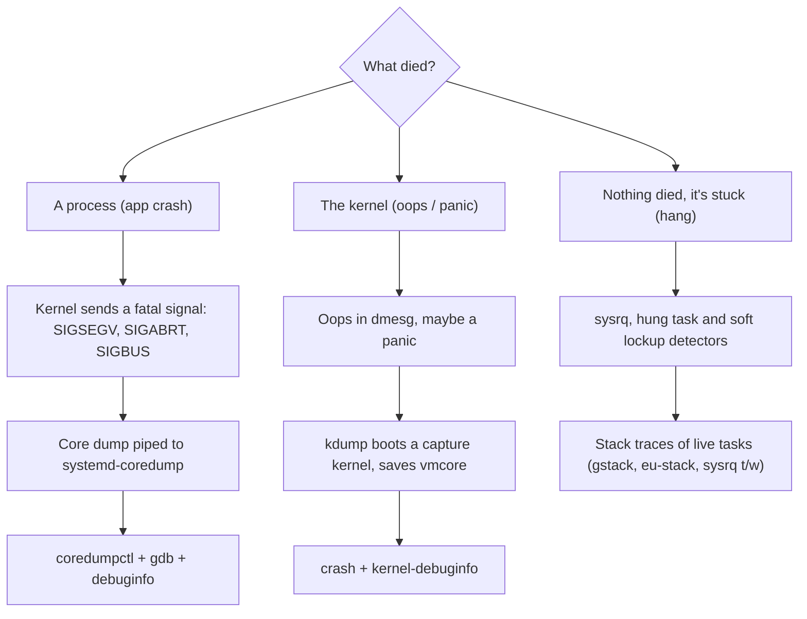
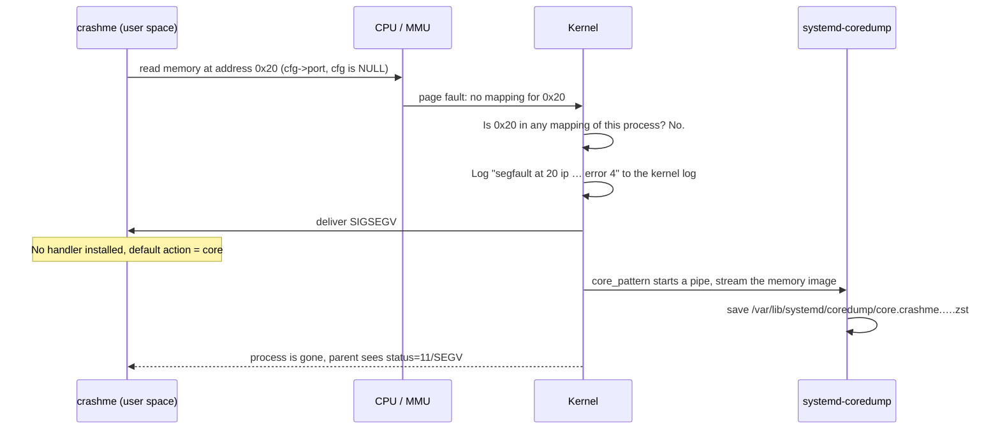
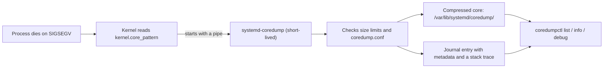
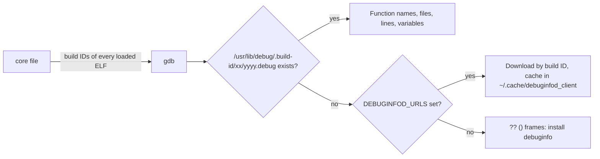

# 24 · Debugging Crashes: Core Dumps, debuginfo and kdump

<ul class="module-meta">
  <li>⏱ ~3.5 hours</li>
  <li>5 labs</li>
  <li>Builds on: 06 · Processes and Signals, 07 · systemd, 08 · Logging, 15 · The Kernel</li>
</ul>

At 02:14 a payment service dies with `status=11/SEGV`. systemd restarts it, it
dies again, and by morning the restart counter reads 37. Two weeks later a
database host freezes, reboots itself, and leaves nothing in the journal.
Most admins stop at "it crashed, we restarted it". This module teaches you to
keep the evidence (a core dump for the app, a vmcore for the kernel) and read
it well enough to hand a developer or a vendor the exact line that failed.

!!! abstract "What you'll learn"
    - Explain what a crash is: which signals kill a program, and what the kernel
      does at that moment.
    - Find, inspect and debug core dumps with `systemd-coredump` and `coredumpctl`.
    - Install the matching debug symbols with `dnf debuginfo-install` and
      understand build IDs.
    - Use `gdb` like an admin: `bt`, `bt full`, `frame`, `info registers`,
      `thread apply all bt`, plus `gcore` and `eu-stack` on live processes.
    - Tell an oops from a panic, decode the taint flags, and read an oops in
      the kernel log.
    - Set up kdump end to end, crash a VM on purpose, and open the vmcore with
      the `crash` utility.
    - Choose the right tool for "the app crashed", "the kernel crashed" and
      "the box hangs".

!!! danger "Labs run in a throwaway VM only"
    Two labs in this module **crash the kernel on purpose**, which reboots the
    machine instantly with no clean shutdown. Use a VM you don't care about,
    and take a snapshot first (`virsh snapshot-create-as <vm> before-crash`
    on a KVM host, or your hypervisor's equivalent). Never run them on a
    shared or production machine.

## The big picture

Every crash leaves evidence, but the evidence lives in different places
depending on *what* died. The whole module fits on one map:



The three branches share one idea. A crash is a moment in time, and your job
is to **freeze that moment** (a core file, a vmcore, a stack trace) so you can
study it later, calmly, instead of guessing from a restart log.

The other shared idea is **symbols**. A frozen moment is just numbers:
addresses, registers, raw memory. Debug symbols turn `0x401136` back into
`parse_config()` at `crashme.c:7`. Without them you have a photo with no
names on it.

## What a crash actually is

A program cannot "just crash". It does something the CPU refuses to do, the
CPU traps into the kernel, and the kernel decides what happens next. Usually
that decision is: send the process a **fatal signal**.

A **signal** (you met them in [module 06](06-processes-and-signals.md#signals-talking-to-processes))
is a small numbered notification the kernel delivers to a process. Some
signals have the default action **"terminate and dump core"**. These are the
crash signals:

| Signal | No. | What usually caused it |
|---|---|---|
| `SIGSEGV` | 11 | **Segmentation violation**: touched an address with no valid mapping (NULL pointer, freed memory, stack overflow) or wrote to read-only memory |
| `SIGBUS` | 7 | **Bus error**: the address is mapped but can't be backed, classically a file truncated under an `mmap()` |
| `SIGABRT` | 6 | **Abort**: the program killed itself on purpose, via `abort()`, a failed `assert()`, or glibc detecting heap corruption (`free(): double free detected`) |
| `SIGFPE` | 8 | Arithmetic fault, most often integer division by zero |
| `SIGILL` | 4 | Illegal instruction, for example a binary built for a newer CPU than yours |
| `SIGTRAP` | 5 | Breakpoint or trap instruction hit with no debugger attached |
| `SIGQUIT` | 3 | You pressed `++ctrl+backslash++` or ran `kill -QUIT`: "stop and dump core" |
| `SIGSYS` | 31 | A seccomp filter blocked a system call (common with sandboxed systemd services) |

`SIGKILL` (9) is missing on purpose. A process killed by `SIGKILL`, including
by the OOM killer, never gets a core dump. That is how you tell "it crashed"
from "something killed it".

!!! analogy "Think of it like a flight recorder"
    A core dump is the black box of a process. When the plane goes down, the
    recorder doesn't stop the crash, but it preserves the cockpit at the moment
    of impact: every gauge (register), every chart on the table (memory), and
    where each pilot was in the checklist (each thread's stack).

### What the kernel does at the moment of a segfault



The kernel leaves a one-line trace in the log before anything else happens.
Learn to read it, because it is often all you get:

```console
$ journalctl -k -g segfault --no-pager
Oct 15 10:02:11 rocky-lab kernel: crashme[4321]: segfault at 20 ip 0000000000401136 sp 00007ffd4c8e2b10 error 4 in crashme[401000+1000] likely on CPU 1 (core 1, socket 0)
```

- `segfault at 20`: the faulting address (hex). `0` or a small number means a NULL
  pointer. A huge random-looking value often means garbage in a pointer.
- `ip`: the **instruction pointer**, the address of the instruction that failed.
- `sp`: the **stack pointer**.
- `error 4`: a bit field from the CPU. Bit 0 set means "page was present but
  access was not allowed", bit 1 means "it was a write", bit 2 means "in user
  mode". So `4` is a user-mode *read* of an unmapped page, `6` a user-mode
  *write* to one, `7` a write to a page the process may not write.
- `in crashme[401000+1000]`: the failing code was inside the `crashme`
  binary, mapped at `0x401000`. If this names a library (`libc.so.6`), the
  crash happened inside that library, though the bug is usually in whoever
  called it with bad arguments.

??? question "Under the hood: why some segfaults leave no log line"
    These one-liners are controlled by the `debug.exception-trace` sysctl
    (`1` by default on x86_64) and are **rate-limited** by the kernel's
    printk limiter. A service that segfaults in a tight restart loop logs the
    first few crashes, then the kernel prints `… callbacks suppressed` and goes
    quiet. Absence of the line is not proof that nothing crashed: check
    `coredumpctl list` and the unit's `NRestarts` too. The `likely on CPU`
    suffix (kernel 6.1+) exists for fleet operators: if every segfault on a
    host lands on the same core, suspect the hardware, not the software.

<div class="quiz" data-answer="3" markdown>

A service shows `code=killed, status=9/KILL` and there is no core dump. What
is the most likely story?

- It hit a NULL pointer and segfaulted
- It called `abort()` after detecting heap corruption
- Something sent it `SIGKILL` (an admin, systemd's stop timeout, or the OOM killer)
- Core dumps are broken on the machine

Right. Crashes caused by the program itself arrive as `SEGV`, `ABRT`, `BUS`
and friends, and those dump core. `SIGKILL` comes from outside and never
dumps core. Check `journalctl -k -g 'Killed process'` for the OOM killer
([module 25](25-memory-deep-dive.md)) and the unit's `TimeoutStopSec=`.

</div>

## Core dumps on Rocky Linux

A **core dump** (or core file) is a snapshot of a process's memory and
registers at the moment it died, written in the ELF format. Where it goes is
decided by one kernel setting.

### core_pattern: who receives the dump

```console
$ sysctl kernel.core_pattern
kernel.core_pattern = |/usr/lib/systemd/systemd-coredump %P %u %g %s %t %c %h %d %F
```

The leading `|` means "don't write a file, **pipe** the dump into this
program". The `%` codes pass details along: `%P` the PID, `%u`/`%g` the user
and group, `%s` the signal, `%t` the time, `%c` the core size limit, `%h` the
hostname, `%d` the dump mode and `%F` a pidfd for the dying process. systemd
sets this value at boot from `/usr/lib/sysctl.d/50-coredump.conf`.



`systemd-coredump` does two things with every crash. It writes a **journal
entry** (who crashed, with which signal, in which unit, plus a short symbolic
stack trace), and it **stores the core** itself, compressed with zstd, under
`/var/lib/systemd/coredump/`:

```console
$ ls -lh /var/lib/systemd/coredump/
-rw-r-----+ 1 root root 21K Oct 15 10:02 core.crashme.1000.6f1c…e2.4321.1760522531000000.zst
```

The name encodes the executable, UID, boot ID, PID and timestamp. The `+`
is an ACL that lets the crashing user read their own core.

??? question "Under the hood: the two halves of systemd-coredump"
    The program the kernel starts from `core_pattern` is a short-lived
    helper running outside any service sandbox. It reads the core from its
    stdin, then hands it over the socket `/run/systemd/coredump` to a fresh
    instance of `systemd-coredump@.service`, which does the slow work
    (compressing, writing, building the stack trace) under systemd's
    resource limits. So when a dump goes missing, look in two places:
    `journalctl -t systemd-coredump` and
    `journalctl -u 'systemd-coredump@*'`.

    The same `50-coredump.conf` also sets `kernel.core_pipe_limit=16`
    (the kernel keeps up to 16 crashing processes alive until the helper has
    read their `/proc/<pid>` data) and `fs.suid_dumpable=2`, so even setuid
    programs dump core, with the result readable only by root.

    One more knob decides *what* goes into a core:
    `/proc/<pid>/coredump_filter`, a per-process bit mask inherited across
    `fork()`. The default `00000033` includes private and shared anonymous
    memory and ELF headers, but not file-backed mappings. A database with a
    100 GB shared buffer pool therefore produces a 100 GB core; clear bit 1
    (`echo 0x31 > /proc/<pid>/coredump_filter`) to leave shared memory out.

!!! version "Rocky 9 vs 10: no ABRT"
    Older RHEL-family guides talk about **ABRT** (the Automatic Bug Reporting
    Tool, `abrtd`, `/var/spool/abrt`). Red Hat dropped ABRT in RHEL 9 and
    points to `systemd-coredump` instead, and Rocky 9 and 10 follow that. If a
    runbook tells you to `abrt-cli list`, it was written for Rocky 8 or older.

### The limits that decide whether a core is kept

Several knobs must all agree before a core lands on disk. When dumps "don't
work", one of these is the reason.

| Knob | Where | Default on Rocky | Effect |
|---|---|---|---|
| `RLIMIT_CORE` (`ulimit -c`) | per process, inherited | often `0` soft for login shells and services | If below one page, systemd-coredump logs the crash but stores no core |
| `LimitCORE=` | unit file | inherits `DefaultLimitCORE=` | Per-service core limit; `LimitCORE=infinity` to allow |
| `Storage=` | `coredump.conf` | `external` | `external` = file in /var/lib, `journal` = inside the journal, `none` = log only |
| `ProcessSizeMax=`, `ExternalSizeMax=` | `coredump.conf` | 32G on 64-bit | Bigger processes are logged but not stored |
| `MaxUse=`, `KeepFree=` | `coredump.conf` | 10% of the filesystem used, 15% kept free | Old cores are deleted to respect these |
| `fs.suid_dumpable` | sysctl | `2` (set by systemd's `50-coredump.conf`); hardening guides set `0` | Whether setuid programs may dump core at all |

Check your shell's limit first. If it is zero, the journal will say so:

```console
$ ulimit -c
0
$ journalctl -t systemd-coredump -n 3 --no-pager
Oct 15 09:58:40 rocky-lab systemd-coredump[4290]: Resource limits disable core dumping for process 4288 (crashme).
Oct 15 09:58:40 rocky-lab systemd-coredump[4290]: Process 4288 (crashme) of user 1000 terminated abnormally without generating a coredump.
```

Raise it for your shell (and everything you start from it) with
`ulimit -c unlimited`. For a service, use a drop-in:

```ini title="/etc/systemd/system/payments.service.d/core.conf"
[Service]
LimitCORE=infinity
```

To change storage behaviour, use a drop-in for `systemd-coredump` itself, not
an edit of the shipped file:

```ini title="/etc/systemd/coredump.conf.d/50-local.conf"
[Coredump]
Storage=external
Compress=yes
ProcessSizeMax=8G
ExternalSizeMax=8G
MaxUse=5G
```

No restart is needed: `systemd-coredump` runs fresh for every crash and reads
the config each time. Old cores are cleaned up by `systemd-tmpfiles` (after
3 days by default), so copy out anything you want to keep.

!!! warning "Core files contain secrets"
    A core is a copy of the process's memory: passwords, TLS private keys,
    session tokens, customer data. That is why STIG-hardened systems often
    mask `systemd-coredump.socket` or set `Storage=none`. Before you send a
    core to a vendor, check your data handling policy. Often the stack trace
    from `coredumpctl info` is enough and contains far less.

### coredumpctl: your crash inbox

```console
$ coredumpctl list
TIME                           PID  UID  GID SIG     COREFILE EXE                    SIZE
Wed 2026-10-15 09:58:40 UTC   4288 1000 1000 SIGSEGV none     /home/alex/crashme        -
Wed 2026-10-15 10:02:11 UTC   4321 1000 1000 SIGSEGV present  /home/alex/crashme    20.9K
Wed 2026-10-15 10:40:05 UTC   5102 1000 1000 SIGABRT present  /usr/bin/sleep        19.4K
```

`COREFILE` says whether the core is still there: `present`, `none` (never
stored), `missing` (cleaned up), or `truncated` (hit a size limit).

| Command | What it does |
|---|---|
| `coredumpctl list` | Every recorded crash, oldest first |
| `coredumpctl list -S today` | Only since a time (`-S`/`-U` like journalctl) |
| `coredumpctl list nginx` | Filter by executable name, PID, or path |
| `coredumpctl info 4321` | Full metadata plus the journal's stack trace |
| `coredumpctl debug 4321` | Open `gdb` on the binary and the core in one step |
| `coredumpctl dump 4321 -o core.4321` | Write the uncompressed core to a file (to copy elsewhere) |

With no argument, `info`, `debug` and `dump` pick the most recent match.
Users in the `wheel` group can read the system journal on Rocky and so see
everyone's crashes; others may need `sudo`.

```console
$ coredumpctl info 4321
           PID: 4321 (crashme)
           UID: 1000 (alex)
           GID: 1000 (alex)
        Signal: 11 (SEGV)
     Timestamp: Wed 2026-10-15 10:02:11 UTC (5min ago)
  Command Line: ./crashme
    Executable: /home/alex/crashme
 Control Group: /user.slice/user-1000.slice/session-3.scope
          Unit: session-3.scope
         Slice: user-1000.slice
       Session: 3
     Owner UID: 1000 (alex)
       Boot ID: 6f1c…e2
    Machine ID: 0d2b…41
      Hostname: rocky-lab
       Storage: /var/lib/systemd/coredump/core.crashme.1000.6f1c…e2.4321.1760522531000000.zst (present)
  Size on Disk: 20.9K
       Message: Process 4321 (crashme) of user 1000 dumped core.

                Stack trace of thread 4321:
                #0  0x0000000000401136 get_port (/home/alex/crashme + 0x1136)
                #1  0x0000000000401172 main (/home/alex/crashme + 0x1172)
                #2  0x00007f0c2b02a5f5 __libc_start_call_main (libc.so.6 + 0x2a5f5)
                #3  0x00007f0c2b02a6a8 __libc_start_main@@GLIBC_2.34 (libc.so.6 + 0x2a6a8)
                #4  0x0000000000401075 _start (/home/alex/crashme + 0x1075)
                ELF object binary architecture: AMD x86-64
```

Read a stack trace **top down**: frame `#0` is where it died, `#1` called
`#0`, and so on down to `_start`, where every program begins. Here `main`
called `get_port`, and `get_port` crashed. For a service crash, the `Unit:`
line tells you which service it was, which is gold on a busy box.

<div class="quiz" data-answer="2" markdown>

`coredumpctl list` shows a crash with `COREFILE none`. The journal says
"Resource limits disable core dumping". What do you change?

- Set `Storage=journal` in coredump.conf
- Raise the core size limit: `ulimit -c unlimited` in the shell, or `LimitCORE=infinity` for the service
- Change `kernel.core_pattern` to `core`
- Install ABRT

Right. The crash was seen (that's why it's listed) but the process's
`RLIMIT_CORE` was zero, so `systemd-coredump` respected it and stored nothing.

</div>

### Practice: triage a crash from the command line

<div class="terminal-sim" data-title="Triage a segfault" markdown>

<div class="task" data-expect="sysctl kernel.core_pattern||cat /proc/sys/kernel/core_pattern" data-hint="It's a kernel setting called kernel.core_pattern. Read it with sysctl." markdown>

**Step 1.** Confirm where core dumps go on this machine.

```text
kernel.core_pattern = |/usr/lib/systemd/systemd-coredump %P %u %g %s %t %c %h %d %F
```

</div>

<div class="task" data-expect="ulimit -c" data-hint="The ulimit builtin with the option for core file size." markdown>

**Step 2.** Check the core file size limit of your shell.

```text
0
```

</div>

<div class="task" data-expect="ulimit -c unlimited" data-hint="Same builtin, give it the value unlimited." markdown>

**Step 3.** It's zero, so cores would be thrown away. Allow unlimited core files for this shell.

```text
```

</div>

<div class="task" data-expect="coredumpctl list||coredumpctl" data-match="^(sudo )?coredumpctl( list)?( crashme)?$" data-hint="systemd's tool for core dumps is coredumpctl. Use its list verb." markdown>

**Step 4.** After reproducing the crash, list the recorded core dumps.

```text
TIME                           PID  UID  GID SIG     COREFILE EXE                 SIZE
Wed 2026-10-15 10:02:11 UTC   4321 1000 1000 SIGSEGV present  /home/alex/crashme 20.9K
```

</div>

<div class="task" data-expect="coredumpctl info 4321||coredumpctl info" data-match="^(sudo )?coredumpctl info( 4321| crashme)?$" data-hint="coredumpctl info, optionally followed by the PID 4321." markdown>

**Step 5.** Show the details and the stack trace for PID 4321.

```text
           PID: 4321 (crashme)
        Signal: 11 (SEGV)
…
                #0  0x0000000000401136 get_port (/home/alex/crashme + 0x1136)
                #1  0x0000000000401172 main (/home/alex/crashme + 0x1172)
```

</div>

<div class="task" data-expect="coredumpctl debug 4321||coredumpctl debug" data-match="^(sudo )?coredumpctl (debug|gdb)( 4321| crashme)?$" data-hint="coredumpctl has a verb that starts gdb on the core for you." markdown>

**Step 6.** Open that core in gdb in one step.

```text
Program terminated with signal SIGSEGV, Segmentation fault.
#0  0x0000000000401136 in get_port (cfg=0x0) at crashme.c:8
8	    return cfg->port;
(gdb)
```

</div>

</div>

## Debug symbols: turning addresses into names

The binaries Rocky ships are **stripped**: the compiler's notes that map
machine addresses back to function names, source files, line numbers and
variable names have been removed to keep packages small. Those notes are
called **debug information** (DWARF data), and Rocky ships them separately in
**debuginfo** packages.

Each package `foo` has up to two companions:

- **`foo-debuginfo`**: the debug information, installed under `/usr/lib/debug/`.
- **`foo-debugsource`**: the exact source code it was built from, under
  `/usr/src/debug/`, so `gdb` can show you the actual line.

### Build IDs: how gdb finds the right symbols

How does `gdb` know which debug file belongs to which binary, when there are
dozens of versions of glibc in the world? Every binary carries a **build ID**:
a unique hash stamped in at build time.

```console
$ file /usr/bin/sleep
/usr/bin/sleep: ELF 64-bit LSB pie executable, x86-64, version 1 (SYSV), dynamically linked, interpreter /lib64/ld-linux-x86-64.so.2, BuildID[sha1]=4a1f0c…9d3e, for GNU/Linux 3.2.0, stripped
$ readelf -n /usr/bin/sleep | grep 'Build ID'
    Build ID: 4a1f0c…9d3e
```

The debuginfo package installs a symlink named after that hash:

```text
/usr/lib/debug/.build-id/4a/1f0c…9d3e.debug -> ../../usr/bin/sleep-9.5-6.el10.x86_64.debug
```

`gdb` reads the build ID from the binary (or from the core file, which
records the build ID of every loaded library), then looks up that path. If the
installed debuginfo is from a slightly different package version, the hash
won't match and `gdb` ignores it. **The version must match exactly.** This is
the single most common reason symbols "don't load".



### Installing debuginfo on Rocky

Debug repos ship **disabled**. List them:

```console
$ dnf repolist --all | grep -i debug
appstream-debug        Rocky Linux 10 - AppStream - Debug        disabled
baseos-debug           Rocky Linux 10 - BaseOS - Debug           disabled
crb-debug              Rocky Linux 10 - CRB - Debug              disabled
…
```

The easy way is the `debuginfo-install` command from `dnf-plugins-core`,
which resolves the right `-debuginfo` and `-debugsource` packages for the
exact installed versions:

```console
$ sudo dnf debuginfo-install --enablerepo='*debug*' coreutils
…
Installing:
 coreutils-debuginfo        x86_64   9.5-6.el10    baseos-debug   3.1 M
 coreutils-debugsource      x86_64   9.5-6.el10    baseos-debug   1.9 M
Installing dependencies:
 glibc-debuginfo            x86_64   2.39-37.el10  baseos-debug   6.2 M
 …
```

Why the explicit `--enablerepo`? The plugin only switches on debug repos
whose IDs follow the `<repo>-debuginfo` naming, and Rocky's are named
`<repo>-debug`. The wildcard works whatever the IDs are. Even better, `gdb`
tells you what to install. When it opens a core with missing symbols it
prints a hint like:

```text
Missing rpms, try: dnf --enablerepo='*debug*' install glibc-debuginfo-2.39-37.el10.x86_64
```

Older gdb builds (Rocky 9) word it as `Missing separate debuginfos, use:
dnf debuginfo-install …`. Either way, copy the command, add `sudo`, run it,
and reopen the core.

??? question "Under the hood: why you see function names without debuginfo"
    Even before you install anything, `coredumpctl info` often shows real
    function names. Rocky's binaries carry **MiniDebugInfo**: a small,
    xz-compressed symbol table hidden in an ELF section called
    `.gnu_debugdata`. It holds function names only, with no files, lines or
    variables. Check for it with
    `readelf -S /usr/bin/sleep | grep gnu_debugdata`. That is why a stack
    trace can say `clock_nanosleep` but `bt full` still shows no locals
    until the real `-debuginfo` package is installed.

!!! pitfall "Debug packages for an old kernel or package"
    Rocky's main mirrors only carry the current minor release. If the crash
    came from a package or kernel you have since updated away from, the
    matching debuginfo may only exist in the Rocky **vault** archive. Grab
    debuginfo soon after a crash, or better, keep the exact versions in your
    own mirror for important hosts.

??? question "Under the hood: debuginfod, symbols on demand"
    **debuginfod** is an HTTP service that serves debug info and source by
    build ID. Tools built with `libdebuginfod` (gdb, `eu-stack`, `perf`)
    download exactly the files they need instead of you installing whole
    packages. They find servers through one environment variable:

    ```console
    $ echo $DEBUGINFOD_URLS

    $ cat /etc/debuginfod/*.urls 2>/dev/null
    ```

    `DEBUGINFOD_URLS` is a space-separated list of server URLs, set at login
    by `/etc/profile.d/debuginfod.sh` from the files in `/etc/debuginfod/`
    (package `elfutils-debuginfod-client`). If both are empty, as above, no
    server is configured and `gdb` only uses locally installed debuginfo.

    We could not confirm that the Rocky project runs a public debuginfod
    server, so trust what your own `/etc/debuginfod/` says. Fedora's or
    another distribution's server won't help: build IDs never match across
    distributions. For a fleet, run your own with the `elfutils-debuginfod`
    package, indexing a directory of debuginfo RPMs
    (`debuginfod -R /srv/debuginfo-rpms`). Otherwise, `dnf debuginfo-install`
    is the reliable path.

## gdb for admins

`gdb`, the GNU debugger, can do everything from single-stepping to scripting.
As an admin you need maybe ten commands, nearly all read-only. You use them
in three situations: a core file, a live process, and a "just give me the
stacks" snapshot.

| gdb command | What it shows |
|---|---|
| `bt` | Backtrace: the chain of function calls for the current thread |
| `bt full` | Backtrace plus every local variable in every frame |
| `frame 1` (or `f 1`) | Switch to frame 1 so `info locals`, `list`, `print` refer to it |
| `list` | Source lines around the current frame (needs debugsource) |
| `info locals`, `info args` | Local variables and arguments of this frame |
| `print cfg` / `print *cfg` | Show a variable, or what a pointer points to |
| `info registers` | CPU registers (`rip` = where it died, `rsp` = stack) |
| `info threads` | Every thread and where it is |
| `thread 3` | Switch to thread 3 |
| `thread apply all bt` | A backtrace of every thread: the one to paste into a bug report |
| `info sharedlibrary` | Loaded libraries and whether their symbols were found |
| `quit` | Leave (on a live process: detaches and lets it run on) |

### A real crash, start to finish

Here is a tiny program with a classic bug: it trusts a pointer that can be NULL.

```c title="crashme.c"
#include <stdio.h>
#include <stdlib.h>

struct config { char name[32]; int port; };

static int get_port(struct config *cfg)
{
    return cfg->port;            /* crashes when cfg is NULL */
}

int main(int argc, char **argv)
{
    struct config *cfg = NULL;
    if (argc > 1) {
        cfg = calloc(1, sizeof *cfg);
        cfg->port = atoi(argv[1]);
    }
    printf("port is %d\n", get_port(cfg));
    return 0;
}
```

Build it with debug info (`-g`) and no optimisation (`-O0`) so every variable
survives, run it with no argument, and open the core:

```console
$ gcc -g -O0 -o crashme crashme.c
$ ulimit -c unlimited
$ ./crashme
Segmentation fault (core dumped)
$ coredumpctl debug
…
Core was generated by `./crashme'.
Program terminated with signal SIGSEGV, Segmentation fault.
#0  0x0000000000401136 in get_port (cfg=0x0) at crashme.c:8
8	    return cfg->port;            /* crashes when cfg is NULL */
(gdb) bt
#0  0x0000000000401136 in get_port (cfg=0x0) at crashme.c:8
#1  0x0000000000401172 in main (argc=1, argv=0x7ffd4c8e2c48) at crashme.c:18
(gdb) frame 1
#1  0x0000000000401172 in main (argc=1, argv=0x7ffd4c8e2c48) at crashme.c:18
18	    printf("port is %d\n", get_port(cfg));
(gdb) info locals
cfg = 0x0
(gdb) info registers rip rsp rax
rip            0x401136            0x401136 <get_port+16>
rsp            0x7ffd4c8e2b10      0x7ffd4c8e2b10
rax            0x0                 0
```

Three lines tell the whole story: it died in `get_port` with `cfg=0x0`,
called from `main` line 18, where `cfg` was still NULL because `argc` was 1.
That is what a good bug report contains.

!!! tip "Optimised builds lie a little"
    Real packages are built with `-O2`. In their cores you'll see
    `<optimized out>` for some variables, and functions may be merged
    (**inlined**) into their callers. The backtrace is still trustworthy for
    *where*; the variables may be incomplete.

### Making a running process dump core

Sometimes the process hasn't crashed, it's just behaving badly (stuck,
leaking, spinning) and you want a snapshot to study. You have two options:

=== "gcore: snapshot and keep running"

    ```console
    $ sudo gcore -o /var/tmp/core 2817
    …
    Saved corefile /var/tmp/core.2817
    $ ps -p 2817 -o pid,stat,cmd
        PID STAT CMD
       2817 S    /usr/sbin/myapp --workers 4
    ```

    `gcore` (part of the `gdb` package) attaches, writes a core and
    detaches. The process pauses for a moment (longer for big processes) and
    then carries on. Open it with `gdb /usr/sbin/myapp /var/tmp/core.2817`.

=== "kill -ABRT: snapshot and terminate"

    ```console
    $ kill -ABRT 2817
    $ coredumpctl list 2817
    TIME                           PID  UID  GID SIG     COREFILE EXE              SIZE
    Wed 2026-10-15 11:05:33 UTC   2817  991  991 SIGABRT present  /usr/sbin/myapp  1.2M
    ```

    The process dies and goes through the normal `systemd-coredump` path,
    so the core is listed and indexed. Use this when you'd restart the
    process anyway. `kill -SEGV` works too, but `ABRT` (or `QUIT`) makes it
    obvious in reports that a human did it.

### Stack traces of live processes

Often you don't need a whole core: you need to know "what is every thread
doing *right now*?" Take three or four of these a few seconds apart. If the
stacks never change, the process is stuck; the top frames show on what.

```console
$ sudo gstack 2817
Thread 2 (Thread 0x7f2a1d7fe6c0 (LWP 2819) "myapp"):
#0  0x00007f2a1e0a1d1d in __futex_abstimed_wait_common () from /lib64/libc.so.6
#1  0x00007f2a1e0a4a50 in pthread_cond_wait@@GLIBC_2.3.2 () from /lib64/libc.so.6
#2  0x0000000000402b1e in worker_loop ()
…
Thread 1 (Thread 0x7f2a1e2f6740 (LWP 2817) "myapp"):
#0  0x00007f2a1e11c3a2 in __GI___poll () from /lib64/libc.so.6
#1  0x0000000000402f40 in main ()
```

`gstack` (and its alias `pstack`) ships in the `gdb` package: it is a small
script that runs gdb in batch mode. The same thing as one line of `gdb`:

```console
$ sudo gdb -p 2817 -batch -ex 'thread apply all bt' 2>/dev/null
```

`eu-stack` from `elfutils` is lighter and faster, which matters on a
production box:

```console
$ sudo eu-stack -p 2817
PID 2817 - process
TID 2817:
#0  0x00007f2a1e11c3a2 __poll
#1  0x0000000000402f40 main
TID 2819:
#0  0x00007f2a1e0a1d1d __futex_abstimed_wait_common
#1  0x00007f2a1e0a4a50 pthread_cond_wait@@GLIBC_2.3.2
#2  0x0000000000402b1e worker_loop
```

!!! note "Attaching is a privileged act"
    Attaching to a process uses `ptrace`. You can attach to your own
    processes, or to anyone's with `sudo`. If attaching fails with
    "Operation not permitted" even as root, check SELinux (`deny_ptrace`
    boolean) and `kernel.yama.ptrace_scope`. Attaching also stops the target
    briefly, so don't loop `gstack` every 100 ms on a latency-sensitive app.

<div class="quiz" data-answer="1" markdown>

gdb shows `#0 0x00007f… in ?? () from /lib64/libc.so.6` for every frame in
libc. What is the fix?

- Install the matching glibc debuginfo (`dnf debuginfo-install glibc` with the debug repos enabled)
- Recompile glibc with `-g`
- Run gdb as root
- Delete `~/.gdbinit`

Right. `??` means gdb has no symbols for that address. The debuginfo package
for the *exact* installed glibc version supplies them, matched by build ID.

</div>

## When the kernel itself fails

User-space crashes are contained: one process dies, the rest carry on. When
the kernel hits a bug, there is no one above it to catch the fall. What
happens next depends on how bad it is.

- An **oops** is the kernel detecting a serious error in itself (bad pointer,
  failed internal check) while running some task. It prints a report, kills
  the task it was running on behalf of, and tries to keep going. The system
  may be fine, or quietly damaged.
- A **panic** is the kernel deciding it cannot safely continue. It stops
  everything. Without kdump, the screen freezes (or the box reboots after
  `kernel.panic` seconds); with kdump, a capture kernel takes over.
- A **WARNING** is a lighter "this should never happen" message with a stack
  trace. The kernel keeps going.

Several settings turn lesser events into panics, on purpose, so that kdump
captures the evidence instead of the system limping on:

```console
$ sysctl kernel.panic kernel.panic_on_oops kernel.softlockup_panic kernel.hung_task_panic
kernel.panic = 0
kernel.panic_on_oops = 1
kernel.softlockup_panic = 0
kernel.hung_task_panic = 0
```

Read these on your own machines rather than assuming. `kernel.panic = 0`
means "after a panic, sit there forever"; set it to, say, `10` to reboot
after 10 seconds when kdump is not configured.

### Taint: has this kernel been modified?

A **tainted** kernel is one where something happened that makes bug reports
less trustworthy: a proprietary module loaded, an earlier oops, a forced
module load. Taint is sticky until reboot. Vendors look at it first.

```console
$ cat /proc/sys/kernel/tainted
4609
```

The number is a bit field. Each set bit has a letter, shown in every oops
header (`Tainted: G  D  W  OE`):

| Letter | Bit value | Meaning |
|---|---|---|
| `P` / `G` | 1 | Proprietary module loaded (`G` means all modules are GPL) |
| `F` | 2 | A module was force-loaded |
| `D` | 128 | The kernel already died (an oops happened) |
| `W` | 512 | A kernel WARNING was issued |
| `O` | 4096 | An out-of-tree module was loaded |
| `E` | 8192 | An unsigned module was loaded |
| `L` | 16384 | A soft lockup occurred |
| `K` | 32768 | The kernel was live patched |

`4609` = 4096 + 512 + 1: an out-of-tree, proprietary module was loaded and
a warning fired. The kernel ships a decoder script, but the table is enough
for most cases. A `D` before the oops you are reading means it was *not* the
first failure: scroll up and find the first one.

### Reading an oops

Oopses land in the kernel ring buffer (`dmesg`) and the journal
(`journalctl -k`). Here is a trimmed one, caused by a buggy out-of-tree module:

```text
BUG: kernel NULL pointer dereference, address: 0000000000000010
#PF: supervisor read access in kernel mode
#PF: error_code(0x0000) - not-present page
Oops: Oops: 0000 [#1] PREEMPT SMP NOPTI
CPU: 1 UID: 0 PID: 3120 Comm: insmod Tainted: G           OE      6.12.0-124.8.1.el10_1.x86_64 #1
Hardware name: QEMU Standard PC (Q35 + ICH9, 2009), BIOS edk2-20241117-3.el10 02/01/2025
RIP: 0010:buggy_init+0x15/0x30 [buggy]
Code: …
RSP: 0018:ffffb3c1c0e4bc98 EFLAGS: 00010246
RAX: 0000000000000000 RBX: ffffffffc0a2b000 RCX: 0000000000000000
…
Call Trace:
 <TASK>
 ? __die+0x20/0x70
 ? page_fault_oops+0x75/0x170
 ? exc_page_fault+0x64/0x140
 ? asm_exc_page_fault+0x26/0x30
 ? buggy_init+0x15/0x30 [buggy]
 do_one_initcall+0x45/0x220
 do_init_module+0x60/0x230
 __do_sys_finit_module+0x2c1/0x360
 do_syscall_64+0x7d/0x160
 entry_SYSCALL_64_after_hwframe+0x76/0x7e
 </TASK>
Modules linked in: buggy(OE+) nft_fib_inet … virtio_blk
CR2: 0000000000000010
```

What to pull out, in order:

1. **The first line**: the kind of failure and the address. `NULL pointer
   dereference, address: …10` means a field 16 bytes into a NULL struct.
2. **`[#1]`**: the oops count. Only `#1` is trustworthy; later ones may be
   fallout.
3. **`Comm:` and `Tainted:`**: which task was running, and whether the kernel
   was already "dirty" (`OE` here: out-of-tree, unsigned module).
4. **`RIP:`**: the function that failed, as `function+offset/length [module]`.
   A name in brackets means the bug is in a module, and that module is your
   prime suspect.
5. **`Call Trace:`**: read top down, skipping lines starting with `?` (those
   are guesses, not confirmed frames). Here: a system call to load a module
   ran its init function, which crashed.
6. **`Modules linked in:`**: what was loaded. Vendors ask for this.

### kdump: a black box for the kernel

When the kernel panics, it can't write a core file the normal way: its own
filesystem code, block drivers and memory may be corrupt. **kdump** solves
this with a trick: at boot it reserves a small slice of RAM and preloads a
second, tiny **capture kernel** into it with **kexec** (the mechanism that
lets one kernel boot another without going through the firmware). On panic,
the dying kernel jumps straight into the capture kernel, which boots in that
reserved slice, sees the old kernel's memory as a file (`/proc/vmcore`),
saves it, and reboots.

<div class="stepper" markdown>

<div class="step" data-title="At boot" markdown>

The kernel command line contains `crashkernel=…`. Early in boot the kernel
**reserves** that much RAM (256 MB on a typical small VM) and never uses it
for anything else.

```console
$ grep -o 'crashkernel=[^ ]*' /proc/cmdline
crashkernel=2G-64G:256M,64G-:512M
```

The value means "if the machine has 2 to 64 GB, reserve 256 MB; above
64 GB, 512 MB".

</div>

<div class="step" data-title="kdump.service loads the capture kernel" markdown>

`kdump.service` runs `kdumpctl`, which builds a special small initramfs
(`/boot/initramfs-$(uname -r)kdump.img`) from `/etc/kdump.conf`, then calls
kexec to load a kernel plus that initramfs into the reserved area. It sits
there, unused, until needed.

```console
$ kdumpctl status
kdump: Kdump is operational
```

</div>

<div class="step" data-title="Panic" markdown>

Something goes badly wrong: a NULL dereference with `panic_on_oops=1`, a
hardware machine check, or you writing `c` to `/proc/sysrq-trigger`. The
kernel prints `Kernel panic - not syncing: …`, stops the other CPUs, and
saves the CPU registers.

</div>

<div class="step" data-title="Jump into the capture kernel" markdown>

Instead of halting, the panicking kernel calls `machine_kexec` and jumps
directly into the preloaded capture kernel. **No firmware, no GRUB**, so
memory is not wiped. The capture kernel boots using *only* the reserved
256 MB, so it doesn't overwrite the evidence.

</div>

<div class="step" data-title="Save the vmcore" markdown>

The kdump initramfs mounts the dump target (local disk by default, or NFS or
SSH), then runs the **core collector**, `makedumpfile`, on `/proc/vmcore`.
`makedumpfile` filters out pages you don't need (free pages, page cache,
zero pages, user data with `-d 31`) and compresses the rest. A 16 GB machine
typically yields a dump of a few hundred MB.

</div>

<div class="step" data-title="Reboot and analyse" markdown>

The capture kernel reboots the machine (the default `final_action`). When it
comes back, you'll find a timestamped directory:

```console
$ sudo ls /var/crash/
127.0.0.1-2026-10-15-10:22:31
$ sudo ls /var/crash/127.0.0.1-2026-10-15-10:22:31/
kexec-dmesg.log  vmcore  vmcore-dmesg.txt
```

`vmcore-dmesg.txt` is the old kernel's log up to the panic: read it first.
`vmcore` is the memory image for the `crash` utility.

</div>

</div>

### Setting up kdump on Rocky 10

The pieces come in three packages on Rocky 10: `kexec-tools` (the kexec
mechanism), `kdump-utils` (`kdumpctl`, `kdump.service`, `/etc/kdump.conf`) and
`makedumpfile`. The installer usually enables kdump for you; check before
changing anything:

```console
$ rpm -q kexec-tools kdump-utils makedumpfile
kexec-tools-2.0.29-…el10.x86_64
kdump-utils-1.0.…el10.x86_64
makedumpfile-1.7.…el10.x86_64
$ systemctl is-enabled kdump
enabled
$ kdumpctl showmem
kdump: Reserved 256MB memory for crash kernel
```

!!! version "Rocky 9 vs 10"
    On Rocky 9, everything lives in the single `kexec-tools` package. Rocky 10
    splits out `kdump-utils` and `makedumpfile`. The default reservation also
    changed: Rocky 10 uses `crashkernel=2G-64G:256M,64G-:512M` (so a VM with
    less than 2 GB reserves nothing), and Red Hat documents the old
    `1G-4G:192M,4G-64G:256M,64G-:512M` value as no longer supported. Use
    `kdumpctl reset-crashkernel` to set the current default instead of
    copying values from old guides.

If `showmem` reports 0 MB, no memory is reserved and kdump can't work. The
supported way to set the default reservation is:

```console
$ sudo kdumpctl reset-crashkernel --kernel=ALL
$ sudo reboot
```

`kdumpctl estimate` suggests a size for unusual hardware (lots of NICs or
storage drivers need more). If the capture kernel runs out of memory during a
test, raise the value with `grubby --update-kernel=ALL --args=crashkernel=…`.

The reservation is real RAM taken away at boot. It shows up as
`Crash kernel` in `/proc/iomem` (`sudo grep -i crash /proc/iomem`) and is
missing from `MemTotal`, which is one reason `free` never shows the full
amount of RAM you paid for ([module 25](25-memory-deep-dive.md)).

The behaviour is controlled by one well-commented file:

```text title="/etc/kdump.conf (default, comments removed)"
auto_reset_crashkernel yes
path /var/crash
core_collector makedumpfile -l --message-level 7 -d 31
```

- `auto_reset_crashkernel yes`: when a new kernel or kdump-utils is
  installed, refresh `crashkernel=` to the current default.
- `path`: directory on the dump target. With no target line, that's the
  root filesystem.
- `core_collector`: `-l` compresses with LZO, `-d 31` drops free, cache,
  zero and user pages.

See your own file with `grep -v '^#' /etc/kdump.conf | grep .`; the shipped
defaults can change between minor releases.

??? question "Going further: dump to another machine"
    A dying disk or a full `/var` can eat the evidence. kdump can write the
    vmcore over the network instead:

    ```text title="/etc/kdump.conf (additions)"
    nfs nfs1.example.com:/export/crash
    failure_action reboot
    ```

    For SSH, use `ssh kdump@crash1.example.com` plus
    `sshkey /root/.ssh/kdump_id_rsa`, then run `sudo kdumpctl propagate` to
    install the key on the server. The kdump initramfs must contain the NIC
    driver and network config, which `kdumpctl restart` adds for you.

After **any** edit, rebuild and reload with `sudo kdumpctl restart` (or
`sudo systemctl restart kdump`), then check `kdumpctl status`. The kdump
initramfs is separate from the normal one, so fixing one never fixes the
other.

!!! warning "Test it before you need it"
    A kdump that has never been tested is a kdump that doesn't work. Typical
    silent failures: too little reserved memory (the capture kernel OOMs), a
    dump target that needs a driver or network the kdump initramfs lacks, or
    `/var/crash` too small. Crash a staging VM built from the same image once,
    and check that a vmcore appears.

### Analysing a vmcore with crash

The `crash` utility is gdb wrapped in a layer that understands kernel data
structures. It needs two things: the vmcore and an **uncompressed kernel with
debug symbols** (`vmlinux`) for the *exact* kernel that crashed, which comes
from `kernel-debuginfo`. That package is big (around a gigabyte installed),
so many teams analyse on a separate box.

```console
$ sudo dnf install -y crash
$ sudo dnf debuginfo-install --enablerepo='*debug*' kernel-$(uname -r)
$ sudo crash /usr/lib/debug/lib/modules/$(uname -r)/vmlinux \
      /var/crash/127.0.0.1-2026-10-15-10:22:31/vmcore
…
      KERNEL: /usr/lib/debug/lib/modules/6.12.0-124.8.1.el10_1.x86_64/vmlinux
    DUMPFILE: /var/crash/127.0.0.1-2026-10-15-10:22:31/vmcore  [PARTIAL DUMP]
        CPUS: 2
        DATE: Wed Oct 15 10:22:29 UTC 2026
      UPTIME: 00:14:02
LOAD AVERAGE: 0.08, 0.05, 0.01
       TASKS: 181
    NODENAME: rocky-lab
     RELEASE: 6.12.0-124.8.1.el10_1.x86_64
     VERSION: #1 SMP PREEMPT_DYNAMIC …
     MACHINE: x86_64  (2496 Mhz)
      MEMORY: 4 GB
       PANIC: "Kernel panic - not syncing: sysrq triggered crash"
         PID: 2817
     COMMAND: "bash"
        TASK: ffff8f0a4b2a8000  [THREAD_INFO: ffff8f0a4b2a8000]
         CPU: 1
       STATE: TASK_RUNNING (PANIC)

crash>
```

If the crashed kernel differs from the one now running (it often does, after
the reboot picked up an update), replace `$(uname -r)` with the version in
`vmcore-dmesg.txt`.

| crash command | What it shows |
|---|---|
| `sys` | The summary above: kernel, uptime, panic message |
| `log` | The kernel log buffer at the moment of death (like dmesg) |
| `bt` | Backtrace of the panicking task; `bt -a` for the active task on every CPU |
| `ps` | Every task, its state and memory; `ps -m` adds how long since each last ran |
| `kmem -i` | Memory summary: total, free, cache, slab, swap |
| `files <pid>` | Open files of a task |
| `dev -d` | Disk I/O in flight (useful for hangs) |
| `foreach UN bt` | Backtraces of every task stuck in uninterruptible sleep |
| `mod` | Loaded modules (`mod -t` shows taint per module) |
| `q` | Quit |

```console
crash> bt
PID: 2817     TASK: ffff8f0a4b2a8000  CPU: 1    COMMAND: "bash"
 #0 [ffffb3c1c0d2fb38] machine_kexec at ffffffffa967c1e5
 #1 [ffffb3c1c0d2fb90] __crash_kexec at ffffffffa97d6a3a
 #2 [ffffb3c1c0d2fc50] panic at ffffffffa96f3c55
 #3 [ffffb3c1c0d2fcd8] sysrq_handle_crash at ffffffffa9e197d6
 #4 [ffffb3c1c0d2fce0] __handle_sysrq.cold at ffffffffaa2d09b1
 #5 [ffffb3c1c0d2fd10] write_sysrq_trigger at ffffffffa9e1a1d4
 #6 [ffffb3c1c0d2fd28] proc_reg_write at ffffffffa9b4c4a5
 #7 [ffffb3c1c0d2fd40] vfs_write at ffffffffa9aa3b2e
 #8 [ffffb3c1c0d2fdd0] ksys_write at ffffffffa9aa4113
 #9 [ffffb3c1c0d2fe08] do_syscall_64 at ffffffffaa2b5c6d
#10 [ffffb3c1c0d2ff50] entry_SYSCALL_64_after_hwframe at ffffffffaa40012f
crash> kmem -i
                 PAGES        TOTAL      PERCENTAGE
    TOTAL MEM   953563       3.6 GB         ----
         FREE   612904       2.3 GB   64% of TOTAL MEM
         USED   340659       1.3 GB   35% of TOTAL MEM
…
```

Read the `bt` from the bottom up to tell the story: `bash` made a `write`
system call to a `/proc` file, which was the sysrq trigger, whose crash
handler called `panic`, which jumped into kdump. For a real bug, the
interesting frames sit just below `panic` (or below the `page_fault` frames
of an oops).

## Hangs: when nothing crashed

A **hang** is the hardest case: no process died, no kernel panicked, the box
just stops responding. The kernel has watchdogs that turn silent hangs into
messages (or, if you ask, panics that kdump can capture).

- **Hung task detector**: warns when a task stays in uninterruptible sleep
  (`D` state, usually waiting on storage or NFS) longer than
  `kernel.hung_task_timeout_secs` (default `120`). The message is
  `INFO: task xfsaild/dm-0:612 blocked for more than 120 seconds.` followed by
  a stack trace.
- **Soft lockup detector**: warns when a CPU runs kernel code for more than
  about 20 seconds without letting anything else run:
  `watchdog: BUG: soft lockup - CPU#1 stuck for 23s!`.
- **Hard lockup detector** (NMI watchdog): warns when a CPU stops taking
  interrupts at all. Often disabled inside VMs.

```console
$ sysctl kernel.hung_task_timeout_secs kernel.watchdog_thresh
kernel.hung_task_timeout_secs = 120
kernel.watchdog_thresh = 10
$ journalctl -k -g 'blocked for more than|soft lockup' --no-pager
Oct 15 03:12:40 db1 kernel: INFO: task postgres:4410 blocked for more than 120 seconds.
```

A soft lockup threshold of `2 × watchdog_thresh` gives the 20 seconds.

!!! pitfall "The hung task detector goes quiet after 10 reports"
    `kernel.hung_task_warnings` (default `10`) is a countdown: each report
    decrements it, and at `0` the detector stops printing until reboot. On a
    box with a flaky NFS mount, the first ten warnings may be from last week
    and the hang you care about today logs nothing. Check
    `sysctl kernel.hung_task_warnings`, and set it to `-1` for unlimited
    while you investigate.

### Magic SysRq: talking to a sick kernel

**Magic SysRq** is a set of single-letter commands handled directly by the
kernel, so they work even when user space is frozen. You trigger them with
`++alt+sysrq++` plus a letter on a console, or by writing the letter to
`/proc/sysrq-trigger` as root:

| Key | Action |
|---|---|
| `h` | Print help to the kernel log |
| `w` | Stack traces of all **blocked** (D state) tasks: the first thing to grab during a hang |
| `t` | Stack traces of **all** tasks (very long) |
| `l` | Backtrace of the active task on every CPU |
| `m` | Memory summary |
| `s` | Sync all filesystems |
| `u` | Remount filesystems read-only |
| `b` | Reboot immediately, no sync |
| `c` | Crash (panic) the kernel, which triggers kdump |

The `kernel.sysrq` sysctl controls which of these the **keyboard** may use
(Rocky's default `16` allows only sync). Writes to `/proc/sysrq-trigger` by
root always work, whatever that value says. The classic emergency sequence on
a wedged box is `s`, `u`, `b`: sync, remount read-only, reboot. On a box where
you want evidence, `w` first, then `c` with kdump armed.

??? question "Going further: netconsole, logs that leave the box"
    If the machine dies before the journal reaches disk, the last kernel
    messages are lost. **netconsole** is a kernel module that sends kernel
    messages as UDP packets to another host as they happen:

    ```console
    $ sudo modprobe netconsole netconsole=6665@192.168.122.50/enp1s0,6666@192.168.122.1/52:54:00:12:34:56
    ```

    The format is `local-port@local-ip/interface,remote-port@remote-ip/remote-mac`.
    On the receiving host, anything that listens on UDP 6666 works (for
    example `nc -u -l 6666`, or rsyslog with a UDP input). It's a cheap way to
    catch the last words of a machine that hard-hangs. Remove it with
    `sudo modprobe -r netconsole`.

## Which tool when: a decision tree

<div class="decision" markdown>

<div class="node" data-id="start" markdown>

**After the incident, is the machine's uptime shorter than you expect (it rebooted)?**

`uptime -s` and `journalctl --list-boots` will tell you.

<button data-goto="reboot">Yes, it rebooted</button> <button data-goto="up">No, it stayed up</button>

</div>

<div class="node" data-id="reboot" markdown>

**Is there a new directory under `/var/crash/`?**

<button data-goto="vmcore">Yes</button> <button data-goto="novmcore">No</button>

</div>

<div class="node" data-id="vmcore" markdown>

**Kernel crash, evidence captured.** Read `vmcore-dmesg.txt` first (the oops
or panic message, taint, `RIP:`). Then install the matching
`kernel-debuginfo` and open the vmcore with `crash`: `sys`, `log`, `bt`,
`ps`. Hand the vmcore and `vmcore-dmesg.txt` to your vendor if it's a driver.

</div>

<div class="node" data-id="novmcore" markdown>

**Rebooted with no vmcore.** Check `journalctl -b -1 -e` for the last
messages of the previous boot. Then check whether kdump was even armed
(`kdumpctl status`, `kdumpctl showmem`). A reboot with clean shutdown messages
was a human or a script. No messages at all suggests a power, firmware or
hypervisor event, or a crash kdump failed to catch: arm kdump, add
netconsole, and wait for the next one.

</div>

<div class="node" data-id="up" markdown>

**Did a process die?** (`systemctl --failed`, `coredumpctl list`, unit status shows `status=11/SEGV` or similar)

<button data-goto="app">Yes, a process died</button> <button data-goto="hang">No, things are stuck or slow</button>

</div>

<div class="node" data-id="app" markdown>

**Which signal?**

<button data-goto="sigcore">SEGV, ABRT, BUS, FPE, ILL</button> <button data-goto="sigkill">KILL</button>

</div>

<div class="node" data-id="sigcore" markdown>

**Application crash.** `coredumpctl info` for the stack trace, then
`coredumpctl debug` with debuginfo installed: `bt`, `thread apply all bt`.
No core stored? Raise `LimitCORE=` for the service and wait for the next one.
Also check the journal for glibc messages like `double free detected` just
before an `ABRT`.

</div>

<div class="node" data-id="sigkill" markdown>

**Killed from outside, not a crash.** Look for the OOM killer
(`journalctl -k -g 'Killed process'`, see [25 · Memory Deep Dive](25-memory-deep-dive.md)),
systemd stop timeouts (`State 'stop-sigterm' timed out. Killing.`), or a
human with `kill -9`.

</div>

<div class="node" data-id="hang" markdown>

**A hang.** Check the kernel log for `blocked for more than` and
`soft lockup`. Grab stacks: `gstack`/`eu-stack` for a stuck process (several
times, a few seconds apart), `echo w > /proc/sysrq-trigger` for D-state
tasks. If you need the full picture and can afford a reboot, arm kdump and
`echo c > /proc/sysrq-trigger` to capture a vmcore of the hung state.

</div>

</div>

<div class="quiz" data-answer="4" markdown>

You set up kdump, but after a test crash no vmcore appears and
`kdumpctl showmem` says `Reserved 0MB memory for crash kernel`. What's wrong?

- `/etc/kdump.conf` has the wrong `path`
- `makedumpfile` is not installed
- The crash utility is missing
- No memory was reserved: `crashkernel=` is missing from the kernel command line

Right. Without a reservation, there is nowhere to load the capture kernel.
Run `kdumpctl reset-crashkernel --kernel=ALL`, reboot, and check `showmem`
again. On a VM with under 2 GB of RAM the default range reserves nothing at
all, so give the VM more memory first.

</div>

## Labs

All labs assume a Rocky 10 VM with sudo and the standard repos. Labs 4 and 5
reboot the VM: **snapshot it first**.

!!! lab "Lab 1: Crash a program and read its core"

    **Goal:** Produce a real segfault, find it with `coredumpctl`, and
    pinpoint the bad line in `gdb`.

    **You'll need:** a Rocky 10 VM, sudo.

    1. Install the tools: `sudo dnf install -y gcc gdb`
    2. Save `crashme.c` from [the gdb section](#a-real-crash-start-to-finish)
       into `~/crashlab/` and build it:

        ```bash
        mkdir -p ~/crashlab && cd ~/crashlab
        gcc -g -O0 -o crashme crashme.c
        ```

    3. Run it once with the default limit, then with core dumps enabled:

        ```bash
        ulimit -c            # note the value
        ./crashme 8080       # works: prints the port
        ./crashme            # crashes
        ulimit -c unlimited
        ./crashme            # crashes again
        ```

    4. Inspect: `coredumpctl list crashme`, then `coredumpctl info`.
    5. Debug: `coredumpctl debug`, then at the `(gdb)` prompt run `bt`,
       `frame 1`, `info locals`, `info registers rip`, `quit`.
    6. Find the kernel's one-line report: `journalctl -k -g segfault -n 2`.

    **Check your work:** `bt` shows `get_port (cfg=0x0) at crashme.c:8`
    called from `main` at line 18, and `coredumpctl list` shows `present`
    for the last crash (and `none` for the first one if your limit was 0).

    ??? success "What just happened?"
        The CPU faulted on reading address `0x20` (`cfg->port`, 32 bytes into the struct, with
        `cfg` NULL), the kernel sent `SIGSEGV`, and the pipe in
        `kernel.core_pattern` handed the image to `systemd-coredump`. With a
        zero `RLIMIT_CORE`, systemd-coredump logged the crash but kept no core.

    **Clean up:** `rm -rf ~/crashlab; ulimit -c 0` (or just log out), then
    `sudo coredumpctl list` will still show the entries until `systemd-tmpfiles`
    ages them out; delete the files now with
    `sudo rm -f /var/lib/systemd/coredump/core.crashme.*`

!!! lab "Lab 2: Symbols for a system binary"

    **Goal:** See the difference debuginfo makes on a stripped Rocky binary.

    1. Make `sleep` dump core:

        ```bash
        ulimit -c unlimited
        sleep 300 &
        kill -ABRT $!
        ```

    2. Open it: `coredumpctl debug sleep`. Run `bt`. Note the `??` frames or
       bare function names with no file and line, and the `Missing rpms`
       (or `Missing separate debuginfos`) hint. `quit`.
    3. Install the symbols gdb asked for:

        ```bash
        sudo dnf debuginfo-install -y --enablerepo='*debug*' coreutils glibc
        ```

    4. Repeat step 2. Run `bt`, then `info sharedlibrary`.
    5. Compare build IDs: `readelf -n /usr/bin/sleep | grep 'Build ID'` and
       `ls -l /usr/lib/debug/.build-id/` for the matching directory.

    **Check your work:** after step 3, `bt` shows source file names and line
    numbers inside glibc's sleep functions (for example `clock_nanosleep`)
    and in `sleep`'s `main`.

    **Clean up:**

    ```bash
    sudo dnf remove -y coreutils-debuginfo coreutils-debugsource glibc-debuginfo glibc-debugsource
    sudo rm -f /var/lib/systemd/coredump/core.sleep.*
    ```

!!! lab "Lab 3: Stacks and snapshots of a live process"

    **Goal:** Take stack traces and a core from a running process without
    stopping it.

    1. Start a long-running multi-threaded process as a transient service:

        ```bash
        sudo dnf install -y gdb elfutils
        sudo systemd-run --unit=busy python3 -c "
        import threading, time
        def worker():
            while True: time.sleep(1)
        for _ in range(3): threading.Thread(target=worker).start()
        time.sleep(3600)"
        PID=$(systemctl show -p MainPID --value busy)
        ```

    2. Take stacks three ways and compare their speed and detail:

        ```bash
        sudo eu-stack -p $PID
        sudo gstack $PID || sudo gdb -p $PID -batch -ex 'thread apply all bt'
        ```

    3. Snapshot it without killing it: `sudo gcore -o /var/tmp/busy $PID`,
       then confirm it is still running with `systemctl status busy`.
    4. Open the snapshot: `sudo gdb /usr/bin/python3 /var/tmp/busy.$PID`,
       then `info threads` and `thread apply all bt`.

    **Check your work:** you see 4 threads (the main one plus 3 workers),
    all sitting in a sleep or wait function, and the service is still
    `active (running)` after `gcore`.

    **Clean up:** `sudo systemctl stop busy; sudo rm -f /var/tmp/busy.*`

!!! lab "Lab 4: kdump end to end (reboots the VM)"

    **Goal:** Arm kdump, crash the kernel deliberately, and collect a vmcore.

    !!! danger "This lab panics the kernel"
        Snapshot the VM first. Run this only in a disposable VM with 3 GB of
        RAM or more: the default `crashkernel=2G-64G:256M,…` reserves nothing
        on a machine that the kernel sees as having less than 2 GB, and a
        "2 GB" VM usually comes in just under that.

    1. Check the pieces:

        ```bash
        rpm -q kexec-tools kdump-utils makedumpfile
        kdumpctl showmem
        systemctl is-active kdump
        kdumpctl status
        ```

    2. If `showmem` shows 0 MB, run
       `sudo kdumpctl reset-crashkernel --kernel=ALL`, reboot, and repeat step 1.
       If the service isn't active, `sudo systemctl enable --now kdump`.
    3. Note the current boot: `journalctl --list-boots | tail -1`.
    4. Sync your disks, then trigger a panic:

        ```bash
        sync
        echo c | sudo tee /proc/sysrq-trigger
        ```

        The console freezes, the capture kernel boots (watch the VM
        console: you'll see `kdump` messages and `makedumpfile` progress),
        and the VM reboots.

    5. Log back in and look: `sudo ls -l /var/crash/*/` and
       `sudo tail -40 /var/crash/*/vmcore-dmesg.txt`.

    **Check your work:** a new directory exists in `/var/crash/` with a
    `vmcore` and a `vmcore-dmesg.txt` whose last lines include
    `sysrq: Trigger a crash` and `Kernel panic - not syncing: sysrq triggered crash`.

    ??? tip "Hint: the VM rebooted but there is no vmcore"
        Watch the VM console during the crash. "Out of memory" in the
        capture kernel means the reservation is too small: raise it with
        `sudo grubby --update-kernel=ALL --args=crashkernel=384M`, reboot, and
        retry. Check `journalctl -b -1 -u kdump` for errors from the previous
        boot's kdump service too.

    **Clean up:** keep the vmcore for Lab 5. Afterwards:
    `sudo rm -rf /var/crash/127.0.0.1-*` (or revert the snapshot).

!!! lab "Lab 5: Investigate the vmcore with crash"

    **Goal:** Open the vmcore from Lab 4 and answer "what crashed, and how?"

    1. Install the tools. The debuginfo is large, so check free space
       (`df -h /usr`) first; you need a few GB.

        ```bash
        sudo dnf install -y crash
        KVER=$(sudo grep -m1 -o 'Linux version [^ ]*' /var/crash/*/vmcore-dmesg.txt | awk '{print $3}')
        echo $KVER
        sudo dnf debuginfo-install -y --enablerepo='*debug*' kernel-$KVER
        ```

    2. Open the dump:

        ```bash
        sudo crash /usr/lib/debug/lib/modules/$KVER/vmlinux /var/crash/*/vmcore
        ```

    3. At the `crash>` prompt, run and read: `sys`, `bt`, `log | tail -20`,
       `ps | grep bash`, `kmem -i`, `files` (for the panicking task), `q`.

    **Check your work:** `sys` shows `PANIC: "Kernel panic - not syncing:
    sysrq triggered crash"`; `bt` shows `sysrq_handle_crash` below `panic`;
    `ps` shows the `bash` process marked with `>` as active on a CPU.

    **Clean up:**

    ```bash
    sudo dnf remove -y kernel-debuginfo kernel-debuginfo-common-$(uname -m) crash
    sudo rm -rf /var/crash/127.0.0.1-*
    ```

    Or revert the VM snapshot.

## Common pitfalls

| Symptom | Cause | Fix |
|---|---|---|
| Crash listed in `coredumpctl` but `COREFILE none` | `RLIMIT_CORE` is 0 for that process | `ulimit -c unlimited` in the shell; `LimitCORE=infinity` for a service |
| `COREFILE truncated` or "process size exceeds limit" | Process bigger than `ProcessSizeMax=` / `ExternalSizeMax=` | Raise them in a `coredump.conf.d` drop-in, or use `gcore` |
| `coredumpctl list` says "No coredumps found" for an obvious crash | Process killed by `SIGKILL` (OOM, timeout), or coredump socket masked by hardening | Check `journalctl -k -g 'Killed process'`; check `systemctl status systemd-coredump.socket` |
| gdb shows `??` frames | No debuginfo, or a version mismatch | `dnf debuginfo-install` the exact versions gdb names |
| Debuginfo "not found" for the crashed version | Package updated since the crash, old build moved to the vault | Install from Rocky's vault, or keep debuginfo for deployed versions |
| `crash` fails with "vmlinux and vmcore do not match" | `kernel-debuginfo` for the wrong kernel | Use the version in `vmcore-dmesg.txt`, not `uname -r` |
| kdump service fails after adding an NFS/SSH target | Network or credentials not available in the kdump initramfs | `kdumpctl propagate` for SSH keys; `kdumpctl restart` after every edit; read `journalctl -u kdump` |
| Box froze on panic for hours | No kdump and `kernel.panic = 0` | Arm kdump, or set `kernel.panic = 10` |
| Analysing a later oops in a long log | Earlier oops already tainted the kernel (`D`) | Scroll back to `[#1]` |

!!! pitfall "Restart loops hide crashes"
    `Restart=on-failure` is great for uptime and terrible for evidence. A
    service that segfaults 40 times a night with a working restart policy
    looks healthy on the dashboard. Alert on `coredumpctl list -S -1h` or on
    the unit's restart counter (`systemctl show -p NRestarts`), not just on
    "is it up".

## Cheat sheet

| Command | What it does |
|---|---|
| `sysctl kernel.core_pattern` | Show where cores go (a pipe to systemd-coredump) |
| `ulimit -c unlimited` | Allow core files for this shell and its children |
| `coredumpctl list` / `info` / `debug` / `dump -o FILE` | Browse, inspect, debug, export core dumps |
| `journalctl -k -g segfault` | The kernel's one-line segfault reports |
| `dnf repolist --all` then grep debug | See the (disabled) debug repos |
| `sudo dnf debuginfo-install --enablerepo='*debug*' PKG` | Install matching debuginfo and debugsource |
| `readelf -n FILE` | Show a binary's build ID |
| `gdb BINARY CORE` | Open a core by hand |
| `bt`, `bt full`, `frame N`, `info locals` | Backtrace, with locals, pick a frame, show its variables |
| `info threads`, `thread apply all bt` | All threads and all their stacks |
| `gcore -o PREFIX PID` | Core of a running process, which keeps running |
| `gstack PID` / `eu-stack -p PID` | Stack traces of a live process |
| `cat /proc/sys/kernel/tainted` | Taint bit field (0 = clean) |
| `kdumpctl status` / `showmem` / `estimate` | Is kdump armed, how much RAM is reserved, how much it needs |
| `kdumpctl reset-crashkernel --kernel=ALL` | Set the default `crashkernel=` value |
| `kdumpctl restart` | Rebuild the kdump initramfs and reload after editing kdump.conf |
| `echo c > /proc/sysrq-trigger` | Panic the kernel (test kdump, VMs only) |
| `echo w > /proc/sysrq-trigger` | Dump stacks of blocked tasks to the kernel log |
| `crash vmlinux vmcore` | Open a kernel dump; then `sys`, `bt`, `log`, `ps`, `kmem -i`, `files` |
| `sysctl kernel.hung_task_timeout_secs` | Hung task warning threshold |

## Flashcards

<div class="flashcards" markdown>

<div class="card" markdown>

Which crash signals dump core, and which common killer never does?

`SIGSEGV`, `SIGABRT`, `SIGBUS`, `SIGFPE`, `SIGILL`, `SIGQUIT` (and a few others) dump core. `SIGKILL` never does, so a `status=9/KILL` means "killed from outside".

</div>

<div class="card" markdown>

Where does Rocky store application core dumps?

`kernel.core_pattern` pipes them to `systemd-coredump`, which stores zstd-compressed cores in `/var/lib/systemd/coredump/` and logs metadata to the journal.

</div>

<div class="card" markdown>

`coredumpctl list` shows `COREFILE none`. Most likely reason?

The process's core size limit (`ulimit -c` / `LimitCORE=`) was 0, so the crash was logged but no core was kept.

</div>

<div class="card" markdown>

What does a build ID do?

It's a unique hash in every ELF binary. gdb uses it to find the exact matching debug file under `/usr/lib/debug/.build-id/`, or to ask a debuginfod server.

</div>

<div class="card" markdown>

How do you install symbols for a crashed glibc on Rocky?

`sudo dnf debuginfo-install --enablerepo='*debug*' glibc` (the debug repos are disabled by default, and versions must match exactly).

</div>

<div class="card" markdown>

The gdb command to paste into a bug report for a multi-threaded crash?

`thread apply all bt`: a backtrace of every thread.

</div>

<div class="card" markdown>

Oops versus panic?

An oops reports a kernel bug, kills the current task, taints the kernel (`D`) and tries to continue. A panic stops the kernel completely (and triggers kdump if armed).

</div>

<div class="card" markdown>

How does kdump capture a dead kernel's memory?

`crashkernel=` reserves RAM at boot, kexec preloads a capture kernel there, and on panic the dying kernel jumps into it. The capture kernel saves `/proc/vmcore` with `makedumpfile` into `/var/crash/`.

</div>

<div class="card" markdown>

What do you need to open a vmcore with `crash`?

The `vmlinux` with debug symbols for the exact kernel that crashed, from `kernel-debuginfo` (`/usr/lib/debug/lib/modules/<version>/vmlinux`).

</div>

<div class="card" markdown>

Which sysrq key dumps the stacks of tasks stuck in D state?

`w` (`echo w > /proc/sysrq-trigger`), output goes to the kernel log.

</div>

</div>

## Recap

!!! recap "Key takeaways"
    - A program crash is a fatal signal (`SEGV`, `ABRT`, `BUS`…) whose default
      action is to dump core. `SIGKILL` never dumps core: it means something
      killed the process.
    - On Rocky, `kernel.core_pattern` pipes cores to `systemd-coredump`,
      which logs the crash to the journal and stores a zstd-compressed core
      in `/var/lib/systemd/coredump/`. ABRT is gone since Rocky 9.
    - `ulimit -c` / `LimitCORE=` and `coredump.conf` decide whether a core is
      kept. `coredumpctl info` and `debug` are your front door.
    - Debug symbols live in `-debuginfo` and `-debugsource` packages, matched
      to binaries by build ID. Versions must match exactly.
    - In gdb, `bt`, `frame`, `info locals` and `thread apply all bt` answer
      most admin questions. `gcore`, `gstack` and `eu-stack` work on live
      processes.
    - An oops kills a task and taints the kernel; a panic stops the kernel.
      kdump preloads a capture kernel into reserved RAM so a panic produces a
      vmcore under `/var/crash/`, which you read with `crash` and the
      matching `kernel-debuginfo`.
    - For hangs, the hung task and soft lockup detectors plus sysrq `w`/`t`
      give you stacks; sysrq `c` turns a hang into a vmcore.

## Go deeper

- Man pages: [[man:core(5)]] [[man:systemd-coredump(8)]] [[man:coredump.conf(5)]] [[man:coredumpctl(1)]] [[man:gdb(1)]] [[man:eu-stack(1)]] [[man:kdump.conf(5)]] [[man:kdumpctl(8)]] [[man:makedumpfile(8)]] [[man:crash(8)]] [[man:debuginfod(8)]]
- [Kernel docs: Documentation for kdump](https://docs.kernel.org/admin-guide/kdump/kdump.html), the upstream explanation of kexec and the capture kernel.
- [Kernel docs: Tainted kernels](https://docs.kernel.org/admin-guide/tainted-kernels.html), every taint bit and how to decode the number.
- [Kernel docs: Linux Magic System Request Key Hacks](https://docs.kernel.org/admin-guide/sysrq.html), the full sysrq key list.
- [Kernel docs: Bug hunting](https://docs.kernel.org/admin-guide/bug-hunting.html), more on reading oops messages.
- [Red Hat: Managing, monitoring, and updating the kernel (RHEL 10)](https://docs.redhat.com/en/documentation/red_hat_enterprise_linux/10/html/managing_monitoring_and_updating_the_kernel/index), including the kdump chapters that Rocky follows.

**Next:** [25 · Memory Deep Dive](25-memory-deep-dive.md)
