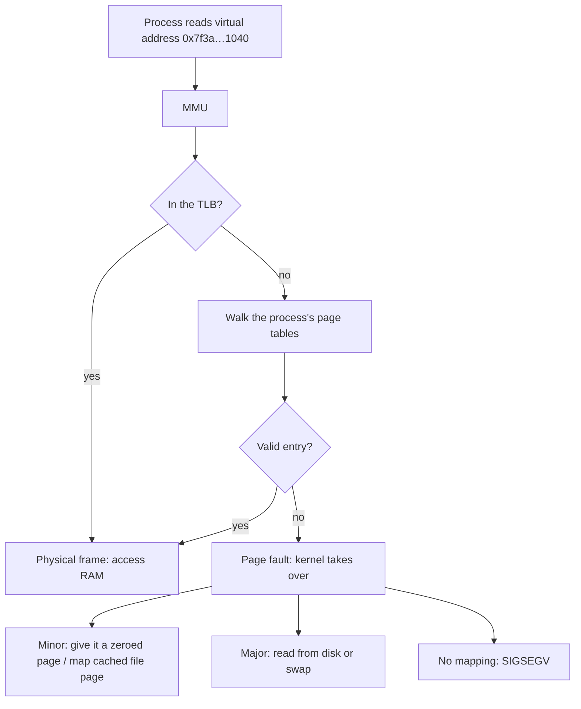
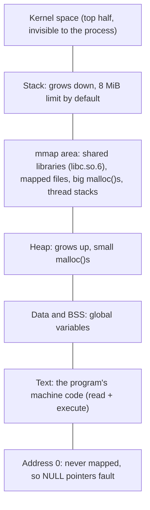
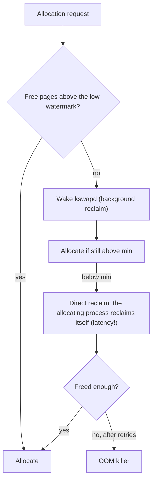
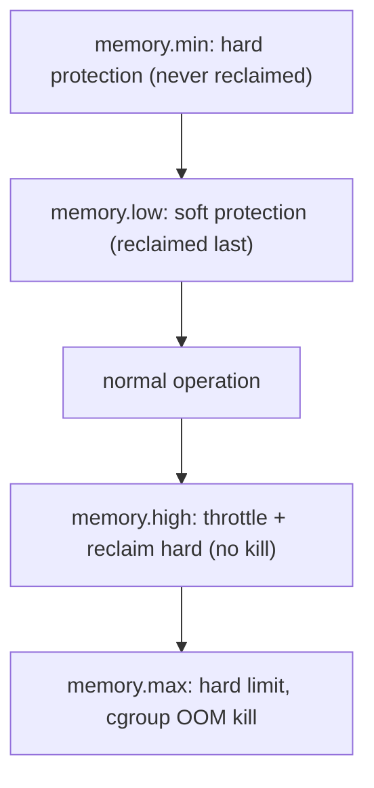

# 25 · Memory Deep Dive

<ul class="module-meta">
  <li>⏱ ~3.5 hours</li>
  <li>5 labs</li>
  <li>Builds on: 06 · Processes and Signals, 07 · systemd, 09 · Disks and Filesystems, 19 · Performance and Observability</li>
</ul>

Your monitoring pages you at night: "free memory below 5%". You log in and
`free` agrees: 300 MB free on a 64 GB box. Yet nothing is slow, nothing is
swapping, and the box has looked like this for a year. A month later a
different host has plenty of "free" memory and the OOM killer shoots your
database anyway. Both make sense once you know where Linux really puts RAM,
and this module shows you how to see it for yourself.

!!! abstract "What you'll learn"
    - Explain virtual memory, pages, page tables and the MMU, and read a
      process's memory map in `/proc/<pid>/maps` and `smaps_rollup`.
    - Tell VSZ, RSS, PSS and USS apart and know which one to trust.
    - Read the important lines of `/proc/meminfo`, starting with
      `MemAvailable` versus `MemFree`.
    - Explain the page cache, dirty writeback, reclaim, `kswapd` versus direct
      reclaim, and what `vm.swappiness` really means.
    - Choose between disk swap and zram, and between the overcommit modes.
    - Read an OOM killer report line by line, and contain memory with cgroup
      v2 limits (`MemoryHigh=`, `MemoryMax=`) and PSI.
    - Know when NUMA, HugeTLB, Transparent Huge Pages and KSM matter.

## The big picture: where your RAM went

Every byte of RAM is doing one of a few jobs at any moment. Some of those
jobs can be cancelled instantly when a program needs memory (clean cache),
some take work to undo (dirty cache, swappable process memory), and some
can't be undone at all (kernel memory in use). "How much memory is free" is
the wrong question. The right one is "how much could the kernel hand out
without hurting anyone", and that's what this stack is about. Click each
layer:

<div class="layers" data-open="0" data-hint="Click a layer to see what it holds and how to measure it." markdown>

<div class="layer" data-label="Free" data-tag="MemFree" markdown>

**What it is:** pages nobody is using. Linux tries to keep this *small*,
because an empty page is a wasted page. It only keeps a reserve (the
**watermarks**, see reclaim below) so it can answer urgent requests.

```console
$ grep MemFree /proc/meminfo
MemFree:          412308 kB
```

</div>

<div class="layer" data-label="Page cache (clean)" data-tag="Cached, Buffers" markdown>

**What it is:** copies of file data recently read from disk, kept in RAM so
the next read is instant. **Clean** means identical to disk, so the kernel
can drop it in microseconds when a program needs the RAM. This is why
`free` looks low and nothing is wrong.

</div>

<div class="layer" data-label="Page cache (dirty)" data-tag="Dirty, Writeback" markdown>

**What it is:** file data that programs have written but the kernel hasn't
written to disk yet. It must be written out before the RAM can be reused,
so it's reclaimable, but slowly.

</div>

<div class="layer" data-label="Shared memory and tmpfs" data-tag="Shmem" markdown>

**What it is:** files in `/dev/shm`, `/run`, `/tmp` if it's tmpfs, and
shared memory segments (databases love them). It *looks* like cache in
`free` but can't be dropped, only swapped.

</div>

<div class="layer" data-label="Process memory (anonymous)" data-tag="AnonPages" markdown>

**What it is:** heaps, stacks and other memory with no file behind it.
**Anonymous** memory can only be freed by the process, by killing it, or by
swapping it out.

</div>

<div class="layer" data-label="Kernel memory" data-tag="Slab, PageTables, KernelStack" markdown>

**What it is:** the kernel's own data: the **slab** caches (inodes, dentries,
network buffers), page tables, kernel stacks. `SReclaimable` slab (mostly
filesystem metadata caches) can be dropped; `SUnreclaim` cannot.

</div>

<div class="layer" data-label="Reserved" data-tag="HugePages, crashkernel" markdown>

**What it is:** RAM set aside at boot and invisible to normal use: static
huge pages, the kdump reservation ([module 24](24-debugging-crashes.md)),
firmware areas. `MemTotal` is already smaller than your physical RAM because
of some of this.

</div>

</div>

`MemAvailable` is the kernel's own estimate of free + clean cache +
reclaimable slab, minus the reserves. It is the number to alert on.

## Virtual memory made visual

Every process on Linux believes it has a huge, private, contiguous memory
all to itself, starting near address zero. None of that is true. What it
has is **virtual memory**: a private map of addresses that the kernel and
the CPU translate, page by page, into real RAM.

!!! analogy "Think of it like a hotel"
    Every guest's key card says "room 12". The front desk (the **page
    table**) knows that guest A's room 12 is physical room 4031 and guest
    B's room 12 is physical room 77. The lift (the **MMU**) reads the card
    and takes you to the right floor without you ever knowing the real
    number. Rooms are only assigned when a guest first walks in, not at
    check-in. That's where the analogy stops: hotels don't let two guests
    share a room read-only, and Linux does that constantly.

### The pieces

- A **page** is the unit of memory management: 4 KiB on x86_64 (huge pages
  are 2 MiB or 1 GiB). RAM is carved into **page frames**.
- A **page table** is a per-process lookup structure that maps virtual pages
  to physical frames, with permission bits (read, write, execute, user).
- The **MMU** (memory management unit) is the part of the CPU that does the
  translation on every single memory access, caching recent answers in the
  **TLB** (translation lookaside buffer).
- A **page fault** happens when the MMU finds no valid translation. The
  kernel decides: allocate a page now (a **minor fault**, cheap), read it from
  disk or swap (a **major fault**, slow), or send `SIGSEGV` (no such mapping).



This is **demand paging**: a program can ask for 1 GB and use 10 MB, and only
10 MB of RAM is ever touched. Remember this, because it explains overcommit
and why "virtual size" is almost meaningless.

### A process's address space



On x86_64 with 4-level page tables, user space gets 128 TiB of virtual
addresses. Real programs touch a tiny fraction of that.

### Reading /proc/&lt;pid&gt;/maps

Every mapping a process has is listed in `/proc/<pid>/maps`. Here is
`sleep`, trimmed:

```console
$ sleep 300 &
[1] 2817
$ cat /proc/2817/maps
55d0c4a00000-55d0c4a02000 r--p 00000000 fd:00 1573019                    /usr/bin/sleep
55d0c4a02000-55d0c4a06000 r-xp 00002000 fd:00 1573019                    /usr/bin/sleep
55d0c4a09000-55d0c4a0a000 rw-p 00008000 fd:00 1573019                    /usr/bin/sleep
55d0c5f3e000-55d0c5f5f000 rw-p 00000000 00:00 0                          [heap]
7f6a2e000000-7f6a34529000 r--p 00000000 fd:00 1574410                    /usr/lib/locale/locale-archive
7f6a34600000-7f6a34628000 r--p 00000000 fd:00 1575110                    /usr/lib64/libc.so.6
7f6a34628000-7f6a3479d000 r-xp 00028000 fd:00 1575110                    /usr/lib64/libc.so.6
…
7ffc1b2e5000-7ffc1b306000 rw-p 00000000 00:00 0                          [stack]
7ffc1b3c8000-7ffc1b3ca000 r-xp 00000000 00:00 0                          [vdso]
```

Each line: address range, permissions (`r`ead, `w`rite, e`x`ecute,
`p`rivate or `s`hared), offset in the file, device, inode, and the file.
Notice the code is `r-x` (you can't write to it) and data is `rw-` (you
can't execute it). Writing to the code is exactly the `error 7` segfault
from module 24. The 101 MB `locale-archive` mapping is mostly never touched.

### smaps_rollup and pmap: what is actually in RAM

`maps` shows the *plan*. `/proc/<pid>/smaps_rollup` shows what's resident:

```console
$ cat /proc/2817/smaps_rollup
55d0c4a00000-7ffc1b3ca000 ---p 00000000 00:00 0                          [rollup]
Rss:                1792 kB
Pss:                 316 kB
Pss_Dirty:           108 kB
Pss_Anon:            100 kB
Pss_File:            216 kB
Pss_Shmem:             0 kB
Shared_Clean:       1600 kB
Shared_Dirty:          0 kB
Private_Clean:        84 kB
Private_Dirty:       108 kB
Anonymous:           108 kB
AnonHugePages:         0 kB
Swap:                  0 kB
SwapPss:               0 kB
…
```

`pmap -x` gives the same per mapping, with a total:

```console
$ pmap -x 2817 | tail -1
total kB          230244    1792     108
```

That's 230 MB of virtual size, 1.8 MB resident, 108 KB dirty.

### VSZ, RSS, PSS and USS

| Measure | Plain meaning | Where to read it | Trust it for |
|---|---|---|---|
| **VSZ** (virtual size) | Everything mapped, touched or not | `ps -o vsz`, `VmSize` | Almost nothing; it's a promise, not usage |
| **RSS** (resident set size) | Pages in RAM, *counting shared pages in full* | `ps -o rss`, `Rss:` | Quick look; overcounts shared libraries |
| **PSS** (proportional set size) | Private pages + each shared page divided by the number of sharers | `Pss:` in smaps_rollup | Summing processes: PSS adds up to real usage |
| **USS** (unique set size) | Only pages private to this process | `Private_Clean + Private_Dirty` | "How much would I get back if I killed it?" |

Every process on the system maps the same 2 MB of `libc.so.6`. RSS charges
the full 2 MB to each of them, so summing RSS across 200 processes counts
libc 200 times. PSS charges each process 2 MB / 200. That's why `sleep`
above has 1792 kB RSS but only 316 kB PSS.

`smem` (from EPEL) computes all of these for every process:

```console
$ sudo dnf install -y epel-release && sudo dnf install -y smem
$ sudo smem -k -s pss -r | head -5
  PID User     Command                         Swap      USS      PSS      RSS
 1288 mysql    /usr/libexec/mysqld                0   412.3M   413.9M   421.0M
  977 root     /usr/bin/python3 -s /usr/sb        0    28.1M    29.6M    41.2M
  715 root     /usr/lib/systemd/systemd-jo        0     5.9M     7.4M    15.8M
    1 root     /usr/lib/systemd/systemd --        0     5.1M     6.3M    14.0M
```

No EPEL? The kernel already does the maths:
`sudo grep -H '^Pss:' /proc/[0-9]*/smaps_rollup | sort -k2 -n | tail`.

<div class="quiz" data-answer="3" markdown>

Twenty `httpd` worker processes each show an RSS of 30 MB. You want to know
how much RAM the whole web server really uses. What should you sum?

- VSZ, because it includes everything
- RSS, because it is resident memory
- PSS, because shared pages are divided among the processes that share them
- Nothing, the kernel can't tell you

Right. The workers share most of their code and libraries. Summing RSS counts
those shared pages twenty times; summing PSS counts them once in total.

</div>

## /proc/meminfo, the important lines

`free` is a summary of `/proc/meminfo`. Learn to read the source:

```console
$ free -h
               total        used        free      shared  buff/cache   available
Mem:           3.6Gi       853Mi       402Mi        19Mi       2.5Gi       2.7Gi
Swap:          3.9Gi       0.8Mi       3.9Gi
$ cat /proc/meminfo
MemTotal:        3735652 kB
MemFree:          412308 kB
MemAvailable:    2861944 kB
Buffers:            5308 kB
Cached:          2448020 kB
SwapCached:          120 kB
Active:          1210404 kB
Inactive:        1752332 kB
Active(anon):     452128 kB
Inactive(anon):   171044 kB
Active(file):     758276 kB
Inactive(file):  1581288 kB
…
SwapTotal:       4108284 kB
SwapFree:        4107500 kB
Dirty:               412 kB
Writeback:             0 kB
AnonPages:        505512 kB
Mapped:           223940 kB
Shmem:             19660 kB
Slab:             221368 kB
SReclaimable:     118264 kB
SUnreclaim:       103104 kB
KernelStack:        6336 kB
PageTables:        11220 kB
CommitLimit:     5976108 kB
Committed_AS:    1902336 kB
…
AnonHugePages:         0 kB
HugePages_Total:       0
HugePages_Free:        0
HugePages_Rsvd:        0
HugePages_Surp:        0
Hugepagesize:       2048 kB
```

| Field | What it means | Worry when… |
|---|---|---|
| `MemTotal` | RAM the kernel can manage (physical minus firmware and kernel image reservations) | n/a |
| `MemFree` | Completely unused pages | Rarely: low is normal |
| `MemAvailable` | Estimate of memory available for new work without swapping | Low *and* falling, with swap or PSI rising |
| `Buffers` | Cache of raw block device metadata | Almost never |
| `Cached` | Page cache for files, **including** `Shmem` | n/a; it's mostly reclaimable |
| `SwapCached` | Pages in RAM that also still have a copy in swap | n/a |
| `Active` / `Inactive` (anon, file) | The LRU lists used by reclaim (see below) | `Inactive(file)` near zero under load |
| `Dirty` | File data waiting to be written | Hundreds of MB to GB, growing |
| `Writeback` | Dirty data being written right now | Stays high: storage can't keep up |
| `AnonPages` | Anonymous process memory in RAM | Steady growth: a leak |
| `Shmem` | tmpfs files and shared memory | Big: check `/dev/shm`, `/run`, `df -t tmpfs` |
| `Slab` = `SReclaimable` + `SUnreclaim` | Kernel object caches | `SUnreclaim` growing forever: kernel or driver leak |
| `PageTables` | Memory used for page tables | Large with huge DBs: consider huge pages |
| `Committed_AS` | Total memory processes have *asked for* | Above `CommitLimit` in mode 2; a trend in others |
| `CommitLimit` | Commit ceiling (only enforced in overcommit mode 2) | n/a |
| `HugePages_*` | Static huge page pool: total, free, reserved, surplus | `Total` large but app not using them: wasted RAM |

`free`'s `buff/cache` is `Buffers + Cached + SReclaimable`. On Rocky 10,
`used` is simply `total - available` (here 3735652 - 2861944 kB, about
853 MiB), so `used` and `available` always add up to `total`.

!!! version "Rocky 9 vs 10: the used column in free changed"
    Rocky 9 ships procps-ng 3.3, where `used` is `total - free - buff/cache`.
    Rocky 10 ships procps-ng 4, where `used` is `total - available`. The same
    machine shows a bigger `used` on Rocky 10 (it now includes things like
    unreclaimable slab and tmpfs). Scripts and dashboards that scrape `free`
    will report a jump after the upgrade with no real change in memory use.

!!! pitfall "Alerting on MemFree"
    A Linux box that has been up for a week should have little free memory,
    because the kernel fills idle RAM with cache. Alert on `MemAvailable` as a
    percentage of `MemTotal`, on swap-in activity (`vmstat` `si`), and on
    memory PSI. Never on `MemFree`.

## The page cache and dirty writeback

All normal file I/O goes through the **page cache**. Reads fill it, so the
second read of a file is served from RAM. Writes land in it as **dirty
pages** and return immediately; the kernel writes them to disk later. That's
**writeback**, and it's why `cp` of a 2 GB file "finishes" before the disk
light stops.

<div class="stepper" markdown>

<div class="step" data-title="write() returns fast" markdown>

`cp` calls `write()`. The kernel copies the data into page-cache pages,
marks them **dirty**, and returns. No disk I/O yet. `Dirty` in meminfo grows.

</div>

<div class="step" data-title="Background flushing starts" markdown>

When dirty data passes `vm.dirty_background_ratio` (% of available memory)
or `vm.dirty_background_bytes`, kernel **flusher threads** (`kworker/u…:flush-253:0`)
start writing it out in the background. Dirty pages also get flushed once
they are older than `vm.dirty_expire_centisecs` (30 s).

</div>

<div class="step" data-title="The writer is throttled" markdown>

If the program writes faster than the disk can absorb and dirty data
reaches `vm.dirty_ratio` (or `vm.dirty_bytes`), the kernel **makes the
writing process wait** inside `write()` until writeback catches up. That's
deliberate: it stops one writer from filling RAM with unwritten data.

</div>

<div class="step" data-title="Writeback completes" markdown>

As writes finish, pages move from `Writeback` back to clean cache. They stay
in RAM as clean cache (instantly reclaimable) until something needs the
space.

</div>

<div class="step" data-title="sync or fsync" markdown>

`sync` flushes everything; `fsync(fd)` flushes one file and waits. Databases
call `fsync` to be sure a commit is on disk. A big pile of dirty data makes
every `fsync` on that filesystem slow, which is how one bulk copy can stall
an unrelated database.

</div>

</div>

```console
$ sysctl vm.dirty_background_ratio vm.dirty_ratio vm.dirty_expire_centisecs
vm.dirty_background_ratio = 10
vm.dirty_ratio = 30
vm.dirty_expire_centisecs = 3000
```

The upstream kernel defaults are 10 and 20; **tuned** profiles change them
(the `virtual-guest` profile, active on most VMs, sets `vm.dirty_ratio = 30`;
`throughput-performance` sets 40). Always read the live values.

### Why a big copy can stall the whole box

Percentages were designed when RAM was small. On a 256 GB server,
`dirty_ratio = 30` allows about 75 GB of unwritten data. Copy a large file to
a slow USB disk or NFS, and the kernel happily buffers tens of GB. Then:
every other writer to that device hits the throttle, `fsync` calls queue
behind gigabytes, and reclaim can't free those pages until they are written.
The symptom: everything that touches the disk freezes for minutes, and hung
task warnings appear (module 24).

The fix on big-memory hosts is to set absolute limits instead of ratios:

```ini title="/etc/sysctl.d/90-dirty.conf"
vm.dirty_background_bytes = 268435456
vm.dirty_bytes = 1073741824
```

Setting the `_bytes` form automatically zeroes the matching `_ratio`. Load it
with `sudo sysctl --system`. If a tuned profile sets the ratios, put your
values in a custom tuned profile instead so they don't fight.

## Reclaim: how the kernel gets memory back

When free memory runs low, the kernel **reclaims** pages: it drops clean
cache, writes dirty cache, and swaps out anonymous memory. To choose what to
evict, it keeps pages on **LRU lists** (least recently used): an **active**
and an **inactive** list for file pages, and the same pair for anonymous
pages. Pages start on inactive, get promoted to active if used again, and
are evicted from the tail of inactive. That's why one big `cat` of a log
file doesn't flush your database's hot data: those pages are seen once, stay
inactive, and are the first to go.

Rocky 10's kernel actually runs the **multi-gen LRU** (MGLRU,
`/sys/kernel/mm/lru_gen/enabled`), which sorts pages into several age
generations instead of two lists. The idea is the same, and meminfo still
reports `Active` and `Inactive`.



- **kswapd** is a per-NUMA-node kernel thread that reclaims in the
  background when free memory drops below the **low watermark**, and stops
  at the **high watermark**. Its work costs CPU but nobody waits for it.
- **Direct reclaim** happens when an allocation finds memory below the **min
  watermark**: the process that wants memory has to do reclaim itself,
  synchronously. That's a latency spike in your application. You see it as
  `allocstall` counters in `/proc/vmstat` and as memory PSI.

The watermarks come from `vm.min_free_kbytes` and
`vm.watermark_scale_factor`. Per-zone values are in `/proc/zoneinfo`.

```console
$ grep -E 'allocstall|pgscan_kswapd|pgscan_direct|pswpin|pswpout' /proc/vmstat
allocstall_normal 0
pgscan_kswapd 182044
pgscan_direct 0
pswpin 12
pswpout 380
```

### What swappiness really means

`vm.swappiness` is widely described as "the percentage of RAM free before
swapping starts". That is wrong. It's a **bias**: how willing reclaim is to
take memory from **anonymous** pages (which means swapping) versus **file**
pages (which means dropping or writing back cache). The range is 0 to 200.

- `100`: treat swapping anonymous memory and dropping file cache as equally
  expensive.
- `60` (the kernel default): prefer dropping cache somewhat more than
  swapping.
- Low values like `10`: strongly prefer dropping cache; swap anonymous memory
  only when cache is nearly gone. tuned's `throughput-performance` uses this.
- `0`: avoid swapping anonymous memory until file pages are nearly
  exhausted. It does **not** disable swap.
- Above 100: prefer swapping, sensible when swap is very fast (zram).

```console
$ sysctl vm.swappiness
vm.swappiness = 30
```

(That's the `virtual-guest` tuned profile's value, not the kernel default.)

### Swap versus zram

**Swap** gives anonymous pages somewhere to go, so reclaim has a choice
other than "drop cache" or "kill something". A modest amount of swap lets
the kernel park memory that was touched once at startup and never again,
freeing RAM for cache. Heavy, continuous swapping (`si`/`so` in `vmstat`
non-zero all the time) means you're short of RAM.

**zram** is a compressed block device in RAM used as swap. Pages "swapped"
to it are compressed (often 2 to 3 times), so you trade CPU for capacity
with no disk I/O. It's great for small VMs and desktops, useless when the
problem is a genuine leak.

On Rocky 10, the `zram-generator` package (AppStream) sets up zram swap at
boot from a config file. It does nothing until configured, either by the
`zram-generator-defaults` package or your own file. Check what your system
actually has:

```console
$ swapon --show
NAME      TYPE      SIZE USED PRIO
/dev/dm-1 partition 3.9G 0.8M   -2
```

To add zram:

```console
$ sudo dnf install -y zram-generator
$ sudo tee /etc/systemd/zram-generator.conf <<'EOF'
[zram0]
zram-size = min(ram / 2, 4096)
compression-algorithm = zstd
EOF
$ sudo systemctl daemon-reload
$ sudo systemctl start systemd-zram-setup@zram0.service
$ swapon --show
NAME       TYPE      SIZE USED PRIO
/dev/dm-1  partition 3.9G 0.8M   -2
/dev/zram0 partition 1.8G   0B  100
```

The higher priority means zram is used first, and disk swap only when zram
is full. `zramctl` shows the compression ratio.

## Overcommit: promising more than you have

Because of demand paging, processes routinely ask for far more memory than
they use. Java reserves its whole heap; `fork()` of a 10 GB process
logically duplicates 10 GB. If the kernel refused every request it couldn't
back right now, most servers wouldn't boot. So it **overcommits**: it says
yes, and deals with the consequences if everyone collects at once.

`vm.overcommit_memory` picks the policy:

| Mode | Name | Behaviour |
|---|---|---|
| `0` | Heuristic (default) | Refuses only obviously impossible single requests. Everything else succeeds; the OOM killer handles the fallout |
| `1` | Always | Never refuses. Used by some scientific and Redis-style workloads that map huge sparse areas |
| `2` | Strict (no overcommit) | Refuses any allocation that would push `Committed_AS` past `CommitLimit`. `malloc()` returns NULL instead of an OOM kill later |

In mode 2, `CommitLimit = swap + RAM × vm.overcommit_ratio / 100` (ratio
default 50), so a 4 GB box with 4 GB swap can commit 6 GB. In the meminfo
above, `CommitLimit` is 5976108 kB: exactly 4108284 kB of swap plus half of
`MemTotal`.

!!! warning "Mode 2 breaks things that assume mode 0"
    Strict mode sounds safer, and for some databases it is recommended. But
    many programs (browsers, JVMs, anything that forks large processes)
    reserve far more than they use, and in mode 2 they fail to start with
    "Cannot allocate memory" while `free` shows gigabytes available. Test
    carefully, and watch `Committed_AS` against `CommitLimit`.

<div class="quiz" data-answer="2" markdown>

What does `vm.swappiness = 0` do on a modern kernel?

- Disables swap completely
- Strongly prefers dropping file cache, and swaps anonymous memory only when cache is nearly exhausted
- Swaps only when 0% of RAM is free
- Makes the OOM killer run before any swapping

Right. Swappiness is a bias between reclaiming file pages and anonymous
pages, not an on/off switch or a free-memory threshold. To really disable
swap, use `swapoff` (or `MemorySwapMax=0` for one service).

</div>

## The OOM killer in depth

When reclaim has truly failed (nothing left to drop, nowhere to swap), the
kernel must free memory immediately or deadlock. The **OOM killer** picks one
process and sends it `SIGKILL`. You met it in
[module 06](06-processes-and-signals.md#the-oom-killer); here is how it
chooses and how to read its report.

### How the victim is chosen

Every process has a **badness** score. Internally it's "how many pages
would killing this free": resident memory + swap used + page tables. Then
`oom_score_adj` (-1000 to +1000) is added, scaled so that +1000 means "as
big as all of RAM and swap". The largest total dies.

```console
$ for p in $(pgrep -x 'sshd|mysqld|python3'); do printf '%-8s %-8s score=%-4s adj=%s\n' $p $(cat /proc/$p/comm) $(cat /proc/$p/oom_score) $(cat /proc/$p/oom_score_adj); done
812      sshd     score=0    adj=-1000
1288     mysqld   score=701  adj=0
5120     python3  score=982  adj=0
```

??? question "Under the hood: why a tiny process scores about 666"
    `/proc/<pid>/oom_score` is not the raw badness. Since kernel 5.9 it is
    rescaled so that `oom_score_adj` fits in: roughly
    `(1000 + badness × 1000 / (RAM + swap)) × 2 / 3`. A process using almost
    no memory with `oom_score_adj=0` therefore shows about `666`, one with
    adj `-1000` shows `0`, and the maximum is about `1333`. Older blog
    posts that say "0 to 1000, and an idle process scores 0" describe
    pre-5.9 kernels. Compare scores with each other, never against a fixed
    threshold.

The `sshd` listener sets its own `oom_score_adj` to -1000 at startup (your
login sessions get 0 back), so you can still log in to fix an out-of-memory
box. Protect your own critical services the same way with `OOMScoreAdjust=`
in the unit (module 07), sparingly.

The OOM killer has two scopes:

- **Global OOM**: the whole machine is out of memory. Every process is a
  candidate.
- **Cgroup (memcg) OOM**: a cgroup hit its `memory.max`. Only processes in
  that cgroup are candidates. The rest of the box never notices.

### Reading an OOM report line by line

The kernel writes a long report to the log every time. Here is one from a
cgroup OOM (lab 5 produces exactly this), trimmed:

```text
python3 invoked oom-killer: gfp_mask=0x100dca(GFP_HIGHUSER_MOVABLE|__GFP_ZERO), order=0, oom_score_adj=0
CPU: 0 UID: 0 PID: 5120 Comm: python3 Not tainted 6.12.0-124.8.1.el10_1.x86_64 #1
Call Trace:
 <TASK>
 dump_stack_lvl+0x4e/0x70
 dump_header+0x4b/0x2f0
 oom_kill_process+0xfa/0x200
 out_of_memory+0x266/0x560
 mem_cgroup_out_of_memory+0x134/0x150
 try_charge_memcg+0x5d6/0x7b0
 …
 </TASK>
memory: usage 262144kB, limit 262144kB, failcnt 312
swap: usage 0kB, limit 0kB, failcnt 0
Memory cgroup stats for /system.slice/oomlab.service:
anon 264019968
file 0
…
Tasks state (memory values in pages):
[  pid  ]   uid  tgid total_vm      rss rss_anon rss_file rss_shmem pgtables_bytes swapents oom_score_adj name
[   5117]     0  5117     1814      896      224      672         0    57344        0             0 bash
[   5120]     0  5120    68943    65150    64454      696         0   569344        0             0 python3
oom-kill:constraint=CONSTRAINT_MEMCG,nodemask=(null),cpuset=/,mems_allowed=0,oom_memcg=/system.slice/oomlab.service,task_memcg=/system.slice/oomlab.service,task=python3,pid=5120,uid=0
Memory cgroup out of memory: Killed process 5120 (python3) total-vm:275772kB, anon-rss:257816kB, file-rss:2784kB, shmem-rss:0kB, UID:0 pgtables:556kB oom_score_adj:0
```

1. **`python3 invoked oom-killer`**: the process whose allocation failed.
   It is *not necessarily the victim*; it's just the one that asked last.
   `GFP_HIGHUSER_MOVABLE` means an ordinary user-space page (a page fault on
   heap memory); `GFP_KERNEL` would mean the kernel wanted memory for itself.
   `order=0` means a single 4 KiB page was wanted. A high `order` (like 3 or
   more) with plenty of free memory points at **fragmentation**, not
   exhaustion.
2. **`CPU… Comm… Tainted`** and the **call trace**: the path into the OOM
   killer. `mem_cgroup_out_of_memory` and `try_charge_memcg` mean a cgroup
   limit; a global OOM shows `__alloc_pages_slowpath` instead.
3. **`memory: usage …, limit …, failcnt`**: the cgroup was at its limit
   (256 MiB) and 312 charge attempts failed. `swap: limit 0kB` confirms the
   cgroup wasn't allowed to swap.
4. **`Memory cgroup stats`**: the breakdown (`anon`, `file`, `shmem`…). Here
   it's all anonymous memory: a process that allocated, not cache.
5. **Tasks state**: every candidate with sizes in **pages** (multiply by 4 for
   KiB). `rss` 65150 pages ≈ 254 MiB for python3. `oom_score_adj` per task
   shows who was protected.
6. **`oom-kill:constraint=CONSTRAINT_MEMCG`**: the kind of OOM
   (`CONSTRAINT_NONE` for a global one) and which cgroup.
7. **`Killed process … anon-rss…`**: the victim and what it held. The
   `Memory cgroup out of memory` prefix tells you at a glance it was a limit,
   not the machine. A global OOM says `Out of memory: Killed process`.

A global OOM report also includes a `Mem-Info:` block (a snapshot like
`/proc/meminfo` per zone) and per-zone free counts. If `Shmem` or
`slab_unreclaimable` are huge there, killing processes won't help much: the
memory is in tmpfs or the kernel.

```console
$ journalctl -k -g 'invoked oom-killer|Killed process' --no-pager
```

<div class="quiz" data-answer="2" markdown>

An OOM report starts with `nginx invoked oom-killer` and ends with
`Out of memory: Killed process 4410 (java)`. What happened?

- nginx was killed because it asked for memory
- The whole machine ran out of memory; nginx's allocation triggered the OOM killer, which chose java as the biggest scorer
- java hit its own cgroup `MemoryMax=`
- nginx sent `SIGKILL` to java

Right. The invoker is just whoever asked last. `Out of memory:` without the
`Memory cgroup` prefix means a global OOM, and the victim is picked by
`oom_score` across the whole machine.

</div>

## cgroup v2 memory controls

Global OOM kills are unpredictable. **cgroups** (control groups, see
[module 07](07-systemd-and-services.md#resource-control-with-slices) and
[module 18](18-containers.md)) let you give each service a budget and decide
exactly what happens when it's exceeded. On Rocky 10, every service, user
session and container already has its own cgroup under `/sys/fs/cgroup/`.



| cgroup file | systemd property | What it does |
|---|---|---|
| `memory.min` | `MemoryMin=` | Memory guaranteed to this cgroup; never reclaimed for others |
| `memory.low` | `MemoryLow=` | Best-effort protection; reclaimed only if unprotected memory is exhausted |
| `memory.high` | `MemoryHigh=` | Throttle point: above it, the cgroup is forced into reclaim and slowed down, but not killed |
| `memory.max` | `MemoryMax=` | Hard limit: if reclaim can't get under it, the cgroup OOM killer runs |
| `memory.swap.max` | `MemorySwapMax=` | How much swap the cgroup may use (`0` = none) |
| `memory.current` | (shown in `systemctl status`) | Current usage, including page cache charged to it |
| `memory.stat` | | Detailed breakdown: `anon`, `file`, `shmem`, `slab`, `pgfault`… |
| `memory.events` | | Counters: `low`, `high`, `max`, `oom`, `oom_kill` |
| `memory.pressure` | | PSI for just this cgroup |

The pattern most production services want is **`MemoryHigh=` a bit below
`MemoryMax=`**: the service gets slowed and squeezed (and you get an alert
from `memory.events high` and PSI) before it's ever killed.

```console
$ sudo systemctl set-property myapp.service MemoryHigh=1.5G MemoryMax=2G
$ systemctl show myapp -p MemoryHigh -p MemoryMax -p MemoryCurrent
MemoryHigh=1610612736
MemoryMax=2147483648
MemoryCurrent=734003200
$ cat /sys/fs/cgroup/system.slice/myapp.service/memory.events
low 0
high 0
max 0
oom 0
oom_kill 0
oom_group_kill 0
```

`set-property` writes a persistent drop-in; add `--runtime` for a temporary
change. `systemd-cgtop -m` shows every cgroup sorted by memory.

!!! tip "Size limits from memory.peak, not from a guess"
    Every cgroup has a `memory.peak` file: the highest `memory.current` it
    has reached. Run a service for a representative week, read
    `/sys/fs/cgroup/system.slice/myapp.service/memory.peak`, and set
    `MemoryMax=` with headroom above it.

!!! note "Page cache counts against the limit"
    A service's file reads and writes are charged to its cgroup. A log
    shipper reading 10 GB of logs under `MemoryMax=1G` is fine: the kernel
    reclaims its cache within the limit. But `memory.current` will sit near
    the limit forever, which is *not* a leak. Check `anon` versus `file` in
    `memory.stat` before panicking.

When a kernel OOM kill hits a service, systemd's `OOMPolicy=` decides what
happens to the rest of the unit: `stop` (the default for services) stops the
whole service, `continue` leaves the survivors running, `kill` kills the
whole cgroup. `systemctl status` then shows `Result: oom-kill`.

### systemd-oomd: acting on pressure, not exhaustion

The kernel OOM killer acts at the last possible moment, often after minutes
of thrashing. **systemd-oomd** is a userspace daemon that watches memory
pressure (PSI, below) and swap use per cgroup, and kills a whole cgroup
*early* when pressure stays above a limit. You opt units or slices in:

```ini title="/etc/systemd/system/batch.slice.d/oomd.conf"
[Slice]
ManagedOOMMemoryPressure=kill
ManagedOOMMemoryPressureLimit=50%
```

Fedora turns `systemd-oomd` on for desktops; Rocky does not set it up on a
server install. Find out what your box has with
`rpm -qf /usr/lib/systemd/systemd-oomd` (it may be a separate
`systemd-oomd` package) and `systemctl is-enabled systemd-oomd.service`.
Once it runs, `oomctl` shows the cgroups it watches. It depends on PSI,
so check the tip below first.

## PSI: measuring the pain, not the usage

Usage numbers tell you memory is full. They don't tell you whether anyone is
suffering. **PSI** (pressure stall information) does: it reports the share of
time tasks were **stalled** waiting for a resource.

```console
$ cat /proc/pressure/memory
some avg10=0.00 avg60=0.00 avg300=0.00 total=1834211
full avg10=0.00 avg60=0.00 avg300=0.00 total=1012993
```

- **`some`**: percentage of time at least one task was stalled on memory
  (reclaim, swap-in, refaulting evicted cache). Lost latency for someone.
- **`full`**: percentage of time *all* non-idle tasks were stalled at once.
  Lost throughput for everyone. Sustained `full` above a few percent is
  thrashing.
- `avg10`, `avg60`, `avg300`: running averages over 10 s, 1 min, 5 min.
  `total` is cumulative microseconds.

The same format exists for `/proc/pressure/cpu` and `/proc/pressure/io`,
and per cgroup in `cpu.pressure`, `memory.pressure` and `io.pressure`. A
service that is slow because it's at its `MemoryHigh=` shows high
`memory.pressure` in its own cgroup while the system-wide file stays calm.

!!! tip "If /proc/pressure doesn't exist"
    PSI must be enabled in the running kernel. RHEL-family kernels have
    built it in but switched it off by default
    (`CONFIG_PSI_DEFAULT_DISABLED=y`, including the Rocky 10 kernel). Check your own
    kernel rather than trusting a guide:

    ```console
    $ grep PSI /boot/config-$(uname -r)
    $ ls /proc/pressure
    ```

    If `/proc/pressure` is missing (and with it every cgroup's
    `memory.pressure`), enable it with
    `sudo grubby --update-kernel=ALL --args=psi=1` and reboot. PSI costs a
    little scheduler overhead, which is why vendors default it off.

<div class="quiz" data-answer="1" markdown>

A service runs with `MemoryHigh=1G` and no `MemoryMax=`. It tries to use
1.5 GB. What happens?

- It's throttled and forced into reclaim above 1 GB, so it slows down (memory PSI rises), but it isn't OOM-killed for crossing the line
- It's killed by the OOM killer as soon as it reaches 1 GB
- Nothing: `MemoryHigh=` is only a monitoring threshold
- The whole machine starts swapping

Right. `memory.high` is a throttle, not a wall. The kernel reclaims hard
from the cgroup (swapping it if allowed) and slows its allocations. Only
`memory.max` triggers the OOM killer.

</div>

## NUMA: not all RAM is equally close

On a multi-socket server, each CPU socket has its own memory. A CPU can
reach the other socket's memory, but more slowly. This is **NUMA**
(non-uniform memory access), and each socket plus its RAM is a **node**.

```console
$ numactl --hardware
available: 2 nodes (0-1)
node 0 cpus: 0 1 2 3 4 5 6 7 8 9 10 11 24 25 26 27 28 29 30 31 32 33 34 35
node 0 size: 64305 MB
node 0 free: 41022 MB
node 1 cpus: 12 13 14 15 16 17 18 19 20 21 22 23 36 37 38 39 40 41 42 43 44 45 46 47
node 1 size: 64507 MB
node 1 free: 50311 MB
node distances:
node   0   1
  0:  10  21
  1:  21  10
```

The distances say remote memory costs about 2.1 times local. Most VMs have
one node, and NUMA doesn't matter there. On big hosts:

- By default the kernel allocates memory on the node where the process is
  running, and **automatic NUMA balancing** (`kernel.numa_balancing = 1`)
  migrates pages or tasks to bring them together over time.
- `numastat -p <pid>` shows how a process's memory is spread across nodes;
  `numastat -m` shows meminfo per node. A node with zero free memory can
  trigger reclaim or swap even though the other node has plenty.
- `numactl --cpunodebind=0 --membind=0 cmd` pins a process to one node;
  `numactl --interleave=all cmd` spreads its memory evenly (good for a big
  shared cache accessed from all CPUs).
- systemd units can do the same with `NUMAPolicy=` and `NUMAMask=`.

## Huge pages: HugeTLB and THP

Every TLB entry covers one page. A database with a 64 GB buffer pool in 4 KiB
pages needs 16 million page-table entries, and the TLB can only cache a
tiny fraction, so the CPU spends time walking page tables. **Huge pages**
(2 MiB, or 1 GiB) cover 512 or 262144 times more memory per entry.

Linux has two ways to use them:

| | Static **HugeTLB** | **Transparent Huge Pages** (THP) |
|---|---|---|
| How | Pool reserved by the admin (`vm.nr_hugepages`) | Kernel uses 2 MiB pages for anonymous memory automatically |
| App changes | App must ask (`MAP_HUGETLB`, `SHM_HUGETLB`, hugetlbfs) | None |
| Swappable | No, always resident | Split and swapped like normal memory |
| Seen in | `HugePages_Total/Free/Rsvd` | `AnonHugePages` |
| Used by | Oracle DB, PostgreSQL `huge_pages=on`, DPDK, KVM guests | Everything, by default |
| Risk | Reserved RAM is wasted if unused | Latency spikes from compaction, memory bloat |

Static pages are best reserved early, before memory fragments:

```console
$ sudo sysctl vm.nr_hugepages=512
$ grep -E 'HugePages_(Total|Free)' /proc/meminfo
HugePages_Total:     512
HugePages_Free:      512
```

THP is controlled through sysfs. The bracket marks the current mode:

Rocky 10 ships THP in `always` mode; confirm yours:

```console
$ cat /sys/kernel/mm/transparent_hugepage/enabled
[always] madvise never
$ cat /sys/kernel/mm/transparent_hugepage/defrag
always defer defer+madvise [madvise] never
$ grep AnonHugePages /proc/meminfo
AnonHugePages:    331776 kB
```

- `always`: any large enough anonymous region may get huge pages.
- `madvise`: only regions the program marks with `madvise(MADV_HUGEPAGE)`.
- `never`: off.
- **`khugepaged`** is a kernel thread that scans memory and collapses runs of
  4 KiB pages into huge pages in the background
  (`/sys/kernel/mm/transparent_hugepage/khugepaged/`).

**Why some databases want THP off.** Workloads with sparse, random access
(Redis, MongoDB, some Oracle and PostgreSQL setups) can suffer: a 2 MiB page
gets allocated where only a few KiB are used (memory bloat), and allocating
or compacting huge pages adds latency spikes. Follow your vendor's guidance.
To switch THP off persistently, use the boot parameter or a tuned profile:

```console
$ sudo grubby --update-kernel=ALL --args=transparent_hugepage=never
```

??? question "Under the hood: multi-size THP in kernel 6.12"
    Rocky 10's kernel can also back anonymous memory with "mid-size" folios
    (16 KiB, 64 KiB and so on) instead of jumping straight from 4 KiB to
    2 MiB. Each size has its own switch under
    `/sys/kernel/mm/transparent_hugepage/hugepages-<size>kB/enabled`, and
    most default to `never` or `inherit`. Before you tune or blame THP, list
    them all:
    `grep -r . /sys/kernel/mm/transparent_hugepage/hugepages-*/enabled`.
    Usage counters live in `/sys/kernel/mm/transparent_hugepage/hugepages-*/stats/`.

??? question "Going further: KSM (kernel samepage merging)"
    **KSM** scans memory regions that opted in (with
    `madvise(MADV_MERGEABLE)`), finds identical pages, and merges them into
    one copy-on-write page. Its big user is KVM: twenty guests running the
    same OS share many identical pages. It costs CPU to scan, and it's
    controlled via `/sys/kernel/mm/ksm/` (`run`, `pages_sharing`). See
    [27 · Virtualization with KVM](27-virtualization-kvm.md).

## Spotting a memory leak

A **memory leak** is memory a program allocates and never frees. One
snapshot can't show it; a **trend** can. Real usage of a healthy service
plateaus; a leak climbs steadily, often in a sawtooth that never returns to
the previous low.

```bash title="Log a process's PSS and anon memory every minute"
PID=$(pgrep -o myapp)
while sleep 60; do
  printf '%s %s %s\n' "$(date +%T)" \
    "$(awk '/^Pss:/{print $2}' /proc/$PID/smaps_rollup)" \
    "$(awk '/^Anonymous:/{print $2}' /proc/$PID/smaps_rollup)"
done | tee /var/tmp/myapp-mem.log
```

For a service, `memory.stat`'s `anon` line in its cgroup gives the same
trend for all its processes together, and PCP or `sar -r` (module 19) can
record it for you. Things to rule out before shouting "leak": cache
(`file`, not `anon`), a warming cache inside the app, and a JVM or Go
runtime that holds freed memory for reuse.

To find *where* a C or C++ program leaks, run it under **valgrind** (in
AppStream) on a test system. It's slow, so never on production:

```console
$ valgrind --leak-check=full ./leaky
…
==5321== HEAP SUMMARY:
==5321==     in use at exit: 102,400 bytes in 100 blocks
==5321==   total heap usage: 101 allocs, 1 frees, 103,424 bytes allocated
==5321==
==5321== 102,400 bytes in 100 blocks are definitely lost in loss record 1 of 1
==5321==    at 0x484880F: malloc (vg_replace_malloc.c:446)
==5321==    by 0x401156: handle_request (leaky.c:6)
==5321==    by 0x401183: main (leaky.c:13)
==5321==
==5321== LEAK SUMMARY:
==5321==    definitely lost: 102,400 bytes in 100 blocks
```

"Definitely lost" with a file and line is what the developer needs. If the
growth is in `SUnreclaim` instead of a process, it's the kernel or a driver:
`sudo slabtop -o -s c | head` shows which cache is growing.

### Practice: find where the memory went

<div class="terminal-sim" data-title="Where did the RAM go?" markdown>

<div class="task" data-expect="free -h||free -m||free" data-match="^free( -[hmgk]+| --human)?$" data-hint="The classic summary command is free. Add -h for human-readable units." markdown>

**Step 1.** Get a quick summary of memory and swap.

```text
               total        used        free      shared  buff/cache   available
Mem:           3.6Gi       853Mi       402Mi        19Mi       2.5Gi       2.7Gi
Swap:          3.9Gi       0.8Mi       3.9Gi
```

</div>

<div class="task" data-expect="grep MemAvailable /proc/meminfo" data-match="^grep -?i? ?['\"]?MemAvailable['\"]? /proc/meminfo$" data-hint="grep for MemAvailable in /proc/meminfo." markdown>

**Step 2.** Read the kernel's own "available" estimate straight from `/proc/meminfo`.

```text
MemAvailable:    2861944 kB
```

</div>

<div class="task" data-expect="cat /proc/pressure/memory" data-hint="PSI files live in /proc/pressure/." markdown>

**Step 3.** Is anything actually stalling on memory? Read the memory PSI file.

```text
some avg10=0.00 avg60=0.00 avg300=0.00 total=1834211
full avg10=0.00 avg60=0.00 avg300=0.00 total=1012993
```

</div>

<div class="task" data-expect="cat /proc/2817/smaps_rollup" data-hint="The summary of a process's resident memory is /proc/<pid>/smaps_rollup." markdown>

**Step 4.** Show the resident memory summary (RSS, PSS) of PID 2817.

```text
Rss:                1792 kB
Pss:                 316 kB
Private_Clean:        84 kB
Private_Dirty:       108 kB
…
```

</div>

<div class="task" data-expect="journalctl -k -g 'Killed process'||journalctl -k -g \"Killed process\"" data-match="^(sudo )?journalctl (-k|--dmesg) (-g|--grep)[ =]['\"]?(Killed process|oom|Out of memory|invoked oom-killer)['\"]?( --no-pager)?$" data-hint="Search the kernel messages in the journal (-k) with -g for 'Killed process'." markdown>

**Step 5.** Check whether the OOM killer has struck since boot.

```text
Oct 15 11:20:41 rocky-lab kernel: Memory cgroup out of memory: Killed process 5120 (python3) total-vm:275772kB, anon-rss:257816kB, file-rss:2784kB, shmem-rss:0kB, UID:0 pgtables:556kB oom_score_adj:0
```

</div>

</div>

## Labs

All labs use a Rocky 10 VM with at least 2 GB of RAM and sudo. They create
pressure only inside cgroups or on scratch files, so the rest of the VM stays
responsive. Create the helper script once (it allocates memory 10 MiB at a
time and writes to it, so it is really resident):

```bash
cat > /var/tmp/eat.py <<'EOF'
import sys, time
target = int(sys.argv[1]) if len(sys.argv) > 1 else 400
chunks = []
for i in range(target // 10):
    chunks.append(b'x' * (10 << 20))
    print(f"{(i + 1) * 10} MiB", flush=True)
    time.sleep(0.2)
time.sleep(600)
EOF
```

!!! lab "Lab 1: Map a process's memory"

    **Goal:** Read a real address space and see why RSS overstates usage.

    1. Start two copies of the same program: `sleep 600 & sleep 600 &`
    2. Look at the plan: `cat /proc/$!/maps`. Find the text (`r-xp`) segment
       of `/usr/bin/sleep`, `libc.so.6`, `[heap]` and `[stack]`.
    3. Look at the reality: `cat /proc/$!/smaps_rollup` and
       `pmap -x $! | tail -1`.
    4. Compare across processes:

        ```bash
        for p in $(pgrep -x sleep); do echo "$p $(ps -o vsz=,rss= -p $p) $(awk '/^Pss:/{print $2}' /proc/$p/smaps_rollup)"; done
        ```

    5. Start a third `sleep 600 &` and run step 4 again.

    **Check your work:** VSZ is hundreds of MB, RSS about 1 to 2 MB, PSS a
    few hundred KB, and PSS of each `sleep` drops slightly when a third copy
    starts sharing the same pages.

    **Clean up:** `pkill -x sleep`

!!! lab "Lab 2: Watch the page cache fill and empty"

    **Goal:** See file data land in RAM, prove it with `fincore`, and drop it.

    1. Create a 500 MB test file (writing it fills the cache), then evict it:

        ```bash
        dd if=/dev/urandom of=/var/tmp/cachetest bs=1M count=500 status=none
        sync; echo 1 | sudo tee /proc/sys/vm/drop_caches
        fincore /var/tmp/cachetest
        ```

    2. Time a cold read, check the cache, time a warm read:

        ```bash
        grep -E '^(Cached|MemFree|MemAvailable)' /proc/meminfo
        time cat /var/tmp/cachetest > /dev/null
        fincore /var/tmp/cachetest
        time cat /var/tmp/cachetest > /dev/null
        grep -E '^(Cached|MemFree|MemAvailable)' /proc/meminfo
        ```

    3. Drop clean page cache again and confirm:
       `sync; echo 1 | sudo tee /proc/sys/vm/drop_caches; fincore /var/tmp/cachetest`

    **Check your work:** `fincore` shows `0B` resident at first and about
    `500M` after the first read. The second `cat` is many times faster.
    `Cached` grows about 500 MB while `MemFree` shrinks and `MemAvailable`
    barely changes.

    ??? success "Why did MemAvailable barely move?"
        Clean page cache counts as available: the kernel can drop it the
        moment someone needs RAM. That's the whole point of `MemAvailable`.
        `drop_caches` only drops *clean* pages, which is why you `sync`
        first. It's a lab and benchmarking tool, never a production fix.

    **Clean up:** `rm -f /var/tmp/cachetest`

!!! lab "Lab 3: Watch dirty pages and writeback"

    **Goal:** See `write()` finish before the disk does.

    1. In terminal A, watch the counters:
       `watch -n1 "grep -E '^(Dirty|Writeback):' /proc/meminfo"`
    2. In terminal B, write a file through the page cache, then flush it:

        ```bash
        sysctl vm.dirty_background_ratio vm.dirty_ratio
        time dd if=/dev/zero of=/var/tmp/dirtytest bs=1M count=1000
        time sync
        ```

    3. Repeat with `oflag=direct` (bypasses the page cache) and compare:
       `time dd if=/dev/zero of=/var/tmp/dirtytest bs=1M count=1000 oflag=direct`

    **Check your work:** during the first `dd`, `Dirty` climbs to hundreds of
    MB, then drains through `Writeback` to near zero; the `sync` after it takes
    noticeable time. The direct I/O run shows almost no `Dirty` growth.

    **Clean up:** `rm -f /var/tmp/dirtytest`

!!! lab "Lab 4: Throttle with MemoryHigh and watch PSI"

    **Goal:** Squeeze a process with `memory.high` and see the stall in its
    own PSI file.

    1. In terminal A, run the eater in a transient scope, limited to 200 MiB
       of "comfortable" memory:

        ```bash
        sudo systemd-run --scope --unit=hilab -p MemoryHigh=200M python3 /var/tmp/eat.py 400
        ```

    2. In terminal B, find its cgroup and watch it:

        ```bash
        CG=/sys/fs/cgroup$(systemctl show -p ControlGroup --value hilab.scope)
        watch -n1 "cat $CG/memory.current $CG/memory.swap.current; cat $CG/memory.pressure; grep high $CG/memory.events"
        ```

    3. Compare with the system-wide view: `cat /proc/pressure/memory`.
    4. Note the high-water mark: `cat $CG/memory.peak`.

    **Check your work:** progress in terminal A is quick up to about 200 MiB
    and then slows down sharply. `memory.events high` keeps increasing, the
    scope's `memory.pressure` `some` rises well above zero, and (if the VM
    has swap) `memory.swap.current` grows. The process is never killed.

    ??? success "What just happened?"
        Above `memory.high`, every allocation forces the cgroup to reclaim its
        own memory. With only anonymous memory to reclaim, that means
        swapping it out, and the kernel adds sleep penalties to slow the
        allocator down. The stall shows up in the cgroup's PSI, while the
        rest of the system is barely affected. With no swap at all, the
        cgroup has nothing left to reclaim, so the kernel just keeps
        sleeping the allocator (up to about 2 seconds per attempt): a
        service stuck at `MemoryHigh=` with no swap can look hung while
        never being killed.

    ??? tip "Hint: memory.pressure: No such file or directory"
        PSI is switched off in this kernel. See the tip in the PSI section,
        or skip the PSI part and watch `memory.current` and `memory.events`.

    **Clean up:** press ++ctrl+c++ in terminal A; the scope disappears.

!!! lab "Lab 5: Trigger and read an OOM kill safely"

    **Goal:** Cause a cgroup OOM kill, read the report, and see the counters.

    1. Run the eater as a service with a hard 256 MiB limit and no swap.
       `OOMPolicy=continue` keeps the unit (and its cgroup) alive after the
       kill so you can inspect it:

        ```bash
        sudo systemd-run --unit=oomlab -p MemoryMax=256M -p MemorySwapMax=0 \
             -p OOMPolicy=continue bash -c 'python3 /var/tmp/eat.py 400; sleep 600'
        ```

    2. After a few seconds, check the result:

        ```bash
        journalctl -u oomlab --no-pager | tail -5
        cat /sys/fs/cgroup/system.slice/oomlab.service/memory.events
        sudo journalctl -k --since -10min --no-pager | less
        ```

    3. In the kernel report, find: who invoked the OOM killer, the
       `memory: usage … limit` line, the tasks table, the `constraint=`, and
       the `Killed process` line.

    **Check your work:** the unit log stops at about `240 MiB` (bash and
    the Python interpreter use some of the 256 MiB), `memory.events`
    shows `oom 1` and `oom_kill 1`, and the kernel log line starts with
    `Memory cgroup out of memory: Killed process … (python3)`. `bash` (the
    `sleep 600`) is still alive in the cgroup.

    ??? tip "Hint: the path to memory.events doesn't exist"
        Ask systemd where the cgroup is:
        `systemctl show -p ControlGroup --value oomlab`.

    **Clean up:** `sudo systemctl stop oomlab; sudo rm -f /var/tmp/eat.py`
    (keep the script if you are doing the labs again).

## Common pitfalls

| Symptom | Cause | Fix |
|---|---|---|
| Monitoring says "memory 95% used" on a healthy box | Alerting on `MemFree` or "used incl. cache" | Alert on `MemAvailable`, swap-in rate, and memory PSI |
| Summed RSS of processes exceeds total RAM | Shared pages counted once per process | Sum PSS (`smem`, smaps_rollup) |
| OOM kill with gigabytes "free" | The kill was in a cgroup (`Memory cgroup out of memory`), or a high-order allocation with fragmented memory | Check the `constraint=` and `order=` in the report; raise the unit's `MemoryMax=` |
| Box freezes for minutes during a large copy | Huge dirty limits on big RAM, slow target | Set `vm.dirty_bytes` / `vm.dirty_background_bytes` |
| Thrashing for 20 minutes before the OOM killer acts | Kernel OOM only fires when reclaim fully fails | Use `MemoryHigh=`/`MemoryMax=` per service, or systemd-oomd on pressure |
| `swappiness=0` and the box still swaps | 0 is a bias, not a switch | `swapoff`, or `MemorySwapMax=0` per service |
| Apps fail with "Cannot allocate memory" while `free` shows plenty | `vm.overcommit_memory=2` and `Committed_AS` at `CommitLimit` | Raise `overcommit_ratio`, add swap, or go back to mode 0 |
| Service's `memory.current` sits at its limit | Page cache charged to the cgroup | Look at `anon` vs `file` in `memory.stat` before calling it a leak |
| Database latency spikes, `AnonHugePages` large | THP compaction and bloat | THP `madvise` or `never` per vendor guidance |
| Static huge pages reserved but `HugePages_Free` equals `Total` | App not configured to use them | Configure the app, or release the pool (RAM is wasted) |

!!! pitfall "drop_caches as a fix"
    Cron jobs that run `echo 3 > /proc/sys/vm/drop_caches` "to free memory"
    make every later read hit the disk and fix nothing. Cache is memory doing
    useful work while it waits to be reclaimed.

## Cheat sheet

| Command | What it does |
|---|---|
| `free -h` | Summary: read the `available` column |
| `cat /proc/meminfo` | The full kernel memory breakdown |
| `cat /proc/PID/maps` | Every mapping of a process |
| `cat /proc/PID/smaps_rollup` | Resident memory of a process: RSS, PSS, private, swap |
| `pmap -x PID` | Mappings with RSS and dirty per mapping |
| `smem -k -s pss -r` | PSS/USS per process (EPEL) |
| `ps -eo pid,vsz,rss,comm --sort=-rss` | Quick top memory users |
| `fincore FILE` | How much of a file is in the page cache |
| `sync; echo 1 > /proc/sys/vm/drop_caches` | Drop clean page cache (labs only) |
| `sysctl vm.dirty_ratio vm.dirty_background_ratio` | Dirty writeback thresholds |
| `sysctl vm.swappiness vm.overcommit_memory` | Reclaim bias and overcommit mode |
| `grep allocstall /proc/vmstat` | Direct reclaim stalls (also check `pgscan_direct`, `pgscan_kswapd`) |
| `swapon --show`, `zramctl` | Swap devices and zram stats |
| `cat /proc/PID/oom_score /proc/PID/oom_score_adj` | OOM badness and its adjustment |
| `journalctl -k -g 'Killed process'` | Find OOM kills |
| `systemctl set-property UNIT MemoryHigh= MemoryMax=` | cgroup memory limits for a service |
| `systemd-run --scope -p MemoryMax=256M CMD` | Run a command inside a limited cgroup |
| `cat /sys/fs/cgroup/…/memory.events` | Counts of high, max, oom, oom_kill |
| `cat /proc/pressure/memory` | System memory pressure (PSI) |
| `numactl --hardware`, `numastat -m` | NUMA layout and per-node memory |
| `cat /sys/kernel/mm/transparent_hugepage/enabled` | THP mode |
| `valgrind --leak-check=full ./prog` | Find leaks in a test run |

## Flashcards

<div class="flashcards" markdown>

<div class="card" markdown>

`MemFree` or `MemAvailable`: which one should you alert on, and why?

`MemAvailable`. It counts clean page cache and reclaimable slab that the kernel can hand out instantly. `MemFree` is low on any healthy, long-running box.

</div>

<div class="card" markdown>

What is the difference between RSS and PSS?

RSS counts every resident page, shared ones in full for each process. PSS divides each shared page among its sharers, so PSS values add up to real RAM use.

</div>

<div class="card" markdown>

Minor versus major page fault?

Minor: the kernel can satisfy it from RAM (a fresh zeroed page or a page already in cache). Major: it must read from disk or swap, which is slow.

</div>

<div class="card" markdown>

What happens when dirty data reaches `vm.dirty_ratio`?

Processes writing data are throttled inside `write()` until writeback catches up.

</div>

<div class="card" markdown>

kswapd versus direct reclaim?

kswapd reclaims in the background when free memory falls below the low watermark. Direct reclaim makes the allocating process do it synchronously below the min watermark, causing latency.

</div>

<div class="card" markdown>

What does `vm.swappiness` control?

The balance between reclaiming anonymous pages (swapping) and file pages (dropping cache), 0 to 200. It is not a free-memory threshold and 0 does not disable swap.

</div>

<div class="card" markdown>

`memory.high` versus `memory.max`?

`memory.high` throttles and reclaims, never kills. `memory.max` is a hard limit: if reclaim fails, the cgroup's OOM killer runs.

</div>

<div class="card" markdown>

What does `Memory cgroup out of memory: Killed process` tell you?

The kill was caused by a cgroup limit (a service's `MemoryMax=` or a container limit), not by the whole machine running out.

</div>

<div class="card" markdown>

PSI `some` versus `full`?

`some`: share of time at least one task stalled on the resource. `full`: share of time all non-idle tasks stalled at once (lost throughput).

</div>

<div class="card" markdown>

HugeTLB versus THP?

HugeTLB: a static pool reserved by the admin that apps must request explicitly. THP: the kernel transparently backs anonymous memory with 2 MiB pages, managed by khugepaged.

</div>

</div>

## Recap

!!! recap "Key takeaways"
    - Every process sees private virtual memory; the MMU translates it page by
      page through page tables, and pages only become real when touched.
    - VSZ is a promise, RSS overcounts shared pages, PSS is what adds up,
      USS is what you'd get back. Read them in `smaps_rollup`.
    - Free RAM is wasted RAM: the page cache fills it. Judge memory by
      `MemAvailable`, swap-in activity and PSI, not `MemFree`.
    - Writes are buffered as dirty pages; on big-memory hosts set
      `vm.dirty_bytes` so one copy can't stall the box.
    - Reclaim works from LRU lists; kswapd works in the background, direct
      reclaim costs latency. Swappiness is a bias, and zram is compressed swap
      in RAM.
    - The OOM killer picks by `oom_score` (memory size plus `oom_score_adj`).
      Read its report from the top: who asked, which constraint, who died.
    - cgroup v2 turns memory into budgets: `MemoryHigh=` throttles,
      `MemoryMax=` kills inside the cgroup, `MemoryLow=`/`MemoryMin=` protect,
      and `memory.events` plus `memory.pressure` tell you what happened.
    - NUMA, huge pages and KSM matter on big hosts and VM hosts: measure with
      `numastat` and meminfo before tuning.

## Go deeper

- Man pages: [[man:proc(5)]] [[man:free(1)]] [[man:pmap(1)]] [[man:fincore(1)]] [[man:systemd.resource-control(5)]] [[man:systemd-oomd.service(8)]] [[man:oomctl(1)]] [[man:numactl(8)]] [[man:numastat(8)]] [[man:zram-generator.conf(5)]] [[man:valgrind(1)]]
- [Kernel docs: Control Group v2, memory controller](https://docs.kernel.org/admin-guide/cgroup-v2.html#memory), the authoritative description of every `memory.*` file.
- [Kernel docs: PSI, Pressure Stall Information](https://docs.kernel.org/accounting/psi.html), including how to set up pressure triggers.
- [Kernel docs: Transparent Hugepage Support](https://docs.kernel.org/admin-guide/mm/transhuge.html) and [HugeTLB Pages](https://docs.kernel.org/admin-guide/mm/hugetlbpage.html).
- [Kernel docs: Documentation for /proc/sys/vm/](https://docs.kernel.org/admin-guide/sysctl/vm.html), every `vm.*` sysctl explained.
- [Kernel docs: Overcommit accounting](https://docs.kernel.org/mm/overcommit-accounting.html).

**Next:** [26 · Centralized Identity](26-centralized-identity.md)
