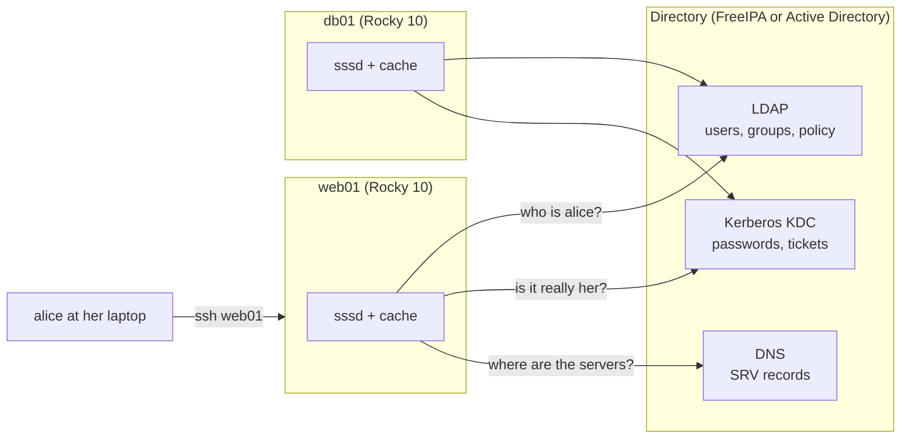
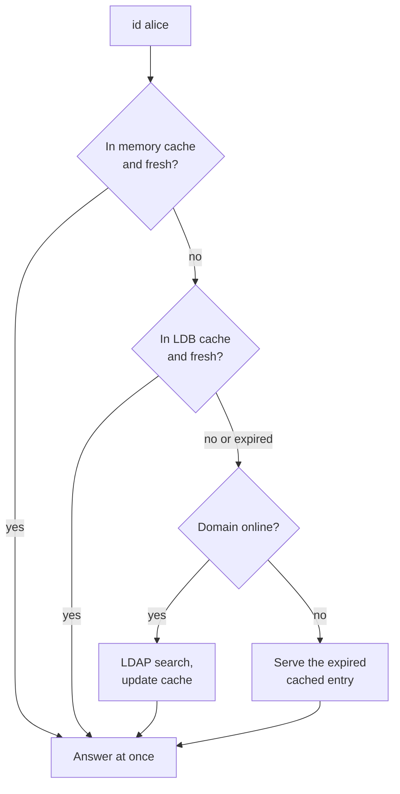
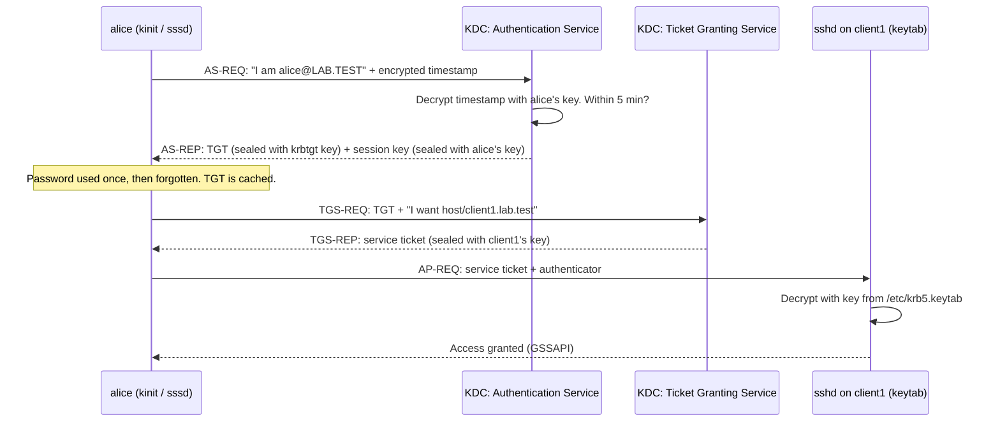
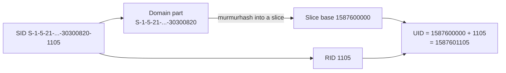

# 26 · Centralized Identity: SSSD, Kerberos, FreeIPA and AD

<ul class="module-meta">
  <li>⏱ ~3.5 hours</li>
  <li>5 labs</li>
  <li>Builds on: 03 · Users, Groups and sudo, 07 · systemd, 11 · Networking, 12 · firewalld</li>
</ul>

You have 200 servers and a new engineer starts on Monday. Do you SSH into 200 machines and run `useradd`? And when she leaves in two years, will you remember every box she had an account on? This module shows how real fleets solve that: one central directory, and a small daemon on each Rocky machine that asks it "who is this person, is that really her, and may she log in here?" By the end you can build a FreeIPA domain, join clients to it, join a machine to Active Directory, and work out why a domain user can't log in.

!!! abstract "What you'll learn"
    - Why central identity exists, and the three questions it answers (who, proof, permission)
    - How the client-side stack fits together: NSS, PAM, `sssd`, its providers and its cache
    - Read and write `sssd.conf`, pick an **authselect** profile, and debug with `sssctl` and `/var/log/sssd`
    - How **Kerberos** works (tickets, the KDC, keytabs) and why clock skew and DNS break it
    - Build a **FreeIPA** (Identity Management) server and client, with HBAC and sudo rules
    - Join a Rocky machine to **Active Directory** with `realm join`, and understand ID mapping
    - Walk a "domain user can't log in" problem from symptom to cause

## The big picture

In the core track you met local accounts: `/etc/passwd`, `/etc/shadow`, PAM and `getent` ([module 03](03-users-groups-and-sudo.md#nss-and-getent-the-right-way-to-look-up-a-user)). Every machine kept its own list. **Centralized identity** moves that list to a **directory server** that every machine trusts. The machines keep almost nothing locally except a cache.



Any login on any machine asks three questions. Keep them apart, because each one fails differently:

| Question | Technical name | Answered by (local) | Answered by (central) |
|---|---|---|---|
| Who is alice? What is her UID, groups, home, shell? | **Identity** (NSS) | `/etc/passwd`, `/etc/group` | LDAP via `sssd` |
| Is this really alice? | **Authentication** (PAM auth) | `/etc/shadow` | Kerberos via `sssd` |
| May alice log in *here*, and run sudo? | **Authorization** (PAM account, sudo) | `pam_access`, `/etc/sudoers` | HBAC rules, AD GPOs, central sudo rules |

On the Rocky machine, one daemon does all three: **sssd**, the System Security Services Daemon. The rest of this module zooms in on sssd, then on the servers it talks to.

!!! analogy "Think of it like a hotel key card system"
    The front desk (the directory) keeps the guest list and issues key cards (Kerberos tickets). Each door (a server) has a reader (sssd) that never stores the guest list itself. It asks the desk, and it remembers recent guests so a door still works for a while if the network to the desk is down (the cache). The analogy breaks in one place: a Kerberos ticket proves *who you are*, not which doors you may open. That decision is a separate policy check.

## Why one directory beats 200 passwd files

Without a directory, every machine is its own island. That causes problems that get worse with scale:

- **Joiners and leavers.** Disabling one account in the directory locks a person out of every machine at once. With local accounts you have to find and edit every box, and you will miss one.
- **UID drift.** alice is UID 1003 on one server and 1007 on another. Copy a file over NFS and it now belongs to someone else.
- **Password sprawl.** Every machine has a separate password with separate expiry. People reuse them or write them down.
- **Audit.** "Who can log in to the payroll database server?" should be one query, not an SSH loop.
- **Single sign-on (SSO).** With Kerberos, alice types her password once in the morning and SSHes everywhere without retyping it.

The two directories you will meet on Rocky are **FreeIPA** (sold by Red Hat as **Identity Management**, or **IdM**, and shipped in Rocky as the `ipa-*` packages) and Microsoft **Active Directory** (**AD**). Both are, under the hood, the same three things: an LDAP server, a Kerberos KDC, and DNS. Plain OpenLDAP or 389 Directory Server without Kerberos also works with sssd, but you lose single sign-on.

## The client-side stack

Programs on Rocky never talk to a directory directly. They call glibc and PAM exactly as they would for a local user. The plumbing below decides where the answer comes from. Click through the layers:

<div class="layers" data-open="0" data-hint="Click a layer to see what lives there." markdown>

<div class="layer" data-label="Applications" data-tag="sshd, sudo, login, ls" markdown>

**What lives here:** anything that needs a user. `ls -l` needs to turn UID `1234400003` into the name `alice`. `sshd` needs to check her password. `sudo` needs her groups and rules.

None of them know about LDAP or Kerberos. They call `getpwnam()` (identity) and the PAM API (authentication).

</div>

<div class="layer" data-label="NSS and PAM" data-tag="glibc, libpam" markdown>

**NSS** (Name Service Switch) reads `/etc/nsswitch.conf` to decide which sources to ask for users and groups. With the `sssd` profile it says `passwd: files sss systemd`. The word `sss` loads `libnss_sss.so.2`.

**PAM** stacks in `/etc/pam.d/system-auth` and `password-auth` include `pam_sss.so` for the auth, account, password and session steps.

```console
$ grep -E '^(passwd|group|sudoers)' /etc/nsswitch.conf
passwd:     files sss systemd
group:      files sss systemd
sudoers:    files sss
```

</div>

<div class="layer" data-label="sssd responders" data-tag="sssd_nss, sssd_pam, sssd_sudo" markdown>

**Responders** are small sssd processes that answer local requests over UNIX sockets in `/var/lib/sss/pipes/`. `sssd_nss` answers NSS lookups, `sssd_pam` answers PAM, `sssd_sudo` serves sudo rules, `sssd_ssh` serves SSH public keys, and `sssd_ifp` (InfoPipe) answers D-Bus queries.

On Rocky 10 most responders are **socket-activated**: systemd starts them the first time something connects.

</div>

<div class="layer" data-label="Cache" data-tag="/var/lib/sss/db" markdown>

Every answer from the directory lands in an **LDB cache** (a small local database) at `/var/lib/sss/db/cache_<domain>.ldb`. A separate **memory cache** in `/var/lib/sss/mc/` lets NSS lookups skip sssd entirely for hot entries.

The cache is why logins keep working when the directory is down, and why a change in the directory can take a few minutes to show up.

</div>

<div class="layer" data-label="Domain backend (providers)" data-tag="sssd_be" markdown>

One **backend** process (`sssd_be`) per domain. It loads **providers**, plug-ins that each answer one kind of question:

- `id_provider`: who exists (users, groups). Values: `ipa`, `ad`, `ldap`, `proxy`.
- `auth_provider`: is the password right. Usually `krb5`, or the same as `id_provider`.
- `access_provider`: may they log in here. `ipa` (HBAC), `ad` (GPO), `simple`, `permit`.
- `sudo_provider`, `autofs_provider`, `selinux_provider`, `hostid_provider` and others.

Helpers like `krb5_child` and `ldap_child` do the privileged Kerberos work.

</div>

<div class="layer" data-label="Network services" data-tag="LDAP 389/636, Kerberos 88, DNS 53" markdown>

The directory itself. sssd finds servers through DNS **SRV records**, binds to LDAP (using Kerberos, so no password is stored on the client), and gets tickets from the KDC on port 88.

</div>

</div>

You can see the processes on a joined client:

```console
$ ps -o pid,cmd -C sssd,sssd_be,sssd_nss,sssd_pam
    PID CMD
    812 /usr/sbin/sssd -i --logger=files
    845 /usr/libexec/sssd/sssd_be --domain lab.test --logger=files
    846 /usr/libexec/sssd/sssd_nss --logger=files
   1290 /usr/libexec/sssd/sssd_pam --logger=files
```

Add `user` to the `-o` list to see which account they run as. The answer changed recently, as the next box explains.

??? question "Under the hood: which user does sssd run as, and why it matters"
    Older SSSD ran every process as root. Since SSSD 2.10 (Rocky 10.0 shipped 2.10, Rocky 10.2 ships 2.12), the project's default is to start the service as an unprivileged **`sssd`** user through `User=`/`Group=` in the systemd unit, and to give elevated rights only to a few binaries (the `krb5_child`, `ldap_child` and `selinux_child` helpers, plus `sssd_pam`) through **file capabilities** rather than setuid. Distributions can override that choice, so prove it on the box rather than trusting a blog:

    ```console
    $ systemctl show sssd -p User -p Group
    $ getcap /usr/libexec/sssd/krb5_child /usr/libexec/sssd/ldap_child
    ```

    If `getcap` lists capabilities such as `cap_dac_read_search` and `cap_setuid`, you are looking at the reduced-privilege design: a bug in the big, network-facing `sssd_be` no longer hands an attacker root.

    The production failure mode is file ownership. When the service user is `sssd`, it must be able to read `/etc/sssd/sssd.conf`, its cache in `/var/lib/sss/db/` and its logs. A config file someone created as `root:root 0600` with a text editor, or a cache restored from a backup with the wrong owner, makes sssd fail at start with a permission error in `sssd.log` or the journal. Red Hat's guidance for SSSD 2.10 and later is `root:sssd` with mode `0640` for `sssd.conf`; on a release where sssd still runs as root, `root:root 0600` is fine. Either way, sssd refuses to start if "other" users can read the file, because it may hold an LDAP bind password.

### Life of a domain login

Here is the whole stack in motion when alice SSHes into `client1`:

<div class="stepper" markdown>

<div class="step" data-title="sshd asks who alice is" markdown>

`sshd` calls `getpwnam("alice")`. NSS checks `files` first (`/etc/passwd`, no alice there), then `sss`. If the memory cache has her, the answer comes back without waking sssd at all. Otherwise `libnss_sss` asks `sssd_nss` over its socket.

</div>

<div class="step" data-title="sssd looks her up" markdown>

`sssd_nss` checks the LDB cache. If the entry is missing or older than `entry_cache_timeout` (default 5400 seconds), it asks the backend, which does an LDAP search on the directory and stores the result. alice exists: UID `1234400003`, home `/home/alice`, shell `/bin/bash`.

</div>

<div class="step" data-title="PAM auth: check the password" markdown>

`sshd` runs the PAM `auth` stack in `password-auth`. `pam_unix` doesn't know alice, so `pam_sss` sends the password to `sssd_pam`, which hands it to `krb5_child`. That process performs a Kerberos **AS exchange** with the KDC. If the KDC issues a ticket, the password was right. No password hash is ever sent to or stored on the client.

</div>

<div class="step" data-title="PAM account: may she log in here?" markdown>

The `account` stack calls `pam_sss` again. sssd evaluates the **access provider**: on FreeIPA, that means HBAC rules ("group webadmins may use sshd on hosts in hostgroup webservers"). On AD, it can mean GPO logon rights. A "no" here gives the classic "correct password, still denied".

</div>

<div class="step" data-title="Session: home directory and ticket" markdown>

The `session` stack runs. With the `with-mkhomedir` authselect feature, `pam_oddjob_mkhomedir` asks the `oddjobd` service to create `/home/alice`. sssd stores alice's fresh Kerberos ticket in her credential cache, so her next `ssh db01` needs no password at all.

</div>

<div class="step" data-title="Later: offline" markdown>

If the directory goes down tomorrow, sssd marks the domain **offline**. NSS answers come from the cache. If `cache_credentials = True`, sssd stored a salted hash of alice's last successful password, so she can still log in. A user who has never logged in on this machine cannot.

</div>

</div>

<div class="quiz" data-answer="3" markdown>

`getent passwd alice` prints a full line for alice on `client1`, but `grep alice /etc/passwd` prints nothing. What does that tell you?

- alice's account is corrupt and needs to be recreated
- NSS is broken because the two commands disagree
- alice comes from a non-file source such as sssd, which is exactly how central accounts look
- `getent` reads a stale backup copy of `/etc/passwd`

Right. `getent` asks NSS, which walks every source in `nsswitch.conf`. `grep` only reads one file. Directory users never appear in `/etc/passwd`, which is why you always check users with `getent` or `id`.

</div>

## authselect: wiring NSS and PAM

You never hand-edit `/etc/nsswitch.conf` or `/etc/pam.d/system-auth` on Rocky. **authselect** generates them from a **profile** plus optional **features** ([module 03](03-users-groups-and-sudo.md#authselect-and-sssd-the-bigger-picture) introduced it). For central identity, you care about the `sssd` profile:

```console
$ authselect list
- local     Local users only
- sssd      Enable SSSD for system authentication (also for local users only)
- winbind   Enable winbind for system authentication
```

??? example "The full feature list: `authselect list-features sssd`"

    ```console
    $ authselect list-features sssd
    with-faillock
    with-fingerprint
    with-mkhomedir
    with-pam-gnome-keyring
    with-pam-u2f
    with-pam-u2f-2fa
    with-pamaccess
    with-silent-lastlog
    with-smartcard
    with-smartcard-lock-on-removal
    with-smartcard-required
    with-subid
    with-sudo
    without-nullok
    …
    ```

    `authselect show sssd` prints the profile's description with what each feature does.

The features you will use most:

| Feature | What it adds |
|---|---|
| `with-mkhomedir` | Creates the home directory on first login (needs `oddjob-mkhomedir` and the `oddjobd` service) |
| `with-sudo` | Adds `sss` to the `sudoers` line in `nsswitch.conf` so sudo asks sssd for central rules |
| `with-faillock` | Locks an account locally after repeated failures |
| `with-smartcard` | Smart card login through sssd |

Selecting the profile:

```console
$ sudo authselect select sssd with-mkhomedir with-sudo
Profile "sssd" was selected.
$ sudo systemctl enable --now oddjobd
$ authselect current
Profile ID: sssd
Enabled features:
- with-mkhomedir
- with-sudo
```

In practice `ipa-client-install` and `realm join` run authselect for you. You still need to know it, because "I added a feature by hand-editing `system-auth` and it vanished" is a classic.

!!! version "Rocky 9 vs 10"
    Rocky 9 defaults to the `sssd` profile even on a standalone machine. Rocky 10 defaults to `local` and only switches to `sssd` when you join a domain. Rocky 10 also uses authselect 1.5, which dropped `/etc/authselect/user-nsswitch.conf`. On Rocky 9 you could add custom `nsswitch.conf` lines there; on Rocky 10 authselect owns the whole file, so you need a custom profile (`authselect create-profile`) for anything the stock profiles don't cover.

## sssd.conf anatomy

The configuration lives in `/etc/sssd/sssd.conf`, plus drop-in snippets in `/etc/sssd/conf.d/*.conf`. It is INI style: one `[sssd]` section, one `[domain/NAME]` section per directory, and optional sections for each responder. Here is what `ipa-client-install` writes on a FreeIPA client:

```ini title="/etc/sssd/sssd.conf"
[domain/lab.test]
id_provider = ipa  # (1)!
ipa_server = _srv_, ipa1.lab.test  # (2)!
ipa_domain = lab.test
ipa_hostname = client1.lab.test
auth_provider = ipa
chpass_provider = ipa
access_provider = ipa  # (3)!
cache_credentials = True  # (4)!
ldap_tls_cacert = /etc/ipa/ca.crt
krb5_store_password_if_offline = True

[sssd]
services = nss, pam, ssh, sudo  # (5)!
domains = lab.test  # (6)!

[nss]
homedir_substring = /home

[pam]

[sudo]

[ssh]
```

1. Where users and groups come from. `ipa` also brings HBAC, sudo and SELinux user mapping from the IPA server.
2. `_srv_` means "look up servers with DNS SRV records first", with `ipa1` as a fallback.
3. Enforce HBAC rules from the server. Set to `permit` to allow everyone, which is useful for one test and dangerous forever.
4. Store a salted hash of the last good password so the user can log in offline.
5. Which responders to start. Many are socket-activated on Rocky 10, so this line can be shorter.
6. Which `[domain/...]` sections are active, in lookup order.

A few rules that bite people:

- No access for "other" users, and the file must be readable by the account sssd runs as (see "which user does sssd run as" above). `sudo chmod 600 /etc/sssd/sssd.conf` on a root-run sssd, or `sudo chown root:sssd` plus `chmod 640` when it runs as `sssd`.
- Check syntax before restarting: `sudo sssctl config-check`.
- Comments must be on their own line in real files (the `# (1)!` markers above are page annotations only).
- After editing, `sudo systemctl restart sssd`.

### Useful knobs

| Option (domain section) | What it controls |
|---|---|
| `entry_cache_timeout` | Seconds before a cached user or group is considered stale (default 5400) |
| `cache_credentials` | Allow offline password logins |
| `offline_credentials_expiration` | Days a cached password stays valid offline (in `[pam]`; 0 means forever) |
| `use_fully_qualified_names` | Require `alice@ad.example.com` instead of `alice` |
| `fallback_homedir` | Home path template when the directory has none, such as `/home/%u@%d` |
| `ldap_id_mapping` | Generate UIDs from Windows SIDs (AD) instead of reading `uidNumber` |
| `simple_allow_groups` | With `access_provider = simple`, only these groups may log in |
| `debug_level` | Logging detail, 0 to 9 (see debugging below) |

## The cache, sss_cache and offline logins

The cache is both sssd's best feature and its most common source of confusion. You add alice to the `webadmins` group in the directory, and `id alice` on a client still doesn't show it. That's not a bug: the client is serving the cached answer until it expires.



Two tools deal with the cache:

- **`sss_cache`** marks entries as expired, so the next lookup goes to the server. It does not delete anything and is safe to run any time.
- **`sssctl cache-remove`** stops sssd, backs up local data, deletes the cache databases, and starts again. Use it when the cache is corrupt or when you change ID mapping settings. Users lose offline login until they log in online again.

```console
$ sudo sss_cache -u alice        # expire one user
$ sudo sss_cache -E              # expire everything
$ id alice
uid=1234400003(alice) gid=1234400003(alice) groups=1234400003(alice),1234400005(webadmins)
```

??? question "Under the hood: the negative cache, and why a brand-new user \"doesn't exist\""
    sssd also remembers **misses**. When a lookup for `newhire` fails, sssd stores that "not found" answer in a **negative cache** for `entry_negative_timeout` seconds (15 by default, in the `[nss]` section). That protects the directory from a flood of repeated failed lookups, for example from a cron job looking up a deleted user every second.

    The trap: someone runs `id newhire` on a client *before* the account exists, the admin creates it a moment later, and the next `id newhire` still says "no such user". It's the negative cache, not replication. Wait 15 seconds or run `sudo sss_cache -u newhire`.

    The **memory cache** in `/var/lib/sss/mc/` (`passwd`, `group`, `initgroups`) is a different beast: memory-mapped files that `libnss_sss` reads directly in the calling process, with no socket round trip to sssd. That's why `getent passwd alice` can answer even while sssd is busy, and why `sss_cache` also invalidates those files. If you ever see stale answers that survive an sssd restart, `ls -l /var/lib/sss/mc/` and `sss_cache -E` are where to look.

!!! warning "Don't `rm -rf /var/lib/sss/db/*` as a reflex"
    Deleting the cache also deletes the stored offline credentials. If the directory is unreachable when you do it, nobody from the domain can log in until it comes back. Expire with `sss_cache -E` first; only remove the cache when you know the server is reachable.

<div class="quiz" data-answer="2" markdown>

The IPA server has been down for an hour. bob, who logged in to `client1` yesterday, can still log in. carol, who has never logged in to `client1`, cannot. Why?

- carol's account is disabled on the server
- sssd cached bob's identity and a hash of his last password, but has nothing at all for carol
- Kerberos tickets last exactly one hour
- HBAC rules deny carol on every host

Right. Offline login only works for users the client has seen before, and only with `cache_credentials = True`.

</div>

## Debugging sssd

When a domain user can't log in, the answer is almost always in three places: `sssctl`, the sssd logs, and the PAM log.

### sssctl: the swiss army knife

```console
$ sudo sssctl domain-list
lab.test
$ sudo sssctl domain-status lab.test
Online status: Online

Active servers:
IPA: ipa1.lab.test

Discovered IPA servers:
- ipa1.lab.test
```

`sssctl user-checks` runs the real NSS lookup and a real PAM `account` check for a user, so you can test access without a password:

```console
$ sudo sssctl user-checks alice -s sshd
user: alice
action: acct
service: sshd

SSSD nss user lookup result:
 - user name: alice
 - user id: 1234400003
 - group id: 1234400003
 - gecos: Alice Admin
 - home directory: /home/alice
 - shell: /bin/bash
…
testing pam_acct_mgmt

pam_acct_mgmt: Permission denied
```

`Permission denied` at the `acct` step means the user exists but the access provider (HBAC on IPA) said no. That's a policy problem, not a password problem.

Other subcommands worth knowing: `sssctl user-show alice` (what the cache holds, including expiry time), `sssctl config-check`, `sssctl logs-remove` (truncate logs before reproducing a problem), and `sssctl analyze request list` (follow one request across the log files).

### Turning up the logs

sssd logs to `/var/log/sssd/`, one file per component:

| File | Contains |
|---|---|
| `sssd.log` | The monitor process: startup, crashes, config errors |
| `sssd_lab.test.log` | The domain backend: LDAP searches, server discovery, online/offline |
| `sssd_nss.log` | Identity lookups from NSS |
| `sssd_pam.log` | Each PAM request and its result |
| `krb5_child.log` | Kerberos exchanges (wrong password, clock skew, KDC unreachable) |
| `ldap_child.log` | The client getting its own ticket from its keytab |

By default they hold only serious errors. Raise the level while you reproduce the problem, then put it back:

```console
$ sudo sssctl debug-level 6          # change at runtime, all components
$ sudo sssctl logs-remove            # start with empty logs
$ ssh alice@client1                  # reproduce the failure (from elsewhere)
$ sudo grep -i -E 'error|denied|offline' /var/log/sssd/sssd_lab.test.log | tail
$ sudo sssctl debug-level 0x0070     # back to the default
```

For a permanent change, add `debug_level = 6` to the relevant section of `sssd.conf` and restart. Level 6 is enough for almost everything; level 9 is very noisy.

Don't forget the plain PAM side: `sudo journalctl -u sshd` and `/var/log/secure` show which PAM step failed, with lines like `pam_sss(sshd:account): Access denied for user alice: 6 (Permission denied)`.

### Practice: interrogate a client

<div class="terminal-sim" data-title="Is this client healthy?" data-prompt="[admin@client1 ~]$ " markdown>

<div class="task" data-expect="authselect current" data-hint="Ask authselect which profile is active." markdown>

**Step 1.** Check which authselect profile wires NSS and PAM on this machine.

```text
Profile ID: sssd
Enabled features:
- with-mkhomedir
- with-sudo
```

</div>

<div class="task" data-expect="sudo sssctl domain-status lab.test" data-match="^(sudo )?sssctl domain-status( -[a-z-]+)* lab\.test$" data-hint="Use sssctl with the domain-status subcommand and the domain name lab.test." markdown>

**Step 2.** Is the `lab.test` domain online, and which server is active?

```text
Online status: Online

Active servers:
IPA: ipa1.lab.test

Discovered IPA servers:
- ipa1.lab.test
```

</div>

<div class="task" data-expect="getent passwd alice||id alice" data-hint="Look the user up through NSS, not by reading /etc/passwd." markdown>

**Step 3.** Look up the domain user `alice` the right way.

```text
alice:*:1234400003:1234400003:Alice Admin:/home/alice:/bin/bash
```

</div>

<div class="task" data-expect="sudo sssctl user-checks alice -s sshd" data-match="^(sudo )?sssctl user-checks (alice -s sshd|-s sshd alice)$" data-hint="sssctl user-checks takes the user name and -s for the PAM service." markdown>

**Step 4.** Test whether alice would be allowed to log in over SSH, without knowing her password.

```text
user: alice
action: acct
service: sshd
…
pam_acct_mgmt: Permission denied
```

So alice exists, but policy says no. That's an HBAC question for the IPA server.

</div>

<div class="task" data-expect="sudo sss_cache -E" data-match="^(sudo )?sss_cache (-E|--everything)$" data-hint="sss_cache with the flag that expires everything." markdown>

**Step 5.** An admin just fixed the HBAC rule. Expire every cached entry so the client re-reads it.

```text
```

No output means success. The next lookup goes to the server.

</div>

</div>

## Kerberos in plain English

**Kerberos** is a network authentication protocol built on a trusted third party. Instead of every server checking your password, one server, the **KDC** (Key Distribution Center), checks it once and hands you **tickets**. You show a ticket to other servers to prove who you are. Your password never crosses the network.

A few terms first:

- **Realm**: the Kerberos domain, written in capitals by convention: `LAB.TEST`. Usually the DNS domain in upper case.
- **Principal**: a name in the realm. Users look like `alice@LAB.TEST`; services look like `host/client1.lab.test@LAB.TEST` or `HTTP/www.lab.test@LAB.TEST`.
- **KDC**: the server that holds every principal's secret key. It runs two logical services, the **AS** (Authentication Service) and the **TGS** (Ticket Granting Service).
- **TGT** (Ticket Granting Ticket): the ticket you get at login. It lets you ask for other tickets without your password.
- **Service ticket**: a ticket for one specific service, such as SSH on `client1`.
- **Keytab**: a file holding a service's secret key, so the service can decrypt tickets without a human typing a password.
- **Credential cache** (ccache): where your tickets are stored, such as `KCM:1000`.

!!! analogy "Think of it like a festival wristband"
    At the gate (the AS) you show your ID once and get a wristband (the TGT) that is valid all day. At each stage (a service), you don't show ID again: you show the wristband at the token booth (the TGS) and get a token for that one stage (a service ticket). The stage staff can verify the token is genuine without phoning the gate.

### The ticket dance



Notice what that implies:

- The client proves it knows the password by encrypting the current time with a key derived from it (**pre-authentication**). That's why clocks must agree.
- The service never talks to the KDC during your login. It just decrypts your ticket with its own key from its keytab. That's why a wrong or stale keytab breaks things silently.
- Tickets expire (typically 24 hours, renewable for 7 days). That's why a long-running job can fail at 3 a.m. the next day.

### kinit, klist, kdestroy

```console
$ kinit alice
Password for alice@LAB.TEST:
$ klist
Ticket cache: KCM:1000
Default principal: alice@LAB.TEST

Valid starting       Expires              Service principal
10/15/2026 09:14:02  10/16/2026 09:14:02  krbtgt/LAB.TEST@LAB.TEST
	renew until 10/22/2026 09:14:02
$ ssh client1.lab.test hostname
client1.lab.test
$ klist | tail -2
10/15/2026 09:14:20  10/16/2026 09:14:02  host/client1.lab.test@LAB.TEST
	renew until 10/22/2026 09:14:02
$ kdestroy
```

After the `ssh`, a second ticket appears: the service ticket for `host/client1`. You never typed a password for it.

`KCM:1000` means the tickets live in the **KCM** credential cache, served by `sssd-kcm`, for UID 1000. If `sssd-kcm` isn't installed you may see a kernel keyring cache (`KEYRING:persistent:1000`) instead. Both work; they are just different places to keep tickets.

### Keytabs

Every machine joined to a realm has a host principal and a keytab at `/etc/krb5.keytab`. sssd uses it to authenticate the machine itself to LDAP; sshd uses it to accept tickets.

```console
$ sudo klist -k /etc/krb5.keytab
Keytab name: FILE:/etc/krb5.keytab
KVNO Principal
---- --------------------------------------------------------------------------
   1 host/client1.lab.test@LAB.TEST
   1 host/client1.lab.test@LAB.TEST
   1 host/client1.lab.test@LAB.TEST
$ sudo kinit -k host/client1.lab.test     # prove the keytab works
$ klist
Ticket cache: KCM:0
Default principal: host/client1.lab.test@LAB.TEST
…
```

The repeated lines are the same key in different encryption types (`klist -ke` shows them). **KVNO** is the key version number. If someone re-joins the machine or resets its key on the server, the KVNO in the directory goes up and the old keytab no longer matches.

??? question "Under the hood: exporting a keytab can break the machine that already has one"
    With MIT `kadmin`, `ktadd` doesn't just *copy* a principal's key into a file. By default it **generates a new random key**, bumps the KVNO, and writes that to the keytab. FreeIPA's `ipa-getkeytab` does the same unless you pass `-r` (retrieve the existing key).

    So the innocent-looking "let me grab a keytab for `HTTP/www` on the second web server too" silently invalidates the keytab on the first one. Its next ticket check fails, and the symptom shows up hours later (when cached tickets expire) on a machine nobody touched. When several hosts must share one service principal, export the key once and copy the file, or use the retrieve option. Lab 3 makes you watch the KVNO move.

??? question "Under the hood: how SSH single sign-on actually happens (GSSAPI)"
    Password-free `ssh` with Kerberos is **GSSAPI** authentication, and both ends must opt in. Rocky ships it switched on in the Red Hat drop-ins under `/etc/ssh/sshd_config.d/` and `/etc/ssh/ssh_config.d/`. Prove what is really in effect rather than reading files:

    ```console
    $ sudo sshd -T | grep -i '^gssapi'
    gssapiauthentication yes
    gssapicleanupcredentials no
    …
    $ ssh -G client1.lab.test | grep -i '^gssapi'
    gssapiauthentication yes
    gssapidelegatecredentials no
    …
    ```

    Three non-obvious rules decide whether it works:

    - **The name you type picks the principal.** `ssh client1.lab.test` asks the KDC for `host/client1.lab.test`. `ssh 192.168.150.20` has no matching principal, so GSSAPI silently fails and you get a password prompt.
    - **Delegation is off by default.** Your TGT is *not* forwarded, so from `client1` a second hop (`ssh db01`) asks for a password again. `ssh -K` (or `GSSAPIDelegateCredentials yes`) forwards it. Only do that to hosts you trust, because root there can use your ticket.
    - **`ssh -vvv` tells you which step failed**: look for lines mentioning `gssapi-with-mic` and the error text from the Kerberos library.

!!! danger "A keytab is a password"
    Anyone who can read `/etc/krb5.keytab` can impersonate the machine. Keep it `0600 root:root`, never copy it into a container image or a Git repository, and never send it by email.

### The two classic Kerberos failures

**1. Clock skew.** The KDC rejects requests whose timestamp is more than 5 minutes off (the default `clockskew`). The error is honest about it:

```console
$ kinit alice
kinit: Clock skew too great while getting initial credentials
```

The fix is to make `chronyd` work ([module 36](36-time-synchronization.md) covers time sync in depth): `chronyc tracking` should show a small offset. FreeIPA clients sync time against the IPA servers by default.

**2. DNS.** Kerberos and sssd find servers through DNS **SRV records**, and service principals are tied to hostnames. If forward and reverse DNS disagree, or the SRV records are missing, you get `Cannot find KDC for realm` or `Server not found in Kerberos database`.

```console
$ dig +short SRV _kerberos._udp.lab.test
0 100 88 ipa1.lab.test.
$ dig +short SRV _ldap._tcp.lab.test
0 100 389 ipa1.lab.test.
$ hostname -f
client1.lab.test
```

Point clients at the directory's DNS servers (or make sure your corporate DNS carries the records), and give every machine a proper fully qualified hostname before you join it.

<div class="quiz" data-answer="1" markdown>

`kinit alice` works on `client1`, but `ssh client1.lab.test` from alice's laptop (with a valid TGT) falls back to asking for a password. `klist` on the laptop shows a ticket for `host/client1.lab.test`. What should you check first on `client1`?

- That `/etc/krb5.keytab` contains a `host/client1.lab.test` key with the current KVNO
- That alice's password hasn't expired
- That `/etc/passwd` contains alice
- That port 88 is open on `client1`

Right. The laptop got a service ticket, so the KDC side worked. The server must now decrypt it with its keytab. A missing or stale keytab (wrong KVNO after a re-join) makes GSSAPI fail and sshd falls back to passwords. `kinit -k` on the client tests it. Port 88 is the KDC's port, not the client's.

</div>

## FreeIPA (Identity Management) on Rocky

**FreeIPA** bundles everything a Linux domain needs into one installer and one admin tool:

| Component | Job |
|---|---|
| 389 Directory Server | LDAP store for users, groups, hosts, policy |
| MIT Kerberos KDC | Authentication and tickets |
| Dogtag Certificate System | An internal CA that issues host and service certificates |
| BIND with `bind-dyndb-ldap` (optional) | DNS zones stored in LDAP, with the SRV records created for you |
| SSSD | The client side, on every member, including the servers |
| Web UI and the `ipa` CLI | Management over a JSON-RPC API |

It also stores **policy** that AD doesn't have natively for Linux: **HBAC** (host-based access control) rules, central **sudo rules**, SELinux user maps, and automount maps. On Rocky the packages live in AppStream: `ipa-server`, `ipa-server-dns` (for integrated DNS), `ipa-server-trust-ad` (for AD trusts) and `ipa-client`.

!!! version "Rocky 9 vs 10"
    On Rocky 8 you had to enable the `idm:DL1` module stream before installing. Rocky 9 and 10 have no module for it: `dnf install ipa-server ipa-server-dns` is all you need.

### Installing a server

The server needs a static IP, a fully qualified hostname that resolves to that IP, and at least 2 GB of RAM (4 GB is more comfortable). The core install is one command:

```console
$ sudo hostnamectl set-hostname ipa1.lab.test
$ sudo dnf install -y ipa-server ipa-server-dns
$ sudo ipa-server-install --setup-dns --auto-forwarders --auto-reverse \
      --realm LAB.TEST --domain lab.test \
      --ds-password 'DirMgr-Pass-123' --admin-password 'Admin-Pass-123' \
      --unattended
…
The ipa-server-install command was successful
$ sudo firewall-cmd --permanent --add-service={freeipa-4,dns}
$ sudo firewall-cmd --reload
```

`--ds-password` is for the LDAP superuser (`cn=Directory Manager`), used only for recovery. `admin` is the everyday IPA administrator. The install takes 5 to 15 minutes. Afterwards, `ipactl status` shows the services:

```console
$ sudo ipactl status
Directory Service: RUNNING
krb5kdc Service: RUNNING
kadmin Service: RUNNING
named Service: RUNNING
httpd Service: RUNNING
ipa-custodia Service: RUNNING
pki-tomcatd Service: RUNNING
ipa-otpd Service: RUNNING
ipa-dnskeysyncd Service: RUNNING
ipa: INFO: The ipactl command was successful
```

### Joining a client

On the client, point DNS at the IPA server (with `nmcli`, [module 11](11-networking.md)), then:

```console
$ sudo dnf install -y ipa-client
$ sudo ipa-client-install --mkhomedir --domain lab.test --server ipa1.lab.test \
      --realm LAB.TEST --principal admin
…
Client hostname: client1.lab.test
Realm: LAB.TEST
DNS Domain: lab.test
IPA Server: ipa1.lab.test
BaseDN: dc=lab,dc=test
Continue to configure the system with these values? [no]: yes
…
Password for admin@LAB.TEST:
…
The ipa-client-install command was successful
```

That one command did a lot. It created a host entry and fetched `/etc/krb5.keytab`, wrote `/etc/krb5.conf` and `/etc/sssd/sssd.conf`, ran `authselect select sssd with-mkhomedir with-sudo`, configured chrony, installed the IPA CA at `/etc/ipa/ca.crt`, and registered the host's SSH keys in DNS.

### Users, groups, HBAC and sudo

Everything is the `ipa` command, after you get an admin ticket:

```console
$ kinit admin
$ ipa user-add alice --first=Alice --last=Admin --password
Password:
Enter Password again to verify:
------------------
Added user "alice"
------------------
  User login: alice
  First name: Alice
  Last name: Admin
  Home directory: /home/alice
  UID: 1234400003
  GID: 1234400003
  …
$ ipa group-add webadmins --desc "Web server admins"
$ ipa group-add-member webadmins --users=alice
```

The first time alice logs in, she must change the temporary password that the admin set.

**HBAC** decides who may log in where, using which service. A fresh install has a rule called `allow_all` that lets everyone log in everywhere. Real deployments disable it and write specific rules:

```console
$ ipa hbacrule-add webadmins_ssh
$ ipa hbacrule-add-user webadmins_ssh --groups=webadmins
$ ipa hbacrule-add-host webadmins_ssh --hosts=client1.lab.test
$ ipa hbacrule-add-service webadmins_ssh --hbacsvcs=sshd
$ ipa hbacrule-disable allow_all
$ ipa hbactest --user=alice --host=client1.lab.test --service=sshd
--------------------
Access granted: True
--------------------
  Matched rules: webadmins_ssh
  Not matched rules: allow_all
```

`ipa hbactest` simulates a login on the server without touching the client. Use it before you disable `allow_all`, so you don't lock out the whole company.

**Central sudo rules** replace `/etc/sudoers.d` files on every host:

```console
$ ipa sudorule-add webadmins_all --hostcat=all --cmdcat=all
$ ipa sudorule-add-user webadmins_all --groups=webadmins
```

On the client, alice runs `sudo -l` and sees the rule (sssd fetched it because of `with-sudo` and `sudo_provider = ipa`).

In larger setups you group hosts too (`ipa hostgroup-add webservers`) and attach rules to host groups, so a new web server gets the right policy just by joining the group.

## Active Directory with realmd

Many shops already run AD. Rocky can join it directly, with no FreeIPA in between, using **realmd**. realmd is a small tool that discovers a domain, installs the needed packages, joins (using `adcli`), and writes `sssd.conf` with the **`ad` provider**.

```console
$ sudo dnf install -y realmd
$ realm discover ad.example.com
ad.example.com
  type: kerberos
  realm-name: AD.EXAMPLE.COM
  domain-name: ad.example.com
  configured: no
  server-software: active-directory
  client-software: sssd
  required-package: oddjob
  required-package: oddjob-mkhomedir
  required-package: sssd
  required-package: adcli
  required-package: samba-common-tools
$ sudo realm join ad.example.com -U Administrator
Password for Administrator:
$ realm list
ad.example.com
  type: kerberos
  realm-name: AD.EXAMPLE.COM
  domain-name: ad.example.com
  configured: kerberos-member
  server-software: active-directory
  client-software: sssd
  login-formats: %U@ad.example.com
  login-policy: allow-realm-logins
```

Behind that one command, realmd installed the missing packages, used `adcli` to create a computer account in AD and write `/etc/krb5.keytab`, wrote `sssd.conf`, and ran authselect. Three defaults in the generated file shape everything that follows: `id_provider = ad`, `use_fully_qualified_names = True` and `ldap_id_mapping = True`.

??? example "The full `sssd.conf` that `realm join` writes"

    ```ini title="/etc/sssd/sssd.conf (written by realm join)"
    [sssd]
    domains = ad.example.com
    config_file_version = 2
    services = nss, pam

    [domain/ad.example.com]
    default_shell = /bin/bash
    krb5_store_password_if_offline = True
    cache_credentials = True
    krb5_realm = AD.EXAMPLE.COM
    realmd_tags = manages-system joined-with-adcli
    id_provider = ad
    fallback_homedir = /home/%u@%d
    ad_domain = ad.example.com
    use_fully_qualified_names = True
    ldap_id_mapping = True
    access_provider = ad
    ```

    Useful `realm join` options when the defaults don't suit you: `--computer-ou="OU=Linux,DC=ad,DC=example,DC=com"` to place the computer account, `--automatic-id-mapping=no` to use POSIX attributes from AD instead of SID mapping, and `--membership-software=samba` if you also need Samba file sharing on the host.

### Fully qualified names

With `use_fully_qualified_names = True`, users must be written `alice@ad.example.com`:

```console
$ id alice@ad.example.com
uid=1587601105(alice@ad.example.com) gid=1587600513(domain users@ad.example.com) groups=…
$ id alice
id: 'alice': no such user
```

That's deliberate. It avoids collisions between a local `alice` and an AD `alice`, and between users of two trusted AD domains. If you have only one domain and want short names, set it to `False` (and set `fallback_homedir = /home/%u`), then clear the cache with `sudo sssctl cache-remove` and restart sssd.

### ID mapping: where do UIDs come from?

Windows identifies users by **SIDs** (Security Identifiers) like `S-1-5-21-3623811015-3361044348-30300820-1105`, not UIDs. With `ldap_id_mapping = True`, sssd computes a UID from the SID with a fixed algorithm: it hashes the domain part of the SID into a slice of the ID range and adds the user's **RID** (the last number). The result is the same on every Rocky client with the same settings, with no extra attributes needed in AD.



??? question "Under the hood: ID-mapping slices, and how two clients end up with different UIDs"
    The ID space between `ldap_idmap_range_min` and `ldap_idmap_range_max` is cut into **slices** of `ldap_idmap_range_size` IDs (200,000 by default). The hash of a domain SID picks the slice, and a user's RID is the offset inside it. Three consequences that bite in production:

    - **Every client must use identical range settings.** If one server was joined with a tweaked `ldap_idmap_range_size`, the same user gets a different UID there. NFS and shared storage then show the wrong owner. Keep the settings in configuration management, not hand edits.
    - **Large RIDs spill over.** In an old, busy AD domain, RIDs above 200,000 don't fit in the first slice. sssd assigns extra slices automatically, but the UID is no longer simply "base + RID", so don't write scripts that assume it.
    - **Hash collisions are possible.** Two trusted domains can hash to the same slice. sssd detects it and logs an error rather than hand out overlapping UIDs, and users of the second domain can't be resolved until you configure ranges explicitly ([[man:sssd-ldap(5)]] documents the `ldap_idmap_*` options).

    `sss_cache` won't fix a mapping mistake: changing any of these settings needs `sssctl cache-remove` and a re-own of existing files.

The alternative, `ldap_id_mapping = False`, reads `uidNumber` and `gidNumber` attributes (POSIX attributes) that someone maintains in AD. Use that when Linux UIDs must match an existing NFS estate. Changing the setting on a live system changes every UID, so file ownership breaks: decide once, before you join.

### Controlling who may log in

`access_provider = ad` honours AD account state and, by default, GPO logon rights for this computer. realmd adds a simple local layer on top:

```console
$ sudo realm deny --all
$ sudo realm permit -g 'linux-admins@ad.example.com'
```

That switches sssd to `access_provider = simple` with `simple_allow_groups`.

!!! warning "Crypto policy and old AD domains"
    Rocky's default crypto policy disables the RC4 Kerberos encryption type. Modern AD supports AES, and the right fix is to make sure AES is enabled for the computer and user accounts in AD. If you can't, Red Hat documents a crypto **subpolicy** as a fallback: `AD-SUPPORT` on EL8, and `AD-SUPPORT-LEGACY` (the one that re-enables RC4) on EL9. Check which modules your release ships with `ls /usr/share/crypto-policies/policies/modules/` before you run `update-crypto-policies --set DEFAULT:<module>`. Any of them weakens the whole host's crypto policy, not just Kerberos ([module 33](33-tls-and-crypto-policies.md)).

<div class="quiz" data-answer="4" markdown>

You joined a Rocky host to AD with default settings. `getent passwd bob` returns nothing, but bob exists in AD. What is the most likely reason?

- The host needs a reboot after `realm join`
- AD users can't be looked up with `getent`
- bob has no `uidNumber` attribute in AD
- realmd set `use_fully_qualified_names = True`, so the name is `bob@ad.example.com`

Right. With the default realmd setup, short names don't resolve. Try `getent passwd bob@ad.example.com`. The `uidNumber` answer would only matter with `ldap_id_mapping = False`.

</div>

## Troubleshooting: a domain user can't log in

Work top to bottom. Each answer narrows the problem to one layer of the stack.

<div class="decision" markdown>

<div class="node" data-id="start" markdown>

**Does `id alice` (or `id alice@ad.example.com`) return the user on the client?**

<button data-goto="auth">Yes</button> <button data-goto="noid">No</button>

</div>

<div class="node" data-id="noid" markdown>

**Is sssd running, and is the domain online?** Check `systemctl status sssd` and `sudo sssctl domain-status <domain>`.

<button data-goto="offline">sssd down or domain offline</button> <button data-goto="name">Running and online</button>

</div>

<div class="node" data-id="offline" markdown>

**Network, DNS, or keytab.** Look at `/var/log/sssd/sssd_<domain>.log` and `ldap_child.log`. Check the SRV records with `dig SRV _ldap._tcp.<domain>`, reachability of ports 389 and 88, and the machine keytab with `sudo kinit -k host/$(hostname -f)`. If `kinit -k` fails with "Clock skew too great", fix chrony. If it fails with "Client not found", the host was removed from the directory: re-join.

</div>

<div class="node" data-id="name" markdown>

**Name format or stale cache.** On AD, try the fully qualified name. Check `nsswitch.conf` contains `sss` (`authselect current` shows the `sssd` profile). Expire the cache with `sudo sss_cache -E` and retry. Still nothing: raise `debug_level` and read `sssd_nss.log` and the domain log for the search.

</div>

<div class="node" data-id="auth" markdown>

**Does `sudo sssctl user-checks alice -s sshd` report `pam_acct_mgmt: Success`?**

<button data-goto="pw">Yes</button> <button data-goto="access">No, Permission denied</button>

</div>

<div class="node" data-id="access" markdown>

**Access policy.** The user exists but is not allowed here. On IPA: `ipa hbactest --user=alice --host=$(hostname -f) --service=sshd` and fix the HBAC rule. On AD: check `realm list` (login-policy) and `simple_allow_groups`, or the GPO logon rights. Also check the account isn't disabled or expired in the directory.

</div>

<div class="node" data-id="pw" markdown>

**Does `kinit alice` work on the client?**

<button data-goto="session">Yes</button> <button data-goto="krb">No</button>

</div>

<div class="node" data-id="krb" markdown>

**Kerberos authentication.** Read the error: "Password incorrect" (wrong password or must change it), "Clock skew too great" (time), "Cannot find KDC" (DNS or `krb5.conf`), "Client's credentials have been revoked" (locked out). `krb5_child.log` has the details.

</div>

<div class="node" data-id="session" markdown>

**Session stage.** Auth and access work, so the failure is after them. Check `journalctl -u sshd` and `/var/log/secure` for `session` errors: a missing home directory (enable `with-mkhomedir` and start `oddjobd`), an invalid shell, or an SELinux denial on a non-standard home path (`ausearch -m avc -ts recent`, [module 16](16-selinux.md)).

</div>

</div>

## Labs

Labs 1 to 3 need only one Rocky 10 VM. Lab 4 needs two VMs on an isolated network; [module 27](27-virtualization-kvm.md) shows how to build them on one host.

!!! lab "Lab 1: Map the client-side stack"

    **Goal:** See how NSS, PAM and authselect fit together on your own machine, and what switching to the `sssd` profile changes.

    **You'll need:** a Rocky 10 VM, sudo.

    1. Record the current state:

        ```bash
        authselect current
        grep -E '^(passwd|group|shadow|sudoers)' /etc/nsswitch.conf
        grep -c pam_sss /etc/pam.d/system-auth
        ```

    2. Back up and switch to the `sssd` profile (this is safe: local users still work through `files` and `pam_unix`):

        ```bash
        sudo dnf install -y sssd-client sssd-tools oddjob-mkhomedir
        sudo authselect select sssd with-mkhomedir --force
        ```

    3. Compare:

        ```bash
        grep -E '^(passwd|group|sudoers)' /etc/nsswitch.conf
        grep pam_sss /etc/pam.d/system-auth
        head -3 /etc/pam.d/system-auth
        ```

    4. Prove local lookups still work: `getent passwd root` and `id $USER`.

    **Check your work:** `nsswitch.conf` now lists `sss` after `files`, and `system-auth` contains `pam_sss.so` lines and a "Generated by authselect" header.

    ??? success "What just happened?"
        authselect rewrote the NSS and PAM files from the `sssd` profile template. Nothing talks to a directory yet: sssd has no domain configured, so `libnss_sss` simply returns "not found" and NSS moves on. `--force` was needed because authselect refuses to overwrite files it didn't generate without it, and it saved a backup under `/var/lib/authselect/backups/`.

    **Clean up:** `sudo authselect select local --force` (Rocky 10 default; on Rocky 9 leave it on `sssd`).

!!! lab "Lab 2: Run your own Kerberos KDC on one VM"

    **Goal:** Build a tiny MIT Kerberos realm on one machine, get a TGT, and watch tickets appear.

    **You'll need:** one Rocky 10 VM, sudo.

    1. Install the KDC and client tools:

        ```bash
        sudo dnf install -y krb5-server krb5-workstation
        ```

    2. Describe the realm for clients with a drop-in file (Rocky's `/etc/krb5.conf` includes `/etc/krb5.conf.d/`):

        ```bash
        sudo tee /etc/krb5.conf.d/lab.conf <<'EOF'
        [libdefaults]
            default_realm = LAB.TEST

        [realms]
            LAB.TEST = {
                kdc = 127.0.0.1
                admin_server = 127.0.0.1
            }
        EOF
        ```

    3. Create the KDC database (choose a master password and remember it), give admins rights, and start the services:

        ```bash
        sudo kdb5_util create -r LAB.TEST -s
        echo '*/admin@LAB.TEST *' | sudo tee /var/kerberos/krb5kdc/kadm5.acl
        sudo systemctl enable --now krb5kdc kadmin
        ```

    4. Add a user principal and get a ticket:

        ```bash
        sudo kadmin.local -q "addprinc alice"
        kinit alice@LAB.TEST
        klist
        ```

    5. Watch the AS exchange in the KDC log:

        ```bash
        sudo tail -3 /var/log/krb5kdc.log
        ```

    6. Try a wrong password with `kinit alice@LAB.TEST` and look at the log again.

    **Check your work:** `klist` shows `Default principal: alice@LAB.TEST` and a `krbtgt/LAB.TEST@LAB.TEST` ticket. The KDC log shows an `AS_REQ ... ISSUE` line for the success and a `PREAUTH_FAILED` line for the wrong password.

    ??? success "What just happened?"
        `kdb5_util create` made the principal database under `/var/kerberos/krb5kdc/` and a **stash file** (`-s`) so the KDC can start without asking for the master password. `kinit` sent an AS-REQ with an encrypted timestamp; the KDC decrypted it with alice's key and issued a TGT sealed with the `krbtgt/LAB.TEST` key. With a wrong password, pre-authentication failed and no ticket was issued.

    **Clean up:**

    ```bash
    kdestroy -A
    sudo systemctl disable --now krb5kdc kadmin
    sudo kdb5_util destroy -r LAB.TEST -f
    sudo rm -f /etc/krb5.conf.d/lab.conf
    echo '*/admin@EXAMPLE.COM *' | sudo tee /var/kerberos/krb5kdc/kadm5.acl
    sudo dnf remove -y krb5-server
    ```

!!! lab "Lab 3: Keytabs and service principals"

    **Goal:** Create a service principal, export its key to a keytab, and authenticate with no password. Then break it by bumping the KVNO.

    **You'll need:** the KDC from Lab 2 (do this lab before Lab 2's cleanup).

    1. Create a host principal with a random key, and export it to a test keytab:

        ```bash
        H=$(hostname -f)
        sudo kadmin.local -q "addprinc -randkey host/$H"
        sudo kadmin.local -q "ktadd -k /root/lab.keytab host/$H"
        sudo klist -k /root/lab.keytab
        ```

    2. Authenticate as the host using only the keytab:

        ```bash
        sudo kinit -k -t /root/lab.keytab host/$H
        sudo klist
        ```

    3. Now rotate the key on the KDC side only (this is what happens if a machine is re-joined from somewhere else):

        ```bash
        sudo kadmin.local -q "cpw -randkey host/$H"
        sudo kadmin.local -q "getprinc host/$H" | grep -i vno
        sudo kinit -k -t /root/lab.keytab host/$H
        ```

    **Check your work:** step 2 succeeds with no password prompt. Note the KVNO in step 1's `klist -k`: it is already 2, not 1, because `ktadd` generated a fresh key when it exported (see "exporting a keytab can break the machine" above). Step 3 bumps it to 3, and `kinit -k` now fails with an error like `Password incorrect while getting initial credentials`, because the keytab still holds the version 2 key.

    ??? success "What just happened?"
        A keytab is just the principal's secret key, saved to a file. When the KDC's copy changes, the old file stops matching. On a real domain member, this is the "it worked yesterday, now sssd is offline and `ldap_child.log` complains" scenario. The fix is to fetch a fresh keytab (`ipa-getkeytab` on IPA, or re-join).

    **Clean up:** `sudo kdestroy -A; sudo rm -f /root/lab.keytab; sudo kadmin.local -q "delprinc -force host/$(hostname -f)"`

!!! lab "Lab 4: A FreeIPA domain with HBAC and sudo (two VMs)"

    **Goal:** Build an IPA server and client, create a user, control where she may log in with HBAC, and give her central sudo rights.

    **You'll need:** two Rocky 10 VMs on an isolated network ([module 27](27-virtualization-kvm.md#networking-nat-bridged-and-isolated)): `ipa1` (4 GB RAM, static IP `192.168.150.10`) and `client1` (`192.168.150.20`). Neither needs internet after packages are installed, but install packages first.

    1. On `ipa1`:

        ```bash
        sudo hostnamectl set-hostname ipa1.lab.test
        echo '192.168.150.10 ipa1.lab.test ipa1' | sudo tee -a /etc/hosts
        sudo dnf install -y ipa-server ipa-server-dns
        sudo ipa-server-install --setup-dns --no-forwarders --auto-reverse \
            --realm LAB.TEST --domain lab.test \
            --ds-password 'DirMgr-Pass-123' --admin-password 'Admin-Pass-123' --unattended
        sudo firewall-cmd --permanent --add-service={freeipa-4,dns} && sudo firewall-cmd --reload
        ```

    2. On `client1`, set the hostname, point DNS at `ipa1` (use your connection name from `nmcli con show`), and join:

        ```bash
        sudo hostnamectl set-hostname client1.lab.test
        sudo nmcli con mod "System eth0" ipv4.dns 192.168.150.10 ipv4.ignore-auto-dns yes
        sudo nmcli con up "System eth0"
        sudo dnf install -y ipa-client
        sudo ipa-client-install --mkhomedir --domain lab.test --server ipa1.lab.test \
            --realm LAB.TEST --principal admin --unattended -w 'Admin-Pass-123'
        ```

    3. On `ipa1`, create a user, a group and rules:

        ```bash
        kinit admin
        ipa user-add alice --first=Alice --last=Admin --password
        ipa group-add webadmins
        ipa group-add-member webadmins --users=alice
        ipa hbacrule-add webadmins_ssh
        ipa hbacrule-add-user webadmins_ssh --groups=webadmins
        ipa hbacrule-add-host webadmins_ssh --hosts=client1.lab.test
        ipa hbacrule-add-service webadmins_ssh --hbacsvcs=sshd
        ipa hbactest --user=alice --host=client1.lab.test --service=sshd
        ipa hbacrule-disable allow_all
        ipa sudorule-add webadmins_all --hostcat=all --cmdcat=all
        ipa sudorule-add-user webadmins_all --groups=webadmins
        ```

    4. From `ipa1`, `ssh alice@client1.lab.test`. Change the temporary password when asked, then run `id`, `pwd`, `klist` and `sudo -l` as alice.

    5. Break it: remove alice from the group (`ipa group-remove-member webadmins --users=alice`), then on `client1` run `sudo sss_cache -E` and `sudo sssctl user-checks alice -s sshd`.

    6. Optional, clock skew: on `client1`, `sudo systemctl stop chronyd; sudo date -s '+10 min'; kinit alice` and read the error. Then `sudo systemctl start chronyd; sudo chronyc makestep`.

    **Check your work:** in step 4, `pwd` shows `/home/alice` (created by mkhomedir), `klist` shows a TGT, and `sudo -l` lists `(ALL) ALL`. In step 5, `user-checks` reports `pam_acct_mgmt: Permission denied`.

    ??? tip "Hint: ipa-server-install fails early"
        The most common causes are the hostname not resolving to the machine's real IP (check `/etc/hosts` has no `127.0.0.1 ipa1.lab.test` line) and too little RAM. The full log is `/var/log/ipaserver-install.log`.

    ??? success "What just happened?"
        The join gave `client1` a keytab and an sssd config with `access_provider = ipa`. Every login now evaluates HBAC on the client, using rules sssd downloads and caches. Disabling `allow_all` made `webadmins_ssh` the only path in. Removing alice from the group, then expiring the cache, made sssd re-read her groups and deny her.

    **Clean up:** on `client1`: `sudo ipa-client-install --uninstall -U`. On `ipa1`: `sudo ipa-server-install --uninstall -U`. Or simply delete both VMs.

!!! lab "Lab 5: Watch sssd go offline and come back"

    **Goal:** See the cache and offline logins in action, and use the debug logs.

    **You'll need:** the two VMs from Lab 4, before cleanup, with alice re-added to `webadmins`.

    1. On `client1`, log in once as alice so her credentials are cached: `ssh alice@localhost` then `exit`.
    2. Raise logging and clear the logs: `sudo sssctl debug-level 6; sudo sssctl logs-remove`.
    3. On `ipa1`, simulate an outage: `sudo ipactl stop`.
    4. On `client1`, run `sudo sss_cache -E`, then `id alice`, then `ssh alice@localhost` (password login).
    5. Check the status: `sudo sssctl domain-status lab.test`.
    6. Start the server again (`sudo ipactl start` on `ipa1`), wait a minute, and check status again.

    **Check your work:** with the server down, `id alice` still works, alice can log in with her password, and `domain-status` reports `Online status: Offline`. The domain log contains lines about the backend going offline. After restart it returns to `Online`.

    ??? success "What just happened?"
        `sss_cache -E` only marked entries as expired. With the server unreachable, sssd served the expired entries anyway rather than failing, and `pam_sss` checked alice's password against the cached hash. sssd retries the server periodically and switches back online by itself.

    **Clean up:** `sudo sssctl debug-level 0x0070` on `client1`, then follow Lab 4's cleanup.

## Common pitfalls

!!! pitfall "Correct password, still \"Permission denied\""
    **Symptom:** `kinit alice` works but SSH says access denied. `/var/log/secure` shows `pam_sss(sshd:account): Access denied`. **Cause:** access policy (HBAC, `simple_allow_groups`, realm permit, AD logon rights), not authentication. **Fix:** `sssctl user-checks` on the client and `ipa hbactest` on the server.

!!! pitfall "Changes in the directory don't show up"
    **Symptom:** you added a user to a group but `id` doesn't show it. **Cause:** the client's cache is still fresh. **Fix:** `sudo sss_cache -u alice` (or `-E`). Existing login sessions keep their old group list until the user logs in again, like with local groups.

!!! pitfall "ls -l and ps hang for a minute"
    **Symptom:** everything that resolves names freezes. **Cause:** sssd is waiting for an unreachable server with a long timeout. **Fix:** check `sssctl domain-status`, DNS and the network path to the directory. This is an identity outage that looks like a slow disk.

!!! pitfall "Hand-edited PAM files reverted"
    **Symptom:** a `pam_access` line you added to `system-auth` disappeared. **Cause:** authselect regenerated the file (for example during `ipa-client-install`). **Fix:** use `authselect enable-feature with-pamaccess` or a custom profile.

!!! pitfall "UIDs changed after a config tweak"
    **Symptom:** after toggling `ldap_id_mapping` or ID ranges, files in `/home` belong to numeric UIDs. **Cause:** the UID calculation changed. **Fix:** pick the ID mapping strategy before joining; if you must change it, re-own files and `sssctl cache-remove`.

| Symptom | Likely cause | First check |
|---|---|---|
| `Clock skew too great` | Time is more than 5 minutes off | `chronyc tracking` |
| `Cannot find KDC for realm` | DNS SRV missing or wrong DNS server | `dig SRV _kerberos._udp.<domain>` |
| sssd won't start, "permission" in `sssd.log` | Wrong mode or owner on `sssd.conf` | `ls -l /etc/sssd/sssd.conf` |
| Domain stays offline after network fix | Stale keytab or removed host | `sudo kinit -k host/$(hostname -f)` |
| Home directory missing at login | mkhomedir feature off or `oddjobd` stopped | `authselect current`, `systemctl status oddjobd` |

## Cheat sheet

| Command | What it does |
|---|---|
| `getent passwd alice` | Look a user up through NSS (files and sssd) |
| `id alice` | Show UID, GID and groups as the system sees them |
| `authselect current` | Show the active profile and features |
| `authselect select sssd with-mkhomedir with-sudo` | Wire NSS and PAM to sssd |
| `sssctl config-check` | Validate `sssd.conf` |
| `sssctl domain-status <domain>` | Online or offline, and which server is active |
| `sssctl user-checks alice -s sshd` | Test lookup and access for a user and PAM service |
| `sssctl user-show alice` | Show what the cache holds for a user |
| `sssctl debug-level 6` | Raise logging at runtime |
| `sss_cache -E` | Expire every cached entry |
| `sssctl cache-remove` | Delete the cache (with backup) and restart sssd |
| `kinit alice` / `klist` / `kdestroy` | Get, list and destroy Kerberos tickets |
| `klist -k /etc/krb5.keytab` | List the keys in a keytab |
| `kinit -k host/$(hostname -f)` | Test the machine keytab |
| `ipa-client-install --mkhomedir` | Join a host to FreeIPA |
| `ipa user-add`, `ipa group-add-member` | Manage IPA users and groups |
| `ipa hbacrule-add`, `ipa hbactest` | Create and simulate host-based access rules |
| `ipa sudorule-add` | Create a central sudo rule |
| `ipactl status` | Status of all IPA server services |
| `realm discover`, `realm join`, `realm list` | Find, join and inspect an AD domain |
| `realm permit -g <group>` | Allow only a group to log in |

## Flashcards

<div class="flashcards" markdown>

<div class="card" markdown>

What three questions does every login answer, and which mechanism answers each?

Who (NSS, identity), is it really them (PAM auth, Kerberos), and may they log in here (PAM account, HBAC or other access policy).

</div>

<div class="card" markdown>

What does `sss_cache -E` do, and how is it different from `sssctl cache-remove`?

`sss_cache -E` only marks cached entries as expired. `sssctl cache-remove` deletes the cache databases (after a backup), losing offline credentials.

</div>

<div class="card" markdown>

What is a TGT?

A Ticket Granting Ticket: the ticket you get from the KDC at login, used to request service tickets without your password.

</div>

<div class="card" markdown>

What is in `/etc/krb5.keytab`?

The machine's own Kerberos keys (for `host/<fqdn>`), used to decrypt service tickets and to authenticate the host to the directory. Treat it like a password.

</div>

<div class="card" markdown>

What is the default maximum clock skew for Kerberos?

5 minutes. Beyond that, the KDC rejects requests with "Clock skew too great".

</div>

<div class="card" markdown>

Which sssd option makes AD users appear as `alice@ad.example.com`?

`use_fully_qualified_names = True`, which `realm join` sets by default.

</div>

<div class="card" markdown>

What does `ldap_id_mapping = True` do?

Computes Linux UIDs and GIDs from Windows SIDs (domain slice plus RID), so no POSIX attributes are needed in AD.

</div>

<div class="card" markdown>

How do you test an HBAC rule without logging in?

`ipa hbactest --user=alice --host=client1.lab.test --service=sshd` on the IPA side, or `sssctl user-checks alice -s sshd` on the client.

</div>

</div>

## Recap

!!! recap "Key takeaways"
    - Central identity answers three separate questions: who (NSS), proof (PAM auth, Kerberos), and permission (PAM account, HBAC, sudo). Each fails differently.
    - On Rocky, `sssd` is the single client: responders for NSS, PAM, sudo and SSH; one backend per domain with id, auth and access providers; and a cache that enables offline logins.
    - authselect owns `nsswitch.conf` and the PAM stacks. Use profiles and features, never hand edits.
    - Kerberos replaces passwords on the network with tickets from a KDC. It needs correct time (5 minutes skew), correct DNS, and matching keytabs.
    - FreeIPA bundles LDAP, Kerberos, a CA and DNS, and adds Linux policy: HBAC, central sudo and more. `ipa hbactest` before you disable `allow_all`.
    - `realm join` connects Rocky directly to AD with the `ad` provider; decide on fully qualified names and ID mapping before you join.
    - Debug with `sssctl domain-status`, `sssctl user-checks`, `debug_level` and `/var/log/sssd/`.

## Go deeper

- [[man:sssd.conf(5)]] [[man:sssd-ipa(5)]] [[man:sssd-ad(5)]] [[man:sssctl(8)]] [[man:sss_cache(8)]] [[man:authselect(8)]] [[man:krb5.conf(5)]] [[man:kinit(1)]] [[man:klist(1)]] [[man:realm(8)]] [[man:ipa(1)]]
- [SSSD documentation](https://sssd.io/): upstream docs, including the troubleshooting guides
- [FreeIPA project documentation](https://www.freeipa.org/page/Documentation)
- [RHEL 10: Installing Identity Management](https://docs.redhat.com/en/documentation/red_hat_enterprise_linux/10/html/installing_identity_management/index)
- [RHEL 10: Integrating RHEL systems directly with Windows Active Directory](https://docs.redhat.com/en/documentation/red_hat_enterprise_linux/10/html/integrating_rhel_systems_directly_with_windows_active_directory/index)
- [MIT Kerberos documentation](https://web.mit.edu/kerberos/krb5-latest/doc/)

**Next:** [27 · Virtualization with KVM and libvirt](27-virtualization-kvm.md)
