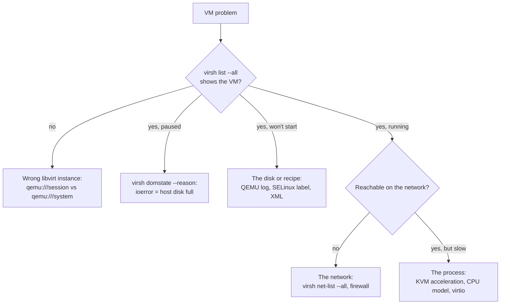
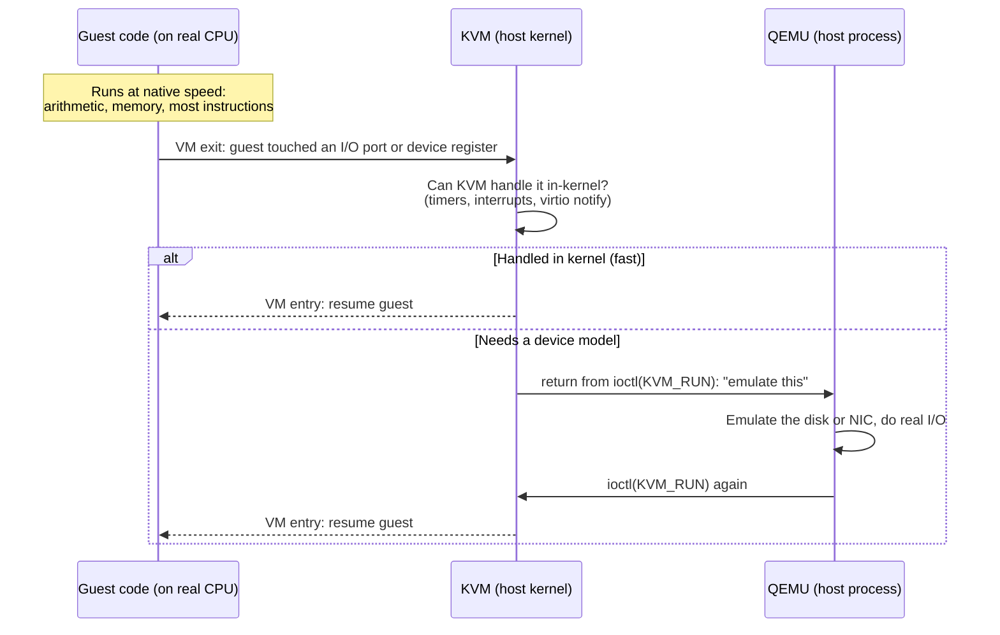
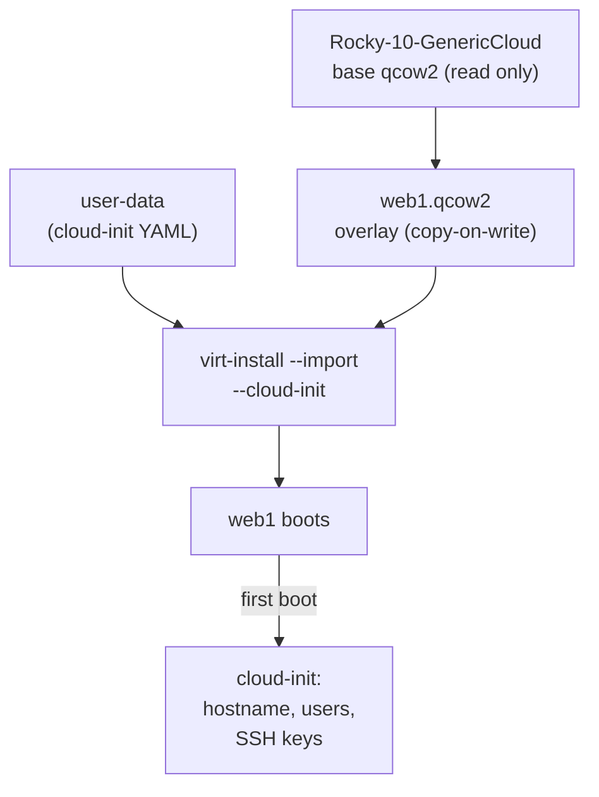
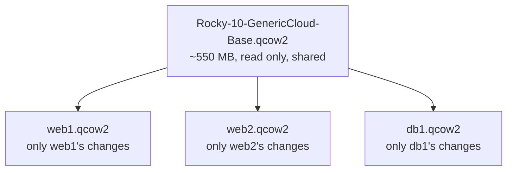
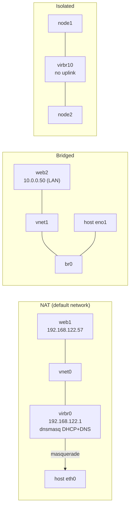
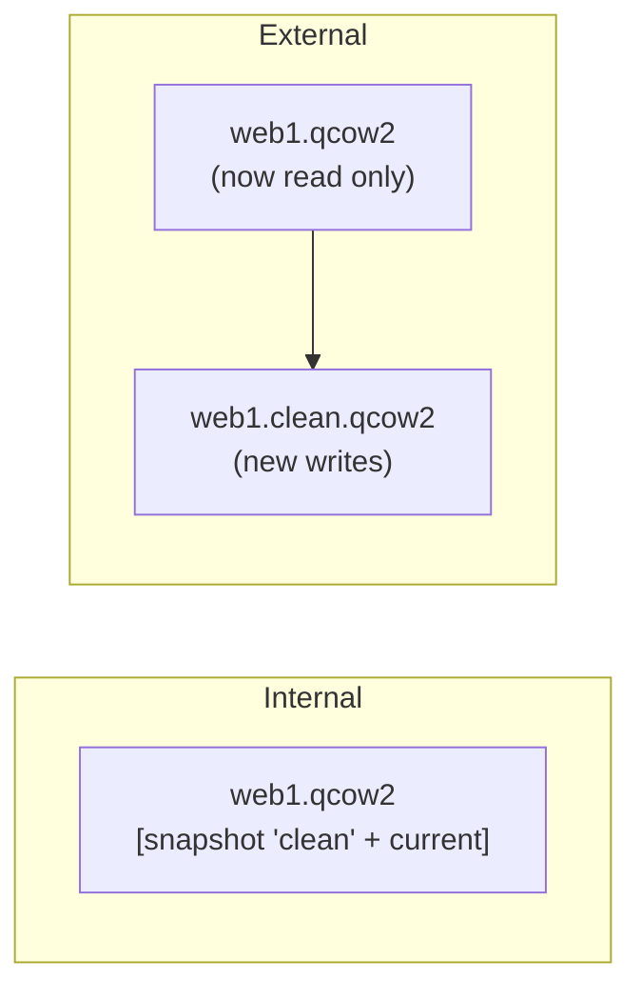

# 27 · Virtualization with KVM and libvirt

<ul class="module-meta">
  <li>⏱ ~3.5 hours</li>
  <li>5 labs</li>
  <li>Builds on: 01 · How Linux Works, 07 · systemd, 09 · Disks and Filesystems, 11 · Networking, 16 · SELinux</li>
</ul>

Your team needs three test servers by lunch, the cloud budget is spent, and there is a beefy Rocky box under a desk. Within ten minutes you can have three fresh VMs booted from a cloud image, on their own private network, sharing one base disk. This module shows you how, and more importantly what is going on underneath: which parts are the kernel, which are QEMU, which are libvirt, and where to look when a VM is slow or won't boot. It's also the foundation for the multi-VM labs in [module 26](26-centralized-identity.md) and [module 28](28-high-availability.md).

!!! abstract "What you'll learn"
    - Explain a VM in one sentence, and read any VM's state, disk and network in three commands
    - How hardware virtualization works, and the jobs of KVM, QEMU and libvirt
    - Check a host for virtualization support and install the stack on Rocky 10
    - Create VMs in seconds from a cloud image with `virt-install` and cloud-init
    - Manage VMs with `virsh` and read a domain's XML
    - Use qcow2 images, backing files and storage pools; build thin clones
    - Connect VMs with NAT, bridged and isolated networks
    - Choose the right CPU model (and why Rocky 10 guests need x86-64-v3), tune performance, take snapshots, and understand live migration

## The big picture

A **virtual machine** (VM) is a complete computer simulated in software: its own CPU, memory, disks and network cards, running its own kernel. The real machine is the **host**; the VM is the **guest**. The program that shares the host's hardware among guests is the **hypervisor**.

### KVM in one sentence

Here is the whole idea:

> **A VM is an ordinary Linux process (QEMU) whose guest code KVM lets run straight on the real CPU, and libvirt keeps a recipe for each one (its XML), plus the disk files and virtual networks it plugs into.**

Everything in this module hangs off that sentence. "The VM is slow" becomes "the process is starved or exiting too often". "The VM won't start" becomes "the recipe, the disk file or the network is wrong". And because a VM is a process, every tool you already know (`ps`, `top`, cgroups, SELinux, the OOM killer) works on it.

On Rocky Linux the hypervisor is not one program but three cooperating parts. Click through the stack:

<div class="layers" data-open="0" data-hint="Click a layer to see what lives there." markdown>

<div class="layer" data-label="Management tools" data-tag="virsh, virt-install, Cockpit" markdown>

**What lives here:** the commands you type. `virsh` (the libvirt shell), `virt-install` (creates VMs), the Cockpit web console with the Machines page, and remote GUIs such as virt-manager on a workstation. They never touch QEMU directly; they ask libvirt.

</div>

<div class="layer" data-label="libvirt" data-tag="virtqemud, virtnetworkd, virtstoraged" markdown>

**What it does:** the management layer. It stores each VM's definition as XML in `/etc/libvirt/qemu/`, starts QEMU with the right 200 command-line options, sets up networks and storage, applies SELinux labels (**sVirt**) and cgroups, and offers one stable API for all tools.

On Rocky 10 libvirt is split into **modular daemons**, one per job: `virtqemud` (VMs), `virtnetworkd` (networks), `virtstoraged` (storage), and a few more.

</div>

<div class="layer" data-label="QEMU" data-tag="one qemu-kvm process per VM" markdown>

**What it does:** the device emulator. Each running VM is one ordinary Linux process, `/usr/libexec/qemu-kvm`. QEMU provides the virtual motherboard, disks, network cards, USB, display and firmware. It hands the CPU-intensive part to KVM.

```console
$ ps -o pid,user,cmd -C qemu-kvm | cut -c1-90
    PID USER     CMD
   4211 qemu     /usr/libexec/qemu-kvm -name guest=web1,debug-threads=on -S -object …
```

</div>

<div class="layer" data-label="KVM" data-tag="kvm.ko + kvm_intel / kvm_amd" markdown>

**What it does:** the kernel module that turns Linux itself into a hypervisor. It programs the CPU's virtualization extensions so guest code runs directly on the real CPU at nearly full speed. It exposes itself to QEMU as the device `/dev/kvm`.

</div>

<div class="layer" data-label="Hardware" data-tag="VT-x / AMD-V, EPT / NPT" markdown>

**What it provides:** CPU virtualization extensions (Intel **VT-x**, AMD **AMD-V**), second-level address translation for guest memory (Intel **EPT**, AMD **NPT**), and optionally an **IOMMU** (VT-d, AMD-Vi) for passing real devices to guests.

</div>

</div>

The key insight: **a VM is just a process**. `top` shows it, cgroups limit it, SELinux confines it, `kill` ends it (please don't). Everything you learned in the core track about processes ([module 06](06-processes-and-signals.md)) applies.

??? question "Under the hood: each vCPU is a host thread you can see"
    Inside the `qemu-kvm` process, every virtual CPU is its own host thread. libvirt starts QEMU with `debug-threads=on`, so the threads carry readable names:

    ```console
    $ ps -T -o spid,comm,psr,pcpu -p $(pgrep -f 'guest=web1')
       SPID COMMAND         PSR %CPU
       4211 qemu-kvm          3  0.4
       4230 CPU 0/KVM         2 11.8
       4231 CPU 1/KVM         5  9.1
    …
    ```

    `PSR` is the host CPU each thread last ran on. A guest that is "slow for no reason" often turns out to be a vCPU thread competing with something else on the host, which `top -H` shows at a glance. The guest's RAM is ordinary anonymous memory of this process, which is why the host's OOM killer can kill a VM ([module 25](25-memory-deep-dive.md)), and why `systemd-cgls` shows each VM in its own scope under `machine.slice`.

### The four things you manage

Every VM is four things. Learn which command shows each and you can answer most questions about any VM:

| Thing | What it is | See it with | Change it with |
|---|---|---|---|
| **1. The process** | The running `qemu-kvm`, one per VM | `virsh list --all`, `virsh dominfo web1` | `virsh start`, `shutdown`, `destroy` |
| **2. The recipe** | The domain XML: CPUs, memory, devices | `virsh dumpxml web1` | `virsh edit web1` (never the file directly) |
| **3. The disk** | A file (usually qcow2), often on top of a shared base | `virsh domblklist web1`, `qemu-img info -U` | `qemu-img` with the VM off |
| **4. The network** | A virtual switch the VM's NIC plugs into | `virsh domiflist web1`, `virsh net-list --all` | `virsh net-*`, a bridge |

When something goes wrong, the same four tell you where to look:



### Words you'll see

| Word | Plain meaning |
|---|---|
| **host** / **guest** | The real machine / the VM running on it |
| **hypervisor** | The software that shares the host's hardware among guests: here KVM + QEMU + libvirt |
| **domain** | libvirt's word for a VM |
| **domain XML** | The VM's recipe: everything libvirt knows about it |
| **VM exit** | The CPU stopping guest code to let the hypervisor handle something sensitive. Fewer exits = faster VM |
| **virtio** | Paravirtual devices designed for VMs, so the guest exits far less than with emulated hardware |
| **qcow2** / **backing file** | The thin, copy-on-write disk format / a shared read-only base image under it |
| **storage pool** | A place libvirt keeps disk images, such as `/var/lib/libvirt/images` |
| **NAT** / **bridged** / **isolated** | Network types: share the host's address / sit on the real LAN / talk only to each other |
| **sVirt** | libvirt's SELinux labels that keep each VM away from other VMs' disks |

## The core skill: reading a VM in three commands

Before you change a VM, read it. Three commands tell you what it is, what disk it really uses, and whether it's healthy. (You'll install the tools in "Installing the stack" below; come back to this once you have a VM.)

```text
1. virsh list --all              → does it exist here, and what state is it in?
2. virsh dominfo NAME            → CPUs, memory, persistent or not, SELinux label
3. qemu-img info -U DISK         → real size on the host, and what it's built on
```

Then say it as a sentence: **"VM NAME is STATE, uses DISK SIZE on the host on top of BASE, and is plugged into NETWORK."**

### Story: the VMs that paused themselves

**Symptom.** Overnight, three lab VMs stopped answering. Nobody shut them down.

**Evidence.** `virsh list` shows them as `paused`, and asking why:

```console
$ virsh domstate web1 --reason
paused (ioerror)
```

**Reasoning.** `ioerror` means QEMU hit an error writing the disk file, and the VM was paused rather than handed a failed write. The disks are thin-provisioned qcow2 files that grow as guests write. In the four-things model, it's the disk: the host filesystem under `/var/lib/libvirt/images` filled up.

**Fix.** Free space on the host filesystem (`df -h /var/lib/libvirt/images` shows how full it is), then `virsh resume web1` for each VM.

**Check.** `virsh list` shows `running` again. To stop it recurring, compare each disk's "virtual size" with the free space on the host.

### Practise: read three snapshots

Answers are hidden.

**A.** You log in as yourself and run:

```console
$ virsh list --all
 Id   Name   State
--------------------
```

Your colleague swears `web1` is running. Who is right?

??? success "Answer A"
    Probably both. A plain `virsh` as a normal user connects to `qemu:///session`, your private libvirt instance, which has no VMs. Server VMs live in `qemu:///system`. Run `virsh -c qemu:///system list --all` (or `sudo virsh list --all`), and set `LIBVIRT_DEFAULT_URI` so it doesn't happen again.

**B.**

```console
$ sudo qemu-img info -U /var/lib/libvirt/images/web1.qcow2
image: /var/lib/libvirt/images/web1.qcow2
file format: qcow2
virtual size: 20 GiB (21474836480 bytes)
disk size: 1.12 GiB
…
backing file: /var/lib/libvirt/images/Rocky-10-GenericCloud-Base.latest.x86_64.qcow2
```

How much host disk does this VM use, and can you delete the Rocky cloud image to save space?

??? success "Answer B"
    About 1.12 GiB on the host ("disk size"); the guest sees 20 GiB ("virtual size"). And no: the cloud image is this VM's **backing file**. The overlay only stores what changed, so every unchanged block is read from the base. Delete or modify the base and the VM is broken. Flatten it first with `qemu-img convert` if you need it standalone.

**C.** A VM's `virsh dominfo` ends with:

```text
Security model: selinux
Security DOI:   0
Security label: system_u:system_r:svirt_t:s0:c123,c456 (enforcing)
```

What does the `c123,c456` part buy you?

??? success "Answer C"
    Isolation between VMs. Each VM's QEMU process runs as `svirt_t` with its own pair of MCS categories, and its disk files get the same pair. If an attacker escapes one guest into its QEMU process, SELinux still stops it opening any other VM's disk. That's sVirt.

## How hardware virtualization works

The guest kernel believes it owns the machine. It wants to write CPU control registers, program interrupt controllers and talk to disks. If it really did those things, it would crash the host. So something must catch those privileged actions and fake them.

Early hypervisors did this in software, which was slow. Since about 2006, CPUs do it in hardware. **VT-x** and **AMD-V** add a new CPU mode for guests. Guest code runs natively until it does something sensitive, then the CPU automatically stops it and jumps back to the hypervisor. That jump is a **VM exit**.



Every VM exit costs time (from hundreds of nanoseconds to microseconds). A fast VM is one that exits rarely. That's the whole reason **virtio** devices exist, as you'll see below.

??? question "Under the hood: count the VM exits yourself"
    You don't have to take exits on faith. The kernel has tracepoints for every exit, and `perf` (package `perf`) can summarise them live per exit reason:

    ```console
    $ sudo dnf install -y perf
    $ sudo perf kvm stat live
    ```

    Leave it running while the guest is idle, then while it does disk or network I/O. Idle guests mostly show `HLT` exits (the guest's idle loop). A guest hammering an emulated device shows a storm of `IO_INSTRUCTION` or `EPT_MISCONFIG` (memory-mapped I/O) exits. When someone says "the VM is slow", a sudden exit storm is hard evidence that the bottleneck is device emulation, not the guest's own code. Press `++ctrl+c++` to stop.

Memory works similarly. The guest has its own page tables mapping guest-virtual to guest-physical addresses. **EPT/NPT** adds a second table in hardware mapping guest-physical to host-physical, so the CPU does both lookups itself without the hypervisor intervening on every page table change.

!!! analogy "Think of it like a flight simulator"
    The pilot (guest kernel) flies the simulator exactly as a real aircraft: same controls, same procedures. Most of the time the instructor (KVM) does nothing. When the pilot does something that would affect the real world (opening a door, radioing the tower), the simulator pauses, the instructor plays the part, and the session resumes. The analogy breaks down in one way: the guest's arithmetic really does run on the real CPU, not a simulation of it.

## Checking support

Three questions: does the CPU have the extensions, are they enabled in firmware, and is KVM loaded?

```console
$ lscpu | grep -i virtualization
Virtualization:                       VT-x
$ grep -c -E 'vmx|svm' /proc/cpuinfo
8
$ lsmod | grep kvm
kvm_intel             454656  0
kvm                  1404928  1 kvm_intel
$ ls -l /dev/kvm
crw-rw-rw-. 1 root kvm 10, 232 Oct 15 09:01 /dev/kvm
```

`vmx` is Intel's flag; `svm` is AMD's. A count of 0 means the CPU lacks the feature or the firmware has disabled it (look for "Intel Virtualization Technology" or "SVM Mode" in the BIOS setup). If `/dev/kvm` is missing, QEMU can still run guests in pure emulation (**TCG**), but 10 to 50 times slower.

After installing the packages (next section), `virt-host-validate` checks everything at once:

```console
$ sudo virt-host-validate qemu
  QEMU: Checking for hardware virtualization                 : PASS
  QEMU: Checking if device '/dev/kvm' exists                 : PASS
  QEMU: Checking if device '/dev/kvm' is accessible          : PASS
  QEMU: Checking if device '/dev/vhost-net' exists           : PASS
  QEMU: Checking if device '/dev/net/tun' exists             : PASS
  QEMU: Checking for cgroup 'cpu' controller support         : PASS
  QEMU: Checking for cgroup 'memory' controller support      : PASS
…
  QEMU: Checking for device assignment IOMMU support         : WARN (No ACPI DMAR table found, IOMMU either disabled in BIOS or not supported by this hardware platform)
  QEMU: Checking for secure guest support                    : WARN (Unknown if this platform has Secure Guest support)
```

The IOMMU warning only matters if you want to pass a physical device (a GPU, a NIC) straight to a guest. The secure guest warning is about AMD SEV or Intel TDX confidential VMs. Both are fine to ignore for this module.

### Nested virtualization: labs inside a lab VM

If your Rocky "host" is itself a VM (on your laptop, or in a cloud), you need **nested virtualization**: the outer hypervisor must expose VT-x or AMD-V to it. Check inside your lab VM:

```console
$ grep -c -E 'vmx|svm' /proc/cpuinfo
0
```

Zero means no nesting. Fix it on the *outer* host:

=== "Outer host is Rocky/KVM"

    ```console
    $ cat /sys/module/kvm_intel/parameters/nested
    Y
    $ sudo virsh edit lab-vm
    ```

    Set `<cpu mode='host-passthrough'/>` in the lab VM's XML, then fully shut it down and start it again. On AMD the file is `/sys/module/kvm_amd/parameters/nested` (shows `1`).

=== "VMware Workstation / Fusion"

    In the VM's processor settings, enable "Virtualize Intel VT-x/EPT or AMD-V/RVI".

=== "VirtualBox"

    Enable "Nested VT-x/AMD-V" in the VM's System > Processor settings (with the VM powered off).

=== "Cloud"

    Only some instance types support nesting (or offer bare metal). Check your provider's documentation.

Nested VMs work well for learning, but expect them to be noticeably slower, especially for I/O. Production hypervisors should run on bare metal.

<div class="quiz" data-answer="2" markdown>

A VM is running on your Rocky host. Which statement is true?

- The VM's code is interpreted instruction by instruction by QEMU
- The VM is a `qemu-kvm` process; its guest code runs directly on the host CPU until a VM exit
- libvirt runs the VM inside the `virtqemud` process
- KVM is a separate operating system that runs underneath Rocky

Right. With KVM, guest instructions run natively in the CPU's guest mode. QEMU is the process that holds the VM and emulates devices. libvirt only manages it. Pure interpretation (TCG) only happens when `/dev/kvm` is unavailable.

</div>

## Installing the stack on Rocky 10

```console
$ sudo dnf install -y qemu-kvm libvirt virt-install virt-viewer
$ for drv in qemu network nodedev nwfilter secret storage interface; do
>   sudo systemctl enable --now virt${drv}d.socket virt${drv}d-ro.socket virt${drv}d-admin.socket
> done
$ sudo virt-host-validate qemu
```

`libvirt` is a meta-package that pulls in all the daemon drivers. `virt-install` creates VMs; `virt-viewer` opens graphical consoles.

### Modular daemons vs the old libvirtd

For years libvirt ran as one big daemon, **libvirtd**, which handled VMs, networks, storage and everything else. Rocky 9 and 10 use **modular daemons** instead: one small daemon per driver, each socket-activated by systemd and each with a narrower SELinux policy.

| Daemon | Manages | Old equivalent |
|---|---|---|
| `virtqemud` | QEMU/KVM virtual machines | libvirtd |
| `virtnetworkd` | Virtual networks (`virbr0`, NAT, DHCP via dnsmasq) | libvirtd |
| `virtstoraged` | Storage pools and volumes | libvirtd |
| `virtnodedevd` | Host devices (for passthrough) | libvirtd |
| `virtnwfilterd` | Network filter rules | libvirtd |
| `virtsecretd` | Secrets (disk encryption keys, Ceph auth) | libvirtd |
| `virtinterfaced` | Host network interface queries | libvirtd |
| `virtproxyd` | Remote connections from old clients | libvirtd |

You rarely need to think about this, except: guides on the internet that say `systemctl restart libvirtd` are out of date for Rocky 10. Restart the specific daemon (`virtqemud`, `virtnetworkd`) instead. Logs are in the journal: `journalctl -u virtqemud`.

!!! version "Rocky 9 vs 10"
    Rocky 9 already used modular daemons on fresh installs, but hosts upgraded from older releases might still run monolithic `libvirtd`. The virt-manager desktop GUI is a supported AppStream package on Rocky 9. In Rocky 10 (following RHEL 10) it was dropped from the supported set: Rocky's documentation says to use Cockpit instead. See "Graphical management" at the end of this module for your options.

### system vs session: two separate worlds

libvirt has two connection **URIs**:

- `qemu:///system`: the system instance. VMs run as the `qemu` user, can use bridges and system networks, and start at boot. This is what servers use, and what this module uses.
- `qemu:///session`: a per-user instance. VMs run as you, with limited networking. Handy on a desktop, confusing on a server.

`sudo virsh` always uses `qemu:///system`. A plain `virsh` as a normal user uses `qemu:///session` by default, which is why "my VM disappeared" is usually "you're looking at the other instance". To manage system VMs without sudo, add yourself to the `libvirt` group and set the default URI:

```console
$ sudo usermod -aG libvirt $USER
$ echo 'export LIBVIRT_DEFAULT_URI=qemu:///system' >> ~/.bashrc
```

Log out and in again for the group to apply. The rest of this module uses `virsh` with that URI set.

## Creating VMs fast: cloud images and cloud-init

There are two ways to get an OS into a VM:

1. **Install from an ISO** (`virt-install --location` or `--cdrom`), optionally automated with Kickstart ([module 23](23-automated-installs.md)). Flexible but takes minutes.
2. **Import a cloud image**: a pre-installed qcow2 disk that Rocky publishes. You boot it and **cloud-init** configures it on first boot (hostname, users, SSH keys, packages). It takes seconds.

Rocky publishes generic cloud images at `https://dl.rockylinux.org/pub/rocky/10/images/x86_64/`, for example `Rocky-10-GenericCloud-Base.latest.x86_64.qcow2` (plain partitions) and `Rocky-10-GenericCloud-LVM.latest.x86_64.qcow2` (LVM root).



The user-data file is YAML that starts with `#cloud-config`:

```yaml title="user-data.yaml"
#cloud-config
hostname: web1
users:
  - name: alex
    groups: wheel
    sudo: ALL=(ALL) NOPASSWD:ALL
    ssh_authorized_keys:
      - ssh-ed25519 AAAAC3NzaC1lZDI1NTE5AAAAI... alex@laptop
```

Then create a small overlay disk on top of the base image and import it:

```console
$ cd /var/lib/libvirt/images
$ sudo qemu-img create -f qcow2 -F qcow2 \
      -b /var/lib/libvirt/images/Rocky-10-GenericCloud-Base.latest.x86_64.qcow2 web1.qcow2 20G
Formatting 'web1.qcow2', fmt=qcow2 cluster_size=65536 extended_l2=off compression_type=zlib size=21474836480 backing_file=/var/lib/libvirt/images/Rocky-10-GenericCloud-Base.latest.x86_64.qcow2 backing_fmt=qcow2 lazy_refcounts=off refcount_bits=16
$ sudo virt-install --name web1 --memory 2048 --vcpus 2 \
      --disk path=/var/lib/libvirt/images/web1.qcow2,bus=virtio \
      --import --osinfo linux2022 --cpu host-passthrough \
      --network network=default,model=virtio \
      --cloud-init user-data=user-data.yaml \
      --graphics none --noautoconsole
Starting install...
Creating domain...                                          |    0 B  00:00:00
Domain creation completed.
```

Key options:

| Option | Meaning |
|---|---|
| `--import` | The disk already has an OS; skip the installer and just boot it |
| `--osinfo linux2022` | Which OS profile to use for sensible defaults (virtio devices, memory). `linux2022` is a generic "modern Linux" profile that every Rocky 10 host knows. `osinfo-query os \| grep -i rocky` shows whether your osinfo-db has a Rocky-specific ID you'd rather use |
| `--cpu host-passthrough` | Give the guest the host's real CPU model (see the CPU section) |
| `--cloud-init user-data=` | Build a small config ISO with your user-data and attach it for the first boot |
| `--graphics none` | No graphical display; use the serial console |
| `--noautoconsole` | Return to the shell instead of attaching to the console |

!!! tip "Why `--osinfo` isn't optional"
    Since virt-install 4.0, it refuses to create a VM when it can't tell what OS is going in, with an error asking for `--osinfo`. With `--import` there is no installer to inspect, so you must name one. The guessing game used to give silently bad defaults (an IDE disk, an e1000 NIC, too little RAM); now it fails loudly instead. `osinfo-query os` lists every ID.

After 20 to 40 seconds the VM is up. Find its address and log in:

```console
$ virsh domifaddr web1
 Name       MAC address          Protocol     Address
-------------------------------------------------------------------------------
 vnet0      52:54:00:3a:7c:11    ipv4         192.168.122.57/24
$ ssh alex@192.168.122.57
[alex@web1 ~]$
```

## virsh essentials

In libvirt, a VM is called a **domain**. A domain can be **persistent** (defined, survives host reboots, has XML in `/etc/libvirt/qemu/`) or **transient** (exists only while running).

```console
$ virsh list --all
 Id   Name    State
------------------------
 1    web1    running
 -    test1   shut off
$ virsh dominfo web1
Id:             1
Name:           web1
UUID:           6c1b5f1e-2d4a-4c3e-9a51-0f3c8b7e2a10
OS Type:        hvm
State:          running
CPU(s):         2
CPU time:       41.2s
Max memory:     2097152 KiB
Used memory:    2097152 KiB
Persistent:     yes
Autostart:      disable
Managed save:   no
Security model: selinux
Security DOI:   0
Security label: system_u:system_r:svirt_t:s0:c123,c456 (enforcing)
```

That last line is worth a pause. Every VM's QEMU process runs as `svirt_t` with a unique pair of **MCS categories** (`c123,c456`), and its disk files get the same categories. Even if an attacker breaks out of one guest into its QEMU process, SELinux stops it from opening another VM's disk ([module 16](16-selinux.md) explains MCS).

The everyday commands:

| Command | What it does |
|---|---|
| `virsh start web1` | Boot a defined VM |
| `virsh shutdown web1` | Ask the guest to shut down cleanly (ACPI power button) |
| `virsh destroy web1` | Pull the virtual power plug at once (the VM is not deleted) |
| `virsh reboot web1` | Ask the guest to reboot |
| `virsh console web1` | Attach to the serial console (exit with ++ctrl+bracket-right++) |
| `virsh autostart web1` | Start the VM when the host boots |
| `virsh edit web1` | Edit the XML in `$EDITOR`, validated on save |
| `virsh dumpxml web1` | Print the full XML |
| `virsh domblklist web1` | List the VM's disks |
| `virsh domiflist web1` | List the VM's network interfaces |
| `virsh undefine web1 --remove-all-storage` | Delete the VM definition and its disks |

!!! warning "destroy doesn't destroy"
    Despite the name, `virsh destroy` just powers the VM off hard, like holding the power button. The definition and disks remain. It's `undefine` that removes the VM, and `--remove-all-storage` that deletes disks. Read twice before pressing Enter on that one.

## Domain XML anatomy

Everything libvirt knows about a VM is in its XML. Tools like `virt-install` and Cockpit just write XML for you. Here is a trimmed `virsh dumpxml web1`:

```xml
<domain type='kvm'>  <!-- (1)! -->
  <name>web1</name>
  <memory unit='KiB'>2097152</memory>
  <vcpu placement='static'>2</vcpu>
  <os>
    <type arch='x86_64' machine='pc-q35-rhel10.0.0'>hvm</type>  <!-- (2)! -->
    <boot dev='hd'/>
  </os>
  <cpu mode='host-passthrough' check='none' migratable='on'/>  <!-- (3)! -->
  <devices>
    <emulator>/usr/libexec/qemu-kvm</emulator>
    <disk type='file' device='disk'>
      <driver name='qemu' type='qcow2' discard='unmap'/>  <!-- (4)! -->
      <source file='/var/lib/libvirt/images/web1.qcow2'/>
      <backingStore type='file'>
        <format type='qcow2'/>
        <source file='/var/lib/libvirt/images/Rocky-10-GenericCloud-Base.latest.x86_64.qcow2'/>
      </backingStore>
      <target dev='vda' bus='virtio'/>  <!-- (5)! -->
    </disk>
    <interface type='network'>
      <mac address='52:54:00:3a:7c:11'/>
      <source network='default'/>  <!-- (6)! -->
      <model type='virtio'/>
    </interface>
    <console type='pty'/>
    <channel type='unix'>
      <target type='virtio' name='org.qemu.guest_agent.0'/>  <!-- (7)! -->
    </channel>
    <memballoon model='virtio'/>
    <rng model='virtio'>
      <backend model='random'>/dev/urandom</backend>
    </rng>
  </devices>
</domain>
```

1. `type='kvm'` means hardware acceleration. `type='qemu'` would mean slow software emulation.
2. The **machine type**: the virtual motherboard (`q35` is a modern PCIe chipset). The version suffix keeps the virtual hardware stable across QEMU upgrades, which matters for migration.
3. The CPU model the guest sees. See the CPU section.
4. Disk format and options. `discard='unmap'` lets the guest's `fstrim` free space in the qcow2 file.
5. `bus='virtio'`: a paravirtual disk, `/dev/vda` in the guest.
6. Plugged into the libvirt network called `default`.
7. A channel for the **QEMU guest agent** (`qemu-guest-agent` in the guest), which lets the host query IPs, freeze filesystems for snapshots, and more.

Always change XML with `virsh edit` (which validates it), never by editing `/etc/libvirt/qemu/web1.xml` directly: libvirt doesn't re-read that file, and the next change from libvirt overwrites yours. Most changes take effect on the next full power off and start, not on a reboot from inside the guest.

??? question "Under the hood: three copies of a VM's truth, and the real QEMU command line"
    A running VM has three descriptions on disk, and support engineers check all three:

    | File | What it is |
    |---|---|
    | `/etc/libvirt/qemu/web1.xml` | The **persistent** definition: what the VM will be at its next cold start |
    | `/run/libvirt/qemu/web1.xml` | The **live** status XML: what is running right now, including hot-plugged devices and runtime details |
    | `/var/log/libvirt/qemu/web1.log` | The exact **QEMU command line** libvirt ran at each start, plus QEMU's own errors |

    `virsh dumpxml web1` shows the live view; `virsh dumpxml --inactive web1` shows the persistent one. When they differ, a change was made with `--live` only, or a `--config` change is waiting for the next power cycle. That gap is behind many "I changed it but nothing happened" tickets.

    When a VM refuses to start, read the end of the QEMU log first: it holds the error QEMU printed before it exited, which `virsh start` often summarises unhelpfully.

    ```console
    $ sudo tail -n 3 /var/log/libvirt/qemu/web1.log
    ```

## Storage: pools, volumes and qcow2

libvirt groups disk images into **storage pools** (a directory, an LVM volume group, an iSCSI target, a Ceph pool…) that contain **volumes**. The default pool is the directory `/var/lib/libvirt/images`, which already has the right SELinux label (`virt_image_t`).

```console
$ virsh pool-list --all
 Name      State    Autostart
-------------------------------
 default   active   yes
$ virsh vol-list default
 Name                                              Path
-----------------------------------------------------------------------------------------------------------
 Rocky-10-GenericCloud-Base.latest.x86_64.qcow2   /var/lib/libvirt/images/Rocky-10-GenericCloud-Base.latest.x86_64.qcow2
 web1.qcow2                                        /var/lib/libvirt/images/web1.qcow2
```

### qcow2: thin, copy-on-write, snapshot-capable

There are two common disk formats:

- **raw**: a plain byte-for-byte image. Fastest and simplest, but no snapshots or backing files. Can be sparse on XFS.
- **qcow2** ("QEMU copy-on-write v2"): a smart format with **thin provisioning** (the file grows as the guest writes), internal snapshots, compression, and **backing files**.

A **backing file** is a read-only base image. An **overlay** qcow2 records only the blocks that differ from it. Reads of unchanged blocks fall through to the base.



Three VMs, one base, a few hundred megabytes of extra disk each. That's how you build lab clusters cheaply.

```console
$ sudo qemu-img info -U /var/lib/libvirt/images/web1.qcow2
image: /var/lib/libvirt/images/web1.qcow2
file format: qcow2
virtual size: 20 GiB (21474836480 bytes)
disk size: 1.12 GiB
cluster_size: 65536
backing file: /var/lib/libvirt/images/Rocky-10-GenericCloud-Base.latest.x86_64.qcow2
backing file format: qcow2
Format specific information:
    compat: 1.1
    compression type: zlib
    lazy refcounts: false
    refcount bits: 16
    corrupt: false
    extended l2: false
…
$ sudo qemu-img info -U --backing-chain /var/lib/libvirt/images/web1.qcow2 | grep -E '^image|disk size'
image: /var/lib/libvirt/images/web1.qcow2
disk size: 1.12 GiB
image: /var/lib/libvirt/images/Rocky-10-GenericCloud-Base.latest.x86_64.qcow2
disk size: 549 MiB
```

"virtual size" is what the guest sees; "disk size" is what the file really uses on the host. The `-U` (`--force-share`) flag is needed because `web1` is running: QEMU holds a lock on images in use, and without `-U` even a read-only `info` fails with `Failed to get shared "write" lock`. That lock is a safety feature, so only use `-U` for reading.

??? example "Other `qemu-img` jobs: create, flatten, convert, resize, check"

    ```console
    $ qemu-img create -f qcow2 data.qcow2 50G                  # empty thin disk
    $ qemu-img convert -O qcow2 web1.qcow2 web1-flat.qcow2     # flatten: merge the chain into one standalone file
    $ qemu-img convert -O raw disk.vmdk disk.raw               # import from VMware
    $ qemu-img resize web1.qcow2 +10G                          # grow (VM off; then grow the partition in the guest)
    $ qemu-img check web1.qcow2                                # consistency check (VM off)
    ```

    Never run `resize`, `check -r` or `convert` on an image a running VM has open. QEMU holds a lock on images in use, so recent `qemu-img` versions refuse with a "Failed to get write lock" error. Only use `-U` for read-only `info`.

!!! danger "Never modify a backing file"
    Every overlay depends on the base image's exact blocks. If you boot the base image itself, or write to it, all overlays built on it are silently corrupted. Make base images read-only (`chmod 444`) and never attach them to a VM directly.

!!! warning "Thin provisioning can run out"
    Ten VMs with 100 GB virtual disks on a 500 GB filesystem works until the guests actually fill their disks. When the host filesystem fills, QEMU pauses the guests with an I/O error (`virsh list` shows them `paused`). Watch `df -h /var/lib/libvirt/images` and use `discard='unmap'` so guest `fstrim` gives space back.

<div class="quiz" data-answer="3" markdown>

You created `web2.qcow2` with `-b base.qcow2`. Later, a colleague boots `base.qcow2` directly to "update it". What happens to `web2`?

- Nothing; overlays copy the base at creation time
- `web2` automatically gets the updates
- `web2` is likely corrupted, because its overlay records differences against blocks that have now changed
- QEMU refuses to start `base.qcow2` because it has children

Right. The overlay only stores changed blocks and trusts the base for everything else. If the base changes underneath it, the guest sees a mix of old and new blocks. QEMU doesn't track which overlays depend on a file, so nothing stops you.

</div>

## Networking: NAT, bridged and isolated

A VM's virtual NIC is connected to a **tap device** on the host (`vnet0`, `vnet1`, …), which is plugged into a **Linux bridge** (a virtual switch, [module 11](11-networking.md)). What that bridge connects to decides how the VM reaches the world.



| Mode | VMs reach the internet? | LAN reaches the VMs? | Use for |
|---|---|---|---|
| NAT (`default`) | Yes, through the host's IP | No (only the host can) | Quick test VMs, laptops |
| Bridged | Yes, as real hosts on the LAN | Yes, they have LAN IPs | Servers that others must reach |
| Isolated | No | No; VMs and host only | Labs, cluster interconnects, safe experiments |

### The default NAT network

```console
$ virsh net-list --all
 Name      State    Autostart   Persistent
--------------------------------------------
 default   active   yes         yes
$ virsh net-dhcp-leases default
 Expiry Time           MAC address         Protocol   IP address          Hostname   Client ID or DUID
--------------------------------------------------------------------------------------------------------------
 2026-10-15 11:02:13   52:54:00:3a:7c:11   ipv4       192.168.122.57/24   web1       01:52:54:00:3a:7c:11
$ ip -br addr show virbr0
virbr0           UP             192.168.122.1/24
```

libvirt runs a `dnsmasq` instance for DHCP and DNS on `virbr0`, and adds firewall rules for masquerading. On Rocky 10 those rules are nftables rules, visible with `sudo nft list ruleset | grep -A3 libvirt`.

### An isolated network

An isolated network is just a network definition with no `<forward>` element:

```xml title="labnet.xml"
<network>
  <name>labnet</name>
  <bridge name='virbr10'/>
  <ip address='192.168.150.1' netmask='255.255.255.0'>
    <dhcp>
      <range start='192.168.150.100' end='192.168.150.200'/>
    </dhcp>
  </ip>
</network>
```

```console
$ virsh net-define labnet.xml
Network labnet defined from labnet.xml
$ virsh net-start labnet
$ virsh net-autostart labnet
```

Give lab VMs two NICs (one on `default` for package downloads, one on `labnet` for cluster traffic), or install packages first and then move them. Add a NIC to an existing VM with `virsh attach-interface web1 network labnet --model virtio --config --live`.

### A bridge to the real LAN

To put VMs directly on your physical network, make a bridge with NetworkManager and move the host's IP onto it:

```console
$ sudo nmcli con add type bridge ifname br0 con-name br0 ipv4.method auto
$ sudo nmcli con add type bridge-slave ifname eno1 master br0 con-name br0-port1
$ sudo nmcli con down "Wired connection 1"; sudo nmcli con up br0
```

Then attach VMs with `--network bridge=br0`. Do this from the console, not over SSH on that same interface: the moment the old connection goes down, your session may go with it.

!!! note "Wi-Fi can't be bridged"
    Most Wi-Fi drivers refuse to bridge, because the access point only accepts frames from the MAC address that associated. On a laptop, stick with NAT.

## virtio: why paravirtual devices matter

QEMU can emulate real hardware like an Intel e1000 NIC or an IDE disk. The guest's normal driver works with them, but every register poke is a VM exit, and real hardware protocols are chatty. Sending one packet through an emulated e1000 can cause many exits.

**virtio** devices are designed for VMs. The guest knows it's virtualized and uses a simple shared-memory ring (a **virtqueue**): it places many requests in the ring, then notifies the host once. The host processes them all and notifies back once.

<div class="stepper" markdown>

<div class="step" data-title="Guest queues work" markdown>

The guest's `virtio_net` driver writes descriptors for 32 outgoing packets into the transmit virtqueue, a ring buffer in guest memory that the host can also read. No exits yet.

</div>

<div class="step" data-title="One kick" markdown>

The driver writes to a notification register: one VM exit for the whole batch. With `vhost-net` (default on Rocky), that notification goes straight to a host kernel thread, not up to QEMU in user space.

</div>

<div class="step" data-title="Host does the I/O" markdown>

The `vhost` thread reads the 32 packets from guest memory and writes them to the tap device `vnet0`, which delivers them to the bridge. No copies through QEMU.

</div>

<div class="step" data-title="One interrupt back" markdown>

The host marks the descriptors as used and injects one interrupt into the guest. The guest frees the buffers. Compare that to dozens of exits per packet with an emulated NIC.

</div>

</div>

The rule: use virtio for everything a modern Linux guest supports. Rocky guests have all virtio drivers built in.

| Device | virtio choice | Notes |
|---|---|---|
| Disk | `virtio-blk` (`bus='virtio'`, shows as `/dev/vda`) | Simplest and fast |
| Disk (many, or SCSI features) | `virtio-scsi` (shows as `/dev/sda`) | Scales to many disks, supports discard and passthrough |
| Network | `model type='virtio'` | Add `<driver queues='N'/>` for multi-queue with many vCPUs |
| Memory | `virtio-balloon` | Lets the host reclaim guest memory |
| Randomness | `virtio-rng` | Fast entropy at boot |
| Console | `virtio-serial` channels | Used by the guest agent |

Windows guests need the virtio drivers installed separately (the `virtio-win` drivers), which is why Windows VMs often start out with emulated devices.

## CPU models and x86-64-v3

The guest sees a **virtual CPU model**, which decides which instruction set features (SSE4.2, AVX2, AES-NI…) it may use. libvirt offers three modes:

| Mode | Guest sees | Pros | Cons |
|---|---|---|---|
| `host-passthrough` | Exactly the host CPU | Fastest; all features; needed for nesting | Live migration only to identical CPUs |
| `host-model` | A named model closest to the host, plus extra flags | Nearly all features; migratable to similar hosts | Slight differences from the real CPU |
| `custom` (named, such as `Haswell-noTSX` or `EPYC`) | A fixed, well-known feature set | Migrate across a mixed fleet | Must choose a model all hosts support |

This matters more than usual on Rocky 10, because **Rocky 10 on x86 requires the x86-64-v3 microarchitecture level**: AVX, AVX2, BMI1/BMI2, FMA and friends (Intel Haswell, AMD Excavator, or newer). The whole distribution is compiled for it. If the guest's virtual CPU doesn't advertise those features, Rocky 10 won't boot, even when the physical CPU has them. The failure comes very early, from glibc in the initramfs:

```text
Fatal glibc error: CPU does not support x86-64-v3
```

That happens with a VM that has no CPU model set (QEMU's generic default model lacks AVX2), or a named model older than Haswell. Fix it with `host-passthrough`, `host-model`, or a v3-capable named model. You can ask glibc which levels a machine (host or guest) supports:

```console
$ /lib64/ld-linux-x86-64.so.2 --help | grep -A4 'glibc-hwcaps'
Subdirectories of glibc-hwcaps directories, in priority order:
  x86-64-v4
  x86-64-v3 (supported, searched)
  x86-64-v2 (supported, searched)
```

If `x86-64-v3` is not marked "supported", that CPU (real or virtual) can't run Rocky 10. A host that itself is older than Haswell can't run Rocky 10 guests at any setting, because KVM can't invent instructions the hardware lacks. Rocky 9 guests (which need only x86-64-v2) still run there.

`virsh cpu-models x86_64` lists the named models QEMU knows; `virsh domcapabilities` shows which ones this host can actually run.

<div class="quiz" data-answer="1" markdown>

You move a Rocky 10 VM from a host using `host-passthrough` to an old XML template with `<cpu mode='custom'><model>Westmere</model></cpu>`. It now dies at boot with "CPU does not support x86-64-v3". The physical CPU is a recent Xeon. Why?

- The guest only sees the features of the Westmere model, which predates AVX2, whatever the physical CPU has
- Rocky 10 doesn't support KVM
- The physical Xeon has lost its AVX2 support
- `custom` mode disables KVM acceleration

Right. The guest sees the virtual CPU model, not the physical CPU. Westmere is far older than Haswell. Switch to `host-passthrough`, `host-model`, or a newer named model.

</div>

## Snapshots

A **snapshot** captures a VM's disk (and optionally its memory) at a point in time so you can roll back. There are two kinds:

- **Internal snapshots** live inside the qcow2 file itself. One file, simple to manage, and they can include RAM. They only work with qcow2 disks, and libvirt may refuse them for some setups (for example some UEFI firmware configurations).
- **External snapshots** freeze the current disk file and start a new overlay on top of it, exactly like the backing chain above. They work with any format and are what backup tools use (freeze, copy the frozen file, merge back).



```console
$ virsh snapshot-create-as web1 clean --description "fresh install"
Domain snapshot clean created
$ virsh snapshot-list web1
 Name    Creation Time               State
---------------------------------------------------
 clean   2026-10-15 10:22:31 +0000   running
$ virsh snapshot-revert web1 clean
$ virsh snapshot-delete web1 clean
```

An external, disk-only snapshot (the guest agent freezes filesystems first if you add `--quiesce`):

```console
$ virsh snapshot-create-as web1 pre-upgrade --disk-only --atomic
Domain snapshot pre-upgrade created
$ virsh domblklist web1
 Target   Source
-------------------------------------------------------
 vda      /var/lib/libvirt/images/web1.pre-upgrade
```

The VM now writes to the new overlay. To fold it back into a single file later, use `virsh blockcommit web1 vda --active --pivot`.

!!! warning "Snapshots are not backups"
    A snapshot lives on the same storage as the VM. Lose the disk, lose both. Long chains of snapshots also slow every read. Take them before risky changes, then delete or commit them.

## Performance basics

KVM guests run close to bare-metal speed for CPU work out of the box. The tuning that matters is about memory, I/O and placement.

**vCPU pinning.** By default the host scheduler moves vCPU threads across all host cores. For latency-sensitive guests, pin each vCPU to a dedicated core (ideally on the same NUMA node as its memory):

```console
$ virsh vcpupin web1 0 2 --config
$ virsh vcpupin web1 1 3 --config
$ virsh vcpupin web1
 VCPU   CPU Affinity
----------------------
 0      2
 1      3
```

**Hugepages.** Guest memory backed by 2 MiB (or 1 GiB) pages means fewer TLB misses for memory-heavy guests such as databases ([module 25](25-memory-deep-dive.md) explains the TLB). Reserve pages on the host and tell libvirt to use them:

```console
$ echo 'vm.nr_hugepages = 2048' | sudo tee /etc/sysctl.d/90-hugepages.conf
$ sudo sysctl -p /etc/sysctl.d/90-hugepages.conf
$ grep HugePages_Total /proc/meminfo
HugePages_Total:    2048
```

```xml
<memoryBacking>
  <hugepages/>
</memoryBacking>
```

**Disk cache modes.** The `cache` attribute on a disk's `<driver>` decides whether the host page cache is involved:

| Mode | Host page cache | Safe on host crash? | Typical use |
|---|---|---|---|
| `none` | Bypassed (O_DIRECT) | Yes, guest flushes are honoured | Production default for most setups; libvirt refuses live migration with other modes as unsafe (unless the images sit on a coherent cluster filesystem, or you pass `--unsafe`) |
| `writeback` | Used for reads and writes | Yes, flushes honoured | Good for lab hosts with spare RAM |
| `writethrough` | Used, but every write is synced to disk before it completes | Yes | Rarely needed |
| `unsafe` | Used, flushes ignored | No | Throwaway installs only |

Pair `cache='none'` with `io='native'` for the lowest overhead on local disks.

**Other quick wins:** use virtio everywhere; give the guest multi-queue networking if it has many vCPUs; use `tuned-adm profile virtual-host` on the host and `virtual-guest` in the guest ([module 19](19-performance-and-observability.md)); and don't overcommit vCPUs on hosts that run latency-sensitive guests.

## Live migration

**Live migration** moves a running VM from one host to another with a pause of typically well under a second. It's how hypervisor hosts get patched without guest downtime. The requirements: both hosts can reach the VM's disks (shared storage, or copy them during migration), compatible CPU models, and the same networks available on both.

<div class="stepper" markdown>

<div class="step" data-title="Prepare" markdown>

libvirt on the source connects to libvirt on the destination (usually over SSH: `qemu+ssh://host2/system`). The destination starts an empty QEMU process with the same virtual hardware, waiting for state.

</div>

<div class="step" data-title="Copy memory while running" markdown>

The source copies all guest RAM to the destination while the guest keeps running. KVM tracks which pages the guest writes to (**dirty page tracking**).

</div>

<div class="step" data-title="Re-copy dirty pages" markdown>

Pages the guest changed during the copy are sent again. Each round should be smaller than the last. This is **pre-copy** migration. A guest that writes memory faster than the network can send it never converges; libvirt can then throttle its vCPUs (`--auto-converge`) or switch to post-copy.

</div>

<div class="step" data-title="Stop and copy" markdown>

When the remaining dirty set is small, the source pauses the guest, sends the last pages and the CPU and device state. This pause is the **downtime**, usually tens to hundreds of milliseconds.

</div>

<div class="step" data-title="Resume on the destination" markdown>

The destination resumes the guest. It announces its MAC address on the new host's network so switches learn the new port. The source QEMU exits. TCP connections inside the guest survive.

</div>

</div>

```console
$ virsh migrate --live --persistent --undefinesource web1 qemu+ssh://host2/system
```

Without shared storage, add `--copy-storage-all` (slower: the disks are copied too). [Module 28](28-high-availability.md) shows how a cluster can manage VMs as resources and migrate them automatically.

## Graphical management: Cockpit and remote virt-manager

**Cockpit** is Rocky's web console. Its Machines page creates VMs, edits hardware, opens consoles in the browser, and manages networks and storage pools, all through libvirt.

```console
$ sudo dnf install -y cockpit cockpit-machines
$ sudo systemctl enable --now cockpit.socket
$ sudo firewall-cmd --permanent --add-service=cockpit && sudo firewall-cmd --reload
```

Browse to `https://<host>:9090` and log in with a local account that has sudo rights.

**virt-manager** is a desktop GUI. It isn't in Rocky 10's AppStream or BaseOS. Two ways to still use it:

- **Remotely (recommended).** Run it on another Linux desktop (Fedora, or a Rocky 9 workstation) and connect to your Rocky 10 host over SSH, using the same libvirt API:

    ```console
    $ virt-manager -c qemu+ssh://alex@kvmhost.example.com/system
    ```

- **From CRB, unsupported.** The `virt-manager` package is still built from the same source as `virt-install`, and the noarch RPM appears in Rocky 10's **CRB** (CodeReady Builder) repository, which carries build dependencies with no support promise. `sudo dnf --enablerepo=crb install virt-manager` works on a desktop install today, but treat it as "may vanish in a point release". Run `dnf --enablerepo=crb info virt-manager` first to see whether your release still has it.

The same `qemu+ssh://` URI works with `virsh -c` from any machine, which is handy for scripts.

??? question "Under the hood: what a remote `qemu+ssh://` connection really does"
    There is no libvirt network port to open. The client runs `ssh user@host` and, on the far side, starts a small helper (`virt-ssh-helper` on current libvirt) that connects to the local libvirt UNIX socket in `/run/libvirt/`. Your SSH session *is* the transport. So the remote user needs SSH access plus membership in the `libvirt` group (or polkit rules) on the host, and nothing else. If remote connections hang, test the pieces separately: `ssh host true`, then on the host `virsh -c qemu:///system list` as that same user.

## Practice

<div class="terminal-sim" data-title="Inspect a hypervisor" data-prompt="[alex@kvmhost ~]$ " markdown>

<div class="task" data-expect="lscpu | grep -i virtualization||lscpu | grep Virtualization" data-match="^lscpu \| grep (-i )?[Vv]irt" data-hint="Pipe lscpu into grep for the word Virtualization (case-insensitive)." markdown>

**Step 1.** Check that the CPU has hardware virtualization extensions.

```text
Virtualization:                       VT-x
```

</div>

<div class="task" data-expect="virsh list --all" data-hint="virsh list shows running VMs. Add the option that includes stopped ones." markdown>

**Step 2.** List every VM on the host, including the stopped ones.

```text
 Id   Name    State
------------------------
 1    web1    running
 -    test1   shut off
```

</div>

<div class="task" data-expect="virsh domifaddr web1" data-match="^virsh (domifaddr web1|net-dhcp-leases default)$" data-hint="virsh has a command that shows a domain's interface addresses." markdown>

**Step 3.** Find web1's IP address.

```text
 Name       MAC address          Protocol     Address
-------------------------------------------------------------------------------
 vnet0      52:54:00:3a:7c:11    ipv4         192.168.122.57/24
```

</div>

<div class="task" data-expect="qemu-img info -U /var/lib/libvirt/images/web1.qcow2" data-match="^(sudo )?qemu-img info( (-U|--force-share|--backing-chain))* /var/lib/libvirt/images/web1\.qcow2$" data-hint="qemu-img info -U followed by the full path /var/lib/libvirt/images/web1.qcow2 (-U because web1 is running)." markdown>

**Step 4.** Show the format, sizes and backing file of `/var/lib/libvirt/images/web1.qcow2`. Remember that web1 is running.

```text
image: /var/lib/libvirt/images/web1.qcow2
file format: qcow2
virtual size: 20 GiB (21474836480 bytes)
disk size: 1.12 GiB
backing file: /var/lib/libvirt/images/Rocky-10-GenericCloud-Base.latest.x86_64.qcow2
…
```

</div>

<div class="task" data-expect="virsh shutdown web1" data-hint="Use the virsh command that asks the guest to power off cleanly, not the one that pulls the plug." markdown>

**Step 5.** Shut web1 down cleanly.

```text
Domain 'web1' is being shutdown
```

</div>

</div>

## Labs

!!! lab "Lab 1: Is this host ready for KVM?"

    **Goal:** Confirm hardware support (or nested support), install the virtualization stack, and validate it.

    **You'll need:** a Rocky 10 machine (bare metal, or a VM with nested virtualization enabled), sudo, at least 8 GB RAM and 30 GB free disk for the labs.

    1. Check the CPU and the Rocky 10 requirement:

        ```bash
        grep -c -E 'vmx|svm' /proc/cpuinfo
        /lib64/ld-linux-x86-64.so.2 --help | grep 'x86-64-v3'
        ```

    2. If the first command prints 0, stop and enable nested virtualization on the outer hypervisor (see "Nested virtualization" above).

    3. Install and start the stack:

        ```bash
        sudo dnf install -y qemu-kvm libvirt virt-install virt-viewer
        for drv in qemu network nodedev nwfilter secret storage interface; do
          sudo systemctl enable --now virt${drv}d.socket virt${drv}d-ro.socket virt${drv}d-admin.socket
        done
        sudo usermod -aG libvirt $USER
        echo 'export LIBVIRT_DEFAULT_URI=qemu:///system' >> ~/.bashrc
        ```

    4. Log out and back in, then validate:

        ```bash
        sudo virt-host-validate qemu
        virsh uri
        virsh net-list --all
        ```

    **Check your work:** `virt-host-validate` shows `PASS` for hardware virtualization and `/dev/kvm`; `virsh uri` prints `qemu:///system`; the `default` network is `active`.

    ??? tip "Hint: the default network is inactive"
        Start it and mark it to autostart: `virsh net-start default; virsh net-autostart default`.

    **Clean up:** keep the stack installed for the next labs. To remove it entirely later: `sudo dnf remove qemu-kvm libvirt virt-install virt-viewer`.

!!! lab "Lab 2: A VM in a minute from a cloud image"

    **Goal:** Boot a Rocky 10 cloud image with cloud-init and log in over SSH.

    **You'll need:** Lab 1 done, internet access, an SSH key (`ssh-keygen -t ed25519` if you have none).

    1. Download the base image:

        ```bash
        cd /var/lib/libvirt/images
        sudo curl -LO https://dl.rockylinux.org/pub/rocky/10/images/x86_64/Rocky-10-GenericCloud-Base.latest.x86_64.qcow2
        sudo chmod 444 Rocky-10-GenericCloud-Base.latest.x86_64.qcow2
        ```

    2. Write the cloud-init user-data:

        ```bash
        cat > ~/user-data.yaml <<EOF
        #cloud-config
        hostname: web1
        users:
          - name: $USER
            groups: wheel
            sudo: ALL=(ALL) NOPASSWD:ALL
            ssh_authorized_keys:
              - $(cat ~/.ssh/id_ed25519.pub)
        EOF
        ```

    3. Create an overlay and import it:

        ```bash
        sudo qemu-img create -f qcow2 -F qcow2 \
          -b /var/lib/libvirt/images/Rocky-10-GenericCloud-Base.latest.x86_64.qcow2 \
          /var/lib/libvirt/images/web1.qcow2 20G
        virt-install --name web1 --memory 2048 --vcpus 2 \
          --disk path=/var/lib/libvirt/images/web1.qcow2,bus=virtio \
          --import --osinfo linux2022 --cpu host-passthrough \
          --network network=default,model=virtio \
          --cloud-init user-data=$HOME/user-data.yaml \
          --graphics none --noautoconsole
        ```

    4. Wait 30 seconds, then find and use the address:

        ```bash
        virsh domifaddr web1
        ssh <the-address> 'hostname; cat /etc/rocky-release; nproc'
        ```

    5. Look at what libvirt did: `virsh dumpxml web1 | less`, `ps -o user,label,cmd -C qemu-kvm | cut -c1-120`, `ls -lZ /var/lib/libvirt/images/`.

    **Check your work:** SSH prints `web1`, a Rocky Linux 10 release line, and `2`. `ps` shows the QEMU process running as `qemu` with an `svirt_t` label, and the overlay disk has matching MCS categories.

    ??? tip "Hint: no IP address after a minute"
        Attach to the console with `virsh console web1` (exit with ++ctrl+bracket-right++). If you see `Fatal glibc error: CPU does not support x86-64-v3`, your host CPU (or the nested CPU it exposes) is too old for Rocky 10. Try a Rocky 9 image instead.

    **Clean up:** keep `web1` for Lab 3 and Lab 4. Final cleanup is at the end of Lab 4.

!!! lab "Lab 3: Thin clones and the backing chain"

    **Goal:** Build two more VMs that share the same base image, and measure how little space they use.

    **You'll need:** Lab 2 done.

    1. Create two overlays and two VMs with a loop:

        ```bash
        for n in node1 node2; do
          sudo qemu-img create -f qcow2 -F qcow2 \
            -b /var/lib/libvirt/images/Rocky-10-GenericCloud-Base.latest.x86_64.qcow2 \
            /var/lib/libvirt/images/$n.qcow2 20G
          sed "s/hostname: web1/hostname: $n/" ~/user-data.yaml > ~/user-data-$n.yaml
          virt-install --name $n --memory 1536 --vcpus 1 \
            --disk path=/var/lib/libvirt/images/$n.qcow2,bus=virtio \
            --import --osinfo linux2022 --cpu host-passthrough \
            --network network=default,model=virtio \
            --cloud-init user-data=$HOME/user-data-$n.yaml \
            --graphics none --noautoconsole
        done
        ```

    2. Compare virtual and real sizes:

        ```bash
        sudo qemu-img info -U --backing-chain /var/lib/libvirt/images/node1.qcow2 | grep -E '^image|size'
        sudo du -h /var/lib/libvirt/images/*.qcow2
        ```

    3. Inside `node1`, write 500 MB (`dd if=/dev/urandom of=~/blob bs=1M count=500`) and check `du` again on the host. Then delete the file, run `sudo fstrim -av` in the guest, and check once more.

    **Check your work:** each overlay starts at a few hundred MB or less while showing `virtual size: 20 GiB`. Writing in the guest grows only that VM's overlay. After `fstrim`, the overlay shrinks back (because virt-install set `discard='unmap'` or you added it; if it doesn't shrink, check `virsh dumpxml node1 | grep discard`).

    ??? success "What just happened?"
        Each overlay stores only the clusters its guest has written. Reads of everything else come from the shared base. With `discard='unmap'`, guest TRIM requests punch holes in the qcow2 file so space returns to the host.

    **Clean up:** keep `node1` and `node2` if you are going on to [module 28](28-high-availability.md). Otherwise: `for n in node1 node2; do virsh destroy $n; virsh undefine $n --remove-all-storage; done; rm -f ~/user-data-node*.yaml`

!!! lab "Lab 4: Isolated network and snapshots"

    **Goal:** Put a VM on a private network, snapshot it, break it, and roll back.

    **You'll need:** `web1` from Lab 2.

    1. Create and start the isolated network:

        ```bash
        cat > ~/labnet.xml <<'EOF'
        <network>
          <name>labnet</name>
          <bridge name='virbr10'/>
          <ip address='192.168.150.1' netmask='255.255.255.0'>
            <dhcp><range start='192.168.150.100' end='192.168.150.200'/></dhcp>
          </ip>
        </network>
        EOF
        virsh net-define ~/labnet.xml && virsh net-start labnet
        ```

    2. Add a second NIC to `web1` on it, live: `virsh attach-interface web1 network labnet --model virtio --config --live`. In the guest, `ip -br addr` shows a new interface with a `192.168.150.x` address.

    3. Take an internal snapshot: `virsh snapshot-create-as web1 clean --description "before damage"`.

    4. Break the guest: SSH in and run `sudo rm -rf /etc/ssh/sshd_config.d /etc/ssh/sshd_config; sudo systemctl restart sshd`. Confirm a new SSH login fails.

    5. Roll back: `virsh snapshot-revert web1 clean`, then SSH in again.

    **Check your work:** after the revert, SSH works and `/etc/ssh/sshd_config` exists. `virsh snapshot-list web1` lists `clean`.

    ??? tip "Hint: snapshot-create-as refuses"
        If libvirt refuses an internal snapshot (for example on a UEFI guest), use a disk-only external snapshot instead: `virsh snapshot-create-as web1 clean --disk-only --atomic`. Reverting external snapshots needs a recent libvirt; otherwise, practise with the internal kind on a BIOS guest.

    **Clean up:**

    ```bash
    virsh snapshot-delete web1 clean
    virsh destroy web1; virsh undefine web1 --remove-all-storage --snapshots-metadata
    virsh net-destroy labnet; virsh net-undefine labnet
    rm -f ~/labnet.xml ~/user-data.yaml
    ```

    Keep the base image if you plan to build more VMs; otherwise `sudo rm /var/lib/libvirt/images/Rocky-10-GenericCloud-Base.latest.x86_64.qcow2`.

!!! lab "Lab 5: See the x86-64-v3 wall for yourself"

    **Goal:** Watch a Rocky 10 guest fail on a too-old virtual CPU model, then fix it by changing only the XML.

    **You'll need:** Lab 1 done and the base image from Lab 2.

    1. Create a throwaway VM deliberately pinned to an old CPU model:

        ```bash
        sudo qemu-img create -f qcow2 -F qcow2 \
          -b /var/lib/libvirt/images/Rocky-10-GenericCloud-Base.latest.x86_64.qcow2 \
          /var/lib/libvirt/images/oldcpu.qcow2 20G
        virt-install --name oldcpu --memory 1536 --vcpus 1 \
          --disk path=/var/lib/libvirt/images/oldcpu.qcow2,bus=virtio \
          --import --osinfo linux2022 --cpu Westmere \
          --network network=default,model=virtio \
          --cloud-init root-password-generate=on \
          --graphics none --noautoconsole
        virsh console oldcpu
        ```

    2. Watch the console. Exit with ++ctrl+bracket-right++.

    3. Fix the CPU: `virsh destroy oldcpu`, then `virsh edit oldcpu` and replace the whole `<cpu …>…</cpu>` element with `<cpu mode='host-passthrough'/>`. Start it again with `virsh start oldcpu --console`.

    **Check your work:** with Westmere, the console shows `Fatal glibc error: CPU does not support x86-64-v3` and the boot stops. With `host-passthrough`, it reaches a login prompt.

    ??? success "What just happened?"
        The guest only sees the instruction set of its virtual CPU. Westmere (2010) has no AVX or AVX2, so the Rocky 10 userspace, built for x86-64-v3, refuses to run on it. The physical CPU never changed.

    **Clean up:** `virsh destroy oldcpu; virsh undefine oldcpu --remove-all-storage`

## Common pitfalls

!!! pitfall "\"My VMs disappeared\""
    **Symptom:** `virsh list --all` is empty, but the VMs are running. **Cause:** you are connected to `qemu:///session` (your user's instance) instead of `qemu:///system`. **Fix:** `virsh -c qemu:///system list --all`, or set `LIBVIRT_DEFAULT_URI`.

!!! pitfall "Permission denied on a disk image in your home directory"
    **Symptom:** the VM won't start with `Could not open '/home/alex/vm.qcow2': Permission denied`. **Cause:** QEMU runs as `qemu` under SELinux `svirt_t`, which can't read files labelled `user_home_t`. **Fix:** keep images in `/var/lib/libvirt/images` (or a pool you define and label with `semanage fcontext -a -t virt_image_t`). Don't disable SELinux.

!!! pitfall "Edited the XML file, nothing changed"
    **Symptom:** you changed `/etc/libvirt/qemu/web1.xml` with vi and the VM ignores it. **Cause:** libvirt keeps its own in-memory copy. **Fix:** always use `virsh edit`, then power the VM fully off and on.

!!! pitfall "VMs paused all by themselves"
    **Symptom:** `virsh list` shows `paused`, and `virsh domstate web1 --reason` says `paused (ioerror)`. **Cause:** the host filesystem holding thin-provisioned images is full. **Fix:** free space, then `virsh resume web1`.

| Symptom | Likely cause | First check |
|---|---|---|
| VM very slow, `type='qemu'` in XML | No KVM acceleration | `ls -l /dev/kvm`, `virt-host-validate` |
| Rocky 10 guest stops at boot with a glibc error | Virtual CPU lacks x86-64-v3 | The `<cpu>` element in `virsh dumpxml <vm>` |
| No IP from the default network | Network inactive or firewall reloaded | `virsh net-list --all`, `journalctl -u virtnetworkd` |
| Lost SSH while creating a bridge | Moved the host IP onto `br0` over that same link | Use the console; script the change |
| Nested VMs won't start | Lab VM doesn't expose `vmx`/`svm` | Count the `vmx` or `svm` flags in the lab VM's `/proc/cpuinfo` |

## Cheat sheet

| Command | What it does |
|---|---|
| `virt-host-validate qemu` | Check the host is ready for KVM |
| `virt-install --import --cloud-init user-data=FILE …` | Create a VM from a cloud image |
| `virsh list --all` | List all VMs and their states |
| `virsh start` / `shutdown` / `destroy` | Boot / clean shutdown / hard power off |
| `virsh console <vm>` | Serial console (exit ++ctrl+bracket-right++) |
| `virsh dominfo <vm>` | Summary: vCPUs, memory, SELinux label |
| `virsh edit <vm>` / `dumpxml <vm>` | Edit / print the domain XML |
| `virsh domifaddr <vm>` | Show the VM's IP addresses |
| `virsh undefine <vm> --remove-all-storage` | Delete a VM and its disks |
| `qemu-img create -f qcow2 -F qcow2 -b BASE NEW` | Create an overlay on a backing file |
| `qemu-img info -U --backing-chain FILE` | Show format, sizes and backing chain |
| `qemu-img convert -O qcow2 IN OUT` | Convert or flatten an image |
| `virsh net-list --all`, `net-define`, `net-start` | Manage virtual networks |
| `virsh net-dhcp-leases default` | Show DHCP leases on a network |
| `virsh snapshot-create-as <vm> NAME` | Take a snapshot |
| `virsh snapshot-revert <vm> NAME` | Roll back to a snapshot |
| `virsh vcpupin <vm> VCPU CPU` | Pin a vCPU to a host CPU |
| `virsh migrate --live <vm> qemu+ssh://HOST/system` | Live-migrate a VM |
| `virsh cpu-models x86_64` | List named CPU models |

## Flashcards

<div class="flashcards" markdown>

<div class="card" markdown>

Say the KVM mental model in one sentence.

A VM is an ordinary Linux process (QEMU) whose guest code KVM runs straight on the real CPU; libvirt keeps its recipe (XML), its disk files and its virtual networks.

</div>

<div class="card" markdown>

What are the four things every VM is made of, and one command to see each?

The process (`virsh list --all`), the recipe (`virsh dumpxml`), the disk (`virsh domblklist`, `qemu-img info -U`) and the network (`virsh domiflist`, `virsh net-list --all`).

</div>

<div class="card" markdown>

What are the jobs of KVM, QEMU and libvirt?

KVM (kernel module): runs guest code on the CPU with hardware virtualization. QEMU (one process per VM): emulates devices and holds the VM. libvirt: manages VMs, networks and storage through one API.

</div>

<div class="card" markdown>

What is a VM exit?

The CPU leaving guest mode and returning control to the hypervisor because the guest did something sensitive, such as device I/O. Fewer exits means a faster VM.

</div>

<div class="card" markdown>

Why are virtio devices faster than emulated ones?

The guest batches requests in a shared-memory ring and notifies the host once, instead of poking emulated hardware registers that each cause a VM exit.

</div>

<div class="card" markdown>

What does `virsh destroy` do?

Hard power-off of a running VM. It does not delete anything; `virsh undefine` does.

</div>

<div class="card" markdown>

What is a qcow2 backing file?

A read-only base image. An overlay qcow2 stores only the blocks that differ from it, so many VMs can share one base.

</div>

<div class="card" markdown>

Why might a Rocky 10 guest fail to boot on a modern host?

Its virtual CPU model lacks x86-64-v3 features (AVX2 and friends). Use `host-passthrough`, `host-model` or a Haswell-or-newer model.

</div>

<div class="card" markdown>

What is the difference between `qemu:///system` and `qemu:///session`?

System: host-wide VMs run as `qemu`, full networking, start at boot. Session: per-user VMs with limited networking.

</div>

<div class="card" markdown>

What happens in pre-copy live migration?

RAM is copied while the guest runs, dirty pages are re-sent in rounds, then the guest pauses briefly for the last pages and device state, and resumes on the destination.

</div>

</div>

## Recap

!!! recap "Key takeaways"
    - The mental model: a VM is a QEMU process accelerated by KVM, and libvirt manages its four parts: the process, the recipe (XML), the disk and the network. Diagnose by asking which of the four is wrong.
    - KVM runs guest code directly on the CPU; QEMU is one process per VM that emulates devices; libvirt (modular daemons such as `virtqemud` on Rocky 10) manages it all.
    - Check support with `lscpu`, `/dev/kvm` and `virt-host-validate`. Nested virtualization needs `vmx`/`svm` exposed to the lab VM.
    - Cloud images plus cloud-init plus `virt-install --import` create a VM in under a minute; qcow2 overlays on a read-only base make clones nearly free.
    - Use `virsh` for everything, `virsh edit` for XML, and remember `destroy` only powers off.
    - NAT for quick tests, bridges for LAN-visible servers, isolated networks for labs.
    - virtio for every device; `host-passthrough` or `host-model` CPUs; Rocky 10 guests need x86-64-v3.
    - Snapshots are for rollback, not backup. Live migration copies memory while the guest runs.

## Go deeper

- [[man:virsh(1)]] [[man:virt-install(1)]] [[man:qemu-img(1)]] [[man:qemu-kvm(1)]] [[man:virt-host-validate(1)]]
- [RHEL 10: Configuring and managing Linux virtual machines](https://docs.redhat.com/en/documentation/red_hat_enterprise_linux/10/html/configuring_and_managing_linux_virtual_machines/index)
- [Rocky Linux documentation: libvirt on Rocky](https://docs.rockylinux.org/guides/virtualization/libvirt-rocky/)
- [libvirt: Domain XML format](https://libvirt.org/formatdomain.html) and [libvirt daemons](https://libvirt.org/daemons.html)
- [QEMU documentation](https://www.qemu.org/docs/master/)

**Next:** [28 · High Availability with Pacemaker](28-high-availability.md)
