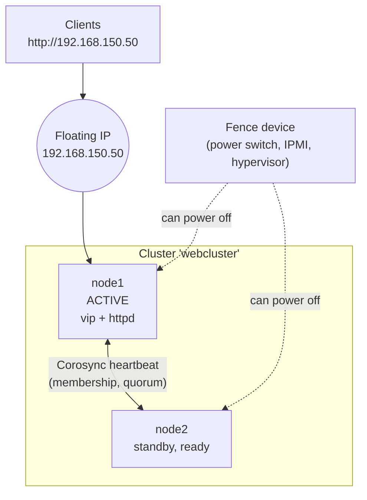
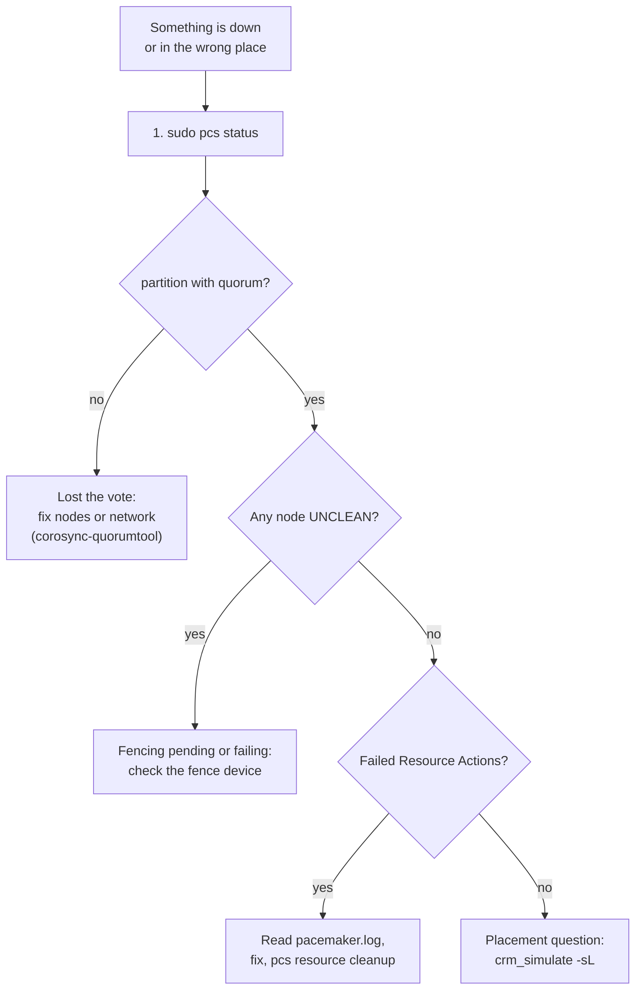
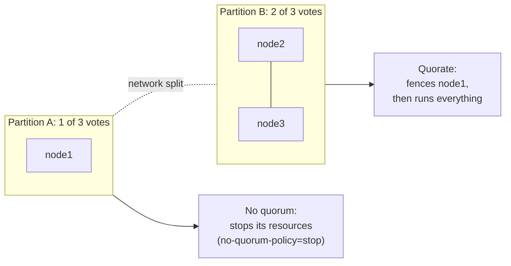
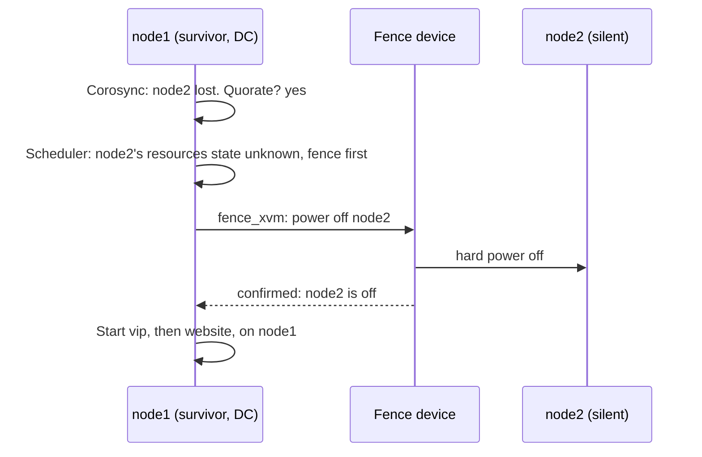
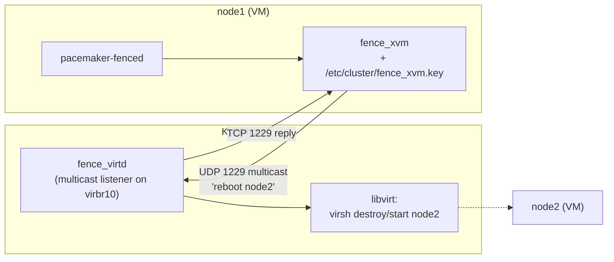

# 28 · High Availability with Pacemaker

<ul class="module-meta">
  <li>⏱ ~3.5 hours</li>
  <li>5 labs</li>
  <li>Builds on: 07 · systemd, 11 · Networking, 12 · firewalld, 27 · Virtualization with KVM</li>
</ul>

At 2:14 a.m. the server running your company's internal web portal loses its power supply. With a plain setup, the portal stays down until someone wakes up, drives in, and swaps the part. With a high availability cluster, a second server notices within seconds, makes sure the first one is really off, takes over its IP address and starts the web server. Users see a short blip. This module shows how Pacemaker and Corosync do that on Rocky Linux, and why the "makes sure the first one is really off" step is the part you must never skip.

!!! abstract "What you'll learn"
    - What high availability is, and what it isn't (not backups, not load balancing)
    - The Rocky HA stack: Corosync, Pacemaker, resource agents, fence agents and `pcs`
    - How quorum works, what split brain is, and why two-node clusters are special
    - Why fencing (STONITH) is mandatory, and how to set it up for KVM lab VMs
    - Build a cluster with a floating IP and a web server, using groups and constraints
    - Test failover by standby, by killing a service and by cutting a node's network
    - Read `pcs status`, `crm_mon` and the Pacemaker logs to explain what the cluster did

## The big picture

A **high availability (HA) cluster** is a group of servers (**nodes**) that watch each other and move services (**resources**) to a healthy node when one fails. Clients talk to a **floating IP** (a virtual IP address that belongs to the service, not to a server), so they don't need to know which node is active.



### HA in one sentence

Here is the whole idea:

> **The servers in a cluster keep voting on who is still alive. Only the side with the majority may run services, and before it takes over a silent server's work, it switches that server off for certain.**

Everything else in this module hangs off that sentence:

1. **"Keep voting on who is alive"** is **membership and quorum**. Corosync passes a heartbeat between the nodes, and only a group holding a strict majority of votes is **quorate**, which means allowed to act.
2. **"Switches that server off for certain"** is **fencing**. Before taking over, the survivors use a power switch, BMC or hypervisor to make *certain* the failed node is off.
3. **"Takes over its work"** is **resource management**. Pacemaker decides where each resource runs, in what order, and restarts or moves it when something fails.

!!! analogy "Think of it like a night shift with two guards"
    Two guards share one gate. They radio each other every few seconds. If one goes quiet, the other can't just assume he fell asleep and take the gate key: maybe his radio broke and he's still standing at the gate. So before taking over, the remaining guard phones the building's power desk and has the quiet guard's booth locked. Only then does she take the key. With three guards, nobody acts alone: two of three must agree before anyone moves.

    Where the analogy breaks: a cluster doesn't ask nicely. Fencing is usually a hard power-off, with no chance for the node to save anything.

### What HA is not

HA is easy to oversell. Be clear about its limits:

| HA is | HA is not |
|---|---|
| Automatic recovery from a node or service failure, in seconds to a minute | Zero downtime. A failover still interrupts connections briefly |
| One copy of a service, moved to where it can run | **Load balancing.** Only one node runs an active/passive service at a time. Use HAProxy or a load balancer to spread traffic |
| Protection against hardware, OS and process failures | **Backups.** If someone deletes the database, the cluster faithfully fails over a deleted database |
| A way to do rolling maintenance | Protection against bad config or bad code, which fail on every node equally |

Clustering also adds complexity. A badly configured cluster causes more outages than it prevents. Use it when minutes of downtime really matter and the application can't do its own redundancy (many modern apps can, with several active instances behind a load balancer).

### The good news: a few states cover most problems

When a cluster misbehaves, `pcs status` almost always shows one of a handful of states. Learn what each one means and you know where to look next.

| `pcs status` shows | What it means, in the one-sentence model | What you do |
|---|---|---|
| **`partition WITHOUT quorum`** | This side lost the vote, so it stopped its services | Bring the missing nodes or network back. Don't force it to run alone |
| **A node is `UNCLEAN`** | A node went silent and hasn't been switched off yet | Check the fence device. Recovery waits until fencing succeeds |
| **Resources `Stopped`, nothing failed** | Nothing is allowed to run yet: no fence device, or a constraint forbids it | Create a fence device, or read the constraints |
| **`Failed Resource Actions`** | A resource's health check failed | Read the log, fix the cause, then `pcs resource cleanup` |
| **Running on the "wrong" node** | The scores favour that node | `crm_simulate -sL` prints the scores |

And one short process for picking the row:



### Words you'll see

| Word | Plain meaning |
|---|---|
| **node** | One server in the cluster |
| **resource** | Anything the cluster starts, stops and watches: an IP address, a web server, a filesystem |
| **floating IP** | An IP address that belongs to a service and moves with it, not to a server |
| **quorum** / **quorate** | A strict majority of votes / "this side holds the majority and may act" |
| **split brain** | Two sides each think the other is dead and both run the same service |
| **fencing** / **STONITH** | Forcing a silent node into a known state, usually off. STONITH is Pacemaker's name for power fencing |
| **DC** | Designated Controller: the one node that makes the decisions |
| **CIB** | Cluster Information Base: the cluster's configuration and state, an XML document copied to every node |
| **resource agent** | A script that knows how to start, stop and check one kind of service |
| **constraint** / **score** | A placement rule / the number Pacemaker adds up per node to choose where a resource runs |
| **stickiness** | A score bonus for staying where you already are |

## Reading pcs status

This is the core skill of the module. `pcs status` is the first command you run, every time, and you'll see it long before you've built anything yourself. Here is a healthy two-node cluster running a fence device and a `web` group (a floating IP plus Apache), which is what you'll have built by the end of the labs:

```console
$ sudo pcs status
Cluster name: webcluster
Cluster Summary:
  * Stack: corosync (Pacemaker is running)
  * Current DC: node1 (version 3.0.1-3.el10-…) - partition with quorum
  * Last updated: Thu Oct 15 10:31:44 2026 on node1
  * Last change:  Thu Oct 15 10:30:12 2026 by root via cibadmin on node1
  * 2 nodes configured
  * 3 resource instances configured

Node List:
  * Online: [ node1 node2 ]

Full List of Resources:
  * fence-xvm	(stonith:fence_xvm):	 Started node1
  * Resource Group: web:
    * vip	(ocf:heartbeat:IPaddr2):	 Started node2
    * website	(ocf:heartbeat:apache):	 Started node2

Daemon Status:
  corosync: active/enabled
  pacemaker: active/enabled
  pcsd: active/enabled
```

How to read it, top to bottom:

- **Current DC** and **partition with quorum**: who is deciding, and whether it's allowed to. "partition WITHOUT quorum" means this node stopped its resources.
- **Node List**: `Online`, `OFFLINE`, `standby`, or `UNCLEAN` (the cluster lost a node and hasn't fenced it yet).
- **Resources**: where each one runs. `Stopped` with no reason usually means a constraint, a missing fence device, or a failure.
- At the bottom, if anything failed, a **Failed Resource Actions** section lists what, where and when, for example `website_monitor_10000 on node2 'not running'`.

Read it with the one-sentence model in mind: first "did this side win the vote?" (the quorum line), then "is any silent node still waiting to be switched off?" (the node list), then "where is the work running, and did anything fail?" (the resources).

### Practise: read three status snippets

Each snippet below is a trimmed `pcs status`. Decide what state the cluster is in and what you'd do before opening the answer.

**Snippet A:**

```text
  * Current DC: node1 - partition WITHOUT quorum
Node List:
  * Online: [ node1 ]
  * OFFLINE: [ node2 node3 ]
```

??? success "Answer A"
    node1 lost the vote. It sees 1 of 3 votes, so it isn't quorate and has stopped its resources (the default `no-quorum-policy=stop`). That's the cluster protecting you from split brain. Check the network between the nodes and whether node2 and node3 are up (`corosync-quorumtool` shows the vote count). Don't try to force node1 to run alone.

**Snippet B:**

```text
  * Current DC: node1 - partition with quorum
Node List:
  * Online: [ node1 ]
  * Node node2: UNCLEAN (offline)
```

??? success "Answer B"
    node1 won the vote, but node2 went silent and hasn't been switched off yet. Until fencing succeeds, node2's resources stay where the cluster last saw them, because they might still be running. If this lasts more than a few seconds, fencing is failing: check the fence device and the fencing lines in `/var/log/pacemaker/pacemaker.log`.

**Snippet C:**

```text
  * Current DC: node1 - partition with quorum
Node List:
  * Online: [ node1 node2 ]
Full List of Resources:
  * Resource Group: web:
    * vip	(ocf:heartbeat:IPaddr2):	 Started node2
    * website	(ocf:heartbeat:apache):	 Started node2
Failed Resource Actions:
  * website_monitor_10000 on node2 'not running'
```

??? success "Answer C"
    Quorum and membership are fine. The `website` health check (its 10 second `monitor`) once found Apache not running on node2, and Pacemaker recovered it in place: it's `Started` again. Find out why Apache died (the Apache error log and `pacemaker.log` around that time), then clear the old failure with `sudo pcs resource cleanup website`.

Notice the order: vote, then fencing, then resources. A resource problem on a side without quorum isn't a resource problem at all.

`crm_mon` shows the same information and refreshes live; `sudo crm_mon -1rf` prints it once, with inactive resources (`-r`) and fail counts (`-f`).

Rocky 10 ships Pacemaker 3.x and pcs 0.12. Commands in this module work the same on Rocky 9 except where noted.

## The Rocky HA stack

The HA software is in its own repository on Rocky, **HighAvailability**, which is disabled by default. Click through the layers of the stack:

<div class="layers" data-open="0" data-hint="Click a layer to see what lives there." markdown>

<div class="layer" data-label="pcs and pcsd" data-tag="management" markdown>

**What it does:** `pcs` is the command-line tool you use for everything: creating the cluster, adding resources, constraints and fencing. It talks to **pcsd**, a daemon on every node (port 2224) that applies changes cluster-wide, so you can run `pcs` on any node. pcsd also serves a web UI.

</div>

<div class="layer" data-label="Pacemaker" data-tag="cluster resource manager" markdown>

**What it does:** the brain. Pacemaker is the **CRM** (cluster resource manager). It keeps the configuration in the **CIB** (Cluster Information Base, an XML document replicated to all nodes), and one node acts as the **DC** (Designated Controller) that makes decisions. Its parts:

- `pacemaker-based`: stores and syncs the CIB
- `pacemaker-schedulerd`: computes where everything should run
- `pacemaker-controld`: carries out the plan (the DC's controller leads)
- `pacemaker-execd`: runs resource agents on each node
- `pacemaker-fenced`: runs fence agents
- `pacemaker-attrd`: tracks node attributes

</div>

<div class="layer" data-label="Resource agents" data-tag="ocf:heartbeat:*, systemd:*" markdown>

**What they do:** scripts that know how to start, stop and monitor one kind of service. Pacemaker never runs `httpd` directly; it calls an agent with `start`, `stop` or `monitor`.

- **OCF agents** (Open Cluster Framework) in `/usr/lib/ocf/resource.d/heartbeat/`: `IPaddr2`, `apache`, `Filesystem`, `LVM-activate`, `pgsql`, and dozens more. They support parameters and deep health checks.
- **systemd** agents: any unit, such as `systemd:httpd`. Simple, but the monitor only knows whether the unit is active.

</div>

<div class="layer" data-label="Fence agents" data-tag="fence_ipmilan, fence_xvm, …" markdown>

**What they do:** turn a node off (or cut it from storage) on command. One agent per kind of hardware: `fence_ipmilan` (server BMCs), `fence_redfish`, `fence_vmware_rest`, `fence_aws`, `fence_xvm` (KVM guests), and many more in the `fence-agents-*` packages.

</div>

<div class="layer" data-label="Corosync" data-tag="membership, quorum, messaging" markdown>

**What it does:** the nervous system. Corosync passes a token around the nodes over the network (using the **knet** transport), so every node always knows who is alive. Its **votequorum** service decides whether this group of nodes has quorum. Pacemaker trusts Corosync's view of membership completely.

</div>

<div class="layer" data-label="Network and hardware" data-tag="ideally redundant links" markdown>

The cluster needs reliable networking between nodes (ideally two separate links, which knet supports), and a fence device that works even when a node is hung: a BMC, a managed power switch, or the hypervisor.

</div>

</div>

## Quorum: who gets to decide

This is the "keep voting on who is alive" part of the one-sentence model.

Imagine a three-node cluster where a switch fails and splits it in two: node1 alone on one side, node2 and node3 on the other. Each side sees the other as dead. If both sides started the database, both would write to it independently. That's **split brain**, and it destroys data.

**Quorum** prevents it. Each node has one **vote**. A partition may run resources only if it holds a strict majority of the expected votes: more than half.



| Nodes | Votes needed | Failures tolerated |
|---|---|---|
| 2 | 2 (special case, see below) | 1, with fencing deciding |
| 3 | 2 | 1 |
| 4 | 3 | 1 |
| 5 | 3 | 2 |

Odd numbers are better: a fourth node adds cost but no extra tolerance.

```console
$ sudo corosync-quorumtool
Quorum information
------------------
Date:             Thu Oct 15 10:12:03 2026
Quorum provider:  corosync_votequorum
Nodes:            2
Node ID:          1
Ring ID:          1.12
Quorate:          Yes

Votequorum information
----------------------
Expected votes:   2
Highest expected: 2
Total votes:      2
Quorum:           1
Flags:            2Node Quorate WaitForAll

Membership information
----------------------
    Nodeid      Votes Name
         1          1 node1 (local)
         2          1 node2
```

### The two-node special case

With two nodes, a majority is 2 out of 2, so losing either node would stop everything, which defeats the purpose. Corosync has a **`two_node`** mode (set automatically by `pcs` for two-node clusters, and visible as the `2Node` flag above): a single node keeps quorum. That creates a new problem: after a split, *both* nodes think they're quorate. The tie is broken by fencing: both try to fence each other, and the faster one wins (a **fence race**). Two safeguards come with it:

- **WaitForAll**: after a cold start, a node won't become quorate alone until it has seen the other node at least once. That stops a node that booted in isolation from grabbing resources.
- **A fencing delay** (`pcmk_delay_base` or `pcmk_delay_max` on the fence device, or the `priority-fencing-delay` cluster property) gives one node a head start, so the two don't shoot each other at the same instant.

??? question "Going further: quorum devices for even-sized clusters"
    A cleaner fix for even-sized clusters is a **quorum device** (**qdevice**): a lightweight arbitrator on a third machine (`corosync-qnetd`) that gives one extra vote to the partition it can still see. It doesn't run resources and can serve many clusters. On the cluster nodes you install `corosync-qdevice` and add it with `pcs quorum device add model net host=<arbitrator> algorithm=ffsplit`.

<div class="quiz" data-answer="3" markdown>

A four-node cluster splits into two halves of two nodes each, with no quorum device. What happens?

- Both halves keep running, because each has two nodes
- The half with the lowest node IDs wins automatically
- Neither half has more than half of the 4 votes, so neither is quorate and both stop their resources
- Corosync merges the halves back together

Right. Each half has 2 of 4 votes, and quorum needs 3. Both stop resources (the default `no-quorum-policy=stop`). That's safe, but it's an outage, which is why even-sized clusters benefit from a qdevice.

</div>

## Fencing: the part you can't skip

This is the "switches that server off for certain" part of the model, and the part people are most tempted to skip.

When node2 stops answering, the cluster knows only one thing: it can't hear node2. It does *not* know whether node2 is dead, hung for 40 seconds by a storage stall, or perfectly healthy behind a broken network cable. If node2 is still alive and the cluster starts its services on node1, two nodes run the same service against the same data.

**Fencing** removes the doubt. Before recovering node2's resources, the cluster uses an out-of-band device to force node2 into a known state, usually powered off. **STONITH** ("Shoot The Other Node In The Head") is Pacemaker's name for power fencing. Only after the fence device confirms success does recovery start.

!!! danger "A story that keeps happening"
    This is a composite of a failure many teams have lived through. A team runs a two-node cluster serving an XFS filesystem from shared SAN storage. Fencing "kept causing problems in testing", so they set `stonith-enabled=false`. Months later a network switch reboots during maintenance. Each node loses sight of the other for 30 seconds. Each concludes the other has died, and each mounts the shared XFS filesystem and starts writing. Neither filesystem cache knows about the other's writes. When the switch returns, the filesystem metadata is corrupted beyond `xfs_repair`'s help, and the next 14 hours are a restore from backup. The cluster did exactly what it was told. Without fencing, a cluster can't tell "dead" from "unreachable", and shared storage does not forgive guessing.



Fencing rules to live by:

- Every node must be fenceable by a device that does *not* depend on that node working (a BMC, a power switch, the hypervisor).
- Test fencing before you trust the cluster: `pcs stonith fence node2` should actually power it off.
- If fencing fails, Pacemaker deliberately *waits* rather than risk split brain. A cluster stuck with "fencing failed" is protecting your data.
- Red Hat does not support clusters with `stonith-enabled=false`. Rocky inherits the same design.

!!! warning "Disabling STONITH: labs only"
    Pacemaker refuses to start resources until a fence device exists or you set `pcs property set stonith-enabled=false`. In a throwaway lab you may disable it to learn resource management first, as Lab 2 does. Never do this on a cluster that touches real data or shared storage. Lab 4 adds real fencing for your VMs.

## Installing and building the cluster

These steps run on **every node** unless noted. The labs use two Rocky 10 VMs, `node1` and `node2`, built as in [module 27](27-virtualization-kvm.md#labs).

**1. Enable the repository and install:**

```console
$ sudo dnf config-manager --set-enabled highavailability
$ dnf repolist | grep -i high
highavailability             Rocky Linux 10 - High Availability
$ sudo dnf install -y pcs pacemaker fence-agents-all
```

`fence-agents-all` pulls in every fence agent; on real hardware you can install just the one you need (for example `fence-agents-ipmilan`).

**2. Names and firewall:** every node must resolve every other node's name, ideally via `/etc/hosts` so the cluster doesn't depend on DNS. Then open the cluster ports with the predefined firewalld service ([module 12](12-firewalld.md)):

```console
$ sudo firewall-cmd --permanent --add-service=high-availability
$ sudo firewall-cmd --reload
```

**3. Start pcsd and set the `hacluster` password:** the packages create a `hacluster` user that pcsd nodes use to authenticate to each other.

```console
$ sudo passwd hacluster
$ sudo systemctl enable --now pcsd
```

**4. On one node only: authenticate and create the cluster:**

```console
$ sudo pcs host auth node1 node2 -u hacluster
Password:
node1: Authorized
node2: Authorized
$ sudo pcs cluster setup webcluster node1 node2 --start --enable
No addresses specified for host 'node1', using 'node1'
No addresses specified for host 'node2', using 'node2'
Destroying cluster on hosts: 'node1', 'node2'...
…
Sending 'corosync.conf' to 'node1', 'node2'
node1: successful distribution of the file 'corosync.conf'
node2: successful distribution of the file 'corosync.conf'
Cluster has been successfully set up.
Starting cluster on hosts: 'node1', 'node2'...
Enabling cluster on hosts: 'node1', 'node2'...
```

`pcs` wrote `/etc/corosync/corosync.conf` on both nodes: the cluster name, the **knet** transport with encryption, the node list, and `two_node: 1` in the quorum section.

??? example "Read the generated `corosync.conf` (it's short)"

    ```ini title="/etc/corosync/corosync.conf (trimmed)"
    totem {
        version: 2
        cluster_name: webcluster
        transport: knet
        crypto_cipher: aes256
        crypto_hash: sha256
    }

    nodelist {
        node {
            ring0_addr: node1
            name: node1
            nodeid: 1
        }
        node {
            ring0_addr: node2
            name: node2
            nodeid: 2
        }
    }

    quorum {
        provider: corosync_votequorum
        two_node: 1
    }
    ```

Never edit it on one node only. Use `pcs` commands (or edit, then `pcs cluster sync` and `pcs cluster reload corosync`).

!!! tip "Enable or not at boot?"
    `--enable` makes the cluster start at boot. Some admins prefer to leave it off, so a node that was fenced and reboots doesn't rejoin until a human has looked at why it was fenced. Either is valid; decide on purpose.

## Resources: a floating IP and a web server

This is the "takes over its work" part of the model.

A **resource** is anything the cluster manages. You give it a name, an agent and parameters, and the cluster calls the agent's `start`, `stop` and `monitor` actions.

Find agents and their parameters:

```console
$ pcs resource agents ocf:heartbeat | grep -E '^(IPaddr2|apache|Filesystem)$'
Filesystem
IPaddr2
apache
```

`pcs resource describe <agent>` lists every parameter an agent takes, marking the required ones.

??? example "What `pcs resource describe ocf:heartbeat:IPaddr2` prints"

    ```console
    $ pcs resource describe ocf:heartbeat:IPaddr2 | head -12
    ocf:heartbeat:IPaddr2 - Manages virtual IPv4 and IPv6 addresses (Linux specific version)

    This Linux-specific resource manages IP alias IP addresses. It can add an IP alias, or remove one…

    Resource options:
      ip (required) (unique): The IPv4 (dotted quad notation) or IPv6 address (colon hexadecimal notation) example IPv4 "192.168.1.1". example IPv6 "2001:db8:DC28:0:0:FC57:D4C8:1FFF".
      nic: The base network interface on which the IP address will be brought online. …
      cidr_netmask: The netmask for the interface in CIDR format …
    …
    ```

??? question "Under the hood: a resource agent is just a script with exit codes"
    Open `/usr/lib/ocf/resource.d/heartbeat/IPaddr2` in a pager: it's a shell script. Pacemaker passes the parameters as environment variables named `OCF_RESKEY_<param>` (so `ip=` becomes `OCF_RESKEY_ip`) and the action as the first argument. Everything the cluster knows comes from the **exit code**:

    | Exit code | Meaning | What Pacemaker does |
    |---|---|---|
    | `0` (`OCF_SUCCESS`) | Action worked / resource is running | Nothing more |
    | `7` (`OCF_NOT_RUNNING`) | Cleanly stopped | Expected after `stop`; a failure if a `monitor` returns it unexpectedly |
    | `1` (`OCF_ERR_GENERIC`) | Something failed, may be recoverable | Recover: stop, then start (here or elsewhere) |
    | `5` (`OCF_ERR_INSTALLED`) | Software missing on this node | Never try this node again until cleanup |
    | `6` (`OCF_ERR_CONFIGURED`) | Bad parameters | Stop the resource everywhere: no node can fix a bad config |

    The production rule hidden in that table: a **`stop` that fails** is the one failure Pacemaker can't recover from politely. If it can't prove a resource is stopped, it fences the node to make it stopped. A slow `stop` that exceeds its timeout (an Apache with long-lived connections, a database flushing) gets your node power-cycled. Give `stop` operations realistic timeouts.

    `sudo pcs resource debug-monitor vip` (and `debug-start`, `debug-stop`) runs the agent by hand with the cluster's parameters and full shell tracing, which is the fastest way to see *why* an agent returns what it returns.

### The floating IP

```console
$ sudo pcs resource create vip ocf:heartbeat:IPaddr2 \
      ip=192.168.150.50 cidr_netmask=24 op monitor interval=10s
```

When it starts, `IPaddr2` adds the address to the right interface and sends **gratuitous ARP** packets, which tell switches and neighbours "this IP now lives at my MAC address". That's what makes clients follow the IP to the new node within a second.

```console
$ ip -br addr show
eth1             UP             192.168.150.12/24 192.168.150.50/24
```

### The web server

The `apache` agent checks health by fetching Apache's status page, so enable it (on both nodes), restricted to local requests:

```apache title="/etc/httpd/conf.d/status.conf"
<Location /server-status>
    SetHandler server-status
    Require local
</Location>
```

```console
$ sudo pcs resource create website ocf:heartbeat:apache \
      configfile=/etc/httpd/conf/httpd.conf \
      statusurl="http://127.0.0.1/server-status" op monitor interval=10s
```

!!! warning "Don't let systemd fight Pacemaker"
    A cluster-managed service must **not** be enabled in systemd. If `httpd.service` is enabled, both systemd and Pacemaker try to manage it at boot. Run `sudo systemctl disable --now httpd` on every node before handing it to the cluster.

### Groups: keep them together, in order

The IP and the web server belong together: same node, IP first. A **resource group** expresses exactly that. Members start in the listed order, stop in reverse, and always run on the same node:

```console
$ sudo pcs resource group add web vip website
```

## Constraints: where, together, and in what order

Groups cover the common case. For anything else, you use **constraints**, rules that feed into Pacemaker's scoring. Every resource gets a **score** for every node; it runs on the node with the highest score. `INFINITY` means "must", `-INFINITY` means "must never".

| Constraint | Question it answers | Example |
|---|---|---|
| **Location** | Which nodes does a resource prefer or avoid? | `pcs constraint location web prefers node1=50` |
| **Colocation** | Must two resources be on the same (or different) node? | `pcs constraint colocation add website with vip INFINITY` |
| **Order** | Must one start before another? | `pcs constraint order vip then website` |

The two-line colocation-plus-order pattern is exactly what a group does internally. Use explicit constraints when resources must be related but managed separately (for example a database and a filesystem that several services share).

```console
$ sudo pcs constraint location web prefers node1=50
$ sudo pcs constraint
Location Constraints:
  resource 'web' prefers node 'node1' with score 50
…
```

(The exact wording of this listing changed across pcs 0.11 releases; the information is the same.)

### Stickiness: don't move back and forth

Suppose node1 fails, `web` moves to node2, then node1 returns. Should `web` move back to node1 because it "prefers" it? Moving back causes a second interruption for no benefit. **Resource stickiness** is a score bonus for staying where you are:

```console
$ sudo pcs resource defaults update resource-stickiness=100
```

You may already have a little stickiness without asking. On Rocky, Pacemaker adds a `build-resource-defaults` set with `resource-stickiness=1` to a new cluster; `pcs resource defaults` shows it, and `update` changes that value.

With stickiness 100 and a location preference of 50, `web` stays on node2 after node1 returns (100 beats 50). If you set the preference above the stickiness, it fails back automatically. That arithmetic is the whole model: Pacemaker sums the scores and picks the highest. `crm_simulate -sL` prints every score it calculated, which is the best way to answer "why is it running *there*?".

<div class="quiz" data-answer="2" markdown>

`web` has `prefers node1=200` and resource stickiness is `100`. node1 fails, `web` moves to node2, and node1 comes back. Where does `web` run?

- On node2, because stickiness always wins
- On node1: its score there (200) beats node2's (100 from stickiness), so it moves back
- On both nodes
- Nowhere, until you run `pcs resource cleanup`

Right. Scores add up per node. On node1, 200 (location). On node2, 100 (stickiness). Highest wins, so it fails back. Lower the preference below 100, or raise stickiness, to make it stay.

</div>

## What happens when a node dies

Walk through a real failover, step by step:

<div class="stepper" markdown>

<div class="step" data-title="node2 dies" markdown>

node2 runs the `web` group. Its power supply fails. It stops sending anything at all.

</div>

<div class="step" data-title="Corosync notices" markdown>

Corosync passes a token around the ring. When the token doesn't come back within the **token timeout** (3 seconds by default in Corosync 3), Corosync declares node2 lost and forms a new membership with just node1.

```text
corosync[1123]:   [KNET  ] link: host: 2 link: 0 is down
corosync[1123]:   [QUORUM] Sync members[1]: 1
corosync[1123]:   [QUORUM] Members[1]: 1
```

</div>

<div class="step" data-title="Quorum check" markdown>

votequorum recalculates. With `two_node` set, node1 alone stays quorate. In a three-node cluster, the two survivors would still have 2 of 3 votes. Without quorum, node1 would stop here and run nothing.

</div>

<div class="step" data-title="The DC plans" markdown>

If node2 was the DC, node1 elects itself. The scheduler sees that node2's resources are in an unknown state: they might still be running. The only safe plan is "fence node2 first, then start `web` on node1". `pcs status` shows node2 as `UNCLEAN (offline)` at this moment.

</div>

<div class="step" data-title="Fence" markdown>

`pacemaker-fenced` runs the fence agent (for KVM labs, `fence_xvm`), which asks the hypervisor to power node2 off. The agent reports success.

```text
pacemaker-fenced[1210]:  notice: Operation 'reboot' [3021] targeting node2 using fence-xvm returned 0
```

</div>

<div class="step" data-title="Recover" markdown>

Now that node2 is certainly off, node1 starts the group in order: `vip` (adds the IP and sends gratuitous ARP), then `website` (starts Apache and checks `server-status`). Clients reconnect. Total time is typically 10 to 60 seconds, most of it detection and fencing.

</div>

<div class="step" data-title="node2 returns" markdown>

After repair, node2 boots, Corosync rejoins it, and it shows `Online`. Because of stickiness, `web` stays on node1. You move it back only when *you* choose to, in a quiet moment.

</div>

</div>

??? question "Under the hood: the token timeout, and why a VM pause can get a node fenced"
    The whole "is node2 alive?" decision hangs on one number. Read the value actually in use (Corosync adds `token_coefficient`, 650 ms, for each node beyond two):

    ```console
    $ sudo corosync-cmapctl | grep -E 'runtime.config.totem.(token|consensus) '
    runtime.config.totem.consensus (u32) = 3600
    runtime.config.totem.token (u32) = 3000
    ```

    Anything that freezes a node for longer than that looks exactly like a dead node: a live migration's final pause on a busy VM, a hypervisor snapshot, a long storage stall, a kernel soft lockup. The survivors fence it, and the post-mortem says "node was healthy, cluster killed it".

    The fix is not "disable fencing". Raise the timeout to cover your platform's real pauses (`pcs cluster config update totem token=10000`, then check the runtime value again) and accept that real failures are detected that much later. Public cloud HA guides typically use much larger values than bare metal. It's a trade-off, so write the chosen number and the reason in your runbook.

## Testing failover

A cluster that hasn't been tested will fail in a way you didn't expect. Test each failure type on purpose:

| Test | How | Expected result |
|---|---|---|
| Planned move | `pcs node standby node2` | Resources stop on node2 and start on node1. No fencing. Undo with `pcs node unstandby node2` |
| Move one resource | `pcs resource move web node1` | `web` moves. Since pcs 0.11 (Rocky 9 and 10), pcs removes its temporary constraint once the move is done, so the resource may later drift back if scores favour another node. `pcs resource move-with-constraint` keeps the old "pin it there" behaviour |
| Service crash | `killall -9 httpd` on the active node | The monitor notices within 10 s and restarts Apache on the *same* node. Fail count goes to 1 |
| Repeated crashes | Set `migration-threshold=3`, crash it three times | After the third failure the resource moves to the other node |
| Network loss | Cut the node's cluster link (Lab 3) | The other node fences it, then takes over |
| Node crash | `echo c > /proc/sysrq-trigger` on the active node | Same as network loss: fence, then recover |
| Fencing itself | `pcs stonith fence node2` | node2 powers off (or reboots) |

After a failure, Pacemaker remembers it. Look and clear:

```console
$ sudo pcs resource failcount show website
Failcounts for resource 'website'
  node2: 1
$ sudo pcs resource cleanup website
Cleaned up website on node2
Waiting for 1 reply from the controller
… got reply (done)
```

<div class="quiz" data-answer="4" markdown>

You run `killall -9 httpd` on node1, which runs the `web` group with default settings. What does the cluster do?

- Fences node1 immediately
- Moves the whole `web` group to node2 at once
- Nothing, because Pacemaker only watches nodes, not services
- The next `monitor` finds Apache not running, and Pacemaker restarts it on node1, recording a failure

Right. A failed monitor first triggers a local recovery (stop, then start) on the same node. With the default `migration-threshold`, it keeps recovering in place; set `migration-threshold` to make it move after N failures. Fencing is for nodes that stop responding, or resources that fail to *stop*.

</div>

## Logs: what did the cluster do, and why?

| Where | What's there |
|---|---|
| `/var/log/pacemaker/pacemaker.log` | Detailed Pacemaker log: every decision, agent call and result |
| `/var/log/cluster/corosync.log` | Membership changes, link up/down, quorum |
| `journalctl -u pacemaker -u corosync` | The same events in the journal, with less detail |
| `pcs status --full` | Current state, including node attributes and recent failures |
| `crm_simulate -sL` | Placement scores calculated from the live CIB |

??? question "Under the hood: replay the cluster's decision offline"
    Every time the scheduler makes a plan (a **transition**), it saves the exact input it used, the whole CIB plus node state, to a compressed file and logs where:

    ```console
    $ sudo grep 'saving inputs' /var/log/pacemaker/pacemaker.log | tail -1
    … pacemaker-schedulerd[1214] … notice: Calculated transition 12, saving inputs in /var/lib/pacemaker/pengine/pe-input-41.bz2
    $ sudo crm_simulate -Ss -x /var/lib/pacemaker/pengine/pe-input-41.bz2
    ```

    `crm_simulate -x` re-runs the scheduler on that saved input and prints the scores and the actions it chose, on any node, at any later time. This is how support engineers answer "why did the cluster move the database at 03:12?" days after the fact: find the transition in the log, replay its input, read the scores. Attach those files to a support case rather than describing the problem in prose.

When something surprising happened, find the moment in the journal first, then read the detailed log around that time. The scheduler records a "transition" for every decision; search for `pacemaker-schedulerd` lines showing actions like `Move`, `Recover`, `Start` or `Fence`:

```console
$ sudo grep -E 'pacemaker-schedulerd.*(Recover|Move|Start|Fence)' /var/log/pacemaker/pacemaker.log | tail -4
Oct 15 10:44:02 node1 pacemaker-schedulerd[1214] (log_list_item)   notice: Actions: Fence (reboot) node2 'peer is no longer part of the cluster'
Oct 15 10:44:02 node1 pacemaker-schedulerd[1214] (log_list_item)   notice: Actions: Move  vip  ( node2 -> node1 )
Oct 15 10:44:02 node1 pacemaker-schedulerd[1214] (log_list_item)   notice: Actions: Move  website  ( node2 -> node1 )
```

## Fencing in a KVM lab

Real servers fence through their BMCs (`fence_ipmilan`, `fence_redfish`). Lab VMs on one KVM host fence through the hypervisor: the **fence_virtd** daemon on the host listens for requests, and the **fence_xvm** agent in each VM sends them. Requests are authenticated with a shared key file.



!!! note "Where the fence-virt packages live"
    On Rocky 10 the `fence-virt` (agent) and `fence-virtd*` (host daemon) packages are built from the `fence-agents` source and ship in **AppStream**, so the KVM host does *not* need the HighAvailability repository enabled. On any release, `dnf provides /usr/sbin/fence_virtd` (host) or `dnf provides /usr/sbin/fence_xvm` (nodes) tells you which repository has them, so you never have to guess.

On the **host**:

```console
$ sudo dnf install -y fence-virtd fence-virtd-libvirt fence-virtd-multicast
$ sudo mkdir -p /etc/cluster
$ sudo dd if=/dev/urandom of=/etc/cluster/fence_xvm.key bs=4k count=1
$ sudo fence_virtd -c
```

`fence_virtd -c` asks a series of questions. Accept the defaults except: listener `multicast`, interface the lab network bridge (`virbr10` from module 27's `labnet`), backend `libvirt`. Then start it and open its port on the host:

```console
$ sudo systemctl enable --now fence_virtd
$ sudo firewall-cmd --permanent --zone=libvirt --add-port=1229/udp
$ sudo firewall-cmd --reload
```

On **each node**: copy the key to `/etc/cluster/fence_xvm.key`, install the agent, open the reply port, and test:

```console
$ sudo dnf install -y fence-virt
$ sudo firewall-cmd --permanent --add-port=1229/tcp && sudo firewall-cmd --reload
$ sudo fence_xvm -o list
node1                            5c7e1f0a-3b8d-4e2a-9d61-7a2b0c9e4f11 on
node2                            a91d4c22-6e0f-4b7a-8c35-1e9f2d7b6a03 on
```

Then, on one node, create the fence device. `pcmk_host_map` maps cluster node names to VM names (here they're the same):

```console
$ sudo pcs stonith create fence-xvm fence_xvm \
      key_file=/etc/cluster/fence_xvm.key pcmk_host_map="node1:node1;node2:node2"
$ sudo pcs property set stonith-enabled=true
$ sudo pcs stonith fence node2
Node: node2 fenced
```

!!! note "Other lab options"
    **SBD** ("STONITH Block Device", package `sbd`) can fence using only a hardware watchdog, optionally plus a shared disk: a node that loses quorum or can't reach the shared disk resets itself, and the others wait a safe interval before assuming it did. It's configured with `pcs stonith sbd enable`. For virtual labs, the `fence_xvm` approach above is simpler to reason about.

## Practice

<div class="terminal-sim" data-title="Drive a cluster" data-prompt="[root@node1 ~]# " markdown>

<div class="task" data-expect="pcs status" data-match="^(sudo )?(pcs status( --full)?|crm_mon -1.*)$" data-hint="The pcs subcommand that shows the whole cluster state." markdown>

**Step 1.** Show the cluster's state. Where is the `web` group running?

```text
Cluster name: webcluster
Cluster Summary:
  * Current DC: node1 - partition with quorum
Node List:
  * Online: [ node1 node2 ]
Full List of Resources:
  * fence-xvm	(stonith:fence_xvm):	 Started node1
  * Resource Group: web:
    * vip	(ocf:heartbeat:IPaddr2):	 Started node2
    * website	(ocf:heartbeat:apache):	 Started node2
```

</div>

<div class="task" data-expect="corosync-quorumtool" data-match="^(sudo )?(corosync-quorumtool( -s)?|pcs quorum status)$" data-hint="Corosync has its own tool for quorum information." markdown>

**Step 2.** Check the quorum state with Corosync's own tool.

```text
Quorate:          Yes
Expected votes:   2
Total votes:      2
Flags:            2Node Quorate WaitForAll
```

</div>

<div class="task" data-expect="pcs node standby node2" data-hint="pcs node standby, followed by the node name." markdown>

**Step 3.** node2 needs a kernel update. Drain it so resources move away.

```text
```

`pcs status` now shows `Node node2: standby` and `web` running on node1.

</div>

<div class="task" data-expect="pcs node unstandby node2" data-hint="The opposite of standby." markdown>

**Step 4.** The update is done. Bring node2 back into service.

```text
```

Thanks to stickiness, `web` stays on node1.

</div>

<div class="task" data-expect="pcs resource cleanup website||pcs resource cleanup" data-hint="pcs resource cleanup, optionally with the resource name." markdown>

**Step 5.** Last night `website` failed once on node2 and the old failure still shows. Clear its failure history.

```text
Cleaned up website on node2
Waiting for 1 reply from the controller
… got reply (done)
```

</div>

</div>

## Labs

All labs use one KVM host (bare metal or nested, see [module 27](27-virtualization-kvm.md)) running two Rocky 10 VMs, `node1` and `node2`, each with 1.5 GB RAM, one NIC on the `default` network (for packages) and one on the isolated `labnet` (`192.168.150.0/24`). A third VM is optional for Lab 5.

!!! lab "Lab 1: Prepare two cluster nodes"

    **Goal:** Get two VMs ready: static cluster addresses, names, packages, firewall and pcsd.

    **You'll need:** `node1` and `node2` from [module 27, Lab 3](27-virtualization-kvm.md#labs), and the `labnet` network from module 27, Lab 4.

    1. On the host, add a `labnet` NIC to each VM: `for n in node1 node2; do virsh attach-interface $n network labnet --model virtio --config --live; done`.

    2. On each node, give the new interface a static address (find its name with `nmcli dev`; here it's `eth1`). Use `.11` on node1 and `.12` on node2:

        ```bash
        sudo nmcli con add type ethernet ifname eth1 con-name cluster \
          ipv4.method manual ipv4.addresses 192.168.150.11/24
        sudo nmcli con up cluster
        ```

    3. On both nodes, add names and install the stack:

        ```bash
        printf '192.168.150.11 node1\n192.168.150.12 node2\n' | sudo tee -a /etc/hosts
        sudo dnf config-manager --set-enabled highavailability
        sudo dnf install -y pcs pacemaker fence-agents-all httpd
        sudo firewall-cmd --permanent --add-service={high-availability,http}
        sudo firewall-cmd --reload
        echo 'Cluster-Lab-123' | sudo passwd --stdin hacluster
        sudo systemctl enable --now pcsd
        ```

    4. On node1 only:

        ```bash
        sudo pcs host auth node1 node2 -u hacluster -p 'Cluster-Lab-123'
        sudo pcs cluster setup webcluster node1 node2 --start --enable
        sudo pcs status
        ```

    **Check your work:** `pcs status` shows `Online: [ node1 node2 ]`, `partition with quorum`, and no resources. `sudo corosync-quorumtool` shows the `2Node` flag.

    ??? tip "Hint: pcs host auth fails"
        Check pcsd is running on both nodes (`systemctl status pcsd`), that port 2224 is open (the `high-availability` firewalld service covers it), and that `node2` resolves to its `192.168.150.12` address from node1 (`getent hosts node2`).

    **Clean up:** keep the cluster for the next labs. To remove it entirely: `sudo pcs cluster destroy --all` on node1.

!!! lab "Lab 2: A floating IP and a web server"

    **Goal:** Create an active/passive web service that follows a floating IP.

    **You'll need:** the cluster from Lab 1.

    1. On both nodes, prepare Apache but leave it disabled in systemd. Give each node a different page so you can see where it's served from:

        ```bash
        printf '<Location /server-status>\n  SetHandler server-status\n  Require local\n</Location>\n' | sudo tee /etc/httpd/conf.d/status.conf
        echo "Served by $(hostname)" | sudo tee /var/www/html/index.html
        sudo systemctl disable --now httpd
        ```

    2. On node1, temporarily disable fencing (lab only, Lab 4 restores it) and create the resources:

        ```bash
        sudo pcs property set stonith-enabled=false
        sudo pcs resource create vip ocf:heartbeat:IPaddr2 ip=192.168.150.50 cidr_netmask=24 op monitor interval=10s
        sudo pcs resource create website ocf:heartbeat:apache configfile=/etc/httpd/conf/httpd.conf \
          statusurl="http://127.0.0.1/server-status" op monitor interval=10s
        sudo pcs resource group add web vip website
        sudo pcs resource defaults update resource-stickiness=100
        sudo pcs status
        ```

    3. From the KVM host (which is on `labnet` as `192.168.150.1`): `curl http://192.168.150.50/`.

    **Check your work:** `pcs status` shows `vip` and `website` started on the same node, and `curl` prints `Served by node1` or `Served by node2`. On that node, `ip -br addr` lists `192.168.150.50`.

    ??? tip "Hint: website won't start"
        Run `sudo pcs resource debug-start website` on the node to see the agent's output. The usual cause is the status URL: test `curl http://127.0.0.1/server-status` on the node while httpd runs by hand. Then `sudo pcs resource cleanup website`.

    **Clean up:** keep everything for Lab 3.

!!! lab "Lab 3: Break things on purpose"

    **Goal:** Watch the cluster handle a planned move, a crashed service and a lost network link.

    **You'll need:** Lab 2 done. A second terminal on the host running `watch -n1 curl -s http://192.168.150.50/` helps.

    1. **Planned move.** Note which node runs `web` (say node2), then `sudo pcs node standby node2`. Watch the `curl` output switch. Then `sudo pcs node unstandby node2` and confirm `web` stays put.

    2. **Service crash.** On the active node, `sudo killall -9 httpd`. Within 10 seconds, check `sudo pcs status` (look for `Failed Resource Actions`) and `sudo pcs resource failcount show website`. Clear it with `sudo pcs resource cleanup website`.

    3. **Make it move after failures.** `sudo pcs resource meta website migration-threshold=2`, then kill httpd twice on the active node (wait for each restart). The group moves.

    4. **Cable pull.** On the host, find the active node's `labnet` interface (`virsh domiflist node1`, the one on `labnet`, such as `vnet5`), then cut it: `virsh domif-setlink node1 vnet5 down`. Watch `pcs status` from the *other* node.

    5. Restore the link: `virsh domif-setlink node1 vnet5 up`.

    **Check your work:** steps 1 to 3 move or restart the service as described. In step 4, with STONITH disabled, both nodes believe they are alone, and *both* may bring up `192.168.150.50` and Apache. Run `ip -br addr` on each node to see it.

    ??? success "What just happened?"
        Step 4 is a live split brain. Each partition is quorate (two-node mode) and nobody can fence anybody, so each side starts the group. With a web server serving static files, the damage is confused clients. With shared storage, it would be data corruption. That's the exact situation fencing prevents, and Lab 4 fixes it. After you restore the link, Pacemaker detects the resource running twice and stops the extra copy; run `sudo pcs resource cleanup` if anything stays failed.

    **Clean up:** `sudo pcs resource meta website migration-threshold=` (an empty value removes it), then `sudo pcs resource cleanup`.

!!! lab "Lab 4: Real fencing with fence_xvm"

    **Goal:** Make the cluster safe: configure hypervisor fencing, re-enable STONITH, and repeat the cable pull.

    **You'll need:** Lab 3 done, root on the KVM host.

    1. On the **host**, install and configure fence_virtd (answers: listener `multicast`, interface `virbr10`, backend `libvirt`, defaults for the rest):

        ```bash
        sudo dnf install -y fence-virtd fence-virtd-libvirt fence-virtd-multicast
        sudo mkdir -p /etc/cluster
        sudo dd if=/dev/urandom of=/etc/cluster/fence_xvm.key bs=4k count=1
        sudo fence_virtd -c
        sudo systemctl enable --now fence_virtd
        sudo firewall-cmd --permanent --zone=libvirt --add-port=1229/udp && sudo firewall-cmd --reload
        ```

    2. Copy the key to both nodes (for example `sudo scp /etc/cluster/fence_xvm.key root@node1:/etc/cluster/` after creating `/etc/cluster` on each node; any method works). On **each node**:

        ```bash
        sudo dnf install -y fence-virt
        sudo firewall-cmd --permanent --add-port=1229/tcp && sudo firewall-cmd --reload
        sudo fence_xvm -o list
        ```

    3. On node1, create the device and turn fencing back on:

        ```bash
        sudo pcs stonith create fence-xvm fence_xvm key_file=/etc/cluster/fence_xvm.key \
          pcmk_host_map="node1:node1;node2:node2" pcmk_delay_max=5
        sudo pcs property set stonith-enabled=true
        sudo pcs status
        ```

    4. Test fencing directly: `sudo pcs stonith fence node2`. On the host, `virsh list` shows node2 restarting. Wait for it to rejoin.

    5. Repeat the cable pull from Lab 3, step 4, on the node running `web`.

    **Check your work:** `fence_xvm -o list` shows both VMs. In step 4, node2 reboots and returns `Online`. In step 5, the isolated node is rebooted by the other node, and `web` runs on exactly one node throughout. `journalctl -u pacemaker | grep -i fenc` on the survivor shows the fencing operation.

    ??? tip "Hint: fence_xvm -o list times out"
        Check, in order: `fence_virtd` is running on the host and listening on the right bridge (`/etc/fence_virt.conf`), the key file is identical everywhere (`sha256sum /etc/cluster/fence_xvm.key`), UDP 1229 is open on the host's `libvirt` zone, and TCP 1229 is open on the nodes. `fence_xvm -o list -d` adds debug output.

    ??? success "What just happened?"
        When the link went down, both nodes raced to fence each other. `pcmk_delay_max=5` adds a random delay up to 5 seconds, so one usually wins clearly. The loser was powered off through libvirt, so it could not keep running `web`. That's the difference between Lab 3 and Lab 4: a cluster with fencing never has two active copies.

    **Clean up:** to tear everything down: `sudo pcs cluster destroy --all` on node1; on the host `sudo systemctl disable --now fence_virtd`; then delete the VMs as in module 27.

!!! lab "Lab 5 (optional): A third vote"

    **Goal:** See how quorum changes with three nodes, or with a quorum device.

    **You'll need:** Lab 4 done, and a third small VM `node3` (`192.168.150.13`, built like node1 and node2 in module 27 with a `labnet` NIC), prepared like Lab 1, step 3, plus `fence-virt` and the key file from Lab 4, step 2. Put names for all three nodes in every node's `/etc/hosts`.

    1. On node1: `sudo pcs host auth node3 -u hacluster -p 'Cluster-Lab-123'`, then `sudo pcs cluster node add node3 --start --enable`. Add `node3:node3` to the fence map: `sudo pcs stonith update fence-xvm pcmk_host_map="node1:node1;node2:node2;node3:node3"`.
    2. Run `sudo corosync-quorumtool` and note the `Quorum` line and the flags.
    3. Find the node running `web` and cut *only its* `labnet` link from the host (`virsh domif-setlink <vm> <vnetN> down`, as in Lab 3). Watch `sudo pcs status` from one of the other two nodes.
    4. When the isolated node has been fenced and rebooted, check `pcs status` again.

    **Check your work:** with three nodes, the `2Node` flag is gone and `Quorum: 2`. In step 3 the two connected nodes stay `partition with quorum`, fence the isolated node, and start `web` themselves. The isolated node (if you watch its console) reports `partition WITHOUT quorum` and stops its resources: it never races to fence anyone.

    ??? success "What just happened?"
        With three votes, a single node is a minority, so it isn't allowed to act at all, and the majority side fences it without a race. No `pcmk_delay_max` lottery is needed. That's why three nodes (or two plus a qdevice) is a more robust design than two. Because a fence reboot starts a fresh QEMU process, the isolated node usually comes back with its link up and rejoins on its own.

    **Clean up:** `sudo pcs cluster node remove node3` on node1, then delete the `node3` VM. Tear down the rest as in Lab 4.

## Common pitfalls

!!! pitfall "Resources stay Stopped on a brand new cluster"
    **Symptom:** you created resources but nothing starts. `pcs status` may warn about STONITH. **Cause:** `stonith-enabled=true` (the default) and no fence device configured. **Fix:** configure fencing (the right answer), or in a lab only, `pcs property set stonith-enabled=false`.

!!! pitfall "The service also starts from systemd"
    **Symptom:** after a reboot, Apache runs on both nodes, or the cluster reports the resource "active on 2 nodes". **Cause:** `httpd.service` is still enabled. **Fix:** `systemctl disable httpd` on every node; only Pacemaker starts cluster resources.

!!! pitfall "Failed actions that never go away"
    **Symptom:** an old failure blocks a resource from a node long after you fixed the cause. **Cause:** Pacemaker remembers fail counts. **Fix:** `pcs resource cleanup <resource>` once the cause is fixed. Optionally set `failure-timeout` so old failures expire.

!!! pitfall "pcs resource move left a constraint behind"
    **Symptom:** a resource refuses to go back to a node. **Cause:** `pcs resource ban`, `pcs resource move-with-constraint`, a `move` on old pcs (Rocky 8), or a `move` that failed part way created a `cli-ban` or `cli-prefer` location constraint. Current pcs prints a warning when a move leaves one behind. **Fix:** list with `pcs constraint`, remove with `pcs resource clear <resource>`. Clearing can itself make the resource move, so do it in a quiet moment.

!!! pitfall "Two-node cluster fences in a loop"
    **Symptom:** after a network blip, nodes keep fencing each other. **Cause:** both start at boot, can't see each other, and race again. **Fix:** fix the network first; add a fencing delay (`pcmk_delay_max`, or `priority-fencing-delay`); consider not enabling the cluster at boot, or use a qdevice.

| Symptom | Likely cause | First check |
|---|---|---|
| `partition WITHOUT quorum` | Too few nodes can see each other | `corosync-quorumtool`, the cluster network |
| Node shows `UNCLEAN` | Lost and not yet fenced; fencing may be failing | `pcs stonith history`, the fence device config |
| `website` fails to start | Bad agent parameters, such as the status URL | `pcs resource debug-start website` |
| Clients don't follow the VIP | Gratuitous ARP filtered, or wrong interface | `ip -br addr` on the node, ARP tables on the client |
| `pcs` commands hang | pcsd down or port 2224 blocked | `systemctl status pcsd`, firewalld |

## Cheat sheet

| Command | What it does |
|---|---|
| `dnf config-manager --set-enabled highavailability` | Enable the HA repository |
| `pcs host auth node1 node2 -u hacluster` | Authenticate pcsd between nodes |
| `pcs cluster setup NAME node1 node2 --start --enable` | Create, start and enable a cluster |
| `pcs status` / `crm_mon -1rf` | Show cluster state |
| `corosync-quorumtool` | Show votes and quorum |
| `pcs resource create NAME AGENT key=value op monitor interval=10s` | Create a resource |
| `pcs resource describe ocf:heartbeat:IPaddr2` | Show an agent's parameters |
| `pcs resource group add GROUP r1 r2` | Group resources (same node, in order) |
| `pcs constraint location R prefers NODE=SCORE` | Location preference |
| `pcs constraint colocation add A with B INFINITY` | Keep A on the same node as B |
| `pcs constraint order A then B` | Start A before B |
| `pcs resource defaults update resource-stickiness=100` | Prefer staying put after failover |
| `pcs node standby NODE` / `unstandby NODE` | Drain a node / return it to service |
| `pcs resource move R NODE` / `pcs resource clear R` | Move a resource (constraint removed afterwards) / remove leftover move or ban constraints |
| `pcs resource failcount show R` / `cleanup R` | Show / reset failure history |
| `pcs stonith create NAME fence_xvm …` | Create a fence device |
| `pcs stonith fence NODE` | Fence a node now (test fencing) |
| `pcs property set stonith-enabled=false` | Disable fencing (**labs only**) |
| `crm_simulate -sL` | Show placement scores |
| `pcs cluster destroy --all` | Remove the cluster configuration from all nodes |

## Flashcards

<div class="flashcards" markdown>

<div class="card" markdown>

Explain an HA cluster in one sentence.

The servers keep voting on who is still alive. Only the side with the majority may run services, and before it takes over a silent server's work, it switches that server off for certain.

</div>

<div class="card" markdown>

In `pcs status`, what three things do you check, in order?

1. The quorum line (`partition with quorum` or `WITHOUT quorum`). 2. The node list (any node `UNCLEAN`?). 3. The resources (where they run, and any `Failed Resource Actions`).

</div>

<div class="card" markdown>

What are the jobs of Corosync and Pacemaker?

Corosync: membership (who is alive) and quorum. Pacemaker: decides where resources run and starts, stops, monitors and fences.

</div>

<div class="card" markdown>

What is split brain?

Two parts of a cluster each believe the other is dead and both run the same service, usually against the same data.

</div>

<div class="card" markdown>

What is quorum?

A strict majority of votes. Only a quorate partition may run resources.

</div>

<div class="card" markdown>

What does `two_node: 1` change in Corosync?

A single node of a two-node cluster keeps quorum. Fencing (and WaitForAll at startup) then prevents both sides from acting.

</div>

<div class="card" markdown>

Why is fencing mandatory?

The cluster can't tell a dead node from an unreachable one. Fencing forces the node off before its resources are recovered elsewhere, so there are never two active copies.

</div>

<div class="card" markdown>

What does a resource group guarantee?

Members run on the same node, start in the listed order, and stop in reverse order.

</div>

<div class="card" markdown>

What is resource stickiness?

A score bonus for staying on the current node, to avoid needless moves (such as failing back automatically).

</div>

<div class="card" markdown>

How do you clear an old failure from a resource?

`pcs resource cleanup <resource>`.

</div>

<div class="card" markdown>

What makes clients follow a floating IP to a new node?

`IPaddr2` sends gratuitous ARP when it starts, updating switches and neighbours with the new MAC address.

</div>

</div>

## Recap

!!! recap "Key takeaways"
    - HA in one sentence: the servers keep voting on who is still alive; only the majority may run services, and it switches a silent server off for certain before taking over its work.
    - Read `pcs status` in the same order: vote (quorum line), then fencing (`UNCLEAN` nodes), then resources (placement and failures).
    - HA moves a single copy of a service to a healthy node within seconds. It's not load balancing, and it's never a backup.
    - Corosync handles membership and quorum; Pacemaker decides and acts through resource agents and fence agents; `pcs` drives it all. The packages live in the `highavailability` repository.
    - Quorum (a strict majority) prevents split brain. Two-node clusters use `two_node` plus fencing; three nodes or a qdevice are more robust.
    - Fencing is mandatory: the cluster can't tell dead from unreachable. Disable STONITH only in labs.
    - Groups keep resources together and ordered; constraints and scores (location, colocation, order, stickiness) handle everything else.
    - Test every failure type before you rely on the cluster, and read `pcs status`, `corosync-quorumtool` and `/var/log/pacemaker/pacemaker.log` to explain what it did.

## Go deeper

- [[man:pcs(8)]] [[man:corosync.conf(5)]] [[man:votequorum(5)]] [[man:crm_mon(8)]] [[man:fence_xvm(8)]] [[man:fence_virtd(8)]]
- [RHEL 10: Configuring and managing high availability clusters](https://docs.redhat.com/en/documentation/red_hat_enterprise_linux/10/html/configuring_and_managing_high_availability_clusters/index)
- [ClusterLabs: Pacemaker documentation](https://clusterlabs.org/pacemaker/doc/), including *Clusters from Scratch* and *Pacemaker Explained*
- [Corosync project](https://corosync.github.io/corosync/)

**Next:** [29 · Secure Boot and Third-Party Drivers](29-secure-boot-and-drivers.md)
