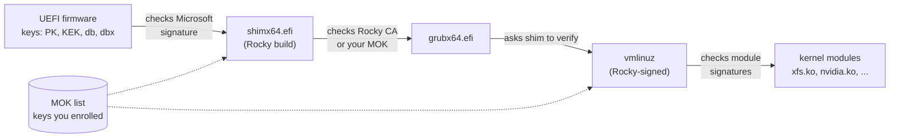
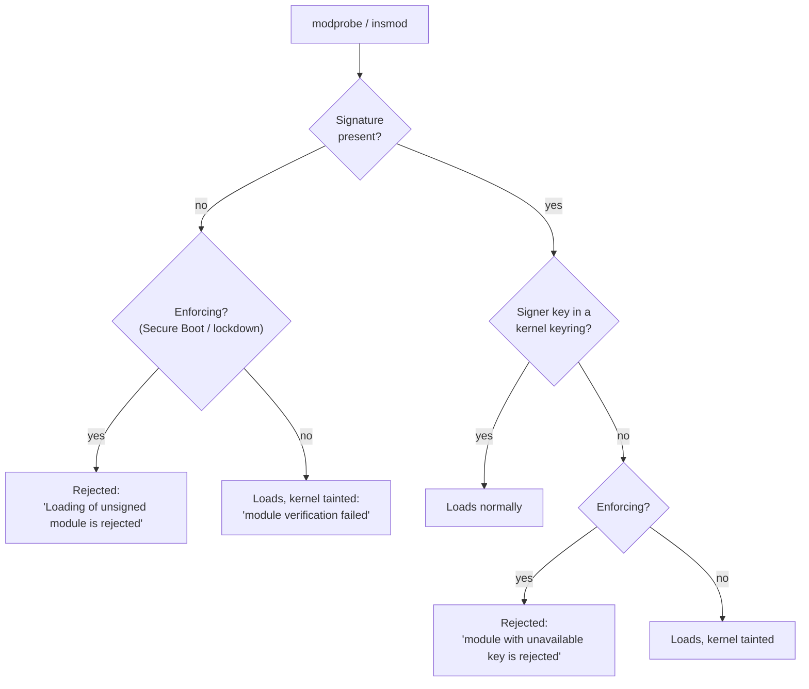
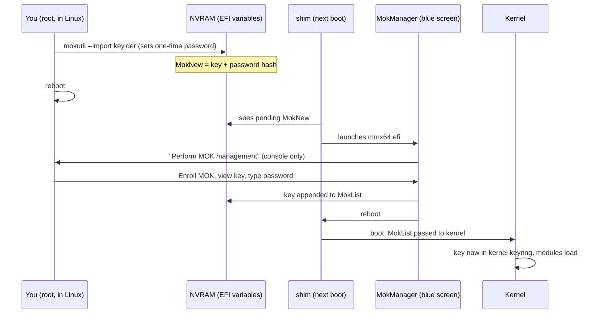
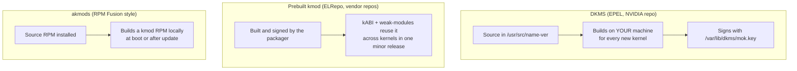
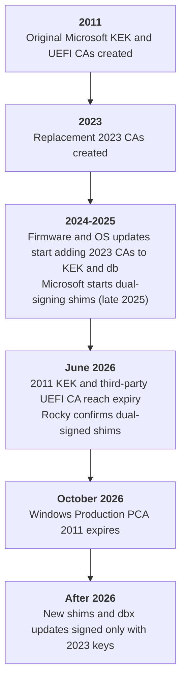

# 29 · Secure Boot and Third-Party Drivers

<ul class="module-meta">
  <li>⏱ ~3 hours</li>
  <li>4 labs</li>
  <li>Builds on: 05 · Software: RPM and DNF, 14 · The Boot Process, 15 · The Kernel, 21 · Inside Rocky Linux</li>
</ul>

You install the NVIDIA driver on a new Rocky workstation, reboot, and `nvidia-smi` says it can't talk to the driver. A forum post says "just disable Secure Boot." That works, and it also switches off the one mechanism that stops a rootkit from loading itself into your kernel. This module teaches you how the chain of trust actually works, so you can make a third-party driver *trusted* instead of making the machine *trust everything*.

!!! abstract "What you'll learn"
    - How UEFI's key databases (**PK**, **KEK**, **db**, **dbx**) decide what may boot
    - Why Rocky boots through **shim**, and how shim, GRUB and the kernel pass trust down the chain
    - What a **Machine Owner Key** (MOK) is, and how to enroll one with `mokutil` and MokManager
    - What kernel **lockdown** does and why unsigned modules are refused
    - How to build, sign and load your own kernel module under Secure Boot
    - The difference between **DKMS**, prebuilt **kmod** packages and **akmods**, and which NVIDIA option fits your machine
    - What the 2011 to 2023 Microsoft certificate transition means for Rocky machines

## The big picture

**Secure Boot** is a UEFI firmware feature that refuses to run boot code unless it carries a valid signature from a key the firmware trusts. Each stage that runs then checks the next stage before handing over control. The result is a **chain of trust**: if any link is unsigned or signed by an unknown key, the chain stops.



Three ideas carry the whole module:

1. **Firmware trusts Microsoft, not Rocky.** PC vendors ship firmware that trusts Microsoft's certificates. Rocky gets in the door with **shim**, a tiny boot loader that Microsoft signs once after review.
2. **Shim carries Rocky's certificate.** From shim onward, Rocky's own key vouches for GRUB, the kernel and every module Rocky ships.
3. **You can add your own key.** The **MOK list** is a key database *you* control. Enroll a key there and anything you sign with it (a driver you compiled, a DKMS-built NVIDIA module) is as trusted as Rocky's own code.

The "disable Secure Boot" advice skips step 3. The rest of this module is about doing step 3 properly.

## The firmware's keys: PK, KEK, db and dbx

Before any software runs, the firmware has to decide what to trust. It keeps that decision in four **UEFI variables** stored in the motherboard's flash memory (**NVRAM**). Click through them from most to least powerful:

<div class="layers" data-open="0" data-hint="Click a key database to see what it holds and who controls it." markdown>

<div class="layer" data-label="PK: Platform Key" data-tag="one key, the owner" markdown>

**What it is:** the single top-level key. Whoever holds the private half "owns" the platform and may replace the KEK.

**Who holds it:** the hardware vendor (Dell, HPE, Lenovo, your hypervisor). Removing the PK puts firmware into **setup mode**, where Secure Boot isn't enforced and any key can be written.

</div>

<div class="layer" data-label="KEK: Key Exchange Keys" data-tag="may update db/dbx" markdown>

**What it is:** keys allowed to sign *updates* to `db` and `dbx`. They don't sign boot loaders.

**Who holds it:** the vendor plus Microsoft. Microsoft's KEK is how a revocation update (a new `dbx`) can be pushed to millions of machines. If your machine lacks Microsoft's current KEK, it can't accept new revocations signed with it.

</div>

<div class="layer" data-label="db: allowed signatures" data-tag="the allow list" markdown>

**What it is:** certificates (and occasionally raw hashes) of code allowed to run.

**Typical contents:** Microsoft's Windows CA, Microsoft's third-party UEFI CA (which signs shim and some hardware option ROMs), and sometimes the vendor's own CA.

```console
$ sudo mokutil --db | grep 'Subject:'
        Subject: C=US, ST=Washington, L=Redmond, O=Microsoft Corporation, CN=Microsoft Corporation UEFI CA 2011
        Subject: C=US, ST=Washington, L=Redmond, O=Microsoft Corporation, CN=Microsoft Windows Production PCA 2011
        Subject: C=US, O=Microsoft Corporation, CN=Microsoft UEFI CA 2023
…
```

</div>

<div class="layer" data-label="dbx: forbidden signatures" data-tag="the deny list" markdown>

**What it is:** revoked certificates and hashes. Anything listed here never runs, even if `db` would allow it.

**Why it matters:** when a vulnerable boot loader is found (the 2020 "BootHole" GRUB bugs, for example), its hashes or certificate go into `dbx`. A modern companion mechanism, **SBAT** (Secure Boot Advanced Targeting), revokes whole *generations* of shim and GRUB by version number instead of hash, so `dbx` doesn't overflow.

</div>

</div>

!!! analogy "Think of it like a building's security desk"
    The **PK** is the building owner. The **KEK** holders are the managers who may update the guest list. **db** is the guest list, **dbx** is the list of banned visitors. Shim is a contractor whose badge was signed by a manager (Microsoft), and once inside, shim vouches for its own crew (GRUB, the kernel) using Rocky's company badge. The analogy breaks in one way: the desk never phones anyone. Everything is checked against lists already stored in the building.

You can read these databases from a running Rocky system without touching firmware setup:

```console
$ mokutil --sb-state
SecureBoot enabled
$ sudo mokutil --kek | grep 'Subject:'
        Subject: C=US, ST=Washington, L=Redmond, O=Microsoft Corporation, CN=Microsoft Corporation KEK CA 2011
        Subject: C=US, O=Microsoft Corporation, CN=Microsoft Corporation KEK 2K CA 2023
```

On a machine booted in legacy BIOS mode, `mokutil --sb-state` prints `EFI variables are not supported on this system`. That is a quick way to tell how a box booted. The raw variables also appear as files under `/sys/firmware/efi/efivars/`, named like `db-d719b2cb-…`.

!!! tip "efi-readvar"
    The `efi-readvar` tool from the **efitools** project prints the same databases in a different format (`efi-readvar -v db`). It isn't in Rocky's base repositories; `mokutil --db`, `--kek`, `--pk` and `--dbx` cover the same ground with a tool that is already installed.

<div class="quiz" data-answer="3" markdown>

An attacker gets root on a running Rocky server and wants their own boot loader to start at the next boot, with Secure Boot still on. Which key would they need?

- Any key in `dbx`
- The private key of the machine's MOK
- A key that `db` trusts (or one shim trusts), meaning a private key held by Microsoft, Rocky, or the machine owner
- None: root can write any EFI variable, so they can just add themselves to `db`

Code only runs if it is signed by a key in the allow lists. Root can't simply add a key to `db`, because changes to `db` must themselves be signed by a KEK. (They *could* queue a MOK request, but MOK enrollment needs a person at the console, as you'll see.)

</div>

## Shim, GRUB and the kernel: passing trust down

Microsoft won't sign GRUB or Linux kernels directly. Re-reviewing every kernel update would be impossible. **Shim** solves this: a small, stable boot loader that Rocky builds with **Rocky's CA certificate embedded**, which Microsoft reviews and signs. Shim rarely changes, so it rarely needs a new Microsoft signature, while GRUB and the kernel can update weekly under Rocky's own key.

Step through a Secure Boot start-up on Rocky:

<div class="stepper" markdown>

<div class="step" data-title="Firmware checks shim" markdown>

The firmware reads the boot entry (`Boot0000` in `efibootmgr`), which points at `\EFI\rocky\shimx64.efi` on the **EFI System Partition** (ESP, mounted at `/boot/efi`).

It checks shim's **Authenticode** signature (the PE-file signature format UEFI uses) against `db`, and checks that neither shim's hash nor its signer is in `dbx`. Shim is signed by Microsoft's third-party UEFI CA, which `db` trusts, so it runs.

```console
$ sudo efibootmgr | grep -i rocky
Boot0004* Rocky Linux	HD(1,GPT,…)/\EFI\rocky\shimx64.efi
```

</div>

<div class="step" data-title="Shim checks GRUB" markdown>

Shim loads `grubx64.efi` from the same directory and verifies it against, in order: its **embedded Rocky certificate**, the firmware's `db`, and the **MOK list**. It also checks the SBAT generation numbers inside GRUB against the revocation policy.

Shim then installs a **verify protocol**: a function later stages can call to say "is this binary trusted?"

</div>

<div class="step" data-title="GRUB checks the kernel" markdown>

GRUB reads the boot entry from `/boot/loader/entries/`, loads `vmlinuz-…`, and **asks shim to verify it**. The kernel is signed by Rocky, so shim says yes.

The initramfs and the kernel command line are *not* signed in this classic design. They are protected in other ways (lockdown refuses dangerous command-line options, and measured boot records them in the TPM, see [module 30](30-network-bound-encryption.md)).

</div>

<div class="step" data-title="Kernel loads its keyrings" markdown>

The kernel starts with Rocky's module-signing certificate built in (the **builtin trusted keys**). Because it was started by shim, it also imports the firmware's `db` and your **MOK list** into its own keyrings:

```console
$ sudo dmesg | grep -i 'x.509'
[    0.701552] integrity: Loading X.509 certificate: UEFI:db
[    0.701890] integrity: Loaded X.509 cert 'Microsoft Corporation UEFI CA 2011: …'
[    0.702311] integrity: Loading X.509 certificate: UEFI:MokListRT (MOKvar table)
[    0.702644] integrity: Loaded X.509 cert 'Rocky Linux Secure Boot Root CA: …'
…
```

(Exact names and lines vary with your kernel and firmware. What matters is the pattern: built-in keys, then `db`, then MOK.)

</div>

<div class="step" data-title="Lockdown switches on" markdown>

The kernel notices it was booted with Secure Boot and enables **lockdown** in *integrity* mode. Lockdown stops even root from changing the running kernel's code, because otherwise root could undo everything the chain just proved.

```console
$ cat /sys/kernel/security/lockdown
none [integrity] confidentiality
$ sudo dmesg | grep -i 'locked down'
[    0.000000] Kernel is locked down from EFI Secure Boot mode; see man kernel_lockdown.7
```

</div>

<div class="step" data-title="Every module is checked" markdown>

From now on, every `modprobe` or `insmod` triggers a signature check. A module signed by a key in the kernel's keyrings loads. An unsigned module, or one signed by an unknown key, is refused:

```console
$ sudo insmod ./hello.ko
insmod: ERROR: could not insert module ./hello.ko: Key was rejected by service
$ sudo dmesg | tail -1
[  412.118202] Loading of unsigned module is rejected
```

This is the error behind most "NVIDIA doesn't work with Secure Boot" forum threads.

</div>

</div>

You can see the signer of any module with `modinfo`:

```console
$ modinfo -F signer xfs        # prints the name of Rocky's kernel signing certificate
$ modinfo -F sig_hashalgo xfs
sha256
```

An empty `signer` means the module is unsigned.

??? question "Under the hood: which keyring trusts which key?"
    The kernel keeps its trusted keys in named **keyrings**, and you can list them with `keyctl` (package `keyutils`):

    ```console
    $ sudo keyctl list %:.builtin_trusted_keys    # compiled into the kernel: Rocky's module-signing key
    $ sudo keyctl list %:.platform                # imported at boot from firmware db and the MOK list
    $ sudo keyctl list %:.blacklist               # hashes and certs from dbx and MokListX
    ```

    The RHEL-family kernels that Rocky rebuilds trust the `.platform` keyring for module signatures. That's why enrolling a MOK is enough. Upstream kernels are stricter: there, `.platform` keys only verify `kexec` images, and MOK keys must be marked as CAs to sign modules. The surprising consequence: on Rocky, a key in your firmware's `db` can sign kernel modules too. Every certificate in `db` (including your hardware vendor's) is part of your kernel's trust base, not just your boot loader's.

Rocky's choice of shim, keys and signing infrastructure is covered in [module 21](21-inside-rocky-linux.md); this module picks up where that one stops.

## Kernel lockdown and module signature enforcement

**Lockdown** is a kernel security module ([[man:kernel_lockdown(7)]]) that draws a line between "root" and "the kernel." Without it, root can rewrite kernel memory, load any module, or boot a new unsigned kernel with `kexec`, and Secure Boot would only protect the first few seconds of the boot.

| Lockdown mode | What it blocks | When Rocky uses it |
|---|---|---|
| `none` | Nothing | Secure Boot off |
| `integrity` | Anything that could *modify* the running kernel: unsigned modules, unsigned `kexec` images, writing `/dev/mem`, `/dev/kmem` and `/dev/port`, some debugfs and MSR access, ACPI table overrides | Automatically, when booted with Secure Boot |
| `confidentiality` | Everything in `integrity`, plus things that could *read* kernel secrets (for example `/proc/kcore`, some tracing) | Only if you ask for it with `lockdown=confidentiality` |

??? question "Under the hood: what lockdown quietly breaks in production"
    Lockdown is more than a module gate, and a few side effects surprise people on Secure Boot servers:

    - **Hibernation is disabled.** Restoring a hibernation image would load unverified kernel memory, so `dmesg` shows `Lockdown: … hibernation is restricted`. Suspend-to-RAM still works.
    - **Tools that poke `/dev/mem` or MSRs fail.** Some vendor BIOS flashers, older hardware-inventory agents and overclocking tools stop working. The error looks like an ordinary `Operation not permitted`, even for root.
    - **kdump still works**, because the crash kernel it loads is Rocky-signed. Hand-built kernels you `kexec` into are refused unless they're signed by a trusted key.
    - **You can't switch lockdown off at runtime.** You can raise it (`echo confidentiality > /sys/kernel/security/lockdown`), but never lower it without a reboot. That one-way ratchet is the whole point.

**Module signature enforcement** is the part you'll meet most. Each `.ko` file can carry a **PKCS#7 signature** appended to its end. When you load it, the kernel checks the signature against its keyrings. There are three outcomes:



Read the `dmesg` line carefully, because it tells you which link is broken:

- `Loading of unsigned module is rejected`: nobody signed the module. Fix the build (DKMS signing, `sign-file`).
- `Loading of module with unavailable key is rejected`: the module is signed, but the key isn't enrolled. Fix the trust (`mokutil --import`).
- `module verification failed: signature and/or required key missing - tainting kernel`: Secure Boot is off, so the kernel loaded it anyway and marked itself **tainted** (flagged as running code the vendor didn't build).

!!! warning "The other escape hatch"
    `mokutil --disable-validation` tells shim to stop checking signatures, without touching firmware settings. It exists for debugging. It has the same effect as disabling Secure Boot (the kernel no longer enforces signatures), and it's the first thing to check if a machine "has Secure Boot on" but loads unsigned modules: run `mokutil --sb-state` and look for `SecureBoot validation is disabled in shim`.

<div class="quiz" data-answer="2" markdown>

`dmesg` shows `Loading of module with unavailable key is rejected` for `nvidia.ko`. What's the fix?

- Rebuild the module with DKMS so it gets signed
- Enroll the public key that signed the module into the MOK list, then reboot and confirm in MokManager
- Add `module.sig_enforce=0` to the kernel command line
- Reinstall `shim-x64`

"Unavailable key" means the module *is* signed; the kernel just doesn't trust the signer. Enrolling that key fixes it. (Disabling enforcement would also "work", but lockdown keeps Secure Boot systems enforcing, and it would defeat the point.)

</div>

## MOK: your own key in the chain

The **Machine Owner Key** (MOK) list is shim's own key database, stored in an EFI variable that only shim (running before the OS) may write. Keys in it are trusted by shim (for boot loaders and kernels) and imported by the kernel (for modules). This is how you, the machine's owner, extend trust without asking Microsoft or Rocky.

The clever part is how a key gets in. From Linux you can only *request* an enrollment. A person at the console must confirm it during the next boot, before any operating system is running. A remote attacker who owns root can queue a request, but can't approve it.



The `mokutil` commands you'll use most:

| Command | What it does |
|---|---|
| `mokutil --sb-state` | Is Secure Boot on? Is shim validation disabled? |
| `mokutil --list-enrolled` | Keys in the MOK list (shim's own Rocky CA usually appears here too) |
| `mokutil --import key.der` | Queue a key for enrollment (asks for a one-time password) |
| `mokutil --list-new` | Show keys queued for the next boot |
| `mokutil --test-key key.der` | Is this key already enrolled? |
| `mokutil --delete key.der` | Queue removal of an enrolled key (also confirmed at the console) |
| `mokutil --revoke-import` | Cancel a pending import request |

Here is what a stock Rocky machine shows:

```console
$ mokutil --list-enrolled | grep 'Subject:'
        Subject: … O=Rocky Enterprise Software Foundation, … CN=Rocky Linux Secure Boot Root CA …
```

That's the Rocky CA that shim carries, mirrored into the runtime MOK list so the kernel can see it. Your own keys appear after it once enrolled.

### The MokManager screen

At the reboot after `mokutil --import`, shim pauses and starts **MokManager** (`mmx64.efi`), a blue text-mode screen. You have about 10 seconds to press a key before it continues booting normally. The flow is:

1. **Press any key to perform MOK management.**
2. Choose **Enroll MOK**.
3. Choose **View key 0** if you want to check the subject and fingerprint, then **Continue**.
4. **Enroll the key(s)?** choose **Yes**.
5. Type the one-time password you set with `mokutil --import`.
6. Choose **Reboot**.

!!! pitfall "Missing the blue screen"
    MokManager only appears on a local console or a remote console (IPMI, iDRAC, iLO, a VM's graphical console). Over SSH you will never see it, and if nobody presses a key in time the machine boots on without enrolling. Plan enrollment for a moment when you have console access. If you missed it, check `mokutil --list-new`, and run the `--import` again if the request is gone.

<div class="quiz" data-answer="1" markdown>

Why does MOK enrollment require someone at the console, instead of just letting root write the key?

- So that malware with root access can't silently add its own key and load a malicious signed kernel module
- Because EFI variables can only be written while the firmware setup menu is open
- Because `mokutil` can't access NVRAM from a running kernel
- To give the user time to back up the key

Root can *queue* a request, but approval happens in shim's pre-boot environment, typed by a person. That's the property that makes MOK safe to have at all.

</div>

## Signing a module yourself

Signing has three parts: a key pair, the `sign-file` tool, and the enrollment you just saw. The kernel accepts any key in its keyrings, so one MOK key can sign every module you build.

**1. Make a key pair.** The kernel expects an X.509 certificate. An OpenSSL config makes the purpose explicit:

```ini title="mok.cnf"
[ req ]
distinguished_name = req_dn
prompt             = no
x509_extensions    = v3

[ req_dn ]
CN = hello-lab module signing key

[ v3 ]
basicConstraints       = critical,CA:FALSE
keyUsage               = digitalSignature
extendedKeyUsage       = codeSigning
subjectKeyIdentifier   = hash
authorityKeyIdentifier = keyid
```

```console
$ openssl req -x509 -new -nodes -utf8 -sha256 -days 3650 -batch \
    -config mok.cnf -outform DER -out mok.der -keyout mok.priv
```

`mok.der` is the public certificate (in **DER**, the binary format `mokutil` wants). `mok.priv` is the private key. Anyone with `mok.priv` can sign code your machine will trust, so guard it like a root password.

**2. Sign the module** with the `sign-file` helper that ships in `kernel-devel`:

```console
$ /usr/src/kernels/$(uname -r)/scripts/sign-file sha256 mok.priv mok.der hello.ko
$ modinfo hello.ko | grep -E 'signer|sig_key|sig_hashalgo'
signer:         hello-lab module signing key
sig_key:        4E:91:…:A2
sig_hashalgo:   sha256
```

The signature is appended to the `.ko` file. If you strip the module afterwards (`strip`), you remove the signature too, so always sign last.

**3. Enroll `mok.der`** with `mokutil --import`, reboot, confirm in MokManager. Lab 2 walks you through all three with a real module, and shows the two different rejection messages along the way.

!!! danger "Protect the private key"
    A MOK private key left in `/root` on every server is a gift to an attacker: with it they can sign a rootkit that your machines will load happily. For a fleet, generate the key on a build host, keep the private key offline or in an HSM, ship only signed modules, and enroll only the public certificate on the servers.

## DKMS, kmods and akmods: who builds the module?

An **out-of-tree module** is a kernel module that isn't shipped with the kernel package: NVIDIA, some RAID and network drivers, ZFS, VirtualBox, your own code. Modules are tied to the kernel they were built for, so every kernel update raises the question: who rebuilds (and re-signs) the module? There are three answers on Rocky.



| Approach | Where it comes from | Who signs | Needs compiler on the box | Main risk |
|---|---|---|---|---|
| **DKMS** (Dynamic Kernel Module Support) | `dkms` from EPEL; NVIDIA's own repo uses it | Your machine, with a locally generated key you enroll once | Yes (`gcc`, `make`, matching `kernel-devel`) | Build fails on a new kernel (missing `kernel-devel`, new kernel API) |
| **Prebuilt kmod** | ELRepo, hardware vendors, Red Hat's partner repos for RHEL | The packager, with their key (you enroll their public cert) | No | Lags behind a new minor release's kernel |
| **akmods** | RPM Fusion's packaging tool | Your machine, with a key from `kmodgenca` | Yes | Same as DKMS, plus it builds at boot, which slows the first boot after an update |

**Why prebuilt kmods survive kernel updates:** Red Hat promises a stable **kABI** (kernel Application Binary Interface) for a whitelisted set of kernel symbols within a minor release. A kmod built only against those symbols works on every kernel of, say, 10.1. The `weak-modules` script (from the `kmod` package) notices a new kernel and symlinks compatible modules into `/lib/modules/<new-kernel>/weak-updates/`. When the next minor release (10.2) changes the kABI, the packager ships a rebuilt kmod.

**Why DKMS survives kernel updates:** a `kernel-install` hook (and the `dkms.service` unit at boot) runs `dkms autoinstall` for every new kernel, compiling and signing the module again. With current DKMS, the signing key is created automatically on the first build:

```console
$ ls -l /var/lib/dkms/mok.*
-rw-------. 1 root root 1704 Oct 15 10:02 /var/lib/dkms/mok.key
-rw-r--r--. 1 root root  797 Oct 15 10:02 /var/lib/dkms/mok.pub
$ sudo mokutil --import /var/lib/dkms/mok.pub
input password:
input password again:
```

Enroll `mok.pub` once, and every future DKMS rebuild is signed with the same trusted key. The paths are configurable (`mok_signing_key` and `mok_certificate` in `/etc/dkms/framework.conf`), so you can point DKMS at your own fleet key instead.

<div class="quiz" data-answer="4" markdown>

You use DKMS for a driver. After `dnf update` installs a new kernel, the driver doesn't load on the new kernel, and `dkms status` doesn't list the new kernel at all. Most likely cause?

- The MOK key expired
- Secure Boot was re-enabled by the update
- The module was signed with the wrong hash algorithm
- `kernel-devel` for the new kernel wasn't installed, so DKMS couldn't build

DKMS needs the headers for the *exact* kernel. If they're missing, nothing gets built. The `kernel-devel-matched` package exists to pull in the `kernel-devel` that matches each installed kernel.

</div>

## NVIDIA on Rocky, without disabling Secure Boot

NVIDIA's Linux driver comes in two **flavors** of kernel module:

- **Open kernel modules** (`nvidia-open`): MIT/GPL-licensed source published by NVIDIA. They need a **Turing or newer** GPU (GeForce RTX 20 / GTX 16 series and later, and data-center cards from T4 onward). They've been NVIDIA's default since the 560 driver series, and the newest GPUs (such as the RTX 50 series) are supported *only* by the open modules.
- **Proprietary kernel modules**: the traditional closed module, needed for older GPUs (Maxwell, Pascal, Volta). NVIDIA's 590 series dropped those generations, so they stay on the 580 branch.

Both flavors are *out-of-tree* modules and both need a signature Rocky's kernel trusts. Your options on Rocky 10:

=== "NVIDIA CUDA repo (DKMS)"

    NVIDIA publishes a repository for RHEL 10 that Rocky can use. Modules build locally with DKMS and are signed with `/var/lib/dkms/mok.key`.

    ```console
    $ sudo dnf install epel-release
    $ sudo dnf config-manager --set-enabled crb
    $ sudo dnf install kernel-devel-matched kernel-headers
    $ sudo dnf config-manager --add-repo \
        https://developer.download.nvidia.com/compute/cuda/repos/rhel10/$(uname -m)/cuda-rhel10.repo
    $ sudo dnf install nvidia-open          # Turing and newer
    $ sudo dnf install cuda-drivers         # or: proprietary modules
    $ sudo mokutil --import /var/lib/dkms/mok.pub
    $ sudo reboot                           # confirm in MokManager
    ```

    For Maxwell, Pascal or Volta cards, install `cuda-drivers` (the proprietary-module metapackage, whose newest version in the RHEL 10 repo is on the 580 branch) and lock the NVIDIA packages to 580 with the `versionlock` DNF plugin (`sudo dnf versionlock '*nvidia*580*'`) so an update doesn't move you to a branch without your GPU.

=== "ELRepo (prebuilt kmod)"

    ELRepo builds `kmod-nvidia` packages (and `kmod-nvidia-open` for Turing and newer GPUs) against the RHEL kABI and signs them with ELRepo's key. No compiler needed on the box. For EL10 they're in the main `elrepo` repository (`kmod-nvidia-580xx` covers the 580 branch for older GPUs).

    ```console
    $ sudo dnf install elrepo-release
    $ sudo dnf install nvidia-detect && nvidia-detect    # suggests the right package
    $ sudo dnf install kmod-nvidia-open
    $ ls /etc/pki/elrepo/                                # ELRepo's Secure Boot certificate (.der)
    $ sudo mokutil --import /etc/pki/elrepo/SECURE-BOOT-KEY-elrepo.org.der
    $ sudo reboot                                        # confirm in MokManager
    ```

    ELRepo's file names and repository layout change between releases. Check ELRepo's Secure Boot page for the current certificate name before you rely on the exact path above.

=== "Disable Secure Boot (last resort)"

    Turning off Secure Boot in firmware setup also turns off lockdown and module enforcement. Every unsigned module loads, including malicious ones. Acceptable on a lab box; hard to justify on a laptop that leaves the building or a server that handles anyone else's data.

Whichever path you pick, also stop the in-kernel **nouveau** driver from grabbing the card first. The NVIDIA packages usually do this for you; if not:

```console
$ sudo grubby --update-kernel=ALL --args="nouveau.modeset=0 rd.driver.blacklist=nouveau"
```

!!! note "Why some other distributions 'just work'"
    Some RHEL-compatible distributions build and sign the NVIDIA modules with the same key as their kernel, so no enrollment is needed. RHEL 10 ships precompiled, Red Hat-signed NVIDIA open modules (`kmod-nvidia-open`) in its Extensions repository for subscribers. At the time of writing, Rocky does not ship signed NVIDIA modules (a proposal to add them is being tracked by the Rocky project), so on Rocky you enroll *some* key: DKMS's, ELRepo's, or your own.

### What breaks after a kernel update, and how to recover

The classic failure: you run `dnf update`, reboot, and get a black screen or a text console. `nvidia-smi` prints `NVIDIA-SMI has failed because it couldn't communicate with the NVIDIA driver`. Use this decision tree:

<div class="decision" markdown>

<div class="node" data-id="start" markdown>

**Boot the previous kernel from the GRUB menu. Does the driver work there?**

<button data-goto="newkernel">Yes, only the new kernel is broken</button> <button data-goto="always">No, it's broken everywhere</button>

</div>

<div class="node" data-id="newkernel" markdown>

**Run `dkms status` (DKMS) or `rpm -q kmod-nvidia` (ELRepo). Is there a module for the new kernel?**

<button data-goto="nobuild">No module built for it</button> <button data-goto="built">Yes, it's listed as installed</button>

</div>

<div class="node" data-id="nobuild" markdown>

**The build never happened or failed.** For DKMS, install the headers and rebuild:

```console
$ sudo dnf install kernel-devel-matched
$ sudo dkms autoinstall -k 6.12.0-124.8.1.el10_1.x86_64
```

If it still fails, read the compiler log in `/var/lib/dkms/<module>/<version>/build/make.log`. A new kernel can break an old driver branch; upgrade the driver or stay on the old kernel. For ELRepo, the kmod may not exist yet for a brand-new minor release: wait for it, and keep the old kernel as default with `grubby --set-default`.

</div>

<div class="node" data-id="built" markdown>

**The module exists. Check how loading fails:** `sudo modprobe nvidia; sudo dmesg | tail`.

- `unavailable key is rejected`: the signing key isn't enrolled (or was wiped). `mokutil --test-key /var/lib/dkms/mok.pub`, then re-import.
- `unsigned module is rejected`: the build didn't sign it. Check `mok_signing_key` in `/etc/dkms/framework.conf` and that both key files exist.
- No error, but no GPU: nouveau got there first. Check `lsmod | grep nouveau` and the blacklist arguments.

</div>

<div class="node" data-id="always" markdown>

**It never worked, or it broke for every kernel.** Check the trust first: `mokutil --sb-state` and `mokutil --list-enrolled`. A firmware update or a "reset to defaults" in BIOS setup can clear the MOK list, which un-trusts every key you enrolled. Re-import the key, reboot, confirm in MokManager. If the key is fine, check that the driver branch supports your GPU (590+ dropped Maxwell, Pascal and Volta).

</div>

</div>

!!! tip "Keep a known-good kernel around"
    DNF keeps three kernels by default (`installonly_limit=3` in `/etc/dnf/dnf.conf`). That's your safety net: a broken driver on the newest kernel is a reboot away from a working one. Don't lower it on machines with out-of-tree drivers.

### Practice: diagnose a rejected driver

Try the diagnosis flow on a simulated workstation before you do it for real.

<div class="terminal-sim" data-title="Diagnose a rejected driver" data-prompt="[alex@gpu-ws ~]$ " markdown>

<div class="task" data-expect="mokutil --sb-state||sudo mokutil --sb-state" data-hint="mokutil has an option that reports the Secure Boot state." markdown>

**Step 1.** Check whether Secure Boot is enforcing.

```text
SecureBoot enabled
```

</div>

<div class="task" data-expect="cat /sys/kernel/security/lockdown||sudo cat /sys/kernel/security/lockdown" data-hint="The lockdown mode is a file under /sys/kernel/security." markdown>

**Step 2.** Confirm the kernel's lockdown mode.

```text
none [integrity] confidentiality
```

</div>

<div class="task" data-expect="sudo modprobe nvidia||modprobe nvidia" data-hint="Use modprobe to load the module named nvidia (with sudo)." markdown>

**Step 3.** Try to load the `nvidia` module.

```text
modprobe: ERROR: could not insert 'nvidia': Key was rejected by service
```

</div>

<div class="task" data-expect="sudo dmesg | tail -1||dmesg | tail -1||sudo dmesg | tail -n 1||sudo dmesg | tail" data-hint="Look at the last line of the kernel log with dmesg piped to tail." markdown>

**Step 4.** Read the last kernel message to find out which link is broken.

```text
[ 1204.551203] Loading of module with unavailable key is rejected
```

</div>

<div class="task" data-expect="sudo mokutil --import /var/lib/dkms/mok.pub||mokutil --import /var/lib/dkms/mok.pub" data-hint="The module is signed by DKMS's key. Queue /var/lib/dkms/mok.pub for enrollment with mokutil." markdown>

**Step 5.** The module is signed, but the key isn't trusted. Queue the DKMS key for enrollment.

```text
input password:
input password again:
```

</div>

</div>

## The 2011 to 2023 Microsoft certificate transition

The Microsoft certificates that the whole PC ecosystem trusts were created in 2011, and the first ones reach their expiry dates in 2026. Microsoft created replacements in 2023 and split the old third-party role into separate CAs:

| Old (2011) | Role | New (2023) |
|---|---|---|
| Microsoft Corporation KEK CA 2011 | Signs `db`/`dbx` updates | Microsoft Corporation KEK 2K CA 2023 |
| Microsoft Corporation UEFI CA 2011 | Signs third-party boot loaders (shim) and option ROMs | Microsoft UEFI CA 2023 (boot loaders), Microsoft Option ROM UEFI CA 2023 (add-in card firmware) |
| Microsoft Windows Production PCA 2011 | Signs Windows' boot manager | Windows UEFI CA 2023 |

**Secure Boot CA transition (simplified)**



Two facts keep this from being scary:

1. **Expiry doesn't stop existing binaries booting.** UEFI firmware generally doesn't check certificate dates (it has no trustworthy clock at boot). A shim signed in 2024 keeps booting after June 2026. What changes is that Microsoft *stops issuing new signatures* with the old CAs, so future shims and future `dbx` revocations will carry only 2023 signatures.
2. **Rocky ships dual-signed shims.** Rocky Linux said in June 2026 that its shim carries signatures from both the old and the new Microsoft CA in one binary, so the same shim boots on older firmware that only trusts the 2011 CA and on newer firmware with the 2023 CA. (Red Hat did the same starting with RHEL 9.8 and 10.2.) This relies on the firmware handling a PE binary with two signatures correctly, which some old firmware gets wrong.

!!! note "aarch64 is different"
    Arm servers generally shipped with the 2023 Microsoft CA already in `db`, so other EL rebuilds sign their aarch64 shim (`shim-aa64`) with the 2023 CA only. On Arm hardware, run `sudo mokutil --db | grep 'UEFI CA 2023'` before you rely on a new shim, and check Rocky's release notes for the current aarch64 signing status.

What can still bite you:

- **Firmware that never receives the 2023 CAs** will eventually be unable to boot a *2023-only* shim (a future Rocky release, or rescue media built later), and without the 2023 KEK it can't accept new revocations.
- **Hardware with option ROMs** (GPUs, NICs, storage controllers whose firmware runs at boot) may be signed only with the new Option ROM CA. If `db` doesn't contain that CA, the card's firmware is refused at boot.

Check where a machine stands:

```console
$ sudo mokutil --kek | grep -o 'CN=[^,]*'
CN=Microsoft Corporation KEK CA 2011
CN=Microsoft Corporation KEK 2K CA 2023
$ sudo mokutil --db | grep -o 'CN=[^,]*'
CN=Microsoft Corporation UEFI CA 2011
CN=Microsoft Windows Production PCA 2011
CN=Microsoft UEFI CA 2023
CN=Microsoft Option ROM UEFI CA 2023
CN=Windows UEFI CA 2023
$ rpm -q shim-x64        # keep this package current
```

In a lab VM, the CAs come from the OVMF firmware's variable template, not from Microsoft. RHEL 10's `edk2-ovmf` has shipped both the 2011 and 2023 certificates since build `20241117-2`, so a fresh Rocky 10 VM normally shows both. A VM created years ago keeps the `db` in its own NVRAM file and won't pick up a newer template on its own.

If the 2023 entries are missing, the normal fix is a **firmware update from your hardware vendor** (or `fwupdmgr` where the vendor publishes through LVFS), plus keeping `shim-x64` updated. Don't hand-edit `KEK` or `db` on production machines: a mistake there can leave a system that won't boot anything.

??? question "Under the hood: SBAT, the revocation that doesn't fill up dbx"
    `dbx` has room for only a few hundred entries, and every vulnerable GRUB build ever signed would need its own hash. **SBAT** solves this with a generation number. Each shim and GRUB binary carries a small `.sbat` section, a CSV that says "I am grub, generation 4". Shim keeps the minimum acceptable generation in an EFI variable (`SbatLevel`). Bump the minimum, and every older GRUB is revoked at once, from every vendor.

    You can read both sides on a Rocky machine (`objcopy` is in `binutils`):

    ```console
    $ objcopy -O binary --only-section=.sbat /boot/efi/EFI/rocky/grubx64.efi /dev/stdout
    sbat,1,SBAT Version,sbat,1,https://github.com/rhboot/shim/blob/main/SBAT.md
    grub,…
    grub.rh,…
    …
    $ mokutil --list-sbat-revocations
    sbat,1,…
    shim,…
    grub,…
    ```

    The production trap: SBAT revocations are written into NVRAM by a newer shim and are **one-way**. Once a machine has booted a shim that raised the GRUB generation, older Rocky install media (with an older GRUB) refuses to boot on it with a `Verification failed: (0x1A) Security Violation` message. Keep rescue and install media current, and don't be surprised when an old ISO "suddenly" stops working on a patched server.

!!! warning "Measured boot side effect"
    Updating `db`, `dbx` or `KEK` changes **PCR 7** in the TPM. If you seal disk keys to PCR 7 (see [module 30](30-network-bound-encryption.md)), plan for a passphrase prompt or a rebind after these updates.

## Labs

!!! lab "Lab 1: Build a Secure Boot VM and inspect its chain"

    **Goal:** Get a Rocky 10 VM with Secure Boot enforcing, and read every key database from inside it.

    **You'll need:** a Rocky host with KVM and libvirt ([module 27](27-virtualization-kvm.md)), `edk2-ovmf` installed, and a Rocky 10 ISO.

    1. Create the VM with UEFI firmware that has Microsoft's keys enrolled and Secure Boot on:

        ```console
        $ sudo virt-install --name sblab --memory 4096 --vcpus 2 \
            --machine q35 --features smm.state=on \
            --boot uefi,firmware.feature0.name=secure-boot,firmware.feature0.enabled=yes,firmware.feature1.name=enrolled-keys,firmware.feature1.enabled=yes \
            --disk size=20 --cdrom Rocky-10.2-x86_64-dvd1.iso --os-variant rocky10
        ```

        (Newer `virt-install` releases also accept the shorter `--boot uefi,secure-boot=on`. Secure Boot needs the `q35` machine type and SMM.)

    2. Install Rocky as normal. After the first boot, update it so the running kernel matches the repositories (Lab 2 installs `kernel-devel` for it): `sudo dnf -y update && sudo reboot`.
    3. Shut the VM down and take a snapshot from the host. libvirt refuses internal snapshots of a *running* UEFI VM, but allows them while it's shut off:

        ```console
        $ sudo virsh shutdown sblab
        $ sudo virsh domstate sblab                       # repeat until it says "shut off"
        $ sudo virsh snapshot-create-as sblab clean
        $ sudo virsh dumpxml sblab | grep nvram          # where this VM's EFI variables live
        $ sudo cp /var/lib/libvirt/qemu/nvram/sblab_VARS.* /root/   # back them up
        $ sudo virsh start sblab
        ```

        The snapshot covers the disk, **not** the NVRAM file that holds `db`, `dbx` and the MOK list. To truly undo a MOK enrollment, restore the NVRAM copy as well as the snapshot.
    4. Inside the VM:

        ```console
        $ mokutil --sb-state
        $ cat /sys/kernel/security/lockdown
        $ sudo mokutil --kek | grep -o 'CN=[^,]*'
        $ sudo mokutil --db  | grep -o 'CN=[^,]*'
        $ mokutil --list-enrolled | grep -E 'Subject:'
        $ sudo dmesg | grep -iE 'secure ?boot|locked down|x\.509'
        $ modinfo -F signer xfs
        ```

    **Check your work:** `SecureBoot enabled`, lockdown shows `[integrity]`, `db` contains a Microsoft UEFI CA, and the MOK list shows the Rocky Linux Secure Boot Root CA.

    ??? success "What did you just prove?"
        You walked the whole chain: `db` trusts Microsoft (which signed shim), shim's Rocky CA is mirrored in the MOK list (which trusts GRUB and the kernel), and the kernel's built-in key signed `xfs.ko`. Lockdown in integrity mode is the kernel's promise not to let root break that chain after boot.

    **Clean up:** keep the VM for Lab 2. When you're done with the module: `sudo virsh destroy sblab; sudo virsh undefine sblab --nvram --remove-all-storage`.

!!! lab "Lab 2: Sign your own module and watch it go from rejected to loaded"

    **Goal:** See both rejection messages, then make the module trusted with your own MOK.

    **You'll need:** the Secure Boot VM from Lab 1, console access (virt-manager or `virt-viewer`), sudo.

    1. Install the build tools for the running kernel:

        ```console
        $ sudo dnf install gcc make kernel-devel-$(uname -r) openssl mokutil
        ```

    2. Write a tiny module:

        ```bash
        mkdir ~/hello && cd ~/hello
        cat > hello.c <<'EOF'
        #include <linux/module.h>
        #include <linux/init.h>

        MODULE_LICENSE("GPL");
        MODULE_DESCRIPTION("Secure Boot lab module");

        static int __init hello_init(void)
        {
            pr_info("hello: signed and loaded\n");
            return 0;
        }

        static void __exit hello_exit(void)
        {
            pr_info("hello: unloaded\n");
        }

        module_init(hello_init);
        module_exit(hello_exit);
        EOF
        echo 'obj-m := hello.o' > Makefile
        make -C /lib/modules/$(uname -r)/build M=$PWD modules
        ```

    3. Try loading it unsigned:

        ```console
        $ sudo insmod hello.ko
        insmod: ERROR: could not insert module hello.ko: Key was rejected by service
        $ sudo dmesg | tail -1
        [  612.402118] Loading of unsigned module is rejected
        ```

    4. Create a key pair with the `mok.cnf` from the "Signing a module yourself" section, then sign the module and try again:

        ```console
        $ openssl req -x509 -new -nodes -utf8 -sha256 -days 3650 -batch \
            -config mok.cnf -outform DER -out mok.der -keyout mok.priv
        $ /usr/src/kernels/$(uname -r)/scripts/sign-file sha256 mok.priv mok.der hello.ko
        $ sudo insmod hello.ko
        insmod: ERROR: could not insert module hello.ko: Key was rejected by service
        $ sudo dmesg | tail -1
        [  688.931770] Loading of module with unavailable key is rejected
        ```

        Same `insmod` error, different kernel message: now it's signed, but by a stranger.

    5. Queue the key and reboot **at the console**:

        ```console
        $ sudo mokutil --import mok.der
        input password:
        input password again:
        $ mokutil --list-new | grep Subject:
        $ sudo reboot
        ```

        In MokManager: any key, **Enroll MOK**, **Continue**, **Yes**, type the password, **Reboot**.

    6. After boot:

        ```console
        $ mokutil --test-key ~/hello/mok.der
        /home/alex/hello/mok.der is already enrolled
        $ sudo insmod ~/hello/hello.ko
        $ sudo dmesg | tail -2
        $ lsmod | grep hello
        ```

    **Check your work:** `dmesg` shows `hello: signed and loaded` (possibly after a line saying the out-of-tree module taints the kernel, which is expected and harmless), and `lsmod` lists `hello`.

    **Clean up:**

    ```console
    $ sudo rmmod hello
    $ sudo mokutil --delete ~/hello/mok.der     # confirm "Delete MOK" in MokManager at next boot
    $ sudo reboot
    $ rm -rf ~/hello
    ```

    Or, with the VM shut off, revert the snapshot from the host (`sudo virsh snapshot-revert sblab clean`) and copy your saved `sblab_VARS.*` file back over the one in `/var/lib/libvirt/qemu/nvram/`. Reverting the disk alone leaves your key enrolled in NVRAM.

!!! lab "Lab 3: Let DKMS rebuild and sign for you"

    **Goal:** Package the `hello` module for DKMS so it is rebuilt and signed automatically for every kernel.

    **You'll need:** the Lab 1 VM, EPEL enabled (`sudo dnf install epel-release`), console access.

    1. Install DKMS and place the source where DKMS expects it:

        ```console
        $ sudo dnf install dkms gcc make kernel-devel-matched
        $ sudo mkdir -p /usr/src/hello-1.0
        ```

        Copy `hello.c` and the one-line `Makefile` from Lab 2 into `/usr/src/hello-1.0/` (recreate them if you cleaned up), then add a `dkms.conf`:

        ```ini title="/usr/src/hello-1.0/dkms.conf"
        PACKAGE_NAME="hello"
        PACKAGE_VERSION="1.0"
        BUILT_MODULE_NAME[0]="hello"
        DEST_MODULE_LOCATION[0]="/extra"
        AUTOINSTALL="yes"
        ```

    2. Register, build and install:

        ```console
        $ sudo dkms add -m hello -v 1.0
        $ sudo dkms install -m hello -v 1.0
        $ dkms status
        hello/1.0, 6.12.0-124.8.1.el10_1.x86_64, x86_64: installed
        $ modinfo -F signer hello
        ```

        The first build generated `/var/lib/dkms/mok.key` and `mok.pub` and signed the module with them.

    3. Enroll the DKMS key (console needed), reboot, then load:

        ```console
        $ sudo mokutil --import /var/lib/dkms/mok.pub
        $ sudo reboot
        $ sudo modprobe hello && lsmod | grep hello
        ```

    4. Optional: install a newer kernel with `sudo dnf update kernel`, and watch DKMS build for it (`dkms status` lists two kernels) before you even reboot.

    **Check your work:** `modprobe hello` works without `insmod` paths, because DKMS installed the module under `/lib/modules/$(uname -r)/extra/` and ran `depmod`.

    **Clean up:**

    ```console
    $ sudo modprobe -r hello
    $ sudo dkms remove -m hello -v 1.0 --all
    $ sudo rm -rf /usr/src/hello-1.0
    $ sudo mokutil --delete /var/lib/dkms/mok.pub   # confirm at next boot
    ```

!!! lab "Lab 4: Read the chain from a module's point of view"

    **Goal:** Practise diagnosing "why won't this module load?" from evidence alone.

    **You'll need:** any Rocky 10 machine (Secure Boot on or off).

    1. Pick three modules and compare their signers:

        ```console
        $ for m in xfs nf_tables $(lsmod | awk 'NR>1{print $1}' | head -3); do
              printf '%-12s %s\n' "$m" "$(modinfo -F signer "$m")"
          done
        ```

    2. Find which file a module comes from and whether it's in-tree, extra or weak-updates:

        ```console
        $ modinfo -n xfs
        $ ls /lib/modules/$(uname -r)/extra /lib/modules/$(uname -r)/weak-updates 2>/dev/null
        ```

    3. Check whether the running kernel is tainted and why:

        ```console
        $ cat /proc/sys/kernel/tainted
        ```

        `0` means clean. Any other number is a bit field: bit 12 (value 4096) means an out-of-tree module was loaded, bit 13 (8192) means an unsigned module was loaded. The kernel's "Tainted kernels" documentation lists every bit.

    **Check your work:** you can explain, for each module, who signed it and which keyring the kernel used to trust it.

    **Clean up:** nothing to undo.

## Common pitfalls

| Symptom | Cause | Fix |
|---|---|---|
| `Key was rejected by service` + `unsigned module is rejected` | Module never signed | Sign with `sign-file`, or fix DKMS signing config |
| `Key was rejected by service` + `unavailable key is rejected` | Signed, but key not enrolled | `mokutil --import key.der`, confirm at console |
| MokManager never appeared | Rebooted over SSH, nobody at console, or 10-second timeout passed | Use a real or remote console; re-run `--import` if `--list-new` is empty |
| Driver broke after BIOS update | Firmware reset cleared the MOK list | Re-import the key |
| Driver works on old kernel only | DKMS build failed or kmod not yet built for new minor release | `kernel-devel-matched`, `dkms autoinstall`, or keep old kernel as default |
| Unsigned modules load "with Secure Boot on" | `mokutil --disable-validation` was used | `mokutil --enable-validation`, reboot, confirm |
| GPU idle, nouveau loaded | nouveau claimed the card first | Blacklist with `rd.driver.blacklist=nouveau` and `nouveau.modeset=0` |
| New GPU not detected by proprietary driver | Blackwell and newer need open modules | Install `nvidia-open` |

!!! pitfall "Signing, then stripping"
    Running `strip` on a `.ko` (some build scripts do it to save space) removes the appended signature. Always sign as the very last step, and check with `modinfo -F signer`.

!!! pitfall "Signing in the wrong order with compressed modules"
    Rocky ships modules compressed (`.ko.xz`). If you compress a module yourself, sign the uncompressed `.ko` first and compress afterwards. The kernel decompresses before it checks the signature.

## Cheat sheet

| Command | What it does |
|---|---|
| `mokutil --sb-state` | Secure Boot on or off, shim validation state |
| `mokutil --db` / `--kek` / `--pk` / `--dbx` | Show firmware key databases |
| `mokutil --list-enrolled` | Show the MOK list |
| `mokutil --import key.der` | Queue a key for enrollment at next boot |
| `mokutil --list-new` | Show queued enrollments |
| `mokutil --test-key key.der` | Check whether a key is enrolled |
| `mokutil --delete key.der` | Queue a key for removal |
| `cat /sys/kernel/security/lockdown` | Current lockdown mode |
| `modinfo -F signer <module>` | Who signed a module |
| `/usr/src/kernels/$(uname -r)/scripts/sign-file sha256 key.priv key.der mod.ko` | Sign a module |
| `dkms status` | DKMS modules and kernels they're built for |
| `dkms autoinstall -k <kernel>` | Build all DKMS modules for a kernel |
| `dkms generate_mok` | Create DKMS signing keys ahead of time |
| `cat /proc/sys/kernel/tainted` | Kernel taint flags (0 is clean) |
| `efibootmgr` | UEFI boot entries |

## Flashcards

<div class="flashcards" markdown>

<div class="card" markdown>

What do `db` and `dbx` hold?

`db` is the allow list of certificates and hashes that may run at boot. `dbx` is the deny list of revoked ones, which always wins.

</div>

<div class="card" markdown>

Why does Rocky boot through shim?

Firmware trusts Microsoft's CA, not Rocky's. Microsoft signs shim, and shim carries Rocky's CA to verify GRUB and the kernel.

</div>

<div class="card" markdown>

What is a MOK?

A Machine Owner Key: a key you enroll into shim's MOK list. Shim and the kernel trust anything signed with it.

</div>

<div class="card" markdown>

Why must MOK enrollment be confirmed at the console?

So malware with root can't add its own key. The confirmation happens in MokManager before any OS runs.

</div>

<div class="card" markdown>

What does lockdown `integrity` mode do?

Stops anything that could modify the running kernel, including loading unsigned modules and unsigned kexec. Enabled automatically under Secure Boot.

</div>

<div class="card" markdown>

`unsigned module is rejected` vs `unavailable key is rejected`?

The first means nobody signed it. The second means it's signed by a key the kernel doesn't trust yet.

</div>

<div class="card" markdown>

Which NVIDIA GPUs can use the open kernel modules?

Turing (RTX 20 / GTX 16) and newer. The newest generations require them.

</div>

<div class="card" markdown>

Where does DKMS keep its signing key?

`/var/lib/dkms/mok.key` and `mok.pub` by default. Enroll `mok.pub` once with `mokutil --import`.

</div>

</div>

## Recap

!!! recap "Key takeaways"
    - Secure Boot is a **chain**: firmware (`db`/`dbx`) trusts Microsoft, Microsoft signs **shim**, shim's Rocky CA trusts GRUB and the kernel, the kernel checks every module.
    - **KEK** keys sign updates to `db`/`dbx`; the **PK** owns the platform.
    - **Lockdown** (`integrity` mode under Secure Boot) stops root from loading unsigned code into the kernel.
    - The `dmesg` line tells you which link broke: **unsigned** (fix the build) or **unavailable key** (enroll the key).
    - **MOK** lets you add your own key; enrollment needs `mokutil --import` *and* a person at the MokManager screen.
    - **DKMS** rebuilds and signs per kernel on your machine; **prebuilt kmods** rely on kABI and the packager's key; both need one enrollment.
    - NVIDIA **open** modules need Turing or newer; Rocky doesn't ship signed NVIDIA modules, so you enroll DKMS's or ELRepo's key.
    - The 2011 Microsoft CAs expire in 2026; Rocky ships **dual-signed** shims. Keep firmware and `shim-x64` updated.

## Go deeper

- [[man:mokutil(1)]] [[man:kernel_lockdown(7)]] [[man:dkms(8)]] [[man:modinfo(8)]] [[man:insmod(8)]] [[man:efibootmgr(8)]]
- [Kernel module signing facility (kernel.org)](https://docs.kernel.org/admin-guide/module-signing.html): signatures, keyrings, `sign-file`
- [Tainted kernels (kernel.org)](https://docs.kernel.org/admin-guide/tainted-kernels.html): decode `/proc/sys/kernel/tainted`
- [rhboot/shim SBAT documentation](https://github.com/rhboot/shim/blob/main/SBAT.md): how generation-based revocation works
- [NVIDIA driver installation guide](https://docs.nvidia.com/datacenter/tesla/driver-installation-guide/index.html): current package names and open vs proprietary modules
- [Rocky Linux: installing NVIDIA GPU drivers](https://docs.rockylinux.org/desktop/display/installing_nvidia_gpu_drivers/)

**Next:** [30 · Unattended Disk Unlock: Clevis, Tang and TPM2](30-network-bound-encryption.md)
