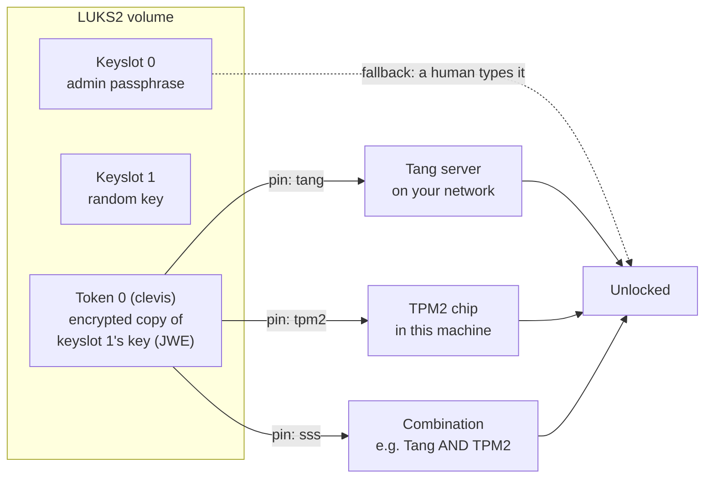
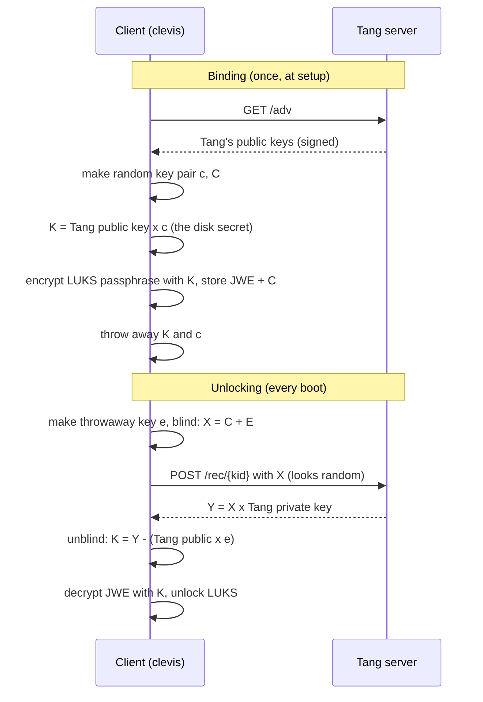
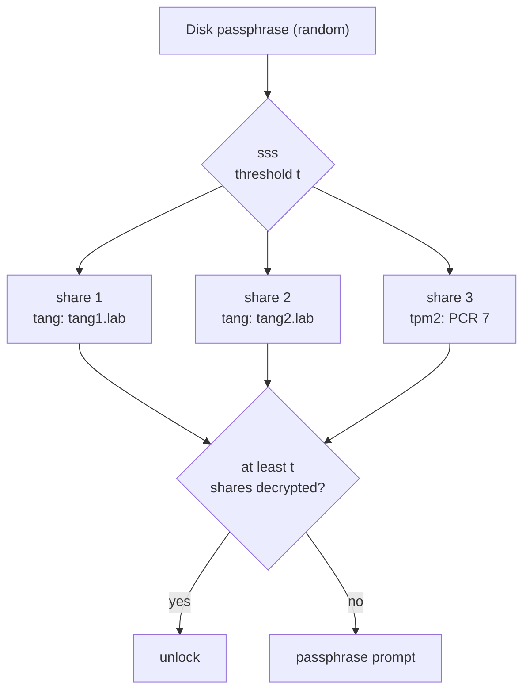
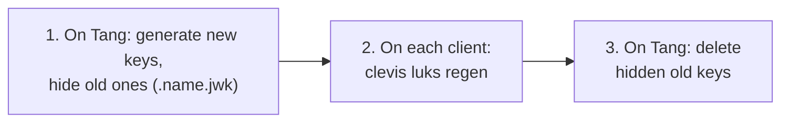

# 30 · Unattended Disk Unlock: Clevis, Tang and TPM2

<ul class="module-meta">
  <li>⏱ ~3 hours</li>
  <li>5 labs</li>
  <li>Builds on: 10 · LVM, RAID and Encryption, 14 · The Boot Process, 29 · Secure Boot and Third-Party Drivers</li>
</ul>

Your security team wants every disk in the data center encrypted, so a failed drive sent back for warranty leaks nothing. Your operations team points out that a server rebooting at 3am after a kernel update will sit at a passphrase prompt until somebody drives in. Both teams are right. This module shows how Rocky resolves that conflict: the disk unlocks itself when it's *where it belongs*, and stays locked when it isn't.

!!! abstract "What you'll learn"
    - How Clevis adds an automatic unlock method to a LUKS2 volume without touching your passphrase
    - How a Tang server lets a machine unlock only while it's on your network, without Tang ever seeing the key
    - How a TPM2 chip seals a key to the machine's boot state, and how to choose PCRs without locking yourself out
    - How to combine pins with Shamir's Secret Sharing (`sss`): "Tang AND TPM", "any of two Tang servers"
    - How to unlock the root volume in early boot with dracut and `rd.neednet=1`
    - How to run, rotate and back up a Tang server
    - How to read the TPM's measured boot event log

## The big picture

The idea is simple: keep your normal LUKS passphrase, and **add a second keyslot** whose key is locked by a policy that a machine can satisfy on its own. **Clevis** is the framework that does the adding and the automatic unlocking. A **pin** is a Clevis plug-in for one kind of policy.



| Pin | Unlocks when… | Protects against | Doesn't protect against |
|---|---|---|---|
| `tang` | The machine can reach your Tang server | A disk or whole server carried out of the building | Someone who steals the server *and* gets onto your network |
| `tpm2` | This exact machine boots in the expected state | A disk removed and read elsewhere | Someone who steals the whole server and boots it |
| `sss` | A threshold of sub-pins succeed | Whatever its combination covers | Depends on the combination |

This approach as a whole is called **Network-Bound Disk Encryption** (NBDE) when Tang is involved. The passphrase never goes away: if every automatic method fails, the boot simply falls back to asking a human.

## LUKS2 keyslots and tokens, revisited

You met LUKS in [module 10](10-lvm-raid-and-encryption.md#encryption-with-luks2): one random **volume key** encrypts the data, and **keyslots** each hold a copy of that volume key locked with a different passphrase or key file. LUKS2 adds one more piece Clevis depends on: **tokens**.

A **token** is a small JSON object stored in the LUKS2 header. It doesn't unlock anything by itself; it's metadata that a tool can read to *work out* a keyslot's passphrase. Clevis stores its encrypted secret (a **JWE**, JSON Web Encryption object) in a token linked to the keyslot it created.

<div class="layers" data-open="0" data-hint="Click a part of the LUKS2 header." markdown>

<div class="layer" data-label="Encrypted data" data-tag="the bulk of the disk" markdown>

Your filesystem, encrypted with the **volume key** (AES-XTS by default). Nothing here changes when you add or remove unlock methods.

</div>

<div class="layer" data-label="Tokens" data-tag="JSON metadata" markdown>

Clevis writes a token of type `clevis` containing the JWE: the keyslot passphrase, encrypted so that only the pin's policy can open it. The token records which keyslot it belongs to.

```console
$ sudo cryptsetup luksDump /dev/vda3 | sed -n '/^Tokens:/,/^Digests:/p'
Tokens:
  0: clevis
	Keyslot:    1
Digests:
```

</div>

<div class="layer" data-label="Keyslots" data-tag="up to 32" markdown>

Each keyslot holds the volume key, encrypted with a key derived (via Argon2id) from a passphrase. Slot 0 is usually your admin passphrase. Clevis adds a slot whose passphrase is a long random string nobody ever types.

```console
$ sudo cryptsetup luksDump /dev/vda3 | grep -E '^  [0-9]+: luks2'
  0: luks2
  1: luks2
```

</div>

<div class="layer" data-label="Header + JSON area" data-tag="first 16 MiB" markdown>

The binary header and the JSON area that describes segments, keyslots, tokens and digests. Back it up with `cryptsetup luksHeaderBackup`: lose this and every keyslot is gone.

</div>

</div>

So "binding" a volume with Clevis means: make a random passphrase, add it to a new keyslot (you type an existing passphrase once to authorize that), encrypt the random passphrase with a pin, and store the result as a token. "Unlocking" means: read the token, ask the pin to decrypt it, feed the result to `cryptsetup`.

!!! warning "Clevis doesn't change the volume key"
    Binding adds a keyslot; it doesn't re-encrypt anything. If you clone one encrypted disk image to many VMs, they all share one volume key, and anyone who unlocks one can decrypt them all. Install each encrypted machine separately (for example with a kickstart, see [module 23](23-automated-installs.md)) instead of cloning.

## Tang: unlock while you're on the network

A **Tang** server is a tiny HTTP service that helps clients recover keys without ever learning them. It has no database of clients, no accounts, and stores nothing per client. It holds only its own key pairs in `/var/db/tang`.

!!! analogy "Think of it like a two-part safe combination"
    When you lock the disk, you mix a secret only you hold with Tang's public number, write down a *recipe* for getting back to the result, then throw your secret away. Later, the recipe plus Tang's help rebuilds the combination. Because of a blinding trick, Tang only ever sees a scrambled number, so even a malicious Tang can't learn your combination or tell which client is asking. Where the analogy breaks: no one is writing anything down in plain text; it's elliptic-curve maths.

### The McCallum-Relyea exchange, simply

Tang uses a variant of an elliptic-curve Diffie-Hellman key exchange called the **McCallum-Relyea exchange**. You don't need the maths to run it, but the shape explains its security properties:



The properties that fall out of this:

- **Tang never sees K**, the key protecting your disk. It only sees `X`, which is blinded with a fresh random value each time.
- **Tang is stateless.** It doesn't know who its clients are. Back up `/var/db/tang` and you have backed up everything.
- **No TLS required.** An eavesdropper sees only blinded values. (Tang can sit behind TLS if your policy demands it.)
- **No authentication.** Anyone who can reach Tang can perform a recovery, *for a JWE they already hold*. The JWE lives on the encrypted disk's header, so the security boundary is: "has the disk header AND can reach Tang." That's why Tang must only be reachable from inside your network.

### Running a Tang server

```console
$ sudo dnf install tang
$ sudo systemctl enable --now tangd.socket
$ sudo ls /var/db/tang
6CiBzHg6Y6ypJmY0Q46S8f8F4hQcdd8m1dX8b5qQkEs.jwk  vYQ0pM1Rz7xvK1bR5zq0b3WqdJpQnF3cXl8XoW0L2kA.jwk
```

The keys are generated automatically the first time Tang starts. One is a **signing** key (it signs the advertisement so clients can tell it's genuine), the other an **exchange** key (used in the recovery maths).

`tangd.socket` listens on TCP port 80 by default. Most sites move it to a dedicated port. On Rocky that takes three changes, because SELinux ([module 16](16-selinux.md)) only lets `tangd` use ports labelled `tangd_port_t`:

```console
$ sudo semanage port -a -t tangd_port_t -p tcp 7500
$ sudo systemctl edit tangd.socket
```

```ini title="/etc/systemd/system/tangd.socket.d/override.conf"
[Socket]
ListenStream=
ListenStream=7500
```

```console
$ sudo systemctl daemon-reload
$ sudo systemctl restart tangd.socket
$ sudo firewall-cmd --permanent --add-port=7500/tcp && sudo firewall-cmd --reload
$ tang-show-keys 7500
vYQ0pM1Rz7xvK1bR5zq0b3WqdJpQnF3cXl8XoW0L2kA
```

`tang-show-keys` prints the **thumbprint** of the signing key. Write it down: when you bind a client, Clevis shows you a thumbprint and asks whether to trust it, and comparing the two is how you know you're talking to the real Tang.

!!! note "Socket activation"
    There's no long-running Tang daemon. `tangd.socket` has `Accept=true`, so systemd starts a short-lived `tangd@.service` instance for each connection. That's why `systemctl status tangd.socket` is the thing to check, and why Tang uses almost no resources. Socket activation is covered in [module 07](07-systemd-and-services.md).

<div class="quiz" data-answer="3" markdown>

An attacker steals one disk from a server whose root volume is bound only to Tang. They plug it into their laptop at home. Can they unlock it?

- Yes, the JWE in the LUKS header contains the key
- Yes, Tang doesn't authenticate clients, so they can ask it from anywhere
- No, recovery needs Tang to do its half of the exchange, and Tang is only reachable inside your network
- No, because Tang keeps a list of approved client disks

The JWE is useless without Tang's private key taking part. Tang doesn't keep a client list; the protection is purely that Tang isn't reachable from the attacker's home. Keep Tang off the internet.

</div>

## TPM2: unlock only on this machine, in this state

A **TPM** (Trusted Platform Module) is a small security chip (or firmware equivalent, or a virtual TPM in a VM) with two features Clevis uses:

1. It can **seal** data: encrypt it with a key that never leaves the chip, so the sealed blob is useless on any other machine.
2. It keeps **PCRs** (Platform Configuration Registers): a set of hash registers that record what happened during boot. Sealed data can carry a **policy** that says "only unseal if PCRs 7 and 4 have these exact values."

### How measured boot fills the PCRs

A PCR can't be set, only **extended**: `new value = hash(old value + new measurement)`. Each boot stage measures (hashes) the next thing it loads and extends a PCR before running it. The final values are a fingerprint of the whole boot path. Change anything, and the fingerprint changes. This is **measured boot**; it complements Secure Boot ([module 29](29-secure-boot-and-drivers.md)), which *blocks* untrusted code, by *recording* what ran.

<div class="stepper" markdown>

<div class="step" data-title="Firmware measures itself" markdown>

The firmware extends **PCR 0** with its own code and **PCR 1** with its configuration (boot order, settings). Option ROMs on add-in cards go into **PCR 2/3**.

</div>

<div class="step" data-title="Secure Boot state recorded" markdown>

The firmware extends **PCR 7** with the Secure Boot policy: whether Secure Boot is on, the contents of `PK`, `KEK`, `db`, `dbx`, and which `db` certificate verified each boot loader.

</div>

<div class="step" data-title="Boot loaders measured" markdown>

Before running shim, the firmware extends **PCR 4** with shim's hash. Shim and GRUB measure GRUB in turn. Shim also records the MOK list (in **PCR 14**).

</div>

<div class="step" data-title="GRUB measures the kernel" markdown>

GRUB extends **PCR 8** with the commands it runs and the kernel command line, and **PCR 9** with the files it loads: the kernel and initramfs.

</div>

<div class="step" data-title="Clevis asks the TPM" markdown>

In the initramfs, Clevis asks the TPM to unseal its key. The TPM compares the current PCR values to the sealed policy. Match: the key comes out, LUKS unlocks. Mismatch: the TPM refuses, Clevis gives up, and you get a passphrase prompt.

</div>

</div>

You can read the current values and the full event log that produced them:

```console
$ sudo dnf install tpm2-tools
$ sudo tpm2_pcrread sha256:0,4,7,8,9
  sha256:
    0 : 0x3D458CFE55CC03EA1F443F1562BEEC8DF51C75E14A9FCF9A7234A13F198E7969
    4 : 0x1F0B6D5C2E8A…
    7 : 0x65CAF8DD1E0EA7A6347B635D2B379C93B9A1351EDC2AFC3ECDA700E534EB3068
    8 : 0x0E3C8B1F…
    9 : 0x9A47D3E2…
$ sudo tpm2_eventlog /sys/kernel/security/tpm0/binary_bios_measurements | less
…
- EventNum: 9
  PCRIndex: 7
  EventType: EV_EFI_VARIABLE_DRIVER_CONFIG
  …
  Event:
    VariableName: 8be4df61-93ca-11d2-aa0d-00e098032b8c
    UnicodeName: SecureBoot
    VariableData: "01"
…
```

The event log is the "receipt" for each PCR: replay all the events for PCR 7 and you get the PCR 7 value. It's how you find out *why* a PCR changed after an update.

### Choosing a PCR policy

Binding to more PCRs is stricter, but every PCR you add is something an ordinary update can change, sending you to the passphrase prompt. This is the central trade-off:

| PCR | Measures | Changes when… | Bind to it? |
|---|---|---|---|
| 0 | Firmware code | BIOS/UEFI update | Rarely: every firmware update locks you out |
| 1 | Firmware settings | Boot order or setting changes, sometimes even hardware changes | Rarely |
| 2-3 | Option ROMs | Add-in card firmware changes | Rarely |
| 4 | Boot loaders and other EFI binaries (shim, GRUB, often the kernel image too) | `shim-x64` or `grub2` updates, and on most systems every kernel update | Rarely, for the same reason as 8-9 |
| 7 | Secure Boot state and keys | Secure Boot toggled, `db`/`dbx`/`KEK` updated, some `shim` updates (shim records its own certificate and SBAT policy here) | **The usual choice** |
| 8-9 | Kernel command line, kernel, initramfs (via GRUB) | Every kernel update and `dracut -f` | No: changes all the time |
| 14 | MOK list | You enroll or delete a MOK | With care |

**PCR 7 is the common recommendation** on its own: it proves Secure Boot is on and the trusted keys are the expected ones, so an attacker can't boot a boot loader or kernel signed by a stranger, and it survives kernel updates. Binding to PCRs 0-7 sounds thorough, but it means every firmware update or BIOS setting change locks the machine out until someone types the passphrase and rebinds.

Be clear about what PCR 7 does *not* prove, though. It records *who signed* the boot chain, not *what* booted.

??? question "Under the hood: the initramfs hole in a PCR 7 policy"
    Remember from [module 29](29-secure-boot-and-drivers.md) that classic Secure Boot doesn't verify the initramfs or the kernel command line. They sit on the unencrypted `/boot` partition. Now picture an attacker who has the whole machine for an hour:

    1. They boot a live USB (Secure Boot on or off doesn't matter yet), mount `/boot`, and add a shell or a "copy the key to a USB stick" hook to the initramfs.
    2. They reboot normally. Firmware, shim, GRUB and the Rocky kernel are all genuine and Rocky-signed, so **PCR 7 has exactly its expected value**.
    3. Their modified initramfs asks the TPM to unseal. The policy is satisfied, and the key comes out.

    The same reasoning applies to any boot medium signed through the same chain, such as Rocky's own install ISO in rescue mode: PCR 7 can't tell them apart from your installed system.

    What this means in practice:

    - `tpm2` with PCR 7 protects a **disk pulled out of the machine**. It does not protect a **whole stolen machine** against a patient attacker.
    - For whole-machine theft, combine TPM2 with Tang (`sss`, `t=2`, below), so the key also needs your network.
    - Lock the cheap paths: a GRUB password (`grub2-setpassword`) blocks editing the command line at the boot menu, and a firmware setup password stops boot-order changes.
    - Measuring the initramfs properly needs a **Unified Kernel Image** (kernel, initramfs and command line in one signed EFI binary). That's the direction Fedora and systemd are taking, but it isn't Rocky's default boot path.

!!! danger "PCR 7 does change sometimes"
    A `dbx` revocation update (shipped through firmware updates or `fwupd`), the 2023 Microsoft CA rollout, enrolling a new key, or toggling Secure Boot all change PCR 7. Before applying one, make sure someone knows the passphrase or that a second pin (Tang) can unlock the machine. After it, rebind with `clevis luks regen`.

!!! note "Without a policy"
    `clevis encrypt tpm2 '{}'` (no `pcr_ids`) seals to the TPM with no PCR policy. The disk still can't be read on another machine, but anyone who boots *this* machine from their own USB stick can ask the TPM to unseal. Use at least PCR 7 with Secure Boot on.

!!! tip "systemd-cryptenroll"
    systemd also offers TPM2 enrollment for LUKS (`systemd-cryptenroll --tpm2-device=auto`), which you may see in Fedora guides. On Rocky, Clevis is the integrated path: it's the tool with dracut support for Tang, TPM2 and `sss` combinations, and the one RHEL documents for NBDE.

<div class="quiz" data-answer="2" markdown>

You bind a server's root volume to `tpm2` with `pcr_ids` `"0,1,2,3,4,5,6,7,8,9"`. What will happen over the next few months?

- Nothing unusual; more PCRs is more secure
- Almost every kernel update changes PCR 8/9, so the machine stops at the passphrase prompt after each one
- The TPM will run out of PCR slots
- The disk will be readable on other machines

GRUB measures the kernel, initramfs and command line into PCRs 8 and 9, so every kernel update changes them. A policy should only include PCRs that change when something *suspicious* happens.

</div>

## Combining pins with Shamir's Secret Sharing

What if one Tang server is down for maintenance? What if you want *both* "on our network" *and* "the original machine"? The **`sss` pin** uses **Shamir's Secret Sharing**: it splits a key into `n` shares, encrypts each share with a different sub-pin, and needs any `t` (the **threshold**) of them to rebuild the key.



Useful recipes:

```bash
# Either of two Tang servers (high availability): t = 1
sudo clevis luks bind -d /dev/vda3 sss \
    '{"t":1,"pins":{"tang":[{"url":"http://tang1.lab:7500"},{"url":"http://tang2.lab:7500"}]}}'

# Tang AND this machine's TPM (stolen whole server stays locked): t = 2
sudo clevis luks bind -d /dev/vda3 sss \
    '{"t":2,"pins":{"tang":[{"url":"http://tang1.lab:7500"}],"tpm2":{"pcr_ids":"7"}}}'

# TPM AND either of two Tang servers: nest sss inside sss
sudo clevis luks bind -d /dev/vda3 sss \
    '{"t":2,"pins":{"tpm2":{"pcr_ids":"7"},"sss":{"t":1,"pins":{"tang":[{"url":"http://tang1.lab:7500"},{"url":"http://tang2.lab:7500"}]}}}}'
```

The JSON reads naturally once you see the shape: `t` is how many must succeed, `pins` maps each pin name to one config or a list of configs.

!!! tip "Two separate bindings vs one sss binding"
    You can also bind *two separate keyslots*, one to Tang and one to TPM2. That behaves like "Tang OR TPM2": whichever works first unlocks. `sss` with `t=2` is the only way to *require* both.

## Binding, listing and removing

Clevis's LUKS commands do the keyslot and token work for you:

```console
$ sudo dnf install clevis clevis-luks clevis-dracut
$ sudo clevis luks bind -d /dev/vda3 tang '{"url":"http://tang1.lab:7500"}'
The advertisement contains the following signing keys:

vYQ0pM1Rz7xvK1bR5zq0b3WqdJpQnF3cXl8XoW0L2kA

Do you wish to trust these keys? [ynYN] y
Enter existing LUKS password:
$ sudo clevis luks list -d /dev/vda3
1: tang '{"url":"http://tang1.lab:7500"}'
```

The thumbprint shown should match `tang-show-keys` on the Tang server. That one comparison is your protection against binding to an impostor.

| Task | Command |
|---|---|
| Bind a new pin (adds keyslot + token) | `clevis luks bind -d DEV PIN 'CFG'` |
| List bindings and their slots | `clevis luks list -d DEV` |
| Test a binding without unlocking | `clevis luks unlock -d DEV -t SLOT` |
| Unlock by hand | `clevis luks unlock -d DEV -n NAME` |
| Remove a binding (keyslot + token) | `clevis luks unbind -d DEV -s SLOT` |
| Rebind with the same config (after Tang key rotation or PCR change) | `clevis luks regen -d DEV -s SLOT` |
| Check whether a Tang binding uses outdated keys | `clevis luks report -d DEV -s SLOT` |
| Edit a binding's config | `clevis luks edit -d DEV -s SLOT -c 'CFG'` |

??? question "Under the hood: what root on a running box can see"
    The token is plain JSON in the header, and you can pull it out yourself:

    ```console
    $ sudo cryptsetup token export --token-id 0 /dev/vda3
    {"type":"clevis","keyslots":["1"],"jwe":{"ciphertext":"…","encrypted_key":"","iv":"…","protected":"…","tag":"…"}}
    $ sudo clevis luks pass -d /dev/vda3 -s 1
    Jx1b…(the random keyslot passphrase)…
    ```

    `clevis luks pass` runs the pin and prints the keyslot's passphrase. That's useful for recovery, and it's a reminder of the threat model: Clevis protects data **at rest**. Anyone who is root on the running, unlocked machine (and can reach Tang, or use the TPM) can recover a working passphrase and keep it. After a suspected compromise, don't just rotate Tang keys. Run `clevis luks regen` so the slot gets a new random passphrase, or better, re-encrypt.

`clevis encrypt` and `clevis decrypt` work on arbitrary data, not just LUKS, which makes them handy for testing a pin before you trust a disk to it:

```console
$ echo 'hello' | clevis encrypt tang '{"url":"http://localhost:7500"}' -y > secret.jwe
$ clevis decrypt < secret.jwe
hello
```

### Practice: bind a volume

<div class="terminal-sim" data-title="Bind and verify a Tang pin" data-prompt="[root@db01 ~]# " markdown>

<div class="task" data-expect="tang-show-keys 7500||sudo tang-show-keys 7500" data-hint="On the Tang server, tang-show-keys takes the port number as its argument." markdown>

**Step 1.** (On the Tang server.) Print the signing key thumbprint for the server listening on port 7500.

```text
vYQ0pM1Rz7xvK1bR5zq0b3WqdJpQnF3cXl8XoW0L2kA
```

</div>

<div class="task" data-expect="clevis luks bind -d /dev/vda3 tang '{&quot;url&quot;:&quot;http://tang1.lab:7500&quot;}'" data-match="clevis luks bind -d /dev/vda3 tang ['&quot;]?\{ ?&quot;url&quot; ?: ?&quot;http://tang1\.lab:7500&quot; ?\}['&quot;]?" data-hint="Use: clevis luks bind -d DEVICE tang, followed by the JSON config in single quotes, with a url key." markdown>

**Step 2.** Bind `/dev/vda3` to the Tang server at `http://tang1.lab:7500`.

```text
The advertisement contains the following signing keys:

vYQ0pM1Rz7xvK1bR5zq0b3WqdJpQnF3cXl8XoW0L2kA

Do you wish to trust these keys? [ynYN] y
Enter existing LUKS password:
```

</div>

<div class="task" data-expect="clevis luks list -d /dev/vda3" data-hint="clevis luks has a subcommand that lists bindings on a device (-d)." markdown>

**Step 3.** List the Clevis bindings on `/dev/vda3`.

```text
1: tang '{"url":"http://tang1.lab:7500"}'
```

</div>

<div class="task" data-expect="clevis luks unlock -d /dev/vda3 -t 1" data-hint="clevis luks unlock has a -t option that tests a slot without unlocking." markdown>

**Step 4.** Test slot 1 without actually unlocking the device.

```text
(no output: exit status 0 means the pin can open slot 1)
```

</div>

<div class="task" data-expect="cryptsetup luksDump /dev/vda3" data-match="cryptsetup luksDump /dev/vda3.*" data-hint="cryptsetup luksDump shows keyslots and tokens." markdown>

**Step 5.** Look at the LUKS header to see the new keyslot and its `clevis` token.

```text
…
Keyslots:
  0: luks2
  1: luks2
…
Tokens:
  0: clevis
	Keyslot:    1
```

</div>

</div>

## Unlocking the root volume at boot

Unlocking a data volume after boot is easy: Clevis hooks into systemd's password prompts (`clevis-luks-askpass.path`, from the `clevis-systemd` package) and answers them for devices listed in `/etc/crypttab`. The root volume is harder, because it must be unlocked *inside the initramfs*, before the real system exists. That's what **`clevis-dracut`** adds: dracut modules that put Clevis, its pins, and (for Tang) networking into the initramfs.

<div class="stepper" markdown>

<div class="step" data-title="Kernel starts the initramfs" markdown>

GRUB loads the kernel and the initramfs built by dracut ([module 14](14-the-boot-process.md)). systemd in the initramfs sees that root lives on a LUKS device and starts `systemd-cryptsetup@luks-….service`, which asks for a passphrase.

</div>

<div class="step" data-title="Network comes up (Tang only)" markdown>

For Tang, the initramfs must have a network. `rd.neednet=1` on the kernel command line tells dracut's network module (NetworkManager in the initramfs on Rocky) to bring interfaces up even though root isn't a network filesystem. Without it, the Tang request never leaves the box.

</div>

<div class="step" data-title="Clevis answers the prompt" markdown>

Clevis's dracut hook sees the password request, reads the `clevis` token from the LUKS header, and runs the pin: an HTTP POST to Tang, or a TPM unseal, or both for `sss`. On success it hands the recovered passphrase to `systemd-cryptsetup`.

</div>

<div class="step" data-title="Fallback to a human" markdown>

If the pin fails (Tang unreachable, PCRs changed), the passphrase prompt stays on the console. Clevis keeps retrying in the background for Tang, so a server that boots before the network is ready still unlocks once the network comes up. A human can type the passphrase at any time.

</div>

<div class="step" data-title="Switch to the real root" markdown>

With root unlocked, the initramfs mounts it and switches to it. The rest of the boot is normal. Data volumes listed in `/etc/crypttab` are handled later by `clevis-luks-askpass`.

</div>

</div>

Setting it up on a client whose root is already on LUKS:

```console
$ sudo dnf install clevis-dracut
$ sudo clevis luks bind -d /dev/vda3 tang '{"url":"http://tang1.lab:7500"}'
$ sudo dracut -fv --regenerate-all --hostonly-cmdline
```

With `--hostonly-cmdline`, Clevis's Tang dracut module notices the Tang binding and bakes `rd.neednet=1` into the initramfs for you. If you prefer it visible on the kernel command line, use `grubby --update-kernel=ALL --args="rd.neednet=1"`.

**Static IP in early boot.** If the server has no DHCP, give the initramfs an address with the `ip=` syntax from [[man:dracut.cmdline(7)]] (`ip=<address>::<gateway>:<netmask>:<hostname>:<interface>:none`):

```ini title="/etc/dracut.conf.d/static_ip.conf"
kernel_cmdline="ip=192.0.2.10::192.0.2.1:255.255.255.0::enp1s0:none nameserver=192.0.2.53"
```

Then rebuild with `dracut -fv --regenerate-all`. Use an IP address in the Tang URL if you'd rather not depend on DNS during early boot.

!!! pitfall "The network comes up, but the wrong NIC"
    On servers with several NICs, the initramfs may bring up an interface that can't reach Tang, or wait for one with no cable. Name the interface in `ip=` and, if needed, add `rd.neednet=1` with `ip=<iface>:dhcp` for just that one. Check what happened with `journalctl -b -u NetworkManager` (the initramfs journal is kept) or by adding `rd.debug` once.

## Choosing a pin

<div class="decision" markdown>

<div class="node" data-id="start" markdown>

**Is the machine in a place you control, with a network you control (data center, office server room)?**

<button data-goto="dc">Yes</button> <button data-goto="mobile">No, it travels or sits at a remote site</button>

</div>

<div class="node" data-id="dc" markdown>

**What theft worries you most: a single disk (RMA, decommissioning), or a whole server walking out?**

<button data-goto="disk">Mostly disks</button> <button data-goto="server">Whole servers too</button>

</div>

<div class="node" data-id="disk" markdown>

**Use `tang`, ideally `sss` with `t=1` over two Tang servers** so maintenance on one doesn't block reboots. A disk taken out of the building can't reach Tang. Keep the admin passphrase in your password vault.

</div>

<div class="node" data-id="server" markdown>

**Use `sss` with `t=2`: Tang AND `tpm2` (PCR 7).** A stolen server can't reach Tang; a disk moved to another machine lacks the TPM. Add a second Tang server under a nested `sss` with `t=1` for availability.

</div>

<div class="node" data-id="mobile" markdown>

**Does it have a TPM2 and Secure Boot?**

<button data-goto="tpm">Yes</button> <button data-goto="none">No</button>

</div>

<div class="node" data-id="tpm" markdown>

**Use `tpm2` with `pcr_ids` `7`, and set a GRUB password.** It protects a disk pulled from the machine and blocks boot loaders signed by strangers. It does *not* stop a patient attacker who steals the whole device and tampers with the unsigned initramfs on `/boot`. If that threat matters (laptops with sensitive data), keep a human passphrase.

</div>

<div class="node" data-id="none" markdown>

**Keep a typed passphrase.** Without a network you control or a TPM, any automatic unlock means storing the key somewhere the thief can also reach.

</div>

</div>

## Running Tang in production

Tang is simple, which makes it easy to run badly. Four rules:

1. **Run at least two.** With `sss` and `t=1`, either server can unlock clients. Put them in different racks or rooms. (The alternative is two Tang servers with *identical* `/var/db/tang` contents behind one load-balanced name. Clients then need only one URL, but you must rotate keys on both at once, and a leaked copy of the directory compromises both.)
2. **Back up `/var/db/tang`.** Losing Tang's keys means every client falls back to passphrases. The directory is small and has no per-client state, so a nightly copy to your backup system is enough. Treat that backup as sensitive: with it plus a stolen disk, an attacker can unlock.
3. **Keep Tang inside.** Only client subnets should reach the port. Firewall it ([module 12](12-firewalld.md)).
4. **Rotate keys** periodically, and after any suspected compromise.

### Key rotation

Rotation is a three-step dance so no client is ever stranded:



Hidden keys (file names starting with a dot) are no longer *advertised* to new clients but are still used to *recover* for old ones. So step 1 breaks nothing.

```console
$ sudo /usr/libexec/tangd-rotate-keys -v -d /var/db/tang
Disabled advertisement of key vYQ0pM1Rz7xvK1bR5zq0b3WqdJpQnF3cXl8XoW0L2kA.jwk -> .vYQ0pM1Rz7xvK1bR5zq0b3WqdJpQnF3cXl8XoW0L2kA.jwk
Disabled advertisement of key 6CiBzHg6Y6ypJmY0Q46S8f8F4hQcdd8m1dX8b5qQkEs.jwk -> .6CiBzHg6Y6ypJmY0Q46S8f8F4hQcdd8m1dX8b5qQkEs.jwk
Created new key Wm2KfTq8X0hZpN3rL5eYc7dA1sVbU9gJiO4kQwE6yRt.jwk
Created new key Hj3nB8vC5xZ2mL7kP0qR4tW9eY1uI6oA3sD8fG2hJ5k.jwk
Keys rotated successfully
```

On each client:

```console
$ sudo clevis luks report -d /dev/vda3 -s 1
The following keys are not in the current advertisement and were probably rotated:
…
$ sudo clevis luks regen -d /dev/vda3 -s 1
```

`regen` keeps the same pin configuration and rebinds against the current advertisement. When every client is done, delete the hidden `.*.jwk` files on Tang. An Ansible play is the natural way to run `regen` across a fleet ([module 32](32-ansible-and-system-roles.md); the `rhel-system-roles.nbde_client` and `nbde_server` roles exist for exactly this).

<div class="quiz" data-answer="1" markdown>

You ran `tangd-rotate-keys` on your Tang server yesterday, but haven't run `clevis luks regen` on any client yet. A client reboots tonight. What happens?

- It unlocks normally, because the old keys are hidden, not deleted, and Tang still uses them for recovery
- It stops at the passphrase prompt, because the old keys are no longer advertised
- It automatically rebinds itself to the new keys
- Tang rejects it because its thumbprint is unknown

Hiding a key stops Tang *advertising* it to new bindings, but recovery requests for it still work. That's why rotation is safe: only deleting the hidden keys strands un-rebound clients.

</div>

## Labs

All labs except the last run on one Rocky 10 VM using loop devices, so nothing touches a real disk. Install the tools once:

```console
$ sudo dnf install tang clevis clevis-luks tpm2-tools cryptsetup
```

!!! lab "Lab 1: Run Tang and encrypt a secret against it"

    **Goal:** See Tang's stateless recovery work, and fail, with nothing but `clevis encrypt` and `decrypt`.

    1. Start Tang on port 7500 (SELinux port label, socket override):

        ```console
        $ sudo semanage port -a -t tangd_port_t -p tcp 7500
        $ sudo mkdir -p /etc/systemd/system/tangd.socket.d
        $ printf '[Socket]\nListenStream=\nListenStream=7500\n' | sudo tee /etc/systemd/system/tangd.socket.d/port.conf
        $ sudo systemctl daemon-reload
        $ sudo systemctl enable --now tangd.socket
        $ tang-show-keys 7500
        ```

    2. Look at the advertisement Clevis will fetch:

        ```console
        $ curl -s http://localhost:7500/adv | head -c 200; echo
        ```

    3. Encrypt and decrypt a secret (compare the thumbprint shown with step 1 and answer `y`):

        ```console
        $ echo 'the eagle has landed' | clevis encrypt tang '{"url":"http://localhost:7500"}' > secret.jwe
        $ clevis decrypt < secret.jwe
        the eagle has landed
        ```

    4. Take Tang away and try again:

        ```console
        $ sudo systemctl stop tangd.socket
        $ clevis decrypt < secret.jwe
        Error communicating with server http://localhost:7500
        $ sudo systemctl start tangd.socket
        ```

    **Check your work:** the secret decrypts only while `tangd.socket` is running, and `/var/db/tang` contains just two key files no matter how many times you encrypt.

    ??? success "Why didn't Tang's directory grow?"
        Tang is stateless. It never stores anything about clients; each JWE carries everything needed for recovery except Tang's private key.

    **Clean up:** `rm -f secret.jwe` (keep Tang running for Labs 2 and 4).

!!! lab "Lab 2: Bind a LUKS volume on a loop device"

    **Goal:** Watch Clevis add a keyslot and token, unlock with no passphrase, then remove the binding.

    1. Make a 64 MiB LUKS2 volume:

        ```console
        $ truncate -s 64M ~/nbde.img
        $ LOOP=$(sudo losetup -f --show ~/nbde.img); echo $LOOP
        /dev/loop0
        $ sudo cryptsetup luksFormat --type luks2 $LOOP     # type YES, then a passphrase
        $ sudo cryptsetup luksDump $LOOP | grep -A3 -E '^(Keyslots|Tokens):'
        ```

    2. Bind it to Tang (enter your passphrase once to authorize the new keyslot):

        ```console
        $ sudo clevis luks bind -d $LOOP tang '{"url":"http://localhost:7500"}'
        $ sudo clevis luks list -d $LOOP
        1: tang '{"url":"http://localhost:7500"}'
        $ sudo cryptsetup luksDump $LOOP | grep -A3 -E '^(Keyslots|Tokens):'
        ```

    3. Unlock without typing anything, put a filesystem on it, and close it. (ext4, because `mkfs.xfs` refuses anything under 300 MB, and only 48 MiB is left after the 16 MiB LUKS2 header.)

        ```console
        $ sudo clevis luks unlock -d $LOOP -n nbdetest
        $ sudo mkfs.ext4 -q /dev/mapper/nbdetest
        $ sudo cryptsetup close nbdetest
        ```

    4. Remove the binding:

        ```console
        $ sudo clevis luks unbind -d $LOOP -s 1      # confirm, enter passphrase
        $ sudo clevis luks list -d $LOOP
        ```

    **Check your work:** after binding, `luksDump` shows keyslot 1 and a `clevis` token pointing at it; after unbinding both are gone and slot 0 (your passphrase) still works.

    **Clean up:** `sudo losetup -d $LOOP; rm -f ~/nbde.img`

!!! lab "Lab 3: Seal to the TPM and break the policy on purpose"

    **Goal:** See a PCR policy succeed, then fail, without risking your boot.

    **You'll need:** a TPM2. In a libvirt VM, add one with `virt-install … --tpm emulator` or in virt-manager (Add Hardware, TPM, Emulated, version 2.0); the host's `swtpm` package provides the emulator. Check inside the VM with `ls /dev/tpmrm0`.

    1. Look at the PCR banks and the event log:

        ```console
        $ sudo tpm2_getcap pcrs
        $ sudo tpm2_pcrread sha256:7,23
        $ sudo tpm2_eventlog /sys/kernel/security/tpm0/binary_bios_measurements | grep -c EventNum
        ```

    2. Seal a secret to PCR 7 (Secure Boot state) and unseal it:

        ```console
        $ echo 'pcr7 secret' | sudo clevis encrypt tpm2 '{"pcr_bank":"sha256","pcr_ids":"7"}' > pcr7.jwe
        $ sudo clevis decrypt < pcr7.jwe
        pcr7 secret
        ```

    3. Now use **PCR 23**, a debug PCR that you are allowed to extend and reset from the OS, to simulate "the boot changed":

        ```console
        $ echo 'pcr23 secret' | sudo clevis encrypt tpm2 '{"pcr_bank":"sha256","pcr_ids":"23"}' > pcr23.jwe
        $ sudo clevis decrypt < pcr23.jwe
        pcr23 secret
        $ sudo tpm2_pcrextend 23:sha256=0000000000000000000000000000000000000000000000000000000000000001
        $ sudo clevis decrypt < pcr23.jwe
        …
        Unsealing jwk from TPM failed!
        $ sudo tpm2_pcrreset 23
        $ sudo clevis decrypt < pcr23.jwe
        pcr23 secret
        ```

    **Check your work:** decryption fails only while PCR 23 differs from its value at sealing time, and works again after `tpm2_pcrreset 23`.

    ??? tip "No vTPM? Use swtpm inside the VM"
        You can run a software TPM as a normal process and point the TPM tools at it. Install `swtpm`, then:

        ```console
        $ mkdir -p ~/swtpm
        $ swtpm socket --tpmstate dir=$HOME/swtpm --tpm2 \
            --server type=tcp,port=2321 --ctrl type=tcp,port=2322 \
            --flags not-need-init,startup-clear &
        $ export TPM2TOOLS_TCTI="swtpm:port=2321"
        $ echo test | clevis encrypt tpm2 '{"pcr_ids":"23"}' | clevis decrypt
        ```

        Clevis uses `TPM2TOOLS_TCTI` when it's set. This TPM has no measured boot, so PCRs 0-7 are all zero; it's only good for experimenting with policies.

    **Clean up:** `rm -f pcr7.jwe pcr23.jwe; sudo tpm2_pcrreset 23` (and `kill %1; rm -rf ~/swtpm` if you used swtpm).

!!! lab "Lab 4: Shamir combinations"

    **Goal:** Prove the difference between `t=1` and `t=2`.

    **You'll need:** Tang from Lab 1 and a TPM from Lab 3.

    1. Encrypt with "Tang AND TPM" and with "Tang OR TPM":

        ```console
        $ echo both | sudo clevis encrypt sss \
            '{"t":2,"pins":{"tang":[{"url":"http://localhost:7500"}],"tpm2":{"pcr_ids":"7"}}}' -y > and.jwe
        $ echo either | sudo clevis encrypt sss \
            '{"t":1,"pins":{"tang":[{"url":"http://localhost:7500"}],"tpm2":{"pcr_ids":"7"}}}' -y > or.jwe
        ```

    2. Decrypt both, then stop Tang and try again:

        ```console
        $ sudo clevis decrypt < and.jwe; sudo clevis decrypt < or.jwe
        $ sudo systemctl stop tangd.socket
        $ sudo clevis decrypt < and.jwe     # fails: only 1 of 2 shares
        $ sudo clevis decrypt < or.jwe      # works: TPM share is enough
        either
        $ sudo systemctl start tangd.socket
        ```

    **Check your work:** with Tang down, `and.jwe` fails and `or.jwe` still decrypts.

    **Clean up:** `rm -f and.jwe or.jwe`. To remove Tang entirely: `sudo systemctl disable --now tangd.socket; sudo rm -rf /etc/systemd/system/tangd.socket.d; sudo systemctl daemon-reload; sudo semanage port -d -t tangd_port_t -p tcp 7500; sudo dnf remove tang`.

!!! lab "Lab 5 (optional): Unattended root unlock across two VMs"

    **Goal:** A VM with an encrypted root that reboots unattended while Tang is reachable, and stops at the prompt when it isn't.

    **You'll need:** two Rocky 10 VMs on the same libvirt network: `tang1` running Tang on port 7500 (as in Lab 1, plus `sudo firewall-cmd --permanent --add-port=7500/tcp; sudo firewall-cmd --reload`), and `client1` installed with **"Encrypt my data"** ticked in the installer.

    **Snapshot `client1` first.** This lab rebuilds its initramfs, and a mistake leaves it waiting at a passphrase prompt. libvirt only takes internal snapshots of UEFI VMs while they're shut off, so on the host: `sudo virsh shutdown client1`, then `sudo virsh snapshot-create-as client1 pre-nbde`, then `sudo virsh start client1`.

    1. On the host, find `tang1`'s IP address (`sudo virsh domifaddr tang1`). Use the IP, not the name: the initramfs may not be able to resolve VM hostnames. Then on `client1`, find the LUKS device holding root and bind it (replace `192.168.122.50` with `tang1`'s address and `/dev/vda3` with your LUKS device):

        ```console
        $ lsblk -o NAME,TYPE,FSTYPE,MOUNTPOINTS
        $ sudo dnf install clevis-dracut
        $ sudo clevis luks bind -d /dev/vda3 tang '{"url":"http://192.168.122.50:7500"}'
        $ sudo dracut -fv --regenerate-all --hostonly-cmdline
        $ sudo lsinitrd | grep -E 'clevis|cmdline.d'
        ```

    2. Reboot `client1` and watch its console: the passphrase prompt appears briefly, then the boot continues on its own.
    3. Shut down `tang1` (or `sudo systemctl stop tangd.socket` there) and reboot `client1` again. It waits at the prompt. Start Tang again: the client unlocks by itself within a few seconds, because Clevis keeps retrying.

    **Check your work:** `journalctl -b | grep -i clevis` on the client shows the unlock, and `clevis luks list` shows the tang binding.

    **Clean up:** shut `client1` down and revert the snapshot (`sudo virsh snapshot-revert client1 pre-nbde`), or `sudo clevis luks unbind -d /dev/vda3 -s 1; sudo dracut -f --regenerate-all`.

## Common pitfalls

| Symptom | Cause | Fix |
|---|---|---|
| Root never unlocks automatically; prompt waits forever | No network in the initramfs | `dracut -fv --regenerate-all --hostonly-cmdline`, or add `rd.neednet=1`; check `lsinitrd` for clevis |
| Works by hand (`clevis luks unlock`) but not at boot | `clevis-dracut` installed after the initramfs was built | Rebuild with `dracut -f --regenerate-all` |
| TPM unlock stopped after a firmware update | PCR 0/1/7 changed | Type the passphrase, `clevis luks regen -d DEV -s SLOT`; bind to PCR 7 only |
| TPM unlock stopped after a kernel update | Policy included PCR 8 or 9 | Rebind with `pcr_ids` `7` |
| `tangd` can't listen on the new port | SELinux port label missing | `semanage port -a -t tangd_port_t -p tcp PORT` |
| Clients fall back to the passphrase after "cleaning up" Tang | Hidden `.*.jwk` keys deleted before clients ran `regen` | Restore `/var/db/tang` from backup; regen clients first next time |
| Data volume in `/etc/crypttab` not unlocked | Late-boot unlocker not enabled | `systemctl enable clevis-luks-askpass.path`; mark network volumes `_netdev` |

!!! pitfall "Removing the last passphrase"
    Never remove your typed passphrase keyslot "because Clevis works now." TPMs fail, motherboards get replaced, Tang servers get decommissioned. Keep at least one human passphrase in a vault, and back up the LUKS header with `cryptsetup luksHeaderBackup`.

## Cheat sheet

| Command | What it does |
|---|---|
| `systemctl enable --now tangd.socket` | Start Tang (keys auto-generated) |
| `tang-show-keys PORT` | Show Tang's signing key thumbprint |
| `/usr/libexec/tangd-rotate-keys -v -d /var/db/tang` | Rotate Tang keys (old ones hidden, not deleted) |
| `clevis luks bind -d DEV tang '{"url":"…"}'` | Bind a LUKS device to Tang |
| `clevis luks bind -d DEV tpm2 '{"pcr_ids":"7"}'` | Bind to the TPM, PCR 7 policy |
| `clevis luks bind -d DEV sss '{"t":2,"pins":{…}}'` | Bind a Shamir combination |
| `clevis luks list -d DEV` | Show bindings |
| `clevis luks unlock -d DEV -n NAME` | Unlock by hand |
| `clevis luks unbind -d DEV -s SLOT` | Remove a binding |
| `clevis luks regen -d DEV -s SLOT` | Rebind after rotation or PCR change |
| `clevis encrypt PIN 'CFG' < in > out.jwe` / `clevis decrypt < out.jwe` | Test a pin on arbitrary data |
| `dracut -fv --regenerate-all --hostonly-cmdline` | Rebuild initramfs with Clevis and network |
| `tpm2_pcrread sha256:0,7` | Show PCR values |
| `tpm2_eventlog /sys/kernel/security/tpm0/binary_bios_measurements` | Show the measured boot log |
| `cryptsetup luksDump DEV` | Show keyslots and tokens |

## Flashcards

<div class="flashcards" markdown>

<div class="card" markdown>

What does Clevis store in the LUKS2 header?

A token containing a JWE: the random passphrase of a keyslot it added, encrypted under a pin's policy.

</div>

<div class="card" markdown>

Does a Tang server ever see the key protecting the disk?

No. The client sends a blinded value; Tang does its half of the exchange; only the client can unblind the result.

</div>

<div class="card" markdown>

What must you back up on a Tang server?

`/var/db/tang`. Tang is stateless, so its keys are everything.

</div>

<div class="card" markdown>

Which PCR is the usual choice for a TPM2 policy, and why?

PCR 7 (Secure Boot state and keys). It survives kernel updates and blocks boot loaders signed by strangers, but it doesn't measure the initramfs, so on its own it protects a removed disk, not a stolen machine.

</div>

<div class="card" markdown>

How do you require Tang AND TPM2?

`sss` pin with `t` set to 2 and both pins listed.

</div>

<div class="card" markdown>

What does `rd.neednet=1` do?

Tells dracut to bring up networking in the initramfs, so Clevis can reach Tang before root is mounted.

</div>

<div class="card" markdown>

What are the three steps of Tang key rotation?

Rotate on Tang (old keys hidden), `clevis luks regen` on every client, then delete the hidden old keys.

</div>

<div class="card" markdown>

Why is cloning an encrypted disk image to many servers dangerous?

They all share one LUKS volume key. Clevis adds keyslots; it never changes the volume key.

</div>

</div>

## Recap

!!! recap "Key takeaways"
    - Clevis adds a **keyslot plus a token** to LUKS2; your passphrase stays as the fallback.
    - **Tang** unlocks while the machine can reach your network. It's stateless, never sees the key, and must not be reachable from outside.
    - **TPM2** seals the key to this machine and, with a PCR policy, to its boot state. **PCR 7** is the practical default, but it doesn't measure the initramfs: pair it with Tang if a whole stolen machine is in your threat model.
    - **`sss`** combines pins with a threshold: `t=1` for "any of", `t=2` for "Tang AND TPM".
    - Root unlock needs **`clevis-dracut`**, a rebuilt initramfs and **network in early boot** (`rd.neednet=1`, `ip=`).
    - Rotate Tang keys with `tangd-rotate-keys`, then **`clevis luks regen`** every client, then delete the old hidden keys.
    - Firmware, `dbx` and Secure Boot changes alter PCRs: plan a passphrase or second pin before applying them.

## Go deeper

- [[man:clevis(1)]] [[man:clevis-luks-bind(1)]] [[man:clevis-encrypt-sss(1)]] [[man:clevis-encrypt-tpm2(1)]] [[man:tang(8)]] [[man:cryptsetup(8)]] [[man:dracut.cmdline(7)]]
- [Clevis on GitHub](https://github.com/latchset/clevis): pin documentation and the unlockers overview
- [Tang on GitHub](https://github.com/latchset/tang): the protocol, including the McCallum-Relyea exchange in full
- [RHEL 9: Configuring automated unlocking of encrypted volumes using policy-based decryption](https://docs.redhat.com/en/documentation/red_hat_enterprise_linux/9/html/security_hardening/configuring-automated-unlocking-of-encrypted-volumes-using-policy-based-decryption_security-hardening): Red Hat's full NBDE procedures, which apply to Rocky
- [RHEL 10: Configuring NBDE by using RHEL system roles](https://docs.redhat.com/en/documentation/red_hat_enterprise_linux/10/html/automating_system_administration_by_using_rhel_system_roles/configuring-nbde-by-using-rhel-system-roles): fleet-wide Tang and Clevis with Ansible
- [TCG PC Client Platform Firmware Profile](https://trustedcomputinggroup.org/resource/pc-client-specific-platform-firmware-profile-specification/): the official list of what goes in each PCR

**Next:** [31 · Disaster Recovery and Migration](31-disaster-recovery-and-migration.md)
