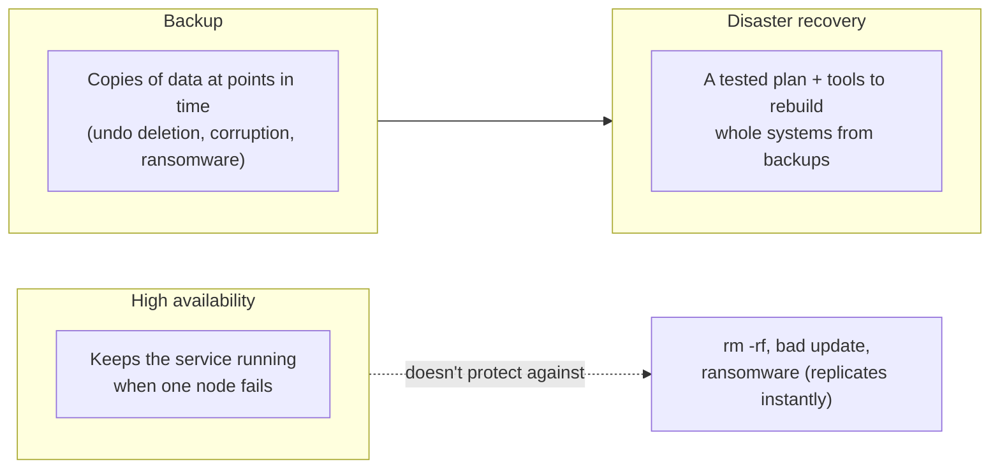
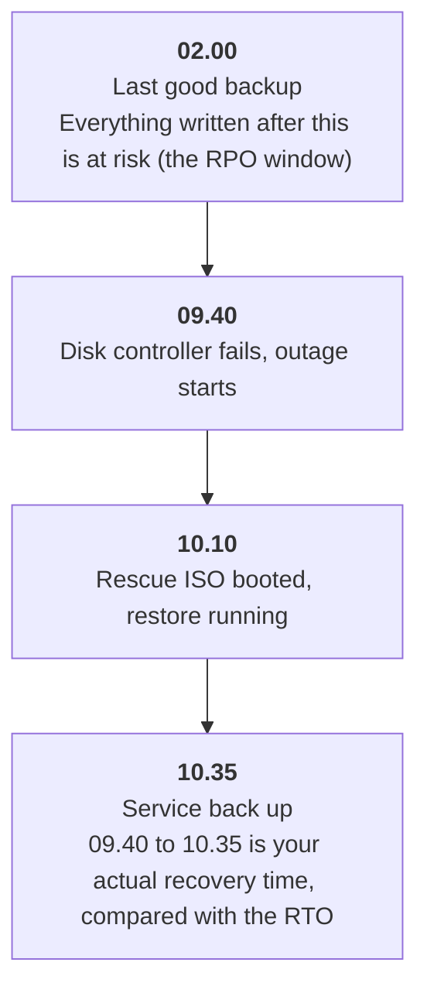
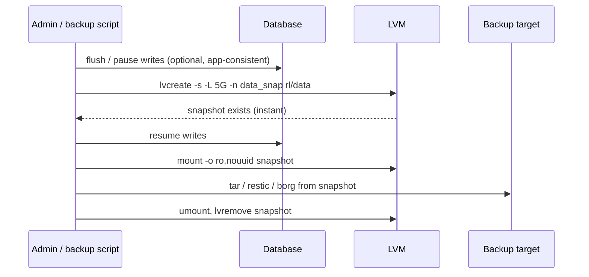
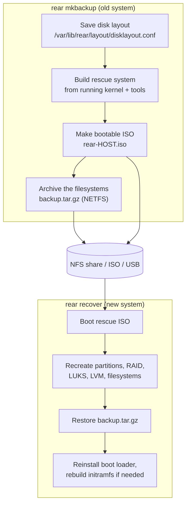
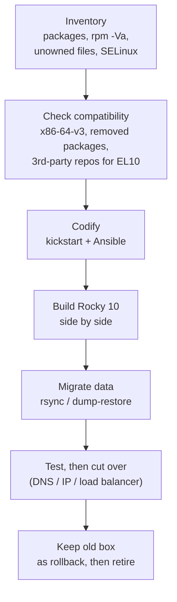
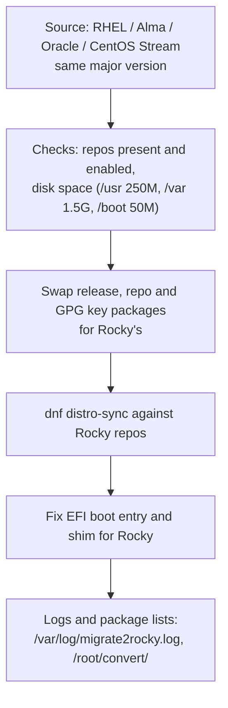

# 31 · Disaster Recovery and Migration

<ul class="module-meta">
  <li>⏱ ~3 hours</li>
  <li>4 labs</li>
  <li>Builds on: 04 · Permissions and ACLs, 05 · Software: RPM and DNF, 09 · Disks and Filesystems, 10 · LVM, RAID and Encryption, 16 · SELinux</li>
</ul>

The RAID controller in your oldest Rocky server dies and takes both mirrors with it. You have backups, so you're fine. Then you discover that "backups" means a nightly copy of `/home` and `/var/lib/pgsql`. Nobody knows how the disks were partitioned, which packages were installed, what was changed in `/etc` over four years, or why the web server runs on port 8443 with a custom SELinux label. This module is about the difference between *having backups* and *being able to recover*, and about the related problem every Rocky admin eventually faces: moving a system to a new major version, or onto Rocky from somewhere else.

!!! abstract "What you'll learn"
    - The difference between backups, disaster recovery and high availability, and how to state goals with **RPO** and **RTO**
    - Exactly what to capture from a Rocky system, including the metadata (SELinux labels, ACLs, xattrs) that plain copies lose
    - How **Relax-and-Recover** (ReaR) builds a bootable rescue image of your own system and restores it to bare metal
    - How to take consistent backups from LVM snapshots, and where restic and borg fit
    - Why Rocky has no supported in-place major upgrade, and how to plan a 9 to 10 rebuild instead
    - How to convert a RHEL, AlmaLinux, Oracle Linux or CentOS Stream system to Rocky with `migrate2rocky`

## The big picture

Three different things get called "backup" in conversation. They answer different questions:



- **High availability** (HA, [module 28](28-high-availability.md)) survives a *component* failure by failing over. It replicates mistakes too: delete a table and the standby deletes it a millisecond later.
- A **backup** is a point-in-time copy you can go back to. It survives mistakes, but on its own it doesn't tell you how to rebuild the machine around the data.
- **Disaster recovery** (DR) is the plan, the tooling and the practice that turn backups back into working systems: bare-metal restore, documented layout, known-good configuration, a run book, and drills.

Two numbers make DR goals concrete:

- **RPO** (Recovery Point Objective): how much data you can afford to lose, measured in time. Nightly backups mean an RPO of up to 24 hours.
- **RTO** (Recovery Time Objective): how long you can afford to be down. "Reinstall by hand from notes" might be two days; "boot a rescue ISO and restore" might be 30 minutes.

**RPO and RTO around one incident**



Every choice in this module moves one of those two numbers. More frequent backups shrink the RPO. Image-based bare-metal recovery and automation shrink the RTO.

## What to back up on a Rocky system

A server isn't just its data. To *rebuild* one you need several layers, and each has its own way of being captured. Click through them from the data down to the disks:

<div class="layers" data-open="0" data-hint="Click a layer to see what it contains and how to capture it." markdown>

<div class="layer" data-label="Application data" data-tag="/var/lib, /srv, /home" markdown>

**What:** databases, uploaded files, mail spools, home directories.

**How:** with an application-consistent method. A database needs its own dump tool (`pg_dump`, `mysqldump`) or a filesystem snapshot taken while it's quiesced. Copying live database files with `tar` gives you a corrupt backup that looks fine.

</div>

<div class="layer" data-label="Configuration" data-tag="/etc, /usr/local, crontabs" markdown>

**What:** everything you changed after installation. On a Rocky box that's mostly `/etc`, plus `/usr/local`, `/var/spool/cron`, `/root`, and systemd overrides.

**How:** a plain archive works, but the valuable thing is knowing *which* files changed: `rpm -Va` finds modified package files, and a search for files no package owns finds the ones you added. See "What changed in /etc?" below.

</div>

<div class="layer" data-label="Package set" data-tag="rpm -qa, dnf repoquery" markdown>

**What:** which packages are installed, which you asked for explicitly, which repositories they came from, and which module streams or versionlocks you set.

**How:**

```console
$ rpm -qa --qf '%{NAME}\n' | sort > packages-all.txt
$ dnf repoquery --userinstalled --qf '%{name}' | sort > packages-user.txt
$ dnf repolist --enabled > repos.txt
$ cp -a /etc/yum.repos.d /etc/pki/rpm-gpg backup/
```

</div>

<div class="layer" data-label="Security metadata" data-tag="SELinux, ACLs, xattrs" markdown>

**What:** SELinux file labels, POSIX ACLs ([module 04](04-permissions-and-acls.md)), extended attributes, file capabilities, and your local SELinux policy changes (custom port labels, booleans, file-context rules from [module 16](16-selinux.md)).

**How:** `tar --xattrs --acls --selinux` keeps labels and ACLs with the files. `semanage export` captures your policy customizations as a replayable list. Lose these and the restored service may fail with permission denials even though every file is "there".

</div>

<div class="layer" data-label="Storage layout" data-tag="partitions, LVM, LUKS, RAID" markdown>

**What:** the partition table, LVM VGs and LVs and their sizes, RAID arrays, LUKS containers, filesystem types and mount options.

**How:** record it: `lsblk -f`, `pvs; vgs; lvs`, `vgcfgbackup` (LVM writes its metadata to `/etc/lvm/backup/` automatically), `/etc/fstab`, `/etc/crypttab`, `cryptsetup luksHeaderBackup`. ReaR captures all of this automatically in `disklayout.conf`.

</div>

<div class="layer" data-label="Boot setup" data-tag="ESP, GRUB, kernel args" markdown>

**What:** UEFI or BIOS boot, the EFI System Partition, kernel command-line arguments (`grubby --info=ALL`), initramfs customizations in `/etc/dracut.conf.d/`.

**How:** these are rebuilt rather than copied. ReaR reinstalls the boot loader during recovery; a kickstart reinstall recreates it from scratch.

</div>

</div>

### Keeping SELinux labels and ACLs

This is the most common silent failure in Linux backups. A plain `tar` or `cp` drops SELinux labels and ACLs. When you restore, files get whatever label their new directory implies, which may be wrong for files that were deliberately relabelled.

```console
$ sudo tar --xattrs --acls --selinux -czpf /backup/etc.tar.gz -C / etc
$ tar --xattrs --acls --selinux -tvzf /backup/etc.tar.gz etc/shadow
----------  root/root      1032 2026-10-12 08:14 etc/shadow
```

The flags must be used on **both** sides. Extracting without them silently drops the metadata again:

```console
$ sudo tar --xattrs --acls --selinux -xzpf /backup/etc.tar.gz -C /restore
```

`-p` (`--preserve-permissions`) keeps exact modes, which root gets by default but is worth stating. To restore SELinux labels from policy instead of from the archive, run `restorecon -Rv` on the restored tree, or `touch /.autorelabel` for a whole-system relabel at next boot. Local policy changes travel separately:

```console
$ sudo semanage export -f /backup/selinux-local.txt
$ cat /backup/selinux-local.txt
boolean -D
login -D
…
port -a -t http_port_t -r 's0' -p tcp 8443
fcontext -a -f a -t httpd_sys_content_t -r 's0' '/srv/www(/.*)?'
boolean -m -1 httpd_can_network_connect_db
```

On the new system, `sudo semanage import -f selinux-local.txt` replays them. ACLs can be dumped and restored on their own too: `getfacl -R /srv > acls.txt` and `setfacl --restore=acls.txt`.

<div class="quiz" data-answer="2" markdown>

You restore `/srv/www` from a `tar` archive made without `--selinux`. The files are all there with the right owners, but Apache returns 403 and the audit log shows AVC denials. Why?

- tar can't restore file ownership
- The restored files got the default label for their location, not the custom label they had, and your custom `fcontext` rule wasn't restored either
- Apache needs to be reinstalled after a restore
- The ACLs were restored twice

Without `--selinux`, labels aren't in the archive. And if the custom `fcontext` rule (from `semanage export`) wasn't restored, `restorecon` can't fix it either, because the policy no longer knows `/srv/www` is web content.

</div>

## Consistent backups with LVM snapshots

Backing up a filesystem while it changes gives you an archive where some files are from 02:00:00 and others from 02:14:37. For most files that's fine. For anything that must be consistent across files (a database, a mail store, a git repository) it isn't.

An LVM **snapshot** ([module 10](10-lvm-raid-and-encryption.md)) gives you a frozen view of a volume in an instant. You back up the snapshot at your leisure, then delete it. LVM briefly freezes the filesystem while it creates the snapshot, so the snapshot is at least filesystem-consistent.



```console
$ sudo lvcreate -s -L 5G -n data_snap rl/data
  Logical volume "data_snap" created.
$ sudo mkdir -p /mnt/snap
$ sudo mount -o ro,nouuid /dev/rl/data_snap /mnt/snap
$ sudo tar --xattrs --acls --selinux -czpf /backup/data-$(date +%F).tar.gz -C /mnt/snap .
$ sudo umount /mnt/snap && sudo lvremove -y rl/data_snap
  Logical volume "data_snap" successfully removed.
```

??? question "Under the hood: what a classic snapshot costs while it exists"
    A classic (thick) LVM snapshot is **copy-on-write**: the first time any chunk of the origin is written after the snapshot, LVM first copies the old chunk into the snapshot's space. So while a snapshot exists:

    - Every first write to a chunk costs an extra read and write. On a busy database volume that can be a noticeable latency hit, so keep the snapshot's life short.
    - `sudo lvs` shows the snapshot's `Data%` filling up. At 100% the snapshot is marked **invalid**, and the half-written backup is useless. `snapshot_autoextend_threshold` in `/etc/lvm/lvm.conf` can grow it automatically if the VG has free space.
    - When it's created, LVM suspends the device, which **freezes** the filesystem (the same thing `fsfreeze` does) so the snapshot is clean. That's why the snapshot mounts without log recovery.

    **Thin** snapshots (from a thin pool, [module 10](10-lvm-raid-and-encryption.md)) work differently: no `-L`, no per-snapshot size limit, and far less write penalty, but they share the pool's free space with everything else, so a full pool hurts every thin volume at once.

!!! pitfall "XFS and nouuid"
    A snapshot of an XFS filesystem has the same filesystem UUID as the original. XFS refuses to mount two filesystems with the same UUID at once, so you must add `-o nouuid` (and `ro`, so the backup can't change it). Size the snapshot (`-L`) for the writes that will happen during the backup: if it fills, it becomes invalid and the backup fails.

### Backup tools: restic and borg

`tar` is universal but naive: every run copies everything. Two modern tools add **deduplication** (each unique chunk of data stored once, across all backups), encryption and easy pruning:

| Tool | Highlights | Where it comes from |
|---|---|---|
| **restic** | Single binary; backs up to local disk, SFTP, S3-compatible object storage and more; encrypted by default | EPEL (`restic`, 0.18 on EPEL 10) |
| **borg** (BorgBackup) | Very efficient deduplication and compression; local or SSH targets; encrypted repositories | EPEL (`borgbackup`, 1.4 on EPEL 10) |

Install them with `sudo dnf install epel-release` followed by `sudo dnf install restic` or `sudo dnf install borgbackup`. Both keep extended attributes and ACLs on Linux, but test a restore of a labelled file before you rely on it, and still capture `semanage export` separately.

!!! tip "The 3-2-1 rule"
    Keep **3** copies of important data, on **2** different kinds of storage, with **1** copy off-site (and ideally one offline or immutable, so ransomware with your admin credentials can't delete it). A backup on the same SAN as the server isn't a disaster-recovery backup.

## Relax-and-Recover: bare-metal recovery

File backups restore *files*. They don't recreate an empty disk's partition table, LVM layout, RAID arrays, LUKS containers and boot loader. That's what **Relax-and-Recover** (ReaR, package `rear` in AppStream; version 2.9 on Rocky 10, 2.6 on Rocky 9) is for. It's the bare-metal recovery tool Red Hat documents for RHEL, and it works the same on Rocky.

The idea: ReaR builds a **rescue system** out of *your own running system*: your kernel, your drivers, your tools, plus a description of your disk layout. Boot that rescue image on a blank machine and one command recreates the disks, restores the backup, and reinstalls the boot loader.



### Configuring ReaR

All configuration goes in `/etc/rear/local.conf`. The defaults (thousands of documented lines) live in `/usr/share/rear/conf/default.conf`; read it when you need an option. A typical setup that writes the rescue ISO and a tar backup to an NFS server:

```bash title="/etc/rear/local.conf"
OUTPUT=ISO                                   # (1)!
BACKUP=NETFS                                 # (2)!
BACKUP_URL=nfs://backup.lab/srv/rear         # (3)!
BACKUP_PROG_EXCLUDE=( "${BACKUP_PROG_EXCLUDE[@]}" '/var/cache/dnf/*' '/var/tmp/*' )  # (4)!
NETFS_KEEP_OLD_BACKUP_COPY=yes               # (5)!
```

1. Produce a bootable ISO image of the rescue system. Other options include `USB` and `PXE`.
2. Use ReaR's built-in backup method: `tar` to a network or local location. ReaR can also drive external backup software (Bacula, Bareos, NetBackup, TSM, borg and others) instead.
3. Where the backup goes. The ISO goes there too, because `OUTPUT_URL` defaults to `BACKUP_URL`. Each host gets its own subdirectory.
4. Skip caches that don't need restoring. Keep the existing default excludes by including the old array.
5. Keep the previous backup instead of overwriting it, in case the new run fails half way.

ReaR is a set of bash scripts, and `local.conf` is sourced by bash, so normal bash syntax applies (that's also why the annotations above are valid comments).

!!! note "Rescue ISO and backup on one image"
    For a single self-contained file (handy for a lab, or for shipping to a remote site), set `BACKUP_URL=iso:///backup`. The tar archive is then put *inside* the ISO in `/var/lib/rear/output/`. Copy that ISO off the machine, or it dies with the disk it's meant to replace.

### Creating the backup

```console
$ sudo dnf install rear nfs-utils
$ sudo rear -v mkbackup
Relax-and-Recover 2.9 / …
Running rear mkbackup (PID 41123 date 2026-10-15 10:12:01)
Using log file: /var/log/rear/rear-rocky-lab.log
Running workflow mkbackup on the normal/original system
Using backup archive '/var/tmp/rear.Xq3…/outputfs/rocky-lab/backup.tar.gz'
Using autodetected kernel '/boot/vmlinuz-6.12.0-124.8.1.el10_1.x86_64' as kernel in the recovery system
Creating disk layout
Using guessed bootloader 'EFI' for 'rear recover' (found in first bytes on /dev/vda)
Verifying that the entries in /var/lib/rear/layout/disklayout.conf are correct ...
Creating recovery system root filesystem skeleton layout
…
Making ISO image
Wrote ISO image: /var/lib/rear/output/rear-rocky-lab.iso (512M)
Copying resulting files to nfs location
…
Making backup (using backup method NETFS)
Creating tar archive '/var/tmp/rear.Xq3…/outputfs/rocky-lab/backup.tar.gz'
Archived 1874 MiB [avg 15893 KiB/sec] OK
…
Exiting rear mkbackup (PID 41123) and its descendant processes ...
```

The other workflows you'll use:

| Command | What it does |
|---|---|
| `rear -v mkbackup` | Rescue image + full backup |
| `rear -v mkrescue` | Rescue image only (when another tool does the file backup) |
| `rear -v mkbackuponly` | Backup only, reuse the existing rescue image |
| `rear checklayout` | Exit status 1 if the disk layout changed since the last rescue image, so you know to rebuild it |
| `rear dump` | Print the effective configuration |
| `rear recover` | Run inside the rescue system: recreate and restore |

The layout file is worth reading once. It's a plain-text description of every disk, partition, VG, LV, filesystem and mount option ReaR will recreate:

```console
$ sudo grep -E '^(disk|part|lvmvol|fs) ' /var/lib/rear/layout/disklayout.conf
disk /dev/vda 21474836480 gpt
part /dev/vda 629145600 1048576 rear-noname boot,esp /dev/vda1
part /dev/vda 1073741824 630194176 rear-noname none /dev/vda2
part /dev/vda 19769704448 1703936000 rear-noname lvm /dev/vda3
lvmvol /dev/rl root 17620271104b linear
lvmvol /dev/rl swap 2147483648b linear
fs /dev/mapper/rl-root / xfs uuid=… label= options=rw,relatime,seclabel,attr2,inode64,logbufs=8,logbsize=32k,noquota
fs /dev/vda2 /boot xfs uuid=… label= options=rw,relatime,seclabel,…
fs /dev/vda1 /boot/efi vfat uuid=… label= options=rw,relatime,…
```

!!! tip "Schedule it, and rebuild the rescue image when the layout changes"
    Run `rear mkbackup` from a systemd timer ([module 07](07-systemd-and-services.md)) or cron. Add `rear checklayout || rear mkrescue` to a daily job so a new disk or a resized LV doesn't leave you with a rescue image that recreates the *old* layout.

### Recovering a system

Step through a bare-metal restore onto a replacement machine:

<div class="stepper" markdown>

<div class="step" data-title="Boot the rescue ISO" markdown>

Attach `rear-rocky-lab.iso` (virtual media through iDRAC/iLO/IPMI, a USB stick, or a VM's CD drive) and boot from it. Boot in the same mode as the original: UEFI if it was UEFI. With Secure Boot on, the ISO must boot through the system's own signed shim. ReaR 2.9 detects Secure Boot when it builds the image and uses the installed shim automatically (the `rear -v mkrescue` output mentions Secure Boot auto-configuration). Older ReaR versions need it set by hand: `SECURE_BOOT_BOOTLOADER=(/boot/efi/EFI/*/shimx64.efi)` in `local.conf`.

The boot menu offers "Recover rocky-lab". Choose it.

</div>

<div class="step" data-title="Log in to the rescue system" markdown>

You get a login prompt. Log in as `root` (no password by default on the console). The rescue system has your network configuration, so the NFS share is reachable.

```console
Welcome to Relax-and-Recover. Run "rear recover" to restore your system !

RESCUE rocky-lab:~ #
```

</div>

<div class="step" data-title="Run rear recover" markdown>

```console
RESCUE rocky-lab:~ # rear recover
Relax-and-Recover 2.9 / …
Running rear recover (PID 712 date 2026-10-15 11:02:44)
Using log file: /var/log/rear/rear-rocky-lab.log
Running workflow recover within the ReaR rescue/recovery system
Using backup archive '/var/tmp/rear.…/outputfs/rocky-lab/backup.tar.gz'
Will do driver migration (recreating initramfs/initrd)
Calculating backup archive size
Backup archive size is 1.2G	/var/tmp/rear.…/outputfs/rocky-lab/backup.tar.gz (compressed)
Comparing disks
Device vda has expected (same) size 21474836480 bytes (will be used for 'recover')
Disk configuration looks identical
Proceed with 'recover' (yes) otherwise manual disk layout configuration is enforced
(default 'yes' timeout 30 seconds)
yes
…
```

</div>

<div class="step" data-title="Disks are recreated" markdown>

ReaR replays `disklayout.conf`: wipes the target disk, writes the GPT, creates partitions, RAID, LUKS (asking you for new passphrases), PVs, VGs, LVs and filesystems, keeping the original UUIDs so `/etc/fstab` still matches.

If the replacement disks *don't* match (different sizes, more than one candidate disk of the same size), ReaR enters **migration mode** and asks you which disk maps to which, and whether to edit the layout before it writes anything.

</div>

<div class="step" data-title="Backup is restored" markdown>

ReaR mounts the new filesystems under `/mnt/local` and extracts `backup.tar.gz` into them. Progress is shown as it goes.

By default ReaR creates `/mnt/local/.autorelabel`, so SELinux relabels every file at first boot. That costs a few minutes of boot time and makes every label match the policy.

??? question "Under the hood: the labels a relabel destroys"
    A relabel sets every file to what the policy's file-context rules say it should be. Rules you added with `semanage fcontext` live in the policy store under `/etc/selinux/`, which is in the backup, so they survive. Labels applied with **`chcon`** were never in any rule, so the relabel silently replaces them with the default for that path.

    Find them *before* you need a restore: `sudo restorecon -Rnv /srv /var/www /opt` (`-n` changes nothing) lists every file whose current label differs from policy. Each line is either a bug or a missing `semanage fcontext` rule. This is also why a ReaR restore can make an application that "worked for years" fail with AVC denials on its first boot.

</div>

<div class="step" data-title="Boot loader and initramfs" markdown>

ReaR reinstalls GRUB (and the UEFI boot entry for shim), migrates network settings if the MAC addresses changed, and rebuilds the initramfs if the new hardware needs different storage drivers.

```console
Finished 'recover'. The target system is mounted at '/mnt/local'.
Exiting rear recover (PID 712) and its descendant processes ...
```

You can inspect or fix things under `/mnt/local` before rebooting.

</div>

<div class="step" data-title="Reboot and verify" markdown>

Remove the ISO and reboot. The first boot relabels SELinux and reboots once more. Then check the things that matter: services running, `getenforce`, `findmnt --verify`, application health, and your monitoring.

</div>

</div>

### Restoring to different hardware

ReaR is designed for "same or similar" hardware. It copes well with a replacement server of the same model, a VM restored to another hypervisor host, or bigger disks. Expect manual work when:

- **Disk sizes or counts differ.** Migration mode asks you to map disks and can shrink or grow partitions proportionally, but check the result.
- **Storage controllers differ** (for example, a hardware RAID volume replaced by NVMe). ReaR rebuilds the initramfs with the drivers it finds, but drivers the original system never had must already be present in the rescue system's kernel modules.
- **Boot mode differs** (BIOS to UEFI or back). Don't do this during an emergency; restore in the original mode.
- **Network interfaces change names or MAC addresses.** ReaR maps old to new MACs and rewrites NetworkManager configuration, but verify the result.

Red Hat's own support position is that restoring to *different* hardware isn't supported, which is a good hint: test exactly the recovery you might need, on the hardware (or VM type) you'd actually have.

<div class="quiz" data-answer="3" markdown>

You built ReaR's rescue ISO six months ago and have run only `rear mkbackuponly` since. Last month you added a disk and extended the root LV across it. What will `rear recover` do?

- Restore the new layout, because the backup is recent
- Refuse to run
- Recreate the *old* layout recorded in the old rescue image, which may be too small for the restored data
- Ask the NFS server for the current layout

The layout lives in the rescue image. `mkbackuponly` doesn't update it. That's what `rear checklayout || rear mkrescue` in a daily job prevents.

</div>

### Testing restores

A backup you haven't restored is a hope, not a backup. Make a restore drill part of the calendar:

1. **Restore to an isolated VM** (no route to production, so a restored server can't start sending email or joining clusters).
2. **Time it.** That's your real RTO, to compare with the target.
3. **Verify behaviour, not just files:** the service starts, SELinux is enforcing without new denials (`ausearch -m avc -ts boot`), data checksums or row counts match.
4. **Write down every manual step** you had to take. Each one is either a gap in the run book or something to automate.

## What changed in /etc?

Before you can rebuild a server any other way than restoring its image, you need to know what's different about it. RPM can tell you, because it recorded the checksum, size, mode and owner of every file it installed.

`rpm -Va` verifies every installed file against the RPM database and prints only the ones that differ:

```console
$ sudo rpm -Va --nomtime 2>/dev/null | grep ' c /etc'
S.5......  c /etc/ssh/sshd_config
S.5......  c /etc/chrony.conf
.M.......  c /etc/sudoers
S.5......  c /etc/dnf/dnf.conf
missing    c /etc/sysconfig/kdump
```

Each column is one test that failed:

| Flag | Meaning |
|---|---|
| `S` | Size differs |
| `M` | Mode (permissions or file type) differs |
| `5` | Content digest differs |
| `D` | Device major/minor differs |
| `L` | Symlink target differs |
| `U` / `G` | Owner / group differs |
| `T` | Modification time differs (hidden here by `--nomtime`) |
| `P` | Capabilities differ |
| `c` | The file is marked as a config file (expected to be edited) |

Modified files are half the story. The other half is files you **added** that no package owns:

```console
$ sudo find /etc -type f -print0 | xargs -0 rpm -qf 2>/dev/null | grep 'not owned'
file /etc/systemd/system/backup.timer is not owned by any package
file /etc/systemd/system/backup.service is not owned by any package
file /etc/NetworkManager/system-connections/bond0.nmconnection is not owned by any package
file /etc/pki/tls/private/web01.key is not owned by any package
…
```

Some of these are generated state you don't need to carry over (SSH host keys, `machine-id`, caches); the rest are your changes. To see *what* changed in a modified config file, compare it with the pristine copy from the package:

```console
$ rpm -qf /etc/chrony.conf
chrony-4.6.1-1.el10.x86_64
$ dnf download --destdir /tmp/pristine chrony
$ rpm2cpio /tmp/pristine/chrony-*.rpm | cpio -i --to-stdout ./etc/chrony.conf 2>/dev/null \
    | diff - /etc/chrony.conf
3c3
< pool 2.rocky.pool.ntp.org iburst
---
> server ntp1.lab iburst
```

??? question "Under the hood: the config changes `rpm -Va` can't see"
    `rpm -Va` compares files with what *the currently installed package* shipped. Two kinds of drift slip past it:

    - **`.rpmnew` files.** When a package update ships a new default for a `%config(noreplace)` file you'd edited, RPM keeps your file and writes the new default beside it as `file.rpmnew`. Your file still matches nothing, so it shows in `rpm -Va`, but the *upstream change you never merged* is easy to miss. On a box that has been updated for years, `sudo find /etc -name '*.rpmnew' -o -name '*.rpmsave'` often turns up a dozen of them, and each is a question for the rebuild: did you mean to keep the old behaviour?
    - **`%ghost` and generated files.** Files a package declares but doesn't ship content for (logs, some state files under `/etc`) are never content-checked.

    `rpm -Va` also trusts the RPM database it reads from. For forensics after a compromise, verify against packages from a known-good source, not the suspect machine's own database.

Those three lists (modified config files, unowned files, the diffs) are the specification for rebuilding the machine with kickstart or Ansible.

### Practice: inventory a server

<div class="terminal-sim" data-title="Inventory before a rebuild" data-prompt="[alex@web01 ~]$ " markdown>

<div class="task" data-expect="dnf repoquery --userinstalled||sudo dnf repoquery --userinstalled" data-match="(sudo )?dnf repoquery --userinstalled.*" data-hint="dnf repoquery has an option that lists packages a user installed on purpose." markdown>

**Step 1.** List the packages someone installed on purpose (not pulled in as dependencies).

```text
bash-completion-1:2.11-16.el10.noarch
chrony-4.6.1-1.el10.x86_64
httpd-2.4.63-1.el10.x86_64
mod_ssl-1:2.4.63-1.el10.x86_64
rear-2.9-…el10.x86_64
…
```

</div>

<div class="task" data-expect="sudo rpm -Va||rpm -Va" data-match="(sudo )?rpm -Va.*" data-hint="rpm has a verify option for all packages: -V plus -a." markdown>

**Step 2.** Verify every installed file against the RPM database.

```text
S.5......  c /etc/httpd/conf/httpd.conf
S.5......  c /etc/ssh/sshd_config
.M.......  c /etc/sudoers
```

</div>

<div class="task" data-expect="sudo semanage export||semanage export" data-match="(sudo )?semanage export.*" data-hint="semanage can export all local customizations." markdown>

**Step 3.** Export the local SELinux customizations.

```text
boolean -D
…
port -a -t http_port_t -r 's0' -p tcp 8443
fcontext -a -f a -t httpd_sys_content_t -r 's0' '/srv/www(/.*)?'
boolean -m -1 httpd_can_network_connect_db
```

</div>

<div class="task" data-expect="/lib64/ld-linux-x86-64.so.2 --help | grep supported" data-match="(/usr)?/lib64/ld-linux-x86-64\.so\.2 --help \| grep (-i )?['&quot;]?supported['&quot;]?" data-hint="The dynamic loader /lib64/ld-linux-x86-64.so.2 has a --help option; pipe it to grep supported." markdown>

**Step 4.** Check whether this CPU can run Rocky 10 (needs x86-64-v3).

```text
  x86-64-v3 (supported, searched)
  x86-64-v2 (supported, searched)
```

</div>

</div>

## Major version moves: Rocky 9 to Rocky 10

Rocky Linux does **not** support in-place upgrades between major versions. The project's guidance is to install the new version fresh and migrate your workload onto it. There are good reasons: a major release changes thousands of packages, removes some entirely, and changes defaults, so an in-place upgrade is a complicated transformation that often leaves a system that is neither cleanly 9 nor cleanly 10.

!!! warning "About ELevate"
    The **ELevate** project, run by AlmaLinux, built on Red Hat's **Leapp** upgrade framework to offer in-place upgrades between EL major versions, and for a while it included Rocky Linux targets. According to the ELevate project, upgrades to and between Rocky Linux releases are **no longer supported as of its 2025-11-03 update**, when it moved to a new data format; AlmaLinux and CentOS Stream remain supported paths. Treat any guide that uses ELevate to upgrade Rocky as out of date. (Red Hat's `leapp` itself is for RHEL only.)

### The hardware gate: x86-64-v3

Rocky Linux 10 on x86_64 is built for the **x86-64-v3** microarchitecture level: CPUs with AVX2 and related instructions (roughly Intel Haswell from 2013 and AMD Excavator/Zen onwards). Older CPUs that ran Rocky 9 (which needs x86-64-v2) can't run Rocky 10 at all. Check before you plan:

```console
$ /lib64/ld-linux-x86-64.so.2 --help | grep supported
  x86-64-v3 (supported, searched)
  x86-64-v2 (supported, searched)
```

If `x86-64-v3` isn't listed as supported, that machine's path to Rocky 10 is new hardware (or staying on Rocky 9, which is supported until 2032). In VMs, check that the hypervisor exposes the host's CPU features: a VM with a generic CPU model may report only v2 on a v3-capable host. With libvirt, use `host-passthrough` or a modern named model ([module 27](27-virtualization-kvm.md)).

### Planning the rebuild



1. **Inventory** the old server with the techniques above: `dnf repoquery --userinstalled`, `rpm -Va`, unowned files in `/etc`, `semanage export`, `crontab -l` for each user, `systemctl list-unit-files --state=enabled`, `firewall-cmd --list-all-zones`, listening ports (`ss -tlnp`).
2. **Check compatibility.** Each user-installed package must exist on Rocky 10, from Rocky's repos, EPEL 10, or a vendor repo that supports EL10. Read the RHEL 10 release notes' list of removed and deprecated features for anything you depend on.
3. **Codify** the configuration instead of copying it: a kickstart file for the base install ([module 23](23-automated-installs.md)) and an Ansible playbook for packages, config files, SELinux settings and services ([module 32](32-ansible-and-system-roles.md)). The inventory is the to-do list. A playbook you can run again turns the *next* migration (and every DR rebuild) into a routine job.
4. **Build side by side.** Install Rocky 10 on new hardware or a new VM, apply the playbook, and test with production-like data.
5. **Migrate data** with the application's own tools where possible (database dump and restore across major versions is usually required anyway), `rsync -aAXH` for files (`-A` ACLs, `-X` xattrs including SELinux labels, `-H` hard links).
6. **Cut over** by moving a DNS name, an IP address or a load balancer pool member. Keep the old server intact until you're confident: it's your rollback.

<div class="quiz" data-answer="4" markdown>

Why is "rebuild with kickstart + Ansible, then migrate data" usually better than an in-place major upgrade, even if a tool for one existed?

- It's the only way to keep SELinux enabled
- In-place upgrades can't preserve `/home`
- Rocky 10 can't read XFS filesystems created by Rocky 9
- It leaves a clean, documented, repeatable system and keeps the old one as an instant rollback

The rebuild produces a system defined by code, which is also your DR plan, and the old server stays untouched until cut-over. (Rocky 10 reads Rocky 9's XFS just fine.)

</div>

## Moving onto Rocky: migrate2rocky

Converting a system from *another* Enterprise Linux distribution to Rocky, **within the same major version**, is supported by the Rocky project's **migrate2rocky** scripts (in the `rocky-tools` repository):

- `migrate2rocky.sh` converts EL8 systems (RHEL 8, AlmaLinux 8, Oracle Linux 8, CentOS Linux 8 or Stream 8) to Rocky 8.
- `migrate2rocky9.sh` converts EL9 systems (RHEL 9, AlmaLinux 9, Oracle Linux 9, CentOS Stream 9) to Rocky 9.
- There is no migrate2rocky script for EL10, and the scripts explicitly **don't do upgrades**: an EL8 machine becomes Rocky 8, not Rocky 9.



```console
$ curl -O https://raw.githubusercontent.com/rocky-linux/rocky-tools/main/migrate2rocky/migrate2rocky9.sh
$ less migrate2rocky9.sh            # read what you're about to run as root
$ chmod +x migrate2rocky9.sh
$ tmux                              # never run it in a session that might drop
$ sudo ./migrate2rocky9.sh -r
…
$ cat /etc/rocky-release
Rocky Linux release 9.6 (Blue Onyx)
```

The options are `-r` (convert to Rocky) and `-V` (verify all RPMs afterwards). Practical rules from the script's own documentation:

- **Run it in `tmux` or `screen`**, not in Cockpit's web terminal (Cockpit restarts during the conversion and kills the script).
- **The original repositories must be present and enabled**, and nothing else should interfere: disable third-party repos, Satellite/Katello configuration and custom mirrors first.
- **Fully update the source system first**, and snapshot or back it up (ReaR is ideal).
- CentOS Stream runs slightly *ahead* of RHEL-based releases, so converting Stream to Rocky can mean some packages move backwards; test on a clone.
- Afterwards, reboot into the Rocky kernel, check `rpm -qa | grep -iE 'alma|centos|oracle|redhat'` for leftovers, and re-enable EPEL or vendor repos.

!!! note "And CentOS 7?"
    CentOS Linux 7 reached end of life in June 2024. There's no direct conversion from 7 to any Rocky release with migrate2rocky (it doesn't cross major versions), and the ELevate route to Rocky is no longer supported. The practical path is the same as for 9 to 10: inventory, codify, rebuild on Rocky 9 or 10, migrate data.

## Choosing a recovery or migration path

<div class="decision" markdown>

<div class="node" data-id="start" markdown>

**What are you trying to do?**

<button data-goto="recover">Recover a broken or destroyed system</button> <button data-goto="move">Move a working system somewhere new</button>

</div>

<div class="node" data-id="recover" markdown>

**Do you have a ReaR rescue image and backup that match the current disk layout?**

<button data-goto="rear">Yes</button> <button data-goto="norear">No</button>

</div>

<div class="node" data-id="rear" markdown>

**Boot the rescue ISO and run `rear recover`.** Same or similar hardware works best. Afterwards, check SELinux relabel finished, services and data.

</div>

<div class="node" data-id="norear" markdown>

**Reinstall (kickstart if you have one), then restore configuration and data** from file backups: replay packages, `semanage import`, restore `/etc` selectively, restore data. Then set up ReaR so next time is faster.

</div>

<div class="node" data-id="move" markdown>

**Is it changing major version (for example 9 to 10)?**

<button data-goto="major">Yes</button> <button data-goto="same">No, same major version</button>

</div>

<div class="node" data-id="major" markdown>

**Rebuild.** Check x86-64-v3, inventory, codify with kickstart and Ansible, build Rocky 10 side by side, migrate data, cut over, keep the old box as rollback. No supported in-place path exists.

</div>

<div class="node" data-id="same" markdown>

**Is it currently Rocky?**

<button data-goto="rocky">Yes, Rocky to new hardware</button> <button data-goto="other">No, RHEL / Alma / Oracle / Stream</button>

</div>

<div class="node" data-id="rocky" markdown>

**Use ReaR as a migration tool:** `rear mkbackup` on the old machine, `rear recover` on the new one (migration mode handles different disks). Or rebuild from your playbook and migrate data.

</div>

<div class="node" data-id="other" markdown>

**Use `migrate2rocky` (EL8) or `migrate2rocky9.sh` (EL9)** after a full update and a backup, in `tmux`, with only the original repos enabled.

</div>

</div>

## Labs

!!! lab "Lab 1: Back up and restore with security metadata"

    **Goal:** See SELinux labels and ACLs survive a `tar` round trip only when you ask for them.

    **You'll need:** a Rocky 10 VM, sudo.

    1. Create a directory with a custom label and an ACL:

        ```console
        $ sudo mkdir -p /srv/demo && echo hi | sudo tee /srv/demo/index.html
        $ sudo semanage fcontext -a -t httpd_sys_content_t '/srv/demo(/.*)?'
        $ sudo restorecon -Rv /srv/demo
        $ sudo setfacl -m u:nobody:r /srv/demo/index.html
        $ ls -Z /srv/demo/index.html; getfacl -p /srv/demo/index.html
        ```

    2. Archive it twice, with and without the metadata flags:

        ```console
        $ sudo tar -czpf /root/plain.tgz -C / srv/demo
        $ sudo tar --xattrs --acls --selinux -czpf /root/full.tgz -C / srv/demo
        ```

    3. Restore each into a scratch directory and compare:

        ```console
        $ sudo mkdir -p /restore/plain /restore/full
        $ sudo tar -xzpf /root/plain.tgz -C /restore/plain
        $ sudo tar --xattrs --acls --selinux -xzpf /root/full.tgz -C /restore/full
        $ ls -Z /restore/plain/srv/demo/index.html /restore/full/srv/demo/index.html
        $ getfacl -p /restore/plain/srv/demo/index.html /restore/full/srv/demo/index.html | grep nobody
        ```

    4. Export your SELinux customizations and look for the rule you added:

        ```console
        $ sudo semanage export | grep /srv/demo
        ```

    **Check your work:** only the `full` copy has `httpd_sys_content_t` and the `user:nobody:r--` ACL entry. The `plain` copy has a generic label and no ACL.

    **Clean up:**

    ```console
    $ sudo semanage fcontext -d '/srv/demo(/.*)?'
    $ sudo rm -rf /srv/demo /restore /root/plain.tgz /root/full.tgz
    ```

!!! lab "Lab 2: Full bare-metal backup and restore with ReaR"

    **Goal:** Destroy a VM's disk and bring it back with ReaR.

    **You'll need:** a KVM host ([module 27](27-virtualization-kvm.md)) and a Rocky 10 VM called `drlab` (UEFI, default LVM layout). An NFS export the VM can write to: on the host or another VM, export `/srv/rear` for the VM's network with `rw,no_root_squash` (ReaR writes as root; with root squashing it can't create its per-host directory) ([module 13](13-nfs-and-samba.md)).

    **This lab destroys the VM's disk.** Use a throwaway VM, and keep a copy of its disk image so you can get back if the recovery fails (step 4 does this).

    1. In `drlab`, leave a marker so you can prove the restore worked:

        ```console
        $ echo "before disaster $(date)" | sudo tee /root/marker.txt
        $ sudo dnf install rear nfs-utils
        ```

    2. Configure ReaR (replace the NFS server address):

        ```console
        $ sudo tee /etc/rear/local.conf <<'EOF'
        OUTPUT=ISO
        BACKUP=NETFS
        BACKUP_URL=nfs://192.168.122.1/srv/rear
        EOF
        $ sudo rear -v mkbackup
        ```

        No NFS available? Use `BACKUP_URL=iso:///backup` instead and copy `/var/lib/rear/output/rear-drlab.iso` to the host with `scp`.

    3. On the host, confirm the files exist: `ls -lh /srv/rear/drlab/` shows `rear-drlab.iso` and `backup.tar.gz`.
    4. Simulate the disaster. Shut the VM down and wipe its disk from the host:

        ```console
        $ sudo virsh destroy drlab
        $ sudo virsh domblklist drlab          # note the disk's path
        $ sudo cp --sparse=always /var/lib/libvirt/images/drlab.qcow2 /var/lib/libvirt/images/drlab.qcow2.safe
        $ sudo qemu-img create -f qcow2 /var/lib/libvirt/images/drlab.qcow2 20G
        ```

        Use the path `domblklist` printed. The `cp` is your safety net; `qemu-img create` then replaces the disk image with a blank one of the same size.

    5. Attach the rescue ISO and boot from it:

        ```console
        $ sudo virsh change-media drlab sda /srv/rear/drlab/rear-drlab.iso --insert --config
        $ sudo virsh start drlab
        $ virt-viewer drlab                    # or open the console in virt-manager
        ```

        (If the VM has no CD drive, add one in virt-manager; `virsh domblklist drlab` shows its target name if it isn't `sda`. Choose the CD in the firmware boot menu, reached with ++esc++, if the empty disk is tried first.)

    6. At the rescue prompt, log in as `root` and run `rear recover`. Answer `yes` to proceed. When it says `Finished 'recover'`, run `reboot`, eject the ISO (`sudo virsh change-media drlab sda --eject --config` on the host), and let it boot. The first boot relabels SELinux and reboots.

    **Check your work:** `cat /root/marker.txt` shows the text from step 1, `getenforce` says `Enforcing`, and `lsblk` shows the same layout as before.

    ??? success "What just happened?"
        ReaR's rescue ISO contained your own kernel and tools plus `disklayout.conf`. `rear recover` recreated the GPT, the ESP, `/boot`, the LVM PV, VG and LVs with the original UUIDs, restored the tar archive into them, reinstalled the UEFI boot entry, and created `/.autorelabel` so every file got a correct SELinux label.

    **Clean up:** `sudo rm -rf /srv/rear/drlab` on the NFS server and `sudo rm /var/lib/libvirt/images/drlab.qcow2.safe` on the host; remove `rear` from the VM if you don't want it (`sudo dnf remove rear`), or delete the VM. If the recovery failed, shut the VM off and copy `drlab.qcow2.safe` back over `drlab.qcow2` instead.

!!! lab "Lab 3: Snapshot-consistent backup on loop devices"

    **Goal:** Back up a volume that's being written to, from an LVM snapshot.

    **You'll need:** a Rocky 10 VM, sudo, about 1 GiB free.

    1. Build a small VG on a loop device and fill an LV with data:

        ```console
        $ truncate -s 800M ~/snaplab.img
        $ LOOP=$(sudo losetup -f --show ~/snaplab.img)
        $ sudo vgcreate snapvg $LOOP
        $ sudo lvcreate -n data -L 400M snapvg
        $ sudo mkfs.xfs -q /dev/snapvg/data
        $ sudo mkdir -p /mnt/data && sudo mount /dev/snapvg/data /mnt/data
        $ for i in $(seq 1 50); do echo "row $i" | sudo tee -a /mnt/data/table.txt >/dev/null; done
        ```

    2. Start a "busy application" that keeps appending, then take a snapshot:

        ```console
        $ (for i in $(seq 51 5000); do echo "row $i" | sudo tee -a /mnt/data/table.txt >/dev/null; sleep 0.01; done) &
        $ sudo lvcreate -s -L 100M -n data_snap snapvg/data
        ```

    3. Mount the snapshot read-only and back it up:

        ```console
        $ sudo mkdir -p /mnt/snap
        $ sudo mount -o ro,nouuid /dev/snapvg/data_snap /mnt/snap
        $ sudo tar --xattrs --acls --selinux -czpf ~/data-snap.tgz -C /mnt/snap .
        $ wc -l /mnt/snap/table.txt /mnt/data/table.txt
        ```

    4. Watch the snapshot's usage grow while the writer runs: `sudo lvs snapvg`.

    **Check your work:** the snapshot's line count stays fixed while the live file keeps growing, and the archive matches the snapshot.

    **Clean up:**

    ```console
    $ wait; sudo umount /mnt/snap /mnt/data
    $ sudo lvremove -y snapvg/data_snap snapvg/data
    $ sudo vgremove snapvg && sudo pvremove $LOOP
    $ sudo losetup -d $LOOP; rm -f ~/snaplab.img ~/data-snap.tgz
    ```

!!! lab "Lab 4: Write the rebuild specification for a server"

    **Goal:** Produce the inventory you'd need to rebuild a server on Rocky 10 by code.

    **You'll need:** any Rocky VM you've used during this course (the more you've changed it, the better).

    1. Collect everything into one directory:

        ```bash
        mkdir -p ~/inventory && cd ~/inventory
        dnf repoquery --userinstalled --qf '%{name}' | sort > packages-user.txt
        dnf repolist --enabled > repos.txt
        sudo rpm -Va --nomtime 2>/dev/null | grep ' c /' > modified-config.txt
        sudo find /etc -type f -print0 | xargs -0 rpm -qf 2>/dev/null \
            | grep 'not owned' | awk '{print $2}' > unowned-etc.txt
        sudo semanage export > selinux-local.txt
        systemctl list-unit-files --state=enabled --no-legend | awk '{print $1}' > enabled-units.txt
        sudo firewall-cmd --list-all-zones > firewall.txt
        sudo ss -tlnp > listening.txt
        /lib64/ld-linux-x86-64.so.2 --help | grep supported > cpu-level.txt
        wc -l *.txt
        ```

    2. Read `modified-config.txt` and `unowned-etc.txt`. For each line, decide: is this a deliberate change (goes in the playbook), an accident (drop it), or generated state (ignore it, for example SSH host keys and `machine-id`)?
    3. Pick one modified file and diff it against the packaged version using `dnf download` and `rpm2cpio` as shown in "What changed in /etc?".

    **Check your work:** you can name every deliberate change on the machine and point to the file that holds it, and `cpu-level.txt` tells you whether this hardware can run Rocky 10.

    **Clean up:** `rm -rf ~/inventory` (or keep it: it's the start of your playbook).

## Common pitfalls

| Symptom | Cause | Fix |
|---|---|---|
| Restored service gets AVC denials | Labels or local SELinux policy not restored | `tar --selinux`, `semanage export`/`import`, then `restorecon -Rv` |
| Database won't start after restore | Live database files copied mid-write | Back up with the database's dump tool, or from a quiesced snapshot |
| `rear recover` recreates an old, smaller layout | Rescue image older than a layout change | `rear checklayout`, rebuild with `rear mkrescue` daily |
| Rescue ISO won't boot on the replacement | Different boot mode (BIOS vs UEFI) or Secure Boot settings | Boot in the original mode |
| Snapshot mount fails: `Filesystem has duplicate UUID` | XFS snapshot mounted alongside origin | Mount with `-o ro,nouuid` |
| Snapshot backup fails half way | Snapshot filled and went invalid | Larger `-L`, shorter backup window |
| Rocky 10 installer refuses the machine, or binaries crash with illegal instruction | CPU lacks x86-64-v3, or VM CPU model hides it | New hardware, or `host-passthrough` CPU in the VM |
| migrate2rocky stops half way | Session dropped, or extra repos interfered | Always `tmux`; disable third-party repos; restore from backup and retry |

!!! pitfall "The backup that lives on the server it protects"
    `/var/lib/rear/output/` and a local `/backup` directory die with the server. Every backup and rescue image must be copied somewhere that won't fail at the same time, and at least one copy should be out of reach of the server's own admin credentials.

## Cheat sheet

| Command | What it does |
|---|---|
| `tar --xattrs --acls --selinux -czpf FILE -C / DIR` | Archive keeping labels, ACLs and xattrs |
| `semanage export -f FILE` / `semanage import -f FILE` | Save / replay local SELinux customizations |
| `getfacl -R DIR > acls.txt` / `setfacl --restore=acls.txt` | Save / restore ACLs |
| `lvcreate -s -L SIZE -n NAME VG/LV` | Take an LVM snapshot |
| `mount -o ro,nouuid SNAPSHOT DIR` | Mount an XFS snapshot alongside its origin |
| `rear -v mkbackup` | Rescue image plus backup |
| `rear -v mkrescue` | Rescue image only |
| `rear checklayout` | Has the disk layout changed since the rescue image? |
| `rear recover` | Restore from inside the rescue system |
| `rpm -Va` | Find files that differ from their packages |
| `rpm -qf FILE` | Which package owns a file |
| `dnf repoquery --userinstalled` | Packages installed on purpose |
| `/lib64/ld-linux-x86-64.so.2 --help` | Which x86-64 levels this CPU supports |
| `./migrate2rocky9.sh -r` | Convert an EL9 system to Rocky 9 |
| `rsync -aAXH SRC DST` | Copy files with ACLs, xattrs (SELinux labels) and hard links |

## Flashcards

<div class="flashcards" markdown>

<div class="card" markdown>

RPO vs RTO?

RPO: how much data (in time) you can lose. RTO: how long you can be down.

</div>

<div class="card" markdown>

Why doesn't high availability replace backups?

HA replicates every change, including mistakes and ransomware, to the standby in real time.

</div>

<div class="card" markdown>

Which `tar` flags keep SELinux labels and ACLs?

`--xattrs --acls --selinux`, on both create and extract.

</div>

<div class="card" markdown>

What does ReaR put in its rescue image?

A bootable system built from your own kernel and tools, plus `disklayout.conf` describing your partitions, LVM, RAID, LUKS and filesystems.

</div>

<div class="card" markdown>

Why does ReaR create `/.autorelabel` after `rear recover`?

So SELinux relabels every restored file at first boot, guaranteeing correct contexts.

</div>

<div class="card" markdown>

What does `S.5......  c` mean in `rpm -Va` output?

A config file whose size and content differ from what the package installed.

</div>

<div class="card" markdown>

Can you upgrade Rocky 9 to 10 in place?

Not with any supported tool. Rebuild Rocky 10 side by side and migrate the workload.

</div>

<div class="card" markdown>

What CPU level does Rocky 10 on x86_64 need?

x86-64-v3 (AVX2 era: roughly Haswell / Zen and newer).

</div>

<div class="card" markdown>

What does `migrate2rocky9.sh -r` do, and what doesn't it do?

Converts an EL9 system (RHEL, Alma, Oracle, CentOS Stream) to Rocky 9. It never changes the major version.

</div>

</div>

## Recap

!!! recap "Key takeaways"
    - **Backups** undo mistakes, **HA** survives component failure, **DR** rebuilds whole systems; state goals as **RPO** and **RTO**.
    - Capture every layer: data, configuration, package set, **security metadata** (SELinux labels, ACLs, `semanage export`), storage layout and boot setup.
    - Use application-aware dumps or **LVM snapshots** (`-o ro,nouuid` for XFS) for consistent backups.
    - **ReaR** builds a rescue ISO from your own system and restores bare metal with `rear recover`; keep the rescue image in step with the layout (`rear checklayout`).
    - **Test restores**: time them, verify services, write down manual steps.
    - Rocky has **no supported in-place major upgrade**; ELevate no longer supports Rocky targets. Inventory, check **x86-64-v3**, codify with kickstart and Ansible, rebuild, migrate data.
    - **migrate2rocky** converts same-major EL8 and EL9 systems to Rocky; run it in `tmux` with only the original repos enabled.

## Go deeper

- [[man:rear(8)]] [[man:tar(1)]] [[man:rpm(8)]] [[man:semanage-export(8)]] [[man:lvcreate(8)]] [[man:rsync(1)]]
- [Relax-and-Recover documentation](https://relax-and-recover.org/documentation/): user guide, configuration reference and release notes
- [RHEL 10: Risk reduction and recovery operations](https://docs.redhat.com/en/documentation/red_hat_enterprise_linux/10/html-single/risk_reduction_and_recovery_operations/risk_reduction_and_recovery_operations): Red Hat's ReaR procedures
- [Rocky Linux documentation: migrate2rocky](https://docs.rockylinux.org/guides/migrate2rocky/)
- [rocky-tools on GitHub](https://github.com/rocky-linux/rocky-tools): the migrate2rocky scripts and their known issues

**Next:** [32 · Automation with Ansible and System Roles](32-ansible-and-system-roles.md)
