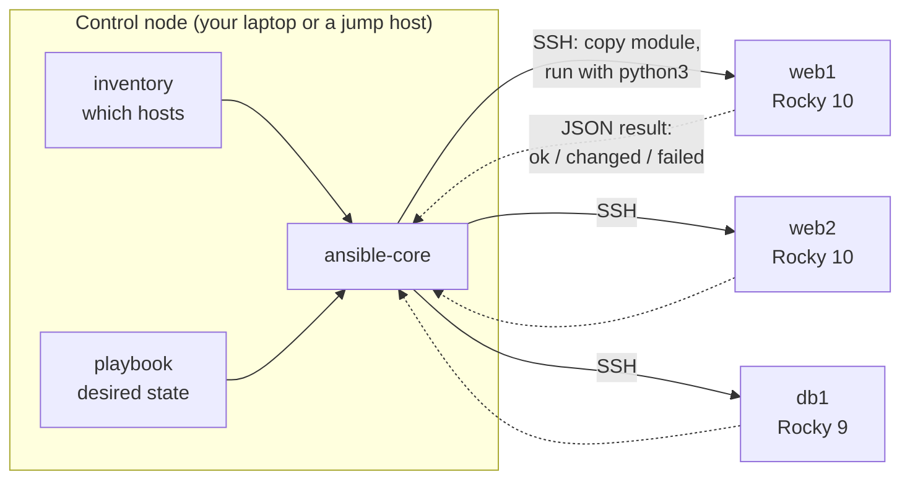
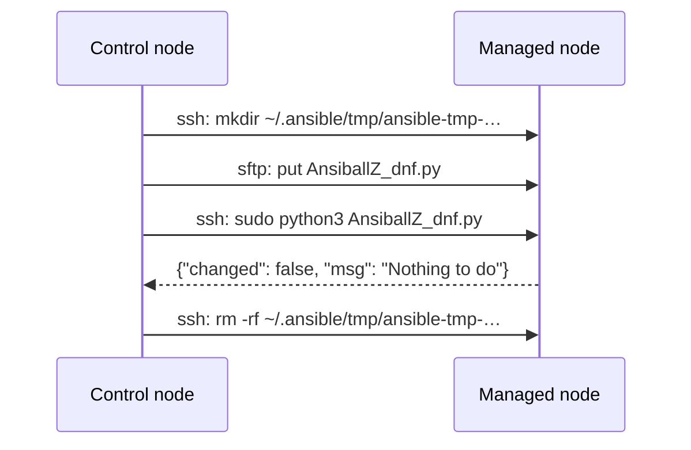
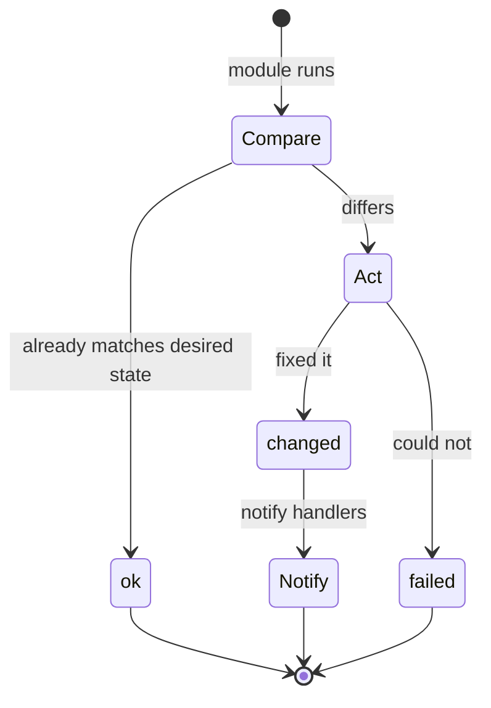
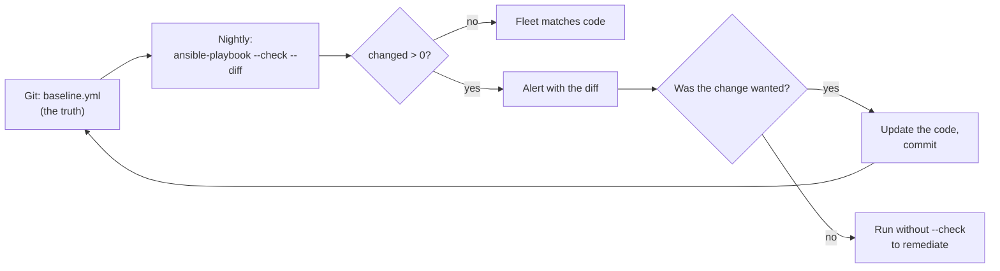

# 32 · Automation with Ansible and System Roles

<ul class="module-meta">
  <li>⏱ ~3 hours</li>
  <li>4 labs</li>
  <li>Builds on: 03 · Users, Groups and sudo, 05 · Software: RPM and DNF, 07 · systemd and Services, 12 · Firewalls with firewalld, 16 · SELinux</li>
</ul>

You hardened one server by hand last month: SSH settings, a login banner, chrony, the firewall, SELinux booleans. Now you have forty more, and someone just asked "are they all configured the same?" You don't know, and neither does anyone else. This module teaches you to describe a server's configuration as code with Ansible, apply it to any number of Rocky machines, and ask the fleet "has anything drifted?" without changing a thing.

!!! abstract "What you'll learn"
    - Why hand-configured "snowflake" servers drift, and how **configuration management** fixes it
    - How Ansible works with no agent: what it copies over SSH and what runs on the managed node
    - Write an **inventory** with groups, `group_vars`, and `host_vars`, and run ad-hoc commands
    - Write a **playbook** that is **idempotent**, and read `ok` vs `changed` to prove it
    - Use **handlers**, **variables**, **facts**, and **Jinja2 templates**, and protect secrets with **ansible-vault**
    - Detect drift with `--check --diff`
    - Use the **RHEL System Roles** (`rhel-system-roles`) to configure time, firewall, SELinux, networking, and storage the supported way

## The big picture

**Configuration management** means writing down how a system should be configured, in files you keep in version control, and letting a tool make reality match. You stop typing commands into servers and start editing a description of them.

**Ansible** is the configuration management tool that ships with Rocky Linux. One machine, the **control node**, holds your code (playbooks and inventory). It connects over plain SSH to the **managed nodes**, pushes small Python programs called **modules**, runs them, collects the results as JSON, and cleans up. Nothing is installed or left running on the managed nodes.



Three ideas carry the whole module:

1. **Desired state, not steps.** You say "nginx is installed and running", not "run `dnf install`". The module works out whether anything needs doing.
2. **Idempotence.** Running the same playbook twice is safe. The second run reports `ok` everywhere and changes nothing. That property is what makes automation trustworthy.
3. **Drift detection for free.** Because modules know how to compare "now" with "desired", you can ask them to *only report* differences (`--check --diff`). That turns your playbook into an audit.

## Why configuration management: snowflakes and drift

A **snowflake server** is one that was configured by hand, over years, by several people. It works, but nobody can rebuild it, and no two are alike. **Configuration drift** is how snowflakes form: a hotfix here, a debug setting left on there, a package updated on half the fleet.

Drift is dangerous because it is invisible. The failures it causes look random: one of six web servers rejects a TLS client, one database replica has a different `vm.swappiness`, one host forgot the firewall rule after a rebuild.

!!! analogy "Think of it like a recipe vs a photograph"
    Hand configuration is like photographing a cake and hoping someone can reproduce it. Configuration management is the recipe: anyone can bake it again, and you can compare any cake against the recipe to see what's different. The analogy breaks down in one place: Ansible only checks what the recipe mentions. Anything your playbook doesn't describe can still drift silently.

| Approach | Rebuild a server | Know what changed | Apply to 40 hosts |
|---|---|---|---|
| Hand-typed commands | From memory, if lucky | No | 40 SSH sessions |
| Shell script | Usually, if run on a fresh host | No; reruns can break things | Loop over SSH |
| Ansible playbook | Yes, repeatably | `--check --diff` tells you | One command, in parallel |

## Installing Ansible on Rocky Linux

Rocky ships **ansible-core** in the AppStream repository. `ansible-core` is the engine plus the `ansible.builtin` collection of modules (files, packages, services, users, templates, and so on). The big "batteries included" `ansible` community package with hundreds of extra collections is not in Rocky's repos; you add the collections you need with `ansible-galaxy` instead.

```console
$ sudo dnf install -y ansible-core
$ ansible --version
ansible [core 2.16.14]
  config file = None
  configured module search path = ['/home/alex/.ansible/plugins/modules', '/usr/share/ansible/plugins/modules']
  ansible python module location = /usr/lib/python3.12/site-packages/ansible
  ansible collection location = /home/alex/.ansible/collections:/usr/share/ansible/collections
  executable location = /usr/bin/ansible
  python version = 3.12.9 (main, …) [GCC 14.2.1 …] (/usr/bin/python3.12)
  jinja version = 3.1.6
  libyaml = True
```

!!! version "Rocky 9 vs 10"
    Rocky 10 ships ansible-core **2.16** (packaged as `1:2.16.x`), built on Python 3.12. Rocky 9 froze ansible-core at **2.14** for the rest of its life. Content written for 2.16 usually runs on 2.14, but a few newer collections require 2.15 or later, so a Rocky 10 control node is the better choice for a mixed fleet. Check yours with `dnf info ansible-core`.

Only the control node needs Ansible. A managed node needs just three things: an SSH server, a user you can log in as, and `python3` (every Rocky install has it, because DNF is written in Python).

!!! tip "Keep each project self-contained"
    Make a directory per project with its own `ansible.cfg`, inventory, and playbooks. Ansible reads `ansible.cfg` from the current directory first (then `~/.ansible.cfg`, then `/etc/ansible/ansible.cfg`), so `cd` into the project and everything just works. `ansible --version` shows which config file it picked.

## How Ansible runs a task: the agentless model

Ansible is called **agentless** because there is no Ansible daemon on the managed nodes. Everything happens through SSH sessions the control node opens on demand. Step through what one task actually does:

<div class="stepper" markdown>

<div class="step" data-title="Read the play" markdown>

`ansible-playbook site.yml` parses the playbook, loads the inventory, and works out which hosts the play targets. For each task it looks up the module (for example `ansible.builtin.dnf`) on the control node.

</div>

<div class="step" data-title="Gather facts" markdown>

Unless you disable it, the first task of each play is **Gathering Facts**: the `setup` module runs on every host and returns hundreds of **facts** (OS version, IP addresses, memory, disks). They become variables like `ansible_distribution_major_version`.

</div>

<div class="step" data-title="Build a payload" markdown>

Ansible wraps the module's Python code, its helper libraries, and your arguments into a single self-extracting Python file called **AnsiballZ** (for example `AnsiballZ_dnf.py`).

</div>

<div class="step" data-title="Ship it over SSH" markdown>

Over an SSH connection (reused via OpenSSH **ControlPersist**, so it is fast), Ansible creates a temporary directory under `~/.ansible/tmp/` on the managed node and copies the payload there. With **pipelining** enabled, it skips the file and streams the code into Python's standard input instead.

</div>

<div class="step" data-title="Run with python3 (maybe via sudo)" markdown>

The managed node runs `/usr/bin/python3 AnsiballZ_dnf.py`. If the task has `become: true`, the command is wrapped in `sudo`. The module compares the current state with the desired state and acts only if they differ.

</div>

<div class="step" data-title="Return JSON, clean up" markdown>

The module prints a JSON result (`"changed": true`, plus details) on standard output. Ansible reads it, deletes the temporary directory, and shows you `ok`, `changed`, `failed`, or `skipped`. The managed node is left with no trace except the change itself.



</div>

</div>

!!! example "Try it: watch the payload"
    Set `ANSIBLE_KEEP_REMOTE_FILES=1` and run an ad-hoc command with `-vvv`. Ansible leaves the `AnsiballZ_*.py` file on the managed node and prints its path, so you can open it and see exactly what was executed.

<div class="quiz" data-answer="3" markdown>

A managed node has no Ansible package installed. What does it need for a normal `ansible.builtin.dnf` task to work?

- An `ansible-agent` service listening on a TCP port
- A copy of every module, installed with `ansible-galaxy`
- An SSH server, a user to log in as, and `python3`
- Nothing at all; Ansible sends shell commands only

Modules are copied over SSH and executed by the node's Python at task time. There's no agent and no pre-installed module library. (The `raw` and `script` modules can work without Python, which is how you bootstrap a host that lacks it.)

</div>

## Inventory: telling Ansible what you manage

The **inventory** is the list of managed nodes, organised into **groups**. You can write it as INI or YAML. Both describe the same thing; pick one per project.

=== "INI"

    ```ini title="inventory/hosts.ini"
    [web]
    web1 ansible_host=192.168.122.11
    web2 ansible_host=192.168.122.12

    [db]
    db1 ansible_host=192.168.122.21

    [rocky:children]
    web
    db
    ```

=== "YAML"

    ```yaml title="inventory/hosts.yml"
    all:
      children:
        rocky:
          children:
            web:
              hosts:
                web1: {ansible_host: 192.168.122.11}
                web2: {ansible_host: 192.168.122.12}
            db:
              hosts:
                db1: {ansible_host: 192.168.122.21}
    ```

Every host is automatically in the group **`all`**. A group can contain other groups (`rocky:children`). The name you use for a host (`web1`) is just a label; `ansible_host` says where to actually connect.

### group_vars and host_vars

Don't cram variables into the inventory file. Ansible automatically loads YAML files from two directories next to it:

```text
inventory/
├── hosts.ini
├── group_vars/
│   ├── all.yml          # every host
│   └── web.yml          # only hosts in [web]
└── host_vars/
    └── db1.yml          # only db1
```

When the same variable is set in several places, the more specific wins: `host_vars` beats `group_vars/web.yml`, which beats `group_vars/all.yml`. (Ansible has more than twenty precedence levels in total. In practice: role defaults are weakest, `-e` extra vars on the command line are strongest, and everything in between follows "more specific wins".)

```console
$ ansible-inventory -i inventory --graph
@all:
  |--@ungrouped:
  |--@rocky:
  |  |--@web:
  |  |  |--web1
  |  |  |--web2
  |  |--@db:
  |  |  |--db1
$ ansible-inventory -i inventory --host db1
{
    "ansible_host": "192.168.122.21",
    "ntp_servers": ["ntp1.lab.example", "ntp2.lab.example"]
}
```

### A minimal ansible.cfg

```ini title="ansible.cfg"
[defaults]
inventory = ./inventory   # (1)!
remote_user = ansible     # (2)!
forks = 10                # (3)!

[ssh_connection]
pipelining = True         # (4)!
```

1. So you don't need `-i inventory` on every command.
2. The account Ansible logs in as on every node. Use a dedicated user with an SSH key and sudo rights, not root.
3. How many hosts to work on in parallel (default 5).
4. Stream modules into Python instead of copying files. Faster, and it requires that `sudo` doesn't need a TTY (the Rocky default).

## Ad-hoc commands: one task, many hosts

An **ad-hoc command** runs a single module against a group without writing a playbook. It's perfect for questions ("what kernel is everyone on?") and one-off fixes.

```console
$ ansible all -m ansible.builtin.ping
web1 | SUCCESS => {
    "ansible_facts": {
        "discovered_interpreter_python": "/usr/bin/python3"
    },
    "changed": false,
    "ping": "pong"
}
…
$ ansible web -m ansible.builtin.command -a 'uname -r'
web1 | CHANGED | rc=0 >>
6.12.0-55.40.1.el10_0.x86_64
web2 | CHANGED | rc=0 >>
6.12.0-124.8.1.el10_1.x86_64
$ ansible web -b -m ansible.builtin.dnf -a 'name=chrony state=latest'
web1 | SUCCESS => {
    "changed": false,
    "msg": "Nothing to do",
…
```

The `ping` module isn't ICMP. It proves the whole chain works: SSH login, Python found, module executed. The `-b` flag means **become** (use sudo). Notice `command` always says `CHANGED`, because Ansible can't know whether an arbitrary command changed anything. That's the first hint about idempotence.

!!! tip "Facts on demand"
    `ansible db1 -m ansible.builtin.setup -a 'filter=ansible_distribution*'` shows the distribution facts (`Rocky`, `10`, `10.1`) for one host. Facts are the raw material for conditionals like "only on Rocky 10".

### Practice: drive Ansible from the shell

<div class="terminal-sim" data-title="First contact with a fleet" data-prompt="[alex@control lab]$ " markdown>

<div class="task" data-expect="ansible-inventory --graph||ansible-inventory -i inventory --graph" data-hint="ansible-inventory has a --graph option that draws the group tree." markdown>

**Step 1.** Show the inventory as a tree of groups and hosts.

```text
@all:
  |--@ungrouped:
  |--@rocky:
  |  |--@web:
  |  |  |--web1
  |  |  |--web2
  |  |--@db:
  |  |  |--db1
```

</div>

<div class="task" data-expect="ansible all -m ping||ansible all -m ansible.builtin.ping" data-hint="Run the ping module (-m ping) against the group all." markdown>

**Step 2.** Prove Ansible can log in and run Python on every host.

```text
web1 | SUCCESS => { "changed": false, "ping": "pong" }
web2 | SUCCESS => { "changed": false, "ping": "pong" }
db1 | SUCCESS => { "changed": false, "ping": "pong" }
```

</div>

<div class="task" data-expect="ansible web -a 'uname -r'||ansible web -m command -a 'uname -r'||ansible web -m ansible.builtin.command -a 'uname -r'" data-match="^ansible web (-m (ansible\.builtin\.)?command )?-a ['\"]uname -r['\"]$" data-hint="The default module is command, so ansible web -a 'uname -r' is enough." markdown>

**Step 3.** Ask only the `web` group which kernel it runs.

```text
web1 | CHANGED | rc=0 >>
6.12.0-55.40.1.el10_0.x86_64
web2 | CHANGED | rc=0 >>
6.12.0-124.8.1.el10_1.x86_64
```

Two different kernels: drift already.

</div>

<div class="task" data-expect="ansible-playbook site.yml --check --diff||ansible-playbook --check --diff site.yml||ansible-playbook site.yml -C -D" data-match="^ansible-playbook (site\.yml )?(--check|-C) (--diff|-D)( site\.yml)?$" data-hint="ansible-playbook with --check (change nothing) and --diff (show differences)." markdown>

**Step 4.** Dry-run `site.yml` and show what *would* change.

```text
TASK [Set login banner] ********************************************
--- before: /etc/issue
+++ after: /home/alex/lab/templates/issue.j2
@@ -1,2 +1 @@
-\S
-Kernel \r on \m
+Authorised use only. web2 is monitored.
changed: [web2]
…
PLAY RECAP *********************************************************
db1   : ok=7  changed=0  unreachable=0  failed=0  skipped=0
web1  : ok=7  changed=0  unreachable=0  failed=0  skipped=0
web2  : ok=7  changed=1  unreachable=0  failed=0  skipped=0
```

</div>

</div>

## Playbooks: desired state as code

A **playbook** is a YAML file containing one or more **plays**. A play maps a group of hosts to a list of **tasks**. Each task calls one module with arguments. Here is a small but realistic one, annotated:

```yaml title="web.yml"
---
- name: Configure web servers          # (1)!
  hosts: web                           # (2)!
  become: true                         # (3)!
  vars:
    http_port: 80

  tasks:
    - name: Install nginx              # (4)!
      ansible.builtin.dnf:             # (5)!
        name: nginx
        state: present

    - name: Deploy nginx config
      ansible.builtin.template:
        src: templates/nginx.conf.j2
        dest: /etc/nginx/nginx.conf
        owner: root
        group: root
        mode: "0644"
        validate: nginx -t -c %s       # (6)!
      notify: Reload nginx             # (7)!

    - name: Start and enable nginx
      ansible.builtin.systemd_service:
        name: nginx
        state: started
        enabled: true

  handlers:
    - name: Reload nginx               # (8)!
      ansible.builtin.systemd_service:
        name: nginx
        state: reloaded
```

1. Every play and task gets a `name`. It's what you see in the output, so write it as a sentence about the result.
2. Which inventory hosts or groups this play targets.
3. Run tasks through `sudo`. Set it per play or per task.
4. A task. Tasks run in order, top to bottom, on all hosts in parallel (up to `forks`).
5. Always use the **fully qualified collection name** (FQCN), `ansible.builtin.dnf`, not just `dnf`. It removes ambiguity when several collections have a module with the same name.
6. Before replacing the file, run `nginx -t` on the new version (`%s` is the temp file). A broken config never reaches the server.
7. If, and only if, this task reports `changed`, queue the handler named `Reload nginx`.
8. **Handlers** run once, at the end of the play, no matter how many tasks notified them.

### Idempotence: ok vs changed

A task is **idempotent** when running it again, on a system already in the desired state, changes nothing. Most `ansible.builtin` modules are idempotent by design: `dnf` checks the RPM database before installing, `template` compares checksums before writing, `systemd_service` checks the unit state before starting.

Run the playbook twice and read the **PLAY RECAP**:

```console
$ ansible-playbook web.yml
…
PLAY RECAP *********************************************************************
web1    : ok=5    changed=3    unreachable=0    failed=0    skipped=0    rescued=0    ignored=0
web2    : ok=5    changed=3    unreachable=0    failed=0    skipped=0    rescued=0    ignored=0

$ ansible-playbook web.yml
…
PLAY RECAP *********************************************************************
web1    : ok=4    changed=0    unreachable=0    failed=0    skipped=0    rescued=0    ignored=0
web2    : ok=4    changed=0    unreachable=0    failed=0    skipped=0    rescued=0    ignored=0
```

First run: three things changed (package, config, service), and the handler fired (that's the fifth `ok`). Second run: `changed=0`, and the handler didn't run because nothing notified it. **`changed=0` on the second run is the test of a well-written playbook.**



!!! pitfall "Non-idempotent shell tasks"
    `ansible.builtin.command: echo "vm.swappiness=10" >> /etc/sysctl.conf` appends a new line on *every* run and always reports `changed`. Use a module that manages state (`lineinfile`, `copy`, `template`, `ansible.posix.sysctl`). If you must use `command`, add `creates:`, `removes:`, or `changed_when:` so Ansible can tell whether it really did something.

<div class="quiz" data-answer="2" markdown>

You run a playbook for the second time on hosts it already configured. The recap shows `changed=2` on every host. What does that most likely mean?

- Ansible is working correctly; `changed` counts tasks that ran
- Two tasks aren't idempotent (often `command`/`shell` tasks without `changed_when` or `creates`)
- Someone edited all the hosts between the two runs
- Facts gathering always counts as a change

On an unchanged system a good playbook reports `changed=0`. Repeatable `changed` results almost always come from command-style tasks that can't detect their own effect. They also break drift detection, because `--check` will flag them forever.

</div>

## Variables, facts, and Jinja2 templates

**Variables** let one playbook serve many hosts. You've seen them in `vars:` and `group_vars`. **Facts** are variables Ansible discovers. **Jinja2** is the template language that combines them: `{{ variable }}` inserts a value, `` and `` add logic.

```jinja title="templates/chrony.conf.j2"
# Managed by Ansible. Local edits will be overwritten.

server {{ server }} iburst

driftfile /var/lib/chrony/drift
makestep 1.0 3
rtcsync

ntsdumpdir /var/lib/chrony

```

```yaml title="inventory/group_vars/all.yml"
ntp_servers:
  - ntp1.lab.example
  - ntp2.lab.example
```

Jinja2 filters transform values: `| int`, `| default('x')`, `| join(',')`, `| upper`. Conditionals on tasks use `when:` with a bare expression (no braces):

```yaml
- name: Only on Rocky 10
  ansible.builtin.debug:
    msg: "{{ inventory_hostname }} runs {{ ansible_distribution }} {{ ansible_distribution_version }}"
  when: ansible_distribution_major_version == "10"
```

To capture a task's result for later, use `register:`, and loop with `loop:`:

```yaml
- name: Check which services are enabled
  ansible.builtin.command: systemctl is-enabled {{ item }}
  loop: [sshd, chronyd, firewalld]
  register: enabled
  changed_when: false        # a read-only check never "changes" anything
  failed_when: false
```

!!! tip "Debug variables before you trust them"
    `ansible -m ansible.builtin.debug -a 'var=ntp_servers' all` prints a variable as each host sees it, after all the precedence rules. It ends most "why is it using the wrong value?" mysteries.

## Check mode and diff mode: drift detection

**Check mode** (`--check` or `-C`) runs every task in "what would you do?" mode: modules compare, report `changed` if they *would* act, and change nothing. **Diff mode** (`--diff` or `-D`) shows the line-level difference for file-changing modules. Together, they turn any idempotent playbook into a drift report.

```console
$ ansible-playbook baseline.yml --check --diff --limit web2
…
TASK [Harden sshd] *************************************************************
--- before: /etc/ssh/sshd_config.d/50-hardening.conf
+++ after: /home/alex/lab/templates/sshd-hardening.conf.j2
@@ -1,4 +1,4 @@
 # Managed by Ansible
-PermitRootLogin yes
+PermitRootLogin no
 MaxAuthTries 3
 X11Forwarding no

changed: [web2]
…
PLAY RECAP *********************************************************************
web2    : ok=11   changed=1    unreachable=0    failed=0    skipped=0    rescued=0    ignored=0
```

Someone set `PermitRootLogin yes` on web2 and forgot. Check mode found it, showed exactly what differs, and touched nothing. Run without `--check` and Ansible puts it back.



!!! warning "Check mode has blind spots"
    `command` and `shell` tasks are skipped in check mode (they can't predict their effect). Tasks that depend on an earlier task's real result can fail or mislead in check mode, for example configuring a service whose package "would be" installed. Add `check_mode: false` to read-only tasks that must always run, and guard dependent tasks with `when: not ansible_check_mode` where needed.

<div class="quiz" data-answer="4" markdown>

Which command reports configuration drift on all web servers without changing anything?

- `ansible-playbook baseline.yml --limit web`
- `ansible web -m ansible.builtin.setup`
- `ansible-playbook baseline.yml --syntax-check`
- `ansible-playbook baseline.yml --check --diff --limit web`

`--check` simulates, `--diff` shows what differs, and `--limit` narrows the run. `--syntax-check` only parses the YAML; it never contacts the hosts.

</div>

## Privilege escalation and secrets

### become

Ansible logs in as an ordinary user (`remote_user`) and uses **become** to run tasks as root, through `sudo` by default. Set `become: true` on a play or a single task. If the sudo rule needs a password, pass `-K` (`--ask-become-pass`).

A typical bootstrap gives the automation user key-based SSH and passwordless sudo, as you learned in [module 03](03-users-groups-and-sudo.md):

```text title="/etc/sudoers.d/ansible"
ansible ALL=(ALL) NOPASSWD: ALL
```

You can also `become_user: postgres` to run a task as a service account.

### ansible-vault

Passwords, API tokens, and private keys must not sit in Git in plain text. **ansible-vault** encrypts a YAML file (AES-256) with a password; Ansible decrypts it in memory at run time.

```console
$ ansible-vault create inventory/group_vars/db/vault.yml
New Vault password:
Confirm New Vault password:
$ head -2 inventory/group_vars/db/vault.yml
$ANSIBLE_VAULT;1.1;AES256
62313365396662343061393464336163383764373764613633653634306231386433626436623361
$ ansible-playbook db.yml --ask-vault-pass
```

A common convention: put secrets in `vault.yml` as `vault_db_password`, then reference it from a plain `vars.yml` as `db_password: "{{ vault_db_password }}"`. You can still `grep` for where a variable is used without decrypting anything.

!!! tip "Password files for automation"
    `--vault-password-file ~/.vault-pass` (mode `0600`, never committed) lets cron jobs and CI run without a prompt. Use `ansible-vault edit`, `view`, `rekey`, and `encrypt_string` for day-to-day work.

## Roles, collections, and Galaxy

As playbooks grow, you'll want to reuse pieces. A **role** is a standard directory layout that bundles tasks, handlers, templates, and default variables for one job ("configure chrony", "harden sshd").

```text
roles/sshd_hardening/
├── defaults/main.yml     # default variables (lowest precedence; meant to be overridden)
├── tasks/main.yml        # the task list
├── handlers/main.yml     # handlers
├── templates/            # Jinja2 templates
├── files/                # static files
└── meta/main.yml         # metadata, dependencies
```

Create the skeleton with `ansible-galaxy role init roles/sshd_hardening`, then use it from a play:

```yaml
- hosts: rocky
  become: true
  roles:
    - role: sshd_hardening
      vars:
        sshd_permit_root_login: "no"
```

A **collection** is the distribution format for Ansible content: a namespaced bundle of modules, plugins, and roles, such as `ansible.posix` (firewalld, sysctl, mount modules) or `community.general`. **Ansible Galaxy** (galaxy.ansible.com) is the public index; `ansible-galaxy` is the CLI.

```console
$ ansible-galaxy collection install ansible.posix
Starting galaxy collection install process
…
ansible.posix:2.0.0 was installed successfully
$ ansible-galaxy collection list
# /home/alex/.ansible/collections/ansible_collections
Collection    Version
------------- -------
ansible.posix 2.0.0
# /usr/share/ansible/collections/ansible_collections
Collection                Version
------------------------- -------
redhat.rhel_system_roles  1.120.5
```

Pin what a project needs in a `requirements.yml` so every control node gets the same versions:

```yaml title="collections/requirements.yml"
collections:
  - name: ansible.posix
    version: ">=1.5.0"
```

```console
$ ansible-galaxy collection install -r collections/requirements.yml
```

<div class="layers" data-hint="Click a layer to see what lives there." data-open="0" markdown>

<div class="layer" data-label="Playbook" data-tag="site.yml" markdown>

**What it is:** your entry point. It says which hosts get which roles and tasks, in what order. Keep it short: mostly a list of roles.

</div>

<div class="layer" data-label="Roles" data-tag="roles/" markdown>

**What they are:** reusable units for one job. Your own live in `roles/`; others come inside collections (`redhat.rhel_system_roles.timesync`).

</div>

<div class="layer" data-label="Collections" data-tag="namespace.name" markdown>

**What they are:** versioned bundles of modules, plugins, and roles. Installed into `~/.ansible/collections` or `/usr/share/ansible/collections` (where RPM-packaged ones like the System Roles go).

</div>

<div class="layer" data-label="Modules" data-tag="ansible.builtin.*" markdown>

**What they are:** the Python programs that actually do the work on the managed node. `ansible-doc ansible.builtin.template` shows every option and examples, offline.

</div>

<div class="layer" data-label="ansible-core" data-tag="engine" markdown>

**What it is:** the engine: inventory parsing, variable precedence, templating, the SSH connection plugin, and the `ansible.builtin` collection. The RPM from AppStream.

</div>

</div>

## RHEL System Roles: supported building blocks

Writing your own role for chrony is easy. Writing one that correctly handles NTS, PTP, `ntpd` fallback, Rocky 8 vs 9 vs 10 differences, and every edge case is not. The **System Roles** project does that for you: a set of roles, maintained by Red Hat engineers alongside the OS, that configure core subsystems through one consistent variable interface.

The upstream project is **linux-system-roles** (published on Galaxy as the `fedora.linux_system_roles` collection). Red Hat packages the same roles as the **`rhel-system-roles`** RPM, which installs the `redhat.rhel_system_roles` collection. Rocky rebuilds that RPM.

```console
$ sudo dnf install -y rhel-system-roles
$ rpm -ql rhel-system-roles | grep -E 'rhel_system_roles/roles/[a-z_]+/README.md$' | head
/usr/share/ansible/collections/ansible_collections/redhat/rhel_system_roles/roles/ad_integration/README.md
/usr/share/ansible/collections/ansible_collections/redhat/rhel_system_roles/roles/aide/README.md
/usr/share/ansible/collections/ansible_collections/redhat/rhel_system_roles/roles/bootloader/README.md
/usr/share/ansible/collections/ansible_collections/redhat/rhel_system_roles/roles/certificate/README.md
…
$ ls /usr/share/doc/rhel-system-roles/
ad_integration  aide  bootloader  certificate  cockpit  crypto_policies  firewall  …  timesync  tlog  vpn
```

!!! note "Availability on Rocky"
    `rhel-system-roles` is built for Rocky 10 in AppStream; it has been reported working on Rocky 10.2 and is present in the 10.1 sources. If `dnf info rhel-system-roles` finds nothing on your mirror, install the upstream collection instead: `ansible-galaxy collection install fedora.linux_system_roles`, and replace `redhat.rhel_system_roles.` with `fedora.linux_system_roles.` in role names. The variables are the same.

Each role's `README.md` documents every variable, and `/usr/share/doc/rhel-system-roles/<role>/` holds ready-to-run example playbooks. That's your reference; read it before using a role.

Here are five of the most useful roles, side by side. Every one follows the same pattern: set variables, include the role.

=== "timesync"

    ```yaml
    - hosts: rocky
      become: true
      vars:
        timesync_ntp_servers:
          - hostname: ntp1.lab.example
            iburst: true
          - hostname: 2.rocky.pool.ntp.org
            pool: true
            iburst: true
      roles:
        - redhat.rhel_system_roles.timesync
    ```

    Writes `/etc/chrony.conf`, enables `chronyd`, and can also configure PTP. See [module 36](36-time-synchronization.md) for what the result means.

=== "firewall"

    ```yaml
    - hosts: web
      become: true
      vars:
        firewall:
          - service: [http, https]
            state: enabled
          - port: 8443/tcp
            state: enabled
      roles:
        - redhat.rhel_system_roles.firewall
    ```

    Drives `firewalld` ([module 12](12-firewalld.md)), applying both runtime and permanent configuration.

=== "selinux"

    ```yaml
    - hosts: web
      become: true
      vars:
        selinux_state: enforcing
        selinux_policy: targeted
        selinux_booleans:
          - name: httpd_can_network_connect
            state: true
            persistent: true
        selinux_ports:
          - ports: "8443"
            proto: tcp
            setype: http_port_t
            state: present
      roles:
        - redhat.rhel_system_roles.selinux
    ```

    Sets the mode, booleans, port labels, and file contexts from [module 16](16-selinux.md), idempotently. It's far safer than scripting `semanage` calls.

=== "network"

    ```yaml
    - hosts: db1
      become: true
      vars:
        network_provider: nm
        network_connections:
          - name: backend
            type: ethernet
            interface_name: enp2s0
            ip:
              address: [10.10.0.21/24]
            state: up
      roles:
        - redhat.rhel_system_roles.network
    ```

    Creates NetworkManager connection profiles ([module 11](11-networking.md)). Test on a console-accessible host first: a bad network change can cut off the SSH session Ansible is using.

=== "storage"

    ```yaml
    - hosts: db1
      become: true
      vars:
        storage_pools:
          - name: data_vg
            disks: [vdb]
            volumes:
              - name: pgdata
                size: 10g
                fs_type: xfs
                mount_point: /var/lib/pgsql
      roles:
        - redhat.rhel_system_roles.storage
    ```

    Builds the LVM volume group, logical volume, XFS filesystem, and `/etc/fstab` entry from [module 10](10-lvm-raid-and-encryption.md) in one go. Growing `size` later grows the LV and filesystem.

!!! danger "The storage role will do what you say"
    Pointing `disks:` at the wrong device, or removing a volume from the list with `state: absent`, destroys data. Always run storage changes with `--check` first, and double-check device names with `lsblk` on the target.

<div class="quiz" data-answer="1" markdown>

Why use `redhat.rhel_system_roles.selinux` instead of a few `command: semanage …` tasks?

- The role is idempotent, works in check mode, and handles version differences for you
- `semanage` doesn't exist on Rocky 10
- Roles run faster because they skip SSH
- System roles bypass SELinux, so they can't be denied

`semanage` works fine, but wrapped in `command:` it always reports `changed`, gets skipped in check mode, and can't tell you about drift. The role checks current state first and reports honestly.

</div>

## Quality and tooling: ansible-lint and ansible-navigator

**ansible-lint** checks playbooks and roles for mistakes and bad habits: missing FQCNs, `command` where a module exists, tasks without names, risky file permissions, YAML style. It is not in Rocky's base repos, so install it from PyPI in a virtual environment (keeping it away from the RPM-installed ansible-core):

```console
$ python3 -m venv ~/venvs/lint && ~/venvs/lint/bin/pip install -q ansible-lint
$ ~/venvs/lint/bin/ansible-lint baseline.yml
WARNING  Listing 2 violation(s) that are fatal
fqcn[action-core]: Use FQCN for builtin module actions (copy).
baseline.yml:14 Use `ansible.builtin.copy` or `ansible.legacy.copy` instead.

no-changed-when: Commands should not change things if nothing needs doing.
baseline.yml:31 Task/Handler: Reload sysctl
…
```

**ansible-navigator** is a text UI and runner that executes playbooks inside an **execution environment**: a container image that bundles a specific ansible-core, Python, and collections. It solves "works on my control node" by making the whole toolchain a pinned image, run with Podman ([module 18](18-containers.md)). It also comes from PyPI on Rocky. For a small team, a project `requirements.yml` and a single control node is enough; reach for navigator when several people or CI need identical tooling.

## Labs

You need a control node and something to manage. Three small Rocky 10 VMs (one control, two managed) are ideal. On a single VM, you can manage the VM itself over SSH to `localhost` using two inventory aliases; that's what the steps below assume, and it works the same way with real hosts.

!!! lab "Lab 1: Bootstrap a control node and an inventory"

    **Goal:** Install ansible-core, create an automation user with SSH keys, and run ad-hoc commands.

    **You'll need:** a Rocky 10 VM, sudo.

    1. Install Ansible and create a dedicated user on the "managed" side:

        ```bash
        sudo dnf install -y ansible-core
        sudo useradd -m ansible
        echo 'ansible ALL=(ALL) NOPASSWD: ALL' | sudo tee /etc/sudoers.d/ansible
        sudo chmod 0440 /etc/sudoers.d/ansible
        ```

    2. Give your own account a key and authorise it for the `ansible` user:

        ```bash
        [ -f ~/.ssh/id_ed25519 ] || ssh-keygen -t ed25519 -N '' -f ~/.ssh/id_ed25519
        sudo install -d -m 700 -o ansible -g ansible ~ansible/.ssh
        sudo install -m 600 -o ansible -g ansible ~/.ssh/id_ed25519.pub ~ansible/.ssh/authorized_keys
        ssh -o StrictHostKeyChecking=accept-new ansible@localhost true
        ```

    3. Create the project:

        ```bash
        mkdir -p ~/lab/inventory/group_vars ~/lab/templates && cd ~/lab
        cat > ansible.cfg <<'EOF'
        [defaults]
        inventory = ./inventory
        remote_user = ansible

        [ssh_connection]
        pipelining = True
        EOF
        cat > inventory/hosts.ini <<'EOF'
        [web]
        web1 ansible_host=127.0.0.1
        web2 ansible_host=localhost
        EOF
        ```

    4. Run ad-hoc commands:

        ```console
        $ ansible-inventory --graph
        $ ansible all -m ansible.builtin.ping
        $ ansible web -b -a 'id -un'
        $ ansible web1 -m ansible.builtin.setup -a 'filter=ansible_distribution*'
        ```

    **Check your work:** `ping` returns `pong` for both hosts, and `id -un` with `-b` prints `root`.

    ??? success "What just happened?"
        Ansible logged in as `ansible` over SSH, found `/usr/bin/python3`, and ran modules. `-b` wrapped the command in `sudo`, which the sudoers drop-in allows without a password. In production you'd do this bootstrap once per host, usually from your kickstart ([module 23](23-automated-installs.md)).

    **Clean up:** keep everything for the next labs. When you're finished with the module: `sudo userdel -r ansible; sudo rm /etc/sudoers.d/ansible; rm -rf ~/lab`.

!!! lab "Lab 2: A baseline hardening playbook, proven idempotent"

    **Goal:** Write a playbook that applies a small security baseline, run it twice, and see `changed=0` the second time.

    **You'll need:** Lab 1.

    1. Create a template for the login banner and an sshd drop-in:

        ```bash
        cd ~/lab
        cat > templates/issue.j2 <<'EOF'
        Authorised use only. {{ inventory_hostname }} is monitored.
        EOF
        cat > templates/sshd-hardening.conf.j2 <<'EOF'
        # Managed by Ansible
        PermitRootLogin no
        MaxAuthTries {{ ssh_max_auth_tries }}
        X11Forwarding no
        EOF
        echo 'ssh_max_auth_tries: 3' > inventory/group_vars/all.yml
        ```

    2. Write the playbook:

        ```yaml title="~/lab/baseline.yml"
        ---
        - name: Rocky security baseline
          hosts: web1          # both aliases are the same machine, so use one
          become: true
          tasks:
            - name: Install baseline packages
              ansible.builtin.dnf:
                name: [chrony, firewalld, audit]
                state: present

            - name: Set login banner
              ansible.builtin.template:
                src: templates/issue.j2
                dest: /etc/issue
                mode: "0644"

            - name: Harden sshd
              ansible.builtin.template:
                src: templates/sshd-hardening.conf.j2
                dest: /etc/ssh/sshd_config.d/50-hardening.conf
                mode: "0600"
                validate: /usr/sbin/sshd -t -f %s
              notify: Reload sshd

            - name: Kernel network hardening
              ansible.builtin.copy:
                dest: /etc/sysctl.d/90-baseline.conf
                content: |
                  net.ipv4.conf.all.accept_redirects = 0
                  net.ipv4.conf.all.send_redirects = 0
                  net.ipv4.conf.all.log_martians = 1
                mode: "0644"
              notify: Apply sysctl

            - name: Core services running
              ansible.builtin.systemd_service:
                name: "{{ item }}"
                state: started
                enabled: true
              loop: [chronyd, firewalld, auditd]

          handlers:
            - name: Reload sshd
              ansible.builtin.systemd_service:
                name: sshd
                state: reloaded

            - name: Apply sysctl
              ansible.builtin.command: sysctl --system
              changed_when: true
        ```

    3. Run it twice:

        ```console
        $ ansible-playbook baseline.yml
        $ ansible-playbook baseline.yml
        ```

    **Check your work:** the second run's recap shows `changed=0`, and `sudo sshd -T | grep -i permitrootlogin` prints `permitrootlogin no`.

    ??? tip "Hint: the validate line fails"
        `sshd -t -f %s` tests the drop-in as if it were the whole config. That works for these simple directives. If you add `Match` blocks, validate the main config instead with a handler that runs `sshd -t`.

    ??? success "Why is the handler `changed_when: true` OK?"
        Handlers only run when something notified them, which already means a change happened. Marking it explicitly keeps ansible-lint quiet and makes the intent clear.

    **Clean up:** keep the files for Lab 3. To revert the host later: `sudo rm /etc/ssh/sshd_config.d/50-hardening.conf /etc/sysctl.d/90-baseline.conf; sudo systemctl reload sshd; sudo sysctl --system; echo -e '\S\nKernel \r on \m' | sudo tee /etc/issue`.

!!! lab "Lab 3: Catch drift with --check --diff"

    **Goal:** Make an unauthorised change by hand, detect it without touching anything, then remediate.

    **You'll need:** Lab 2.

    1. Play the careless admin:

        ```bash
        sudo sed -i 's/^MaxAuthTries 3/MaxAuthTries 10/' /etc/ssh/sshd_config.d/50-hardening.conf
        echo 'net.ipv4.conf.all.accept_redirects = 1' | sudo tee -a /etc/sysctl.d/90-baseline.conf
        ```

    2. Audit the host:

        ```console
        $ ansible-playbook baseline.yml --check --diff
        ```

        Find the two `--- before / +++ after` blocks and the recap line with `changed=2`. Confirm nothing was changed yet: `grep MaxAuth /etc/ssh/sshd_config.d/50-hardening.conf` still says `10`.

    3. Remediate, then audit again:

        ```console
        $ ansible-playbook baseline.yml
        $ ansible-playbook baseline.yml --check --diff
        ```

    **Check your work:** the final check run reports `changed=0`.

    ??? success "What just happened?"
        In check mode, `template` and `copy` rendered the desired content, compared checksums with the real files, and printed a diff instead of writing. The handlers were "notified" but don't run in check mode. The real run restored both files and fired both handlers. Schedule the check run nightly (a systemd timer, [module 07](07-systemd-and-services.md)) and alert on `changed>0`, and you have continuous compliance.

    **Clean up:** nothing extra.

!!! lab "Lab 4: Use System Roles for time, firewall, and SELinux"

    **Goal:** Replace hand-written tasks with supported roles, and read their documentation.

    **You'll need:** Lab 1.

    1. Install the roles and look at an example:

        ```console
        $ sudo cp -a /etc/chrony.conf /root/chrony.conf.orig
        $ sudo dnf install -y rhel-system-roles
        $ ls /usr/share/doc/rhel-system-roles/timesync/
        $ less /usr/share/ansible/collections/ansible_collections/redhat/rhel_system_roles/roles/timesync/README.md
        ```

        (If the package isn't available, run `ansible-galaxy collection install fedora.linux_system_roles` and use `fedora.linux_system_roles.` below.)

    2. Write `roles.yml`:

        ```yaml title="~/lab/roles.yml"
        ---
        - name: Configure with System Roles
          hosts: web1
          become: true
          vars:
            timesync_ntp_servers:
              - hostname: 2.rocky.pool.ntp.org
                pool: true
                iburst: true
            firewall:
              - service: [http, https]
                state: enabled
            selinux_booleans:
              - name: httpd_can_network_connect
                state: true
                persistent: true
          roles:
            - redhat.rhel_system_roles.timesync
            - redhat.rhel_system_roles.firewall
            - redhat.rhel_system_roles.selinux
        ```

    3. Preview, apply, then re-run:

        ```console
        $ ansible-playbook roles.yml --check --diff
        $ ansible-playbook roles.yml
        $ ansible-playbook roles.yml
        ```

    **Check your work:** `chronyc sources` lists pool servers, `sudo firewall-cmd --list-services` includes `http https`, `getsebool httpd_can_network_connect` says `on`, and the last run reports `changed=0`.

    **Clean up:** `sudo firewall-cmd --permanent --remove-service={http,https} && sudo firewall-cmd --reload; sudo setsebool -P httpd_can_network_connect off`. Restore chrony's original config with `sudo cp /root/chrony.conf.orig /etc/chrony.conf && sudo systemctl restart chronyd`.

## Common pitfalls

| Symptom | Cause | Fix |
|---|---|---|
| `UNREACHABLE! … Permission denied (publickey…)` | Wrong `remote_user`, or the key isn't in `authorized_keys` | Test with plain `ssh ansible@host`; fix the key; check `ansible.cfg` is being read (`ansible --version`) |
| `Missing sudo password` | Sudo rule requires a password | Add `-K`, or configure `NOPASSWD` for the automation user |
| `couldn't resolve module/action 'firewalld'` | Module lives in a collection that isn't installed (`ansible.posix`) | `ansible-galaxy collection install ansible.posix`; use the FQCN |
| Second run still shows `changed` | `command`/`shell` tasks without `changed_when`/`creates` | Use a stateful module, or tell Ansible how to detect change |
| Check mode fails on a later task | Earlier task "would" install a package, so the service doesn't exist yet | `when: not ansible_check_mode` on dependent tasks, or accept the noise |
| Variable has an unexpected value | Precedence: set in several places | `ansible -m debug -a 'var=name' host`; `ansible-inventory --host host` |
| Handler never ran | The run failed after the notify, so the play ended before handlers | Fix the failure; use `--force-handlers` or `meta: flush_handlers` when order matters |
| Network role cut off the host | Ansible's own SSH path was reconfigured | Test with console access; change one interface at a time |

!!! pitfall "Editing managed files by hand"
    The template header says "Managed by Ansible" for a reason: the next run overwrites manual edits. Change the code, not the server. If you must hotfix by hand at 3am, write the change into the playbook the next morning, or the following run will quietly undo it.

## Cheat sheet

| Command | What it does |
|---|---|
| `dnf install ansible-core` | Install Ansible on the control node |
| `ansible --version` | Version, Python, and which `ansible.cfg` is used |
| `ansible-inventory --graph` | Draw groups and hosts |
| `ansible-inventory --host web1` | Show the variables one host ends up with |
| `ansible all -m ansible.builtin.ping` | Test SSH, Python, and module execution |
| `ansible web -b -a 'cmd'` | Run a command on a group with sudo |
| `ansible host -m ansible.builtin.setup` | Show gathered facts |
| `ansible-doc ansible.builtin.template` | Module documentation, offline |
| `ansible-playbook site.yml` | Apply a playbook |
| `ansible-playbook site.yml --check --diff` | Report drift without changing anything |
| `ansible-playbook site.yml --limit web2` | Run against a subset of hosts |
| `ansible-playbook site.yml --syntax-check` | Parse only |
| `ansible-playbook site.yml --list-tasks` | Show what would run, in order |
| `ansible-vault create/edit/view file.yml` | Manage encrypted variable files |
| `ansible-galaxy collection install ns.name` | Install a collection |
| `ansible-galaxy role init roles/name` | Create a role skeleton |
| `dnf install rhel-system-roles` | Install the System Roles collection |
| `ansible-lint site.yml` | Lint playbooks (install from PyPI) |

## Flashcards

<div class="flashcards" markdown>

<div class="card" markdown>

What does "agentless" mean for Ansible?

No daemon on managed nodes. Ansible copies modules over SSH, runs them with the node's `python3`, reads the JSON result, and deletes them.

</div>

<div class="card" markdown>

What does `changed=0` on a second playbook run prove?

The playbook is idempotent: on a system already in the desired state, it changes nothing.

</div>

<div class="card" markdown>

What do `--check` and `--diff` do together?

Simulate every task without changing anything and show line-level differences: a drift report.

</div>

<div class="card" markdown>

When does a handler run?

Once, at the end of the play, only if at least one task that notified it reported `changed`.

</div>

<div class="card" markdown>

Where do `group_vars` and `host_vars` live, and which wins?

In directories next to the inventory (or playbook). `host_vars` beats `group_vars/<group>`, which beats `group_vars/all`.

</div>

<div class="card" markdown>

What's the difference between a role and a collection?

A role is a reusable bundle of tasks, handlers, templates, and defaults. A collection is a versioned, namespaced package that can contain modules, plugins, and roles.

</div>

<div class="card" markdown>

Which RPM provides the System Roles, and what collection name does it install?

`rhel-system-roles`, which installs `redhat.rhel_system_roles`. Upstream on Galaxy it's `fedora.linux_system_roles`.

</div>

<div class="card" markdown>

How do you keep secrets out of Git in plain text?

Encrypt the variable file with `ansible-vault`; supply the password with `--ask-vault-pass` or `--vault-password-file`.

</div>

</div>

## Recap

!!! recap "Key takeaways"
    - **Configuration management** turns hand-built snowflakes into reproducible, auditable code.
    - Ansible is **agentless**: SSH plus `python3` on the managed node, modules shipped and run per task.
    - The **inventory** says what you manage; `group_vars` and `host_vars` hold per-group and per-host settings.
    - Well-written playbooks are **idempotent**: the second run reports `changed=0`.
    - **Handlers** react to changes; **templates** plus **facts** let one playbook fit many hosts.
    - `--check --diff` is a free **drift detector**.
    - Keep secrets in **ansible-vault**; package reusable work as **roles** and **collections**.
    - The **RHEL System Roles** give you supported, idempotent roles for time, firewall, SELinux, networking, storage, and more.

## Go deeper

- [[man:ansible(1)]] [[man:ansible-playbook(1)]] [[man:ansible-inventory(1)]] [[man:ansible-vault(1)]] [[man:ansible-galaxy(1)]] [[man:ansible-doc(1)]]
- [Ansible Community Documentation: playbook guide](https://docs.ansible.com/ansible/latest/playbook_guide/index.html)
- [Ansible: variable precedence](https://docs.ansible.com/ansible/latest/playbook_guide/playbooks_variables.html#understanding-variable-precedence)
- [Linux System Roles project](https://linux-system-roles.github.io/)
- [Red Hat: Automating system administration by using RHEL System Roles (RHEL 10)](https://docs.redhat.com/en/documentation/red_hat_enterprise_linux/10/html/automating_system_administration_by_using_rhel_system_roles/index)

**Next:** [33 · TLS, Certificates and Crypto Policies](33-tls-and-crypto-policies.md)
