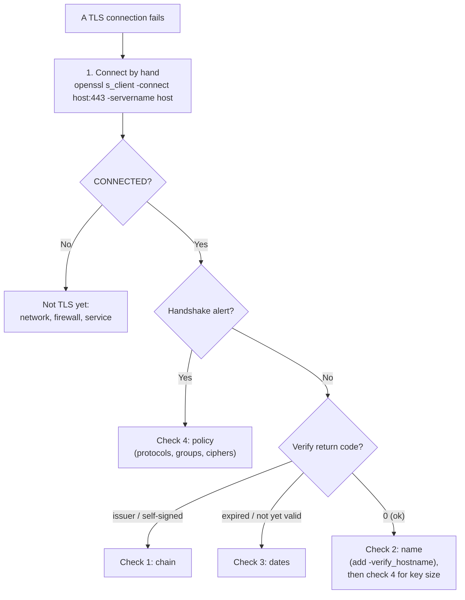
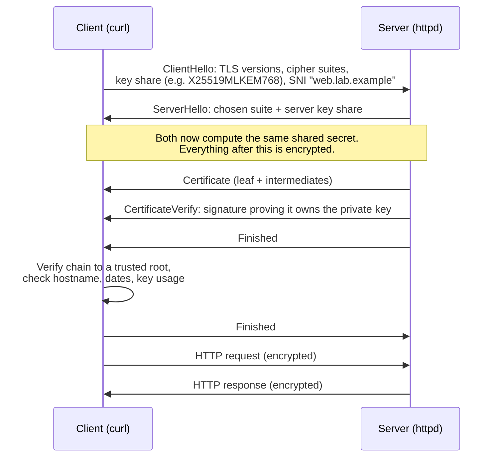
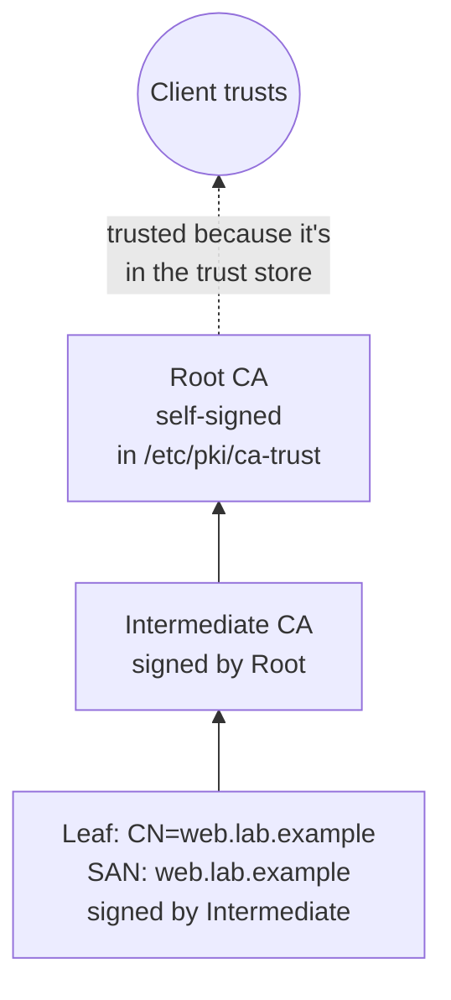
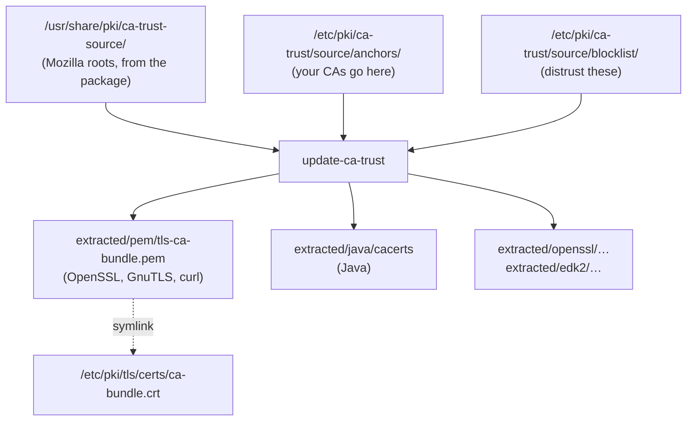
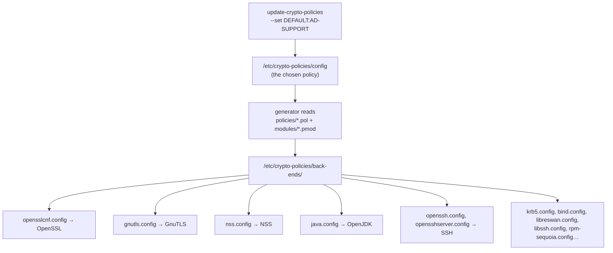

# 33 · TLS, Certificates and Crypto Policies

<ul class="module-meta">
  <li>⏱ ~3 hours</li>
  <li>4 labs</li>
  <li>Builds on: 05 · Software: RPM and DNF, 11 · Networking, 16 · SELinux, 17 · Security Hardening</li>
</ul>

A partner's monitoring system says your API "fails TLS". `curl` from your laptop works fine. A Java client in the same data centre fails. After the last update, an old appliance can't connect at all. TLS failures are frustrating because the error messages are vague and the cause can live in five places: the certificate, the chain, the name, the clock, or the crypto policy. This module teaches you how each piece works on Rocky Linux and how to prove which one is broken.

!!! abstract "What you'll learn"
    - Explain the **TLS 1.3 handshake** and the **chain of trust** in plain English
    - Read an **X.509 certificate** with `openssl x509 -text` and know which fields matter
    - Manage the **system trust store** (`/etc/pki/ca-trust`, `update-ca-trust`, `trust list`) and trust a private CA
    - Build your own **certificate authority** with `openssl` and issue a correct server certificate
    - Control every TLS library at once with **crypto-policies**: levels, subpolicies, custom modules, and opting an app out
    - Understand **post-quantum** key exchange (ML-KEM hybrids) on Rocky 10.1 and later, and how 10.0 (OpenSSL 3.2) differs from 10.1+ (OpenSSL 3.5)
    - Configure TLS in **httpd** and **nginx**, automate certificates with **certbot**, and debug with `openssl s_client` and `curl -v`

## The big picture

### TLS in one sentence

Here is the whole idea:

> **The server shows an ID card (its certificate) and proves the card is its own (with its private key). The client accepts only if the card was signed by someone in its trust store, the name and dates on it are right, and both sides agree on algorithms the crypto policy allows.**

Everything else in this module is detail around that sentence. The **ID card** is an X.509 certificate. The **signer** is a certificate authority (CA). The **trust store** is the list of CAs your system believes. The **crypto policy** is Rocky's one system-wide rulebook for which algorithms, key sizes and protocol versions are acceptable.

**TLS** (Transport Layer Security) wraps a TCP connection in encryption and proves to the client that it's talking to the right server. HTTPS, secure SMTP, LDAPS, database connections, and NTS time sync all use it. Its job has three parts:

1. **Agree on secret keys** with someone you've never met, over a network anyone can watch (**key exchange**).
2. **Prove identity**: the server shows a **certificate**, a signed statement saying "this public key belongs to `www.example.com`".
3. **Protect the data**: encrypt and integrity-check every byte with a fast symmetric cipher such as AES-GCM.

### The good news: five checks explain almost every failure

The sentence above contains five checks. When TLS fails, one of them failed, and each has its own typical error and its own fix. This is the table to come back to.

| Check | In ID-card terms | Typical error | The fix |
|---|---|---|---|
| **1. Chain** | The card's signer must lead back to a CA in the client's trust store | `unable to get local issuer certificate`, `self-signed certificate in certificate chain` | Server: send the intermediates. Client: add the private root to `/etc/pki/ca-trust/source/anchors/` and run `update-ca-trust` |
| **2. Name** | The name on the card must match the host you asked for | `no alternative certificate subject name matches target host name` | Reissue with the name in the SAN, or send SNI (`-servername`) so you get the right card |
| **3. Dates** | The card must be valid today | `certificate has expired`, `certificate is not yet valid` | Renew, or fix the clock that is wrong |
| **4. Policy** | The card's key and signature, and the connection's protocol and ciphers, must be ones the crypto policy accepts | `EE certificate key too weak`, `CA signature digest algorithm too weak`, `handshake failure`, `no protocols available` | Fix the weak side (bigger key, SHA-256 signature, newer peer). As a last resort, opt one application out |
| **5. Key** | The server must own the private key that matches the card | Server refuses to start, or `CertificateVerify` fails | Deploy the key that matches the certificate |

And one process to find out which check failed:



The full version of this flow, with every branch, is the decision tree in "Debugging TLS" below.

### Core skill: turn an error message into a check

Most TLS errors name the failed check if you know how to read them. Try these. For each, say which of the five checks failed.

**Error A:**

```text
curl: (60) SSL certificate problem: unable to get local issuer certificate
```

??? success "Answer A"
    **Check 1, the chain.** The client couldn't link the server's certificate back to a CA in its trust store. Either the server sent only its leaf certificate (most common), or the root is a private CA the client hasn't been told to trust. `openssl s_client -showcerts` tells you which: count the certificates the server sent.

**Error B:**

```text
no alternative certificate subject name matches target host name 'api.lab.example'
```

??? success "Answer B"
    **Check 2, the name.** The certificate is fine and trusted, but `api.lab.example` isn't in its Subject Alternative Name list. Read the names with `openssl x509 -noout -ext subjectAltName`. If the right name *is* in a different certificate on the same server, the client probably didn't send SNI.

**Error C:** in the server's log, after switching the policy to `FUTURE`:

```text
ee key too small
```

??? success "Answer C"
    **Check 4, the policy.** The server's own certificate has a key smaller than the new policy accepts (2048-bit RSA under FUTURE, which wants 3072). The certificate didn't change; the rulebook did. Issue a bigger key, or go back to `DEFAULT`.

Notice the pattern. Words like **issuer**, **self-signed** and **chain** mean check 1. **Name** or **host** means check 2. **Expired** or **not yet valid** means check 3. **Too weak**, **too small**, **handshake failure** or **no protocols** means check 4.

### Words you'll see

| Word | Plain meaning |
|---|---|
| **certificate** (X.509) | The server's ID card: a name, a public key, and a CA's signature |
| **private key** | The secret that proves the server owns the certificate. Never leaves the server |
| **CA** | Certificate authority: someone who signs certificates |
| **root** / **intermediate** / **leaf** | The top CA (self-signed, in the trust store) / a CA signed by the root / the server's own certificate |
| **chain** | Leaf, then intermediates, leading back to a root |
| **trust store** | The system-wide list of root CAs, in `/etc/pki/ca-trust` |
| **SAN** | Subject Alternative Name: the list of names a certificate is valid for. Clients check only this |
| **SNI** | The hostname the client asks for at the start, so one IP can serve many certificates |
| **CSR** | Certificate signing request: a key's public half plus the wanted name, sent to a CA |
| **handshake** | The opening exchange where client and server agree on keys and check the certificate |
| **crypto policy** | Rocky's system-wide setting (`DEFAULT`, `LEGACY`, `FUTURE`, `FIPS`) for allowed algorithms |
| **PEM** | The text format for certificates and keys (`-----BEGIN CERTIFICATE-----`) |
| **ML-KEM** / **ML-DSA** | Post-quantum key exchange / post-quantum signatures |

### Where each piece lives on Rocky

On Rocky Linux, many components cooperate to make that happen. Click through them:

<div class="layers" data-hint="Click a layer to see what lives there." data-open="0" markdown>

<div class="layer" data-label="Applications" data-tag="httpd, nginx, curl, sshd, chronyd" markdown>

**What lives here:** programs that speak TLS. They rarely implement crypto themselves; they link a TLS library and hand it a certificate, a key, and maybe some settings.

</div>

<div class="layer" data-label="TLS libraries" data-tag="OpenSSL, GnuTLS, NSS, Java" markdown>

**What lives here:** the code that runs the handshake. httpd, nginx, and curl use **OpenSSL**; chrony and some GNOME apps use **GnuTLS**; Firefox and some tools use **NSS**; Java has its own. Four libraries, four config syntaxes.

</div>

<div class="layer" data-label="Crypto policies" data-tag="/etc/crypto-policies" markdown>

**What lives here:** one system-wide setting (`DEFAULT`, `LEGACY`, `FUTURE`, `FIPS`) translated into a config file for *each* library. This is how Rocky keeps four libraries consistent. Covered in depth below.

</div>

<div class="layer" data-label="Trust store" data-tag="/etc/pki/ca-trust" markdown>

**What lives here:** the list of **certificate authorities** your system trusts, shared by all libraries. Add your company CA once here and every app trusts it.

</div>

<div class="layer" data-label="Keys and certificates" data-tag="/etc/pki/tls" markdown>

**What lives here:** each service's private key (`/etc/pki/tls/private/`, readable only by root) and certificate (`/etc/pki/tls/certs/`). SELinux labels them `cert_t` so confined services can read them.

</div>

</div>

## The TLS handshake in plain English

Before any data flows, client and server run a **handshake**. TLS 1.3, the default on Rocky 10, does it in one round trip:



The pieces:

- **SNI** (Server Name Indication) is the hostname the client wants, sent in the ClientHello so one IP address can host many sites with different certificates.
- **Key share**: each side generates a temporary key pair and sends the public half. Combining your private half with their public half gives both sides the same secret, which an eavesdropper can't compute. This is **ephemeral key exchange** (ECDHE, or ML-KEM for post-quantum). Because the keys are thrown away, recording traffic today and stealing the server's key later doesn't decrypt it: **forward secrecy**.
- **Certificate + CertificateVerify**: the server sends its certificate and signs the handshake with its private key. Anyone can copy a certificate; only the real server can produce that signature.
- **Finished**: both sides send a hash of the whole conversation, so tampering with any earlier message is detected.

!!! analogy "Think of it like a passport check"
    The certificate is a passport: a name, a photo (the public key), and a government stamp (the CA's signature). You trust the stamp because you trust the government (a root CA in your trust store). CertificateVerify is the traveller proving the photo is really them. The analogy breaks in one place: anyone can photocopy a TLS passport, which is why the live signature matters so much.

### The chain of trust

This is **check 1** from the big picture. Root CAs almost never sign server certificates directly. Their keys stay offline. Instead they sign **intermediate CAs**, which sign **leaf** (server) certificates. The client must build a path from the leaf back to a root it already trusts:



The server must send the leaf **and the intermediates**. The client supplies the root from its own trust store. Forgetting the intermediate is the single most common TLS misconfiguration on the internet, and it's sneaky: browsers often cache intermediates or fetch them, so the site "works in Chrome" while `curl`, Python, and Java fail.

<div class="quiz" data-answer="3" markdown>

An attacker copies your server's certificate exactly and puts it on their own server. Why can't they impersonate you?

- Certificates are encrypted so they can't be copied
- The client checks the server's IP address against the certificate
- They don't have the private key, so they can't produce a valid CertificateVerify signature
- The root CA notices the duplicate and revokes it

Certificates are public; every client receives yours. What proves identity is the signature over the handshake, which needs the matching private key. That's why the key file must be readable only by root (mode `0600`).

</div>

## Anatomy of an X.509 certificate

Certificates use the **X.509** format, usually stored as **PEM** (Base64 text between `-----BEGIN CERTIFICATE-----` lines). `openssl x509 -text` decodes one. Here is a real-looking server certificate, with the parts that matter annotated:

```console
$ openssl x509 -in web.crt -noout -text
Certificate:
    Data:
        Version: 3 (0x2)
        Serial Number:
            5c:31:9e:0a:7d:41:2b:c8:90:1f:3e:52:66:aa:08:d4:3b:19:7e:01
        Signature Algorithm: sha256WithRSAEncryption
        Issuer: CN=Lab Root CA
        Validity
            Not Before: Oct 15 09:02:11 2026 GMT
            Not After : Nov 16 09:02:11 2027 GMT
        Subject: CN=web.lab.example
        Subject Public Key Info:
            Public Key Algorithm: rsaEncryption
                Public-Key: (2048 bit)
                Modulus:
                    00:b7:4e:…
                Exponent: 65537 (0x10001)
        X509v3 extensions:
            X509v3 Basic Constraints:
                CA:FALSE
            X509v3 Key Usage: critical
                Digital Signature, Key Encipherment
            X509v3 Extended Key Usage:
                TLS Web Server Authentication
            X509v3 Subject Alternative Name:
                DNS:web.lab.example, DNS:localhost, IP Address:127.0.0.1
            X509v3 Subject Key Identifier:
                1A:7C:…
            X509v3 Authority Key Identifier:
                9E:42:…
    Signature Algorithm: sha256WithRSAEncryption
    Signature Value:
        3f:88:…
```

The fields map straight onto the five checks: **Issuer** feeds check 1 (chain), **SAN** is check 2 (name), **Validity** is check 3 (dates), and the **public key** and **signature algorithm** are what check 4 (policy) inspects.

| Field | What it means | What breaks if it's wrong |
|---|---|---|
| **Issuer** | Who signed it | Client can't find that CA: "unable to get local issuer certificate" |
| **Validity** | Not Before / Not After | Expired, or "not yet valid" if a clock is wrong ([module 36](36-time-synchronization.md)) |
| **Subject** | The CN (common name). Legacy, for display only | Nothing, in modern clients |
| **Subject Alternative Name (SAN)** | The names (and IPs) the cert is valid for. **Clients check only this** | "hostname mismatch", "no alternative certificate subject name matches" |
| **Public key** | Algorithm and size (RSA 2048, ECDSA P-256, ML-DSA-65) | Too small for the active crypto policy: "ee key too small" |
| **Signature algorithm** | How the issuer signed it | SHA-1 signatures are rejected by Rocky's DEFAULT policy (since Rocky 9) |
| **Basic Constraints** | `CA:TRUE` for CAs, `CA:FALSE` for leaves | A leaf can't sign other certs |
| **Key Usage / Extended Key Usage** | What the key may be used for. `serverAuth` for TLS servers | Strict clients reject a cert without `serverAuth` |

!!! tip "One-liners for daily use"
    - Who issued it and when it expires: `openssl x509 -in cert.pem -noout -subject -issuer -dates`
    - Just the names: `openssl x509 -in cert.pem -noout -ext subjectAltName`
    - Will it expire in 30 days? `openssl x509 -in cert.pem -noout -checkend 2592000` (exit status 1 if yes)
    - Does this key match this cert? Compare `openssl x509 -in cert.pem -noout -pubkey` with `openssl pkey -in key.pem -pubout`

## The system trust store

The trust store is the client side of **check 1**. Every TLS client needs a list of roots to trust. Rocky keeps one list for the whole system, managed by the **ca-certificates** package and the **p11-kit** `trust` tool. You add sources; `update-ca-trust` compiles them into the formats each library expects.



Adding a private CA is two commands:

```console
$ sudo cp lab-root-ca.crt /etc/pki/ca-trust/source/anchors/
$ sudo update-ca-trust
$ trust list --filter=ca-anchors | grep -B1 -A3 'Lab Root'
pkcs11:id=%9E%42%…;type=cert
    type: certificate
    label: Lab Root CA
    trust: anchor
    category: authority
```

Applications pick up the change on their next connection (long-running daemons may need a restart). NSS-based apps read the same store through the `p11-kit-trust` module.

!!! warning "Don't edit the extracted bundles"
    Files under `/etc/pki/ca-trust/extracted/` are regenerated by every `update-ca-trust` run and every `ca-certificates` update. Appending your CA to `tls-ca-bundle.pem` works until the next update, then silently stops. Always use `source/anchors/`.

??? note "Python, Node, and Java: when an app ignores the system store"
    Rocky's own packages use the system store: Python's `ssl` module, the RPM-packaged `python3-requests`, Java (through the extracted `cacerts` file), and Rocky's Node.js packages, which are built to use OpenSSL's default store. Things you install from upstream often don't: `pip install requests` brings the `certifi` CA list, and Node.js binaries from nodejs.org or `nvm` use their own built-in list unless started with `--use-openssl-ca` or given `NODE_EXTRA_CA_CERTS`. When "curl works but the app doesn't", check which CA list the app actually loads.

## Building your own CA with openssl

A private CA is the right tool for internal services, labs, and anything that isn't public on the internet. The steps are always the same: make a CA key and self-signed certificate, then for each server make a key and a **CSR** (certificate signing request), and sign the CSR with the CA.

<div class="stepper" markdown>

<div class="step" data-title="CA key and certificate" markdown>

The CA's private key is the crown jewel: whoever holds it can mint certificates for any name your systems trust. Make it strong and keep it offline in real life.

```bash
openssl genpkey -algorithm RSA -pkeyopt rsa_keygen_bits:4096 -out ca.key
openssl req -new -key ca.key -subj "/CN=Lab Root CA" -out ca.csr
cat > ca.ext <<'EOF'
basicConstraints = critical, CA:TRUE
keyUsage = critical, keyCertSign, cRLSign
subjectKeyIdentifier = hash
EOF
openssl x509 -req -in ca.csr -signkey ca.key -days 3650 -sha256 \
    -extfile ca.ext -out ca.crt
```

`-signkey` makes it self-signed. The extension file marks it as a CA that may sign certificates.

</div>

<div class="step" data-title="Server key and CSR" markdown>

The server generates its own key. The CSR carries the public key and requested name, signed by the server key to prove possession. The private key never leaves the server.

```bash
openssl genpkey -algorithm RSA -pkeyopt rsa_keygen_bits:2048 -out web.key
openssl req -new -key web.key -subj "/CN=web.lab.example" -out web.csr
```

</div>

<div class="step" data-title="Describe the leaf" markdown>

The extensions decide whether clients accept the certificate. SAN is mandatory in practice.

```ini title="web.ext"
basicConstraints = CA:FALSE
keyUsage = critical, digitalSignature, keyEncipherment
extendedKeyUsage = serverAuth
subjectAltName = DNS:web.lab.example, DNS:localhost, IP:127.0.0.1
subjectKeyIdentifier = hash
authorityKeyIdentifier = keyid, issuer
```

</div>

<div class="step" data-title="Sign it" markdown>

```console
$ openssl x509 -req -in web.csr -CA ca.crt -CAkey ca.key -CAcreateserial \
    -days 397 -sha256 -extfile web.ext -out web.crt
Certificate request self-signature ok
subject=CN=web.lab.example
$ openssl verify -CAfile ca.crt web.crt
web.crt: OK
```

397 days was the longest validity public CAs were allowed until March 2026. The CA/Browser Forum's schedule then cuts it to 200 days, 100 days in 2027, and 47 days in 2029, which is why automated renewal (ACME) matters. Your private CA can choose any lifetime, but short ones force you to automate early.

</div>

<div class="step" data-title="Trust and deploy" markdown>

Put `ca.crt` in the trust store of every client (`/etc/pki/ca-trust/source/anchors/` + `update-ca-trust`), and `web.key` plus `web.crt` on the server, then point the web server at them. Lab 1 does exactly this.

</div>

</div>

!!! tip "Use real tooling for real fleets"
    Hand-rolled `openssl` CAs are perfect for learning and small labs. For production, use something that tracks issued certificates and revocation: FreeIPA's Dogtag CA ([module 26](26-centralized-identity.md)) with `certmonger` for automatic renewal, or an ACME server. The `certificate` System Role ([module 32](32-ansible-and-system-roles.md)) requests certificates through certmonger.

## Crypto policies: one switch for every library

This is the rulebook behind **check 4**. Each TLS library has its own way to configure allowed protocols, ciphers, and key sizes. Keeping OpenSSL, GnuTLS, NSS, Java, OpenSSH, Kerberos, BIND, and libreswan consistent by hand is hopeless. Rocky solves this with **system-wide cryptographic policies** (**crypto-policies**): you pick one policy, and a tool generates a matching config snippet for each library.



### The policy levels

| Policy | Intended for | Main effects |
|---|---|---|
| `DEFAULT` | Almost everyone | TLS 1.2 and 1.3, RSA/DH at least 2048 bits, no SHA-1 signatures, no TLS RSA key exchange; on Rocky 10.1 and later, hybrid post-quantum key exchange preferred |
| `LEGACY` | Talking to old systems | Still TLS 1.2+ (TLS 1.0 and 1.1 are gone in every policy), but allows SHA-1 signatures, TLS RSA key exchange, CBC ciphers in SSH, and the 1536-bit FFDHE group. A stopgap, not a home |
| `FUTURE` | Conservative, long-lived systems | RSA/DH at least 3072 bits, fewer ciphers. Many public sites still use 2048-bit RSA and will fail. From Rocky 10.2, also TLS 1.3 only with hybrid ML-KEM as the only key exchange |
| `FIPS` | FIPS 140 compliance | Only FIPS-approved algorithms. On Rocky 10, a system must be **installed** in FIPS mode; setting the policy alone doesn't make it FIPS |

```console
$ update-crypto-policies --show
DEFAULT
$ sudo update-crypto-policies --set FUTURE
Setting system policy to FUTURE
Note: System-wide crypto policies are applied on application start-up.
It is recommended to restart the system for the change of policies
to fully take place.
$ ls -l /etc/crypto-policies/back-ends/ | head -4
total 0
lrwxrwxrwx. 1 root root 40 Oct 15 10:01 bind.config -> /usr/share/crypto-policies/FUTURE/bind.txt
lrwxrwxrwx. 1 root root 42 Oct 15 10:01 gnutls.config -> /usr/share/crypto-policies/FUTURE/gnutls.txt
lrwxrwxrwx. 1 root root 40 Oct 15 10:01 java.config -> /usr/share/crypto-policies/FUTURE/java.txt
```

!!! warning "FUTURE on Rocky 10.2+ can break dnf"
    From Rocky 10.2, `FUTURE` allows **only TLS 1.3 with hybrid ML-KEM** key exchange (in 10.1 the hybrids are merely preferred). Any server that doesn't offer X25519MLKEM768 or a sibling hybrid (many package mirrors, APIs, and appliances today) can no longer complete a handshake, so `dnf` may fail against some mirrors. Even on 10.0 and 10.1, FUTURE rejects every server whose certificate chain uses 2048-bit RSA. Test your real dependencies before switching a production host to FUTURE.

That note matters: libraries read the policy **when a program starts**. A running httpd keeps the old policy until it restarts. Either restart the affected services or reboot.

!!! version "Rocky 9 vs 10"
    Rocky 10 removed the `fips-mode-setup` tool: FIPS mode is chosen at install time (`fips=1` on the installer's kernel command line) and can't be switched on later. Rocky 10's `DEFAULT` also dropped **TLS RSA key exchange** (the `TLS_RSA_WITH_*` cipher suites without forward secrecy), which Rocky 9's DEFAULT still allowed. An old Java client or appliance that only speaks those suites connects to a Rocky 9 server and fails against Rocky 10 with `handshake failure`. The subpolicy list changed too (next section).

### Subpolicies and custom modules

A **subpolicy** (policy module) adjusts a base policy. You append it with a colon, and you can stack several: `DEFAULT:AD-SUPPORT`, `DEFAULT:NO-PQ`, `FIPS:OSPP`. The modules Rocky ships live in `/usr/share/crypto-policies/policies/modules/`. On Rocky 10.1:

```console
$ ls /usr/share/crypto-policies/policies/modules/
AD-SUPPORT-LEGACY.pmod  ECDHE-ONLY.pmod      NO-PQ.pmod  TEST-PQ.pmod
AD-SUPPORT.pmod         NO-ENFORCE-EMS.pmod  OSPP.pmod
```

| Module | What it does |
|---|---|
| `AD-SUPPORT` / `AD-SUPPORT-LEGACY` | Re-enable `aes256-cts-hmac-sha1-96`, the strongest Kerberos encryption type Active Directory supports (the `-LEGACY` one also allows AES-128 and RC4 for unmigrated AD accounts) |
| `ECDHE-ONLY` | Allow only elliptic-curve key exchange (no finite-field DH) |
| `NO-ENFORCE-EMS` | Don't require Extended Master Secret in TLS 1.2 (relevant in FIPS mode) |
| `NO-PQ` | Turn post-quantum algorithms off (10.1+) |
| `OSPP` | Restrict further to the Common Criteria OSPP profile |
| `TEST-PQ` | Experimental extra post-quantum algorithms, not for production (on 10.0 it comes from the separate `crypto-policies-pq-preview` package) |

The list changes between minor releases, so always check the directory. Rocky 10.0 has no `NO-PQ`, and `TEST-PQ` is only there if you install `crypto-policies-pq-preview`. Rocky 9 has `SHA1` (re-enable SHA-1 signatures as a temporary crutch) and `NO-SHA1`. Rocky 10 has no `SHA1` module at all, so a script that sets `DEFAULT:SHA1` on Rocky 9 fails with an error on 10.

You can write your own. A custom module is a file in `/etc/crypto-policies/policies/modules/` whose name is **upper case** and ends in `.pmod`. Its directives can be **scoped** to a protocol or library with `@`:

```ini title="/etc/crypto-policies/policies/modules/NO-CBC-SSH.pmod"
# Disable all CBC-mode ciphers for SSH only (OpenSSH and libssh)
cipher@SSH = -*-CBC
# Disable AES-128 everywhere, all modes
cipher = -AES-128-*
```

```console
$ sudo update-crypto-policies --set DEFAULT:NO-CBC-SSH
$ update-crypto-policies --show
DEFAULT:NO-CBC-SSH
```

Common directives: `protocol`, `cipher`, `mac`, `group` (key exchange groups), `sign` (signature algorithms), `min_rsa_size`, `sha1_in_certs`. Inside a value, `-NAME` removes an item, `+NAME` puts it at the front of the list (highest priority), `NAME+` appends it at the end, and plain names replace the whole list. See [[man:crypto-policies(7)]] for the full grammar.

??? question "Under the hood: how OpenSSL actually finds the policy"
    There's no magic hook. `/etc/pki/tls/openssl.cnf` (OpenSSL's main config) has a `[crypto_policy]` section that does `.include = /etc/crypto-policies/back-ends/opensslcnf.config`. That file holds a `CipherString` with an `@SECLEVEL=` (2 for DEFAULT, 3 for FUTURE), the TLS 1.3 `Ciphersuites`, `MinProtocol`, `Groups`, and `SignatureAlgorithms`. Every program that initialises OpenSSL with the default config gets those settings.

    Three consequences you can use:

    - `openssl ciphers -s -v` lists what the policy allows, without connecting anywhere.
    - A program started with `OPENSSL_CONF=/some/other.cnf` (some vendor software does this) **bypasses crypto-policies entirely**, which explains "the policy says X but this one app does Y".
    - `SECLEVEL` is why a too-small *key* is rejected with `ee key too small` at load time, not just at handshake time: OpenSSL refuses to even load it into the server.

### Opting one application out

Sometimes one service must talk to one ancient peer, and you don't want to weaken the whole machine. Prefer, in order:

1. **Configure the application itself.** Most apps that set explicit protocols and ciphers override the policy for themselves. nginx's `ssl_protocols` and `ssl_ciphers`, httpd's `SSLProtocol` and `SSLCipherSuite`, or an OpenSSH `Ciphers` line in an `sshd_config.d` drop-in.
2. **A scoped custom module**, so the exception is documented in one place and survives updates (`cipher@SSH`, `group@libssh`, and so on).
3. **A `local.d` snippet.** A file named `/etc/crypto-policies/local.d/<backend>-<anything>.config` (for example `gnutls-extra-line.config`) is appended to that back-end's generated file the next time you run `update-crypto-policies`. It survives policy changes, but you're writing raw library syntax with no validation, and because it's simply appended, the effect varies by library (it may override everything or be ignored). `update-crypto-policies --check` tells you whether the back-end files still match what the policy would generate.
4. **Replace that app's back-end symlink** in `/etc/crypto-policies/back-ends/` with your own file. This works, but the next `update-crypto-policies --set` recreates the symlinks, so it's fragile.

Note that some apps use the special OpenSSL cipher string `PROFILE=SYSTEM`, which means "whatever the policy says". On Rocky, nginx's sample config uses `ssl_ciphers PROFILE=SYSTEM;`; change it only if you mean to opt out.

<div class="quiz" data-answer="2" markdown>

You switch a server to `FUTURE` with `update-crypto-policies --set FUTURE`. Five minutes later, `nginx` still happily serves its 2048-bit RSA certificate to clients. Why?

- FUTURE doesn't affect nginx
- nginx read the old policy when it started and keeps it until it's restarted
- You must also run `update-ca-trust`
- crypto-policies only affects SSH

Policies are read at program start-up. Restart the service (or reboot) after changing policy. `update-ca-trust` is about trusted CAs, not algorithms.

</div>

## Post-quantum TLS on Rocky 10

A large enough quantum computer could break today's public-key algorithms (RSA, ECDH, ECDSA). Nobody has one yet, but an attacker can **record encrypted traffic now and decrypt it later** ("harvest now, decrypt later"). That makes key exchange the urgent part to fix.

NIST standardised two new algorithms in 2024:

- **ML-KEM** (FIPS 203, formerly Kyber): a **key encapsulation mechanism** that replaces ECDH for agreeing on keys.
- **ML-DSA** (FIPS 204, formerly Dilithium): a signature scheme that can replace RSA/ECDSA in certificates.

TLS deploys ML-KEM as a **hybrid**: the key share combines classic X25519 *and* ML-KEM-768 (the group is called **X25519MLKEM768**), so the connection is safe as long as *either* algorithm holds. For FIPS mode, the NIST-curve hybrids `SecP256r1MLKEM768` and `SecP384r1MLKEM1024` are used instead.

| | Rocky 10.0 | Rocky 10.1 and later |
|---|---|---|
| OpenSSL | 3.2 (no native ML-KEM) | 3.5 (native ML-KEM and ML-DSA) |
| ML-KEM hybrid key exchange | Technology preview: install `crypto-policies-pq-preview` and set the `TEST-PQ` subpolicy | **On by default** in every policy, at the highest priority (used when the peer supports it); from 10.2, FUTURE allows *only* the hybrids |
| ML-DSA signatures | Preview only | Enabled in the policies; OpenSSL 3.5 can create ML-DSA keys and certificates |
| Turning PQC off | Don't enable the preview | `update-crypto-policies --set DEFAULT:NO-PQ` |
| SSH | `mlkem768x25519-sha256` supported by OpenSSH but not in the policy's `KexAlgorithms` | Enabled and preferred by default |

!!! tip "Seeing what SSH will actually offer"
    `ssh -Q kex` lists every key exchange the `ssh` binary *supports*, not what the policy *enables*. To see the effective list for a connection, ask for the resolved client config: `ssh -G host | grep kexalgorithms`. On Rocky 10.1+ it starts with `mlkem768x25519-sha256`.

In practice: on Rocky 10.1+, a TLS 1.3 connection between two up-to-date systems (Rocky 10.1, recent browsers, OpenSSL 3.5 clients) negotiates `X25519MLKEM768` automatically. Against an older peer, the handshake falls back to plain X25519 with no error. You can see which one you got:

```console
$ openssl s_client -connect web.lab.example:443 -servername web.lab.example </dev/null 2>/dev/null \
    | grep -E 'Negotiated|Temp Key|Cipher is'
Negotiated TLS1.3 group: X25519MLKEM768
New, TLSv1.3, Cipher is TLS_AES_256_GCM_SHA384
$ openssl s_client -connect web.lab.example:443 -groups X25519 </dev/null 2>/dev/null | grep -E 'Negotiated|Temp Key'
Peer Temp Key: X25519, 253 bits
```

??? tip "Why the output line changes"
    `s_client` prints `Peer Temp Key:` when the server's key share is a classic key it can describe (X25519, P-256), and `Negotiated TLS1.3 group:` when it's a hybrid KEM, which has no single "temp key". OpenSSL 3.2 on Rocky 10.0 prints `Server Temp Key:` instead. So grep for both, or a script that only looks for `Negotiated` sees nothing on a classic connection.

??? question "For the curious: post-quantum (ML-DSA) certificates"
    ML-DSA certificates are another matter: browsers and public CAs don't use them yet, so they're for internal experiments only. Creating one with OpenSSL 3.5:

    ```console
    $ openssl req -x509 -newkey mldsa65 -nodes -keyout pq.key -out pq.crt \
        -days 30 -subj "/CN=pq.lab.example"
    $ openssl x509 -in pq.crt -noout -text | grep -E 'Signature Algorithm|Public Key Algorithm' | head -2
            Signature Algorithm: ML-DSA-65
                Public Key Algorithm: ML-DSA-65
    ```

!!! warning "Hybrid key shares are big"
    An X25519MLKEM768 key share adds over 1 KB to the ClientHello, so it may no longer fit in one packet. Some old middleboxes, load balancers, and IDS appliances mishandle that and drop the connection. If clients on Rocky 10.1 time out against a server that Rocky 9 clients reach fine, test with `-groups X25519` and suspect the network path. `DEFAULT:NO-PQ` is the system-wide escape hatch.

## TLS in web servers

### httpd with mod_ssl

```console
$ sudo dnf install -y httpd mod_ssl
```

`mod_ssl` adds `/etc/httpd/conf.d/ssl.conf` with a `:443` virtual host. On first start, the `httpd-init.service` helper generates a throwaway self-signed `localhost.crt` so the server can come up. Point it at your real files:

```apache title="/etc/httpd/conf.d/ssl.conf (excerpt)"
<VirtualHost _default_:443>
ServerName web.lab.example
SSLEngine on
SSLCertificateFile /etc/pki/tls/certs/web.crt
SSLCertificateKeyFile /etc/pki/tls/private/web.key
#SSLCertificateChainFile /etc/pki/tls/certs/chain.crt
</VirtualHost>
```

- `SSLCertificateFile`: the leaf certificate. You can append intermediates to this same file (leaf first), which is the modern way to send the chain.
- `SSLCertificateKeyFile`: the private key: owner root, mode `0600`, SELinux type `cert_t`.
- `SSLCertificateChainFile`: the deprecated but still accepted way to send intermediates separately.

There's no protocol list here on purpose. Rocky's `ssl.conf` sets `SSLCipherSuite PROFILE=SYSTEM` and leaves `SSLProtocol` commented out, so httpd follows the crypto policy until you override either.

### nginx

```nginx title="/etc/nginx/conf.d/web.conf"
server {
    listen 443 ssl;
    http2 on;
    server_name web.lab.example;

    ssl_certificate     /etc/pki/tls/certs/web-fullchain.crt;  # leaf + intermediates
    ssl_certificate_key /etc/pki/tls/private/web.key;
    ssl_ciphers PROFILE=SYSTEM;                                  # follow crypto-policies

    root /usr/share/nginx/html;
}
```

nginx takes the chain only through `ssl_certificate`, so concatenate leaf then intermediates: `cat web.crt intermediate.crt > web-fullchain.crt`. Test with `sudo nginx -t` before reloading.

!!! pitfall "SELinux and certificates in odd places"
    Copying a certificate from your home directory with `mv` keeps its `user_home_t` label, and httpd (`httpd_t`) can't read it: "Permission denied" on start despite perfect Unix permissions. Use `cp` into `/etc/pki/tls/…`, or run `sudo restorecon -Rv /etc/pki/tls` ([module 16](16-selinux.md)).

### ACME and Let's Encrypt with certbot

For public sites, **ACME** (Automatic Certificate Management Environment) lets a CA such as **Let's Encrypt** verify you control a domain and issue a certificate automatically. **certbot** is the reference client, packaged in **EPEL** ([module 05](05-software-rpm-and-dnf.md)) together with web server plugins (`dnf search python3-certbot` lists the ones available for your release):

```console
$ sudo dnf install -y epel-release
$ sudo dnf install -y certbot python3-certbot-nginx
$ sudo certbot --nginx -d www.example.com
…
Successfully received certificate.
Certificate is saved at: /etc/letsencrypt/live/www.example.com/fullchain.pem
Key is saved at:         /etc/letsencrypt/live/www.example.com/privkey.pem
…
$ systemctl list-timers 'certbot*'
NEXT                        LEFT     LAST  PASSED  UNIT                 ACTIVATES
Thu 2026-10-15 21:17:02 UTC 11h left -     -       certbot-renew.timer  certbot-renew.service
$ sudo certbot renew --dry-run
```

The **HTTP-01** challenge needs port 80 reachable from the internet; the **DNS-01** challenge (with a DNS plugin) works for internal hosts and wildcards. The EPEL package's `certbot-renew.timer` runs `certbot renew` twice a day; enable it with `systemctl enable --now certbot-renew.timer` if it isn't. Certificates renew when they're within 30 days of expiry, and certbot reloads the web server through its installer plugin or a `--deploy-hook`.

## Debugging TLS

Two tools answer almost every question. **`openssl s_client`** is a raw TLS client that shows you everything about the handshake. **`curl -v`** shows the same from an application's point of view, including the trust and hostname checks.

```console
$ openssl s_client -connect web.lab.example:443 -servername web.lab.example -showcerts </dev/null
CONNECTED(00000003)
depth=1 CN=Lab Root CA
verify return:1
depth=0 CN=web.lab.example
verify return:1
---
Certificate chain
 0 s:CN=web.lab.example
   i:CN=Lab Root CA
   a:PKEY: rsaEncryption, 2048 (bit); sigalg: RSA-SHA256
   v:NotBefore: Oct 15 09:02:11 2026 GMT; NotAfter: Nov 16 09:02:11 2027 GMT
-----BEGIN CERTIFICATE-----
…
---
Negotiated TLS1.3 group: X25519MLKEM768
---
New, TLSv1.3, Cipher is TLS_AES_256_GCM_SHA384
…
    Verify return code: 0 (ok)
```

How to read it:

- `depth=N` lines: the client walking the chain, from the root (highest depth) down to the leaf (0). Any `verify error:` line here is your answer.
- **Certificate chain**: what the *server actually sent*. `s:` is subject, `i:` is issuer. Each entry's issuer should be the next entry's subject, ending at something in your trust store.
- **Verify return code**: `0 (ok)` means the chain checks out. (s_client does *not* check the hostname unless you add `-verify_hostname web.lab.example`.)

| Option | Use it to |
|---|---|
| `-connect host:port` | Connect (works for any TLS port: 443, 636, 993, 4460…) |
| `-servername name` | Send SNI. Without it, a multi-site server may hand you the default certificate |
| `-showcerts` | Print every certificate the server sent |
| `-groups X25519` | Offer only specific key-exchange groups |
| `-tls1_2`, `-tls1_3` | Force a protocol version |
| `-verify_hostname name` | Also check the name, like a real client |
| `-CAfile ca.crt` | Trust a specific CA for this test |
| `-starttls smtp` | Upgrade a plain-text protocol (smtp, imap, ldap…) to TLS first |

```console
$ curl -v https://web.lab.example/ -o /dev/null 2>&1 | grep -E '^\*  ?(SSL|Server|subject|start|expire|issuer)'
* SSL connection using TLSv1.3 / TLS_AES_256_GCM_SHA384 / X25519MLKEM768 / RSASSA-PSS
* Server certificate:
*  subject: CN=web.lab.example
*  start date: Oct 15 09:02:11 2026 GMT
*  expire date: Nov 16 09:02:11 2027 GMT
*  subjectAltName: host "web.lab.example" matched cert's "web.lab.example"
*  issuer: CN=Lab Root CA
*  SSL certificate verify ok.
```

### Common failures and their error messages

| Error you see | Real cause | Proof |
|---|---|---|
| `unable to get local issuer certificate` (curl 60) | Server didn't send the intermediate, or client doesn't trust the root | `-showcerts`: is there more than one cert? Is the top issuer in `trust list`? |
| `self-signed certificate` / `self-signed certificate in certificate chain` | The root isn't in the client's trust store | Add it to `source/anchors/`, run `update-ca-trust` |
| `no alternative certificate subject name matches target host name` | Hostname not in the SAN | `openssl x509 -noout -ext subjectAltName` |
| Wrong certificate entirely | Missing SNI, or a vhost ordering problem | Compare with and without `-servername` |
| `certificate has expired` / `certificate is not yet valid` | Expired, or a clock is wrong on either side | `-dates`; check `timedatectl` on both ends |
| `EE certificate key too weak` (client), `ee key too small` (server log) | Key smaller than the policy allows (RSA 2048 under FUTURE) | `update-crypto-policies --show`; key size in `-text` |
| `CA signature digest algorithm too weak` (client), `ca md too weak` (server log) | SHA-1-signed certificate under DEFAULT | Signature Algorithm in `-text` |
| `no protocols available` / `handshake failure` alert | No overlap in protocol versions or ciphers | `-tls1_2` / `-tls1_3`; compare policies on both sides |

!!! example "Worked story: works in the browser, fails in curl"
    **Symptom.** A new internal API loads fine in Firefox, but `curl https://api.internal/` fails, and so does a Python client.

    **Evidence.** curl says `unable to get local issuer certificate`. `openssl s_client -connect api.internal:443 -servername api.internal -showcerts </dev/null` lists only one certificate under "Certificate chain", and its `i:` (issuer) line names an intermediate CA, not a root.

    **Reasoning.** That's **check 1, the chain**. The server sent its leaf but not the intermediate that links it to the root. Firefox hides the problem because browsers often cache or fetch intermediates; curl, Python and Java don't.

    **Fix.** On the server, put the leaf and then the intermediate in the certificate file (`cat web.crt intermediate.crt > web-fullchain.crt` for nginx, or append to `SSLCertificateFile` for httpd), test the config, and reload.

    **Check.** `s_client -showcerts` now lists two certificates, `Verify return code: 0 (ok)`, and curl succeeds without `-k`.

Trace a failed connection with this tree:

<div class="decision" markdown>

<div class="node" data-id="start" markdown>

**Does a TCP connection open at all?** Try `openssl s_client -connect host:443 </dev/null`. Do you get `CONNECTED(…)`?

<button data-goto="hs">Yes, CONNECTED</button> <button data-goto="net">No: refused or timeout</button>

</div>

<div class="node" data-id="net" markdown>

**Not a TLS problem yet.** It's the network, the firewall, or the service isn't listening. Check `ss -tlnp` on the server, `firewall-cmd --list-all` ([module 12](12-firewalld.md)), and routing ([module 11](11-networking.md)).

</div>

<div class="node" data-id="hs" markdown>

**Does the handshake complete?** Look for `Cipher is …` and a `Verify return code` line, versus an alert such as `handshake failure` or `no protocols available`.

<button data-goto="verify">Completes</button> <button data-goto="nego">Alert / failure</button>

</div>

<div class="node" data-id="nego" markdown>

**Negotiation failed: no common ground.** Retry with `-tls1_2` and with `-groups X25519`. If one of those works, the peers disagree on versions or groups. Compare `update-crypto-policies --show` on both ends. A Rocky 10.1 client that times out only with PQ groups points to a middlebox (try `DEFAULT:NO-PQ` to confirm). An ancient peer that needs TLS 1.0 or SHA-1 needs to be upgraded; at most opt one app out.

</div>

<div class="node" data-id="verify" markdown>

**What is the Verify return code?**

<button data-goto="ok">0 (ok)</button> <button data-goto="chain">20 or 21: unable to get/verify issuer</button> <button data-goto="selfsig">18 or 19: self-signed</button> <button data-goto="time">9 or 10: not yet valid / expired</button>

</div>

<div class="node" data-id="chain" markdown>

**Broken chain.** Run with `-showcerts`. If the server sent only the leaf, add the intermediates to its certificate file (leaf first). If the chain is complete, the client doesn't trust the root: add it to `/etc/pki/ca-trust/source/anchors/` and run `update-ca-trust`.

</div>

<div class="node" data-id="selfsig" markdown>

**Root not trusted.** The server's chain ends in a root the client doesn't know. For a private CA, install it in the client's trust store. Don't "fix" it with `curl -k`, which disables all checks.

</div>

<div class="node" data-id="time" markdown>

**Dates.** Check `openssl x509 -noout -dates`. If the certificate is fine, a clock is wrong: run `timedatectl` and `chronyc tracking` on both machines ([module 36](36-time-synchronization.md)). Otherwise, renew.

</div>

<div class="node" data-id="ok" markdown>

**Chain is fine; check the name and the policy.** Add `-verify_hostname <name>`. A mismatch means the SAN lacks that name, or SNI is missing so you got another vhost's certificate. If the name matches too, look at key size and signature algorithm against the client's crypto policy (`EE certificate key too weak`, `CA signature digest algorithm too weak`).

</div>

</div>

<div class="quiz" data-answer="1" markdown>

`curl https://api.internal/` fails with "unable to get local issuer certificate", but the site loads in Firefox. `openssl s_client -showcerts` shows one certificate, issued by "Corp Issuing CA 2". What's the most likely fix?

- Configure the server to send the intermediate "Corp Issuing CA 2" certificate along with the leaf
- Switch the client to the LEGACY crypto policy
- Use `curl -k`
- Regenerate the server's private key

Only the leaf was sent. Browsers often cache or fetch intermediates, so they hide the problem; curl, Python, and Java don't. Fix the server's chain file. `-k` only hides the problem and removes all protection.

</div>

### Practice: inspect a TLS server

<div class="terminal-sim" data-title="TLS detective" markdown>

<div class="task" data-expect="update-crypto-policies --show" data-hint="The crypto-policies tool has a --show option." markdown>

**Step 1.** Which system-wide crypto policy is active?

```text
DEFAULT
```

</div>

<div class="task" data-expect="openssl s_client -connect web.lab.example:443 -servername web.lab.example" data-match="^openssl s_client (-connect web\.lab\.example:443 -servername web\.lab\.example|-servername web\.lab\.example -connect web\.lab\.example:443)( -showcerts)?( &lt;\s*/dev/null)?$" data-hint="openssl s_client with -connect host:port and -servername for SNI." markdown>

**Step 2.** Connect to `web.lab.example` on port 443 with SNI and look at the handshake.

```text
CONNECTED(00000003)
depth=1 CN=Lab Root CA
verify return:1
depth=0 CN=web.lab.example
verify return:1
…
Negotiated TLS1.3 group: X25519MLKEM768
New, TLSv1.3, Cipher is TLS_AES_256_GCM_SHA384
    Verify return code: 0 (ok)
```

</div>

<div class="task" data-expect="openssl x509 -in web.crt -noout -dates||openssl x509 -noout -dates -in web.crt" data-match="^openssl x509 (-in web\.crt -noout -dates|-noout -dates -in web\.crt|-noout -in web\.crt -dates|-in web\.crt -dates -noout)$" data-hint="openssl x509 -in FILE -noout -dates" markdown>

**Step 3.** Print only the validity dates of `web.crt`.

```text
notBefore=Oct 15 09:02:11 2026 GMT
notAfter=Nov 16 09:02:11 2027 GMT
```

</div>

<div class="task" data-expect="openssl x509 -in web.crt -noout -ext subjectAltName" data-match="^openssl x509 (-in web\.crt -noout|-noout -in web\.crt) -ext subjectAltName$" data-hint="Use -ext subjectAltName with openssl x509 -noout." markdown>

**Step 4.** Which names is `web.crt` valid for?

```text
X509v3 Subject Alternative Name:
    DNS:web.lab.example, DNS:localhost, IP Address:127.0.0.1
```

</div>

<div class="task" data-expect="trust list --filter=ca-anchors" data-match="^trust list --filter=ca-anchors( .*)?$" data-hint="The p11-kit trust tool: trust list with a filter for CA anchors." markdown>

**Step 5.** List the CA anchors the system trusts (you'd normally pipe this into `grep`).

```text
pkcs11:id=%9E%42%…;type=cert
    type: certificate
    label: Lab Root CA
    trust: anchor
    category: authority
…
```

</div>

</div>

## Labs

!!! lab "Lab 1: Your own CA, an httpd site, trusted system-wide"

    **Goal:** Issue a certificate from your own CA, serve it with httpd, and make every tool on the system trust it without `-k`.

    **You'll need:** a Rocky 10 VM, sudo.

    1. Prepare:

        ```bash
        sudo dnf install -y httpd mod_ssl openssl
        echo '127.0.0.1 web.lab.example' | sudo tee -a /etc/hosts
        mkdir -p ~/ca && cd ~/ca
        ```

    2. Create the CA and the server certificate exactly as in the stepper above (all five steps: `ca.key`, `ca.ext`, `ca.crt`, `web.key`, `web.csr`, `web.ext`, `web.crt`). Confirm with `openssl verify -CAfile ca.crt web.crt`.

    3. Install the key and certificate and point httpd at them:

        ```bash
        sudo cp web.crt /etc/pki/tls/certs/web.crt
        sudo install -m 600 web.key /etc/pki/tls/private/web.key
        sudo restorecon -v /etc/pki/tls/certs/web.crt /etc/pki/tls/private/web.key
        sudo sed -i.orig \
          -e 's#^SSLCertificateFile .*#SSLCertificateFile /etc/pki/tls/certs/web.crt#' \
          -e 's#^SSLCertificateKeyFile .*#SSLCertificateKeyFile /etc/pki/tls/private/web.key#' \
          /etc/httpd/conf.d/ssl.conf
        echo 'hello over TLS' | sudo tee /var/www/html/index.html
        sudo apachectl configtest && sudo systemctl enable --now httpd
        ```

    4. Try before and after trusting the CA:

        ```console
        $ curl https://web.lab.example/
        curl: (60) SSL certificate problem: unable to get local issuer certificate
        $ sudo cp ca.crt /etc/pki/ca-trust/source/anchors/lab-root-ca.crt
        $ sudo update-ca-trust
        $ curl https://web.lab.example/
        hello over TLS
        ```

    **Check your work:** `curl` works without `-k`, `trust list --filter=ca-anchors | grep 'Lab Root'` finds your CA, and `python3 -c "import urllib.request;print(urllib.request.urlopen('https://web.lab.example').read())"` also works.

    ??? success "What just happened?"
        Before `update-ca-trust`, curl built the chain `web.lab.example → Lab Root CA` but couldn't find Lab Root CA in `/etc/pki/tls/certs/ca-bundle.crt`. After you added it as an anchor, `update-ca-trust` regenerated the bundles that OpenSSL, GnuTLS, Python, and Java read, so all of them trust it at once.

    **Clean up:** keep everything for Labs 2 to 4. At the end of the module: `sudo systemctl disable --now httpd; sudo mv /etc/httpd/conf.d/ssl.conf.orig /etc/httpd/conf.d/ssl.conf; sudo rm /etc/pki/ca-trust/source/anchors/lab-root-ca.crt /etc/pki/tls/certs/web.crt /etc/pki/tls/private/web.key /var/www/html/index.html; sudo update-ca-trust; sudo sed -i '/web.lab.example/d' /etc/hosts; rm -rf ~/ca`.

!!! lab "Lab 2: Inspect the negotiated key exchange group"

    **Goal:** See post-quantum hybrid key exchange (or its absence) on your own machine.

    **You'll need:** Lab 1.

    1. Check your versions and policy:

        ```console
        $ cat /etc/rocky-release
        $ openssl version
        $ update-crypto-policies --show
        ```

    2. Connect and look at the group:

        ```console
        $ openssl s_client -connect web.lab.example:443 -servername web.lab.example </dev/null 2>/dev/null | grep -E 'Negotiated|Temp Key|Cipher is'
        $ curl -sv https://web.lab.example/ -o /dev/null 2>&1 | grep 'SSL connection'
        ```

    3. Force classic key exchange, then a hybrid explicitly:

        ```console
        $ openssl s_client -connect web.lab.example:443 -groups X25519 </dev/null 2>/dev/null | grep -E 'Negotiated|Temp Key'
        $ openssl s_client -connect web.lab.example:443 -groups X25519MLKEM768 </dev/null 2>&1 | grep -E 'Negotiated|Temp Key|error'
        ```

    4. On Rocky 10.1 or later, turn PQC off system-wide, restart httpd, and repeat step 2:

        ```console
        $ sudo update-crypto-policies --set DEFAULT:NO-PQ
        $ sudo systemctl restart httpd
        ```

    **Check your work:** on Rocky 10.1+, step 2 shows `Negotiated TLS1.3 group: X25519MLKEM768`, and after step 4 it shows `Peer Temp Key: X25519, 253 bits`. On Rocky 10.0, step 2 shows `Server Temp Key: X25519, 253 bits`, the `-groups X25519MLKEM768` attempt fails because OpenSSL 3.2 doesn't know that group, and step 4 doesn't apply (`NO-PQ` doesn't exist there).

    ??? question "Why does a 10.1 client still connect to a Rocky 9 server?"
        The client offers several groups in its ClientHello, hybrid first. A server that doesn't know ML-KEM simply picks X25519 (or asks for it with a HelloRetryRequest). Hybrid key exchange is negotiated, never forced, unless you restrict the groups.

    **Clean up:** `sudo update-crypto-policies --set DEFAULT && sudo systemctl restart httpd`.

!!! lab "Lab 3: Switch to FUTURE and watch a weak certificate fail"

    **Goal:** See a crypto policy reject a certificate that DEFAULT accepts, then fix it properly.

    **You'll need:** Lab 1 (the web certificate uses a 2048-bit RSA key).

    Don't run `dnf` while FUTURE is active on Rocky 10.2+: some mirrors can't complete a hybrid ML-KEM handshake (see the warning above). The cleanup step switches back to DEFAULT.

    1. Switch the policy, but don't restart httpd yet:

        ```console
        $ sudo update-crypto-policies --set FUTURE
        $ curl https://web.lab.example/
        curl: (60) SSL certificate problem: EE certificate key too weak
        ```

        `curl` started fresh, so it read the new policy. httpd is still running with the old one.

    2. Now restart httpd and see the server side refuse too:

        ```console
        $ sudo systemctl restart httpd
        Job for httpd.service failed because the control process exited with error code.
        $ sudo journalctl -u httpd -n 20 --no-pager | grep -i -E 'key too small|SSL Library Error'
        ```

    3. Fix it properly: issue a certificate with a key FUTURE accepts (ECDSA P-384):

        ```bash
        cd ~/ca
        openssl genpkey -algorithm EC -pkeyopt ec_paramgen_curve:P-384 -out web-ec.key
        openssl req -new -key web-ec.key -subj "/CN=web.lab.example" -out web-ec.csr
        openssl x509 -req -in web-ec.csr -CA ca.crt -CAkey ca.key -CAcreateserial \
            -days 397 -sha384 -extfile web.ext -out web-ec.crt
        sudo cp web-ec.crt /etc/pki/tls/certs/web.crt
        sudo install -m 600 web-ec.key /etc/pki/tls/private/web.key
        sudo restorecon -v /etc/pki/tls/certs/web.crt /etc/pki/tls/private/web.key
        sudo systemctl restart httpd
        curl https://web.lab.example/
        ```

    **Check your work:** httpd starts, and `curl` prints `hello over TLS` under the FUTURE policy.

    ??? success "Why did the CA still work?"
        The CA key is RSA 4096, which satisfies FUTURE's 3072-bit minimum, and it signs with SHA-256. Only the leaf's 2048-bit key was too weak. (`web.ext` says `keyEncipherment`, which is meaningless for an EC key but harmless.) In a real migration, audit every certificate's key size *before* switching policy: `openssl x509 -noout -text | grep Public-Key`.

    **Clean up:** `sudo update-crypto-policies --set DEFAULT`, then put the RSA certificate back for Lab 4 (`sudo cp ~/ca/web.crt /etc/pki/tls/certs/web.crt; sudo install -m 600 ~/ca/web.key /etc/pki/tls/private/web.key; sudo restorecon -v /etc/pki/tls/certs/web.crt /etc/pki/tls/private/web.key; sudo systemctl restart httpd`).

!!! lab "Lab 4: Diagnose three broken handshakes"

    **Goal:** Reproduce classic failures and identify each from its error.

    **You'll need:** Lab 1.

    1. **Hostname mismatch.** Add a second name for the same IP and connect with it:

        ```console
        $ echo '127.0.0.1 other.lab.example' | sudo tee -a /etc/hosts
        $ curl https://other.lab.example/
        $ openssl s_client -connect other.lab.example:443 -verify_hostname other.lab.example </dev/null 2>&1 | grep -i verify
        ```

    2. **Untrusted root.** Make an unrelated CA and tell the clients to trust only that one:

        ```console
        $ cd ~/ca
        $ openssl req -x509 -newkey rsa:2048 -nodes -keyout /dev/null -out other-ca.crt -days 1 -subj "/CN=Other CA"
        $ curl --cacert other-ca.crt https://web.lab.example/
        curl: (60) SSL certificate problem: unable to get local issuer certificate
        $ openssl s_client -connect web.lab.example:443 -CAfile other-ca.crt -no-CApath -no-CAstore </dev/null 2>&1 | grep 'Verify return'
            Verify return code: 20 (unable to get local issuer certificate)
        ```

    3. **Expiry check.** Will the certificate expire within 400 days?

        ```console
        $ openssl x509 -in /etc/pki/tls/certs/web.crt -noout -checkend $((400*86400)); echo "exit=$?"
        ```

    **Check your work:** you can match each error to a row of the "common failures" table: (1) curl's `no alternative certificate subject name matches target host name` and s_client's `verify error:num=62:hostname mismatch`, (2) unable to get local issuer certificate / code 20, (3) "Certificate will expire" with `exit=1`.

    **Clean up:** `sudo sed -i '/other.lab.example/d' /etc/hosts; rm ~/ca/other-ca.crt`, then run Lab 1's cleanup.

## Common pitfalls

!!! pitfall "Testing with `curl -k` and calling it done"
    `-k` (`--insecure`) disables certificate and hostname verification. It hides exactly the bugs your users will hit. Test with the real trust store, or with `--cacert` pointing at your CA.

!!! pitfall "Forgetting to restart after a policy change"
    `update-crypto-policies --set` changes files, not running processes. Long-running daemons keep the old policy until restart. After a policy change, reboot or restart every TLS and SSH service.

!!! pitfall "Using the CN instead of SAN"
    Modern clients ignore the Common Name for hostname checks. A certificate without a SAN fails everywhere, even if the CN is perfect.

!!! pitfall "Wrong order in the chain file"
    The leaf must come first, followed by intermediates in order. A file with the intermediate first makes httpd or nginx fail with a key mismatch ("key values mismatch").

!!! pitfall "LEGACY as a permanent fix"
    Switching a whole server to `LEGACY` to fix one old client weakens every service on it. Use a scoped custom module or configure the one application instead, and plan to retire the old client.

## Cheat sheet

| Command | What it does |
|---|---|
| `openssl x509 -in c.pem -noout -text` | Decode a certificate |
| `openssl x509 -in c.pem -noout -subject -issuer -dates` | Quick identity and validity check |
| `openssl x509 -in c.pem -noout -ext subjectAltName` | Show the names the cert is valid for |
| `openssl x509 -in c.pem -noout -checkend 2592000` | Exit 1 if it expires within 30 days |
| `openssl verify -CAfile ca.crt c.pem` | Verify a cert against a CA |
| `openssl genpkey -algorithm EC -pkeyopt ec_paramgen_curve:P-256 -out k.pem` | Make an EC private key |
| `openssl req -new -key k.pem -subj /CN=name -out r.csr` | Make a CSR |
| `openssl x509 -req -in r.csr -CA ca.crt -CAkey ca.key -extfile e.ext -out c.pem` | Sign a CSR with your CA |
| `openssl s_client -connect h:443 -servername h -showcerts` | Inspect a live handshake and chain |
| `openssl s_client -connect h:443 -groups X25519` | Force a key exchange group |
| `curl -v https://h/` | Handshake and verification from a client's view |
| `cp ca.crt /etc/pki/ca-trust/source/anchors/` then `update-ca-trust` | Trust a private CA system-wide |
| `trust list --filter=ca-anchors` | List trusted roots |
| `update-crypto-policies --show` | Show the active policy |
| `update-crypto-policies --set DEFAULT:AD-SUPPORT` | Set a policy with a subpolicy |
| `openssl ciphers -s -v` | List the cipher suites the active policy allows |
| `certbot --nginx -d name` | Get and install a Let's Encrypt certificate |
| `certbot renew --dry-run` | Test automatic renewal |

## Flashcards

<div class="flashcards" markdown>

<div class="card" markdown>

Explain TLS in one sentence.

The server shows a certificate and proves it owns it with its private key; the client accepts only if the chain ends at a CA in its trust store, the name and dates are right, and both sides agree on algorithms the crypto policy allows.

</div>

<div class="card" markdown>

What are the five checks behind almost every TLS failure?

Chain (trusted signer), name (SAN and SNI), dates (validity and clocks), policy (key size, signature, protocols, ciphers), and key (the private key matches the certificate).

</div>

<div class="card" markdown>

What does SNI do?

Sends the requested hostname in the ClientHello so a server with many sites picks the right certificate.

</div>

<div class="card" markdown>

Which certificate field do clients check the hostname against?

The Subject Alternative Name (SAN). The CN is ignored by modern clients.

</div>

<div class="card" markdown>

Where do you put a private CA so the whole system trusts it?

`/etc/pki/ca-trust/source/anchors/`, then run `update-ca-trust`.

</div>

<div class="card" markdown>

What does a server have to send in its chain?

The leaf certificate plus all intermediates (leaf first). Not the root; the client has that.

</div>

<div class="card" markdown>

What are the four base crypto policies?

`DEFAULT`, `LEGACY`, `FUTURE`, `FIPS`. Subpolicies are appended with a colon, e.g. `DEFAULT:AD-SUPPORT`.

</div>

<div class="card" markdown>

When does a policy change take effect for a running service?

Only after the service restarts; libraries read the policy at start-up.

</div>

<div class="card" markdown>

What is X25519MLKEM768?

A hybrid TLS key exchange combining classic X25519 with post-quantum ML-KEM-768. Default on Rocky 10.1 and later.

</div>

<div class="card" markdown>

How do you turn post-quantum key exchange off on Rocky 10.1+?

`update-crypto-policies --set DEFAULT:NO-PQ`, then restart services.

</div>

<div class="card" markdown>

"unable to get local issuer certificate": the two usual causes?

The server didn't send its intermediate, or the client doesn't trust the root.

</div>

</div>

## Recap

!!! recap "Key takeaways"
    - **The one idea:** the server shows a certificate and proves it owns it; the client checks the **chain**, the **name**, the **dates**, and the **policy**. Every TLS error is one of those checks failing.
    - TLS agrees keys with **ephemeral key exchange**, proves identity with a **certificate plus a live signature**, then encrypts with a fast symmetric cipher.
    - Clients validate a **chain** from the leaf to a trusted root, check the **SAN** against the hostname, and check the **dates**.
    - Rocky has one **trust store**: add CAs to `/etc/pki/ca-trust/source/anchors/` and run `update-ca-trust`.
    - **crypto-policies** configure OpenSSL, GnuTLS, NSS, Java, SSH, and more from one setting; customise with **subpolicies** and `.pmod` modules; restart services after changes.
    - Rocky 10.1+ uses **hybrid post-quantum key exchange** (X25519MLKEM768) by default; 10.0 needs the preview; `NO-PQ` turns it off.
    - Send the full chain (leaf first) from httpd and nginx; automate public certificates with **certbot** and its renewal timer.
    - `openssl s_client` and `curl -v` tell you exactly which check failed. Never settle for `-k`.

## Go deeper

- [[man:update-crypto-policies(8)]] [[man:crypto-policies(7)]] [[man:update-ca-trust(8)]] [[man:trust(1)]] [[man:openssl-s_client(1ossl)]] [[man:openssl-x509(1ossl)]] [[man:x509v3_config(5ossl)]]
- [Red Hat: Using system-wide cryptographic policies (RHEL 10)](https://docs.redhat.com/en/documentation/red_hat_enterprise_linux/10/html/security_hardening/using-system-wide-cryptographic-policies)
- [Red Hat blog: What's new in post-quantum cryptography in RHEL 10.1](https://www.redhat.com/en/blog/whats-new-post-quantum-cryptography-rhel-101)
- [RFC 8446: The TLS Protocol Version 1.3](https://www.rfc-editor.org/rfc/rfc8446)
- [Let's Encrypt: How it works](https://letsencrypt.org/how-it-works/)

**Next:** [34 · nftables and Traffic Control](34-nftables-and-traffic-control.md)
