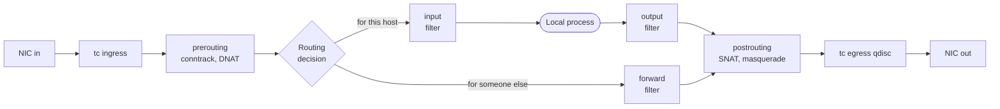
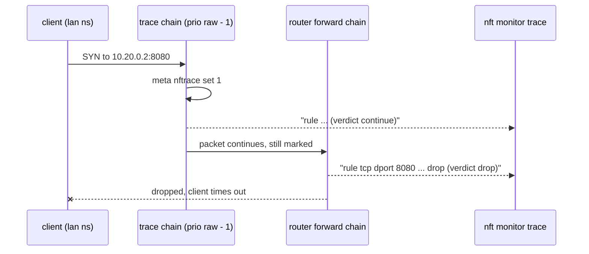
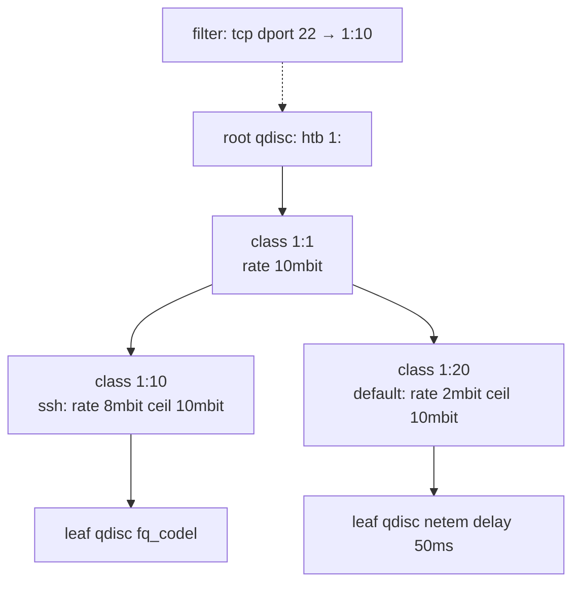
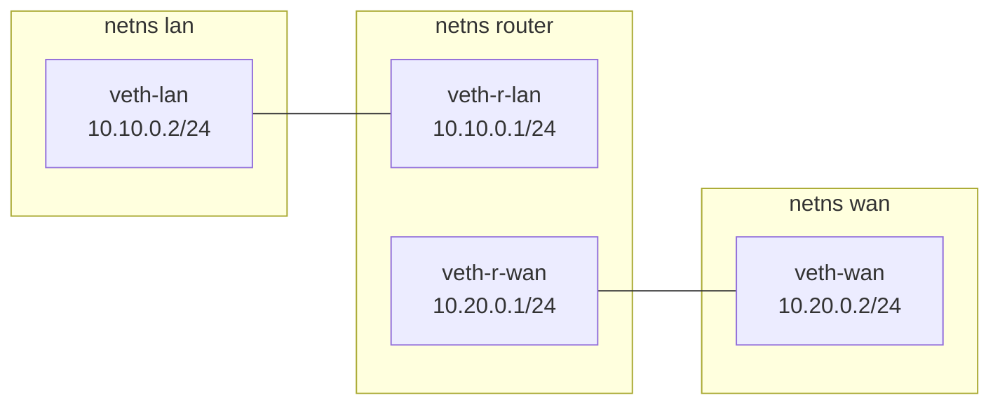

# 34 · nftables and Traffic Control

<ul class="module-meta">
  <li>⏱ ~3 hours</li>
  <li>5 labs</li>
  <li>Builds on: 11 · Networking, 12 · Firewalls with firewalld, 18 · Containers from the Ground Up</li>
</ul>

A developer swears their service works on their laptop, but in staging every tenth request takes two seconds. Another team needs a Rocky box to act as a small NAT router for a lab network. Someone else asks why `nft list ruleset` shows hundreds of lines they never wrote. All three questions live one level below `firewall-cmd`: in **netfilter**, the kernel's packet-filtering framework, and in **tc**, its traffic-control layer. This module takes you there, safely, using network namespaces so nothing you break can lock you out.

!!! abstract "What you'll learn"
    - Trace the path a packet takes through the kernel's netfilter hooks, and say where routing, conntrack and NAT happen
    - Read the nftables object model: families, tables, base and regular chains, rules, sets, maps and verdict maps
    - Read firewalld's generated ruleset without disturbing it, and decide when raw nftables is the better tool
    - Write a persistent ruleset for `nftables.service` and replace it atomically with `nft -f`
    - Debug a dropped packet with `meta nftrace set 1` and `nft monitor trace`, and inspect flows with `conntrack`
    - Use `tc` to inspect qdiscs, inject latency and loss with netem, and shape or police bandwidth with tbf, htb and ingress policing
    - Build all of it inside throwaway network namespaces

## The big picture

When a packet arrives at a Rocky host, it does not go straight to an application. The kernel passes it through a series of checkpoints. Some checkpoints belong to **netfilter** (firewalling, NAT, connection tracking). Some belong to **traffic control** (queueing, shaping, delaying). The routing table sits between them and decides where the packet goes next.



Three tools cover everything in that picture:

| Tool | Package | Works on |
|---|---|---|
| `nft` | `nftables` | The netfilter hooks: filtering, NAT, marking, sets |
| `conntrack` | `conntrack-tools` | The connection-tracking table that makes stateful filtering and NAT work |
| `tc` | `iproute-tc` | The queues on each interface: shaping, delay, loss, policing |

firewalld, which you met in [module 12](12-firewalld.md), is a manager that writes nftables rules for you. Everything in this module is the layer it sits on.

!!! analogy "Think of it like an airport"
    Netfilter hooks are the checkpoints (check-in, security, passport control, the gate). nftables is the rulebook the officers at each checkpoint follow. Conntrack is the boarding-pass system that remembers you already cleared security, so you don't get searched again. tc is the boarding queue at the gate: it decides the order people board, and how fast. The analogy breaks in one place: at an airport every passenger visits every checkpoint, but a packet visits only the hooks on its path (forwarded packets never see `input`).

## The packet path, hook by hook

**Netfilter** provides **hooks**: fixed points in the kernel's network code where registered functions get to inspect each packet. nftables, conntrack, NAT, firewalld and the old iptables all attach to these same hooks. Step through a packet's life:

<div class="stepper" markdown>

<div class="step" data-title="Arrival" markdown>

The NIC driver receives a frame. Before the IP stack even sees it, three optional checkpoints can act:

- **XDP** (eXpress Data Path): an eBPF program run inside the driver. It is the earliest and fastest place to drop a packet. You will only meet it in passing in this module.
- **tc ingress**: the traffic-control ingress hook, used for policing incoming traffic.
- the nftables **netdev** family's `ingress` hook: per-interface filtering before any IP processing.

No routing or connection tracking has happened yet. These hooks see raw packets.

</div>

<div class="step" data-title="prerouting" markdown>

Every incoming IP packet hits **prerouting**. Inside this one hook, functions run in **priority order** (lower number runs first):

| Priority | Name | What runs |
|---|---|---|
| -300 | `raw` | Rules that must run before conntrack, such as `notrack` |
| -200 | (conntrack) | Connection tracking looks up or creates the flow |
| -150 | `mangle` | Packet marking and header changes |
| -100 | `dstnat` | Destination NAT (port forwarding) |
| 0 | `filter` | Filtering (rarely used here) |

Because DNAT runs here, **before** the routing decision, a packet whose destination you rewrite is then routed to its new destination.

</div>

<div class="step" data-title="Routing decision" markdown>

The kernel looks up the (possibly rewritten) destination address in the routing table:

- Addressed to one of this host's own IPs: go to **input**.
- Addressed elsewhere, and `net.ipv4.ip_forward` is `1`: go to **forward**.
- Addressed elsewhere, forwarding off: dropped silently.

```console
$ ip route get 10.20.0.2
10.20.0.2 dev veth-r-wan src 10.20.0.1 uid 0
    cache
```

</div>

<div class="step" data-title="input" markdown>

Packets for a local socket pass through **input**. This is where a host firewall does its work: firewalld's `filter_INPUT` chain lives here. After input, the packet is delivered to the socket and your process reads it.

</div>

<div class="step" data-title="forward" markdown>

Packets just passing through (this host is a router, or a container bridge) take **forward** instead. They never see input or output. This is why firewalld's zone rules for "services" don't apply to traffic between containers: that traffic is forwarded, not input.

</div>

<div class="step" data-title="output" markdown>

Packets created by local processes start here. The kernel makes a routing decision **first** (it needs to know the outgoing interface), then runs the **output** hook (raw, conntrack, mangle, NAT for local traffic, filter). If a rule changes the mark or destination, the kernel reroutes.

</div>

<div class="step" data-title="postrouting" markdown>

Every outgoing packet, forwarded or local, hits **postrouting** last. Source NAT and **masquerade** (SNAT to whatever address the outgoing interface has) happen here, at priority `srcnat` (100). Conntrack also **confirms** new flows at the end of the path, so a packet dropped earlier never creates a table entry.

</div>

<div class="step" data-title="Egress queue" markdown>

Finally the packet enters the interface's **qdisc** (queueing discipline), the tc layer. The qdisc decides when it leaves: right away, after an artificial delay, or only when a rate limiter has tokens to spare. Then the driver hands it to the NIC.

```console
$ tc qdisc show dev eth0
qdisc fq_codel 0: root refcnt 2 limit 10240p flows 1024 quantum 1514 target 5ms interval 100ms memory_limit 32Mb ecn drop_batch 64
```

</div>

</div>

!!! note "Each network namespace has its own hooks"
    Netfilter state is per **network namespace**: each namespace has its own rules, its own conntrack table, its own routing table, and its own qdiscs. That is why containers ([module 18](18-containers.md)) can have private firewalls, and why every lab in this module runs inside namespaces. Your host's firewalld rules never see traffic between two namespaces' veth pairs.

<div class="quiz" data-answer="3" markdown>

A Rocky host is acting as a router. A packet arrives from the LAN, addressed to a server on the internet. Which hooks does it pass through, in order?

- prerouting, input, output, postrouting
- prerouting, input, forward
- prerouting, forward, postrouting
- input, forward, output

Forwarded packets take the short path: prerouting (conntrack and DNAT), the routing decision sends them to forward, then postrouting (where masquerade happens). They never touch input or output, which only handle traffic to and from local processes.

</div>

## The nftables object model

The old iptables had fixed tables (`filter`, `nat`, `mangle`) with fixed chains. nftables throws that away: nothing exists until you create it, and you decide where each chain attaches. Click through the building blocks from the outside in:

<div class="layers" data-open="0" data-hint="Click a layer to see what it holds." markdown>

<div class="layer" data-label="Ruleset" data-tag="nft list ruleset" markdown>

**Everything** loaded into one network namespace: all tables of all families. `nft list ruleset` prints it; `nft -f file` loads a file into it in one transaction.

</div>

<div class="layer" data-label="Table" data-tag="family + name" markdown>

A **table** is a namespace for chains, sets and maps. It has a **family** that decides which packets it can see, and a name you choose. Tables don't do anything by themselves. Two tables never share sets or chains.

```text
table inet lab { … }
table inet firewalld { … }   # firewalld's, hands off
```

</div>

<div class="layer" data-label="Base chain" data-tag="type, hook, priority, policy" markdown>

A **base chain** is a chain registered on a hook. It declares four things:

- **type**: `filter` (accept/drop), `nat` (address translation), or `route` (rerouting after marking, output hook only).
- **hook**: `prerouting`, `input`, `forward`, `output`, `postrouting` (or `ingress`/`egress` for netdev).
- **priority**: where it runs among other chains on the same hook. Names like `filter` (0), `dstnat` (-100), `srcnat` (100) or plain numbers.
- **policy**: what happens to packets that fall off the end: `accept` (default) or `drop`.

</div>

<div class="layer" data-label="Regular chain" data-tag="jump / goto target" markdown>

A **regular chain** has no hook. Packets only enter it when a rule says `jump name` (come back afterwards) or `goto name` (don't come back). Use them to organise rules, exactly like functions in a program.

</div>

<div class="layer" data-label="Rule" data-tag="match + statement" markdown>

A **rule** is a list of **expressions** read left to right: matches (`tcp dport 22`, `ip saddr 10.0.0.0/8`, `ct state new`) followed by statements (`counter`, `log`, `masquerade`) and usually a **verdict** (`accept`, `drop`, `reject`, `jump`, `goto`, `return`). If any match fails, the rest of the rule is skipped.

</div>

<div class="layer" data-label="Sets, maps, verdict maps" data-tag="O(1) lookups" markdown>

- A **set** is a collection of values (`{ 22, 80, 443 }`). Named sets live in the table and can change without touching rules. They can hold **timeouts** so entries expire on their own.
- A **map** turns a key into a value (port to IP, for DNAT).
- A **verdict map** turns a key into a verdict: `tcp dport vmap { 22 : accept, 23 : drop }`.

A lookup in a set is one hash or tree lookup, however many elements it holds. This is the main reason nftables scales where long iptables chains did not.

</div>

<div class="layer" data-label="Stateful objects" data-tag="counters, quotas, limits" markdown>

**Counters** (`counter`), **quotas** and **limits** can be inline in a rule or named objects in the table that several rules share. `nft list counters` shows the named ones.

</div>

</div>

### Families: which packets a table can see

| Family | Sees | Typical use |
|---|---|---|
| `ip` | IPv4 only | Legacy-style IPv4 rules |
| `ip6` | IPv6 only | IPv6-only rules |
| `inet` | IPv4 and IPv6 | **Almost everything**: one ruleset for both stacks |
| `arp` | ARP packets | Rare: ARP filtering |
| `bridge` | Frames crossing a Linux bridge | Filtering between bridged VMs |
| `netdev` | One interface, before the IP stack (`ingress`, `egress`) | Early drops, DDoS filtering |

Use `inet` unless you have a reason not to. firewalld does.

### A small ruleset, annotated

```bash title="/etc/nftables/lab.nft"
table inet lab {
    set admin_hosts {                                   # (1)!
        type ipv4_addr
        elements = { 192.168.122.1, 10.0.0.5 }
    }

    set blocklist {                                     # (2)!
        type ipv4_addr
        flags dynamic, timeout
        timeout 10m
    }

    chain input {
        type filter hook input priority filter; policy drop;   # (3)!

        ct state established,related accept             # (4)!
        ct state invalid drop
        iif "lo" accept
        ip saddr @blocklist counter drop                 # (5)!
        tcp dport 2323 add @blocklist { ip saddr } drop  # (6)!
        meta l4proto { icmp, ipv6-icmp } accept
        tcp dport vmap { 22 : jump ssh_in, 80 : accept, 443 : accept }  # (7)!
    }

    chain ssh_in {                                      # (8)!
        ip saddr @admin_hosts accept
        counter reject
    }
}
```

1. A named set of addresses. You can add or remove elements later without reloading rules: `nft add element inet lab admin_hosts '{ 10.0.0.9 }'`.
2. A set whose entries expire after 10 minutes. `dynamic` lets rules add to it from the packet path.
3. The base chain: attaches to `input` at priority 0 and drops anything not explicitly accepted.
4. The stateful firewall line. Replies to connections we allowed are accepted without re-checking every rule. This depends on conntrack.
5. Any source in the blocklist is counted and dropped.
6. A tripwire: anyone who touches port 2323 is added to the blocklist for 10 minutes.
7. A verdict map: one lookup decides what to do with each port.
8. A regular chain, reached only by the `jump` in the verdict map.

```console
$ sudo nft list set inet lab blocklist
table inet lab {
	set blocklist {
		type ipv4_addr
		size 65535
		flags dynamic,timeout
		timeout 10m
		elements = { 203.0.113.50 timeout 10m expires 8m41s }
	}
}
```

!!! tip "Handles let you delete one rule"
    `sudo nft -a list chain inet lab input` prints each rule with `# handle N`. Then `sudo nft delete rule inet lab input handle N` removes exactly that rule. To insert a rule at a precise spot, use `nft insert rule … position N` or `nft add rule … position N`.

<div class="quiz" data-answer="2" markdown>

Your table `inet myfw` has an input chain with `policy accept` and a rule that accepts TCP port 8080. firewalld is also running, and its input chain does not allow 8080. Does a new connection to port 8080 get through?

- Yes, because your table accepts it
- No, because the packet must also pass firewalld's base chain on the same hook, and that one rejects it
- Yes, because tables with lower priority override higher ones

An `accept` verdict only ends processing in **that** base chain. The packet then continues to the next base chain on the same hook (firewalld's, at priority `filter + 10`). A `drop` anywhere is final; an `accept` is not. To open a port alongside firewalld, open it in firewalld.

</div>

## Reading firewalld's ruleset safely

firewalld translates zones, services and policies into an nftables table called `inet firewalld`. Reading it is the best way to understand what firewalld really does, and it is completely safe: `nft list` never changes anything.

```console
$ sudo nft list tables
table inet firewalld
$ sudo nft list chain inet firewalld filter_INPUT
table inet firewalld {
	chain filter_INPUT {
		type filter hook input priority filter + 10; policy accept;
		ct state { established, related } accept
		ct status dnat accept
		iifname "lo" accept
		ct state invalid drop
		jump filter_INPUT_POLICIES
		reject with icmpx admin-prohibited
	}
}
```

Read it top to bottom and you can see the whole design: replies are accepted early, loopback is trusted, invalid packets are dropped, then the packet jumps to per-zone chains (`filter_IN_public`, `filter_IN_public_allow`, …) chosen by interface or source. Anything that falls through is rejected with an ICMP "administratively prohibited" message. That reject line is why a closed port on Rocky answers immediately instead of timing out.

```console
$ sudo nft list chain inet firewalld filter_IN_public_allow
table inet firewalld {
	chain filter_IN_public_allow {
		tcp dport 22 accept
		ip6 daddr fe80::/64 udp dport 546 accept
		tcp dport 9090 accept
	}
}
```

There's `ssh`, `dhcpv6-client` and `cockpit`, the three services in the default `public` zone, turned into three rules.

!!! warning "Look, don't touch"
    Never add rules to `inet firewalld` with `nft`. firewalld rebuilds that table from its own configuration on every reload, so your change silently disappears. On Rocky 10 (and since Rocky 9.5) firewalld also creates the table with `flags owner,persist`: the kernel lets only firewalld modify it, and a global `nft flush ruleset` skips it. Change firewalld's behaviour with `firewall-cmd` (zones, policies, rich rules) instead.

### Raw nftables or firewalld?

<div class="decision" markdown>

<div class="node" data-id="start" markdown>

**Is this a normal server that needs ports opened and closed?**

<button data-goto="fwd">Yes</button> <button data-goto="router">No, it's something more unusual</button>

</div>

<div class="node" data-id="fwd" markdown>

**Use firewalld.** Zones, services and `--permanent` cover it, other admins expect it, and tools like Cockpit, Podman and libvirt integrate with it. Read its nftables output when you need to understand it. See [module 12](12-firewalld.md).

</div>

<div class="node" data-id="router" markdown>

**Do you need features firewalld can't express?** Examples: verdict maps, dynamic sets with timeouts, netdev ingress filtering, complex per-flow marking, a pure router or NAT appliance with a fixed, reviewed ruleset.

<button data-goto="raw">Yes</button> <button data-goto="policy">Not really</button>

</div>

<div class="node" data-id="policy" markdown>

**Stay with firewalld.** It handles routing between zones (policies with `--new-policy`), masquerade, port forwarding and rich rules. Most "I need raw nftables" requests turn out to be firewalld policies.

</div>

<div class="node" data-id="raw" markdown>

**Use raw nftables with `nftables.service`**, and pick one of two safe setups:

1. **Replace firewalld**: `systemctl disable --now firewalld`, `systemctl mask firewalld`, `systemctl enable --now nftables`. One owner, one ruleset.
2. **Run both on purpose**: keep firewalld for the host, and put your extra rules in your own table. Remember a packet must survive **every** base chain on a hook, and never use `flush ruleset` in your files.

</div>

</div>

## Writing a persistent ruleset

On Rocky, `nftables.service` loads one file at boot: `/etc/sysconfig/nftables.conf`. Rocky ships it with only comments and commented-out `include` lines, plus some sample files in `/etc/nftables/`. The convention is to keep your real rules in `/etc/nftables/*.nft` and include them:

```console
$ systemctl cat nftables | grep -E 'Exec'
ExecStart=/sbin/nft -f /etc/sysconfig/nftables.conf
ExecReload=/sbin/nft 'flush ruleset; include "/etc/sysconfig/nftables.conf";'
ExecStop=/sbin/nft flush ruleset
```

Notice `ExecStop` and `ExecReload`: they flush the **whole** ruleset in that namespace. On a host where firewalld owns its table that table is protected, but every other table (yours, libvirt's, Podman's) is wiped. That's one more reason not to run `nftables.service` and firewalld together casually.

### Atomic replacement with nft -f

`nft -f file` applies the whole file as a **single transaction**: either every line succeeds, or nothing changes. There is no moment when half the rules are loaded. This is how you change a production firewall without a gap.

To make a file safe to load again and again, start it by removing your own table, and only your own table:

```bash title="/etc/nftables/router.nft"
table inet router          # (1)!
delete table inet router   # (2)!

table inet router {
    chain forward {
        type filter hook forward priority filter; policy drop;
        ct state established,related accept
        iifname "veth-r-lan" oifname "veth-r-wan" accept
    }
    chain postrouting {
        type nat hook postrouting priority srcnat; policy accept;
        oifname "veth-r-wan" masquerade
    }
}
```

1. Create the table if it doesn't exist (an empty declaration is harmless if it does).
2. Now it definitely exists, so deleting it can't fail. The new definition below replaces it, all inside one transaction.

Always check the syntax first. `-c` parses and validates against the running kernel without applying anything:

```console
$ sudo nft -c -f /etc/nftables/router.nft && echo OK
OK
$ sudo nft -f /etc/nftables/router.nft
```

Then include the file from `/etc/sysconfig/nftables.conf` and enable the service:

```ini title="/etc/sysconfig/nftables.conf"
include "/etc/nftables/router.nft"
```

```console
$ sudo systemctl enable --now nftables
```

!!! danger "Remote changes: give yourself an undo"
    When you change a firewall over SSH, a typo in a `policy drop` chain can lock you out. Schedule a rollback before loading, then cancel it once you've confirmed you can still connect:

    ```console
    $ sudo nft list ruleset > /root/nft-before.nft
    $ sudo systemd-run --on-active=5m --unit=nft-rollback /bin/sh -c 'nft -f /root/nft-before.nft'
    $ sudo nft -f /etc/nftables/new.nft
    $ sudo systemctl stop nft-rollback.timer     # still connected? cancel the undo
    ```

    For the rollback file to be a full replacement, it needs the same "declare, delete, redefine" header for each of your tables.

<div class="quiz" data-answer="1" markdown>

You load a 200-line ruleset with `nft -f`, and line 150 contains a typo. What state is the firewall in afterwards?

- Exactly as it was before; nothing from the file was applied
- The first 149 lines are applied, the rest are not
- All rules are flushed, leaving the host wide open
- All rules except line 150 are applied

`nft -f` sends the whole file to the kernel as one transaction. One error and the kernel rejects all of it. That is what makes atomic replacement safe, and it's why you check with `nft -c -f` first anyway.

</div>

## Connection tracking

**Conntrack** is the kernel's memory of every flow it has seen. It is what makes `ct state established` work, and it is what NAT uses to rewrite reply packets back to the original addresses. Each entry stores the flow twice: the original direction and the expected reply direction.

```console
$ sudo dnf install -y conntrack-tools
$ sudo conntrack -L -p tcp --dport 22
tcp      6 431999 ESTABLISHED src=192.168.122.1 dst=192.168.122.50 sport=50412 dport=22 src=192.168.122.50 dst=192.168.122.1 sport=22 dport=50412 [ASSURED] mark=0 secctx=system_u:object_r:unlabeled_t:s0 use=1
conntrack v1.4.8 (conntrack-tools): 1 flow entries have been shown.
```

Reading it: protocol, the seconds left before the entry expires (431999 is about five days, the default for an established TCP flow), the state, the original tuple, then the reply tuple. When NAT is involved, the reply tuple shows the translated addresses, which is how you prove masquerade is working.

| Command | What it shows |
|---|---|
| `conntrack -L` | All tracked flows |
| `conntrack -E` | Live events: new, update, destroy |
| `conntrack -C` | How many entries exist now |
| `conntrack -S` | Per-CPU statistics, including `drop`, `early_drop` and `insert_failed` |
| `conntrack -D -s 10.0.0.5` | Delete matching entries (forces those flows to be re-evaluated) |

!!! pitfall "nf_conntrack: table full, dropping packet"
    Busy NAT gateways and load balancers can fill the conntrack table. New connections then fail at random while existing ones keep working. Compare `conntrack -C` with `sysctl net.netfilter.nf_conntrack_max`, check the journal for the message above, and raise the limit (in a file under `/etc/sysctl.d/`) or exempt high-volume stateless traffic with a `notrack` rule in a `raw` priority chain.

!!! tip "Rules you add don't affect existing flows"
    A rule that drops `ct state new` traffic to a port won't kill a connection that is already established, because its packets are `established`. After tightening a firewall, `conntrack -D` on the affected flows forces them to be checked against the new rules.

## Debugging: follow one packet with nftrace

When a packet disappears, guessing which rule ate it wastes hours. nftables can **trace** a packet: mark it with `meta nftrace set 1`, and every chain and rule it passes through reports what happened. `nft monitor trace` prints those reports.

The trick is to set the mark as early as possible, and only on the packets you care about:

```console
$ sudo nft add table inet trace
$ sudo nft add chain inet trace pre '{ type filter hook prerouting priority raw - 1; }'
$ sudo nft add rule inet trace pre ip saddr 10.10.0.2 tcp dport 8080 meta nftrace set 1
$ sudo nft monitor trace
```

Then send the traffic. Every traced packet gets an id, and each line shows a step:

```console
trace id 6e2b1f0a inet trace pre packet: iif "veth-r-lan" ether saddr 6a:1c:9e:20:41:07 ether daddr 2e:5d:83:ab:10:92 ip saddr 10.10.0.2 ip daddr 10.20.0.2 ip dscp cs0 ip ecn not-ect ip ttl 64 ip id 30551 ip protocol tcp ip length 60 tcp sport 47314 tcp dport 8080 tcp flags == syn tcp window 64240
trace id 6e2b1f0a inet trace pre rule ip saddr 10.10.0.2 tcp dport 8080 meta nftrace set 1 (verdict continue)
trace id 6e2b1f0a inet trace pre verdict continue
trace id 6e2b1f0a inet trace pre policy accept
trace id 6e2b1f0a inet router forward packet: iif "veth-r-lan" oif "veth-r-wan" …
trace id 6e2b1f0a inet router forward rule tcp dport 8080 counter packets 1 bytes 60 drop (verdict drop)
```

The last line names the table, the chain, the exact rule, and the verdict. No guessing.



!!! warning "Remove trace rules when you're done"
    Tracing has a cost, and a broad trace rule (say, all TCP) on a busy server floods the monitor. Delete the trace table afterwards: `sudo nft delete table inet trace`.

!!! tip "firewalld can log what it drops"
    For firewalld's own rejects, `sudo firewall-cmd --set-log-denied=all` adds log rules before each reject and drop, and the kernel messages appear in `journalctl -k`. Set it back with `--set-log-denied=off`.

### Practice: read the firewall

<div class="terminal-sim" data-title="Inspect netfilter and tc" data-prompt="[alex@rocky-lab ~]$ " markdown>

<div class="task" data-expect="sudo nft list tables||nft list tables" data-hint="Use nft to list just the tables, not the whole ruleset." markdown>

**Step 1.** List every nftables table on this host.

```text
table inet firewalld
```

</div>

<div class="task" data-expect="sudo nft list chain inet firewalld filter_INPUT||nft list chain inet firewalld filter_INPUT" data-hint="nft list chain <family> <table> <chain>" markdown>

**Step 2.** Show firewalld's base input chain, `filter_INPUT`, in the `inet firewalld` table.

```text
table inet firewalld {
	chain filter_INPUT {
		type filter hook input priority filter + 10; policy accept;
		ct state { established, related } accept
		…
		reject with icmpx admin-prohibited
	}
}
```

</div>

<div class="task" data-expect="sudo conntrack -L||conntrack -L||sudo conntrack -L -p tcp||sudo conntrack -L -p tcp --dport 22" data-match="^(sudo )?conntrack -L" data-hint="The conntrack tool lists flows with -L." markdown>

**Step 3.** List the tracked connections.

```text
tcp      6 431999 ESTABLISHED src=192.168.122.1 dst=192.168.122.50 sport=50412 dport=22 src=192.168.122.50 dst=192.168.122.1 sport=22 dport=50412 [ASSURED] mark=0 use=1
conntrack v1.4.8 (conntrack-tools): 1 flow entries have been shown.
```

</div>

<div class="task" data-expect="tc -s qdisc show dev eth0||tc -s qdisc||tc -s qdisc show||tc -s qdisc ls dev eth0" data-hint="tc, with -s for statistics, then qdisc show dev eth0." markdown>

**Step 4.** Show the queueing discipline on `eth0`, with statistics.

```text
qdisc fq_codel 0: root refcnt 2 limit 10240p flows 1024 quantum 1514 target 5ms interval 100ms memory_limit 32Mb ecn drop_batch 64
 Sent 48213377 bytes 61204 pkt (dropped 0, overlimits 0 requeues 3)
 backlog 0b 0p requeues 3
  maxpacket 1514 drop_overlimit 0 new_flow_count 412 ecn_mark 0
  new_flows_len 0 old_flows_len 0
```

</div>

</div>

## Traffic control: queues, shaping and impairment

Netfilter decides **whether** a packet may pass. **Traffic control** (tc) decides **when** it leaves. Every interface has a **qdisc** (queueing discipline) on egress: the algorithm that holds packets until the NIC can take them.



Three building blocks:

- **qdisc**: the queue algorithm. Simple ones (fq_codel, tbf, netem) are **classless**. **Classful** ones (htb) contain classes.
- **class**: a slot inside a classful qdisc, with its own rate. Each class has its own leaf qdisc.
- **filter**: sorts packets into classes (by port, address, firewall mark, …).

Handles are written `major:minor`. A qdisc is `1:` (minor 0), its classes `1:1`, `1:10`, and so on.

### The default: fq_codel

Rocky's kernel is built with **fq_codel** as the default qdisc. It does two things: it gives each flow its own small queue and serves them fairly (**fq**, fair queueing), and it drops or ECN-marks packets when a queue's delay stays above 5 ms for a while (**CoDel**, controlled delay). The result is low latency even under load, which fights **bufferbloat** (huge queues that make every packet wait behind a big download).

The old default, **pfifo_fast**, was three plain first-in-first-out bands chosen by the packet's priority bits. You still see it named in old tutorials. On a multi-queue NIC (most virtio and physical NICs), the root is an `mq` qdisc with one fq_codel child per hardware queue:

```console
$ tc qdisc show dev eth0
qdisc mq 0: root
qdisc fq_codel 0: parent :2 limit 10240p flows 1024 quantum 1514 target 5ms interval 100ms memory_limit 32Mb ecn drop_batch 64
qdisc fq_codel 0: parent :1 limit 10240p flows 1024 quantum 1514 target 5ms interval 100ms memory_limit 32Mb ecn drop_batch 64
$ sysctl net.core.default_qdisc
net.core.default_qdisc = fq_codel
```

!!! tip "Read the drop counters"
    `tc -s qdisc show dev eth0` shows `Sent … (dropped N, overlimits N requeues N)` and a `backlog`. Climbing `dropped` with a non-zero backlog means the interface is congested and the qdisc is shedding load. Zero drops and a full application queue means the bottleneck is elsewhere. The [performance module](19-performance-and-observability.md) shows how this fits into a USE-method check.

### netem: break the network on purpose

**netem** (network emulator) adds delay, jitter, loss, duplication, corruption and reordering to an interface's egress. It's the best tool you have to test how an application behaves on a bad network, before your users find out.

```console
$ sudo tc qdisc add dev veth-c root netem delay 200ms
$ sudo tc qdisc change dev veth-c root netem delay 200ms 20ms distribution normal loss 5%
$ sudo tc qdisc change dev veth-c root netem delay 10ms reorder 25% 50%
$ sudo tc qdisc del dev veth-c root
```

| netem option | Effect |
|---|---|
| `delay 200ms` | Every packet waits 200 ms |
| `delay 200ms 20ms` | 200 ms plus or minus 20 ms of jitter |
| `loss 5%` | Drop 5% of packets at random |
| `duplicate 1%` | Send 1% of packets twice |
| `corrupt 0.1%` | Flip a random bit in 0.1% of packets |
| `reorder 25% 50%` | Send 25% of packets immediately (out of order), with 50% correlation; needs a `delay` |
| `rate 1mbit` | Limit the rate as well |

Remember netem only affects **egress** of the interface you put it on. Put `delay 100ms` on one end of a link and the round-trip time grows by 100 ms, not 200.

!!! version "Rocky 9 vs 10"
    On Rocky 9, `sch_netem` lives in the `kernel-modules-extra` package, and `tc qdisc add … netem` fails with "Error: Specified qdisc kind is unknown." until you install it (`sudo dnf install kernel-modules-extra`, for the running kernel). On Rocky 10 the queueing modules, netem included, ship in `kernel-modules-core`, so netem works out of the box.

### Shaping with tbf and htb

**Shaping** means holding packets back to keep traffic under a rate. Shaping only works on egress, because you can only delay what you send.

**tbf** (token bucket filter) is the simple one: one rate for the whole interface. Tokens drip into a bucket at the configured rate; each byte sent spends a token; when the bucket is empty, packets wait. `burst` is the bucket size, and `latency` caps how long a packet may wait before it's dropped.

```console
$ sudo tc qdisc add dev veth-c root tbf rate 5mbit burst 32kbit latency 400ms
```

**htb** (hierarchical token bucket) is the classful one. It gives each class a guaranteed **rate** and lets it borrow up to a **ceil** when siblings are idle. Use it when different kinds of traffic need different shares:

```console
$ sudo tc qdisc add dev veth-c root handle 1: htb default 20
$ sudo tc class add dev veth-c parent 1: classid 1:1 htb rate 10mbit
$ sudo tc class add dev veth-c parent 1:1 classid 1:10 htb rate 8mbit ceil 10mbit
$ sudo tc class add dev veth-c parent 1:1 classid 1:20 htb rate 2mbit ceil 10mbit
$ sudo tc filter add dev veth-c parent 1: protocol ip prio 1 u32 match ip dport 22 0xffff flowid 1:10
$ tc -s class show dev veth-c
```

`default 20` sends unclassified traffic to class `1:20`. The `u32` filter matches destination port 22 and puts it in `1:10`. When both classes are busy, SSH gets 8 Mbit/s and everything else 2; when SSH is idle, everything else can borrow up to 10.

### Policing incoming traffic

You can't delay packets that have already arrived, but you can **police** them: drop whatever exceeds a rate. TCP senders notice the losses and slow down. Policing lives on the special `ingress` qdisc:

```console
$ sudo tc qdisc add dev veth-c handle ffff: ingress
$ sudo tc filter add dev veth-c parent ffff: protocol ip u32 match u32 0 0 police rate 2mbit burst 100k drop flowid :1
```

Policing is cruder than shaping (it drops instead of queueing), so throughput under a policer is jumpy. Where you control the sender, shape there instead.

!!! note "XDP, briefly"
    **XDP** runs an eBPF program inside the NIC driver, before the kernel even allocates its normal packet structure. It's how DDoS scrubbers and load balancers process millions of packets per second per core. Writing XDP programs is beyond this course; recognise the name, and know that `ip link show` lists an attached program as `xdp` or `xdpgeneric`.

<div class="quiz" data-answer="2" markdown>

You add `tc qdisc add dev eth0 root netem delay 100ms` on a server and ping it from a client. Before the change the RTT was 1 ms. What do you expect now?

- About 201 ms, because the delay applies in both directions
- About 101 ms, because netem delays only packets leaving eth0 on the server
- About 1 ms, because ping uses ICMP which tc ignores
- About 100 ms on the client and 1 ms on the server

netem is an egress qdisc. The echo request arrives undelayed; only the echo reply, leaving the server through eth0, waits 100 ms. To delay both ways, add netem on both ends (or on egress of both veth ends in a lab).

</div>

## Labs

All labs build on one throwaway topology inside your Rocky 10 VM: three network namespaces joined by veth pairs. Your host's own networking and firewalld are untouched.



Install the tools once: `sudo dnf install -y nftables iproute-tc conntrack-tools iperf3 tcpdump`.

!!! lab "Lab 1: Build a NAT router in a namespace"

    **Goal:** Turn a namespace into a router that masquerades a private LAN, and prove the translation in the conntrack table.

    **You'll need:** a Rocky 10 VM, sudo.

    1. Create the namespaces and wire them up:

        ```bash
        for n in lan router wan; do sudo ip netns add $n; done
        sudo ip link add veth-lan type veth peer name veth-r-lan
        sudo ip link add veth-wan type veth peer name veth-r-wan
        sudo ip link set veth-lan netns lan
        sudo ip link set veth-r-lan netns router
        sudo ip link set veth-r-wan netns router
        sudo ip link set veth-wan netns wan
        sudo ip -n lan addr add 10.10.0.2/24 dev veth-lan
        sudo ip -n router addr add 10.10.0.1/24 dev veth-r-lan
        sudo ip -n router addr add 10.20.0.1/24 dev veth-r-wan
        sudo ip -n wan addr add 10.20.0.2/24 dev veth-wan
        for n in lan router wan; do sudo ip -n $n link set lo up; done
        sudo ip -n lan link set veth-lan up
        sudo ip -n router link set veth-r-lan up
        sudo ip -n router link set veth-r-wan up
        sudo ip -n wan link set veth-wan up
        sudo ip -n lan route add default via 10.10.0.1
        ```

        Note that `wan` has **no route** back to `10.10.0.0/24`. Without NAT, replies can't come back.

    2. Turn on forwarding inside the router namespace only:

        ```console
        $ sudo ip netns exec router sysctl -w net.ipv4.ip_forward=1
        net.ipv4.ip_forward = 1
        ```

    3. Try to ping the wan host from lan. It fails, because wan doesn't know how to reach 10.10.0.2:

        ```console
        $ sudo ip netns exec lan ping -c 2 -W 1 10.20.0.2
        2 packets transmitted, 0 received, 100% packet loss, time 1032ms
        ```

    4. Write the router's ruleset (the same file shown earlier in this module) to `/tmp/router.nft`, check it, and load it into the router namespace:

        ```bash
        sudo tee /tmp/router.nft <<'EOF'
        table inet router
        delete table inet router
        table inet router {
            chain forward {
                type filter hook forward priority filter; policy drop;
                ct state established,related accept
                iifname "veth-r-lan" oifname "veth-r-wan" accept
            }
            chain postrouting {
                type nat hook postrouting priority srcnat; policy accept;
                oifname "veth-r-wan" masquerade
            }
        }
        EOF
        sudo ip netns exec router nft -c -f /tmp/router.nft && sudo ip netns exec router nft -f /tmp/router.nft
        ```

    5. Ping again, then look at the router's conntrack table:

        ```console
        $ sudo ip netns exec lan ping -c 2 10.20.0.2
        64 bytes from 10.20.0.2: icmp_seq=1 ttl=63 time=0.071 ms
        64 bytes from 10.20.0.2: icmp_seq=2 ttl=63 time=0.055 ms
        $ sudo ip netns exec router conntrack -L
        icmp     1 27 src=10.10.0.2 dst=10.20.0.2 type=8 code=0 id=4410 src=10.20.0.2 dst=10.20.0.1 type=0 code=0 id=4410 mark=0 use=1
        conntrack v1.4.8 (conntrack-tools): 1 flow entries have been shown.
        ```

    **Check your work:** the TTL is 63 (one router hop), and the reply tuple in conntrack has `dst=10.20.0.1`: the wan host answered the router's address, and the router translated it back to 10.10.0.2.

    ??? success "What just happened?"
        The ping left `lan`, entered the router's prerouting hook, where conntrack created an entry. The routing decision sent it to forward (allowed by your `iifname … oifname … accept` rule), then postrouting rewrote the source to 10.20.0.1. The wan host replied to 10.20.0.1. On the way back, conntrack recognised the reply, reversed the NAT, and the `established` rule let it through forward. Also try `sudo ip netns exec wan ping -c 1 -W 1 10.10.0.2`: it fails, because the forward policy is drop and only replies are allowed back in.

    **Clean up:** keep the namespaces for the next labs. To remove everything at any point: `for n in lan router wan; do sudo ip netns del $n; done` (deleting a namespace destroys its veth ends too).

!!! lab "Lab 2: Trace a dropped packet"

    **Goal:** Use nftrace to find exactly which rule drops a connection.

    1. Start a web server in the wan namespace (leave it running in its own terminal):

        ```console
        $ sudo ip netns exec wan python3 -m http.server 8080
        ```

    2. In another terminal, add a sneaky drop rule on the router, **before** the accept rule:

        ```console
        $ sudo ip netns exec router nft insert rule inet router forward tcp dport 8080 counter drop
        ```

    3. Confirm the client now hangs:

        ```console
        $ sudo ip netns exec lan curl --max-time 3 -s http://10.20.0.2:8080/ ; echo "exit=$?"
        exit=28
        ```

    4. Add a trace chain that marks only this traffic, before everything else on prerouting:

        ```bash
        sudo ip netns exec router nft add table inet trace
        sudo ip netns exec router nft add chain inet trace pre '{ type filter hook prerouting priority raw - 1; }'
        sudo ip netns exec router nft add rule inet trace pre ip saddr 10.10.0.2 tcp dport 8080 meta nftrace set 1
        ```

    5. In a third terminal, start the monitor: `sudo ip netns exec router nft monitor trace`. Run the `curl` from step 3 again and watch.

    **Check your work:** the monitor ends with a line like `inet router forward rule tcp dport 8080 counter packets 2 bytes 120 drop (verdict drop)`. You found the culprit by table, chain and rule.

    6. Fix it: find the rule's handle and delete it, then retry `curl` (it should print the directory listing HTML):

        ```console
        $ sudo ip netns exec router nft -a list chain inet router forward
        …
        		tcp dport 8080 counter packets 2 bytes 120 drop # handle 4
        …
        $ sudo ip netns exec router nft delete rule inet router forward handle 4
        ```

    **Clean up:** stop the monitor and the web server with ++ctrl+c++, then `sudo ip netns exec router nft delete table inet trace`.

!!! lab "Lab 3: Make the network bad with netem"

    **Goal:** Add 200 ms of latency and 5% loss between lan and router, and measure it.

    1. Take a baseline:

        ```console
        $ sudo ip netns exec lan ping -c 20 -q 10.20.0.2
        20 packets transmitted, 20 received, 0% packet loss, time 19455ms
        rtt min/avg/max/mdev = 0.041/0.062/0.090/0.011 ms
        ```

    2. Impair the lan side's egress:

        ```console
        $ sudo ip netns exec lan tc qdisc add dev veth-lan root netem delay 200ms loss 5%
        ```

    3. Measure again with more packets (loss is random, so you need a decent sample):

        ```console
        $ sudo ip netns exec lan ping -c 100 -i 0.2 -q 10.20.0.2
        100 packets transmitted, 94 received, 6% packet loss, time 20140ms
        rtt min/avg/max/mdev = 200.112/200.231/200.580/0.081 ms
        ```

    4. Look at the qdisc's own counters:

        ```console
        $ sudo ip netns exec lan tc -s qdisc show dev veth-lan
        qdisc netem 8001: root refcnt 2 limit 1000 delay 200ms loss 5%
         Sent 9872 bytes 101 pkt (dropped 6, overlimits 0 requeues 0)
         backlog 0b 0p requeues 0
        ```

    5. Add jitter and see `mdev` grow: `sudo ip netns exec lan tc qdisc change dev veth-lan root netem delay 200ms 50ms loss 5%`, then repeat step 3.

    **Check your work:** average RTT is about 200 ms (only one direction is delayed), loss is near 5%, and the qdisc's `dropped` counter matches the missing pings.

    ??? question "Use this on a real app"
        Run your application's client in a namespace with netem and watch what breaks: timeouts that are too short, retries that stampede, a UI that freezes on one lost packet. Ten minutes of netem testing finds bugs that otherwise show up only for your most distant users.

    **Clean up:** `sudo ip netns exec lan tc qdisc del dev veth-lan root`

!!! lab "Lab 4: Rate-limit with tbf, then share with htb"

    **Goal:** Cap throughput with a token bucket and measure it with iperf3.

    1. Start an iperf3 server in wan (leave it running): `sudo ip netns exec wan iperf3 -s`
    2. Baseline from lan (veth is fast, expect many Gbit/s):

        ```console
        $ sudo ip netns exec lan iperf3 -c 10.20.0.2 -t 5
        …
        [  5]   0.00-5.00   sec  21.4 GBytes  36.8 Gbits/sec    0             sender
        ```

    3. Cap the lan egress at 5 Mbit/s:

        ```console
        $ sudo ip netns exec lan tc qdisc add dev veth-lan root tbf rate 5mbit burst 32kbit latency 400ms
        $ sudo ip netns exec lan iperf3 -c 10.20.0.2 -t 5
        …
        [  5]   0.00-5.00   sec  3.12 MBytes  5.23 Mbits/sec    0             sender
        [  5]   0.00-5.04   sec  2.88 MBytes  4.79 Mbits/sec                  receiver
        ```

    4. Replace tbf with htb: SSH-like traffic (port 22) gets 8 Mbit/s, everything else 2 Mbit/s, both may borrow up to 10:

        ```bash
        sudo ip netns exec lan tc qdisc del dev veth-lan root
        sudo ip netns exec lan tc qdisc add dev veth-lan root handle 1: htb default 20
        sudo ip netns exec lan tc class add dev veth-lan parent 1: classid 1:1 htb rate 10mbit
        sudo ip netns exec lan tc class add dev veth-lan parent 1:1 classid 1:10 htb rate 8mbit ceil 10mbit
        sudo ip netns exec lan tc class add dev veth-lan parent 1:1 classid 1:20 htb rate 2mbit ceil 10mbit
        sudo ip netns exec lan tc filter add dev veth-lan parent 1: protocol ip prio 1 u32 match ip dport 22 0xffff flowid 1:10
        ```

    5. Run iperf3 again (port 5201, so class 1:20). Alone it borrows up to about 10 Mbit/s. Then check which class carried the bytes:

        ```console
        $ sudo ip netns exec lan tc -s class show dev veth-lan
        class htb 1:1 root rate 10Mbit ceil 10Mbit burst 1600b cburst 1600b
         Sent 6312840 bytes 4182 pkt (dropped 0, overlimits 0 requeues 0)
        class htb 1:10 parent 1:1 prio 0 rate 8Mbit ceil 10Mbit burst 1600b cburst 1600b
         Sent 0 bytes 0 pkt (dropped 0, overlimits 0 requeues 0)
        class htb 1:20 parent 1:1 prio 0 rate 2Mbit ceil 10Mbit burst 1600b cburst 1600b
         Sent 6312840 bytes 4182 pkt (dropped 0, overlimits 0 requeues 0)
        …
        ```

    **Check your work:** with tbf, iperf3 reports close to 5 Mbit/s; with htb, class `1:20` has all the bytes and the rate tops out near the 10 Mbit/s ceil.

    **Clean up:** stop iperf3 with ++ctrl+c++; `sudo ip netns exec lan tc qdisc del dev veth-lan root`

!!! lab "Lab 5: Sets with timeouts and an atomic swap"

    **Goal:** Use a dynamic blocklist, then replace the whole router ruleset in one transaction without dropping established flows.

    1. Add a blocklist set and a tripwire to the router (traffic to port 2323 bans the sender for 30 seconds):

        ```bash
        sudo ip netns exec router nft add set inet router blocklist '{ type ipv4_addr; flags dynamic, timeout; timeout 30s; }'
        sudo ip netns exec router nft insert rule inet router forward ip saddr @blocklist counter drop
        sudo ip netns exec router nft add rule inet router forward tcp dport 2323 add @blocklist '{ ip saddr }' drop
        ```

        Order matters: the `@blocklist` check was **inserted** at the top, the tripwire **added** at the bottom, after the accept rule for lan traffic. Look at `nft list chain inet router forward` and you'll see the tripwire can't be reached yet. Fix it by inserting it instead:

        ```bash
        sudo ip netns exec router nft -a list chain inet router forward   # note the tripwire's handle
        sudo ip netns exec router nft delete rule inet router forward handle <N>
        sudo ip netns exec router nft insert rule inet router forward tcp dport 2323 add @blocklist '{ ip saddr }' drop
        ```

    2. Trip it, and watch the ban expire:

        ```console
        $ sudo ip netns exec lan curl --max-time 2 -s http://10.20.0.2:2323/
        $ sudo ip netns exec router nft list set inet router blocklist
        …
        		elements = { 10.10.0.2 timeout 30s expires 26s412ms }
        $ sudo ip netns exec lan ping -c 1 -W 1 10.20.0.2      # blocked
        $ sleep 30; sudo ip netns exec lan ping -c 1 -W 1 10.20.0.2   # works again
        ```

    3. Now an atomic swap. Start a long ping in another terminal: `sudo ip netns exec lan ping 10.20.0.2`. Then reload the original `/tmp/router.nft` (which has no blocklist):

        ```console
        $ sudo ip netns exec router nft -f /tmp/router.nft
        $ sudo ip netns exec router nft list ruleset | grep -c blocklist
        0
        ```

    **Check your work:** the long-running ping never missed a reply during the reload, and the blocklist is gone. The table was deleted and recreated inside one transaction, and conntrack state (which lives outside the ruleset) was never lost.

    **Clean up (all labs):** stop the ping, then:

    ```bash
    for n in lan router wan; do sudo ip netns del $n; done
    sudo rm -f /tmp/router.nft
    ```

## Common pitfalls

!!! pitfall "Your accept rule is ignored"
    **Symptom:** you added `tcp dport 8080 accept` in your own table, but connections are still refused. **Cause:** a packet must pass every base chain on the hook; firewalld's chain (priority `filter + 10`) still rejects it. **Fix:** open the port in firewalld, or replace firewalld entirely. Never assume one table's accept is final.

!!! pitfall "`flush ruleset` in a file you load on a firewalld host"
    **Symptom:** after loading your file, Podman containers or libvirt VMs lose network access. **Cause:** `flush ruleset` removes every table except owned ones, including tables created by libvirt or Podman's netavark. **Fix:** use the "declare, delete, redefine" pattern for your own tables only.

!!! pitfall "Rules added with `nft add` vanish at reboot"
    **Symptom:** the firewall works until the next reboot. **Cause:** `nft add …` changes the live kernel ruleset only. **Fix:** put the rules in `/etc/nftables/*.nft`, include them from `/etc/sysconfig/nftables.conf`, and enable `nftables.service`.

!!! pitfall "Forwarding works one way only"
    **Symptom:** a namespace or VM can send but never receives replies. **Cause:** usually no masquerade (the far side has no route back), `ip_forward` is off in the right namespace, or the forward chain lacks a `ct state established,related accept`. **Fix:** check each with `conntrack -L` (is the reply tuple what you expect?), `sysctl net.ipv4.ip_forward`, and an nftrace.

!!! pitfall "tc changes seem to do nothing"
    **Symptom:** you added netem or tbf, but traffic is unaffected. **Cause:** you shaped the wrong direction (egress of the wrong interface), or the interface is multi-queue and you added a child qdisc instead of replacing the root. **Fix:** `tc -s qdisc show dev X` and watch which qdisc's `Sent` counter grows. Remember: egress only, unless you use an ingress policer.

## Cheat sheet

| Command | What it does |
|---|---|
| `nft list ruleset` | Show every table, chain, rule and set |
| `nft list tables` | List tables and their families |
| `nft -a list chain inet T C` | Show a chain with rule handles |
| `nft -c -f file` | Validate a ruleset file without applying it |
| `nft -f file` | Apply a file atomically (all or nothing) |
| `nft insert rule inet T C …` | Add a rule at the top of a chain |
| `nft delete rule inet T C handle N` | Remove one rule |
| `nft add element inet T S '{ 1.2.3.4 }'` | Add to a named set |
| `nft monitor trace` | Show nftrace events for marked packets |
| `meta nftrace set 1` | Rule statement that enables tracing for a packet |
| `conntrack -L` / `-E` / `-S` | List flows, stream events, show stats |
| `ip netns add N` / `ip netns exec N cmd` | Create a namespace / run a command inside it |
| `ip -n N addr add …` | Run an `ip` subcommand in a namespace |
| `tc -s qdisc show dev X` | Qdiscs with statistics |
| `tc qdisc add dev X root netem delay 200ms loss 5%` | Inject latency and loss |
| `tc qdisc add dev X root tbf rate 5mbit burst 32kbit latency 400ms` | Simple rate limit |
| `tc class add dev X parent 1: classid 1:10 htb rate R ceil C` | HTB class with guaranteed and borrowable rate |
| `tc qdisc add dev X handle ffff: ingress` | Attach ingress qdisc for policing |
| `tc qdisc del dev X root` | Remove your qdisc, restore the default |

## Flashcards

<div class="flashcards" markdown>

<div class="card" markdown>

Which netfilter hooks does a forwarded packet traverse?

prerouting, then forward, then postrouting. It never sees input or output.

</div>

<div class="card" markdown>

At what priority does conntrack run in prerouting, and why does that matter?

-200. Rules at `raw` priority (-300) run before conntrack, so that's where `notrack` goes. DNAT (-100) runs after it.

</div>

<div class="card" markdown>

Four things a base chain declares?

type (filter, nat, route), hook, priority, and policy.

</div>

<div class="card" markdown>

Does an `accept` in one table stop a `drop` in another table on the same hook?

No. Accept only ends that base chain. The packet continues to the next base chain; any drop is final.

</div>

<div class="card" markdown>

Why is `nft -f` safe for live changes?

The whole file is one kernel transaction: it applies completely or not at all.

</div>

<div class="card" markdown>

How do you trace one packet through nftables?

Add a rule with `meta nftrace set 1` in an early prerouting (or output) chain matching that traffic, then run `nft monitor trace`.

</div>

<div class="card" markdown>

What's Rocky's default qdisc and what does it do?

fq_codel: per-flow fair queues plus CoDel, which drops or marks packets when queueing delay stays high, keeping latency low.

</div>

<div class="card" markdown>

Shaping vs policing?

Shaping delays egress packets to fit a rate (tbf, htb). Policing drops packets over a rate, and is the only option on ingress.

</div>

</div>

## Recap

!!! recap "Key takeaways"
    - Netfilter hooks (prerouting, input, forward, output, postrouting) are fixed checkpoints; the routing decision between prerouting and input/forward decides a packet's path.
    - nftables has no built-in tables: you create tables per family, attach base chains with type, hook, priority and policy, and organise with regular chains, sets, maps and verdict maps.
    - A packet must survive every base chain on a hook. firewalld's `inet firewalld` table is generated, owned and read-only for you: read it, don't edit it.
    - Persistent raw rulesets live in `/etc/nftables/*.nft`, included from `/etc/sysconfig/nftables.conf` and loaded by `nftables.service`. `nft -f` replaces rules atomically.
    - `meta nftrace set 1` plus `nft monitor trace` shows exactly which rule handled a packet; `conntrack -L` proves what NAT and state tracking did.
    - tc qdiscs control egress: fq_codel by default, netem for delay and loss, tbf and htb for shaping, an ingress policer for incoming traffic.
    - Network namespaces give every experiment its own private netfilter and tc, so you can practise without risk.

## Go deeper

- Man pages: [[man:nft(8)]] [[man:conntrack(8)]] [[man:tc(8)]] [[man:tc-netem(8)]] [[man:tc-htb(8)]] [[man:tc-tbf(8)]] [[man:ip-netns(8)]] [[man:firewalld.conf(5)]]
- [nftables wiki](https://wiki.nftables.org/wiki-nftables/index.php/Main_Page): the upstream reference, including the netfilter hooks and priorities pages.
- [nftables wiki: Ruleset debug/tracing](https://wiki.nftables.org/wiki-nftables/index.php/Ruleset_debug/tracing): everything about nftrace.
- [Linux kernel documentation: networking](https://docs.kernel.org/networking/index.html): background on the stack, XDP and offloads.

**Next:** [35 · Enterprise Storage: iSCSI, Multipath and NVMe-oF](35-enterprise-storage.md)
