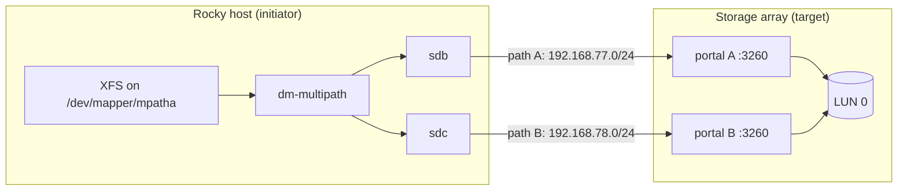
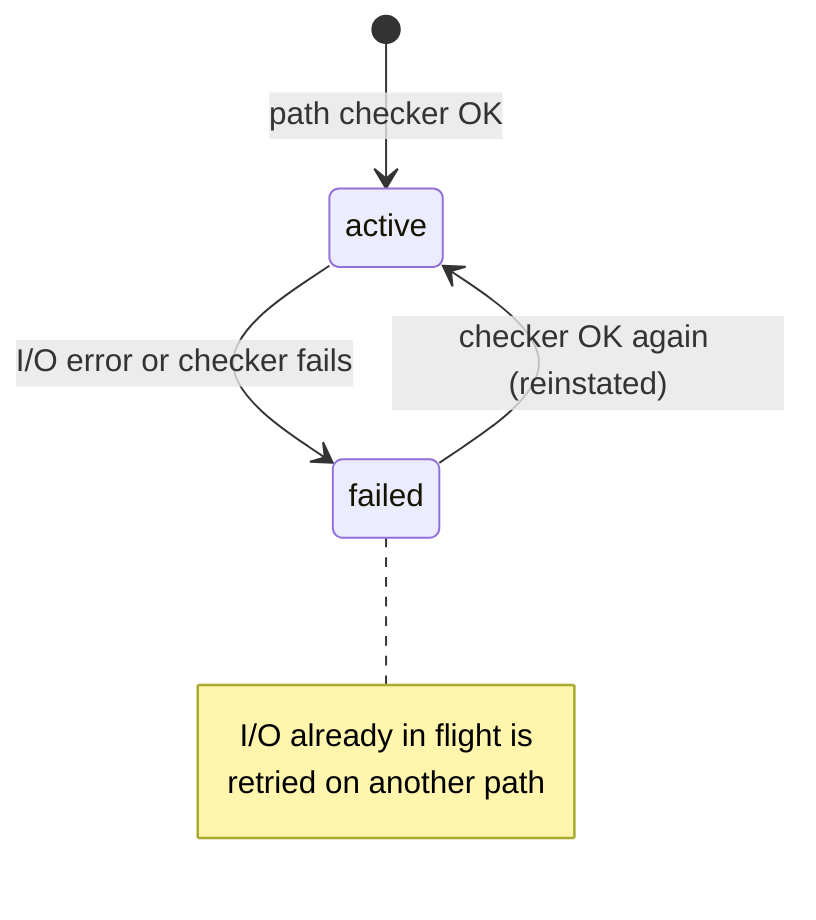
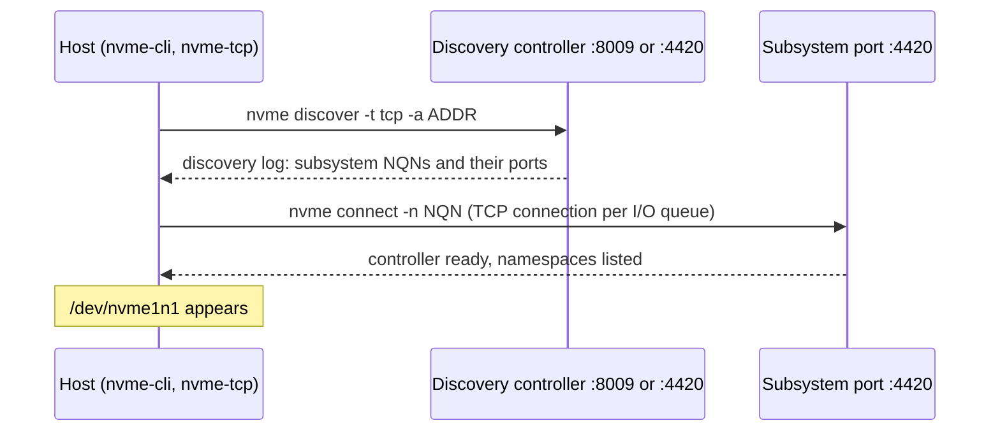

# 35 · Enterprise Storage: iSCSI, Multipath and NVMe-oF

<ul class="module-meta">
  <li>⏱ ~3 hours</li>
  <li>5 labs</li>
  <li>Builds on: 09 · Disks and Filesystems, 10 · LVM, RAID and Encryption, 11 · Networking</li>
</ul>

The database server's "local disk" is actually a slice of a storage array two racks away, reached over four network cables. One cable gets unplugged during maintenance, and the database doesn't notice. Another team reboots a server, and it hangs at boot waiting for a disk that hasn't logged in yet. Both outcomes come down to the topics in this module: how Linux attaches block storage over a network, how it keeps several paths to the same disk, and how you configure it so that failures are boring.

!!! abstract "What you'll learn"
    - Explain SAN vocabulary: initiator, target, IQN, LUN, portal, ACL, CHAP, WWN, NQN
    - Build an iSCSI target with `targetcli` and log in to it with `iscsiadm`
    - Configure dm-multipath, read `multipath -ll` line by line, and watch a path fail over
    - Connect to an NVMe over TCP target with `nvme-cli`, and know how native NVMe multipath differs from dm-multipath on Rocky 10
    - Name network disks safely in `/etc/fstab` with `/dev/disk/by-id`, `_netdev` and `remote-fs.target`
    - Choose an I/O scheduler, and run an fio benchmark whose numbers mean something

## The big picture

So far every disk you used was attached to the machine: a virtio disk, a SATA drive, an NVMe card. In a data centre, much of the storage lives in a **SAN** (storage area network): big shared arrays that hand out **block devices** to servers over a network. The server sees an ordinary disk (`/dev/sdb`, `/dev/nvme1n1`), partitions it, puts LVM and XFS on it, exactly as in [module 09](09-disks-and-filesystems.md). Only the bottom of the stack changes.

<div class="layers" data-open="0" data-hint="Click a layer: the top half is the stack you already know." markdown>

<div class="layer" data-label="Filesystem and LVM" data-tag="XFS, LVM" markdown>

**Unchanged.** XFS, LVM and LUKS neither know nor care that the disk is remote. Everything from modules 09 and 10 applies.

</div>

<div class="layer" data-label="Multipath device" data-tag="/dev/mapper/mpatha" markdown>

**One disk, many paths.** If the same LUN is reachable over two cables, the kernel sees two disks. **dm-multipath** (for SCSI and iSCSI) merges them into one device and fails over when a path dies. NVMe has its own **native multipath** built into the driver.

</div>

<div class="layer" data-label="SCSI or NVMe disks" data-tag="sdb, sdc, nvme1n1" markdown>

**Ordinary block devices.** iSCSI LUNs appear as SCSI disks (`sdX`), NVMe-oF namespaces as NVMe devices (`nvmeXnY`). udev gives them stable names under `/dev/disk/by-id/`.

</div>

<div class="layer" data-label="Transport initiator" data-tag="iscsid, nvme-tcp" markdown>

**The client side.** The **initiator** wraps SCSI or NVMe commands in TCP packets. On Rocky that's the kernel's `iscsi_tcp` driver driven by the `iscsid` daemon, or the `nvme-tcp` driver driven by `nvme-cli`.

</div>

<div class="layer" data-label="Network" data-tag="TCP 3260 / 4420" markdown>

**Ethernet and TCP.** iSCSI listens on port 3260, NVMe/TCP on 4420 (8009 for discovery). Production SANs use dedicated, redundant networks, often with jumbo frames.

</div>

<div class="layer" data-label="Target" data-tag="array or LIO" markdown>

**The server side.** The **target** receives commands and serves them from its storage. Usually a hardware array; in our labs, the Linux kernel's own target, **LIO**, configured with `targetcli`, and the kernel NVMe target `nvmet`.

</div>

</div>



## SAN vocabulary

Storage people speak their own dialect. Here's the minimum you need to read any SAN document:

| Term | Meaning |
|---|---|
| **Initiator** | The client: the server that uses the storage |
| **Target** | The server side that exports storage; one array can present many targets |
| **IQN** | iSCSI Qualified Name, the unique name of an initiator or target: `iqn.YYYY-MM.reversed.domain:anything` |
| **LUN** | Logical Unit Number: one disk exported by a target. LUN 0, LUN 1, … |
| **Portal** | An IP address and port where a target listens, such as `192.168.77.1:3260` |
| **TPG** | Target Portal Group: a set of portals, LUNs and ACLs inside one target (LIO calls it `tpg1`) |
| **ACL** | Access control list on the target: which initiator IQNs may see which LUNs |
| **CHAP** | Challenge-Handshake Authentication Protocol: a shared-secret login check, optional and mutual if you like |
| **WWN / WWID** | World Wide Name / Identifier: the globally unique ID of a LUN, the same on every path |
| **NQN** | NVMe Qualified Name, the NVMe-oF equivalent of an IQN |
| **ALUA** | Asymmetric Logical Unit Access: the array tells the host which paths are optimal |

Every initiator has a name. Installing `iscsi-initiator-utils` doesn't create it: a one-shot unit, `iscsi-init.service`, generates it the first time `iscsid` starts (it only runs while the file is missing):

```console
$ sudo systemctl start iscsid
$ grep '^InitiatorName' /etc/iscsi/initiatorname.iscsi
InitiatorName=iqn.1994-05.com.redhat:3f9a1c2b7d4e
```

The target's ACL must list exactly this name. If you clone a VM **after** the name was generated, every clone has the same IQN, which confuses targets badly (sessions from two hosts kick each other off). Regenerate it with `echo "InitiatorName=$(iscsi-iname)" | sudo tee /etc/iscsi/initiatorname.iscsi` and restart `iscsid`. Better: delete the file in your golden image, and each clone generates its own at first boot.

## Building an iSCSI target with targetcli

**LIO** is the SCSI target built into the Linux kernel. **targetcli** is the shell for configuring it. It presents the configuration as a tree of directories you `cd` around in, or you can pass a path and command on one line, which is easier to script.

The tree has three parts you fill in order:

1. **backstores**: where the data actually lives. `fileio` (a file), `block` (a block device or LV), `ramdisk`, or `pscsi` (pass-through).
2. **iscsi**: the target IQN, with its `tpg1` holding `luns`, `acls` and `portals`.
3. **saveconfig**: write it all to `/etc/target/saveconfig.json`, which `target.service` restores at boot.

```console
$ sudo dnf install -y targetcli
$ sudo systemctl enable --now target
$ sudo targetcli /backstores/fileio create name=disk1 file_or_dev=/var/lib/target-lab/disk1.img size=1G
Created fileio disk1 with size 1073741824
$ sudo targetcli /iscsi create iqn.2026-10.lab.rocky:storage1
Created target iqn.2026-10.lab.rocky:storage1.
Created TPG 1.
Global pref auto_add_default_portal=true
Created default portal listening on all IPs (0.0.0.0), port 3260.
$ sudo targetcli /iscsi/iqn.2026-10.lab.rocky:storage1/tpg1/luns create /backstores/fileio/disk1
Created LUN 0.
$ sudo targetcli /iscsi/iqn.2026-10.lab.rocky:storage1/tpg1/acls create iqn.1994-05.com.redhat:3f9a1c2b7d4e
Created Node ACL for iqn.1994-05.com.redhat:3f9a1c2b7d4e
Created mapped LUN 0.
```

`targetcli ls` shows the whole tree. It's worth reading once slowly:

```console
$ sudo targetcli ls
o- / ......................................................................... [...]
  o- backstores .............................................................. [...]
  | o- block .................................................. [Storage Objects: 0]
  | o- fileio ................................................. [Storage Objects: 1]
  | | o- disk1 ........... [/var/lib/target-lab/disk1.img (1.0GiB) write-back activated]
  | |   o- alua ................................................... [ALUA Groups: 1]
  | |     o- default_tg_pt_gp ....................... [ALUA state: Active/optimized]
  | o- pscsi .................................................. [Storage Objects: 0]
  | o- ramdisk ................................................ [Storage Objects: 0]
  o- iscsi ............................................................ [Targets: 1]
  | o- iqn.2026-10.lab.rocky:storage1 .................................... [TPGs: 1]
  |   o- tpg1 ............................................... [no-gen-acls, no-auth]
  |     o- acls .......................................................... [ACLs: 1]
  |     | o- iqn.1994-05.com.redhat:3f9a1c2b7d4e ................. [Mapped LUNs: 1]
  |     |   o- mapped_lun0 .................................. [lun0 fileio/disk1 (rw)]
  |     o- luns .......................................................... [LUNs: 1]
  |     | o- lun0 ............ [fileio/disk1 (/var/lib/target-lab/disk1.img) (default_tg_pt_gp)]
  |     o- portals .................................................... [Portals: 1]
  |       o- 0.0.0.0:3260 ..................................................... [OK]
  o- loopback ......................................................... [Targets: 0]
```

`no-gen-acls` means only initiators listed under `acls` get in. `no-auth` means no CHAP yet. The backstore is in `write-back` mode, so the file's data passes through the target host's page cache: fast, but a target crash can lose acknowledged writes. Real arrays have battery-backed cache for this; for a production LIO target, prefer a `block` backstore on an LV.

!!! tip "Turning on CHAP"
    On the target: `sudo targetcli /iscsi/<iqn>/tpg1 set attribute authentication=1`, then on the ACL: `sudo targetcli /iscsi/<iqn>/tpg1/acls/<initiator-iqn> set auth userid=rocky password=Secr3tSecr3t`. On the initiator, set `node.session.auth.authmethod = CHAP`, `node.session.auth.username` and `node.session.auth.password` in `/etc/iscsi/iscsid.conf` (before discovery) or per node with `iscsiadm -m node -o update`. CHAP stops casual mistakes, not a determined attacker: the real protection is an isolated storage network.

A real target also needs its firewall open: `sudo firewall-cmd --permanent --add-service=iscsi-target && sudo firewall-cmd --reload`.

## Logging in with iscsiadm

On the initiator side, the kernel driver does the I/O, and the **iscsid** daemon handles logins, logouts and error recovery. `iscsiadm` is the tool that talks to iscsid. It starts on demand through `iscsid.socket`, and `iscsi.service` logs in to saved targets at boot.

Step through what happens from an empty host to a usable disk:

<div class="stepper" markdown>

<div class="step" data-title="Discovery" markdown>

You ask a portal which targets it offers. This is a **SendTargets** query: a short iSCSI session that returns every target and portal the initiator may use.

```console
$ sudo iscsiadm -m discovery -t sendtargets -p 192.168.77.1
192.168.77.1:3260,1 iqn.2026-10.lab.rocky:storage1
192.168.78.1:3260,1 iqn.2026-10.lab.rocky:storage1
```

Two portals, one target: two paths to the same storage.

</div>

<div class="step" data-title="Node records" markdown>

Discovery saves one **node record** per target and portal under `/var/lib/iscsi/nodes/`. Each record holds every login setting, copied from `/etc/iscsi/iscsid.conf` at discovery time.

```console
$ sudo iscsiadm -m node
192.168.77.1:3260,1 iqn.2026-10.lab.rocky:storage1
192.168.78.1:3260,1 iqn.2026-10.lab.rocky:storage1
$ sudo iscsiadm -m node -T iqn.2026-10.lab.rocky:storage1 -p 192.168.77.1 | grep '^node.startup'
node.startup = automatic
```

`node.startup = automatic` is what makes `iscsi.service` log in at boot. (Upstream open-iscsi defaults to `manual`; Rocky's package patches `iscsid.conf` to `automatic`.) Editing `iscsid.conf` later does **not** change existing records: update them with `iscsiadm -m node -o update`.

</div>

<div class="step" data-title="Login" markdown>

The initiator opens a TCP connection to the portal, presents its IQN (and CHAP response, if configured), and the target checks its ACL.

```console
$ sudo iscsiadm -m node -T iqn.2026-10.lab.rocky:storage1 -l
Logging in to [iface: default, target: iqn.2026-10.lab.rocky:storage1, portal: 192.168.77.1,3260]
Logging in to [iface: default, target: iqn.2026-10.lab.rocky:storage1, portal: 192.168.78.1,3260]
Login to [iface: default, target: iqn.2026-10.lab.rocky:storage1, portal: 192.168.77.1,3260] successful.
Login to [iface: default, target: iqn.2026-10.lab.rocky:storage1, portal: 192.168.78.1,3260] successful.
```

</div>

<div class="step" data-title="SCSI scan" markdown>

Each session becomes a virtual SCSI host adapter. The kernel scans it, finds LUN 0, and creates a disk for each path:

```console
$ lsblk -S -o NAME,HCTL,TYPE,VENDOR,MODEL,TRAN
NAME HCTL       TYPE VENDOR   MODEL TRAN
sdb  7:0:0:0    disk LIO-ORG  disk1 iscsi
sdc  8:0:0:0    disk LIO-ORG  disk1 iscsi
```

Same vendor, same model, two different disks. The kernel has no idea yet that they are the same LUN.

</div>

<div class="step" data-title="udev names" markdown>

udev reads each disk's identity and creates stable symlinks. Both paths report the same WWN, because it belongs to the LUN, not the path:

```console
$ ls -l /dev/disk/by-id/ | grep -E 'sd[bc]$'
lrwxrwxrwx. 1 root root  9 Oct 15 10:02 scsi-36001405a7c3e2f0b1e84d4ca9f3b7e61 -> ../../sdc
lrwxrwxrwx. 1 root root  9 Oct 15 10:02 wwn-0x6001405a7c3e2f0b1e84d4ca9f3b7e61 -> ../../sdc
```

Only one link survives (the last path to appear wins). That's the cue for multipath, which claims both paths and builds one device on top.

</div>

<div class="step" data-title="Session state" markdown>

`-m session -P 3` is the full picture: each connection, its state, and the disks it carries.

```console
$ sudo iscsiadm -m session -P 3 | grep -E 'Current Portal|iSCSI Session State|Attached scsi disk'
	Current Portal: 192.168.77.1:3260,1
		iSCSI Session State: LOGGED_IN
			Attached scsi disk sdb		State: running
	Current Portal: 192.168.78.1:3260,1
		iSCSI Session State: LOGGED_IN
			Attached scsi disk sdc		State: running
```

</div>

</div>

<div class="quiz" data-answer="3" markdown>

You logged in to a target, but `lsblk` shows no new disk. `iscsiadm -m session` shows the session is logged in. What's the most likely cause?

- iscsid isn't running
- The firewall on the target blocks port 3260
- The target's ACL for your IQN has no mapped LUNs, or your IQN doesn't match the ACL
- The disk needs to be formatted first

A logged-in session proves the network and the login worked, so the firewall and iscsid are fine. If no disk appears, the target presented zero LUNs to you. Compare `/etc/iscsi/initiatorname.iscsi` with the ACL names in `targetcli ls`, and check for `mapped_lun` entries under your ACL.

</div>

## dm-multipath: one disk, many paths

With two paths you have two problems: the same LUN appears twice (mount both and you corrupt it), and if you use one path and its cable fails, I/O errors reach your filesystem. **dm-multipath** solves both. The `multipathd` daemon groups disks with the same WWID, builds one device-mapper device on top (`/dev/mapper/mpatha`), sends I/O down healthy paths, and checks failed paths until they come back.



### Turning it on

```console
$ sudo dnf install -y device-mapper-multipath
$ sudo mpathconf --enable --with_multipathd y
$ grep -A3 '^defaults' /etc/multipath.conf
defaults {
	user_friendly_names yes
	find_multipaths yes
	…
```

`mpathconf --enable` writes a starter `/etc/multipath.conf` and starts `multipathd`. Two defaults matter:

- **user_friendly_names yes**: devices are called `mpatha`, `mpathb`, … instead of their 33-character WWID. The mapping is stored in `/etc/multipath/bindings`. Convenient, but the same LUN can get a **different** name on another host. In a cluster, set an explicit `alias` per WWID, or use WWID names.
- **find_multipaths yes**: only build a multipath device when a WWID has two or more paths (or was multipathed before, recorded in `/etc/multipath/wwids`). This stops multipath from grabbing your single local boot disk.

### Reading multipath -ll

This is the output you'll read most. Every field means something:

```console
$ sudo multipath -ll
mpatha (36001405a7c3e2f0b1e84d4ca9f3b7e61) dm-3 LIO-ORG,disk1
size=1.0G features='1 queue_if_no_path' hwhandler='1 alua' wp=rw
`-+- policy='service-time 0' prio=50 status=active
  |- 7:0:0:0 sdb 8:16 active ready running
  `- 8:0:0:0 sdc 8:32 active ready running
```

Line by line:

1. `mpatha` is the friendly name, `(3600140…)` the WWID, `dm-3` the kernel device, `LIO-ORG,disk1` the vendor and product the array reported.
2. `features='1 queue_if_no_path'`: if **all** paths fail, queue I/O instead of failing it (for a limited time, set by `no_path_retry`). `hwhandler='1 alua'`: the array speaks ALUA. `wp=rw`: writable.
3. A **path group**. `policy='service-time 0'` sends each I/O to the path with the shortest expected service time. `prio=50` is the ALUA priority (50 means active/optimised). `status=active` means this group carries I/O now.
4. Each path: SCSI address (host:channel:target:lun), device, major:minor, then three states: **dm state** (`active`/`failed`), **checker state** (`ready`/`faulty`/`ghost`), and **kernel device state** (`running`/`offline`).

Here both paths sit in one group because the target reports both as optimised, so I/O is spread across them. On an active/passive array, you'd see **two** groups: the optimised paths (`prio=50 status=active`) and the non-optimised ones (`prio=10 status=enabled`), used only if the first group fails. That is ALUA at work: the array tells the host which controller owns the LUN.

??? question "Under the hood: where `LIO-ORG,disk1` and those settings come from"
    Every SCSI device answers an **INQUIRY** command with a vendor and product string. The kernel's LIO target always reports vendor `LIO-ORG`; its default product is the backstore type (`FILEIO`, `IBLOCK`). targetcli changes that: its global preference `export_backstore_name_as_model` (on by default) turns on the backstore's `emulate_model_alias` attribute, so the product becomes the backstore name, `disk1`.

    multipath then looks that vendor/product pair up in its **built-in hardware table**, a list of per-array defaults compiled into multipath-tools. The LIO entry says: group paths by priority, get priorities from ALUA, check paths with `directio`, and `no_path_retry 12`. That last one is why you see `features='1 queue_if_no_path'` without ever configuring it. The `hwhandler='1 alua'` comes from the kernel, which attaches its ALUA handler to any device that advertises ALUA support when it's scanned.

    To see the merged result of built-ins plus your `multipath.conf`, ask the daemon: `sudo multipathd show config | grep -A10 'vendor "(LIO-ORG'`. When a storage vendor's documentation gives you a `devices { device { … } }` stanza, this is the table it overrides.

??? question "Under the hood: queue_if_no_path, and the server that won't shut down"
    `no_path_retry 12` means: when **every** path is down, queue I/O for 12 path-checker intervals (the checker runs every 5 seconds, so about 60 seconds), then fail it. That covers a switch reboot or a controller failover without the filesystem ever seeing an error.

    Set `no_path_retry queue` (queue forever), which some old vendor guides recommend, and a dead SAN turns into a different problem: every process that touches the filesystem hangs in uninterruptible sleep (`D` state in `ps`), `umount` hangs, and so does shutdown. The escape hatch is to tell the map to stop queueing so the I/O fails and processes can be killed:

    ```console
    $ sudo dmsetup message mpatha 0 fail_if_no_path
    ```

    (`multipathd disablequeueing map mpatha` does the same through the daemon.) Production rule of thumb: a finite `no_path_retry` that's longer than your array's worst failover time, never `queue` unless the vendor insists and you know how to break it.

!!! warning "Set the iSCSI replacement timeout for multipath"
    When an iSCSI connection drops, iscsid waits `node.session.timeo.replacement_timeout` seconds (default **120**) for it to come back before failing I/O to the layer above. With multipath, that means two minutes of frozen I/O before failover. Set it to a few seconds so multipath can switch paths quickly:

    ```console
    $ sudo iscsiadm -m node -T iqn.2026-10.lab.rocky:storage1 -o update -n node.session.timeo.replacement_timeout -v 5
    ```

    Set it in `/etc/iscsi/iscsid.conf` as well, so future discoveries inherit it.

!!! version "Rocky 9 vs 10: NVMe and dm-multipath"
    On Rocky 9, native NVMe multipath is the default, but you could switch it off (`nvme_core.multipath=N`) and put NVMe over RDMA or Fibre Channel namespaces under dm-multipath instead (never NVMe/TCP). Rocky 10 removes that choice: native multipath is always on, the `nvme_core.multipath` parameter no longer exists, and dm-multipath is for SCSI devices (iSCSI, Fibre Channel, SAS) only. A host can run both: dm-multipath for its iSCSI LUNs, native multipath for its NVMe namespaces. If you migrate a Rocky 9 host that put NVMe namespaces under dm-multipath, plan the move to native multipath first.

<div class="quiz" data-answer="2" markdown>

In `multipath -ll`, one path shows `failed faulty offline`. What does that tell you?

- The LUN is corrupt and must be restored
- That path is down (multipath stopped using it, the checker sees it failing, the kernel took the SCSI device offline), while I/O continues on the remaining paths
- multipathd has crashed
- The array switched ALUA ownership, which is normal

The three states are dm, checker and kernel. All three agree that this path is unusable. As long as another path shows `active ready running`, the multipath device keeps serving I/O. Find out why the path died (cable, switch port, target port) before the next one goes.

</div>

## NVMe over Fabrics

**NVMe-oF** carries the NVMe command set, designed for flash, over a network instead of PCIe. Compared with iSCSI it has far less protocol overhead and many parallel queues, so it gets closer to local-flash latency. **NVMe/TCP** runs it over ordinary Ethernet and TCP; other transports use RDMA or Fibre Channel.

The vocabulary maps closely onto iSCSI:

| iSCSI | NVMe-oF |
|---|---|
| IQN | **NQN** (`nqn.2014-08.org.nvmexpress:uuid:…` for hosts) |
| Target | **Subsystem** |
| LUN | **Namespace** |
| Portal | **Port** (transport, address, service id) |
| `/etc/iscsi/initiatorname.iscsi` | `/etc/nvme/hostnqn` |
| `iscsiadm` | `nvme` (from `nvme-cli`) |
| dm-multipath | **Native NVMe multipath** with ANA |



On the host side, it looks like this:

```console
$ sudo dnf install -y nvme-cli
$ sudo modprobe nvme-tcp
$ cat /etc/nvme/hostnqn
nqn.2014-08.org.nvmexpress:uuid:9b1e5f4c-2d7a-4e3b-8f61-0c5a2b9d7e14
$ sudo nvme discover -t tcp -a 127.0.0.1 -s 4420
Discovery Log Number of Records 2, Generation counter 2
=====Discovery Log Entry 0======
trtype:  tcp
adrfam:  ipv4
subtype: current discovery subsystem
…
subnqn:  nqn.2014-08.org.nvmexpress.discovery
traddr:  127.0.0.1
…
=====Discovery Log Entry 1======
trtype:  tcp
adrfam:  ipv4
subtype: nvme subsystem
treq:    not specified, sq flow control disable supported
portid:  1
trsvcid: 4420
subnqn:  nqn.2026-10.lab.rocky:nvme1
traddr:  127.0.0.1
eflags:  none
sectype: none
$ sudo nvme connect -t tcp -a 127.0.0.1 -s 4420 -n nqn.2026-10.lab.rocky:nvme1
$ sudo nvme list-subsys
nvme-subsys1 - NQN=nqn.2026-10.lab.rocky:nvme1
               hostnqn=nqn.2014-08.org.nvmexpress:uuid:9b1e5f4c-2d7a-4e3b-8f61-0c5a2b9d7e14
               iopolicy=numa
\
 +- nvme1 tcp traddr=127.0.0.1,trsvcid=4420,src_addr=127.0.0.1 live
```

With **native NVMe multipath**, every path to a subsystem is a separate controller (`nvme1`, `nvme2`, …) under one **subsystem**, and the kernel presents a single `/dev/nvme1n1` for each namespace. The array reports path states through **ANA** (Asymmetric Namespace Access, NVMe's version of ALUA). The I/O policy lives in sysfs:

```console
$ cat /sys/class/nvme-subsystem/nvme-subsys1/iopolicy
numa
$ echo round-robin | sudo tee /sys/class/nvme-subsystem/nvme-subsys1/iopolicy
```

`numa` picks the closest path, `round-robin` alternates, and `queue-depth` picks the least busy path. Storage vendors usually tell you which one to use, often with a udev rule to set it on connect.

To reconnect automatically at boot, save the connection parameters in `/etc/nvme/discovery.conf` and enable the `nvmf-autoconnect.service` that ships with `nvme-cli`.

!!! note "The Linux NVMe target in labs"
    The kernel also contains an NVMe-oF **target**, `nvmet`, configured through configfs under `/sys/kernel/config/nvmet/` (the `nvmetcli` tool in BaseOS wraps it, much as targetcli wraps LIO). Rocky 10's kernel ships the `nvmet` and `nvmet-tcp` modules in `kernel-modules-core`, so they're always installed, which makes them perfect for a loopback lab. Red Hat documents and supports RHEL as an NVMe-oF **host**; treat the in-kernel target as a lab and test tool, and expect the target side in production to be a storage array.

## Persistent naming and fstab

Device names like `sdb` are handed out in the order disks appear. With network storage, that order depends on which login finished first, so `sdb` today might be `sdc` after a reboot. **Never put `/dev/sdX` in `/etc/fstab` for SAN storage.**

| Name | Example | Stable? |
|---|---|---|
| Kernel name | `/dev/sdb` | No: order of discovery |
| WWN | `/dev/disk/by-id/wwn-0x6001405a7c3e…` | Yes: the LUN's global ID (but points at **one path**) |
| By path | `/dev/disk/by-path/ip-192.168.77.1:3260-iscsi-iqn…-lun-0` | Stable per path; wrong for multipath |
| Multipath name | `/dev/mapper/mpatha` | Stable on this host (from the bindings file) |
| Multipath WWID | `/dev/disk/by-id/dm-uuid-mpath-36001405a7c3…` | Yes, on every host |
| Filesystem UUID | `UUID=4b1f…` | Yes: tied to the filesystem |

With multipath, mount the multipath device (by filesystem UUID or by its `mpath` name), never one of its paths.

Then there's timing. Local disks exist before the network; SAN disks exist only after the network is up and the login has happened. Tell systemd so, with **`_netdev`**:

```text title="/etc/fstab"
UUID=4b1f6c2e-8a0d-4c5e-9f2b-7d3e1a6c9b08  /srv/san  xfs  _netdev,nofail  0 0
```

- `_netdev` marks the mount as network-dependent. systemd orders it after `network-online.target` and `remote-fs-pre.target` (which `iscsid` starts before), places it under **`remote-fs.target`** instead of `local-fs.target`, and then waits for the filesystem's device to appear, which happens when `iscsi.service` logs in.
- `nofail` lets the boot continue if the storage is unavailable, instead of dropping you into emergency mode. Your application should then depend on the mount (`RequiresMountsFor=/srv/san` in its unit).

```console
$ systemctl list-dependencies remote-fs.target
remote-fs.target
● ├─srv-san.mount
…
```

!!! danger "The boot that never ends"
    Without `_netdev`, systemd treats the mount as local and tries it before the network is up. The device doesn't exist, the mount waits 90 seconds, fails, and without `nofail` the boot stops in emergency mode. On a remote server with no console, that's an outage. Test every new SAN fstab line with `sudo mount -a` and `sudo systemctl daemon-reload`, then a reboot, before you walk away.

<div class="quiz" data-answer="4" markdown>

Which fstab source is the best choice for an XFS filesystem on a multipathed iSCSI LUN?

- `/dev/sdb`
- `/dev/disk/by-path/ip-192.168.77.1:3260-iscsi-iqn.2026-10.lab.rocky:storage1-lun-0`
- `/dev/disk/by-id/wwn-0x6001405a7c3e2f0b1e84d4ca9f3b7e61`
- `UUID=…` of the filesystem (or `/dev/mapper/mpatha`), with `_netdev`

`sdb` moves around; the by-path and wwn links point to a single path, so mounting them bypasses multipath. The filesystem UUID resolves to the multipath device (multipath claims the paths), and `_netdev` gets the boot ordering right.

</div>

## I/O schedulers and queue depth

Between the filesystem and the device, the block layer can reorder and merge requests with an **I/O scheduler**. Each device has its own:

```console
$ cat /sys/block/sdb/queue/scheduler
none [mq-deadline] kyber bfq
$ cat /sys/block/nvme0n1/queue/scheduler
[none] mq-deadline kyber bfq
```

| Scheduler | Idea | Good for |
|---|---|---|
| `none` | No reordering: pass requests straight through | NVMe and fast SSDs, arrays with their own smart caches |
| `mq-deadline` | Sort and merge, but guarantee every request a deadline | Single-queue devices: SATA, SAS, many iSCSI LUNs |
| `bfq` | Fair share of bandwidth per process | Desktops, slow disks with competing users |
| `kyber` | Throttle queues to hit latency targets | Fast multi-queue devices, specialist use |

The kernel picks `mq-deadline` for single-queue devices and `none` for multi-queue devices like NVMe. For a SAN LUN, the array's controller reorders far better than the host can, so `none` or `mq-deadline` are both reasonable: measure before changing anything. Changes via `echo none | sudo tee /sys/block/sdb/queue/scheduler` last until reboot; make them permanent with a udev rule or a tuned profile.

**Queue depth** is how many requests can be outstanding to a device at once. A network LUN needs depth to hide network latency: with one request at a time and 0.5 ms round trips, you can never exceed 2,000 IOPS, however fast the array is. For iSCSI, the per-LUN depth comes from `node.session.queue_depth` in `iscsid.conf` (default 32):

```console
$ cat /sys/block/sdb/device/queue_depth
32
```

??? question "Under the hood: three queue limits stacked on top of each other"
    The 32 you just read is only the first of three limits a request has to get past:

    | Limit | Where it's set | Default |
    |---|---|---|
    | Per LUN | `node.session.queue_depth` (initiator) | 32 |
    | Per session (all LUNs on that login) | `node.session.cmds_max` (initiator) | 128 |
    | Per session, granted by the target | iSCSI **CmdSN window**; on LIO the TPG attribute `default_cmdsn_depth` | 64 on LIO |

    The target has the final word: it hands the initiator a window of command sequence numbers, and the initiator can't send past it. So eight LUNs behind one LIO session can't each run 32 deep: together they're capped at 64 outstanding commands, and fio will show latency rising while IOPS stay flat. Arrays document their own window; raise the initiator values only to match it, and only after a benchmark shows you're hitting it. Multipath helps here too: each path is its own session with its own window.

## Benchmarking with fio, done right

**fio** (flexible I/O tester) is the standard storage benchmark. It's easy to run and very easy to run wrongly. Most misleading storage numbers come from three mistakes:

1. **Measuring the page cache, not the disk.** Without `--direct=1`, reads come from RAM and writes are acknowledged before they reach the device. Always use `--direct=1` to measure storage.
2. **Testing one request at a time.** `--iodepth=1` measures pure latency; real servers with many users run deep queues. Test both.
3. **Testing too briefly, on too little data.** Arrays have caches too. Use `--time_based --runtime=60` and a size larger than any cache in the path.

```console
$ sudo fio --name=randread --filename=/dev/mapper/mpatha --readonly \
    --direct=1 --ioengine=libaio --rw=randread --bs=4k \
    --iodepth=32 --numjobs=1 --time_based --runtime=30 --group_reporting
randread: (g=0): rw=randread, bs=(R) 4096B-4096B, (W) 4096B-4096B, (T) 4096B-4096B, ioengine=libaio, iodepth=32
…
randread: (groupid=0, jobs=1): err= 0: pid=4512: Thu Oct 15 10:12:03 2026
  read: IOPS=38.7k, BW=151MiB/s (159MB/s)(4538MiB/30001msec)
    slat (usec): min=2, max=210, avg= 4.11, stdev= 1.92
    clat (usec): min=95, max=8410, avg=820.33, stdev=211.40
     lat (usec): min=99, max=8414, avg=824.52, stdev=211.52
    clat percentiles (usec):
     |  1.00th=[  433],  5.00th=[  537], 10.00th=[  594], 20.00th=[  668],
     | 30.00th=[  717], 40.00th=[  766], 50.00th=[  807], 60.00th=[  848],
     | 70.00th=[  898], 80.00th=[  963], 90.00th=[ 1057], 95.00th=[ 1139],
     | 99.00th=[ 1369], 99.50th=[ 1500], 99.90th=[ 2343], 99.95th=[ 3195],
     | 99.99th=[ 6194]
…
  IO depths    : 1=0.1%, 2=0.1%, 4=0.1%, 8=0.1%, 16=0.1%, 32=100.0%, >=64=0.0%
…
Run status group 0 (all jobs):
   READ: bw=151MiB/s (159MB/s), 151MiB/s-151MiB/s (159MB/s-159MB/s), io=4538MiB (4758MB), run=30001-30001msec
```

How to read it:

- **IOPS** and **BW** are the headline rates. For 4k random I/O, IOPS is the number that matters; for large sequential I/O, bandwidth.
- **slat** is submission latency (time to hand the I/O to the kernel), **clat** completion latency (time until the device finished), **lat** the total.
- **Percentiles** tell the real story. The median (50th) is 807 µs, but 1 in 1,000 reads took over 2.3 ms and 1 in 10,000 over 6 ms. Users feel the tail, not the average. Quote p99 or p99.9 alongside IOPS.
- **Check it adds up.** Little's law says outstanding requests = rate × latency. 32 / 0.000824 s ≈ 38,800 IOPS, matching the result. If your numbers don't obey this, something (a cache, a bottleneck in the host) is distorting the test.

| fio option | What it controls |
|---|---|
| `--rw=` | `read`, `write`, `randread`, `randwrite`, `randrw` (with `--rwmixread=70`) |
| `--bs=` | Block size: 4k for database-style I/O, 1M for streaming |
| `--iodepth=` | Outstanding I/Os per job (needs an async engine like `libaio` or `io_uring`) |
| `--numjobs=` | Parallel workers; add `--group_reporting` to sum them |
| `--direct=1` | Bypass the page cache |
| `--readonly` | Safety catch: refuse to issue writes |

!!! danger "fio writes destroy data"
    A write test against `/dev/mapper/mpatha` or `/dev/sdb` overwrites whatever is on that device, filesystem included. Run write tests against a scratch device, or against a file on a filesystem (`--filename=/srv/san/fio.test --size=2G`). Keep `--readonly` on read tests as a seatbelt.

### Practice: inspect SAN storage

<div class="terminal-sim" data-title="Read the SAN state" markdown>

<div class="task" data-expect="sudo iscsiadm -m session||iscsiadm -m session||sudo iscsiadm --mode session" data-hint="iscsiadm in session mode (-m session) lists active logins." markdown>

**Step 1.** List the active iSCSI sessions.

```text
tcp: [1] 192.168.77.1:3260,1 iqn.2026-10.lab.rocky:storage1 (non-flash)
tcp: [2] 192.168.78.1:3260,1 iqn.2026-10.lab.rocky:storage1 (non-flash)
```

</div>

<div class="task" data-expect="sudo multipath -ll||multipath -ll" data-hint="multipath, with -ll for the full topology." markdown>

**Step 2.** Show the multipath topology.

```text
mpatha (36001405a7c3e2f0b1e84d4ca9f3b7e61) dm-3 LIO-ORG,disk1
size=1.0G features='1 queue_if_no_path' hwhandler='1 alua' wp=rw
`-+- policy='service-time 0' prio=50 status=active
  |- 7:0:0:0 sdb 8:16 active ready running
  `- 8:0:0:0 sdc 8:32 active ready running
```

</div>

<div class="task" data-expect="cat /sys/block/sdb/queue/scheduler" data-hint="It's a file under /sys/block/sdb/queue/." markdown>

**Step 3.** Which I/O scheduler is `sdb` using?

```text
none [mq-deadline] kyber bfq
```

</div>

<div class="task" data-expect="sudo nvme list-subsys||nvme list-subsys" data-hint="nvme-cli has a list-subsys subcommand." markdown>

**Step 4.** Show the NVMe subsystems and their paths.

```text
nvme-subsys1 - NQN=nqn.2026-10.lab.rocky:nvme1
               hostnqn=nqn.2014-08.org.nvmexpress:uuid:9b1e5f4c-2d7a-4e3b-8f61-0c5a2b9d7e14
               iopolicy=numa
\
 +- nvme1 tcp traddr=127.0.0.1,trsvcid=4420,src_addr=127.0.0.1 live
```

</div>

</div>

## Labs

The labs run the target and the initiator on **one** Rocky 10 VM. A dummy network interface with two addresses stands in for two separate storage networks, so you get two real paths. Labs 1 to 3 build on each other; tear everything down at the end with the final cleanup.

Install everything first:

```console
$ sudo dnf install -y targetcli iscsi-initiator-utils device-mapper-multipath nvme-cli fio
```

!!! lab "Lab 1: An iSCSI target with two portals"

    **Goal:** Export a file-backed LUN on two IP addresses and log in to both.

    1. Create two "storage networks" on a dummy interface. Use NetworkManager so the addresses come back after the reboot in Lab 3:

        ```bash
        sudo nmcli connection add type dummy ifname sanlab con-name sanlab \
            ipv4.method manual ipv4.addresses 192.168.77.1/24,192.168.78.1/24 \
            ipv6.method disabled
        sudo nmcli connection up sanlab
        ip -br addr show sanlab
        ```

    2. Build the target. Use your own initiator name from `/etc/iscsi/initiatorname.iscsi`:

        ```bash
        IQN=iqn.2026-10.lab.rocky:storage1
        sudo systemctl start iscsid      # generates the initiator name on first start
        INIT=$(sudo awk -F= '/^InitiatorName=/{print $2}' /etc/iscsi/initiatorname.iscsi)
        echo "$INIT"
        sudo mkdir -p /var/lib/target-lab
        sudo systemctl enable --now target
        sudo targetcli /backstores/fileio create name=disk1 file_or_dev=/var/lib/target-lab/disk1.img size=1G
        sudo targetcli /iscsi create $IQN
        sudo targetcli /iscsi/$IQN/tpg1/luns create /backstores/fileio/disk1
        sudo targetcli /iscsi/$IQN/tpg1/acls create $INIT
        sudo targetcli /iscsi/$IQN/tpg1/portals delete 0.0.0.0 3260
        sudo targetcli /iscsi/$IQN/tpg1/portals create 192.168.77.1 3260
        sudo targetcli /iscsi/$IQN/tpg1/portals create 192.168.78.1 3260
        sudo targetcli saveconfig
        ```

    3. Discover, shorten the replacement timeout (for Lab 2), and log in:

        ```bash
        sudo iscsiadm -m discovery -t sendtargets -p 192.168.77.1
        sudo iscsiadm -m node -T $IQN -o update -n node.session.timeo.replacement_timeout -v 5
        sudo iscsiadm -m node -T $IQN -l
        ```

    4. Inspect the result with `lsblk -S -o NAME,HCTL,VENDOR,MODEL,TRAN` and `sudo iscsiadm -m session -P 3 | grep -E 'Portal|disk'`.

    **Check your work:** two new disks (for example `sdb` and `sdc`) with vendor `LIO-ORG` and transport `iscsi`, and `/usr/lib/udev/scsi_id -g -u -d /dev/sdb` prints the same WWID as for `/dev/sdc`.

    ??? success "Why two disks for one LUN?"
        Each portal login is a separate session, and each session is a separate SCSI host adapter as far as the kernel is concerned. The kernel scans each adapter and finds a LUN 0 on each. Only the WWID reveals that they are the same storage. Writing to both independently would corrupt the data, which is exactly what Lab 2 fixes.

    **Clean up:** keep everything for Lab 2. (Full teardown is at the end.)

!!! lab "Lab 2: Multipath and a live failover"

    **Goal:** Merge the two paths into one device and keep I/O running while a path dies.

    1. Enable multipath and look at the result:

        ```console
        $ sudo mpathconf --enable --with_multipathd y
        $ sudo multipath -ll
        mpatha (36001405a7c3e2f0b1e84d4ca9f3b7e61) dm-3 LIO-ORG,disk1
        size=1.0G features='1 queue_if_no_path' hwhandler='1 alua' wp=rw
        `-+- policy='service-time 0' prio=50 status=active
          |- 7:0:0:0 sdb 8:16 active ready running
          `- 8:0:0:0 sdc 8:32 active ready running
        ```

        If `multipath -ll` prints nothing, run `sudo multipath -v2` to build the map and show why.

    2. In a second terminal, start continuous reads through the multipath device:

        ```console
        $ while true; do sudo dd if=/dev/mapper/mpatha of=/dev/null bs=1M count=200 iflag=direct status=none && date +%T; done
        ```

    3. Fail one path by taking its SCSI device offline (use whichever disk is a path on your system):

        ```console
        $ echo offline | sudo tee /sys/block/sdc/device/state
        $ sudo multipath -ll
        …
          |- 7:0:0:0 sdb 8:16 active ready running
          `- 8:0:0:0 sdc 8:32 failed faulty offline
        $ journalctl -u multipathd --since -2min | tail -3
        … multipathd[2210]: sdc: mark as failed
        … multipathd[2210]: mpatha: remaining active paths: 1
        ```

    4. Watch the second terminal: timestamps keep coming. Bring the path back and watch it reinstate within a few seconds:

        ```console
        $ echo running | sudo tee /sys/block/sdc/device/state
        $ sleep 10; sudo multipath -ll | tail -2
          |- 7:0:0:0 sdb 8:16 active ready running
          `- 8:0:0:0 sdc 8:32 active ready running
        ```

    5. Now a harsher failure: log out of one portal entirely, as if the network were cut, then log back in:

        ```console
        $ sudo iscsiadm -m node -T iqn.2026-10.lab.rocky:storage1 -p 192.168.78.1 -u
        $ sudo multipath -ll | tail -2
        $ sudo iscsiadm -m node -T iqn.2026-10.lab.rocky:storage1 -p 192.168.78.1 -l
        ```

        After the logout the path disappears from the map completely (the disk is gone, not just failed). After the login it comes back, possibly under a new name such as `sdd`: multipath doesn't care, because it matches on the WWID.

    **Check your work:** the `dd` loop never errored, and `journalctl -u multipathd` shows the path being marked failed and then reinstated.

    **Clean up:** stop the `dd` loop with ++ctrl+c++. Keep multipath for Lab 3.

!!! lab "Lab 3: A SAN filesystem that boots safely"

    **Goal:** Put XFS on the multipath device and mount it the right way in fstab.

    1. Make the filesystem and find its UUID:

        ```console
        $ sudo mkfs.xfs /dev/mapper/mpatha
        $ sudo blkid /dev/mapper/mpatha
        /dev/mapper/mpatha: UUID="4b1f6c2e-8a0d-4c5e-9f2b-7d3e1a6c9b08" BLOCK_SIZE="512" TYPE="xfs"
        ```

    2. Add an fstab line using that UUID with `_netdev,nofail`, then mount it:

        ```bash
        sudo mkdir -p /srv/san
        echo 'UUID=4b1f6c2e-8a0d-4c5e-9f2b-7d3e1a6c9b08  /srv/san  xfs  _netdev,nofail  0 0' | sudo tee -a /etc/fstab
        sudo systemctl daemon-reload
        sudo mount -a
        ```

    3. Confirm the mount is on the multipath device and is classed as remote:

        ```console
        $ findmnt /srv/san
        TARGET   SOURCE             FSTYPE OPTIONS
        /srv/san /dev/mapper/mpatha xfs    rw,relatime,seclabel,attr2,inode64,logbufs=8,logbsize=32k,noquota
        $ systemctl list-dependencies remote-fs.target | grep san
        ● ├─srv-san.mount
        ```

    4. This lab has a twist a real SAN doesn't: the target runs on the same machine. `target.service` normally starts after `network.target`, which can be before the `sanlab` addresses exist, and nothing orders it against the initiator. Add a drop-in so the target comes up after the network and before `iscsi.service` logs in (and, in reverse, stops only after the initiator has logged out at shutdown):

        ```bash
        sudo mkdir -p /etc/systemd/system/target.service.d
        printf '[Unit]\nWants=network-online.target\nAfter=network-online.target\nBefore=iscsi.service\n' | \
            sudo tee /etc/systemd/system/target.service.d/lab-order.conf
        sudo systemctl daemon-reload
        ```

    5. Reboot, and confirm it comes back by itself: `findmnt /srv/san` and `sudo multipath -ll` after login.

    **Check your work:** the mount survives a reboot, and `systemctl show srv-san.mount -p After | tr ' ' '\n' | grep -E 'network|remote-fs'` lists `network-online.target` and `remote-fs-pre.target`.

    ??? success "What `_netdev` turned into"
        systemd never reads fstab directly at mount time. At boot (and on `daemon-reload`), `systemd-fstab-generator` turns each line into a `.mount` unit under `/run/systemd/generator/`; `systemctl cat srv-san.mount` shows the generated file. Because of `_netdev`, systemd treats it as a network mount: `systemctl show srv-san.mount -p After -p Wants` lists `network-online.target` and `remote-fs-pre.target`, and the unit hangs under `remote-fs.target` instead of `local-fs.target`. `nofail` means `remote-fs.target` only *wants* it rather than *requires* it, so a missing LUN can't fail the boot. Without the drop-in from step 4, the reboot may still work by luck of timing; the drop-in makes it deterministic.

    **Clean up:** `sudo umount /srv/san`, then remove the line you added from `/etc/fstab` (`sudo sed -i '\#/srv/san#d' /etc/fstab`) and run `sudo systemctl daemon-reload`. Keep the drop-in until the final teardown.

!!! lab "Lab 4: NVMe over TCP on loopback"

    **Goal:** Export a namespace with the kernel NVMe target and connect to it with nvme-cli.

    1. Make a backing device and load the modules:

        ```bash
        sudo truncate -s 1G /var/lib/target-lab/nvme1.img
        LOOP=$(sudo losetup --show -f /var/lib/target-lab/nvme1.img); echo $LOOP
        sudo modprobe nvmet-tcp
        sudo modprobe nvme-tcp
        ```

    2. Build the subsystem, namespace and port in configfs (each `mkdir` creates a kernel object):

        ```bash
        NQN=nqn.2026-10.lab.rocky:nvme1
        cd /sys/kernel/config/nvmet
        sudo mkdir subsystems/$NQN
        echo 1 | sudo tee subsystems/$NQN/attr_allow_any_host
        sudo mkdir subsystems/$NQN/namespaces/1
        echo -n $LOOP | sudo tee subsystems/$NQN/namespaces/1/device_path
        echo 1 | sudo tee subsystems/$NQN/namespaces/1/enable
        sudo mkdir ports/1
        echo tcp | sudo tee ports/1/addr_trtype
        echo ipv4 | sudo tee ports/1/addr_adrfam
        echo 127.0.0.1 | sudo tee ports/1/addr_traddr
        echo 4420 | sudo tee ports/1/addr_trsvcid
        sudo ln -s /sys/kernel/config/nvmet/subsystems/$NQN ports/1/subsystems/$NQN
        cd -
        ```

    3. Discover and connect as a host:

        ```bash
        sudo nvme discover -t tcp -a 127.0.0.1 -s 4420
        sudo nvme connect -t tcp -a 127.0.0.1 -s 4420 -n $NQN
        sudo nvme list
        sudo nvme list-subsys
        ```

    **Check your work:** `nvme list` shows a new `/dev/nvmeXn1` with model `Linux`, and `nvme list-subsys` shows one `tcp` path that is `live`, with an `iopolicy` line (native multipath in action).

    ??? tip "No nvmet module?"
        If `modprobe nvmet-tcp` fails, check `modinfo nvmet_tcp` and that `kernel-modules-core` for your running kernel is installed. As a fallback, run the target on a second VM (any recent Linux) and use its IP address in the host commands.

    **Clean up:**

    ```bash
    sudo nvme disconnect -n $NQN
    cd /sys/kernel/config/nvmet
    sudo rm ports/1/subsystems/$NQN
    sudo rmdir ports/1
    echo 0 | sudo tee subsystems/$NQN/namespaces/1/enable
    sudo rmdir subsystems/$NQN/namespaces/1
    sudo rmdir subsystems/$NQN
    cd -
    sudo modprobe -r nvmet_tcp nvmet
    sudo losetup -d $LOOP
    sudo rm -f /var/lib/target-lab/nvme1.img
    ```

!!! lab "Lab 5: fio, the right way and the wrong way"

    **Goal:** See how cache, queue depth and parallelism change benchmark results.

    1. The wrong way: buffered reads of a file that fits in RAM. Run it twice:

        ```console
        $ fio --name=wrong --filename=/tmp/fio.test --size=256M --rw=randread --bs=4k --runtime=10 --time_based
        …
          read: IOPS=412k, BW=1609MiB/s …
        ```

        Hundreds of thousands of IOPS: you measured the page cache.

    2. The right way: direct I/O against the multipath device, read-only, queue depth 1, then 32:

        ```bash
        for qd in 1 32; do
          sudo fio --name=qd$qd --filename=/dev/mapper/mpatha --readonly --direct=1 \
            --ioengine=libaio --rw=randread --bs=4k --iodepth=$qd \
            --time_based --runtime=20 --group_reporting | grep -E 'IOPS|clat \(|99.00th'
        done
        ```

    3. Add parallelism: `--iodepth=8 --numjobs=4 --group_reporting`, and compare.

    4. Check the scheduler on the paths and try `none` vs `mq-deadline` on both (`echo none | sudo tee /sys/block/sdb/queue/scheduler`, same for `sdc`), repeating step 2's queue-depth-32 test.

    **Check your work:** fill in a table of IOPS, average latency and p99 for each run. Depth 1 gives the lowest latency and lowest IOPS; depth 32 raises IOPS and latency together; IOPS × average latency ≈ the queue depth each time.

    ??? question "Why are my loopback numbers so odd?"
        In this lab the "array" is a file on the same VM, behind the target's page cache, behind a virtual disk. The numbers say little about real hardware. The **method** is what transfers: direct I/O, several queue depths, long enough runs, percentiles, and a Little's-law sanity check.

    **Clean up:** `rm -f /tmp/fio.test`, and set the schedulers back (`echo mq-deadline | sudo tee /sys/block/sd{b,c}/queue/scheduler`, or reboot).

!!! lab "Final teardown (after Labs 1 to 5)"

    ```bash
    sudo umount /srv/san 2>/dev/null
    sudo multipath -F
    sudo systemctl disable --now multipathd
    sudo iscsiadm -m node -T iqn.2026-10.lab.rocky:storage1 -u
    sudo iscsiadm -m node -T iqn.2026-10.lab.rocky:storage1 -o delete
    sudo targetcli clearconfig confirm=True
    sudo targetcli saveconfig        # otherwise target.service restores the old config next time
    sudo systemctl disable --now target
    sudo rm -rf /etc/systemd/system/target.service.d/lab-order.conf /var/lib/target-lab
    sudo rm -f /etc/multipath.conf /etc/multipath/bindings /etc/multipath/wwids
    sudo systemctl daemon-reload
    sudo nmcli connection delete sanlab
    ```

    **Check your work:** `lsblk` shows no `sdb`/`sdc`, `sudo iscsiadm -m node` reports no records, and `sudo targetcli ls` shows empty backstores.

## Common pitfalls

| Symptom | Cause | Fix |
|---|---|---|
| Boot hangs, then emergency mode | SAN filesystem in fstab without `_netdev` (and without `nofail`) | Add `_netdev,nofail`; test with a reboot |
| Data corruption after mounting "the disk" | Two hosts, or two paths, mounted the same LUN as separate disks | Mount only the multipath device; use a cluster filesystem or HA manager for shared LUNs ([module 28](28-high-availability.md)) |
| I/O freezes for two minutes when a path fails | `replacement_timeout` still at 120 s | Set it to about 5 s for multipath setups, in iscsid.conf and existing node records |
| `mpatha` is a different LUN on another node | `user_friendly_names` bindings differ per host | Use `alias` in a `multipaths` section, or WWID names |
| Local boot disk grabbed by multipath | `find_multipaths no` or a broad config | Keep `find_multipaths yes`, blacklist local disks by WWID |
| Login works, no disk appears | Initiator IQN doesn't match the target ACL (often a cloned VM) | Compare `initiatorname.iscsi` with the ACL; regenerate cloned IQNs |
| Wildly high benchmark numbers | Page cache or array cache measured, not the device | `--direct=1`, longer runs, data larger than caches |
| NVMe namespaces ignored by `multipath -ll` on Rocky 10 | Expected: NVMe uses native multipath only | Inspect with `nvme list-subsys` |

## Cheat sheet

| Command | What it does |
|---|---|
| `targetcli ls` | Show the LIO target configuration tree |
| `targetcli /backstores/fileio create name=N file_or_dev=F size=1G` | Create a file-backed backstore |
| `targetcli /iscsi create IQN` | Create an iSCSI target (with tpg1) |
| `targetcli saveconfig` | Save to `/etc/target/saveconfig.json` |
| `iscsiadm -m discovery -t sendtargets -p IP` | Discover targets on a portal |
| `iscsiadm -m node -T IQN -l` / `-u` | Log in / log out (all portals of the target) |
| `iscsiadm -m session -P 3` | Session details, including attached disks |
| `iscsiadm -m node -T IQN -o update -n KEY -v VAL` | Change a saved node setting |
| `mpathconf --enable --with_multipathd y` | Create multipath.conf and start multipathd |
| `multipath -ll` | Show multipath devices, groups and path states |
| `multipathd show paths` | Path list straight from the daemon |
| `nvme discover -t tcp -a IP -s 4420` | Query an NVMe-oF discovery controller |
| `nvme connect -t tcp -a IP -s 4420 -n NQN` | Connect to a subsystem |
| `nvme list` / `nvme list-subsys` | Namespaces / subsystems and paths |
| `nvme disconnect -n NQN` | Disconnect a subsystem |
| `ls -l /dev/disk/by-id/` | Stable names (WWN, dm-uuid-mpath) |
| `cat /sys/block/DEV/queue/scheduler` | Show (and with `echo`, set) the I/O scheduler |
| `fio --direct=1 --iodepth=N --rw=randread …` | Benchmark the device, not the cache |

## Flashcards

<div class="flashcards" markdown>

<div class="card" markdown>

Initiator vs target?

The initiator is the client that uses the storage; the target is the server that exports it.

</div>

<div class="card" markdown>

What identifies a LUN uniquely on every path?

Its WWN/WWID. Both paths report the same one, which is how multipath groups them.

</div>

<div class="card" markdown>

Where does iscsiadm keep per-target login settings?

In node records under `/var/lib/iscsi/nodes/`, copied from `iscsid.conf` at discovery time.

</div>

<div class="card" markdown>

What do the three states at the end of a `multipath -ll` path line mean?

dm state (active/failed), path checker state (ready/faulty), kernel device state (running/offline).

</div>

<div class="card" markdown>

Which multipath does NVMe-oF use on Rocky 10?

Native NVMe multipath in the kernel driver (with ANA). dm-multipath for NVMe isn't supported in RHEL 10.

</div>

<div class="card" markdown>

What does `_netdev` do in fstab?

Marks the mount as network-dependent, so systemd orders it after `network-online.target` and puts it under `remote-fs.target` instead of `local-fs.target`.

</div>

<div class="card" markdown>

Why `--direct=1` in fio?

To bypass the page cache so you measure the storage device, not RAM.

</div>

<div class="card" markdown>

Little's law for storage?

Outstanding I/Os = IOPS × latency. Use it to sanity-check benchmark results.

</div>

</div>

## Recap

!!! recap "Key takeaways"
    - A SAN gives you ordinary block devices; only the bottom of the storage stack (initiator, network, target) is new.
    - LIO and `targetcli` build iSCSI targets from backstores, LUNs, ACLs and portals; `iscsiadm` discovers, saves node records and logs in.
    - Each path is a separate disk until dm-multipath groups them by WWID; `multipath -ll` shows groups, priorities and three-part path states. Lower `replacement_timeout` so failover is quick.
    - NVMe/TCP uses subsystems, namespaces, ports and NQNs; on Rocky 10 it always uses native NVMe multipath.
    - Mount SAN storage by filesystem UUID or multipath name with `_netdev` (and usually `nofail`), never by `/dev/sdX`.
    - Benchmarks are only honest with direct I/O, several queue depths, long enough runs, and latency percentiles.

## Go deeper

- Man pages: [[man:targetcli(8)]] [[man:iscsiadm(8)]] [[man:iscsid(8)]] [[man:multipath(8)]] [[man:multipath.conf(5)]] [[man:mpathconf(8)]] [[man:multipathd(8)]] [[man:nvme(1)]] [[man:fio(1)]]
- [RHEL 10: Configuring an iSCSI target](https://docs.redhat.com/en/documentation/red_hat_enterprise_linux/10/html/managing_storage_devices/configuring-an-iscsi-target): the supported procedure for LIO on RHEL 10.
- [RHEL 10: Configuring NVMe over fabrics using NVMe/TCP](https://docs.redhat.com/en/documentation/red_hat_enterprise_linux/10/html/managing_storage_devices/configuring-nvme-over-fabrics-using-nvme-tcp): host-side NVMe/TCP and native multipath.
- [fio documentation](https://fio.readthedocs.io/en/latest/fio_doc.html): every option, and how the output is calculated.

**Next:** [36 · Time: chrony, NTS and PTP](36-time-synchronization.md)
