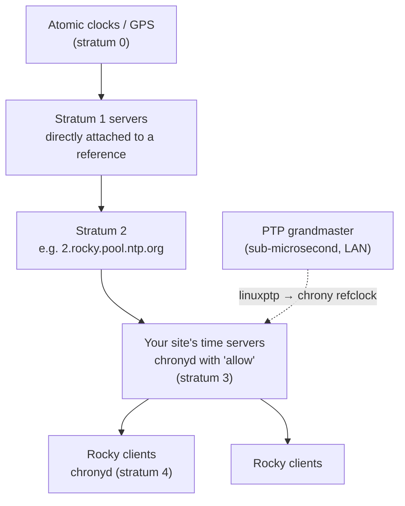
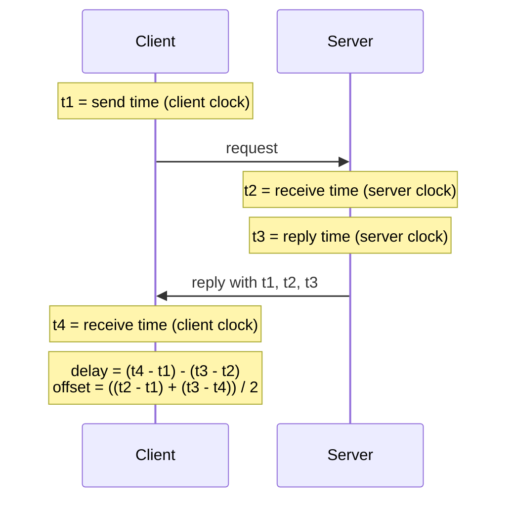
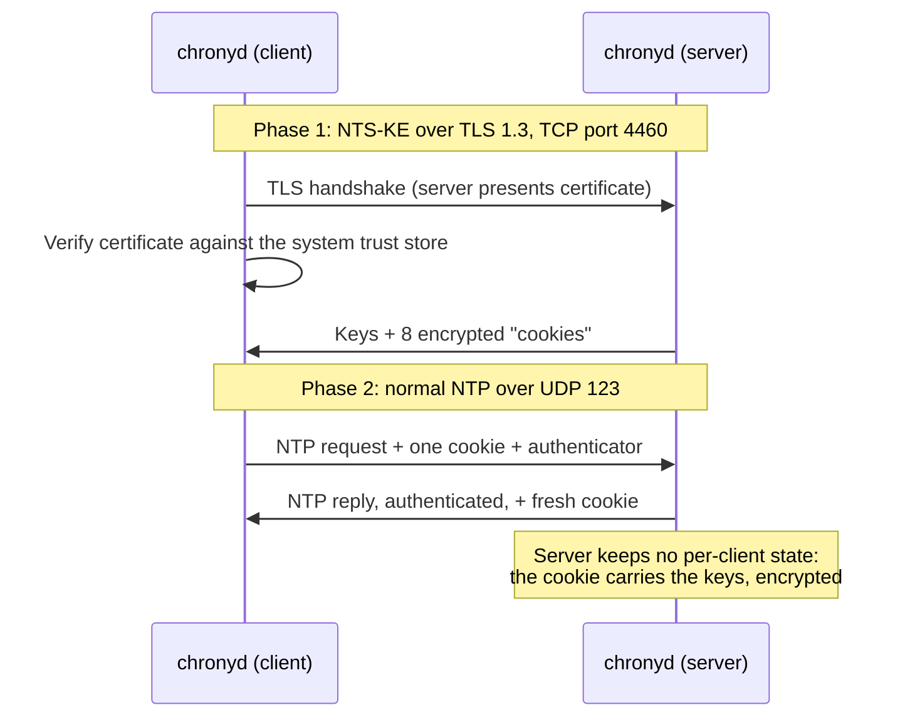
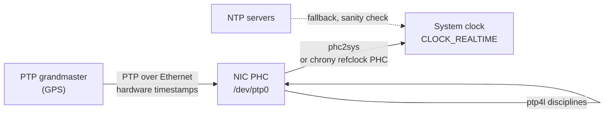

# 36 · Time: chrony, NTS and PTP

<ul class="module-meta">
  <li>⏱ ~2.5 hours</li>
  <li>4 labs</li>
  <li>Builds on: 07 · systemd and Services, 11 · Networking, 12 · Firewalls with firewalld, 33 · TLS, Certificates and Crypto Policies</li>
</ul>

Users can't log in to half your servers. The error says "Clock skew too great". On another day, a perfectly valid certificate is "not yet valid", a cluster fences a healthy node, and the logs from three machines tell three different stories about the order of events. All of these are clock problems. This module shows you how Linux keeps time, how chrony keeps it right, how to read what chrony tells you, how to serve time securely with NTS, and where PTP fits when milliseconds aren't good enough.

!!! abstract "What you'll learn"
    - Why accurate time matters for Kerberos, TLS, logs, clusters, and databases
    - The difference between the **RTC** and the **system clock**, and between `CLOCK_REALTIME` and `CLOCK_MONOTONIC`
    - NTP's core ideas: **stratum**, **offset**, **delay**, **jitter**, and **polling**
    - Configure `chronyd`, and explain **slewing** vs **stepping** and what `makestep` really does
    - Read `chronyc tracking`, `sources -v`, and `sourcestats` line by line
    - Serve time to your network and secure it with **NTS** (Network Time Security)
    - Know when you need **PTP**, check NIC support with `ethtool -T`, and feed PTP into chrony

## The big picture

Every computer has a cheap quartz oscillator that drifts by a few seconds a day. Left alone, a fleet of servers slowly disagrees about what time it is. **Time synchronisation** keeps each clock close to a shared reference (ultimately atomic clocks and GPS) by measuring the difference over the network and gently correcting it.

On Rocky Linux the job belongs to **chronyd**, the daemon from the **chrony** package, installed and enabled by default. It speaks **NTP** (Network Time Protocol) to servers, disciplines the kernel's clock, and can serve time to others.



Three ideas carry the whole module:

1. **Measure, don't trust.** NTP measures the offset to several servers, weighs them by quality, and rejects liars.
2. **Correct gently.** chrony prefers to **slew** (speed up or slow down the clock slightly) rather than **step** (jump), because time jumping backwards breaks software.
3. **Learn the drift.** chrony learns how fast your oscillator runs wrong and compensates continuously, so the clock stays good even between measurements.

## Why time matters

| System | What depends on time | What breaks |
|---|---|---|
| **Kerberos** / FreeIPA / Active Directory | Tickets carry timestamps; default tolerance is 5 minutes | "Clock skew too great": logins and NFS mounts fail ([module 26](26-centralized-identity.md)) |
| **TLS** | Certificate validity dates | "certificate is not yet valid" or "expired" ([module 33](33-tls-and-crypto-policies.md)) |
| **Logs** | Correlating events across hosts | Effects appear before causes; incident timelines lie |
| **HA clusters** | Token timeouts, fencing decisions | Spurious failovers ([module 28](28-high-availability.md)) |
| **Databases** | Replication ordering, snapshot timestamps, TTLs | Conflicts resolved wrongly; data appears from the future |
| **Distributed systems** | Leases, cache expiry, TOTP codes | Locks expire early, one-time passwords rejected |
| **Builds** (`make`) | File modification times | Files rebuilt forever, or never |

## Clocks on Linux

### Two clocks: the RTC and the system clock

A machine actually has two clocks:

- The **RTC** (real-time clock, or hardware clock) is a battery-backed chip on the motherboard. It keeps counting while the machine is off. It's low-resolution and drifts. On Linux it should hold **UTC**.
- The **system clock** is kept by the kernel in memory, counting from a high-resolution hardware counter called the **clocksource** (`tsc` on modern x86, `kvm-clock` in many KVM guests). It only exists while the system runs.

At boot, the kernel reads the RTC once to set the system clock. From then on, the system clock is the truth, and chrony disciplines it. With chrony's `rtcsync` directive, the kernel copies the system time back to the RTC every 11 minutes, so the RTC is close next boot.

```console
$ timedatectl
               Local time: Thu 2026-10-15 10:12:03 UTC
           Universal time: Thu 2026-10-15 10:12:03 UTC
                 RTC time: Thu 2026-10-15 10:12:03
                Time zone: UTC (UTC, +0000)
System clock synchronized: yes
              NTP service: active
          RTC in local TZ: no
$ sudo hwclock --show
2026-10-15 10:12:03.402381+00:00
$ cat /sys/devices/system/clocksource/clocksource0/current_clocksource
kvm-clock
```

`System clock synchronized: yes` means the kernel reports that a sync daemon has disciplined it recently. `RTC in local TZ: no` is what you want; storing local time in the RTC only makes sense when dual-booting with Windows.

### Time zones are only a display setting

The kernel keeps time as seconds since 1970 in **UTC**. Time zones are applied by the C library when a program formats a time for humans. The system default is the symlink `/etc/localtime`:

```console
$ ls -l /etc/localtime
lrwxrwxrwx. 1 root root 25 Sep 30 08:01 /etc/localtime -> ../usr/share/zoneinfo/UTC
$ sudo timedatectl set-timezone Europe/Berlin
$ TZ=America/New_York date
Thu Oct 15 06:12:03 AM EDT 2026
```

Changing the time zone never changes the actual clock, and NTP never deals with time zones. Many teams run servers in UTC so logs from every region line up.

### Kernel clocks: REALTIME vs MONOTONIC

Programs ask the kernel for time through several clocks. Two matter most:

- **`CLOCK_REALTIME`**: wall-clock time, "it's 10:12 UTC". It can **jump** when someone or something steps the clock. Use it for timestamps humans read.
- **`CLOCK_MONOTONIC`**: time since boot (roughly). It **never goes backwards** and is never stepped, though chrony's slewing does adjust its rate. Use it for "how long did this take?" and timeouts.

There are others: `CLOCK_BOOTTIME` (monotonic, but includes time suspended) and `CLOCK_TAI` (atomic time, no leap seconds, used by PTP).

!!! analogy "Think of it like a wall clock and a stopwatch"
    `CLOCK_REALTIME` is the wall clock: correct it and the hands jump. `CLOCK_MONOTONIC` is a stopwatch: it only ever moves forward. A program that measures a timeout with the wall clock can wait forever (or zero seconds) when the clock is stepped. Well-written software uses the stopwatch for durations.

<div class="quiz" data-answer="2" markdown>

A server's clock is stepped back by 30 seconds. Which kind of program is most likely to misbehave?

- One that measures elapsed time with `CLOCK_MONOTONIC`
- One that measures elapsed time by subtracting two `CLOCK_REALTIME` readings
- One that prints the current local time once a minute
- All programs equally

Subtracting wall-clock readings across a step gives a negative or huge duration. `CLOCK_MONOTONIC` is immune to steps, which is exactly why it exists. This is also why chrony avoids stepping a running system.

</div>

## NTP in one page

**NTP** sends a small UDP packet (port 123) with timestamps to a server and gets one back. Four timestamps are enough to compute two numbers:



- **Offset**: how far your clock is from the server's. This is what gets corrected.
- **Delay** (round-trip delay): how long the network took. The offset calculation assumes the outbound and return trips took equal time, so **half the delay is the worst-case error** of a measurement. Nearby servers are better.
- **Jitter**: how much successive measurements vary. Low jitter means a stable path.
- **Stratum**: distance from a reference clock. Stratum 1 is attached to GPS or an atomic clock; a server synced to a stratum 1 is stratum 2, and so on. Lower is closer, not necessarily better: a nearby stratum 3 can beat a far-away stratum 1.
- **Poll interval**: how often chrony asks, written as a power of two seconds. Poll 6 is 2^6 = 64 seconds, poll 10 is 1024 seconds. chrony lengthens the interval as the clock settles.

!!! tip "Use several servers"
    With one server you can't tell if it's wrong. With two you can't tell *which* is wrong. With **three or more**, chrony can outvote a bad one (marking it `x`, a "falseticker"). The Rocky default uses the `pool` directive, which resolves several servers from one name.

## chronyd: configuration and internals

### The default configuration

Here is Rocky 10's `/etc/chrony.conf`, trimmed to the active lines and annotated. (Compare with yours: `grep -Ev '^(#|$)' /etc/chrony.conf`. Minor releases occasionally adjust a line or two.)

```bash title="/etc/chrony.conf"
pool 2.rocky.pool.ntp.org iburst     # (1)!
sourcedir /run/chrony-dhcp           # (2)!
driftfile /var/lib/chrony/drift      # (3)!
makestep 1.0 3                       # (4)!
rtcsync                              # (5)!
keyfile /etc/chrony.keys             # (6)!
ntsdumpdir /var/lib/chrony           # (7)!
leapsectz right/UTC                  # (8)!
logdir /var/log/chrony               # (9)!
```

1. Use several servers from the NTP Pool's Rocky zone. `pool` resolves the name to multiple addresses and replaces ones that go bad. **`iburst`** sends a quick burst of four requests at start-up so the first sync takes seconds, not minutes. For a single fixed server, use `server name iburst`.
2. Also use NTP servers handed out by DHCP (NetworkManager writes them here).
3. Where chrony saves the learned **frequency error** of your oscillator, so after a reboot it starts out already compensating.
4. **Step** the clock if it's off by more than 1.0 second, but only during the first 3 clock updates. After that, only slew. More below.
5. Have the kernel copy system time to the RTC every 11 minutes.
6. Symmetric keys for classic NTP authentication (rarely used now that NTS exists).
7. Save NTS keys and cookies across restarts, so clients don't need a new NTS-KE handshake each time.
8. Learn about upcoming leap seconds (and the TAI-UTC offset) from the system time zone database. Newer chrony versions also offer `leapseclist`, which reads tzdata's `leap-seconds.list` file instead; either does the job.
9. Directory for optional measurement logs (enable with a `log` line).

Cloud images and hosting providers often replace the `pool` line with their own internal time service (for example a link-local address on AWS or Azure's host time). That's fine and usually better than the public pool.

### Slew vs step

When chrony finds the clock is off, it has two choices:

- **Slew**: run the clock slightly fast or slow until the error is gone. Time stays continuous and never goes backwards. chrony does this by temporarily changing the clock's rate, capped by `maxslewrate` (83,333 ppm by default, about 83 ms per second), and it normally corrects more gently than the cap. Slewing out a couple of seconds takes a minute or so; slewing out an hour would take far too long, which is why big errors get stepped.
- **Step**: jump the clock to the right time instantly. Fast, but anything measuring with wall-clock time sees a discontinuity.

<div class="stepper" markdown>

<div class="step" data-title="Boot" markdown>

chronyd starts. The kernel set the clock from the RTC, which may be seconds or minutes off. chronyd reads `/var/lib/chrony/drift` to know the oscillator's typical error.

</div>

<div class="step" data-title="iburst" markdown>

chronyd sends four quick requests to each source and gets offset/delay samples within a few seconds.

</div>

<div class="step" data-title="Select" markdown>

It discards unreachable sources and **falsetickers** (sources whose error ranges don't overlap with the majority), picks the best as the **system peer** (`*`), and combines the good ones (`+`).

</div>

<div class="step" data-title="Step allowed?" markdown>

`makestep 1.0 3`: this is one of the first 3 updates, and the offset is above 1 second, so chronyd **steps** the clock. The journal shows `System clock wrong by 4.723118 seconds` and `System clock was stepped by 4.723118 seconds`.

</div>

<div class="step" data-title="Steady state" markdown>

From now on, no stepping. chronyd slews away remaining errors and adjusts the clock's **frequency** so it runs at the right rate. Poll intervals grow from 64 s towards 1024 s as the estimate stabilises.

</div>

<div class="step" data-title="Disturbance" markdown>

If something pushes the clock far off later (a VM paused for a minute, a manual `date -s`), chronyd logs `System clock wrong by 60.000412 seconds, adjustment started` and slowly slews. To fix it immediately, an admin runs `chronyc makestep`.

</div>

</div>

!!! tip "Containers and VMs"
    Containers share the host's kernel clock, so run chrony on the host, not in containers. VMs have their own clock and should run chronyd, but a paused or migrated VM can return far off. Some sites use `makestep 1 -1` (step whenever off by more than a second, at any time) on VMs. That trades continuity for fast recovery; know which your applications prefer.

### Reading chronyc tracking

`chronyc` talks to the running chronyd. `tracking` describes the system clock's state:

```yaml title="chronyc tracking (output)"
Reference ID    : A29FC801 (time.cloudflare.com)        # (1)!
Stratum         : 4                                     # (2)!
Ref time (UTC)  : Thu Oct 15 10:09:51 2026              # (3)!
System time     : 0.000012345 seconds fast of NTP time  # (4)!
Last offset     : +0.000008123 seconds                  # (5)!
RMS offset      : 0.000021456 seconds                   # (6)!
Frequency       : 12.345 ppm slow                       # (7)!
Residual freq   : +0.001 ppm                            # (8)!
Skew            : 0.045 ppm                             # (9)!
Root delay      : 0.012345678 seconds                   # (10)!
Root dispersion : 0.000987654 seconds                   # (11)!
Update interval : 64.3 seconds                          # (12)!
Leap status     : Normal                                # (13)!
```

1. The source currently used for synchronisation (hex ID, here an IPv4 address, and its name).
2. Our stratum: the source's stratum plus one.
3. When the last measurement from that source was processed.
4. **The most important line**: how far the system clock is from true time *right now*, and in which direction. chrony is slewing this away.
5. Offset at the last clock update.
6. Long-term average offset. Microseconds is healthy on a LAN; low milliseconds is normal over the internet.
7. How wrong the oscillator runs without correction: 12.345 parts per million slow is about 1 second per day. chrony compensates for this continuously.
8. The remaining difference between measured and applied frequency. Near zero is good.
9. Estimated error bound on the frequency.
10. Total network round-trip delay back to the stratum 1 reference.
11. Accumulated uncertainty back to the reference. Root delay / 2 + root dispersion is the **maximum error** of your clock.
12. Average interval between clock updates.
13. `Normal`, `Insert second`, `Delete second` (a leap second is scheduled), or `Not synchronised` (bad).

### Reading chronyc sources -v

`sources` lists every time source and its state. `-v` adds a legend:

```console
$ chronyc sources -v

  .-- Source mode  '^' = server, '=' = peer, '#' = local clock.
 / .- Source state '*' = current best, '+' = combined, '-' = not combined,
| /             'x' = may be in error, '~' = too variable, '?' = unusable.
||                                                 .- xxxx [ yyyy ] +/- zzzz
||      Reachability register (octal) -.           |  xxxx = adjusted offset,
||      Log2(Polling interval) --.      |          |  yyyy = measured offset,
||                                \     |          |  zzzz = estimated error.
||                                 |    |           \
MS Name/IP address         Stratum Poll Reach LastRx Last sample
===============================================================================
^* time.cloudflare.com           3   6   377    35   +112us[ +140us] +/-   12ms
^+ ntp1.example.net              2   6   377    34   -320us[ -292us] +/-   25ms
^- 192.0.2.10                    2   7   377    98  +1203us[+1231us] +/-   41ms
^? 198.51.100.7                  0   6     0     -     +0ns[   +0ns] +/-    0ns
```

Column by column:

- **M** (mode): `^` a server, `=` a peer, `#` a local reference clock (PPS, PHC, SHM).
- **S** (state): `*` the selected best source; `+` acceptable and combined into the result; `-` acceptable but not combined; `x` a **falseticker** that disagrees with the majority; `~` too variable; `?` unusable (unreachable or not enough samples yet).
- **Stratum**: `0` here means "no reply yet".
- **Poll**: log2 of the interval; `6` is 64 seconds.
- **Reach**: an 8-bit shift register of the last eight polls, in **octal**. `377` (binary 11111111) means the last eight all answered. `0` means none did. `376` means the most recent one was lost.
- **LastRx**: seconds since the last good sample.
- **Last sample**: the offset after adjustments `[raw measured offset]` `+/-` error bound.

The last line, `^? … Reach 0`, is a server that never answered: blocked UDP 123, a wrong name, or a dead server. Check with `chronyc ntpdata 198.51.100.7` or a packet capture.

### chronyc sourcestats

`sourcestats` shows chrony's statistical model of each source:

```console
$ chronyc sourcestats
Name/IP Address            NP  NR  Span  Frequency  Freq Skew  Offset  Std Dev
==============================================================================
time.cloudflare.com        12   7   710     +0.012      0.081   +108us    41us
ntp1.example.net           10   6   583     -0.034      0.152   -301us    87us
192.0.2.10                  8   5   812     +0.210      0.920  +1190us   410us
```

**NP** is the number of samples kept, **NR** the number of runs of same-sign residuals (a sanity check of the fit), **Span** the time covered. **Frequency** and **Freq Skew** are this source's estimate of your clock's frequency error and its uncertainty. **Std Dev** is the source's jitter. A source with a much larger Std Dev than the others is a poor choice, which is why `192.0.2.10` above isn't combined.

### Practice: interrogate chrony

<div class="terminal-sim" data-title="Is this clock healthy?" markdown>

<div class="task" data-expect="timedatectl||timedatectl status" data-hint="systemd's tool for time and date settings, with no arguments." markdown>

**Step 1.** Get the overall picture: time zone, RTC, and sync state.

```text
               Local time: Thu 2026-10-15 10:12:03 UTC
           Universal time: Thu 2026-10-15 10:12:03 UTC
                 RTC time: Thu 2026-10-15 10:12:03
                Time zone: UTC (UTC, +0000)
System clock synchronized: yes
              NTP service: active
          RTC in local TZ: no
```

</div>

<div class="task" data-expect="chronyc tracking" data-hint="chronyc has a subcommand that describes the system clock's state." markdown>

**Step 2.** How far off is the system clock right now?

```text
Reference ID    : A29FC801 (time.cloudflare.com)
Stratum         : 4
System time     : 0.000012345 seconds fast of NTP time
…
Leap status     : Normal
```

</div>

<div class="task" data-expect="chronyc sources -v||chronyc sources" data-match="^chronyc sources( -v)?$" data-hint="chronyc sources, with -v for the legend." markdown>

**Step 3.** Which sources is chrony using, and which is the best?

```text
MS Name/IP address         Stratum Poll Reach LastRx Last sample
===============================================================================
^* time.cloudflare.com           3   6   377    35   +112us[ +140us] +/-   12ms
^+ ntp1.example.net              2   6   377    34   -320us[ -292us] +/-   25ms
^? 198.51.100.7                  0   6     0     -     +0ns[   +0ns] +/-    0ns
```

</div>

<div class="task" data-expect="sudo chronyc makestep" data-hint="Stepping the clock changes it, so you need root. The chronyc command is makestep." markdown>

**Step 4.** The clock was found 40 seconds off after a VM resume. Correct it immediately instead of slewing.

```text
200 OK
```

</div>

</div>

<div class="quiz" data-answer="3" markdown>

`chronyc sources` shows a server with `Reach 0` and state `?`. Everything else is `377`. What does that tell you?

- The server is a falseticker; chrony caught it lying
- The server is the current best source
- chrony has received no replies from it in the last eight polls
- The server is stratum 0, an atomic clock

Reach is a register of the last eight polls in octal; `0` means none answered. Check name resolution, the firewall (UDP 123 outbound), and the server itself. A falseticker would be marked `x` and still have a non-zero Reach.

</div>

## Serving time to your network

Clients across a site should sync to a few local servers, not each to the internet. Turning a Rocky machine into an NTP server takes one directive and a firewall rule:

```bash title="/etc/chrony.conf (server additions)"
allow 192.168.122.0/24           # (1)!
#local stratum 10                # (2)!
```

1. Answer NTP requests from this network. Without any `allow`, chronyd is client-only.
2. Keep serving time even if all upstream sources are lost, at a high (untrusted-looking) stratum. Useful on isolated networks; dangerous if it makes clients follow a drifting clock. Leave it off unless you need it.

```console
$ sudo systemctl restart chronyd
$ sudo firewall-cmd --permanent --add-service=ntp && sudo firewall-cmd --reload
$ sudo chronyc clients
Hostname                      NTP   Drop Int IntL Last     Cmd   Drop Int  Last
===============================================================================
client1.lab.example            12      0   6   -    41       0      0   -     -
```

Point clients at it with `server ntp1.lab.example iburst` lines (or the `timesync` System Role, [module 32](32-ansible-and-system-roles.md)). Use at least three internal servers for a big site.

!!! note "Port 323 is not NTP"
    `chronyc` talks to chronyd over UDP port 323 on localhost (or a Unix socket). It's a management channel and should never be opened in the firewall. NTP itself is UDP 123.

## NTS: authenticated time

Classic NTP is unauthenticated. An attacker on the path can forge replies and move your clock, which then breaks certificate validation, Kerberos, and log integrity, or replays expired credentials. **NTS** (Network Time Security, RFC 8915) fixes this with TLS.



The TLS handshake proves the server's identity using exactly the certificate machinery from [module 33](33-tls-and-crypto-policies.md). After that, NTP packets carry cookies and are authenticated with fast symmetric crypto. chrony on Rocky supports NTS as both client and server.

### NTS client

Add `nts` to a server line. The server must offer NTS and have a certificate your system trusts:

```ini title="/etc/chrony.conf (client)"
server time.cloudflare.com iburst nts
server ntp1.lab.example iburst nts
#authselectmode require          # refuse to use any unauthenticated source
```

```console
$ chronyc -N authdata
Name/IP address             Mode KeyID Type KLen Last Atmp  NAK Cook CLen
=========================================================================
time.cloudflare.com          NTS     1   15  256  33m    0    0    8  100
ntp1.lab.example             NTS     1   15  256   2h    0    0    8  100
```

`Mode NTS` with `Cook 8` (eight cookies held) means NTS is working. `Atmp` counts failed NTS-KE attempts and `NAK` counts rejected cookies; non-zero values there point to certificate, firewall, or clock problems. `-N` shows names instead of addresses.

!!! warning "The chicken-and-egg problem"
    NTS needs certificate validation, and certificate validation needs a roughly correct clock. A machine whose RTC is badly wrong (dead battery, years off) can't validate any certificate, so it can't get NTS time. chrony handles this with the `nocerttimecheck` directive (skip the certificate date check until the clock has been synchronised a given number of times) and by stepping with `makestep` early. Keep at least one alternative path, or ensure RTCs are healthy.

### NTS server

A server needs a certificate and key whose SAN matches the name clients use, readable by the `chrony` user:

```ini title="/etc/chrony.conf (server additions)"
allow 192.168.122.0/24
ntsservercert /etc/pki/tls/certs/ntp1.crt
ntsserverkey /etc/pki/tls/private/ntp1.key
ntsdumpdir /var/lib/chrony
```

```console
$ sudo chown root:chrony /etc/pki/tls/private/ntp1.key
$ sudo chmod 640 /etc/pki/tls/private/ntp1.key
$ sudo systemctl restart chronyd
$ sudo firewall-cmd --permanent --add-service=ntp
$ sudo firewall-cmd --permanent --add-port=4460/tcp
$ sudo firewall-cmd --reload
$ sudo chronyc serverstats | grep -i nts
NTS-KE connections accepted : 3
NTS-KE connections dropped  : 0
Authenticated NTP packets   : 412
```

Remember that NTS-KE is TLS, so the server's crypto policy applies to it too. A client whose policy forbids the server's key (for example a 2048-bit RSA key under FUTURE) fails the NTS-KE handshake.

<div class="quiz" data-answer="4" markdown>

You enable NTS on a server. Clients show `Atmp 5` and `Cook 0` in `chronyc -N authdata`. Which of these is NOT a likely cause?

- TCP port 4460 is blocked by firewalld on the server
- The server certificate's SAN doesn't match the name in the client's `server` line
- The clients don't trust the CA that signed the server certificate
- UDP port 323 is closed on the server

NTS-KE (TCP 4460) is failing, so clients never get cookies. Firewall, name, and trust are classic causes. Port 323 is chronyc's local management port and has nothing to do with clients.

</div>

## Leap seconds and smearing

The Earth's rotation is slightly irregular, so UTC occasionally gets a **leap second**: an extra second, 23:59:60, at the end of June or December. Leap seconds have caused real outages when software saw a repeated second or a minute with 61 seconds. None has been added since the end of 2016, and the international timekeeping bodies have decided to stop adding them by 2035, but your systems should still handle one sensibly.

chrony learns about upcoming leap seconds from NTP servers and from the time zone database (`leapsectz right/UTC`). `chronyc tracking` shows `Leap status : Insert second` in the days before. How it applies it is set by `leapsecmode`:

| `leapsecmode` | Behaviour |
|---|---|
| `system` (default) | The kernel inserts the second (the clock shows 23:59:59 twice, effectively) |
| `step` | chronyd steps the clock back one second after midnight |
| `slew` | chronyd slews the second out over about 12 seconds; no repeated time, briefly off by up to 1 s |
| `ignore` | Do nothing; the error is corrected later by normal slewing |

Big providers instead **smear** the leap second: their servers spread the extra second over many hours, so clients see time running very slightly slow and never notice. chrony can act as a smearing server with `smoothtime 400 0.001 leaponly` plus `leapsecmode slew`. Never mix smeared and non-smeared servers on the same client: during a smear they disagree by up to a second and chrony will reject one group as falsetickers. A client that follows smeared servers should also comment out `leapsectz`, so it doesn't apply the leap second a second time.

## PTP: when milliseconds aren't enough

NTP over a LAN gets you tens of microseconds; over the internet, milliseconds. Some workloads need far better: financial trading (regulators require traceable timestamps to 100 µs), telecom (5G fronthaul), industrial control, and audio/video broadcast. That's the domain of **PTP** (Precision Time Protocol, IEEE 1588), which reaches sub-microsecond accuracy on a LAN.

PTP gets its precision from **hardware timestamping**: the network card itself records the exact moment a packet leaves or arrives, removing software delays. The NIC has its own clock, the **PHC** (PTP hardware clock), exposed as `/dev/ptp0`. PTP-aware switches (**boundary clocks** or **transparent clocks**) correct for their own queueing delays. A **grandmaster** clock, usually GPS-disciplined, is the source.

On Rocky, PTP comes from the **linuxptp** package:

- **`ptp4l`** runs the PTP protocol on an interface and disciplines the NIC's PHC to the grandmaster.
- **`phc2sys`** copies time from the PHC to the system clock (or between PHCs).
- **`timemaster`** can run ptp4l and chronyd together, configured from one file.



### Check hardware support first

```console
$ ethtool -T enp1s0
Time stamping parameters for enp1s0:
Capabilities:
	hardware-transmit
	software-transmit
	hardware-receive
	software-receive
	software-system-clock
	hardware-raw-clock
PTP Hardware Clock: 0
Hardware Transmit Timestamp Modes:
	off
	on
Hardware Receive Filter Modes:
	none
	all
```

`hardware-transmit`, `hardware-receive`, and `PTP Hardware Clock: 0` (meaning `/dev/ptp0`) are what you need. A typical virtio NIC in a VM shows only the `software-*` capabilities and `PTP Hardware Clock: none`; PTP with software timestamps works but is far less accurate.

### Running ptp4l and feeding chrony

```console
$ sudo dnf install -y linuxptp
$ sudo ptp4l -i enp1s0 -s -m
ptp4l[1203.551]: selected /dev/ptp0 as PTP clock
ptp4l[1203.588]: port 1 (enp1s0): INITIALIZING to LISTENING on INIT_COMPLETE
ptp4l[1205.322]: port 1 (enp1s0): new foreign master 001122.fffe.334455-1
ptp4l[1209.322]: selected best master clock 001122.fffe.334455
ptp4l[1209.323]: port 1 (enp1s0): LISTENING to UNCALIBRATED on RS_SLAVE
ptp4l[1211.104]: port 1 (enp1s0): UNCALIBRATED to SLAVE on MASTER_CLOCK_SELECTED
ptp4l[1212.105]: master offset        -23 s2 freq   +1132 path delay       612
```

`-s` means client only (never become master), `-m` prints to the terminal. `master offset` in nanoseconds settling to small numbers means the PHC is locked. For a permanent setup, use the `ptp4l` systemd service with options in `/etc/sysconfig/ptp4l` and settings in `/etc/ptp4l.conf`.

Now get PHC time into the system clock. Two ways:

=== "chrony refclock (recommended with chrony)"

    ```ini title="/etc/chrony.conf"
    refclock PHC /dev/ptp0 poll 0 dpoll -2 offset -37 refid PTP
    pool 2.rocky.pool.ntp.org iburst
    ```

    chronyd reads the PHC directly as a **reference clock**. `offset -37` converts from TAI (which PTP uses) to UTC: TAI is currently 37 seconds ahead. NTP sources stay configured as a sanity check and fallback. `chronyc sources` then shows a `#* PTP` line.

=== "phc2sys"

    ```console
    $ sudo phc2sys -s enp1s0 -c CLOCK_REALTIME -w -m
    ```

    `-s` is the source (the PHC of `enp1s0`), `-c` the clock to set, `-w` waits for ptp4l to be synchronised and also fetches the TAI-UTC offset from it, so the 37-second conversion is handled for you. `-m` logs to the terminal. **Don't** run phc2sys against `CLOCK_REALTIME` while chronyd is also disciplining it: two controllers fight. Either let chrony own the system clock (refclock), or stop chronyd.

!!! tip "A deep cut for KVM guests"
    The `ptp_kvm` kernel module gives a KVM guest a virtual PHC (`/dev/ptp0`) that reads the host's clock directly, with no network involved. With `refclock PHC /dev/ptp0 poll 2` in the guest's chrony.conf, guests track the host very closely. Load it with `sudo modprobe ptp_kvm` and check `ls /dev/ptp*`. The host must itself be well synchronised, of course.

## Troubleshooting clock skew

<div class="decision" markdown>

<div class="node" data-id="start" markdown>

**Is chronyd running?** `systemctl is-active chronyd`

<button data-goto="src">active</button> <button data-goto="dead">inactive or failed</button>

</div>

<div class="node" data-id="dead" markdown>

**Start it and read why it stopped.** `sudo systemctl enable --now chronyd`, then `journalctl -u chronyd -b`. Also check nothing else is fighting for the clock: `systemctl status ntpd systemd-timesyncd ptp4l phc2sys` (only one service should discipline the system clock).

</div>

<div class="node" data-id="src" markdown>

**Does `chronyc sources` show a `*` source?**

<button data-goto="offset">Yes</button> <button data-goto="reach">No: all ? or Reach 0</button> <button data-goto="false">No: sources marked x or ~</button>

</div>

<div class="node" data-id="reach" markdown>

**No source answers.** Check DNS resolves the server names, outbound UDP 123 isn't blocked (cloud security groups, corporate firewalls), and for NTS that TCP 4460 is open and `chronyc -N authdata` shows cookies. `chronyc ntpdata <server>` and `sudo tcpdump -ni any udp port 123` prove whether replies arrive.

</div>

<div class="node" data-id="false" markdown>

**Sources disagree.** With only two sources, chrony can't tell which is right: add a third. Mixed smeared and non-smeared servers also cause this. Check `chronyc sourcestats` for a source with a huge Std Dev or offset, and remove it.

</div>

<div class="node" data-id="offset" markdown>

**Synced. Is `System time` in `chronyc tracking` small?**

<button data-goto="ok">Yes, microseconds to milliseconds</button> <button data-goto="slew">No, seconds or more</button>

</div>

<div class="node" data-id="slew" markdown>

**Large offset being slewed.** After the first updates, `makestep 1.0 3` no longer steps, so a big error (after a VM pause, a manual change) slews for hours. Run `sudo chronyc makestep` to fix it now. If it keeps happening on VMs, consider `makestep 1 -1` or `ptp_kvm`.

</div>

<div class="node" data-id="ok" markdown>

**This host is fine.** If an application still complains about skew, check the *other* end (the KDC, the TLS peer, the database primary) with the same steps, and check the app compares times in UTC. `timedatectl` on both ends should agree.

</div>

</div>

## Labs

!!! lab "Lab 1: Read the clocks"

    **Goal:** Map everything in this module to real output on your machine.

    **You'll need:** a Rocky 10 VM.

    1. Look at the clocks:

        ```console
        $ timedatectl
        $ sudo hwclock --show
        $ cat /sys/devices/system/clocksource/clocksource0/current_clocksource
        $ cat /sys/devices/system/clocksource/clocksource0/available_clocksource
        ```

    2. Look at chrony's view:

        ```console
        $ grep -Ev '^(#|$)' /etc/chrony.conf
        $ chronyc tracking
        $ chronyc sources -v
        $ chronyc sourcestats
        $ cat /var/lib/chrony/drift
        ```

    3. Compare the two kernel clocks:

        ```console
        $ cat /proc/uptime
        $ python3 -c 'import time; print(time.clock_gettime(time.CLOCK_MONOTONIC), time.clock_gettime(time.CLOCK_REALTIME))'
        ```

    **Check your work:** you can state (a) your clocksource, (b) your current offset from `System time`, (c) your oscillator's frequency error in ppm and roughly how many seconds per day that is (ppm × 0.0864), and (d) which source is `*` and why its Reach is what it is.

    ??? success "Reading the drift file"
        `/var/lib/chrony/drift` holds two numbers: the frequency correction in ppm and its estimated error. It matches `Frequency` in `chronyc tracking` (with the opposite sign convention for "slow"/"fast" spelled out in words there).

    **Clean up:** nothing to undo.

!!! lab "Lab 2: Skew the clock and watch chrony recover"

    **Goal:** See stepping at start-up, slewing afterwards, and a manual `makestep`.

    **You'll need:** a Rocky 10 VM with working NTP (from Lab 1).

    1. Stop chrony and push the clock 5 minutes ahead:

        ```console
        $ sudo systemctl stop chronyd
        $ sudo date -s '+5 minutes'
        $ date
        ```

    2. Start chrony and watch it step (this is one of the first 3 updates, and 300 s > 1 s):

        ```console
        $ sudo systemctl start chronyd
        $ chronyc waitsync 30 0.1
        $ journalctl -u chronyd --since '-2 min' --no-pager | grep -i 'system clock'
        … chronyd[2311]: System clock wrong by -300.004113 seconds
        … chronyd[2311]: System clock was stepped by -300.004113 seconds
        ```

    3. Now, with chrony running and past its first updates, skew the clock by 2 seconds and watch it slew instead:

        ```console
        $ sudo chronyc burst 4/4 && sleep 15        # make sure the first updates are behind us
        $ sudo date -s '+2 seconds'
        $ sudo chronyc burst 4/4
        $ watch -n 2 'chronyc tracking | grep -E "System time|Last offset"'
        ```

        `System time` shows about 2 seconds and shrinks gradually rather than jumping to zero. Press ++ctrl+c++ once it's back near zero.

    4. Fix it instantly:

        ```console
        $ sudo chronyc makestep
        200 OK
        $ chronyc tracking | grep 'System time'
        ```

    **Check your work:** the journal shows the step in step 2; in step 3 the offset shrinks gradually rather than jumping; after step 4 it's back to microseconds or milliseconds.

    ??? success "Why didn't chrony step in step 3?"
        `makestep 1.0 3` only allows steps during the first three clock updates after chronyd starts. After that, chrony assumes any error is best removed smoothly, by running the clock slightly fast or slow, so no program ever sees time jump.

    **Clean up:** nothing; chrony has already corrected the clock. Confirm with `chronyc tracking`.

!!! lab "Lab 3: An NTS server and client"

    **Goal:** Serve authenticated time from one VM to another with NTS.

    **You'll need:** two Rocky 10 VMs that can reach each other: `ntp1` (server, e.g. 192.168.122.10) and `client1`. The CA from [module 33](33-tls-and-crypto-policies.md) Lab 1, or create one the same way.

    1. On both VMs, make the name resolvable:

        ```console
        $ echo '192.168.122.10 ntp1.lab.example' | sudo tee -a /etc/hosts
        ```

    2. On your CA machine, issue a certificate for `ntp1.lab.example` (as in module 33's stepper, with `subjectAltName = DNS:ntp1.lab.example` in the extension file), and copy `ntp1.crt`, `ntp1.key`, and `ca.crt` to `ntp1`. Copy `ca.crt` to `client1`.

    3. On **ntp1**, install the certificate and enable the NTS server:

        ```bash
        sudo cp ntp1.crt /etc/pki/tls/certs/ntp1.crt
        sudo install -m 640 -o root -g chrony ntp1.key /etc/pki/tls/private/ntp1.key
        sudo restorecon -v /etc/pki/tls/certs/ntp1.crt /etc/pki/tls/private/ntp1.key
        sudo tee -a /etc/chrony.conf <<'EOF'
        allow 192.168.122.0/24
        ntsservercert /etc/pki/tls/certs/ntp1.crt
        ntsserverkey /etc/pki/tls/private/ntp1.key
        EOF
        sudo systemctl restart chronyd
        sudo firewall-cmd --permanent --add-service=ntp
        sudo firewall-cmd --permanent --add-port=4460/tcp
        sudo firewall-cmd --reload
        ```

    4. On **client1**, trust the CA and use the server with NTS only:

        ```bash
        sudo cp ca.crt /etc/pki/ca-trust/source/anchors/lab-root-ca.crt
        sudo update-ca-trust
        sudo cp -a /etc/chrony.conf /etc/chrony.conf.orig
        sudo sed -i 's/^pool /#pool /' /etc/chrony.conf
        echo 'server ntp1.lab.example iburst nts' | sudo tee -a /etc/chrony.conf
        sudo systemctl restart chronyd
        ```

    5. Verify on client1, then on ntp1:

        ```console
        client1$ chronyc -N authdata
        client1$ chronyc -N sources
        ntp1$ sudo chronyc serverstats
        ntp1$ sudo chronyc clients
        ```

    **Check your work:** `authdata` shows `Mode NTS` with `Cook` greater than 0, `sources` shows `ntp1.lab.example` with `*` and Reach climbing towards `377`, and `serverstats` counts NTS-KE connections and authenticated packets.

    ??? tip "Hint: Cook stays at 0"
        Test the NTS-KE port directly from the client: `openssl s_client -connect ntp1.lab.example:4460 -alpn ntske/1 </dev/null`. A TLS error there is a certificate or trust problem (module 33's decision tree applies). No connection at all means the firewall or chronyd isn't listening (`sudo ss -tlnp | grep 4460` on ntp1). `journalctl -u chronyd` on both sides usually names the problem.

    **Clean up:** on client1: `sudo cp /etc/chrony.conf.orig /etc/chrony.conf; sudo systemctl restart chronyd; sudo rm /etc/pki/ca-trust/source/anchors/lab-root-ca.crt; sudo update-ca-trust`. On ntp1: remove the three added lines from `/etc/chrony.conf`, `sudo systemctl restart chronyd`, `sudo firewall-cmd --permanent --remove-service=ntp --remove-port=4460/tcp && sudo firewall-cmd --reload`, `sudo rm /etc/pki/tls/certs/ntp1.crt /etc/pki/tls/private/ntp1.key`. On both: remove the `/etc/hosts` line.

!!! lab "Lab 4: Is this machine ready for PTP?"

    **Goal:** Check hardware timestamping, and (on a KVM guest) use the host as a precise reference clock.

    **You'll need:** a Rocky 10 machine; a KVM guest for part 2.

    1. Check every interface for hardware timestamping:

        ```console
        $ for i in $(ls /sys/class/net | grep -v lo); do echo "== $i"; ethtool -T "$i" | grep -E 'hardware|PTP Hardware Clock'; done
        $ ls /dev/ptp* 2>/dev/null
        ```

    2. On a KVM guest, load `ptp_kvm` and add the host clock as a reference clock:

        ```console
        $ sudo modprobe ptp_kvm
        $ ls /dev/ptp*
        /dev/ptp0
        $ cat /sys/class/ptp/ptp0/clock_name
        KVM virtual PTP
        $ sudo cp -a /etc/chrony.conf /etc/chrony.conf.orig
        $ echo 'refclock PHC /dev/ptp0 poll 2 refid KVM' | sudo tee -a /etc/chrony.conf
        $ sudo systemctl restart chronyd
        $ sleep 30; chronyc sources
        ```

    **Check your work:** part 1 tells you whether each NIC has a PHC. In part 2, `chronyc sources` shows a `#` line with refid `KVM`, usually selected (`*`) with an error bound far smaller than the network sources.

    ??? question "Why no TAI offset here?"
        The KVM virtual PHC reports the host's system time (UTC), not TAI, so no `offset -37` is needed. A real NIC PHC disciplined by ptp4l runs in TAI, which is why the PTP example above uses `offset -37`.

    **Clean up:** `sudo cp /etc/chrony.conf.orig /etc/chrony.conf; sudo systemctl restart chronyd; sudo modprobe -r ptp_kvm`.

## Common pitfalls

| Symptom | Cause | Fix |
|---|---|---|
| "Clock skew too great" from Kerberos | Client or KDC more than 5 minutes off | Fix chrony on both; `chronyc makestep` for an immediate correction |
| All sources `?` with `Reach 0` | UDP 123 outbound blocked, or names don't resolve | Open the path; use the provider's internal time service in clouds |
| Two servers, constant flapping or `x` marks | Not enough sources to outvote one bad server | Use three or more servers |
| Clock fixed, then wrong again after reboot | RTC badly off, and `rtcsync` missing | Keep `rtcsync`; `sudo hwclock --systohc` once the clock is right |
| Time jumps around every few seconds | Two daemons disciplining the clock (chronyd plus phc2sys, ntpd, or a guest agent's time sync) | Exactly one owner of the system clock |
| NTS: `Cook 0`, `Atmp` rising | TCP 4460 blocked, SAN mismatch, CA not trusted, or clock too wrong to validate the cert | `openssl s_client -connect host:4460`; module 33 tree; `nocerttimecheck` |
| Clients ignore your server | No `allow` line, or `ntp` not opened in firewalld | Add `allow <subnet>`; `firewall-cmd --add-service=ntp` |
| Huge offset slowly slewing after VM resume | `makestep` only applies to the first 3 updates | `chronyc makestep`; `makestep 1 -1` on VMs if apps tolerate steps |

!!! pitfall "Setting the time zone to fix the time"
    If a server shows the wrong hour, check `timedatectl` before touching anything. A wrong *time zone* is a display problem (`set-timezone`). A wrong *clock* is a sync problem (chrony). Changing one to hide the other leaves UTC timestamps, certificates, and Kerberos broken.

## Cheat sheet

| Command | What it does |
|---|---|
| `timedatectl` | Clock, time zone, RTC and sync status |
| `timedatectl set-timezone Europe/Berlin` | Change the display time zone |
| `hwclock --show` | Read the RTC |
| `hwclock --systohc` | Copy system time to the RTC |
| `chronyc tracking` | System clock offset, frequency, stratum, leap status |
| `chronyc sources -v` | Time sources and their state, with legend |
| `chronyc sourcestats` | Per-source statistics (jitter, frequency estimate) |
| `chronyc makestep` | Step the clock now |
| `chronyc burst 4/4` | Take a quick burst of measurements |
| `chronyc waitsync 30 0.1` | Wait until synchronised (scripts, boot ordering) |
| `chronyc ntpdata <ip>` | Raw NTP details for one source |
| `chronyc -N authdata` | NTS / key authentication status per source |
| `chronyc clients` | Who is using this host as a server |
| `chronyc serverstats` | Server counters, including NTS-KE |
| `ethtool -T <if>` | Hardware timestamping and PHC support |
| `ptp4l -i <if> -s -m` | Run PTP as a client, logging to the terminal |
| `phc2sys -s <if> -c CLOCK_REALTIME -w` | Sync the system clock from a NIC PHC |

## Flashcards

<div class="flashcards" markdown>

<div class="card" markdown>

RTC vs system clock?

The RTC is the battery-backed hardware clock, read at boot. The system clock is the kernel's in-memory clock that chrony disciplines while running.

</div>

<div class="card" markdown>

Why use `CLOCK_MONOTONIC` for timeouts?

It never goes backwards or jumps, unlike `CLOCK_REALTIME`, which can be stepped.

</div>

<div class="card" markdown>

What does `makestep 1.0 3` mean?

Step the clock if it's more than 1.0 s off, but only during the first 3 clock updates. After that, only slew.

</div>

<div class="card" markdown>

What does `Reach 377` mean in `chronyc sources`?

The last eight polls all got replies (377 octal is eight 1 bits).

</div>

<div class="card" markdown>

What do `*`, `+`, and `x` mean in `chronyc sources`?

`*` the selected best source, `+` combined with it, `x` a falseticker that disagrees with the majority.

</div>

<div class="card" markdown>

Which ports does an NTS server need open?

UDP 123 for NTP and TCP 4460 for NTS-KE. (UDP 323 is chronyc's local management port; never open it.)

</div>

<div class="card" markdown>

Which `chronyc` command shows whether NTS is working?

`chronyc -N authdata`: look for `Mode NTS` and a non-zero `Cook` count.

</div>

<div class="card" markdown>

What makes PTP more accurate than NTP?

Hardware timestamping in the NIC (PHC) and PTP-aware switches remove software and queueing delays from the measurement.

</div>

<div class="card" markdown>

Why `offset -37` on `refclock PHC`?

PTP hardware clocks run in TAI, currently 37 seconds ahead of UTC.

</div>

</div>

## Recap

!!! recap "Key takeaways"
    - Wrong time breaks **Kerberos, TLS, logs, clusters, and databases**, often with misleading errors.
    - The kernel's **system clock** is the truth while running; the **RTC** only seeds it at boot. Time zones are just display.
    - NTP measures **offset** and **delay**; use **three or more** sources so bad ones can be outvoted.
    - chronyd **slews** by default and **steps** only early (`makestep`); `chronyc makestep` forces a step.
    - `chronyc tracking` gives the clock's health; `sources -v` and `sourcestats` show each source's.
    - `allow` turns chronyd into a server; **NTS** adds TLS-based authentication on TCP 4460, verified with `chronyc -N authdata`.
    - **PTP** with linuxptp gives sub-microsecond time when NICs support hardware timestamping; feed it into chrony with `refclock PHC`.

## Go deeper

- [[man:chrony.conf(5)]] [[man:chronyc(1)]] [[man:chronyd(8)]] [[man:timedatectl(1)]] [[man:hwclock(8)]] [[man:ptp4l(8)]] [[man:phc2sys(8)]] [[man:clock_gettime(2)]]
- [chrony documentation and FAQ](https://chrony-project.org/documentation.html)
- [RFC 8915: Network Time Security for the Network Time Protocol](https://www.rfc-editor.org/rfc/rfc8915)
- [Rocky Linux documentation: configuring chrony](https://docs.rockylinux.org/guides/automation/configuring_chrony/)
- [The linuxptp project](https://linuxptp.nwtime.org/)

**Next:** [37 · Real-Time and Low-Latency Rocky](37-real-time-and-low-latency.md)
