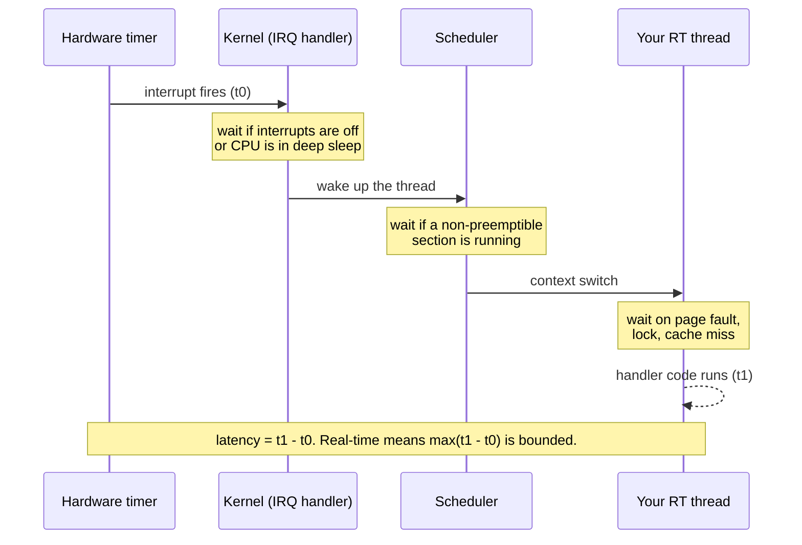
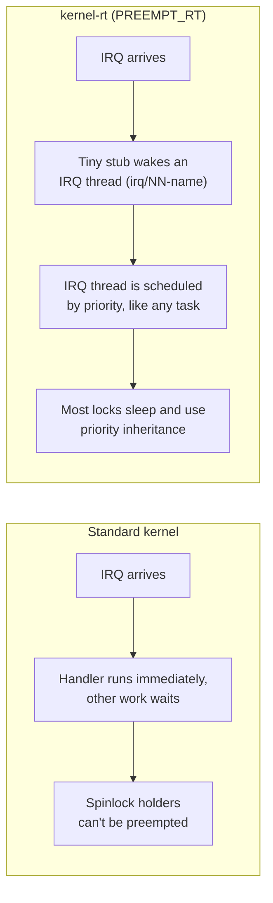
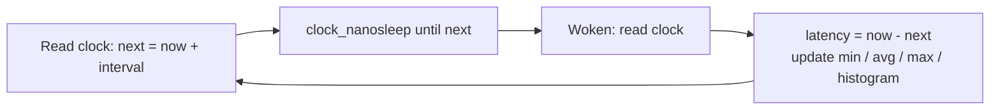
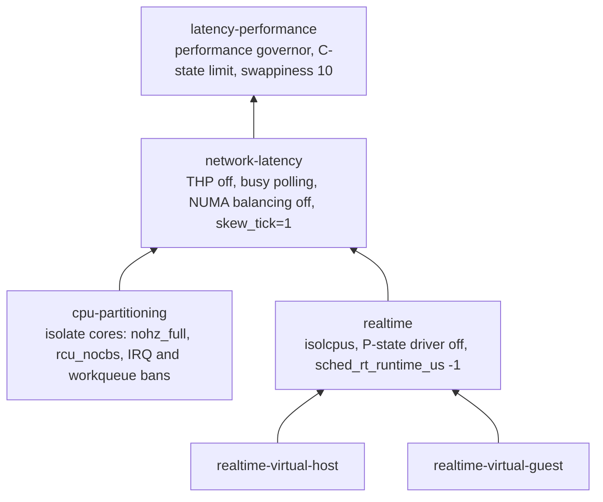
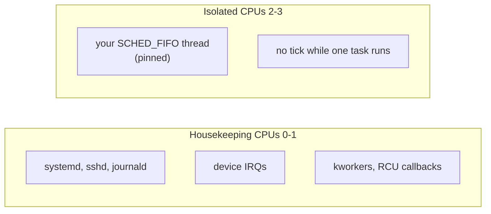

# 37 · Real-Time and Low-Latency Rocky

<ul class="module-meta">
  <li>⏱ ~3 hours</li>
  <li>5 labs</li>
  <li>Builds on: 06 · Processes and Signals, 14 · The Boot Process, 15 · The Kernel, 19 · Performance and Observability</li>
</ul>

A motion controller has to send a new position to a motor every 250 microseconds. On average, your Rocky box does it in 4. But about once an hour it takes 2 milliseconds, the motor stutters, and a part gets scrapped. Making the average faster won't help; you need to make the **worst case** small and predictable. This module shows you where those rare long delays come from, which knobs Rocky gives you to remove them, and how to measure the result honestly.

!!! abstract "What you'll learn"
    - Explain what "real-time" means (bounded worst-case latency, not speed) and why averages lie
    - Name the sources of latency, from SMIs and C-states to interrupts, the scheduler and page faults
    - Install `kernel-rt` from Rocky's RT repository and know what PREEMPT_RT changes
    - Apply and customise tuned profiles: `realtime`, `cpu-partitioning`, `network-latency`, `realtime-virtual-host`
    - Isolate CPUs with `isolcpus`, `nohz_full`, `rcu_nocbs` and `irqaffinity`, and move IRQs off them
    - Run a task under `SCHED_FIFO` with `chrt`, set limits safely, and know how the kernel protects starving tasks (RT throttling on Rocky 9, the fair server on Rocky 10)
    - Measure with `cyclictest`, `hwlatdetect` and `rteval`, and read a latency histogram

## The big picture

**Latency** here means the delay between an event (a timer expiring, a packet arriving) and the moment the code that handles it actually runs. A **real-time** system is one where that delay has a known, small upper bound. Real-time is about **determinism**, not speed: a system that answers in 50 µs every single time is "more real-time" than one that answers in 2 µs on average but sometimes in 5 ms.



Every pause in that diagram is a place where something else can get in the way. Tuning a system for real-time is the job of finding each of those somethings and moving it out of the way, then **measuring** to prove you got them all.

There are degrees:

- **Hard real-time**: missing a deadline is a failure (an airbag, a motor controller).
- **Firm or soft real-time**: an occasional miss degrades quality (audio dropouts, a late market-data packet, a 5G radio frame).
- **Low latency**: you want small typical latency and a tight tail, but no strict deadline (trading, telco, HPC). Many "real-time" Rocky deployments are really this.

!!! analogy "Think of it like a train timetable"
    A commuter train that averages 60 km/h but is occasionally an hour late is useless for catching a connection. A slower train that is *never* more than a minute late is the one you plan your day around. Real-time tuning trades some average speed (throughput, power efficiency) for that guarantee. The analogy breaks in one way: a train timetable is published in advance, while a Linux system's worst case is something you can only estimate by measuring for a long time under realistic load.

## Where latency comes from

Latency comes from every layer of the machine, and the worst offenders are often the ones you can't see in `top`. Click through from your application down to the hardware:

<div class="layers" data-open="0" data-hint="Click a layer: what delays your thread there, and what fixes it." markdown>

<div class="layer" data-label="Your application" data-tag="page faults, locks" markdown>

**Delays:** page faults (first touch of memory, or swapped-out pages), memory allocation, lock contention, system calls that block, logging to slow disks.

**Fixes:** `mlockall()` and pre-faulting memory at startup, huge pages, no allocation in the hot loop, priority-inheritance mutexes. This is the layer only you can fix.

</div>

<div class="layer" data-label="Scheduler" data-tag="policy, priority" markdown>

**Delays:** other runnable tasks on the same CPU, a normal (`SCHED_OTHER`) policy that time-slices you with everyone else, migration between CPUs, and the kernel's starvation protection taking the CPU back for normal tasks.

**Fixes:** `SCHED_FIFO` priority with `chrt`, pinning with `taskset`, isolated CPUs with nothing else on them.

</div>

<div class="layer" data-label="Kernel preemption" data-tag="PREEMPT_RT" markdown>

**Delays:** stretches of kernel code that can't be interrupted (spinlocks held, interrupts disabled). On a standard kernel some of these last hundreds of microseconds.

**Fixes:** `kernel-rt` (PREEMPT_RT), which makes almost all kernel code preemptible. On the stock kernel, `preempt=full` helps somewhat.

</div>

<div class="layer" data-label="Interrupts and softirqs" data-tag="IRQs, ksoftirqd" markdown>

**Delays:** a network or disk interrupt landing on your CPU, followed by its softirq processing (packet handling can run for a long time).

**Fixes:** IRQ affinity (`/proc/irq/*/smp_affinity_list`), `irqaffinity=` boot option, banning CPUs in `irqbalance`.

</div>

<div class="layer" data-label="Kernel housekeeping" data-tag="tick, RCU" markdown>

**Delays:** the scheduler tick (1000 times a second on Rocky's x86_64 kernel, 100 on aarch64), RCU callbacks, kernel worker threads, timers migrated onto your CPU.

**Fixes:** `nohz_full=` (stop the tick when one task runs), `rcu_nocbs=` (offload RCU callbacks), workqueue cpumasks. tuned's `cpu-partitioning` and `realtime` profiles set these.

</div>

<div class="layer" data-label="Power management" data-tag="C-states, P-states" markdown>

**Delays:** waking a CPU from a deep idle state (**C-state**) can take tens or hundreds of microseconds. Frequency changes (**P-states**) stall briefly and slow the code.

**Fixes:** limit C-states with `/dev/cpu_dma_latency` (tuned's `force_latency`), the `performance` governor, firmware settings.

</div>

<div class="layer" data-label="Firmware and hardware" data-tag="SMIs, hypervisor" markdown>

**Delays:** **SMIs** (System Management Interrupts): the firmware freezes *every* CPU to do housekeeping, invisible to the OS. In a VM, the hypervisor can also steal time from your vCPU.

**Fixes:** choose hardware certified for low latency, disable firmware features that use SMIs (vendor BIOS "low latency" profiles), and detect them with `hwlatdetect`. Nothing in Linux can fix an SMI.

</div>

</div>

<div class="quiz" data-answer="3" markdown>

A trading application has an average response time of 8 µs and a 99.99th-percentile of 900 µs. Which change is most likely to help the tail?

- Buy a CPU with a higher clock speed
- Tune the application's hot loop to save another microsecond
- Find what occasionally interrupts the thread (IRQs, tick, C-state exits, page faults) and remove it from that CPU
- Increase the number of application threads

A 100× gap between average and tail means something occasionally gets in the way. Faster code shrinks the average, but the tail comes from outside events. Isolating the CPU, moving IRQs, locking memory and limiting C-states is how you shrink it.

</div>

## Kernel preemption and kernel-rt

**Preemption** means the kernel can stop whatever a CPU is doing to run something more urgent. How much of the kernel is preemptible is a build-time choice called the **preemption model**:

| Model | What can be interrupted | Who uses it |
|---|---|---|
| Voluntary | User code, plus kernel code at explicit "safe points" | **Rocky's standard kernel** (default) |
| Full | User code and most kernel code, except where locks or disabled interrupts forbid it | Stock kernel booted with `preempt=full` |
| PREEMPT_RT | Almost everything: spinlocks become sleeping locks, interrupt handlers run as threads | **`kernel-rt`** |

The **PREEMPT_RT** patches were developed out of tree for about twenty years and were merged into mainline Linux in version 6.12, the kernel Rocky 10 is based on. Merged doesn't mean enabled: it's a build option, and Rocky's standard kernel is built without it. You get it by installing the separate **`kernel-rt`** package, built from the same source with real-time options turned on.

You can see which you're running:

```console
$ uname -v
#1 SMP PREEMPT_DYNAMIC Wed Sep 24 14:02:11 UTC 2025
$ sudo cat /sys/kernel/debug/sched/preempt
none (voluntary) full lazy
```

`PREEMPT_DYNAMIC` means the standard kernel can switch models at boot: the parentheses show the active one. (`lazy` is a newer model that preempts like `full` but gives normal tasks a little more slack. Early Rocky 10 x86_64 kernels also list an experimental fifth model, `laziest`, which later updates dropped; on aarch64, `lazy` only appears in later updates.) Add `preempt=full` to the kernel command line (with `grubby`) and it becomes `none voluntary (full) lazy`. That's a cheap improvement for low-latency work, but it's not PREEMPT_RT. On `kernel-rt`, `uname -v` says `PREEMPT_RT`.

### What PREEMPT_RT changes



The practical effects: interrupt handlers become kernel threads (`irq/25-virtio0-input.0`) that you can prioritise and pin with `chrt` and `taskset`; locks inherit priority so a low-priority holder can't block a high-priority waiter indefinitely; and long non-preemptible stretches mostly disappear. The cost is lower throughput, which is why it's not the default.

### Rocky's RT and NFV repositories

Rocky ships the real-time packages in two extra repositories, both **disabled by default**:

| Repo id | What it's for |
|---|---|
| `rt` | `kernel-rt` and its modules, `realtime-setup`, `rteval` (with `rteval-loads`), `tuned-profiles-realtime`, and the `tuned-profiles-nfv`, `-nfv-host` and `-nfv-guest` profiles for real-time VMs |
| `nfv` | Network Functions Virtualization: on Rocky 10 it carries the same package set as `rt` (there is no separate `kernel-rt-kvm` package any more) |

The measuring tools are elsewhere: `realtime-tests` (cyclictest, hwlatdetect and friends) is in **AppStream**, and `tuned-profiles-cpu-partitioning` is in **BaseOS**, so you can measure and partition the stock kernel without enabling either repo.

```console
$ sudo dnf config-manager --set-enabled rt
$ sudo dnf install -y kernel-rt tuned-profiles-realtime realtime-tests rteval
$ sudo grubby --info=ALL | grep -E '^kernel'
kernel="/boot/vmlinuz-6.12.0-…el10_0.x86_64+rt"
kernel="/boot/vmlinuz-6.12.0-…el10_0.x86_64"
…
```

Use `grubby --set-default` with the RT kernel's path to boot it by default, or pick it once from the GRUB menu ([module 14](14-the-boot-process.md)).

!!! note "Architecture support"
    Red Hat certifies the real-time kernel on specific x86_64 servers. RHEL 10 also builds it for aarch64 (including a 64k-page `kernel-rt-64k` variant) with narrower support, and Rocky builds the same packages. Check the current release notes before you plan an aarch64 real-time deployment. Either way, firmware matters more than the kernel: tune the platform (BIOS low-latency settings) before you judge the RT kernel.

## Measuring latency: cyclictest, hwlatdetect, rteval

Never tune without measuring. The standard tool is **cyclictest** (from `realtime-tests`). Its idea is simple: a high-priority thread asks to be woken at an exact time, again and again, and records how late each wake-up actually was. That lateness is your scheduling latency.



```console
$ sudo cyclictest --mlockall --smp --priority=95 --interval=200 --distance=0 --duration=60 --quiet
# /dev/cpu_dma_latency set to 0us
T: 0 ( 3412) P:95 I:200 C: 299991 Min:      2 Act:    3 Avg:    3 Max:      38
T: 1 ( 3413) P:95 I:200 C: 299987 Min:      2 Act:    3 Avg:    3 Max:      45
T: 2 ( 3414) P:95 I:200 C: 299990 Min:      2 Act:    4 Avg:    3 Max:      29
T: 3 ( 3415) P:95 I:200 C: 299989 Min:      2 Act:    3 Avg:    3 Max:      41
```

| Option | Meaning |
|---|---|
| `--mlockall` (`-m`) | Lock memory so page faults don't pollute the result |
| `--smp` (`-S`) | One measuring thread per CPU, each pinned to its CPU |
| `--priority=95` (`-p95`) | `SCHED_FIFO` priority of the measuring threads |
| `--interval=200` (`-i200`) | Wake every 200 µs |
| `--duration=60` (`-D 60`) | Run for 60 seconds (use hours for real validation) |
| `--histogram=200` (`-h 200`) | Record a histogram of latencies up to 200 µs |
| `--affinity=2,3` (`-a 2,3`) | Measure only on these CPUs (use with `--threads=2`) |

Each line is one thread: `C` is the number of cycles, and `Min`, `Act`, `Avg`, `Max` are in **microseconds**. **Max is the number that matters.** Notice the first line too: cyclictest writes `0` to `/dev/cpu_dma_latency` while it runs, which keeps CPUs out of deep C-states. Your real application won't do that unless you (or tuned) arrange it.

### Reading a histogram

A max value tells you the worst case; a histogram tells you how often you got close to it. With `--histogram=200 --histfile=hist.txt`, cyclictest writes one row per microsecond with a count per CPU:

```text
# Histogram
000000 000000	000000
000001 000000	000000
000002 041233	039912
000003 201877	205114
000004 048210	046881
000005 006011	006370
…
000037 000001	000000
…
# Min Latencies: 00002 00002
# Avg Latencies: 00003 00003
# Max Latencies: 00038 00029
# Histogram Overflows: 00000 00000
```

Most wake-ups cluster at 2 to 5 µs, then a long thin **tail**. The tail is the story: each of those rare entries is one of the latency sources above. **Overflows** count samples beyond the histogram range; anything non-zero means some samples were worse than you measured for. Plot the counts on a log scale to see the tail clearly.

!!! tip "Measure under load, for a long time"
    An idle system always looks good. Real validation runs cyclictest for hours while the machine does realistic work, or at least while a load generator hammers the **other** CPUs: `stress-ng --cpu 2 --io 2 --vm 1 --vm-bytes 512M`. Rare events (an SMI every few minutes, a daily cron job) only appear in long runs.

**hwlatdetect** looks for latency the kernel didn't cause. It uses the kernel's hardware-latency tracer to spin on a CPU with interrupts off and look for gaps in time. If time jumps while nothing in the OS could have run, the firmware (an SMI) or the hypervisor took the CPU:

```console
$ sudo hwlatdetect --duration=120 --threshold=10
hwlatdetect:  test duration 120 seconds
   detector: tracer
   parameters:
        Latency threshold: 10us
        Sample window:     1000000us
        Sample width:      500000us
     Non-sampling period:  500000us
        Output File:       None

Starting test
test finished
Max Latency: Below threshold
Samples recorded: 0
Samples exceeding threshold: 0
```

`Below threshold` is what you want. Samples over the threshold on bare metal point to firmware; in a VM they usually point to the host.

**rteval** is the full validation suite: it runs heavy loads (kernel compiles, `hackbench`, `stress-ng`) on the housekeeping CPUs while cyclictest measures the others, then writes a report with histograms and system details. Run it for hours before you trust a real-time configuration: `sudo rteval --duration=4h`.

## tuned profiles for latency

**tuned** ([module 19](19-performance-and-observability.md)) is how Rocky applies a coordinated set of settings: sysctls, CPU governor, kernel command-line arguments, IRQ bans, workqueue masks. Its latency profiles build on each other:



| Profile | Package | Use it for |
|---|---|---|
| `latency-performance` | `tuned` | Lower latency on any server, no isolation |
| `network-latency` | `tuned` | Low-latency networking (adds busy polling, THP off) |
| `cpu-partitioning` | `tuned-profiles-cpu-partitioning` | Dedicated cores for polling apps (DPDK) on the stock kernel |
| `realtime` | `tuned-profiles-realtime` (`rt` repo) | Bare-metal hosts running `kernel-rt` |
| `realtime-virtual-host` / `-guest` | `tuned-profiles-nfv-host` / `-guest` (`rt` or `nfv` repo) | A real-time KVM host and its guests |

```console
$ tuned-adm active
Current active profile: virtual-guest
$ sudo dnf install -y tuned-profiles-cpu-partitioning
$ tuned-adm list | grep -E 'latency|partitioning|realtime'
- cpu-partitioning            - Optimize for CPU partitioning
- cpu-partitioning-powersave  - Optimize for CPU partitioning with additional powersave
- latency-performance         - Optimize for deterministic performance at the cost of increased power consumption
- network-latency             - Optimize for deterministic performance at the cost of increased power consumption, focused on low latency network performance
```

The isolation profiles need to know **which CPUs to isolate**. You tell them in a variables file:

```ini title="/etc/tuned/cpu-partitioning-variables.conf"
isolated_cores=2-3
```

```console
$ sudo tuned-adm profile cpu-partitioning
$ sudo reboot
…
$ sudo tuned-adm verify
Verification succeeded, current system settings match the preset profile.
See TuneD log file ('/var/log/tuned/tuned.log') for details.
```

The reboot is required: the profile adds kernel arguments (`nohz_full=2-3 rcu_nocbs=2-3`, and more) through tuned's **bootloader** plugin, and those only apply at boot. After rebooting, `cat /proc/cmdline` shows them, and `tuned-adm verify` checks that every setting in the profile really is in effect.

Read the real profile to see exactly what it does. On Rocky 10, system profiles live in `/usr/lib/tuned/profiles/<name>/tuned.conf`:

```console
$ grep -A1 -E '^\[(irqbalance|bootloader|sysctl)\]' /usr/lib/tuned/profiles/realtime/tuned.conf
[sysctl]
kernel.sched_rt_runtime_us = -1
--
[bootloader]
cmdline_realtime=+isolcpus=${managed_irq}${isolated_cores} ${disable_pstate} nosoftlockup
--
[irqbalance]
banned_cpus=${isolated_cores}
```

### Writing your own profile

Don't edit shipped profiles. Create a child that **includes** one and overrides what you need:

```ini title="/etc/tuned/profiles/motion-control/tuned.conf"
[main]
summary=Motion controller: cpu-partitioning plus app tweaks
include=cpu-partitioning

[variables]
isolated_cores=2-3

[bootloader]
cmdline_motion=+preempt=full
```

- `include=cpu-partitioning` inherits the whole parent profile.
- Setting `isolated_cores` here means you don't need the variables file.
- `cmdline_motion` adds a kernel argument; any `cmdline_*` key in `[bootloader]` is merged into the command line.

```console
$ sudo tuned-adm profile motion-control
```

!!! version "Rocky 9 vs 10"
    Rocky 10's tuned keeps system profiles in `/usr/lib/tuned/profiles/` and your custom profiles in `/etc/tuned/profiles/`. Older tuned releases, the ones Rocky 9 shipped for most of its life, use a flat layout: `/usr/lib/tuned/<name>/` and `/etc/tuned/<name>/`. `ls /usr/lib/tuned/` tells you which you have. The variables files (`/etc/tuned/realtime-variables.conf`, `/etc/tuned/cpu-partitioning-variables.conf`) are in the same place on both. When you copy a custom profile from an older host, move it into `/etc/tuned/profiles/`.

## CPU isolation

The cleanest way to protect a latency-critical thread is to give it a CPU where nothing else ever runs. **CPU isolation** splits the machine into **housekeeping** CPUs (the OS, daemons, IRQs, kernel threads) and **isolated** CPUs (your real-time work only).



Four kernel arguments do the work. Each one removes a different kind of disturbance:

| Argument | What it removes from the listed CPUs |
|---|---|
| `isolcpus=2,3` | The scheduler's load balancing: no task lands there unless explicitly pinned |
| `nohz_full=2,3` | The periodic timer tick, when only one task is runnable on the CPU |
| `rcu_nocbs=2,3` | RCU callback processing, moved to kernel threads on housekeeping CPUs |
| `irqaffinity=0,1` | Default IRQ placement: device interrupts go to CPUs 0 and 1 |

Set them with `grubby` ([module 15](15-the-kernel.md)) if you're not using a tuned profile:

```console
$ sudo grubby --update-kernel=ALL --args="isolcpus=2,3 nohz_full=2,3 rcu_nocbs=2,3 irqaffinity=0,1"
$ sudo reboot
…
$ cat /sys/devices/system/cpu/isolated
2-3
$ cat /sys/devices/system/cpu/nohz_full
2-3
```

Rocky's standard kernel is built with `nohz_full` support, so this all works without `kernel-rt`.

!!! warning "isolcpus is all or nothing"
    CPUs in `isolcpus` are excluded from load balancing. If you start a multi-threaded program and pin it to "2-3", the scheduler will **not** spread its threads across the two CPUs: they can all pile onto one. Pin each real-time thread to its own CPU explicitly. If you want a dedicated but balanced set of CPUs, use cpusets (cgroups, [module 18](18-containers.md)) or tuned's `cpu-partitioning` without `no_balance_cores`, instead of `isolcpus`.

??? question "Under the hood: cpu-partitioning doesn't use isolcpus"
    Read the `[bootloader]` line of `/usr/lib/tuned/profiles/cpu-partitioning/tuned.conf` and you'll find `nohz_full`, `rcu_nocbs` and `tuned.non_isolcpus`, but **no** `isolcpus`, unless you also set the `no_balance_cores` variable. So how does it keep processes off the isolated CPUs? Three other mechanisms:

    - `[systemd] cpu_affinity=` sets `CPUAffinity=` in systemd's own config, so PID 1 and everything it starts (every service, every login session) inherits a mask of housekeeping CPUs only.
    - `[scheduler] isolated_cores=` makes tuned walk the existing processes and move them off those CPUs (skipping patterns such as DPDK and `qemu-kvm` threads, which are meant to be there).
    - `tuned.non_isolcpus=` in the command line is read by a hook tuned adds to the initramfs, which moves kernel workqueues to the housekeeping CPUs before udev even starts. The overlay also carries the systemd `CPUAffinity` setting, so the mask applies from the very first process.

    The consequences are worth knowing. `cat /sys/devices/system/cpu/isolated` prints an **empty line** under cpu-partitioning, because that file only reports `isolcpus=`; check `nohz_full` instead. The scheduler still load-balances across the isolated CPUs, so a multi-threaded app pinned to "2-3" spreads properly (the pitfall in the warning above doesn't apply). And managed IRQs stay on all CPUs, because only the `realtime` profile adds `isolcpus=managed_irq,…`.

Don't set the same arguments with both `grubby` and a tuned profile. tuned manages its own arguments and will add them again; mixing the two leads to duplicated or conflicting values that are hard to untangle. Pick one owner.

<div class="quiz" data-answer="2" markdown>

You booted with `nohz_full=3`, but `/proc/interrupts` still shows the `LOC` (local timer) count for CPU 3 rising by 1000 per second. Why?

- `nohz_full` doesn't work on Rocky's standard kernel
- More than one task is runnable on CPU 3, so the kernel keeps the tick to time-slice between them
- The tick can never be stopped on x86
- `nohz_full` only applies to IRQs from network cards

The tick stops only when a single task is runnable on that CPU (it has nobody to switch to). If two tasks share CPU 3, or a kernel thread keeps waking there, the tick returns. Combine `nohz_full` with `isolcpus` or cpusets so your thread runs alone.

</div>

## IRQ affinity

Each device interrupt has a list of CPUs it may be delivered to. By default **irqbalance** spreads interrupts around for throughput. For real-time, you want them all on housekeeping CPUs.

```console
$ head -1 /proc/interrupts; grep -E 'virtio|LOC|RES' /proc/interrupts
           CPU0       CPU1       CPU2       CPU3
 25:      18234          0          0        512  PCI-MSIX-0000:01:00.0   1-edge      virtio1-input.0
 26:          0       9876          0          0  PCI-MSIX-0000:01:00.0   2-edge      virtio1-output.0
 30:       2210          0       4102          0  PCI-MSIX-0000:04:00.0   1-edge      virtio4-req.0
LOC:     412339     398112     402771     399014   Local timer interrupts
RES:       2841       3102       2511       2297   Rescheduling interrupts
```

The network receive IRQ 25 has been delivered 512 times on CPU 3. Each one interrupted whatever CPU 3 was doing. Every IRQ has a control file:

```console
$ cat /proc/irq/25/smp_affinity_list
0-3
$ echo 0-1 | sudo tee /proc/irq/25/smp_affinity_list
0-1
$ cat /proc/irq/default_smp_affinity
f
```

`default_smp_affinity` (a hex CPU mask) applies to IRQs registered later; the `irqaffinity=` boot argument sets it at boot.

Two things fight you:

1. **irqbalance** moves IRQs back. Tell it which CPUs are off limits in `/etc/sysconfig/irqbalance` with `IRQBALANCE_BANNED_CPULIST=2-3`, then `sudo systemctl restart irqbalance`. (tuned's `[irqbalance]` plugin does this for you in the isolation profiles.)
2. **Managed IRQs** can't be moved at all. Many multi-queue drivers (NVMe, virtio-blk, some NICs) let the kernel spread one queue per CPU and own their affinity. Writing to them fails:

    ```console
    $ echo 0-1 | sudo tee /proc/irq/30/smp_affinity_list
    tee: /proc/irq/30/smp_affinity_list: Input/output error
    ```

    The way to keep these off isolated CPUs is the `managed_irq` flag of `isolcpus` (`isolcpus=managed_irq,domain,2-3`), which the `realtime` profile sets when its `isolate_managed_irq=Y` variable is on.

On `kernel-rt`, the handler for each IRQ is also a thread named `irq/<N>-<name>`, which you can see in `ps` and prioritise with `chrt`.

## Real-time scheduling policies

Normal processes run under **`SCHED_OTHER`** (the fair scheduler): everybody gets a share, weighted by nice value ([module 06](06-processes-and-signals.md)). Real-time work uses the **real-time policies**, which always beat `SCHED_OTHER`:

| Policy | Priority | Behaviour |
|---|---|---|
| `SCHED_OTHER` | 0 (nice -20 to 19) | Fair time-sharing; the default |
| `SCHED_BATCH` / `SCHED_IDLE` | 0 | Background work |
| `SCHED_FIFO` | 1 to 99 | Runs until it blocks, yields, or a higher-priority RT task wakes |
| `SCHED_RR` | 1 to 99 | Like FIFO, but equal-priority tasks take turns in time slices |
| `SCHED_DEADLINE` | (none) | Runtime, deadline and period parameters; the kernel admits it only if it can guarantee them |

`chrt` starts or changes a task's policy, and `taskset` pins it:

```console
$ chrt -p $$
pid 2201's current scheduling policy: SCHED_OTHER
pid 2201's current scheduling priority: 0
$ sudo taskset -c 3 chrt -f 80 ./control-loop &
$ ps -eLo pid,tid,class,rtprio,psr,comm | grep -E 'CLS|control'
    PID     TID CLS RTPRIO PSR COMMAND
   4410    4410 FF      80   3 control-loop
```

`CLS` `FF` is FIFO (`RR` for round robin, `TS` for normal), `PSR` is the CPU it last ran on.

Pick priorities with care. Kernel threads that matter (on `kernel-rt`, IRQ threads run at priority 50 by default) need to run too: if your task at 99 spins forever, nothing below it on that CPU ever runs again.

### Permissions: rtprio and memlock

By default only root can use real-time priorities or lock large amounts of memory. Grant it to a group through PAM limits instead of running everything as root:

```text title="/etc/security/limits.d/90-rtapp.conf"
@rtapp   -   rtprio    80
@rtapp   -   memlock   unlimited
```

For a service, put it in the unit file instead ([module 07](07-systemd-and-services.md)):

```ini title="/etc/systemd/system/control-loop.service.d/rt.conf"
[Service]
CPUSchedulingPolicy=fifo
CPUSchedulingPriority=80
CPUAffinity=3
LimitMEMLOCK=infinity
```

- `CPUSchedulingPolicy` and `CPUSchedulingPriority` start the process as `SCHED_FIFO` 80.
- `CPUAffinity=3` pins it to CPU 3.
- `LimitMEMLOCK=infinity` lets it `mlockall()` its memory.

### Starvation protection: from RT throttling to the fair server

A runaway `SCHED_FIFO` loop would starve its CPU of everything else, including the kernel threads that CPU needs and the shell you'd use to kill it. Linux has always had a safety valve for this. Which one you get depends on the kernel, and Rocky 10 is where it changed.

**Rocky 9 (kernel 5.14): RT throttling.** The kernel caps all real-time tasks together at `sched_rt_runtime_us` out of every `sched_rt_period_us`: 950 ms per second by default. When they hit the cap, it logs `sched: RT throttling activated` and simply stops running them for the rest of the period, a 50 ms hole in your real-time schedule. The `realtime` tuned profile sets `sched_rt_runtime_us = -1` to turn that off.

**Rocky 10 (kernel 6.12): the fair server.** Kernel 6.12 replaced that mechanism with a **deadline server**: a per-CPU `SCHED_DEADLINE` reservation that runs normal (`SCHED_OTHER`) tasks on behalf of the fair scheduler. By default it gets 50 ms in every 1 s period on each CPU. It is **deferred**: it does nothing while normal tasks get CPU time on their own, and only steps in once they've been starved for most of a period. Then it runs them, at deadline priority, above every `SCHED_FIFO` task.

```console
$ sysctl kernel.sched_rt_period_us kernel.sched_rt_runtime_us
kernel.sched_rt_period_us = 1000000
kernel.sched_rt_runtime_us = 950000
$ sudo cat /sys/kernel/debug/sched/fair_server/cpu3/runtime /sys/kernel/debug/sched/fair_server/cpu3/period
50000000
1000000000
```

The two sysctls are still there with the same values, but on Rocky's kernel they no longer throttle anything. (Classic throttling now only exists in kernels built with per-cgroup RT bandwidth, `CONFIG_RT_GROUP_SCHED`, which Rocky's are not.) They now set the admission limit for `SCHED_DEADLINE` reservations, so the `realtime` profile's `-1` lifts that limit and leaves the fair server in place. The fair server's own values (in nanoseconds) live in debugfs and are reset at every boot.

??? question "Under the hood: what the fair server means for your latency budget"
    Picture a busy-polling `SCHED_FIFO` thread that owns isolated CPU 3 at 100%. A per-CPU kernel worker (a `kworker/3:1` flushing a work item, say) becomes runnable on CPU 3. On Rocky 9 with throttling off, the kworker waits forever; if the kernel needed that work done, you'd eventually see hung-task warnings or an RCU stall. On Rocky 10, after roughly 950 ms of starvation the fair server runs the kworker. Good for the kernel, but your poller just lost up to 50 ms of CPU, and nothing in `chrt` or the tuned profile told you it could happen.

    That's why real-time users treat the fair server as "the new RT throttling". Three ways to live with it:

    1. **Keep normal tasks off the CPU** (isolation, IRQ and workqueue masks, `nohz_full`). If nothing `SCHED_OTHER` is ever runnable there, the server never activates. This is the right fix, and `rtla osnoise` or a long cyclictest run proves it.
    2. **Shrink it** for a CPU: `echo 5000000 | sudo tee /sys/kernel/debug/sched/fair_server/cpu3/runtime` gives starving tasks 5 ms per second instead of 50.
    3. **Disable it** with `echo 0` to that file. The kernel logs `Fair server disabled in CPU 3, system may crash due to starvation.`, and you are back to "a spinning FIFO thread owns this CPU forever". Only on isolated CPUs, only with a watchdog.

    Debugfs settings don't survive a reboot, so if you change them, do it from a small systemd unit (or a tuned `[script]`) that runs at boot, and document why.

!!! danger "Disabling the safety net"
    On Rocky 9 that means `sched_rt_runtime_us = -1`; on Rocky 10 it means a fair-server runtime of `0`. Either way, a bug that makes a `SCHED_FIFO` thread spin will own that CPU forever. On an isolated CPU that's survivable (housekeeping CPUs still run your shell). On a non-isolated one, or a single-CPU VM, it can hang the machine. Only do it together with isolation, and test with a watchdog.

<div class="quiz" data-answer="2" markdown>

On Rocky 10, a `SCHED_FIFO` busy-polling thread owns isolated CPU 3 at 100%, and `kernel.sched_rt_runtime_us` is `-1`. A kernel worker thread becomes runnable on CPU 3. What happens?

- The kworker never runs, because `-1` disabled every limit on real-time tasks
- After it has been starved for most of a second, the fair server runs it for up to 50 ms, preempting the FIFO thread
- The kernel logs `sched: RT throttling activated` and pauses the FIFO thread for 50 ms every second regardless
- The scheduler migrates the FIFO thread to a housekeeping CPU

On kernel 6.12 the RT throttling sysctls only set the admission limit for `SCHED_DEADLINE`. Starving normal tasks are rescued by the per-CPU fair server (50 ms per 1 s by default, deferred until they've been starved), which outranks `SCHED_FIFO`. Keep normal tasks off the CPU, or shrink the server's runtime in `/sys/kernel/debug/sched/fair_server/`.

</div>

## Memory and power: the quiet killers

### Lock and pre-fault memory

The first time a process touches a page of memory, the kernel takes a **page fault** to allocate it: a few microseconds normally, far longer if memory must be reclaimed or a page read from disk. Real-time programs avoid faults in the hot path:

- Call `mlockall(MCL_CURRENT | MCL_FUTURE)` at startup so nothing gets swapped out, and touch all buffers (and the stack) once before the real work starts.
- Use **huge pages** for large buffers: fewer TLB misses and fewer faults ([module 25](25-memory-deep-dive.md)).
- Avoid **transparent huge pages** for latency work: background compaction can stall you. The `network-latency` profile sets THP to `never`.

### Keep CPUs awake

Modern CPUs save power by sleeping in **C-states** when idle. C1 wakes in about a microsecond; the deepest states can take a hundred or more. A real-time thread that wakes on an idle CPU pays that exit cost every time.

```console
$ sudo dnf install -y kernel-tools
$ cpupower idle-info | sed -n '1,12p'
CPUidle driver: intel_idle
CPUidle governor: menu
analyzing CPU 0:

Number of idle states: 4
Available idle states: POLL C1 C1E C6
POLL:
Flags/Description: CPUIDLE CORE POLL IDLE
Latency: 0
…
C6:
Flags/Description: MWAIT 0x20
Latency: 170
```

You limit C-states in software through the **PM QoS** interface `/dev/cpu_dma_latency`: a program opens it, writes the maximum wake-up latency it can tolerate (in µs) and holds it open; the kernel avoids any idle state slower than that until the file is closed. tuned's `force_latency` setting (in `latency-performance` and its children) does exactly this for you, and cyclictest does it during its run. `cpupower monitor` shows how much time each CPU spends in each state, so you can confirm deep states are no longer used.

**P-states** (frequency scaling) matter too: a CPU that's ramping up runs your code slowly. The `latency-performance` profile sets the `performance` governor, and the `realtime` profile goes further and disables the `intel_pstate` or `amd_pstate` driver on the kernel command line. Check with `cpupower frequency-info`.

!!! note "Virtual machines"
    Everything in this module works in a VM, and the labs use one. But a guest's worst case includes the hypervisor's: vCPU scheduling on the host, host interrupts, and host power states. Real-time VMs need a tuned host (`realtime-virtual-host`), pinned vCPUs and a tuned guest (`realtime-virtual-guest`). Expect lab numbers on a laptop hypervisor to be noisy; that's a lesson in itself. See [module 27](27-virtualization-kvm.md) for vCPU pinning.

### Practice: inspect a latency setup

<div class="terminal-sim" data-title="Check real-time readiness" markdown>

<div class="task" data-expect="tuned-adm active||sudo tuned-adm active" data-hint="Ask tuned-adm which profile is active." markdown>

**Step 1.** Which tuned profile is active?

```text
Current active profile: cpu-partitioning
```

</div>

<div class="task" data-expect="cat /sys/devices/system/cpu/nohz_full" data-hint="The kernel lists tickless CPUs in /sys/devices/system/cpu/." markdown>

**Step 2.** Which CPUs run without the periodic tick (`nohz_full`)?

```text
2-3
```

</div>

<div class="task" data-expect="cat /proc/irq/25/smp_affinity_list" data-hint="Each IRQ has a directory under /proc/irq/ with an smp_affinity_list file." markdown>

**Step 3.** Which CPUs may IRQ 25 be delivered to?

```text
0-1
```

</div>

<div class="task" data-expect="chrt -p 4410||sudo chrt -p 4410" data-hint="chrt -p shows a process's policy and priority." markdown>

**Step 4.** Show the scheduling policy and priority of PID 4410.

```text
pid 4410's current scheduling policy: SCHED_FIFO
pid 4410's current scheduling priority: 80
```

</div>

<div class="task" data-expect="sudo cat /sys/kernel/debug/sched/fair_server/cpu3/runtime||cat /sys/kernel/debug/sched/fair_server/cpu3/runtime" data-hint="debugfs needs root: sudo cat the runtime file." markdown>

**Step 5.** How much CPU 3's fair server reserves for starving normal tasks: read its `runtime` file under `/sys/kernel/debug/sched/fair_server/cpu3/` (as root).

```text
50000000
```

</div>

</div>

## Labs

Use a throwaway Rocky 10 VM with **at least 4 vCPUs** and 4 GB RAM. You'll treat CPUs 0 and 1 as housekeeping and isolate 2 and 3. Install the tools once:

```console
$ sudo dnf install -y realtime-tests stress-ng tuned-profiles-cpu-partitioning kernel-tools
```

!!! lab "Lab 1: A baseline, idle and under load"

    **Goal:** Measure worst-case scheduling latency on the stock kernel, and see what load does to it.

    1. Record the starting point: `uname -v`, `tuned-adm active`, `cat /proc/cmdline`.
    2. Idle measurement, one minute:

        ```console
        $ sudo cyclictest -m -S -p95 -i200 -d0 -D 60 -q
        ```

    3. Now the same measurement while the system is busy. In a second terminal start a load on all CPUs:

        ```console
        $ stress-ng --cpu 4 --io 2 --vm 2 --vm-bytes 512M --timeout 90s
        ```

        and rerun step 2 in the first terminal while it runs.

    4. Write down the `Max` per CPU for both runs.

    **Check your work:** the loaded `Max` values are noticeably higher than the idle ones (in a typical VM, idle maxima of tens of µs become hundreds or thousands under load). `Avg` barely changes. That's the point of the module in one table.

    ??? question "Why did Avg hardly move?"
        Most wake-ups still happen promptly; the load adds rare long delays, not a uniform slowdown. Averages hide them. That's why real-time work talks about maxima and high percentiles.

    **Clean up:** nothing to undo (stress-ng stops itself after 90 seconds).

!!! lab "Lab 2: Isolate CPUs with cpu-partitioning"

    **Goal:** Dedicate CPUs 2 and 3 to measurement and compare against Lab 1.

    1. Note your current profile so you can restore it: `tuned-adm active` (usually `virtual-guest`).
    2. Configure and apply:

        ```bash
        echo 'isolated_cores=2-3' | sudo tee /etc/tuned/cpu-partitioning-variables.conf
        sudo tuned-adm profile cpu-partitioning
        sudo reboot
        ```

    3. After reboot, confirm:

        ```console
        $ cat /proc/cmdline
        … nohz=on nohz_full=2-3 rcu_nocbs=2-3 tuned.non_isolcpus=00000003 intel_pstate=disable nosoftlockup
        $ cat /sys/devices/system/cpu/nohz_full
        2-3
        $ ps -eo psr,comm | awk '$1>=2' | head
        ```

        The last command lists what still runs on CPUs 2 and 3: only per-CPU kernel threads, no user processes.

    4. Run the load on the housekeeping CPUs only, and measure on the isolated ones:

        ```console
        $ taskset -c 0,1 stress-ng --cpu 2 --io 2 --vm 1 --vm-bytes 512M --timeout 90s &
        $ sudo cyclictest -m -p95 -i200 -d0 -D 60 -q --threads=2 --affinity=2,3
        ```

    **Check your work:** the maxima on CPUs 2 and 3 under load are much closer to Lab 1's idle numbers than to its loaded numbers.

    **Clean up:** keep the profile for Lab 3. Restore later with `sudo tuned-adm profile virtual-guest` (or what you noted in step 1) and a reboot; tuned removes its kernel arguments itself.

!!! lab "Lab 3: Pin a task and move IRQs off its CPU"

    **Goal:** Run a SCHED_FIFO task on an isolated CPU and make sure no device interrupts land there.

    1. Start a pinned, real-time "control loop" (a sleep loop is enough to observe):

        ```console
        $ sudo taskset -c 3 chrt -f 80 bash -c 'while true; do sleep 0.001; done' &
        $ ps -eLo pid,class,rtprio,psr,comm | grep -E 'CLS|bash' | grep -E 'CLS|FF'
            PID CLS RTPRIO PSR COMMAND
           2954 FF      80   3 bash
        ```

    2. Look for interrupts landing on CPU 3. Take two snapshots ten seconds apart:

        ```bash
        grep -E '^ *[0-9]+:' /proc/interrupts | awk '{print $1, $5, $NF}' > /tmp/irq1
        sleep 10
        grep -E '^ *[0-9]+:' /proc/interrupts | awk '{print $1, $5, $NF}' > /tmp/irq2
        diff /tmp/irq1 /tmp/irq2
        ```

        (`$5` is the CPU3 column on a 4-CPU machine.) Any line in the diff is an IRQ still hitting CPU 3.

    3. For each such IRQ, check and move it:

        ```console
        $ cat /proc/irq/25/smp_affinity_list
        $ echo 0-1 | sudo tee /proc/irq/25/smp_affinity_list
        ```

        If you get `Input/output error`, it's a managed IRQ: note it, and see the IRQ affinity section for `isolcpus=managed_irq`.

    4. Make sure irqbalance won't undo it: `grep BANNED /etc/sysconfig/irqbalance` (under cpu-partitioning, tuned bans the isolated CPUs for you) and repeat step 2.

    **Check your work:** the second diff shows no movable IRQ counters increasing on CPU 3, and `ps` shows your loop as `FF 80` on `PSR 3`.

    **Clean up:** `sudo kill %1` (or `sudo pkill -f 'sleep 0.001'` from another shell); `rm -f /tmp/irq1 /tmp/irq2`. IRQ affinity resets at reboot.

!!! lab "Lab 4: Watch the kernel rescue a starving task"

    **Goal:** Starve a normal task with a runaway `SCHED_FIFO` loop, and measure the slice the kernel's starvation protection gives back.

    1. Look at the protection on CPU 3. On Rocky 10 that's the fair server (values in nanoseconds):

        ```console
        $ sudo cat /sys/kernel/debug/sched/fair_server/cpu3/runtime
        50000000
        ```

        If the file doesn't exist, you're on an older kernel (Rocky 9) that uses RT throttling instead: `sysctl kernel.sched_rt_runtime_us` must show `950000`. If it shows `-1` there, **stop**: nothing would protect the CPU.

    2. Start an ordinary CPU-burning task pinned to CPU 3, then a `SCHED_FIFO` one on the same CPU. Both end on their own:

        ```console
        $ timeout 40 taskset -c 3 bash -c 'while :; do :; done' &
        $ sudo timeout 30 taskset -c 3 chrt -f 50 bash -c 'while :; do :; done' &
        ```

    3. Measure how CPU 3 is shared over a 5 second window (the second `top` sample is the one that counts):

        ```console
        $ top -b -d 5 -n 2 -o %CPU | grep -A2 '^ *PID' | tail -2
           4471 root     -51   0  226112   3584   3200 R  95.0   0.1   0:24.37 bash
           4466 alex      20   0  226112   3456   3072 R   5.0   0.1   0:02.71 bash
        ```

        `PR -51` is the FIFO task (priority 50); `PR 20` is the normal one.

    4. While it runs, use your shell normally. It lives on the housekeeping CPUs and is unaffected.

    **Check your work:** the FIFO task gets about 95% of CPU 3 and the normal task about 5%, not 0%. On Rocky 10 that 5% is the fair server's 50 ms per second; on Rocky 9 it's RT throttling, and `sudo dmesg | grep -i throttl` shows `sched: RT throttling activated` (printed once per boot). On Rocky 10 that message never appears.

    ??? success "Why is the normal task's share lumpy?"
        The fair server is deferred: it waits until normal tasks have been starved for about 950 ms, then runs them for up to 50 ms. Watch `top -d 1` and you'll see the normal task jump between 0% and a few percent rather than sit at a steady 5%. For a real-time thread on that CPU, those 50 ms bursts are exactly the latency spike the "Under the hood" box above warns about.

    **Clean up:** both tasks exit by themselves (the FIFO one after 30 seconds, the normal one after 40). To stop them early: `sudo pkill -f 'while :; do :; done'`.

!!! lab "Lab 5 (optional): kernel-rt and hwlatdetect"

    **Goal:** Compare the real-time kernel against Lab 2, and check the platform for hardware latency.

    1. Check for firmware or hypervisor stalls first:

        ```console
        $ sudo hwlatdetect --duration=60 --threshold=10
        ```

    2. Enable the RT repo and install the RT kernel:

        ```bash
        sudo dnf config-manager --set-enabled rt
        sudo dnf install -y kernel-rt
        sudo grubby --info=ALL | grep -E '^kernel'
        ```

    3. Boot it once (choose it in the GRUB menu, or `sudo grubby --set-default=/boot/vmlinuz-<the +rt entry>` then reboot) and confirm with `uname -v` (look for `PREEMPT_RT`). Your tuned profile's kernel arguments apply to it too.
    4. Repeat Lab 2 step 4. Also look at the IRQ threads: `ps -eo pid,class,rtprio,comm | grep 'irq/' | head`.

    **Check your work:** `uname -v` shows `PREEMPT_RT`, interrupt handlers appear as `irq/N-name` threads with class `FF` and priority 50, and you have a third column of maxima to compare.

    ??? question "My RT numbers aren't better in a VM. Why?"
        In a VM, the host decides when your vCPU runs. If the host isn't tuned, its noise (often hundreds of microseconds) dominates whatever the guest kernel does. On tuned bare metal, kernel-rt typically brings worst-case latency down to the tens of microseconds. hwlatdetect from step 1 hints at how noisy your platform is.

    **Clean up:** set the default back to the standard kernel with `sudo grubby --set-default=/boot/vmlinuz-$(uname -r | sed 's/+rt$//')` if that matches your entry (or pick the path from `grubby --info=ALL`), reboot, then `sudo dnf remove -y kernel-rt\*` and `sudo dnf config-manager --set-disabled rt`. Finally restore your tuned profile: `sudo tuned-adm profile virtual-guest` and reboot.

## Common pitfalls

!!! pitfall "Tuning by averages"
    **Symptom:** "We cut average latency by 30%" and the production glitches remain. **Cause:** the glitches live in the tail. **Fix:** report max and p99.99 from long, loaded cyclictest or application runs, and compare histograms.

!!! pitfall "Testing idle"
    **Symptom:** perfect lab numbers, terrible production behaviour. **Cause:** the lab ran with no I/O, no network, no cron jobs. **Fix:** run cyclictest or rteval for hours under realistic load on the housekeeping CPUs.

!!! pitfall "Kernel arguments set twice"
    **Symptom:** `/proc/cmdline` contains two different `isolcpus=` values, or isolation disappears after changing profiles. **Cause:** arguments set both by `grubby` and by a tuned profile. **Fix:** let one tool own them. `grubby --remove-args` the manual ones if you use tuned.

!!! pitfall "Multi-threaded app pinned to an isolcpus range"
    **Symptom:** an app pinned to CPUs 2-5 uses only one of them. **Cause:** `isolcpus` disables load balancing. **Fix:** pin each thread to its own CPU, or use cpusets instead of `isolcpus`.

!!! pitfall "Priority 99 for everything"
    **Symptom:** the system hangs or kernel threads stall (watchdog warnings, network timeouts). **Cause:** user threads at priority 99 starve IRQ threads and kernel helpers on `kernel-rt`. **Fix:** use priorities in the middle of the range (for example 60 to 80), leave headroom above, and don't busy-spin at RT priority on non-isolated CPUs.

!!! pitfall "Forgetting the firmware"
    **Symptom:** cyclictest maxima of a few hundred microseconds that nothing in Linux changes. **Cause:** SMIs or power management in the firmware. **Fix:** confirm with `hwlatdetect`, then apply the vendor's low-latency BIOS settings.

## Cheat sheet

| Command | What it does |
|---|---|
| `uname -v` | Shows `PREEMPT_DYNAMIC` (stock) or `PREEMPT_RT` (kernel-rt) |
| `sudo dnf config-manager --set-enabled rt` | Enable Rocky's RT repository |
| `sudo dnf install kernel-rt` | Install the real-time kernel |
| `tuned-adm list` / `active` / `verify` | List, show and verify tuned profiles |
| `sudo tuned-adm profile cpu-partitioning` | Apply a profile (reboot if it sets kernel args) |
| `/etc/tuned/cpu-partitioning-variables.conf` | Set `isolated_cores=` for the profile |
| `sudo grubby --update-kernel=ALL --args="…"` | Add kernel arguments by hand |
| `cat /sys/devices/system/cpu/isolated` / `nohz_full` | CPUs isolated with `isolcpus=` / running tickless |
| `cat /proc/interrupts` | Interrupt counts per CPU |
| `echo 0-1 > /proc/irq/N/smp_affinity_list` | Move an IRQ (as root) |
| `IRQBALANCE_BANNED_CPULIST=2-3` | Keep irqbalance off CPUs (in `/etc/sysconfig/irqbalance`) |
| `taskset -c 3 cmd` | Run pinned to CPU 3 |
| `chrt -f 80 cmd` / `chrt -p PID` | Run as SCHED_FIFO 80 / show policy |
| `ps -eLo pid,tid,class,rtprio,psr,comm` | Policy, priority and CPU of every thread |
| `sysctl kernel.sched_rt_runtime_us` | Rocky 9: RT throttling budget (`-1` = off). Rocky 10: deadline admission limit only |
| `/sys/kernel/debug/sched/fair_server/cpuN/runtime` | Rocky 10: CPU time (ns per second) reserved for starving normal tasks |
| `cpupower idle-info` / `monitor` / `frequency-info` | C-states, residency, frequency |
| `sudo cyclictest -m -S -p95 -i200 -D 60 -q` | Measure scheduling latency on every CPU |
| `sudo hwlatdetect --duration=60 --threshold=10` | Detect firmware or hypervisor stalls |
| `sudo rteval --duration=4h` | Full load-and-measure validation run |

## Flashcards

<div class="flashcards" markdown>

<div class="card" markdown>

What does "real-time" mean?

A bounded, predictable worst-case latency. It's about determinism, not raw speed.

</div>

<div class="card" markdown>

Is PREEMPT_RT in Rocky 10's standard kernel?

It's in mainline since 6.12, but Rocky's standard kernel isn't built with it. Install `kernel-rt` from the `rt` repo.

</div>

<div class="card" markdown>

`isolcpus` vs `nohz_full` vs `rcu_nocbs`?

isolcpus: no load balancing onto those CPUs. nohz_full: stop the tick when one task runs. rcu_nocbs: move RCU callbacks to other CPUs.

</div>

<div class="card" markdown>

How do you set the isolated cores for tuned's cpu-partitioning profile?

`isolated_cores=2-3` in `/etc/tuned/cpu-partitioning-variables.conf`, then apply the profile and reboot.

</div>

<div class="card" markdown>

SCHED_FIFO vs SCHED_RR?

Both use priorities 1 to 99 and beat normal tasks. FIFO runs until it blocks; RR time-slices among equal-priority tasks.

</div>

<div class="card" markdown>

How does the kernel stop a runaway SCHED_FIFO task from starving a CPU?

Rocky 9: RT throttling caps RT tasks at 950 ms per second (`sched_rt_runtime_us`). Rocky 10 (6.12): a per-CPU fair server runs starved normal tasks for up to 50 ms per second, preempting RT tasks.

</div>

<div class="card" markdown>

Which cyclictest number matters most?

Max (and the histogram tail), measured for a long time under load.

</div>

<div class="card" markdown>

What does hwlatdetect find?

Latency caused outside the OS: SMIs from firmware, or a hypervisor stealing the CPU.

</div>

<div class="card" markdown>

Why can't some IRQs be moved?

They're managed IRQs: the driver and kernel own their affinity. Use `isolcpus=managed_irq,…` to keep them off isolated CPUs.

</div>

</div>

## Recap

!!! recap "Key takeaways"
    - Real-time is about the worst case. Measure maxima and tails, under load, for a long time.
    - Latency comes from every layer: firmware SMIs, power states, interrupts, kernel housekeeping, non-preemptible kernel code, the scheduler, and your own page faults.
    - Rocky's standard kernel uses voluntary preemption (switchable with `preempt=full`); `kernel-rt` from the disabled-by-default `rt` repo brings PREEMPT_RT.
    - tuned's `cpu-partitioning` and `realtime` profiles coordinate isolation, IRQ bans, workqueues, kernel arguments and power settings; customise them with a child profile.
    - Isolate CPUs (`isolcpus`, `nohz_full`, `rcu_nocbs`, `irqaffinity`), move IRQs off them, and pin each RT thread with `taskset` and `chrt`.
    - The kernel protects starving tasks from runaway RT threads: RT throttling on Rocky 9, the per-CPU fair server on Rocky 10. Shrink or disable it only together with proper isolation.
    - `cyclictest`, `hwlatdetect` and `rteval` turn tuning from guesswork into evidence.

## Go deeper

- Man pages: [[man:cyclictest(8)]] [[man:hwlatdetect(8)]] [[man:rteval(8)]] [[man:chrt(1)]] [[man:taskset(1)]] [[man:sched(7)]] [[man:tuned-adm(8)]] [[man:tuned.conf(5)]] [[man:tuned-profiles-cpu-partitioning(7)]] [[man:tuned-profiles-realtime(7)]] [[man:cpupower(1)]] [[man:irqbalance(1)]] [[man:grubby(8)]]
- [RHEL for Real Time 10: Installing RHEL for Real Time](https://docs.redhat.com/en/documentation/red_hat_enterprise_linux_for_real_time/10/html/installing_rhel_for_real_time/installing-rhel-for-real-time): the upstream procedure Rocky's RT packages follow.
- [The Linux Foundation Real-Time Linux project](https://wiki.linuxfoundation.org/realtime/start): PREEMPT_RT background and documentation.
- [Kernel docs: NO_HZ, reducing scheduling-clock ticks](https://docs.kernel.org/timers/no_hz.html) and [Hardware Latency Detector](https://docs.kernel.org/trace/hwlat_detector.html).
- [Rocky Linux repositories](https://docs.rockylinux.org/10/teams/rel_eng/repo/): every repo id, including `rt` and `nfv`.

**Next:** you've reached the end of the electives. Head back to the [course home](index.md).
