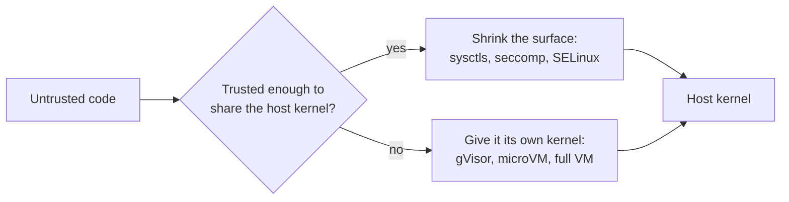
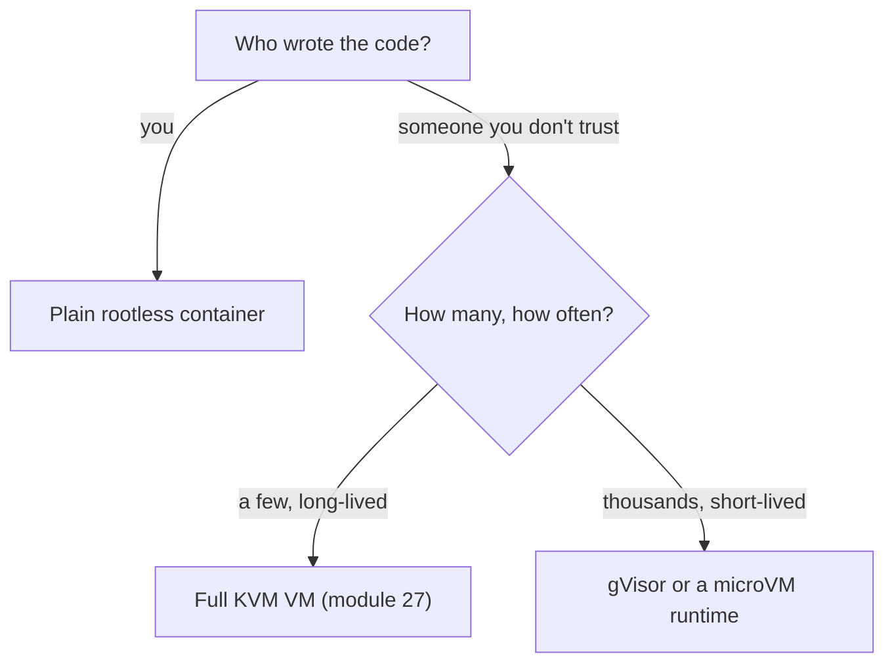
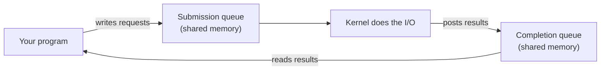
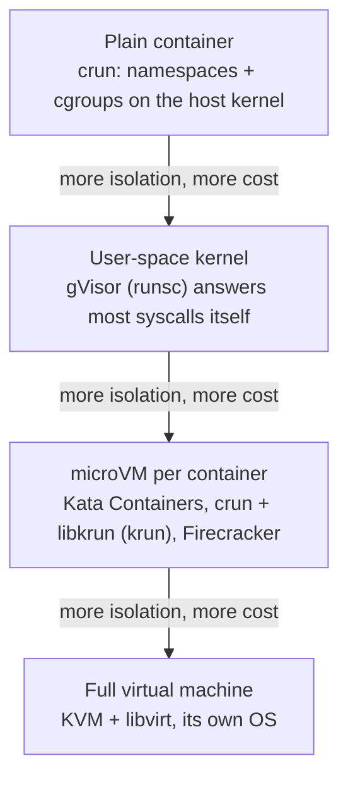
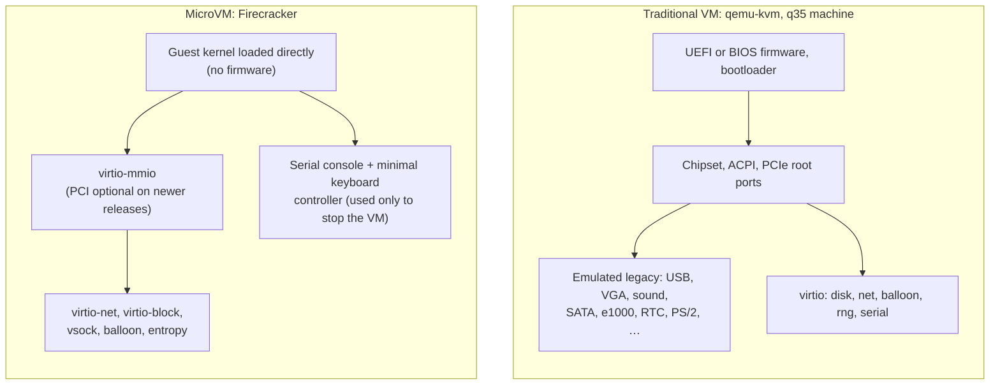

# 38 · Sandboxing and MicroVMs

<ul class="module-meta">
  <li>⏱ ~3 hours</li>
  <li>3 labs</li>
  <li>Builds on: 18 · Containers, 27 · Virtualization with KVM, 16 · SELinux</li>
</ul>

Your team wants to run code it didn't write: build jobs from outside pull requests, customer plug-ins, an AI agent that executes commands it wrote itself. A container starts in milliseconds, but every container on the host talks to the same kernel, and one kernel bug can turn a sandbox into a doorway. A virtual machine has its own kernel, but takes seconds to boot. This module shows you the whole range in between, what each layer costs, and which pieces you can actually use on Rocky 10 today.

!!! abstract "What you'll learn"
    - Explain why a container escape is usually a kernel bug, and what that means for untrusted code
    - Weigh unprivileged user namespaces as both the key to rootless Podman and an attack path, and know what `user.max_user_namespaces=0` breaks
    - Explain io_uring, why Rocky disables it by default, and tell a kernel refusal (`EPERM`) from a seccomp refusal (`ENOSYS`)
    - Shrink the kernel attack surface with sysctls like `kernel.io_uring_disabled` and `kernel.unprivileged_bpf_disabled`
    - Place crun, gVisor, microVM runtimes (Kata, krun) and full VMs on one isolation spectrum, and say which are packaged for Rocky 10
    - Explain what a microVM throws away, what its two walls are, and when not to use one
    - Boot a Firecracker microVM by hand and inspect it from the host

## The big picture

### Sandboxing in one sentence

> **Every layer you add between untrusted code and the host kernel shrinks what an attacker can reach, and costs you something in speed, memory or compatibility.**

Everything in this module hangs off that sentence. **Shrinking what an attacker can reach** comes in two forms. You can switch off parts of the shared kernel that ordinary processes rarely need (user namespaces, io_uring, unprivileged BPF), or you can stop sharing the kernel at all and give the untrusted code a kernel of its own (gVisor, a microVM, a full VM). **The cost** is the other half of every decision: each layer breaks something, slows something, or uses more memory.



Both paths end at the host kernel. The left path keeps the workload talking to it directly, through fewer doors. The right path puts another kernel (a user-space one, or a real one inside a VM) in front of it, so the workload only reaches the host through a much smaller interface.

### The few things that solve most problems

Most real situations come down to one of these moves:

| Situation | Move |
|---|---|
| Your own services, on your own hosts | A rootless container with SELinux enforcing and the default seccomp profile |
| An app's io_uring fails with `EPERM` on the host | Rocky's `kernel.io_uring_disabled = 2`. Use the app's non-io_uring mode, or `1` plus a group if you accept the risk |
| io_uring works on the host but fails with `ENOSYS` in a container | The default seccomp profile. A custom profile for that one container, never `unconfined` |
| A hardening guide says `user.max_user_namespaces = 0` | Only on hosts with no rootless containers, Flatpak or browsers |
| Untrusted code on a single Rocky 10 box | A real KVM virtual machine from [module 27](27-virtualization-kvm.md) |
| Untrusted code at scale, started thousands of times an hour | gVisor, Kata, krun or Firecracker, maintained from outside the distribution |



### Words you'll see

| Word | Plain meaning |
|---|---|
| **attack surface** | The parts of the kernel (or any program) an attacker can reach and poke at |
| **user namespace** | A namespace where an ordinary user can be "root" over things they own, without being root on the host |
| **seccomp** | A kernel filter that allows or refuses a process's system calls; Podman applies a default profile to every container |
| **io_uring** | Fast asynchronous I/O through two rings of memory shared with the kernel; disabled by default on Rocky |
| **OCI runtime** | The small program (crun on Rocky) that actually creates a container from Podman's settings |
| **gVisor** | An OCI runtime (`runsc`) with a user-space kernel that answers the container's system calls itself |
| **microVM** | A KVM virtual machine with almost no emulated hardware, so it boots in a fraction of a second |
| **VMM** | Virtual machine monitor: the user-space program that runs a VM through KVM (QEMU, Firecracker, Cloud Hypervisor) |
| **virtio-mmio** | Attaching virtio devices as memory-mapped register windows instead of on a PCI bus |
| **vsock** | Sockets between host and guest addressed by a number (CID), with no network involved |
| **virtio-fs** | Sharing a host directory into a guest, served by the `virtiofsd` daemon |
| **jailer** | Firecracker's launcher that puts the VMM in a chroot, namespaces and a cgroup, and drops its privileges |

## The shared-kernel threat model

Every container on a host makes its system calls into the same kernel. That
kernel is millions of lines of code, and every year a few bugs in it let an
ordinary process become root. So the real threat model for containers fits in
one sentence: **a container escape is usually a kernel bug that the attacker can
reach from inside the container.** SELinux, seccomp and capabilities make that
harder, but they cannot fix a bug in the kernel itself.

Put another way, the kernel is the container's real wall. You make it
stronger by shrinking how much of the kernel an unprivileged process can
reach, or, for code you don't trust, by giving it a kernel of its own.

The first strategy is called **attack surface reduction**: turn off kernel
features that unprivileged users rarely need, so a bug in them is out of
reach. The second is stronger isolation: a different **OCI runtime** that puts
a user-space kernel or a small virtual machine between the container and the
host. In the apartment-building picture from [module 18](18-containers.md),
the first is locking the doors to the boiler room; the second is moving a
tenant into their own house. The next section covers the first strategy; the
two after it cover the second.

## Shrinking the kernel attack surface

### Unprivileged user namespaces: the key and the risk

[User namespaces](18-containers.md#the-user-namespace-root-that-isnt) are what make rootless
Podman work: alice becomes "root" inside her own namespace without being root
on the host. That same trick is also attack surface. Being root in your own
user namespace gives you capabilities like `CAP_NET_ADMIN` and `CAP_SYS_ADMIN`
over namespaces you own, and with them you can reach kernel code that used to
need real root: building nftables rule sets in your own network namespace,
mounting certain filesystems, creating network devices. Many local privilege
escalation exploits of recent years (for example CVE-2022-0185 in filesystem
mounting and CVE-2024-1086 in nf_tables) started by creating a user namespace
to get at that code.

The main knob on Rocky is a set of sysctls, one per namespace type. Each is
the most namespaces of that type that may exist at once. The default is not
"unlimited" but a large number the kernel works out from your RAM:

```console
$ sysctl -a 2>/dev/null | grep -E '^user\.max_.*namespaces'
user.max_cgroup_namespaces = 15362
user.max_ipc_namespaces = 15362
user.max_mnt_namespaces = 15362
user.max_net_namespaces = 15362
user.max_pid_namespaces = 15362
user.max_time_namespaces = 15362
user.max_user_namespaces = 15362
user.max_uts_namespaces = 15362
```

Setting `user.max_user_namespaces=0` stops *everyone* creating a user
namespace, root included. That closes the door, but a lot lives behind it:

| What breaks at `user.max_user_namespaces = 0` | Why |
|---|---|
| Rootless Podman, Buildah and toolbox | They need a user namespace for UID mapping |
| Flatpak apps | `bubblewrap` builds its sandbox in a user namespace |
| Browser sandboxes (Chrome, Firefox) | They use user namespaces to sandbox renderer processes |
| systemd services with `PrivateUsers=` | The option runs the service in its own user namespace |

Rootful containers (`sudo podman`) keep working, because they don't need a
user namespace by default. So `0` makes sense on a server that runs only
rootful containers or none at all, and is a bad idea on a developer machine
or a rootless container host.

The worked story ["rootless Podman broke after hardening"](#story-rootless-podman-broke-after-hardening)
shows what that bad idea looks like when it happens.

??? question "Under the hood: how Ubuntu does it, and SELinux's user_namespace class"
    **Ubuntu** (24.04 and later) takes a finer approach: AppArmor blocks
    unconfined programs from getting capabilities in a new user namespace,
    controlled by `kernel.apparmor_restrict_unprivileged_userns`, and
    programs that need namespaces get an AppArmor profile that allows them.
    That sysctl comes from Ubuntu's AppArmor patches and does not exist on
    Rocky.

    **SELinux** gained a matching hook in Linux 6.1: a `user_namespace`
    class with a `create` permission, so policy can say which domains may
    create user namespaces. It only does anything if the loaded policy
    defines the class and grants or withholds it. Check your system:

    ```console
    $ ls /sys/fs/selinux/class/ | grep -x user_namespace
    ```

    No output means the loaded policy does not use the class, so creation is
    not checked by SELinux at all. As of this writing RHEL documents no
    boolean for it, so on Rocky the sysctls above are the supported knob.
    Treat per-domain user-namespace rules as something to test, not assume.

### io_uring: fast I/O through a side door

Normally a program asks the kernel for every read or write with its own
system call, and each call costs a trip into the kernel. **io_uring** (added
in Linux 5.1) replaces that with two ring buffers in memory shared between the
process and the kernel. The program writes requests into the **submission
queue**, the kernel does the work asynchronously, and results appear in the
**completion queue**. Thousands of I/Os can go through with only a handful of
system calls, or none at all in polling mode.



The program and the kernel pass work through two shared trays instead of a
phone call per request. Databases, storage engines and fast NVMe setups love
it: less overhead per I/O means more I/Os per second from the same CPUs.

Security teams worry about it for two reasons:

- **It has been a rich source of kernel bugs.** In June 2023 Google reported
  that about 60% of the kernel exploits submitted to its kCTF bug bounty in
  the previous year used io_uring, and that it had disabled io_uring on
  ChromeOS and its production servers and restricted it on Android.
- **seccomp can't see inside the ring.** seccomp filters system calls. An
  open or a read submitted through the ring is not a system call; it is a
  request the kernel picks up from shared memory. So a seccomp profile can
  only allow or deny io_uring as a whole (the `io_uring_setup`,
  `io_uring_enter` and `io_uring_register` calls), never "allow reads but
  deny opens".

Two sysctls (added in Linux 6.6, backported to Rocky 9) control who may
*create* an io_uring:

| `kernel.io_uring_disabled` | Meaning |
|---|---|
| `0` | Anyone may create io_uring instances (the upstream default) |
| `1` | Only processes with `CAP_SYS_ADMIN`, or in the group set by `kernel.io_uring_group`, may create them |
| `2` | Nobody may create new instances, not even root: `io_uring_setup()` fails with `EPERM` |

`kernel.io_uring_group` defaults to `-1` (no group). Rocky follows RHEL here:
io_uring is a Technology Preview and is **disabled by default**, with
`kernel.io_uring_disabled = 2`. If one service really needs it, `1` plus that
service's group in `kernel.io_uring_group` is much narrower than `0`.

```console
$ sysctl kernel.io_uring_disabled kernel.io_uring_group
kernel.io_uring_disabled = 2
kernel.io_uring_group = -1
```

!!! version "Rocky 9 vs 10"
    Both default to `kernel.io_uring_disabled = 2`: RHEL documents it from
    9.4 and for 10.0. Rocky 10 also removed **runc**: **crun** is the only
    OCI runtime in the base repositories. On Rocky 9 runc is still
    installable but deprecated.

**Containers add a second lock.** Podman's default seccomp profile
(`/usr/share/containers/seccomp.json`) is an allowlist, and the three
io_uring calls have not been on it since 2021. Calls that aren't listed fail
with `ENOSYS` ("Function not implemented"), the profile's default answer.
(Docker's default profile also stopped allowing them in 2023.) The error
number tells you which lock said no:

| Error | Who refused | Where to look |
|---|---|---|
| `EPERM`, "Operation not permitted" | The host kernel, because of `kernel.io_uring_disabled` | `sysctl kernel.io_uring_disabled` |
| `ENOSYS`, "Function not implemented", only in the container | The container's seccomp profile | `grep Seccomp /proc/PID/status`, the profile |

The worked story ["the database that was fast on the host"](#story-the-database-that-was-fast-on-the-host)
follows both locks through a real incident, and Lab 1 lets you trip each one.

!!! warning "Think twice before opening the ring"
    Allowing io_uring re-opens exactly the code Google found most exploited,
    and inside the ring seccomp can no longer filter individual operations.
    First check whether the application has a non-io_uring I/O path (most
    do, and many fall back to it automatically) and whether the speed-up is
    real for your workload. If you do enable it, prefer
    `kernel.io_uring_disabled = 1` with a group over `0`, and never use
    `--security-opt seccomp=unconfined` to get there.

??? question "Under the hood: why ring operations bypass seccomp"
    seccomp runs a small BPF filter at the system-call entry point, looking at
    the call number and its arguments. With io_uring, the process calls
    `io_uring_enter` (or, with `IORING_SETUP_SQPOLL`, nothing at all, because
    a kernel thread polls the queue), and the kernel then performs the queued
    operations: reads, writes, `openat`, `connect`, `accept` and dozens more.
    Some run inline, others on kernel worker threads named `iou-wrk-PID`.
    None of them pass through the system-call entry, so the seccomp filter
    never sees them. That is why profiles treat io_uring as all or nothing,
    and why Android and ChromeOS chose to block it outright for untrusted
    code.

<div class="quiz" data-answer="3" markdown>

On a Rocky 10 host where an admin set `kernel.io_uring_disabled = 0`,
`fio --ioengine=io_uring` works. In a rootless Podman container it fails with
`error=Function not implemented`. What is the most likely cause?

- The container's kernel is too old for io_uring
- `kernel.io_uring_disabled` is still `2` inside the container
- Podman's default seccomp profile does not allow the io_uring system calls
- The volume needs `:Z`

Right. Containers share the host kernel and its sysctls, so the kernel side
is open. `ENOSYS` ("Function not implemented") is the default seccomp
profile's answer for calls it doesn't list; the kernel's own refusal would be
`EPERM`.

</div>

### Switches that shrink the attack surface for unprivileged users

These sysctls each close a door that unprivileged code rarely needs. They are
global: a container cannot change them, and they protect the host from every
container at once. Check your values with `sysctl NAME`.

| sysctl | What it limits | Rocky default |
|---|---|---|
| `user.max_user_namespaces` (and the other `user.max_*_namespaces`) | Creating namespaces. `0` blocks rootless containers | Large, scaled to RAM |
| `kernel.io_uring_disabled` | Creating io_uring instances | `2` (disabled) |
| `kernel.unprivileged_bpf_disabled` | Loading BPF programs without `CAP_BPF` / `CAP_SYS_ADMIN` | `2` on Rocky 9 (off; root may switch it back on). Check on 10 |
| `vm.unprivileged_userfaultfd` | `userfaultfd`, a feature many exploits use to pause the kernel mid-copy | Check with `sysctl` (upstream default `0`: restricted) |
| `kernel.perf_event_paranoid` | Performance counters for unprivileged users | Check with `sysctl` (upstream default `2`) |
| `kernel.yama.ptrace_scope` | Attaching a debugger to your own other processes | Check with `sysctl`. `1` = only to your children |

Change one with a file in `/etc/sysctl.d/` and `sudo sysctl --system`, then
test the software that runs on that host. Every switch here has a legitimate
user somewhere (profilers need perf events, debuggers need ptrace).

## The isolation spectrum: runtimes with their own kernel

When the code is genuinely untrusted (a customer's build job, a serverless
function, an AI agent running commands it wrote itself), shrinking the
surface may not be enough. The alternative is to stop sharing the kernel.

Podman doesn't start containers itself. It prepares the image and the
settings and hands them to an **OCI runtime**: a small program that follows
the Open Container Initiative runtime spec and actually creates the
container. On Rocky that runtime is **crun**. Because the hand-off is
standard, you can swap in a different runtime with `podman run --runtime NAME`,
and the rest of Podman (images, volumes, `-p`) stays the same.

```console
$ podman info --format '{{.Host.OCIRuntime.Name}}'
crun
```

The runtimes form a spectrum from "shares everything" to "shares nothing":



Read it top to bottom: each step puts more code between the workload and the
host kernel, and costs more startup time, memory or compatibility.

- **gVisor** (`runsc`) runs a kernel written in Go, in user space, that
  handles the container's system calls itself and uses only a small set of
  host system calls. No hardware virtualization is needed.
- A **microVM** is a virtual machine stripped to the minimum: a tiny virtual
  machine monitor, a few virtio devices, a small guest kernel, booting in a
  fraction of a second. **Kata Containers** runs each pod in one (with QEMU,
  Cloud Hypervisor or Firecracker underneath), **libkrun** is a library that
  turns a process into a microVM, and crun built with libkrun becomes the
  **krun** runtime. **Firecracker** is the microVM monitor behind AWS Lambda.
  The [microVM section](#microvms) below opens one up.

| | Plain container | gVisor | microVM per container | Full VM |
|---|---|---|---|---|
| **Isolation boundary** | Host kernel's syscall interface, plus SELinux and seccomp | A user-space kernel; few host syscalls | Hardware virtualization (KVM), own guest kernel | KVM, own kernel and full virtual hardware |
| **Startup** | Milliseconds | Fast, a little slower than plain | A fraction of a second, typically | Seconds or more |
| **Memory overhead** | Almost none | Small (the user-space kernel) | A guest kernel and a small monitor per container | A whole guest OS |
| **Compatibility** | Everything | Most apps; not every syscall or `/proc` file; heavy I/O is slower | Very high (a real Linux kernel), but sharing files and devices with the host is harder | Anything, any OS |
| **Typical use** | Your own trusted services | Running customer code on shared hosts | CI runners, serverless, AI agent sandboxes, multi-tenant Kubernetes | Different OSes, long-lived servers |

What you can actually install on Rocky 10 matters more than the table:

| Runtime | On Rocky 10 |
|---|---|
| `crun` | In AppStream, installed with Podman, the default and only base runtime |
| `krun` (crun with libkrun) | Not built: the RHEL 10 `crun` package enables krun support only on Fedora, where it ships as `crun-krun`. A `libkrun` library package arrived with RHEL 10.2; check `dnf info libkrun` on your release |
| gVisor (`runsc`) | Not packaged. gVisor publishes binaries upstream |
| Kata Containers | Not in BaseOS or AppStream. Used mostly through Kubernetes (Red Hat's product form is OpenShift sandboxed containers) |

!!! tip "Which one for a single Rocky host?"
    For your own services, a plain rootless container with SELinux enforcing
    and the default seccomp profile is the right answer. For code you don't
    trust on a plain Rocky 10 box, the packaged option today is a real KVM
    virtual machine from [module 27](27-virtualization-kvm.md). Reach for gVisor, Kata or krun when you
    run untrusted code at scale and can maintain software from outside the
    distribution.

<div class="quiz" data-answer="2" markdown>

Which of these gives each container its own Linux kernel, using hardware
virtualization?

- crun with the default seccomp profile
- Kata Containers or the krun runtime
- gVisor's `runsc`
- conmon

Right. Kata and krun boot a small guest kernel in a KVM microVM for each
container. gVisor also stops sharing the kernel's syscall interface, but its
"kernel" is a user-space program, not a VM. crun and conmon use the host
kernel directly.

</div>

## MicroVMs: VMs that boot like containers { #microvms }

The last section placed microVMs on the spectrum. This one opens one up. A
full virtual PC from [module 27](27-virtualization-kvm.md) has firmware, a chipset, USB controllers, a graphics card, all emulated so that any operating system feels at home. That generality costs seconds of boot time and tens of MiB per VM. For a long-lived server nobody cares. For a service that starts a fresh, isolated machine for every function call or every CI job, it's the whole problem.

> **A microVM is a real KVM virtual machine with almost all of the PC hardware thrown away, so it boots in a fraction of a second and costs a few MiB, giving container-like speed with VM-grade isolation.**

The guest still runs its own kernel on the real CPU through KVM, exactly as in [KVM in one sentence](27-virtualization-kvm.md#kvm-in-one-sentence). What changes is the process that holds it: instead of `qemu-kvm` with hundreds of device models, a small purpose-built program offers the guest a handful of virtio devices and nothing else.

The best-known numbers come from **Firecracker**, the microVM program AWS built for Lambda and Fargate. Its published specification promises at most 125 ms from the "start" API call to the guest's `/sbin/init`, and at most 5 MiB of memory overhead per microVM (measured with 1 vCPU, 128 MiB of RAM, a minimal guest and the serial console off, on AWS bare-metal hosts). At launch in 2018, AWS said a host could create up to 150 microVMs per second. Treat these as the project's own benchmark figures: a nested lab VM with a full Linux userspace will be slower, but still in a different class from a q35 guest.

### Why microVMs exist: the multi-tenant problem

Picture a platform that runs **other people's code**: serverless functions, CI builds from pull requests, customer plug-ins, or an AI agent executing commands it wrote itself. You must assume some of that code is hostile. You need two things at once: isolation strong enough for strangers, and start-up fast and cheap enough to do it thousands of times an hour.

| | Container | Full VM (`qemu-kvm`, q35) | MicroVM |
|---|---|---|---|
| Kernel | Shared with the host | Its own | Its own |
| Boot to a usable process | Milliseconds | Seconds (firmware, bootloader, device probing) | Around 100 ms to well under a second |
| Overhead per instance | Tiny | Tens of MiB of emulator, plus the guest | A few MiB of VMM, plus the guest |
| What untrusted code attacks | The whole host kernel's system call interface | The guest kernel, then a large device emulator | The guest kernel, then a tiny device emulator |

Containers lose on the last row, for the reason in [the shared-kernel threat model](#the-shared-kernel-threat-model): one exploitable kernel bug reachable from inside a container can be a bug in every container on the host. A full VM fixes that but is too heavy to throw away after one request. MicroVMs sit in the gap, which is why Kata Containers and the krun runtime from the previous section use them as a stronger wrapper for containers.

### What gets thrown away

A traditional PC guest expects a lot of hardware, and QEMU emulates all of it. A microVM drops anything a modern Linux guest running one workload doesn't need:

- **No firmware.** No BIOS or UEFI, no bootloader. The VMM loads the guest kernel straight into memory and jumps to it (**direct kernel boot**). This alone saves most of a normal VM's boot time.
- **No legacy or PC-only devices.** No USB, no graphics, no sound, no IDE or SATA controller, no emulated e1000 NIC, no floppy.
- **Often no PCI bus.** Devices are announced through **virtio-mmio** instead (see below), so the guest kernel skips bus enumeration.
- **A tiny device set.** Typically virtio-net, virtio-block, vsock, a serial console and sometimes a memory balloon, an entropy device or virtio-fs.



On the left, the guest boots through firmware, then discovers a whole motherboard of devices, most of which only exist so that unmodified operating systems work. On the right, the guest kernel is started directly and finds a few virtio devices and a serial port. Firecracker's FAQ lists exactly that: virtio-net, virtio-balloon, virtio-block, virtio-vsock, a serial console and a minimal keyboard controller, with a few newer optional devices (an entropy device, pmem) added since.

The cost is generality. The guest must be a Linux kernel built with the right virtio drivers compiled in, and usually an uncompressed `vmlinux` image. Windows, or a stock distribution kernel that expects firmware and an initramfs, won't boot on Firecracker.

??? question "Under the hood: virtio-mmio vs virtio-pci"
    The virtio devices themselves (the shared-memory virtqueues from [module 27's virtio section](27-virtualization-kvm.md#virtio-why-paravirtual-devices-matter)) are the same either way. What differs is the **transport**: how the guest finds the device and how it gets notified.

    - **virtio-pci** puts each device on a PCI bus. The guest enumerates the bus, reads configuration space, sets up MSI-X interrupts (one per queue), and can hot-plug devices. That's what every `qemu-kvm` guest in module 27 uses.
    - **virtio-mmio** gives each device a small window of memory-mapped registers at a fixed address and one interrupt line. There is no bus to scan: the VMM tells the guest where the devices are, through kernel command-line parameters (`virtio_mmio.device=…`), a device tree on Arm, or ACPI tables. It's simpler and faster to set up, but has no hot-plug and one interrupt per device rather than per queue.

    That trade-off is why the line is blurring. Firecracker's getting-started guide now offers `--enable-pci` and recommends it, because the PCI transport gives higher throughput and lower latency for busy devices. Without the flag, Firecracker uses MMIO. Cloud Hypervisor uses PCI. "MicroVM" means "minimal device model", not "never PCI".

### The building blocks

Every microVM is built from the same few parts. In plain words:

| Part | What it is |
|---|---|
| `/dev/kvm` and the KVM API | The kernel interface you met in [Checking support](27-virtualization-kvm.md#checking-support). Any program that can open `/dev/kvm` can create a VM, give it memory and vCPUs, and run it. There's nothing magic about QEMU. |
| **VMM** (virtual machine monitor) | The user-space program that does this: it asks KVM to run guest code and emulates the few devices the guest has. QEMU is a VMM; so are Firecracker, Cloud Hypervisor, crosvm and libkrun. One VMM process per microVM. |
| **virtio-mmio** / virtio-pci | How virtio devices are attached: as memory-mapped register windows, or on a PCI bus (previous collapsible). |
| **vsock** | Host-to-guest sockets (`AF_VSOCK`) addressed by a number called a **CID** instead of an IP address. The host and guest talk without any network, NIC, IP address or firewall rule. Agents inside microVMs (Kata's agent, for example) use it as their control channel. |
| **virtio-fs** | Shares a host directory into the guest, with the host side served by the `virtiofsd` daemon. Much faster than a network filesystem, and how container runtimes give a microVM the container's root filesystem. libvirt uses it for `<filesystem>` devices on full VMs too. |
| **vhost** / **vhost-user** | Moving a device's data path out of the VMM: into a host kernel thread (vhost, as with `vhost-net` in module 27's virtio stepper) or into a separate user-space process over a UNIX socket (vhost-user, as with `virtiofsd`). The VMM stays small; the busy work happens elsewhere. |
| **Snapshots** | Pause a microVM and write its device state and memory to files; later load them and resume in milliseconds. A platform can boot a function once, snapshot it, and start every later copy from the snapshot instead of booting. |
| **Balloon** | The `virtio-balloon` device from module 27's virtio table: the host asks the guest to give memory back, so many mostly idle microVMs can share a host. |
| **Rate limiters** | Per-device limits on bandwidth and operations per second (Firecracker has them for disks and NICs), so one noisy tenant can't saturate the host's disk or network. |

??? question "Under the hood: a VMM in five system calls"
    Why can a 50,000-line program replace QEMU for this job? Because KVM does the hard part. Stripped to its core, every VMM does this with `ioctl()` calls on `/dev/kvm`:

    1. Open `/dev/kvm` and ask for a new VM (`KVM_CREATE_VM`).
    2. `mmap()` some ordinary anonymous memory and hand it to the VM as guest RAM (`KVM_SET_USER_MEMORY_REGION`). Guest RAM really is just memory of the VMM process, as you saw with `qemu-kvm` in module 27.
    3. Create a vCPU (`KVM_CREATE_VCPU`) and set its registers so it starts at the guest kernel's entry point.
    4. Start a thread per vCPU that loops on `KVM_RUN`. Guest code runs natively until a VM exit.
    5. When `KVM_RUN` returns, read the exit reason (the guest touched an I/O port or an MMIO address, say), emulate that one device access, and loop.

    That's the sequence diagram from [How hardware virtualization works](27-virtualization-kvm.md#how-hardware-virtualization-works), seen from the VMM's side. The size of a VMM is mostly step 5: the more devices it emulates, the more code runs on behalf of the guest. Firecracker names its threads after these roles, so `ps -T` shows `fc_api` (the API server), `fc_vcpu 0` and so on, next to the main VMM thread.

??? question "Under the hood: vsock, snapshots and the clone problem"
    **vsock addressing.** An `AF_VSOCK` address is a (CID, port) pair. The host is always CID 2; each guest gets its own CID. Firecracker doesn't expose guest vsock as a host `AF_VSOCK` socket: it maps it to an ordinary UNIX socket on the host (`uds_path` in its config). A host program connects to that UNIX socket and sends `CONNECT <port>` followed by a newline to reach a guest port. That keeps the VMM in charge of every byte.

    **Fast restore.** When Firecracker loads a snapshot, it can map the memory file privately (`MAP_PRIVATE`) instead of reading it in. Pages are only loaded when the guest touches them, so a 1 GiB guest can resume in milliseconds, and many clones can share the unchanged pages of one snapshot file through the host page cache.

    **The clone problem.** If you start 100 microVMs from one snapshot, all 100 wake up with identical memory: the same random number generator state, the same TCP sequence numbers, the same UUIDs an application generated before the snapshot. Firecracker documents this in "Entropy for Clones" and supports a VM generation ID device (VMGenID) that tells a Linux guest it has been cloned so the kernel can reseed. User-space programs that cache randomness still need care.

<div class="quiz" data-answer="3" markdown>

A Firecracker microVM reaches its init process in about 100 ms, while a q35 `qemu-kvm` guest of the same Linux takes several seconds. Where does most of the difference come from?

- Firecracker runs guest code faster than KVM does
- Firecracker uses less RAM, so the guest has less to initialise
- There is no firmware or bootloader, and the guest kernel has only a few virtio devices to find
- Firecracker skips the guest kernel and runs the application directly

Right. Both run guest code on the real CPU through KVM. The microVM saves time by loading the kernel directly (no UEFI, no GRUB) and giving it almost nothing to probe. There is still a guest kernel: that's where the isolation comes from.

</div>

### Two walls: defense in depth around the VMM

A microVM is only as strong as the code between the attacker and the host. Click down the stack an attacker would have to break through:

<div class="layers" data-hint="Click a layer to see what an attacker must defeat there." markdown>

<div class="layer" data-label="Untrusted workload" data-tag="the attacker starts here" markdown>

**What it is:** the function, CI job or agent you were asked to run. Assume it has root inside the guest. That's fine: root in the guest owns nothing but the guest.

</div>

<div class="layer" data-label="Wall 1: the guest kernel" data-tag="its own kernel, not the host's" markdown>

**What it stops:** a kernel exploit here gives the attacker the guest kernel, which is still inside the VM. Compare a container, where the same exploit lands in the host kernel shared by everyone.

</div>

<div class="layer" data-label="Wall 2: the VMM process" data-tag="tiny device model, Rust, seccomp, jailer" markdown>

**What it stops:** to leave the VM, the attacker needs a bug in the code that handles VM exits: the VMM's few device models, or KVM itself. Firecracker keeps that code small and memory-safe (Rust), and even a successful exploit lands in a process that has a seccomp filter allowing only the system calls it needs, runs as an unprivileged user, and sits in a chroot with its own namespaces and cgroup (the **jailer**).

</div>

<div class="layer" data-label="KVM in the host kernel" data-tag="small, shared by all VMs" markdown>

**What it is:** the kernel side of virtualization. A bug here would cross every wall, which is why KVM's guest-facing surface is kept small and heavily scrutinised.

</div>

<div class="layer" data-label="The host and other tenants" data-tag="what you are protecting" markdown>

**The goal:** other customers' microVMs, the host's data and credentials. On a full libvirt host, sVirt adds one more wall here: SELinux keeps each VM's process away from other VMs' files.

</div>

</div>

| | Container | Full QEMU VM | Firecracker microVM |
|---|---|---|---|
| Untrusted code talks directly to | The host kernel (hundreds of system calls) | Its own guest kernel | Its own guest kernel |
| To escape it must also break | Nothing more: namespaces, cgroups, seccomp and SELinux are the only barriers | QEMU's large device model (written in C, over 1.4 million lines in total as of QEMU 4.2), or KVM | Firecracker's handful of devices (about 50,000 lines of Rust at the time of the 2020 paper), or KVM |
| After escaping the device model | Already on the host | A QEMU process confined by sVirt (SELinux) and cgroups | A Firecracker process confined by seccomp, the jailer's chroot, namespaces, cgroups and an unprivileged user |

The line counts come from the Firecracker NSDI 2020 paper. A large device model isn't automatically insecure (libvirt plus sVirt confines QEMU well, and RHEL's build disables many devices), but less code reachable from the guest means fewer places for a bug to hide.

??? question "Under the hood: what the jailer does, step by step"
    Firecracker's own documentation says production deployments should start it through the **jailer**, a separate small binary shipped in the same release tarball. You start `jailer` as root with a VM ID, the Firecracker binary, and a uid and gid; it then:

    1. Creates a cgroup for the microVM (or moves it into one you prepared), so CPU and memory are metered and capped.
    2. Builds a private directory under `/srv/jailer/firecracker/<id>/root` (the default `--chroot-base-dir`), copies the Firecracker binary into it, and creates only the device nodes it needs (`/dev/kvm`, `/dev/net/tun`).
    3. Enters a new mount namespace and uses `pivot_root()` so that directory becomes `/`. Nothing else of the host filesystem is visible.
    4. Optionally joins a prepared network namespace (`--netns`) and a new PID namespace (`--new-pid-ns`).
    5. Drops to the unprivileged uid and gid, then `exec()`s Firecracker.
    6. Firecracker installs its seccomp filters per thread (VMM, API and vCPU threads each get their own allow-list) before running any guest code.

    These are the same kernel features [module 18](18-containers.md) uses to build containers. The jailer wraps a container around the VMM, so an attacker who escapes the guest finds themselves in a container with almost no system calls available.

### The landscape

Several VMMs and runtimes compete here. They share the rust-vmm building blocks more than you'd expect (Firecracker began as a fork of crosvm; Cloud Hypervisor and Firecracker both use rust-vmm crates).

| Project | Made by | Known for | How you drive it | On Rocky 10 |
|---|---|---|---|---|
| **Firecracker** | AWS | AWS Lambda and Fargate | REST API over a UNIX socket, or a JSON file with `--config-file` | Not in the repos. Static release binaries (`firecracker`, `jailer`) from GitHub. Check `docs/kernel-policy.md` for the host kernels it is tested on |
| **Cloud Hypervisor** | Linux Foundation project, started by Intel | Kata Containers; general cloud VMs (also boots Windows via firmware) | REST API socket and `ch-remote`; libvirt has a `ch` driver | Not in the Rocky repos. Static binaries from its GitHub releases; check `dnf search cloud-hypervisor` with EPEL enabled |
| **QEMU `microvm`** | The QEMU project | A minimal machine type for QEMU, so existing QEMU tooling works | `qemu-system-x86_64 -M microvm` | Rocky's `qemu-kvm` uses RHEL's trimmed device list, which leaves `microvm` out. `/usr/libexec/qemu-kvm -machine help` shows what your build has |
| **libkrun** | The containers project (Podman's upstream) | `crun`'s krun handler (`podman run --runtime krun`), krunvm, muvm | A C library linked into another program | `libkrun` is built for CentOS Stream 10 and RHEL 10.2; the `crun-krun` handler is a Fedora package whose RHEL 10 status is changing. Check `dnf info libkrun crun-krun` |
| **crosvm** | Google | ChromeOS Linux apps, Android's virtualization framework | Command line | Not packaged; build from source |
| **Kata Containers** | OpenInfra Foundation | Running each Kubernetes pod in its own microVM; Red Hat sells it as OpenShift sandboxed containers | An OCI runtime (containerd shim), choosing QEMU, Cloud Hypervisor, Firecracker or its built-in Dragonball VMM | Not in the Rocky repos; upstream release tarballs |

!!! note "Packaging here moves fast"
    Everything in the last column is a snapshot from late 2026. Before you plan around a package, ask your own mirror: `dnf search krun`, `dnf search cloud-hypervisor`, `dnf info crun-krun`. Nothing in this table is a supported part of Rocky's virtualization stack the way `qemu-kvm` and libvirt are.

!!! example "Try it: a container inside a microVM (only where it's packaged)"
    Podman can hand a container to crun's **krun** handler, which sets up the namespaces as usual and then boots the workload inside a libkrun microVM. First check whether your repos carry it:

    ```console
    $ dnf info crun-krun
    ```

    If dnf finds it, install it (`sudo dnf install -y crun-krun`) and compare kernels:

    ```console
    $ uname -r
    $ podman run --rm --runtime krun docker.io/rockylinux/rockylinux:10 uname -r
    ```

    The second command reports a different kernel: the guest kernel libkrun booted for the container, not your host's. If dnf finds nothing, this is a Fedora feature for now; try it on a Fedora machine.

### When not to use microVMs

MicroVMs are a specialised tool. Stay with full `qemu-kvm` and libvirt when:

- **The VM is a general-purpose server** that lives for months, gets patched in place and is managed by people. libvirt, `virsh`, Cockpit and everything else in module 27 only manage QEMU (and, through its `ch` driver, Cloud Hypervisor). Firecracker has no libvirt support: you drive it through its own API or a platform built on it.
- **The guest isn't a recent Linux kernel.** Firecracker boots Linux kernels built for it; Windows and other systems that need firmware are out. (Cloud Hypervisor can boot Windows with firmware, at which point it's no longer very "micro".)
- **You need real hardware in the guest.** GPU or NIC passthrough (VFIO) isn't in Firecracker at all; Cloud Hypervisor and QEMU support it.
- **You need live migration.** Firecracker has snapshots, not live migration; a microVM platform reschedules short-lived work instead of moving it. Cloud Hypervisor and QEMU can migrate.
- **The workload is trusted and just needs packaging.** If you wrote the code and run it on your own hosts, a plain container is simpler and faster still.

<div class="quiz" data-answer="2" markdown>

An attacker gets root inside a Firecracker microVM's guest. What must they still defeat to read another tenant's data on the same host?

- Nothing: root in the guest is root on the host
- A bug in Firecracker's device emulation or in KVM, and then the seccomp filter, jailer chroot, namespaces and unprivileged user around the Firecracker process
- Only the guest's SELinux policy
- The host firewall, because microVMs talk to each other over the network

Right. Root in the guest only owns the guest (wall 1 is already behind them). To leave, they need a VMM or KVM bug (wall 2), and even then they land in a process with almost no system calls, no view of the host filesystem and no privileges.

</div>

## Worked stories

Each story runs symptom, evidence, reasoning, fix, check. The first two are
the attack-surface switches biting a real team; the third is the most common
reason a microVM won't start at all.

### Story: rootless Podman broke after hardening

**Symptom:** after a hardening playbook ran, every `podman` command for
alice fails, while `sudo podman` works. **Evidence:**

```console
$ podman ps
cannot clone: No space left on device
user namespaces are not enabled in /proc/sys/user/max_user_namespaces
Error: cannot re-exec process
$ grep -r max_user_namespaces /etc/sysctl.conf /etc/sysctl.d/
/etc/sysctl.d/99-hardening.conf:user.max_user_namespaces = 0
```

**Reasoning:** "No space left on device" (`ENOSPC`) is how the kernel says
"namespace limit reached", and Podman even names the file. **Fix:** remove
the line (or set a value that fits, such as a few hundred per user on a
shared host), then `sudo sysctl --system`. **Check:** `podman ps` works
again.

### Story: the database that was fast on the host

**Symptom:** a team runs a storage-heavy database on a Rocky host where an
admin set `kernel.io_uring_disabled = 0` for it. Moved into a rootless Podman
container, its io_uring engine won't start. You reproduce it with `fio` on
the host and in a test image with `fio` installed:

```console
$ fio --name=uring --ioengine=io_uring --rw=read --size=8M --filename=/var/tmp/fio.dat
…
   READ: bw=402MiB/s (421MB/s), 402MiB/s-402MiB/s (421MB/s-421MB/s), io=8192KiB (8389kB), run=20-20msec
$ podman run --rm localhost/fio-test fio --name=uring --ioengine=io_uring --rw=read --size=8M --filename=/tmp/fio.dat
…
fio: your kernel doesn't support io_uring
fio: pid=2, err=38/file:engines/io_uring.c:…, func=io_queue_init, error=Function not implemented
```

**Evidence:** same kernel, same sysctl, different result, and the error is
`38` (`ENOSYS`), not `EPERM`. That points at the leash, not the kernel:

```console
$ podman run --rm localhost/fio-test grep Seccomp /proc/self/status
Seccomp:	2
Seccomp_filters:	1
$ grep -c io_uring /usr/share/containers/seccomp.json
0
```

**Reasoning:** `Seccomp: 2` means a filter is active, and the default
profile doesn't list any io_uring call. **Fix:** if the team accepts the risk,
give *this one container* a copy of the profile with the three calls added,
rather than disabling seccomp:

```bash
jq '.syscalls += [{"names": ["io_uring_setup", "io_uring_enter", "io_uring_register"], "action": "SCMP_ACT_ALLOW"}]' \
  /usr/share/containers/seccomp.json > ~/uring-seccomp.json  # (1)!
podman run --rm --security-opt seccomp="$HOME/uring-seccomp.json" \
  localhost/fio-test fio --name=uring --ioengine=io_uring --rw=read --size=8M --filename=/tmp/fio.dat  # (2)!
```

1. Copy the default profile and append one rule that allows the three io_uring calls.
2. Use the custom profile for this container only. Every other container keeps the default.

**Check:** `fio` reports a `READ:` line. In a Quadlet file the same option is
`SeccompProfile=`.

### Story: the microVM that wouldn't start in a lab VM

**Symptom.** You follow [Lab 3](#labs) (Firecracker) inside your Rocky lab VM. Firecracker exits immediately instead of booting the guest.

**Evidence.** Its error message ends with a hint about permissions:

```console
$ sudo ./firecracker --api-sock /tmp/firecracker.socket --config-file vm_config.json
… Error creating KVM object: No such file or directory (os error 2) Make sure the user launching the firecracker process is configured on the /dev/kvm file's ACL.
$ ls -l /dev/kvm
ls: cannot access '/dev/kvm': No such file or directory
$ grep -c -E 'vmx|svm' /proc/cpuinfo
0
```

**Reasoning.** The hint says "ACL", but the error number says "No such file or directory": you are running as root, so permissions aren't the issue. `/dev/kvm` doesn't exist, because the CPU this lab VM sees has no `vmx` or `svm` flag, so `kvm_intel` or `kvm_amd` couldn't load. The outer hypervisor isn't exposing virtualization (see [Nested virtualization: labs inside a lab VM](27-virtualization-kvm.md#nested-virtualization-labs-inside-a-lab-vm)). QEMU could limp along in slow TCG emulation here; Firecracker has no emulator to fall back on. No KVM, no microVM.

**Fix.** Shut the lab VM down, enable nested virtualization on the outer host (for a KVM outer host, `<cpu mode='host-passthrough'/>`), and start it again.

**Check.** Inside the lab VM, `grep -c -E 'vmx|svm' /proc/cpuinfo` is above 0, `ls -l /dev/kvm` shows the device, and Firecracker boots the guest to a login prompt.

## Practice

<div class="terminal-sim" data-title="Check the walls" data-prompt="[alice@rocky-lab ~]$ " markdown>

<div class="task" data-expect="sysctl kernel.io_uring_disabled" data-match="^(sudo )?sysctl (-n )?kernel\.io_uring_disabled$" data-hint="sysctl takes the setting name, kernel.io_uring_disabled." markdown>

**Step 1.** Is io_uring allowed on this host?

```text
kernel.io_uring_disabled = 2
```

</div>

<div class="task" data-expect="sysctl user.max_user_namespaces" data-match="^((sudo )?sysctl (-n )?user\.max_user_namespaces|cat /proc/sys/user/max_user_namespaces)$" data-hint="The setting is user.max_user_namespaces." markdown>

**Step 2.** How many user namespaces may exist? (Rootless Podman needs this above 0.)

```text
user.max_user_namespaces = 15362
```

</div>

<div class="task" data-expect="podman info --format '{{.Host.OCIRuntime.Name}}'" data-match="^podman info (-f|--format) ['&quot;]?\{\{ ?\.Host\.OCIRuntime\.Name ?\}\}['&quot;]?$" data-hint="Use podman info with --format and the template {{.Host.OCIRuntime.Name}}." markdown>

**Step 3.** Which OCI runtime does Podman use?

```text
crun
```

</div>

<div class="task" data-expect="grep Seccomp /proc/4120/status" data-match="^grep (-i )?seccomp /proc/4120/status$" data-hint="The Seccomp line in /proc/PID/status shows the filter mode." markdown>

**Step 4.** Is a seccomp filter active on the container process with host PID 4120?

```text
Seccomp:	2
Seccomp_filters:	1
```

</div>

<div class="task" data-expect="grep Seccomp /proc/5120/status" data-match="^(grep (-i )?seccomp /proc/5120/status|cat /proc/5120/status)$" data-hint="Every process's /proc/PID/status file has Seccomp lines. grep them for PID 5120." markdown>

**Step 5.** A Firecracker microVM is running as PID 5120. Check that its process is under a seccomp filter.

```text
Seccomp:        2
Seccomp_filters:        1
```

</div>

</div>

## Labs

!!! lab "Lab 1: Find the two locks on io_uring"

    **Goal:** See io_uring refused first by the host kernel, then by the
    container's seccomp profile, and tell them apart by the error.

    **You'll need:** a throwaway Rocky 10 VM, sudo, and Podman as your normal
    user. This lab briefly enables io_uring on the host and switches it off
    again at the end.

    1. Install `fio` and `jq` (both in AppStream) and check the host setting:

        ```bash
        sudo dnf install -y fio jq
        sysctl kernel.io_uring_disabled    # 2 = disabled for everyone
        ```

    2. Try io_uring on the host. Expect `error=Operation not permitted`
       (`EPERM`) from the kernel:

        ```bash
        fio --name=uring --ioengine=io_uring --rw=read --size=8M --filename=/var/tmp/fio.dat
        ```

    3. Open the kernel lock for now and run it again. This time you get a
       `READ:` summary line:

        ```bash
        sudo sysctl -w kernel.io_uring_disabled=0
        fio --name=uring --ioengine=io_uring --rw=read --size=8M --filename=/var/tmp/fio.dat
        ```

    4. Build a small test image with `fio` and run the same test in a
       container. Expect `error=Function not implemented` (`ENOSYS`):

        ```bash
        mkdir -p ~/fiotest && cd ~/fiotest
        printf 'FROM docker.io/rockylinux/rockylinux:10\nRUN dnf install -y fio && dnf clean all\n' > Containerfile
        podman build -t localhost/fio-test .
        podman run --rm localhost/fio-test fio --name=uring --ioengine=io_uring --rw=read --size=8M --filename=/tmp/fio.dat
        ```

    5. Read the evidence for the second lock:

        ```bash
        podman run --rm localhost/fio-test grep Seccomp /proc/self/status
        grep -c io_uring /usr/share/containers/seccomp.json
        ```

    6. Give one container a profile that allows io_uring, and run it again:

        ```bash
        jq '.syscalls += [{"names": ["io_uring_setup", "io_uring_enter", "io_uring_register"], "action": "SCMP_ACT_ALLOW"}]' \
          /usr/share/containers/seccomp.json > ~/fiotest/uring-seccomp.json
        podman run --rm --security-opt seccomp="$HOME/fiotest/uring-seccomp.json" \
          localhost/fio-test fio --name=uring --ioengine=io_uring --rw=read --size=8M --filename=/tmp/fio.dat
        ```

    **Check your work:** step 2 failed with `Operation not permitted`, step 3
    worked, step 4 failed with `Function not implemented` even though the
    host allowed io_uring, step 5 showed `Seccomp: 2` and a count of `0`, and
    step 6 printed a `READ:` line.

    ??? tip "Hint: step 6 still fails"
        If the error changes to `Permission denied`, run
        `sudo ausearch -m AVC -ts recent`. Newer SELinux policies can also
        decide which domains may use io_uring, which is a third lock on top
        of the two in this lab.

    **Clean up:** put the kernel lock back and remove the files:
    `sudo sysctl -w kernel.io_uring_disabled=2; podman rmi localhost/fio-test; rm -rf ~/fiotest /var/tmp/fio.dat`

!!! lab "Lab 2: Watch rootless Podman lose its user namespace"

    **Goal:** See what `user.max_user_namespaces=0` breaks, and what it
    doesn't, then put it back.

    **You'll need:** a throwaway Rocky 10 VM, sudo, and Podman as your normal
    user.

    1. Note the current value and check that user namespaces work:

        ```bash
        orig=$(sysctl -n user.max_user_namespaces); echo "$orig"
        unshare --user --map-root-user id
        ```

    2. Stop the pause process that keeps your existing rootless namespace
       alive, so the next `podman` command has to create a new one:

        ```bash
        podman system migrate
        pgrep -u "$USER" -a catatonit    # should print nothing; if not, pkill -u "$USER" catatonit
        ```

    3. Close the door, then try both tools as your normal user:

        ```bash
        sudo sysctl -w user.max_user_namespaces=0
        unshare --user --map-root-user id
        podman run --rm docker.io/rockylinux/rockylinux:10 true
        ```

    4. Try a rootful container, which doesn't need a user namespace:

        ```bash
        sudo podman run --rm docker.io/rockylinux/rockylinux:10 echo rootful works
        ```

    5. Restore the old value and confirm rootless Podman is back:

        ```bash
        sudo sysctl -w user.max_user_namespaces="$orig"
        podman run --rm docker.io/rockylinux/rockylinux:10 echo rootless works
        ```

    **Check your work:** in step 3, `unshare` failed with `unshare failed: No
    space left on device` and Podman printed `user namespaces are not enabled
    in /proc/sys/user/max_user_namespaces`. Step 4 printed `rootful works`,
    and step 5 printed `rootless works`.

    ??? success "What just happened?"
        `ENOSPC` ("No space left on device") is the kernel's answer when a
        namespace limit is reached, and a limit of 0 is reached immediately.
        Rootless Podman needs a fresh user namespace for its UID mapping,
        so it fails. Rootful Podman runs as real root without a user
        namespace, so it doesn't care. This is the trade-off in one lab: the
        setting removes an attack path and rootless containers with it.

    **Clean up:** confirm `sysctl user.max_user_namespaces` shows the
    original value, then `sudo podman rmi docker.io/rockylinux/rockylinux:10`.

!!! lab "Lab 3: Boot a Firecracker microVM by hand"

    **Goal:** Boot a microVM with Firecracker, measure how fast it starts, and compare its process with a `qemu-kvm` guest.

    **You'll need:** a throwaway Rocky 10 x86_64 or aarch64 machine with working KVM (module 27's Lab 1; in a lab VM that means [nested virtualization](27-virtualization-kvm.md#nested-virtualization-labs-inside-a-lab-vm)), sudo, internet access, about 2 GB free disk, and two terminals. Ideally a `qemu-kvm` guest such as `web1` from module 27's Lab 2 is still running for the comparison. The commands follow Firecracker's official getting-started guide (`docs/getting-started.md` in its repository), trimmed to the serial console with no networking; check it if anything here has drifted.

    1. Check KVM first, then install the tools the guide's script needs:

        ```bash
        ls -l /dev/kvm
        sudo sh -c '[ -r /dev/kvm ] && [ -w /dev/kvm ] && echo OK || echo FAIL'
        sudo dnf install -y squashfs-tools e2fsprogs
        mkdir ~/fc && cd ~/fc
        ```

        If `/dev/kvm` is missing, stop and read ["Story: the microVM that wouldn't start in a lab VM"](#story-the-microvm-that-wouldnt-start-in-a-lab-vm).

    2. Download the latest Firecracker release. The release page redirects `latest` to the current version tag, so nothing is hard-coded:

        ```bash
        ARCH="$(uname -m)"
        release_url="https://github.com/firecracker-microvm/firecracker/releases"
        latest=$(basename $(curl -fsSLI -o /dev/null -w %{url_effective} ${release_url}/latest))
        echo "$latest"
        curl -L ${release_url}/download/${latest}/firecracker-${latest}-${ARCH}.tgz | tar -xz
        ls release-${latest}-${ARCH}/
        mv release-${latest}-${ARCH}/firecracker-${latest}-${ARCH} firecracker
        ```

        The listing shows the `jailer` binary next to `firecracker`; this lab doesn't use it, but production should.

    3. Fetch a guest kernel and an Ubuntu root filesystem from Firecracker's CI bucket, exactly the way the guide does (it finds the newest artifacts rather than naming a version), and turn the rootfs into an ext4 image:

        ```bash
        S3="https://s3.amazonaws.com/spec.ccfc.min"
        CI_ARTIFACTS_PREFIX=$(curl -fsSL "$S3?list-type=2&prefix=firecracker-ci/&delimiter=/" \
            | grep -oP "(?<=<Prefix>)firecracker-ci/[0-9]{8}-[^/]+/(?=</Prefix>)" | sort | tail -1)
        latest_kernel_key=$(curl -fsSL "$S3?list-type=2&prefix=${CI_ARTIFACTS_PREFIX}${ARCH}/vmlinux-" \
            | grep -oP "(?<=<Key>)(${CI_ARTIFACTS_PREFIX}${ARCH}/vmlinux-[0-9]+\.[0-9]+\.[0-9]{1,3})(?=</Key>)" \
            | sort -V | tail -1)
        curl -fsSLO "$S3/${latest_kernel_key}"
        latest_ubuntu_key=$(curl -fsSL "$S3?list-type=2&prefix=${CI_ARTIFACTS_PREFIX}${ARCH}/ubuntu-" \
            | grep -oP "(?<=<Key>)(${CI_ARTIFACTS_PREFIX}${ARCH}/ubuntu-[0-9]+\.[0-9]+\.squashfs)(?=</Key>)" \
            | sort -V | tail -1)
        curl -fsSL -o rootfs.squashfs "$S3/$latest_ubuntu_key"
        unsquashfs rootfs.squashfs
        sudo chown -R root:root squashfs-root
        truncate -s 1G rootfs.ext4
        sudo mkfs.ext4 -d squashfs-root -F rootfs.ext4
        KERNEL=$(ls vmlinux-* | tail -1); echo "$KERNEL"
        ```

    4. Write the microVM's whole configuration as one JSON file (the same fields the REST API takes):

        ```bash
        cat > vm_config.json <<EOF
        {
          "boot-source": {
            "kernel_image_path": "./$KERNEL",
            "boot_args": "console=ttyS0 reboot=k panic=1"
          },
          "drives": [
            {
              "drive_id": "rootfs",
              "path_on_host": "./rootfs.ext4",
              "is_root_device": true,
              "is_read_only": false
            }
          ],
          "machine-config": {
            "vcpu_count": 1,
            "mem_size_mib": 256
          }
        }
        EOF
        ```

        The kernel is a bare `vmlinux` (no firmware, no bootloader, no initramfs). `console=ttyS0` sends the guest console to Firecracker's serial port, which is the terminal you start it in. `reboot=k panic=1` make a guest reboot or panic end the VM, because Firecracker has no power management.

    5. In terminal 1, start it. The boot log scrolls past and ends at a login prompt; log in as `root` with password `root` (the guide's test image):

        ```bash
        sudo rm -f /tmp/firecracker.socket
        sudo ./firecracker --api-sock /tmp/firecracker.socket --config-file vm_config.json
        ```

    6. Inside the guest, look at how long the kernel took to reach init, and how little hardware there is:

        ```bash
        dmesg | grep -m1 'Run /sbin/init'
        free -m
        ls /sys/bus/virtio/devices/
        ls /sys/bus/pci/devices/ 2>/dev/null | wc -l
        ```

    7. In terminal 2, on the host, look at the microVM as a process, the same way you looked at `qemu-kvm`:

        ```bash
        FC=$(pgrep -x firecracker)
        ps -T -o spid,comm -p $FC
        grep Seccomp /proc/$FC/status
        ps -o pid,rss,comm -p $FC
        ps -o pid,rss,comm -C qemu-kvm
        sudo curl -s --unix-socket /tmp/firecracker.socket http://localhost/machine-config
        ```

    8. Back in the guest, run `reboot`. Firecracker exits and terminal 1 returns to the host prompt.

    **Check your work:** the `Run /sbin/init` line has a timestamp of a fraction of a second (more in a nested lab VM, and the guide's figure of 125 ms assumes bare metal, a minimal rootfs and no serial console). The guest sees a few virtio devices and few or no PCI devices (Firecracker only builds a PCI bus when started with `--enable-pci`). `ps -T` shows the threads `firecracker`, `fc_api` and `fc_vcpu 0`; `Seccomp:` is `2` (a filter is active); and the Firecracker process's RSS is roughly the guest memory it has touched plus a few MiB, against a `qemu-kvm` RSS that also carries QEMU's much larger device model. The `curl` call returns the machine config as JSON: that socket is the API a platform would use to create and control thousands of these.

    ??? success "What just happened?"
        Firecracker opened `/dev/kvm`, gave the VM 256 MiB of its own memory, loaded the kernel straight into it and started one vCPU thread looping on `KVM_RUN`. There was no firmware and no bus scan, so the kernel's first job was mounting the virtio-block root disk. The release binary installs its seccomp filters before running guest code, which `/proc/<pid>/status` confirms. In production the jailer would also have put it in a chroot, a cgroup and namespaces, as an unprivileged user.

    ??? tip "Hint: curl says Connection refused or Permission denied"
        Firecracker created the socket as root (you started it with `sudo`), so `curl` needs `sudo` too. Firecracker's guide also mentions SELinux can get in the way on RHEL-family hosts; check `sudo ausearch -m avc -ts recent` ([module 16](16-selinux.md)) before changing anything.

    **Clean up:** make sure Firecracker has exited (if the guest hangs, `sudo kill $(pgrep -x firecracker)` in terminal 2), then `cd ~ && sudo rm -rf ~/fc && sudo rm -f /tmp/firecracker.socket`.

## Common pitfalls

| Symptom | Cause | Fix |
|---|---|---|
| Rootless Podman: `cannot clone: No space left on device` | `user.max_user_namespaces` set to `0` by hardening | Find the line with `grep -r max_user_namespaces /etc/sysctl.d/`, remove it, `sysctl --system` |
| App's io_uring fails with `EPERM` on the host | Rocky ships `kernel.io_uring_disabled = 2` | Use the app's non-io_uring mode, or `1` plus `kernel.io_uring_group` if you accept the risk |
| io_uring works on the host but fails with `ENOSYS` in a container | Default seccomp profile doesn't allow the io_uring calls | A custom profile for that one container (`--security-opt seccomp=FILE`), never `unconfined` |
| Firecracker exits with "Error creating KVM object … /dev/kvm file's ACL" | `/dev/kvm` missing (no nested virtualization) or not accessible to that user | `ls -l /dev/kvm`, then the `vmx`/`svm` count |
| `curl --unix-socket` to Firecracker fails | Firecracker started with `sudo` but `curl` without it, or a stale socket file | Run both as the same user; remove the socket before each start |
| A distribution kernel won't boot in Firecracker | Firecracker wants an uncompressed `vmlinux` with virtio drivers built in, no firmware or initramfs | Use the guest kernel from Firecracker's CI artifacts or its guest kernel configs |
| `-M microvm` rejected by `qemu-kvm` | Rocky's QEMU build leaves the `microvm` machine type out | `/usr/libexec/qemu-kvm -machine help` |

!!! pitfall "A container is not a sandbox for hostile code"
    Containers share the host kernel. A kernel exploit inside one container
    reaches the host. Keep SELinux enforcing, prefer rootless, never use
    `--privileged` casually, and use a VM or microVM when you must run
    untrusted code.

## Cheat sheet

| Command | What it does |
|---|---|
| `sysctl kernel.io_uring_disabled user.max_user_namespaces` | Check two attack-surface switches |
| `grep Seccomp /proc/PID/status` | Is a seccomp filter active (`2`) on a process? |
| `podman run --security-opt seccomp=FILE …` | Run one container with a custom seccomp profile |
| `podman info --format '{{.Host.OCIRuntime.Name}}'` | Which OCI runtime Podman uses |
| `podman run --runtime NAME …` | Run a container with a different OCI runtime |
| `podman run --runtime krun IMAGE` | Run a container inside a libkrun microVM (needs `crun-krun`) |
| `/usr/libexec/qemu-kvm -machine help` | List the machine types this QEMU build offers |
| `firecracker --api-sock SOCK --config-file FILE` | Boot a Firecracker microVM from a JSON config |
| `curl --unix-socket SOCK http://localhost/machine-config` | Query (or, with `-X PUT`, configure) Firecracker through its API |

## Flashcards

<div class="flashcards" markdown>

<div class="card" markdown>

Why are unprivileged user namespaces both essential and risky?

They make rootless containers possible, but being "root" in your own namespace lets an ordinary user reach kernel code (nftables, mounts) that once needed real root, which many privilege-escalation exploits use. `user.max_user_namespaces=0` closes the door and breaks rootless Podman, Flatpak and browser sandboxes.

</div>

<div class="card" markdown>

io_uring fails with `EPERM` on the host but `ENOSYS` in a container. Who said no each time?

`EPERM`: the host kernel, because `kernel.io_uring_disabled` is `2` (Rocky's default). `ENOSYS`: the container's default seccomp profile, which doesn't allow the io_uring calls.

</div>

<div class="card" markdown>

What does `podman run --runtime` change?

The OCI runtime that creates the container: crun by default, or one that adds isolation, such as gVisor's `runsc` (a user-space kernel) or krun and Kata (a microVM per container with its own kernel).

</div>

<div class="card" markdown>

Say what a microVM is in one sentence.

A real KVM virtual machine with almost all the PC hardware thrown away (no firmware, a few virtio devices), so it boots in a fraction of a second and costs a few MiB, giving container-like speed with VM-grade isolation.

</div>

<div class="card" markdown>

What are the two walls an attacker in a microVM must break to reach the host?

The guest kernel (its own, not the host's), then the VMM or KVM (a bug in the few emulated devices), and even then the jailer's seccomp filter, chroot, namespaces and dropped privileges confine the escaped process.

</div>

<div class="card" markdown>

What does Firecracker's jailer do?

Starts Firecracker inside a cgroup, a new mount namespace with `pivot_root` into a private directory holding only the binary and `/dev/kvm` and `/dev/net/tun`, optionally new network and PID namespaces, then drops to an unprivileged uid and gid before exec.

</div>

<div class="card" markdown>

Why can't a seccomp profile allow io_uring reads but deny opens?

seccomp filters system calls at the entry point. Operations queued in the ring are picked up by the kernel from shared memory and never pass through that entry, so a profile can only allow or deny io_uring as a whole.

</div>

<div class="card" markdown>

Which OCI runtimes can you install from Rocky 10's base repositories?

Only crun. runc was removed in Rocky 10; krun, gVisor's `runsc` and Kata Containers are not in BaseOS or AppStream.

</div>

</div>

## Recap

!!! recap "Key takeaways"
    - The mental model: every layer between untrusted code and the host kernel shrinks what an attacker can reach, at a cost in speed, memory or compatibility.
    - A container escape is usually a kernel bug reachable from inside the container. SELinux, seccomp and capabilities make that harder but can't fix the kernel.
    - Unprivileged user namespaces make rootless Podman work and are also a common first step in kernel exploits. `user.max_user_namespaces=0` closes the door and breaks rootless containers, Flatpak and browser sandboxes with it.
    - Rocky disables io_uring by default (`kernel.io_uring_disabled = 2`), and Podman's default seccomp profile blocks it again inside containers. `EPERM` means the kernel said no; `ENOSYS` in a container means seccomp did.
    - Runtimes form a spectrum: crun on the host kernel, gVisor's user-space kernel, a microVM per container (Kata, krun), a full VM. On Rocky 10 only crun is in the base repositories.
    - A microVM is a KVM guest with almost no hardware: a small VMM such as Firecracker boots a Linux kernel directly in about 100 ms with a few virtio devices. Use it for untrusted, short-lived, multi-tenant work; keep `qemu-kvm` and libvirt for general-purpose servers.
    - An attacker in a microVM must break the guest kernel, then the VMM or KVM, and even then lands in the jailer's chroot, namespaces, cgroup and seccomp filter.

## Go deeper

- Man pages: [[man:user_namespaces(7)]] [[man:io_uring(7)]] [[man:seccomp(2)]] [[man:sysctl(8)]] [[man:podman-run(1)]]
- [Linux kernel docs: /proc/sys/kernel sysctls (io_uring_disabled, unprivileged_bpf_disabled, …)](https://docs.kernel.org/admin-guide/sysctl/kernel.html)
- [Google Security Blog: Learnings from kCTF VRP's 42 Linux kernel exploits submissions](https://security.googleblog.com/2023/06/learnings-from-kctf-vrps-42-linux.html)
- [gVisor documentation](https://gvisor.dev/docs/), [Kata Containers](https://katacontainers.io/) and [Cloud Hypervisor](https://www.cloudhypervisor.org/)
- [Firecracker](https://firecracker-microvm.github.io/) and its [docs folder](https://github.com/firecracker-microvm/firecracker/tree/main/docs) (start with `getting-started.md` and `jailer.md`)
- Agache et al., [Firecracker: Lightweight Virtualization for Serverless Applications](https://www.usenix.org/conference/nsdi20/presentation/agache) (NSDI 2020): why AWS built it, with the design and numbers

**Next:** you've reached the end of the electives. Head back to the [course home](index.md).
