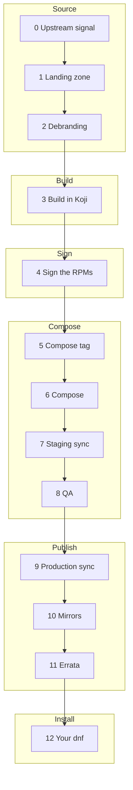
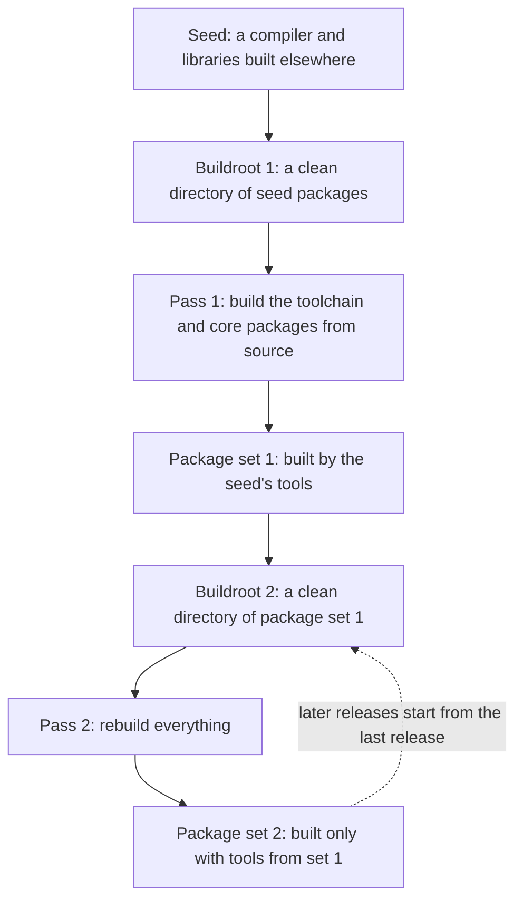

# 40 · How an OS gets built

<ul class="module-meta">
  <li>⏱ ~3 hours</li>
  <li>4 labs</li>
  <li>Builds on: 01 · How Linux Works, 05 · Software: RPM and DNF, 09 · Disks and Filesystems, 18 · Containers, 21 · Inside Rocky Linux</li>
  <li>Environment: Tier A</li>
  <li>Verified: Rocky 10.2, 2026-11-07</li>
</ul>

On a Rocky Linux 10 host and a RHEL 10 host, `rpm -q bash` prints the same string, `bash-5.2.26-6.el10.x86_64`. Compare the 124 file digests inside each package and Rocky matches RHEL on 123 of them: only `/usr/bin/bash`, the file you actually run, differs. The package payload digests differ as well. So the same version string did not mean the same package, and this series is about finding out what did.

<div class="pipeline-strip" data-here="none" role="group" aria-label="Rocky build pipeline, six stages" markdown>

1. Source
2. Build
3. Sign
4. Compose
5. Publish
6. Install

</div>

*You are here: the whole map. This module covers all six stages at low resolution (no single stage is lit). Before: nothing, this is the start. After: module 41 zooms in on the package.*

!!! abstract "What you'll learn"
    - Name the thirteen steps from a Red Hat source package to a Rocky package on your server, and group them into the six stages of the strip
    - Explain the bootstrap loop (a compiler needs a compiler) and what a seed buildroot is
    - Build a small Rocky-shaped OS tree in a directory with `dnf --installroot`, then inspect it with `rpm --root` and `chroot`
    - Say what a package's name, version, file digests and payload digest each promise, and which command shows each one
    - Run one public, read-only command for each stage of Rocky's pipeline
    - Start your dossier, `~/dossier/which.md`, and stamp command output into it with a helper script

## The big picture

An **operating system** (OS) in the Linux sense is a kernel plus a large pile of files: libraries, programs, configuration and a tool that installs and updates them. A **distribution** is the people and the pipeline that choose those files, build them from source, seal them, publish them and keep them updated. Rocky Linux is a **rebuild**: it compiles the same source code as Red Hat Enterprise Linux (RHEL), with Red Hat's branding removed.

That sounds like a single act, "build an OS". It is thirteen separate steps, run by different tools, leaving different evidence. Each step has a public trace you can query, except a few that the project has not published. This module draws the whole map once. Every later module zooms in on one part of it.

!!! note "The question that runs through the series"
    When two machines both say they are Rocky Linux 10.2, what exactly is the same between them, and how would you prove it?

    "Same name" is not "same version". "Same version" is not "same bits". "Same bits" is not "same source", and "same source" is not "trustworthy". Each module peels one layer. By module 52 you will have your own evidence for every layer.

### How an OS gets built in one sentence

> **An OS is a pile of files built from source by tools that were themselves built from source, so somebody has to start somewhere.**

Everything in this module hangs off that sentence. The first half explains the pile and the loop (the "start somewhere" part). The second half walks the pipeline that Rocky runs today.

!!! analogy "Think of it like a lathe that builds a lathe"
    You can make a better lathe with an old lathe, but the very first one had to come from somewhere else. A distribution has the same shape: its compiler is a program built by an earlier compiler. Where the analogy breaks: a lathe cannot borrow another workshop's finished parts, but a distribution can start from another distribution's finished binaries, and many do.

Here is the master map. It has thirteen hops, numbered from 0, grouped into the six stages of the strip at the top of every module. You will see the same picture, with the relevant part lit, at the top of every later module.



The diagram shows one path from top to bottom. Source arrives (hops 0 to 2), is built (3), sealed with a signature (4), assembled into a dated release tree and tested (5 to 8), published to the world (9 to 11), and finally pulled by your `dnf` (12). The stage boundaries are a teaching choice, not Rocky's: for example the staging sync (hop 7) is a publishing step that happens to sit before QA.

| Hop | Name | Plain meaning | A public way to look |
|-----|------|---------------|----------------------|
| 0 | Upstream signal | Red Hat publishes source | `git ls-remote` on the CentOS Stream repo |
| 1 | Landing zone | An unmodified copy lands in a public Rocky repo | `git ls-remote` on `staging/src-rhel/rpms/<pkg>` |
| 2 | Debranding | A small patch removes Red Hat branding and the result is committed | `git ls-remote` on `staging/rpms/<pkg>` |
| 3 | Build | Builders compile the source package in a clean buildroot | anonymous Koji XML-RPC |
| 4 | Sign | The finished RPM gets the release key's signature | `rpm -q --qf '%{RSAHEADER:pgpsig}\n' <pkg>` |
| 5 | Compose tag | Signed builds are tagged for the next compose | Koji `getTag` on the `-compose` tag |
| 6 | Compose | A dated tree, installers and images are assembled | `metadata/*.json` on `dl.rockylinux.org` |
| 7 | Staging sync | The compose is merged into a staging tree | `curl -s https://dl.rockylinux.org/stg/rocky/` |
| 8 | QA | Automated and manual tests gate promotion | the public openQA API |
| 9 | Production sync | The tested tree is copied to the public origin | `curl -sI` on a `repomd.xml` |
| 10 | Mirrors | Partner mirrors copy it and a mirrorlist points clients at them | `curl` on the mirrorlist URL |
| 11 | Errata | An advisory says what changed and why | the public Apollo API |
| 12 | Your dnf | Your repo files, key trust and update run | `/etc/yum.repos.d/rocky.repo` |

!!! note "Remember from module 21"
    [Module 21](21-inside-rocky-linux.md) drew this pipeline with eight boxes and gave you the four commands that read a package's fingerprints (`rpm -qi`, `rpm -K`, `dnf info --installed`, `dnf updateinfo`). Here you get the thirteen-hop version and, for each hop, a command that works from the outside. Nothing in module 21 changes. It zooms out.

### The few things that solve most problems

| Situation | What to do | Where this module teaches it |
|-----------|-----------|------------------------------|
| Two systems report the same version string | Compare digests, not versions: `rpm -q --qf '%{NVRA} %{PAYLOADDIGEST}\n' <pkg>` | The core skill |
| You need to know which package makes a file, or says "this is Rocky" | `rpm -qf <file>` | What an OS is made of |
| You want to see what an OS is made of without a VM | Build a tree with `dnf --installroot`, then `rpm --root` and `chroot` | The OS is a directory |
| A question is about "where did this come from" and you do not know where to look | Pick the stage on the map, then run its public command | The map, hop by hop |
| Someone states a fact about how Rocky started or signs | Ask whether the project published it; if not, say "not public" | The bootstrap loop |

To pick one, ask what you are comparing. If it is two things that claim to be the same, use digests. If it is one thing whose origin you want, use `rpm -qf` and walk the map. If you want to understand a layer, build it small.

### Words you'll see

| Word | Plain meaning |
|------|---------------|
| **kernel** | The core program that talks to hardware and runs everything else |
| **userland** | Everything above the kernel: shell, libraries, tools, services |
| **package** | A file that holds software plus a description of it (on Rocky, an **RPM**) |
| **SRPM** | A source package: the source code plus the **spec file** that says how to build it |
| **NVR / NVRA** | Name, version, release (and architecture): the label in a file name like `bash-5.2.26-6.el10.x86_64` |
| **repository** | A directory of packages plus metadata that `dnf` reads |
| **buildroot** | A clean, disposable directory holding only the packages a build is allowed to see |
| **compiler / toolchain** | The programs (compiler, assembler, linker, C library) that turn source into binaries |
| **bootstrap** | Getting a self-hosting system started when its tools need the system to exist |
| **seed** | The ready-made tools from outside the loop that a bootstrap starts from |
| **installroot** | A directory that `dnf --installroot` fills with packages as if it were a disk's root |
| **chroot** | A command that makes a directory look like `/` to the programs you run inside it |
| **compose** | A dated, self-describing release tree: packages, installers and images |
| **payload digest** | A checksum of the files inside a package, recorded in its signed header |
| **dossier** | Your own file, `~/dossier/which.md`, where you collect evidence about one package |

## The core skill: ask what a version string promises

The skill you need most in this series is to ask, for any two things that look the same, "same on which rung of the ladder?". A package has five rungs, and each one is a command.

1. **The name.** `rpm -q bash` gives the name, version and release.
2. **The files.** `rpm -q bash --qf '[%{FILEDIGESTS} %{FILENAMES}\n]' | sort` gives one checksum per file.
3. **The package.** `rpm -q --qf '%{NVRA} %{PAYLOADDIGEST}\n' bash` gives a checksum of the whole payload.
4. **The builder.** `rpm -q --qf '%{BUILDHOST}\n' bash` says where it was built.
5. **The seal.** `rpm -q --qf '%{RSAHEADER:pgpsig}\n' bash` says which key signed it and when.

Equal on a high rung does not make two things equal on a lower one. Here is the ladder on one real package.

```console
$ rpm -q --qf '%{NVRA}\n%{PAYLOADDIGEST}\n%{BUILDHOST}\n%{RSAHEADER:pgpsig}\n' bash
bash-5.2.26-6.el10.x86_64
3dc1a77e7da67bb7…987b2a
pb-0d1a2830-…-b-x86-64
RSA/SHA256, Wed 21 May 2025 01:19:52 PM UTC, Key ID 5b106c736fedfc85
```

Rocky 10.2 x86_64, 2026-11-07 (hashes and host name trimmed with an ellipsis). The build host is named like a Peridot pod, and the signature is dated months after the package was built. Both facts come back later in this module.

Three practice items. Decide before you open each answer.

**Practice A.** Two machines both print `Rocky Linux 10.2 (Red Quartz)` as `PRETTY_NAME`. On one, `rpm -q rocky-release` prints `rocky-release-10.2-1.1.el10.noarch`. On the other it prints `rocky-release-10.2-1.2.el10.noarch`. Are they the same distribution?

??? success "Answer A: same name, same os-release, different package builds"
    Both say 10.2, and the `os-release` file turned out byte-identical on two such machines (sha256 `2ac9f7b2…` on both, see the worked story below). But the release package is a different build: `1.1` against `1.2`. "10.2" names a point release, not a frozen set of package builds. A fresh install pulls newer builds than an older image does.

**Practice B.** On Rocky and on RHEL, 123 of the 124 file digests in `bash` match. The `/usr/bin/bash` digests are `a59fc4da…98fc` on Rocky and `a7178e58…0376` on RHEL. Can you call the two packages the same?

??? success "Answer B: no, the file you run is the one that differs"
    The version string and 123 of the 124 file digests agree, but the main binary does not, and the package payload digests differ too. Why they differ is a build question (modules 45 and 48 return to it). What you can say is "same source version, different bits in the one file that matters".

**Practice C.** For `glibc-2.39-145.el10_2`, all 36 file digests are identical between Rocky and RHEL, yet the payload digests differ. What is the safest statement?

??? success "Answer C: the files agree, the package does not, and the reason was not isolated"
    The safest statement is "every file content matches, but the package payloads are not byte-identical". The payload digest covers more than file contents, and nobody has published, or we have not isolated, which extra bytes differ. Do not say "identical package", and do not invent a cause. Rocky's `glibc` was built on 2026-10-19 and RHEL's on 2026-09-21, which may or may not matter.

<div class="quiz" data-answer="2" markdown>

Two hosts both print `bash-5.2.26-6.el10.x86_64` for `rpm -q bash`. Which statement is safe?

- The two `/usr/bin/bash` files are identical
- They were built from the same source version, and you still have to compare digests to know more
- They were built by the same builder

Right: the version string is a promise about the source, not about the bits. It does not say who built it, with what, or when. The digests do.

</div>

## What an OS is made of

Start with the pile. A running Rocky system is a stack of parts, each supplied by a package. You can name every layer by the package that provides it.

<div class="layers" data-open="0" data-hint="Click a layer to see what lives there and how to see it." markdown>

<div class="layer" data-label="Identity and configuration" data-tag="rocky-release" markdown>

**What it does:** says what this system is called and where its updates come from. The files are `/etc/os-release`, the repo definitions under `/etc/yum.repos.d/` and the release key.

```console
$ rpm -qf /etc/os-release /etc/yum.repos.d/rocky.repo /etc/pki/rpm-gpg/RPM-GPG-KEY-Rocky-10
rocky-release-10.2-1.1.el10.noarch
rocky-repos-10.2-1.1.el10.noarch
rocky-gpg-keys-10.2-1.1.el10.noarch
```

Three files, three small packages, built from one source package. Change those packages and you change what the system calls itself and where it trusts updates from.

</div>

<div class="layer" data-label="Shell and userland tools" data-tag="bash, coreutils" markdown>

**What it does:** the programs you type: the shell, `ls`, `cp`, `grep`. They are ordinary packages like any other.

```console
$ rpm -qf /bin/bash
bash-5.2.26-6.el10.x86_64
```

</div>

<div class="layer" data-label="Package manager" data-tag="rpm, dnf" markdown>

**What it does:** installs, verifies and updates packages. `rpm` works on files on disk. `dnf` resolves dependencies and talks to repositories. On Rocky 10.2 `dnf --version` prints 4.20.0.

</div>

<div class="layer" data-label="Init and services" data-tag="systemd" markdown>

**What it does:** the first program the kernel starts, which brings up everything else. A bare installroot tree does not have it (you check this in Lab 2).

</div>

<div class="layer" data-label="C library" data-tag="glibc" markdown>

**What it does:** the layer almost every program calls to talk to the kernel. A package built against a newer glibc will not run on an older one.

```console
$ rpm -qf /lib64/libc.so.6
glibc-2.39-121.el10_2.x86_64
```

This is the build in the stock container image of 2026-11-07. A fully updated host shows a newer build.

</div>

<div class="layer" data-label="Toolchain" data-tag="gcc, binutils" markdown>

**What it does:** the compiler, assembler and linker that turn source into binaries. A running server rarely needs them. A build system needs them first. This is the layer the bootstrap loop is about.

</div>

<div class="layer" data-label="Kernel" data-tag="kernel-core" markdown>

**What it does:** the engine. It is a package too (`kernel-core`), and a container or a chroot borrows the host's kernel rather than carrying its own.

</div>

</div>

The layers read from the top (what you touch) to the bottom (what everything else rests on). Every layer is a package, so every layer has a name, a version, a builder and a signature. The identity layer is the interesting one for this series: a handful of small packages decide that the same bits are called "Rocky Linux 10.2" and not something else.

Module 42 names every layer by role and proves which package supplies it. For now the point is that "the OS" is not one thing. It is a set of packages with a clear order of dependence.

## The OS is a directory

The fastest way to feel this is to build one. An **installroot** install tells `dnf` to put packages into a directory instead of onto your running system. When it finishes, the directory looks like the root of a Linux disk.

```console
$ time dnf -y --installroot=/var/tmp/lab-root --releasever=10 --setopt=install_weak_deps=False install bash coreutils rpm dnf rootfiles rocky-release
…
Complete!

real	0m37.387s
$ dnf --installroot=/var/tmp/lab-root clean all > /dev/null 2>&1
$ du -sh /var/tmp/lab-root
211M	/var/tmp/lab-root
$ rpm --root /var/tmp/lab-root -qa | wc -l
119
```

Rocky 10.2 x86_64 VM, 2026-11-06 (lab log). One command, about forty seconds, and 119 package entries (118 packages plus the imported release key as a pseudo-package) sit in a 211 MB directory. The `clean all` line matters for the size: without it, dnf leaves its download cache inside the tree and `du` printed 308 MB on a 2026-11-07 re-run of the same command. Lab 2 has you do this yourself.

<div class="stepper" markdown>

<div class="step" data-title="Resolve" markdown>

`dnf` reads the repo definitions, finds the six packages you named and works out everything they need. `--releasever=10` is required because the empty directory has no release package yet to answer "which release?".

</div>

<div class="step" data-title="Download and unpack" markdown>

It downloads the packages and unpacks their files into the directory, not into `/`. The files are laid out exactly as on a real disk: `usr/bin/bash`, `etc/os-release` and so on.

</div>

<div class="step" data-title="Run scriptlets" markdown>

Each package may carry small scripts that run after its files land. They run against the tree, so the tree ends up with the same bookkeeping a real install has.

</div>

<div class="step" data-title="Record in the database" markdown>

The packages are recorded in an RPM database inside the tree. That is why `rpm --root /var/tmp/lab-root -qa` can list them, and why `rpm --root … -V bash` can verify them later.

</div>

<div class="step" data-title="Look around" markdown>

`chroot /var/tmp/lab-root /bin/bash` makes the directory look like `/`. Inside, `cat /etc/os-release` says Rocky Linux 10.2 and `rpm -qa` lists the same packages.

</div>

</div>

Read the stepper as a sequence: resolve, download and unpack, run scriptlets, record the database, then look around. Nothing in it needs a disk, a boot loader or a kernel of its own.

!!! analogy "Think of it like furniture without a house"
    The tree holds all the furniture, arranged correctly. When you `chroot` into it you walk into the room, but the foundation under it is still the host's kernel. Where the analogy breaks: unlike furniture, the tree really does run programs. It just cannot start by itself.

Look at what the tree does not have. There is no kernel, no init system and no compiler in it, and `/dev` is nearly empty. It is **bootable-shaped**: it has the right outline, but nothing here can start it from a power button. Adding `kernel-core` and `dracut` gives it a kernel and an initramfs, which is closer.

<!-- ev: labs/final 02-packages d.log; FACTBASE-B O31 | observed | Rocky 10.2 x86_64 VM, 2026-11-06 -->
!!! evidence "Observed: kernel scriptlets build an initramfs inside a directory"
    **Seen on:** Rocky 10.2 x86_64 VM, 2026-11-06.

    ```console
    $ dnf -y --installroot=/var/tmp/lab-root --releasever=10 --setopt=install_weak_deps=False install kernel-core dracut
    …
    $ ls -lh /var/tmp/lab-root/boot/initramfs-*.img
    -rw-------. 1 root root 27M … /var/tmp/lab-root/boot/initramfs-6.12.0-211.74.1.el10_2.x86_64.img
    ```

    **Check it yourself:** run the same install on your tree after Lab 2. The initramfs appears under `boot/`, generated by the kernel package's own scripts, with mode `0600`. Do this only if you have 400 MB to spare: the tree roughly doubles in size.

??? question "Going further: the same tree as a container image"
    A container image is a tree plus a little metadata. You can prove it by importing the tree you just built.

    ```console
    $ tar --numeric-owner --xattrs -C /var/tmp/lab-root -cf /var/tmp/lab-root.tar .
    $ gzip -k -1 /var/tmp/lab-root.tar
    $ podman import --change 'CMD ["/bin/bash"]' --message "installroot lab" /var/tmp/lab-root.tar.gz localhost/rocky-lab-base:10
    $ podman images localhost/rocky-lab-base
    REPOSITORY                TAG         IMAGE ID      CREATED         SIZE
    localhost/rocky-lab-base  10          dd0ac1768e19  24 seconds ago  468 MB
    ```

    Rocky 10.2 x86_64 VM, 2026-11-06, with `kernel-core` and `dracut` already in the tree (so it is larger than an official image). On the same host the official `rockylinux/rockylinux:10` image was 244 MB and `:10-minimal` was 132 MB. The container image is the OS minus its own kernel, which module 44 covers.

<div class="quiz" data-answer="3" markdown>

After `dnf --installroot=/var/tmp/lab-root ... install bash coreutils rpm dnf rootfiles rocky-release`, `chroot` into the tree prints `Rocky Linux 10.2` and the host's architecture. Is the tree a bootable operating system?

- Yes, it has bash and a release package
- Yes, but only on the same architecture
- No: it has no kernel or init of its own, so it borrows the host kernel inside a chroot

Right: the tree is the user-space half of an OS. A kernel, an initramfs and a boot loader are still missing.

</div>

## Four artifacts every distribution makes

Whatever the distribution, the build produces the same four kinds of thing. You will meet each one properly in laps 2 to 4.

| Artifact | What it is | A Rocky example you can name | Module |
|----------|-----------|------------------------------|--------|
| Package | A signed file holding software and a description | `which-2.21-44.el10_0.x86_64.rpm` | [41](41-anatomy-of-a-package.md) |
| Repository | Packages plus metadata that `dnf` reads | BaseOS, AppStream and CRB under `dl.rockylinux.org/pub/rocky/10/` | [42](42-what-is-inside-an-os.md) |
| Installer media | A boot loader plus an installer that fetches the rest | `Rocky-10.2-x86_64-boot.iso` | [43](43-installer-and-install-media.md) |
| Image | An installed system frozen in one shape | the GenericCloud qcow2, `quay.io/rockylinux/rockylinux:10` | [44](44-images-cloud-container-bootc.md) |

The first two travel the whole pipeline. The last two are made at the compose step from the packages the first two hold. A reader who skips the rest of this section still has the key point: all four are made from the same signed packages.

## The bootstrap loop

Now the "start somewhere" half of the mental model. To build a package you need a **buildroot** that already holds a compiler and a C library. To build that compiler and that library, you need a compiler and a C library. The loop is real: every distribution has to break it once, then keep the broken loop going by always building from the last release's tools.



The diagram shows the seed entering the loop once, at the top. After pass 1, the seed's own binaries are no longer needed to build the next package set, because package set 1 can serve as the buildroot for pass 2. After that, each release is built from the previous one. The dotted arrow is the loop that never closes: it is the same loop, run again for every release.

Two details make this real for Rocky.

**Rocky's problem is easier than most.** It is a rebuild: the sources and the target answer already exist, so the job is to reproduce a known result. A new distribution has to design its dependency order from scratch. Even so, the first Rocky 8 release candidate slipped from 2021-03-31 to 2021-04-30 "due to complications in the build efforts", according to the project's March 2021 community update ([community-update-march-2021](https://rockylinux.org/news/community-update-march-2021)).

**A bootstrap build can mark itself so the real build supersedes it.** Rocky's `%dist` macro can append `~bootstrap`, and in RPM version comparison a tilde sorts below everything else.

<!-- ev: FACTBASE-B O13; labs/final 02-packages and a container re-run | observed | Rocky 10.2 x86_64 VM, 2026-11-07 -->
!!! evidence "Observed: a bootstrap-marked release sorts below the real one"
    **Seen on:** Rocky 10.2 x86_64 VM, 2026-11-07.

    ```console
    $ rpm -E '%{dist}'
    .el10
    $ rpm --define 'with_bootstrap 1' -E '%{dist}'
    .el10~bootstrap
    $ python3 -c "import rpm; print(rpm.labelCompare(('0','44','el10~bootstrap'), ('0','44','el10')))"
    -1
    ```

    **Check it yourself:** run the three commands on any Rocky 10 system. The result `-1` means the first version is older, so a `~bootstrap` package is always replaced by the real rebuild. The macro comes from the `rocky-release` package (`cat /usr/lib/rpm/macros.d/macros.dist`).

Rocky's own tools show the seed idea in practice. The `mock` tool, which builds one package in a clean buildroot, can build that buildroot's first layer from a container image. The Rocky 10 mock template names `quay.io/rockylinux/rockylinux:10` as its `bootstrap_image`.

<!-- ev: FACTBASE-A O21; reviewer A re-run | observed | Rocky 10.2 x86_64 VM, mock 6.9, mock-core-configs 45.2, 2026-11-07 -->
!!! evidence "Observed: mock seeds a buildroot from a Rocky container image"
    **Seen on:** Rocky 10.2 x86_64 VM, mock 6.9 and mock-core-configs 45.2 (both from EPEL), 2026-11-07.

    ```console
    $ grep -E "bootstrap_image|chroot_setup_cmd" /etc/mock/templates/rocky-10.tpl
    config_opts['chroot_setup_cmd'] = 'install bash bzip2 coreutils cpio diffutils findutils gawk glibc-minimal-langpack grep gzip info patch redhat-rpm-config rocky-release rpm-build sed tar unzip util-linux which xz'
    config_opts['bootstrap_image'] = 'quay.io/rockylinux/rockylinux:10'
    ```

    **Check it yourself:** install `mock-core-configs` from EPEL and run the `grep` above. You see the list of packages every buildroot starts with and a `bootstrap_image` line naming the Rocky container image. This shows how a developer's build starts, not how Rocky's own first buildroot was seeded.

The same seed idea applies to a build system. A fresh Koji has no packages at all. In the single-host Koji lab ([module 50](50-build-your-own-koji.md)) the only inputs are published repositories attached to the build tag, and the first build works with zero locally built packages. That is how a downstream can begin, and it is the practical version of "start from someone else's finished binaries".

### Where Rocky's own first buildroot came from

Here the public record is partial, and the right habit is to say exactly how partial. Three facts are public.

<!-- ev: COLD-OPEN-VERIFICATION item 4 | observed | public Koji hub and pungi-rocky history, 2026-11-07 -->
!!! evidence "Observed: the Rocky 10 tag on the public hub holds imported builds"
    **Seen on:** the anonymous public Koji hub, 2026-11-07.

    ```console
    $ python3 -c "import xmlrpc.client as x; s=x.ServerProxy('https://koji.rockylinux.org/kojihub',allow_none=True); b=s.listTagged('dist-rocky10',None,False,None,False); print(len(b), {i['task_id'] for i in b}, min(i['creation_time'] for i in b), max(i['creation_time'] for i in b))"
    8110 {None} 2025-05-13 03:41:17.197634+00:00 2025-05-18 23:46:23.322131+00:00
    ```

    **Check it yourself:** run the command above. Every build in the tag has an empty task id (no build task ran on this hub for it) and was created in a five-day window, so the hub imported them rather than compiling them. An empty task id is exactly what an import looks like.

<!-- ev: COLD-OPEN-VERIFICATION item 4 | official | git.resf.org pungi-rocky commit, rockylinux.org news, 2026-11-07 -->
!!! freshness "As of 2026-11-07 on Rocky 10.2"
    A 2023 commit in the `pungi-rocky` configuration repository already points Rocky 10 composes at a Koji tag named `r10-bootstrap`. That tag does not exist on the public hub today. The count of imported builds in `dist-rocky10` can change if builds are tagged there later; the 2025-05 creation dates are history.

    **Re-check:** `python3 -c "import xmlrpc.client as x; s=x.ServerProxy('https://koji.rockylinux.org/kojihub'); print([t['name'] for t in s.listTags() if t['name']=='r10-bootstrap'])"`

| Architecture | What is public | Source |
|--------------|---------------|--------|
| riscv64 | "The compiler stack was bootstrapped from Fedora RISC-V", with backports to EL10 | the project's [riscv64 support post](https://rockylinux.org/news/rockylinux-support-for-riscv) |
| x86_64 and aarch64 | I found no public description of how the first buildroot got its first compiler | searched news, docs, forum, issue trackers and history on 2026-11-07 |

!!! unknown "What nobody outside the project can tell you"
    - How the first x86_64 and aarch64 Rocky 10 buildroot got its first compiler. I found no public description. The public record shows imported builds in `dist-rocky10` (created 2025-05-13 to 2025-05-18) and the `r10-bootstrap` tag name in a 2023 commit, but not the seed. Not public.
    - How Rocky signs packages inside the build system. The public record shows the result (signature times, key id) and not the mechanism. Not public.
    - How Rocky obtains Red Hat's source packages for its stable and beta branches today. The public record shows where they land (the landing-zone repository), not the route they take to get there. Not public.

??? question "How the rest of the world breaks the loop (three short stories)"
    **Linux From Scratch (LFS)** is the teaching version. You start from a host system's compiler, build a cross toolchain into a separate directory, build the C library with it, enter a **chroot** where the old host no longer interferes, and rebuild the final toolchain and system inside. A **Gentoo stage** tarball is the same idea as your installroot tree: "a tarball of a root filesystem".

    **GCC's three-stage bootstrap** is a fixed-point test. Stage 1 uses the host compiler to build GCC. Stage 2 rebuilds GCC with stage 1. Stage 3 rebuilds it again with stage 2, and the build compares the stage 2 and stage 3 results. A mismatch means the stage 2 compiler miscompiled something. Note the word clash: Gentoo "stages" are tarballs, GCC "stages" are rebuild passes.

    **Debian's new-port playbook and Guix** are the two extremes. A Debian port builds a cross toolchain, imports a handful of packages by hand, assembles a self-hosting chroot and then rebuilds everything natively (the loong64 port hand-imported 112 packages and then built 300 more overnight, per Debian's own notes). Guix goes the other way: its full-source bootstrap (announced 2023-04-26) starts from a 357-byte program and builds up to a modern compiler. Rocky does neither. Our reading is that it trusts a binary lineage (earlier packages and toolchain) and does not try to shrink the seed.

??? question "Trusting trust, in three short paragraphs"
    In his famous argument, Ken Thompson showed that a compromised compiler binary can insert a backdoor into the programs it builds, and into the next version of the compiler, while the source code stays clean. Karger and Schell had described the idea earlier, in 1974. If you only audit source, you miss it.

    David Wheeler's countermeasure is **diverse double-compiling**: build the compiler's source with an independent trusted compiler, use that result to build the same source again, and compare the output bit for bit with the compiler binary you wanted to check. A match proves the binary corresponds to the source. It does not prove the source is harmless.

    For a rebuild like Rocky the lesson is narrow and practical: every package's trust rests on a chain of earlier toolchains, and nobody can show that chain without publishing it. Module 48 returns to what reproducibility does and does not prove.

<div class="quiz" data-answer="2" markdown>

Why can a new distribution not compile everything from source in any order?

- Source code licences forbid it
- Each build needs a working compiler and C library first, and those need building too, so the first set must come from a seed
- Compilers are too slow to run more than once

Right: that is the bootstrap loop. The seed enters once, then each package set is built with the tools of the last.

</div>

## The map, hop by hop

Now walk the real pipeline. Each step below names the hops it covers, shows what each does in plain words, and gives one command you can run from outside. The outputs were captured on 2026-11-07 on Rocky 10.2 x86_64: a container with network access for the public services, and a VM for the package header in the Sign step. Lab 4 has you run the network ones.

<div class="stepper" markdown>

<div class="step" data-title="Source" markdown>

**Hops 0 to 2.** Red Hat publishes its source. Rocky copies it unmodified into a public landing-zone repo. A small importer applies a debranding patch written as a short YAML file and commits the result to the repository that Koji builds from.

```console
$ git ls-remote --heads https://gitlab.com/redhat/centos-stream/rpms/bash.git | awk '{print $2}' | sed 's#refs/heads/##' | tr '\n' ' '
c10s c11s c8s c9s test
$ git ls-remote --heads https://git.rockylinux.org/staging/src-rhel/rpms/kernel.git | awk '{print $2}' | sed 's#refs/heads/##' | tr '\n' ' '
c10 c10-beta c10s c8 c8-beta c8-init-modify c8s c9 c9-beta c9s
$ git ls-remote --heads https://git.rockylinux.org/staging/rpms/which.git | awk '{print $2}' | sed 's#refs/heads/##' | tr '\n' ' '
r10 r10s r8 r8-beta r8s r9 r9-beta
```

The first is upstream (hop 0), the second is the unmodified landing zone (hop 1), the third is the debranded repo (hop 2), whose `r10` branch is what Koji builds for Rocky 10. A branch list is a diary of where a package arrived. How Rocky obtains Red Hat's source packages is not public. Module 45 covers this stage.

</div>

<div class="step" data-title="Build" markdown>

**Hop 3.** A build system called **Koji** accepts the repository commit, hands it to a builder, and the builder compiles it in a clean buildroot with `mock`. The public Koji hub answers anonymous queries.

```python
import xmlrpc.client as x
s = x.ServerProxy('https://koji.rockylinux.org/kojihub', allow_none=True)
print(s.getTag('dist-rocky10.2-compose')['arches'])
print([p['name'] for p in s.getInheritanceData('dist-rocky10.2')])
b = s.getBuild('which-2.21-44.el10_0')
print(b['nvr'], b['task_id'])
```

```console
x86_64 aarch64 ppc64le s390x riscv64
['dist-rocky10.1']
which-2.21-44.el10_0 481353
```

Koji organises builds into **tags** that can inherit from one another, so the 10.2 tag sees everything tagged in the 10.1 tag. A normal build has a task id. Builds with an empty task id were imported rather than compiled here, as you saw in the bootstrap section. Module 45 and module 50 cover this stage.

</div>

<div class="step" data-title="Sign" markdown>

**Hop 4.** The finished RPM is sealed with the Rocky 10 release key. The signature is a separate event, hours or months after the build.

```console
$ rpm -q --qf '%{NAME} %{BUILDTIME:date} sig=%{RSAHEADER:pgpsig}\n' bash
bash Thu 31 Oct 2024 05:16:11 AM UTC sig=RSA/SHA256, Wed 21 May 2025 01:19:52 PM UTC, Key ID 5b106c736fedfc85
```

This `bash` was built in October 2024 and signed on 2025-05-21, about three weeks before the Rocky 10.0 release on 2025-06-11. How the signing is done inside the build system is not public: the public record shows the result, not the mechanism. Module 47 covers this stage.

</div>

<div class="step" data-title="Compose" markdown>

**Hops 5 to 8.** Signed builds are tagged for the next compose. A compose tool assembles them into a dated release tree, with installer images and cloud images next to it. The tree is merged into a staging area and tested before promotion.

```console
$ curl -s https://dl.rockylinux.org/pub/rocky/10/metadata/images.json | python3 -c "import json,sys; d=json.load(sys.stdin)['payload']['compose']; print(d['id'], d['type'])"
Rocky-10.2-20260525.0 production
```

The compose id is a dated name: product, version, date, respin. The `metadata/` directory is shared: on 2026-11-07 `composeinfo.json` there named the September security compose (`Security-10.2-20260929.0`) while `images.json` still named the release compose. Why the directory is shared that way is not documented. Rocky's compose tool is Pungi, as of 2026-11, and its release engineers have an open issue to replace it. The idea (a compose is a dated shelf of builds) is stable; the tool name is what may change. Module 46 covers this stage.

<!-- ev: FACTBASE-A hop 6; releng issue 49 | official | rocky-linux releng issue tracker, 2026-11-07 -->
!!! freshness "As of 2026-11-07 on Rocky 10.2"
    Rocky composes with Pungi against Koji tags. A public issue titled "Switch from pungi to something that scales linearly for composes" is open. This changes at the next tooling decision.

    **Re-check:** `gh api repos/rocky-linux/releng/issues/49 --jq '.title, .state'`

</div>

<div class="step" data-title="Publish" markdown>

**Hops 9 to 11.** The tested tree is copied to the public origin. Mirrors copy it on their own schedule, and a mirrorlist service hands clients the nearest ones. A public advisory records what changed.

```console
$ curl -sI https://dl.rockylinux.org/pub/rocky/10/BaseOS/x86_64/os/repodata/repomd.xml | grep -iE '^(HTTP|last-modified)'
HTTP/2 200
last-modified: Fri, 06 Nov 2026 08:03:08 GMT
$ curl -s 'https://mirrors.rockylinux.org/mirrorlist?arch=x86_64&repo=BaseOS-10' | head -1
# repo = rocky-BaseOS-10.2 arch = x86_64 country = US country = CA country = PR
$ curl -s 'https://apollo.build.resf.org/v2/advisories?limit=1' | python3 -c "import json,sys; a=json.load(sys.stdin)['advisories'][0]; print(a['name'], a['source']['name'])"
RLSA-2023:4330 RHSA-2023:4330
```

The `repomd.xml` timestamp is the moment the origin last changed. The mirrorlist's country list depends on where you ask from. The advisory shows a Rocky id carrying the same number as the Red Hat advisory it mirrors. Module 46 covers this stage.

</div>

<div class="step" data-title="Install" markdown>

**Hop 12.** Your `dnf` reads the repo definitions that `rocky-repos` installed, checks each package's signature against keys you chose to trust, and installs.

```console
$ grep -c '^gpgcheck=1' /etc/yum.repos.d/rocky.repo; grep -c repo_gpgcheck /etc/yum.repos.d/rocky.repo
9
0
```

Package signatures are checked (nine repositories set `gpgcheck=1`) but the signature on the repository metadata is not requested (`repo_gpgcheck` is not set anywhere in the file). Module 47 explains what each check covers. Modules 43 and 44 cover what is installed from media and images.

</div>

</div>

Read the stepper as one story: source is copied and debranded, built, signed, composed and tested, published and mirrored, then installed. Every step left a trace you queried yourself. Three things you cannot query are marked "not public": how Rocky obtains Red Hat's source, how signing works inside the build system, and how the first buildroot was seeded.

### Which stage do I look at?

<div class="decision" markdown>

<div class="node" data-id="start" markdown>

**What do you want to find out?**

<button data-goto="source">Where a package's source came from</button> <button data-goto="build">Who built it, where and with what</button> <button data-goto="sign">Whether it was sealed and by what</button> <button data-goto="compose">Which release or tree it shipped in</button> <button data-goto="publish">Why it is not on my mirror, or which advisory covers it</button> <button data-goto="install">Why my dnf behaves this way</button>

</div>

<div class="node" data-id="source" markdown>

**Stage 1, Source (hops 0 to 2).** Start with `git ls-remote --heads` on the landing-zone repo for the package name. The branch names tell you where it arrived. Module 45.

</div>

<div class="node" data-id="build" markdown>

**Stage 2, Build (hop 3).** Start with `rpm -q --qf '%{BUILDHOST} %{PACKAGER}\n' <pkg>` on the installed package, then ask the public Koji hub. Module 45, and module 50 for your own.

</div>

<div class="node" data-id="sign" markdown>

**Stage 3, Sign (hop 4).** Start with `rpm -q --qf '%{RSAHEADER:pgpsig}\n' <pkg>` and `rpm -Kv <file>`. Module 47.

</div>

<div class="node" data-id="compose" markdown>

**Stage 4, Compose (hops 5 to 8).** Start with the `metadata/*.json` files on `dl.rockylinux.org` and the compose id inside. Module 46.

</div>

<div class="node" data-id="publish" markdown>

**Stage 5, Publish (hops 9 to 11).** Start with `curl -sI` on the repository's `repomd.xml`, then the mirrorlist and the Apollo advisory API. Module 46.

</div>

<div class="node" data-id="install" markdown>

**Stage 6, Install (hop 12).** Start with `/etc/yum.repos.d/rocky.repo`, then `dnf info --installed <pkg>`. Modules 43 and 44 for media and images.

</div>

</div>

## What Rocky adds: it is a rebuild

Rocky does not write most of what it ships. It takes Red Hat's source, applies a debranding patch and builds it. That makes the through-line question sharper: the sources start the same, so any difference between a Rocky package and its Red Hat twin comes from the build, the branding patch or the toolchain, not from different code.

You can see Rocky's own small changes in the release field of a package. A release such as `.el10_2` is a straight rebuild. A release ending `.rocky.0.N` marks a package whose source Rocky changed.

<!-- ev: FACTBASE-A O9; COLD-OPEN-VERIFICATION E2e | observed | Rocky 10.2 x86_64 VM, 2026-11-07 -->
!!! evidence "Observed: a stock install has few packages with Rocky's own patch marker"
    **Seen on:** Rocky 10.2 x86_64, 2026-11-07.

    ```console
    $ rpm -qa --qf '%{SOURCERPM}\n' | grep '\.rocky\.0' | sed -E 's/-[^-]+-[^-]+\.src\.rpm//' | sort -u | tr '\n' ' '
    cockpit dnf efi-rpm-macros elfutils grub2 ima-evm-utils libdnf openssh redhat-rpm-config systemd
    ```

    **Check it yourself:** run the command on a fresh Rocky 10 install. You see about ten source package names (the stock cloud image showed 10, and a VM with extra tools installed showed 12). Some packages, such as the kernel, are patched without carrying the marker, so the list is a lower bound.

Rocky's own build history is also part of the story, and it is easy to state wrongly. Early Rocky 10 content was built in a build system called Peridot. In the current tree the newest Peridot-built RPM and the oldest Koji-built one are both dated 2025-05-16, and later builds come from Koji or the isolated Secure Boot build environment. Both facts are visible in package headers today.

<!-- ev: FACTBASE-A hop 3, ERRATA E1, E9 | observed | x86_64 primary.xml of BaseOS and AppStream, 2026-11-07 -->
!!! freshness "As of 2026-11-07 on Rocky 10.2"
    In the x86_64 plus noarch RPM files of the current tree, 276 of 3,194 BaseOS files (8.6%) and 2,741 of 7,672 AppStream files (35.7%) name a Peridot pod as their build host. They were built between 2024-02-24 and 2025-05-16. The two shares are over different denominators and are never added together. Both fall as old packages get rebuilt; they only fall.

    **Re-check:** `rpm -q --qf '%{BUILDHOST}\n' bash` (a `pb-` host name means a Peridot pod; the repository-wide census reads `<rpm:buildhost>` from each repo's `primary.xml`).

The Rocky 10.0 announcement said the builds "will not come from our Peridot build system, but instead from Koji". The installed `bash-5.2.26-6.el10` was built on a Peridot pod. Both statements are partly true, and the dates are what reconcile them.

## Worked story: two machines that both say Rocky 10.2

**Symptom.** You have a freshly built tree from Lab 2 and the container you are running in. Both print `Rocky Linux 10.2 (Red Quartz)`. A colleague says "so they are the same". You want to know exactly how far that goes.

**Evidence.** Compare the layers from the top. The `os-release` file first, then the release package, then two ordinary packages.

```console
$ sha256sum /usr/lib/os-release /var/tmp/lab-root/usr/lib/os-release
2ac9f7b21412a20a…  /usr/lib/os-release
2ac9f7b21412a20a…  /var/tmp/lab-root/usr/lib/os-release
$ rpm -q --qf 'host  %{NVRA}  %{PAYLOADDIGEST}\n' rocky-release bash glibc
host  rocky-release-10.2-1.1.el10.noarch  f2c065f5c11aeb0b…
host  bash-5.2.26-6.el10.x86_64  3dc1a77e7da67bb7…
host  glibc-2.39-121.el10_2.x86_64  75598e7141555d0f…
$ rpm --root /var/tmp/lab-root -q --qf 'tree  %{NVRA}  %{PAYLOADDIGEST}\n' rocky-release bash glibc
tree  rocky-release-10.2-1.2.el10.noarch  3e9cbc389460cd3f…
tree  bash-5.2.26-6.el10.x86_64  3dc1a77e7da67bb7…
tree  glibc-2.39-145.el10_2.x86_64  45b59e222719e8c7…
```

Rocky 10.2 x86_64 container (the host side) and a tree installed from the public repositories the same day, 2026-11-07.

**Reasoning.** The `os-release` files are byte-identical, so by the strictest test of "what the system calls itself" the two machines agree. `bash` is the same build on both (same NVRA, same payload digest). But `rocky-release` is `1.1` on one and `1.2` on the other, and `glibc` is a different build. The reason is simple: the container image was built at one moment and the tree was installed from the repositories at another. "10.2" labels the point release, and updates keep landing inside it.

**Fix.** Do not compare the label. Compare the package set. Counting by name, version and release shows how far apart the two machines are.

```console
$ echo "same: $(comm -12 /tmp/host.txt /tmp/tree.txt | wc -l)  host only: $(comm -23 /tmp/host.txt /tmp/tree.txt | wc -l)  tree only: $(comm -13 /tmp/host.txt /tmp/tree.txt | wc -l)"
same: 68  host only: 71  tree only: 51
```

Your numbers will differ: they depend on how old your container image is and which packages each side holds. In this run (2026-11-07) the host side had 139 packages (Lab 1 had added `which`) and the tree 119. The tree has packages the image lacks, and the reverse.

**Check.** Pick any package present on both sides with the same NVRA and compare `%{PAYLOADDIGEST}`. Equal NVRA and equal digest, as with `bash`, means same bytes. Equal NVRA and different digest would be a surprise, and the surprise is the interesting part of modules 41, 45 and 48.

<!-- ev: COLD-OPEN-VERIFICATION item 1; labs/final 02-packages and a container re-run | observed | x86_64 hosts V5 capture, 2026-11-06 -->
??? version "Comparison lens: AlmaLinux and CentOS Stream"
    Take the same package on four distributions, each at the patch level of the host that was checked on 2026-11-06 (the hosts were not all fully updated, so treat this as a snapshot).

    | Compared with RHEL | Files with a digest identical to RHEL's | Files that differ | Payload digest |
    |---|---|---|---|
    | Rocky | 123 of 124 | `/usr/bin/bash` | differs |
    | AlmaLinux | 122 of 124 | `/usr/bin/bash` and `/usr/bin/bashbug-64` | differs |
    | CentOS Stream | 124 of 124 | none | equal |

    On all four, `rpm -q bash` prints `bash-5.2.26-6.el10.x86_64`. For `which`, Rocky and AlmaLinux ship `which-2.21-44.el10_0` and Stream ships `which-2.21-44.el10`, and the three `/usr/bin/which` files are all different. **Check it yourself:** run the `rpm -q bash --qf '[%{FILEDIGESTS} %{FILENAMES}\n]' | sort` command on each system and compare the output files.

<div class="quiz" data-answer="1" markdown>

A package was built in October 2024 but its signature is dated May 2025. What does this show?

- Signing is a separate step after the build, and here the signature came months later, ahead of the 10.0 release
- The signature is forged
- The package was rebuilt in May 2025

Right: the build time and the signing time are two different events, and each is recorded in the package header. They are rarely equal.

</div>

## Practice terminal

These commands run against a Rocky 10.2 system that has `which` installed and the tree from Lab 2 at `/var/tmp/lab-root`. The simulator accepts any equivalent spelling.

<div class="terminal-sim" data-title="Read the identity and the tree" markdown>

<div class="task" data-expect="rpm -qf /usr/bin/which||rpm -qf $(command -v which)||rpm -qf `which which`" data-hint="Ask rpm which package owns the file /usr/bin/which." markdown>

**Step 1.** Which package owns `/usr/bin/which`?

```text
which-2.21-44.el10_0.x86_64
```

</div>

<div class="task" data-expect="rpm -qf /etc/os-release||rpm -qf /usr/lib/os-release" data-hint="The same -qf query, on the file that says what this system is." markdown>

**Step 2.** Which package owns the file that names the distribution?

```text
rocky-release-10.2-1.1.el10.noarch
```

</div>

<div class="task" data-expect="grep ^ID= /etc/os-release||grep &quot;^ID=&quot; /etc/os-release||grep '^ID=' /etc/os-release" data-hint="Use grep to print the line that starts with ID= in /etc/os-release." markdown>

**Step 3.** Print the `ID` line from `/etc/os-release`.

```text
ID="rocky"
```

</div>

<div class="task" data-expect="rpm --root /var/tmp/lab-root -qa | wc -l||rpm -qa --root /var/tmp/lab-root | wc -l" data-match="^rpm (--root /var/tmp/lab-root -qa|-qa --root /var/tmp/lab-root) \| wc -l$" data-hint="Point rpm at the tree with --root, list everything with -qa, then count lines." markdown>

**Step 4.** Count the packages in your tree.

```text
119
```

</div>

<div class="task" data-expect="rpm --root /var/tmp/lab-root -q which||rpm -q which --root /var/tmp/lab-root" data-match="^rpm (--root /var/tmp/lab-root -q which|-q which --root /var/tmp/lab-root|-q --root /var/tmp/lab-root which)$" data-hint="Query the tree for the package which, with --root." markdown>

**Step 5.** Is `which` in your tree?

```text
package which is not installed
```

</div>

</div>

## Labs

!!! tip "Lab kit"
    The installroot lab is scripted in kit 02 (`d-installroot.sh`). Browse the files on the [lab kits](lab-kits.md) page.

Labs 1 to 3 build on one another and share the directory `/var/tmp/lab-root`. Lab 4 only needs network access. Use a Rocky 10 container (started with `--privileged` for Labs 2 and 3, because they use `chroot`) or any Rocky 10 VM. You need to be root: in a container you already are, and on a VM run `sudo -i` first.

!!! lab "Lab 1: Start your dossier"

    - **Tier** A: Rocky shell
    - **Status** Tested
    - **Time** about 5 minutes
    - **Hardware** 1 vCPU, 2 GiB RAM, 1 GiB disk
    - **Tested on** Rocky 10.2 x86_64 container (podman, emulated on an Apple silicon host), 2026-11-07

    **Goal:** Create `~/dossier/which.md` and a helper script, `stamp`, that appends a command and its output to it with a time.

    **You'll need:** a Rocky 10 shell. If you use a throwaway container, mount a host directory at `/root/dossier` when you start it (for example `-v $HOME/dossier:/root/dossier:Z`) so the file survives after the container stops.

    1. Make sure `which` is installed. The stock container image does not ship it, and the dossier is about this package.

        ```bash
        dnf -y install which
        ```

    2. Create the helper script. It takes two arguments, a heading and a command, runs the command, shows the output and appends everything to the dossier.

        ```bash
        mkdir -p ~/dossier
        cat > ~/dossier/stamp <<'EOF'
        #!/bin/bash
        # stamp 'heading' 'command'
        # Run the command, show its output, and append heading, command, time and output to which.md
        set -u
        file="${DOSSIER:-$HOME/dossier}/which.md"
        if [ $# -ne 2 ]; then
            echo "usage: stamp 'heading' 'command'" >&2
            exit 2
        fi
        heading=$1
        cmd=$2
        {
            printf '\n### %s\n\n' "$heading"
            printf 'Command: `%s`\n\n' "$cmd"
            printf 'Captured: %s\n\n' "$(date -u '+%Y-%m-%d %H:%M UTC')"
            printf '```text\n'
            bash -c "$cmd" 2>&1
            printf '```\n'
        } | tee -a "$file"
        EOF
        chmod +x ~/dossier/stamp
        ```

    3. Create the dossier file and stamp the first block into it.

        ```bash
        [ -f ~/dossier/which.md ] || printf '# Dossier: which\n\nStarted: %s\n' "$(date -u +%Y-%m-%d)" > ~/dossier/which.md
        ~/dossier/stamp 'Start: the machine' 'grep -E "^(PRETTY_NAME|VERSION_ID)=" /etc/os-release; uname -m'
        ```

    4. Check that the helper refuses bad input.

        ```bash
        ~/dossier/stamp oops; echo "exit code $?"
        ```

    **Check your work:** run `cat ~/dossier/which.md`. You expect a title line, a `Started:` date and one block headed `Start: the machine` that contains your `VERSION_ID="10.2"` line and your architecture. Step 4 should print the usage line and `exit code 2`. If the block is missing, `stamp` ran with the wrong arguments or `$HOME` is not what you expect.

    ??? success "What just happened?"
        `stamp` runs your command in a subshell with `bash -c`, so pipes and quotes work, and wraps the output in a Markdown block. The pipe through `tee -a` shows the block on screen and appends it to the file at once. Because the file is plain Markdown, it renders anywhere and diffs cleanly. Every later module adds one section with the same helper.

    **Clean up:** keep the dossier, since every later module adds to it. To start over, run `rm -rf ~/dossier`.

!!! lab "Lab 2: Build a bootable-shaped OS tree in a minute"

    - **Tier** A: Rocky shell with root
    - **Status** Tested
    - **Time** about 5 minutes (install measured at 37 s on an x86_64 VM and 2m28s in an emulated x86_64 container)
    - **Hardware** 2 vCPU, 4 GiB RAM, 2 GiB free disk
    - **Tested on** Rocky 10.2 x86_64 VM, 2026-11-06 (lab log) and 2026-11-07 (re-run); Rocky 10.2 x86_64 privileged container (podman, emulated), 2026-11-07

    **Goal:** Install a small Rocky 10 into a directory, list and verify it with `rpm --root`, and look around inside it with `chroot`.

    **You'll need:** a Rocky 10 shell with root, network access to the Rocky repositories, and about 2 GiB free under `/var/tmp`.

    1. Install the tree. Do not pipe this command into `head` or `tail`: closing the pipe early can leave a half-built tree.

        ```bash
        R=/var/tmp/lab-root
        time dnf -y --installroot=$R --releasever=10 --setopt=install_weak_deps=False install bash coreutils rpm dnf rootfiles rocky-release
        ```

    2. Measure it. Clean dnf's download cache out of the tree first, or `du` also counts the cached packages (about 100 MB):

        ```bash
        dnf --installroot=$R clean all > /dev/null 2>&1
        du -sh $R
        rpm --root $R -qa | wc -l
        ```

    3. Ask which package owns the shell, and verify that package's files against the database.

        ```bash
        rpm --root $R -qf /bin/bash
        rpm --root $R -V bash && echo VERIFY-OK
        ```

    4. Step into the tree and look around.

        ```bash
        chroot $R /bin/bash -c 'head -3 /etc/os-release; rpm -qa | wc -l; uname -m; dnf --version | head -1; ls /dev | wc -l; ls /boot | wc -l'
        ```

    5. Ask what is not there.

        ```bash
        rpm --root $R -q systemd kernel-core gcc
        ```

    **Check your work:** step 2 should print a size in the low hundreds of megabytes and a package count near 120 (119 on the lab runs: 118 real packages plus the key pseudo-package). Step 3 should print the bash NVRA and `VERIFY-OK`. Step 4 should print `NAME="Rocky Linux"`, `VERSION="10.2 (Red Quartz)"`, the same count, your host's architecture, `4.20.0`, and `1` and `0` for the `/dev` and `/boot` entries. Step 5 should say all three packages are not installed. A different count can mean a different release or architecture. If the tree contains only `usr` and `var`, step 1 was interrupted by a closed pipe: delete the tree and start again.

    ??? success "What just happened?"
        `dnf` treated the directory as the root of a system: it resolved dependencies, unpacked files into it, ran scriptlets and recorded the packages in an RPM database inside it. `rpm --root` read that database. `chroot` made the directory look like `/`, which is why `os-release` says Rocky. `uname -m` still printed your host's architecture because a chroot shares the host's kernel. There is no systemd, no kernel and no compiler in the tree, which is why it is bootable-shaped and not bootable.

    **Clean up:** keep the tree for Lab 3. When Labs 2 and 3 are done, remove it with `rm -rf /var/tmp/lab-root`.

!!! lab "Lab 3: Prove what two Rocky 10.2 machines share"

    - **Tier** A: Rocky shell with root
    - **Status** Tested
    - **Time** about 10 minutes
    - **Hardware** 2 vCPU, 4 GiB RAM, 2 GiB free disk
    - **Tested on** Rocky 10.2 x86_64 privileged container (podman, emulated), 2026-11-07; the same steps also ran on an aarch64 container on 2026-11-06

    **Goal:** Compare your running system with the tree from Lab 2 on every rung of the ladder, and say precisely what is the same.

    **You'll need:** the tree at `/var/tmp/lab-root` from Lab 2.

    1. Compare the `os-release` files byte for byte.

        ```bash
        R=/var/tmp/lab-root
        sha256sum /usr/lib/os-release $R/usr/lib/os-release
        ```

    2. Compare the release package, `bash` and `glibc` on name, version and payload digest.

        ```bash
        for p in rocky-release bash glibc; do
          echo "== $p"
          rpm -q --qf 'host  %{NVRA}  %{PAYLOADDIGEST}\n' $p
          rpm --root $R -q --qf 'tree  %{NVRA}  %{PAYLOADDIGEST}\n' $p
        done
        ```

    3. Compare the two package sets by name, version and release.

        ```bash
        rpm -qa --qf '%{NAME}-%{VERSION}-%{RELEASE}\n' | sort > /tmp/host.txt
        rpm --root $R -qa --qf '%{NAME}-%{VERSION}-%{RELEASE}\n' | sort > /tmp/tree.txt
        echo "same: $(comm -12 /tmp/host.txt /tmp/tree.txt | wc -l)  host only: $(comm -23 /tmp/host.txt /tmp/tree.txt | wc -l)  tree only: $(comm -13 /tmp/host.txt /tmp/tree.txt | wc -l)"
        ```

    4. In your own words, write two sentences in the dossier file: what is the same between the two machines, and what is not?

    **Check your work:** step 1 prints two identical digests if both sides carry the same release package content. In step 2, for any package whose NVRA is equal on both lines, the payload digests should be equal too. In the lab run `bash` matched on both counts, while `rocky-release` (`1.1` against `1.2`) and `glibc` (`121` against `145`) differed in NVRA and in digest. Step 3 should print three numbers that are not all zero, with "same" well below the total. If your two sides show the same NVRA but different digests, you found a real surprise: note it and compare `%{BUILDHOST}` and `%{RSAHEADER:pgpsig}` for that package.

    ??? success "What just happened?"
        You climbed the ladder from the core skill. The strictest test of "what the system calls itself" (`os-release`) agreed. The release package, built at two different moments, did not. A shared label, `10.2`, hid that the two machines hold different builds of many packages. The honest statement is "same point release, same `os-release`, overlapping but not identical package sets".

    **Clean up:** `rm -rf /var/tmp/lab-root /tmp/host.txt /tmp/tree.txt`

!!! lab "Lab 4: Tour the map with public commands"

    - **Tier** D: network services
    - **Status** Tested
    - **Time** about 10 minutes
    - **Hardware** 1 vCPU, 2 GiB RAM, outbound internet access
    - **Tested on** Rocky 10.2 x86_64 container (podman, emulated), 2026-11-07

    **Goal:** Run one read-only command for each stage of the pipeline and match each result to a hop on the map.

    **You'll need:** a Rocky 10 shell with outbound HTTPS access. These services are public and need no login.

    1. Install `git`. The base container image does not ship it.

        ```bash
        dnf -y install git
        ```

    2. Source stage: list the branches of the same package at three points on its path (hops 0 to 2).

        ```bash
        git ls-remote --heads https://gitlab.com/redhat/centos-stream/rpms/bash.git | awk '{print $2}' | sed 's#refs/heads/##' | tr '\n' ' '; echo
        git ls-remote --heads https://git.rockylinux.org/staging/src-rhel/rpms/kernel.git | awk '{print $2}' | sed 's#refs/heads/##' | tr '\n' ' '; echo
        git ls-remote --heads https://git.rockylinux.org/staging/rpms/which.git | awk '{print $2}' | sed 's#refs/heads/##' | tr '\n' ' '; echo
        ```

    3. Build stage: ask the public Koji hub about a tag and a build (hop 3).

        ```bash
        python3 - <<'EOF'
        import xmlrpc.client as x
        s = x.ServerProxy('https://koji.rockylinux.org/kojihub', allow_none=True)
        print(s.getTag('dist-rocky10.2-compose')['arches'])
        print([p['name'] for p in s.getInheritanceData('dist-rocky10.2')])
        b = s.getBuild('which-2.21-44.el10_0')
        print(b['nvr'], b['task_id'])
        EOF
        ```

    4. Compose stage: read the id of the release compose (hop 6).

        ```bash
        curl -s https://dl.rockylinux.org/pub/rocky/10/metadata/images.json | python3 -c "import json,sys; d=json.load(sys.stdin)['payload']['compose']; print(d['id'], d['type'])"
        ```

    5. Publish stage: check the origin, the mirrorlist and an advisory (hops 9 to 11).

        ```bash
        curl -sI https://dl.rockylinux.org/pub/rocky/10/BaseOS/x86_64/os/repodata/repomd.xml | grep -iE '^(HTTP|last-modified)'
        curl -s 'https://mirrors.rockylinux.org/mirrorlist?arch=x86_64&repo=BaseOS-10' | head -1
        curl -s 'https://apollo.build.resf.org/v2/advisories?limit=1' | python3 -c "import json,sys; a=json.load(sys.stdin)['advisories'][0]; print(a['name'], a['source']['name'])"
        ```

    6. Install stage: count what your repo file sets (hop 12).

        ```bash
        grep -c '^gpgcheck=1' /etc/yum.repos.d/rocky.repo; grep -c repo_gpgcheck /etc/yum.repos.d/rocky.repo
        ```

    **Check your work:** step 2 should list branch names, with `c10s` in the first line, `c10` in the second and `r10` in the third. Step 3 should list the five architectures, an inheritance list with one parent tag, and a build NVR followed by a task id that is a number. Step 4 prints a compose id with the shape `Rocky-10.2-<date>.0`. Step 5 should print `HTTP/2 200` with a `last-modified` date, a mirrorlist header line, and an advisory name that equals its source name apart from the prefix. Step 6 prints `9` and `0`. If a value is different, the service changed, which is the point of the freshness boxes: the commands are stable, the values are not.

    ??? success "What just happened?"
        Each command asked a different public system about one hop. None of them needed a login, and none changed anything. Together they touched Red Hat's source, Rocky's landing zone and debranded repo, the build system, a compose, the public origin, the mirror service, the advisory service and your own repo file. That is the map, and every later module goes deeper into one of these.

    **Clean up:** nothing was changed on the services. To remove the tool you installed, run `dnf -y remove git`.

## Common pitfalls

!!! pitfall "Piping the installroot dnf run into head or tail"
    **Symptom:** the tree contains only `usr` and `var`, and `rpm --root` lists no packages (0 in a test on 2026-11-07, and the pipeline's first command exited with status 141). **Cause:** closing the pipe early sends `dnf` a SIGPIPE and stops it mid-install. **Fix:** let it print to the terminal or redirect it to a file (`> /tmp/inst.log 2>&1`), then delete the tree and rerun.

!!! pitfall "Forgetting --releasever in an installroot install"
    **Symptom:** `dnf` asks the mirror service for a repository literally named `BaseOS-$releasever` and stops with `Failed to download metadata for repo 'baseos': Cannot prepare internal mirrorlist: Status code: 404 for https://mirrors.rockylinux.org/mirrorlist?arch=x86_64&repo=BaseOS-$releasever` (seen on an emulated x86_64 container, 2026-11-07). **Cause:** the empty directory has no release package, so there is nothing to answer `$releasever`. **Fix:** pass `--releasever=10`, as in Lab 2.

!!! pitfall "Treating the label as the contents"
    **Symptom:** two systems both say Rocky 10.2 and you assume they hold the same packages. **Cause:** "10.2" names a point release and updates keep landing inside it, as the worked story showed. **Fix:** compare the package set and digests, not the label.

!!! pitfall "Grepping rpm -qi for Signature"
    **Symptom:** `rpm -qi bash | grep Signature` prints only `Signature   :`. **Cause:** on Rocky 10 the value sits on the next indented line. **Fix:** use `rpm -q --qf '%{RSAHEADER:pgpsig}\n' bash`, which prints one clean line.

!!! pitfall "Running dnf inside the bare chroot"
    **Symptom:** `dnf install` inside the tree fails with `Could not resolve hostname for https://mirrors.rockylinux.org/…`. **Cause:** the tree has no `/etc/resolv.conf`, so name lookups fail. **Fix:** install from outside with `dnf --installroot=$R …`, which uses your host's resolver. Copying the host's `resolv.conf` into the tree should also work but was not tested here.

!!! pitfall "Calling a chroot a machine"
    **Symptom:** `uname -m` and the kernel inside the tree are your host's, `/dev` is nearly empty and nothing starts. **Cause:** a tree has no kernel or init of its own. **Fix:** treat it as the user-space half of an OS, and add a kernel and boot loader (or import it as a container) to go further.

## Cheat sheet

| Command | What it does |
|---------|--------------|
| `rpm -q bash` | Prints the name, version and release of an installed package |
| `rpm -q --qf '%{NVRA} %{PAYLOADDIGEST}\n' bash` | Prints the NVRA and the package's payload digest |
| `rpm -q bash --qf '[%{FILEDIGESTS} %{FILENAMES}\n]' \| sort` | Prints one checksum per file, sorted so two machines can be diffed |
| `rpm -q --qf '%{RSAHEADER:pgpsig}\n' bash` | Prints the signature algorithm, signing time and key id on one line |
| `rpm -q --qf '%{BUILDHOST}\n' bash` | Prints the host the package was built on |
| `rpm -qf /etc/os-release` | Names the package that owns a file |
| `dnf -y --installroot=DIR --releasever=10 install …` | Installs packages into a directory instead of onto the live system |
| `rpm --root DIR -qa \| wc -l` | Counts the packages recorded in the tree at DIR |
| `rpm --root DIR -V bash` | Verifies the tree's `bash` files against its database |
| `chroot DIR /bin/bash` | Makes DIR look like `/` for the programs you run |
| `rpm -E '%{dist}'` | Prints the dist tag your system gives to builds |
| `git ls-remote --heads URL` | Lists a remote repository's branches without cloning |
| `curl -sI URL` | Prints only the headers, such as `last-modified`, of a public file |
| `~/dossier/stamp 'heading' 'command'` | Runs a command and appends its output to your dossier |

## Facts and freshness

Every dated fact in this module, in one place.

| Fact | Value (dated) | Re-check | Stale when |
|------|---------------|----------|------------|
| `rocky-release` in the stock image against the repo | `10.2-1.1` in the container image, `10.2-1.2` from the repo (2026-11-07) | `rpm -q rocky-release` | a new 10.2 image or 10.3 GA |
| Installroot of six packages | 119 entries, 211 MB (after `dnf --installroot=DIR clean all`) on an x86_64 VM, 37 s (2026-11-06; re-run 2026-11-07: 119 entries, 42 s) | `rpm --root DIR -qa \| wc -l` | the repo changes or a new minor release |
| DNF version | 4.20.0 (2026-11-07) | `dnf --version \| head -1` | 10.3 GA |
| Compose tool | the tool named in the Compose step, with an open request to replace it (2026-11-07) | `gh api repos/rocky-linux/releng/issues/49 --jq '.state'` | a tooling decision |
| Imported builds in `dist-rocky10` | all with an empty task id, created 2025-05-13 to 2025-05-18 (2026-11-07) | the Koji command in the bootstrap section | builds are tagged there later |
| `r10-bootstrap` tag on the public hub | absent (2026-11-07) | the `listTags` command in the bootstrap section | the tag appears |
| Peridot-built share | 276 of 3,194 BaseOS and 2,741 of 7,672 AppStream x86_64 plus noarch RPM files (2026-11-07) | `primary.xml` census | old packages are rebuilt (only falls) |
| Rocky 10.0 release date | 2025-06-11 (announcement post) | read the news page | never, it is history |
| Stock repo checks | nine `gpgcheck=1`, no `repo_gpgcheck` (2026-11-07) | `grep -c repo_gpgcheck /etc/yum.repos.d/rocky.repo` | `rocky-repos` changes |

## Flashcards

<div class="flashcards" markdown>

<div class="card" markdown>

State the one-sentence mental model for this module.

An OS is a pile of files built from source by tools that were themselves built from source, so somebody has to start somewhere.

</div>

<div class="card" markdown>

What is a seed buildroot?

The first clean directory of ready-made packages, built elsewhere, that holds the compiler and libraries needed to build the first package set. It enters the loop once.

</div>

<div class="card" markdown>

What does `dnf --installroot=DIR` do, and what is still missing from the result?

It installs packages into DIR as if DIR were a disk's root. The tree has no kernel, init system or boot loader of its own, so it is bootable-shaped, not bootable.

</div>

<div class="card" markdown>

Why does Rocky's `%dist` macro have a `~bootstrap` form?

A bootstrap build is marked `.el10~bootstrap`, and in RPM version comparison a tilde sorts below the real `.el10`, so the real rebuild always supersedes it.

</div>

<div class="card" markdown>

Two hosts print the same `rpm -q bash`. What have you proved?

Only that the packages were built from the same source version. You have not proved the same files, the same builder or the same bits. Compare file digests and the payload digest.

</div>

<div class="card" markdown>

Name the six stages of the pipeline strip, in order.

Source, Build, Sign, Compose, Publish, Install.

</div>

<div class="card" markdown>

Which command prints a package's signature on one clean line?

`rpm -q --qf '%{RSAHEADER:pgpsig}\n' <package>`. The `rpm -qi` form prints the label and puts the value on the next line.

</div>

<div class="card" markdown>

What is public about how Rocky's first x86_64 buildroot was seeded?

I found no public description. The hub shows imported builds in `dist-rocky10`, a 2023 commit names an `r10-bootstrap` tag that is not on the hub today, and the project says the riscv64 compiler stack was bootstrapped from another distribution's RISC-V port.

</div>

</div>

## Recap

!!! recap "Key takeaways"
    - An OS is a pile of files built from source by tools that were themselves built from source, so the first set has to come from a seed.
    - Rocky's pipeline has thirteen hops, grouped into six stages: Source, Build, Sign, Compose, Publish, Install. Most have a public, read-only trace.
    - A directory built with `dnf --installroot` has the shape of an OS, but borrows the host's kernel and cannot boot by itself.
    - A version string promises the source, not the bits. Compare file digests and the payload digest to know more.
    - "Rocky Linux 10.2" is a point-release label. Two machines can share it and still hold different package builds.
    - Where the public record stops (the first buildroot's compiler, how signing works inside the build system, how Red Hat's source is obtained), say "not public" and stop.

## Add to your dossier

!!! example "Dossier entry"
    Add a section headed `## 40 · How an OS gets built` to `~/dossier/which.md` and paste the output of each command below under it with your `stamp` helper. Start the section with `printf '\n## 40 · How an OS gets built\n' >> ~/dossier/which.md`.

    1. `~/dossier/stamp 'Owner of the file' 'rpm -qf /usr/bin/which'`: the package that owns the file.
    2. `~/dossier/stamp 'Name, version, release' "rpm -q --qf '%{NAME} %{VERSION} %{RELEASE} %{ARCH}\n' which"`: version and release.
    3. `~/dossier/stamp 'Distribution ID' "grep -E '^(ID|VERSION_ID)=' /etc/os-release"`: the `ID` and `VERSION_ID` lines.
    4. `~/dossier/stamp 'Who owns os-release' 'rpm -qf /etc/os-release'`: the package that says this is Rocky.
    5. One sentence in your own words: what here proves this machine is running Rocky's build of `which`, and what does it not prove yet?

    **A good entry proves:** the package header, not the file name, is where the build facts live, and "Rocky 10.2" is a label whose contents you now know how to compare.

## Go deeper

- Man pages: [[man:rpm(8)]] [[man:dnf(8)]] [[man:chroot(1)]]
- The Rocky 10.0 release announcement, including the release engineering note on Koji and Peridot: [rockylinux.org/news/rocky-linux-10-0-ga-release](https://rockylinux.org/news/rocky-linux-10-0-ga-release)
- The Rocky 10.0 release notes: [docs.rockylinux.org/10/releases/release_notes/10_0/](https://docs.rockylinux.org/10/releases/release_notes/10_0/)
- The project's riscv64 support post, which states how that port's compiler stack was bootstrapped: [rockylinux.org/news/rockylinux-support-for-riscv](https://rockylinux.org/news/rockylinux-support-for-riscv)
- Where each hop is taught in depth: package anatomy in [41](41-anatomy-of-a-package.md), the layers of an OS in [42](42-what-is-inside-an-os.md), media in [43](43-installer-and-install-media.md), images in [44](44-images-cloud-container-bootc.md), source to build in [45](45-pipeline-source-to-build.md), compose to your server in [46](46-pipeline-compose-to-your-server.md), trust in [47](47-trust-signatures-and-keys.md) and [48](48-trust-secure-boot-and-reproducibility.md).

**Next:** [41 · Anatomy of a package](41-anatomy-of-a-package.md)

*Verified on Rocky 10.2 (kernel 6.12), 2026-11-07. Re-verify trigger: 10.3 GA.*
