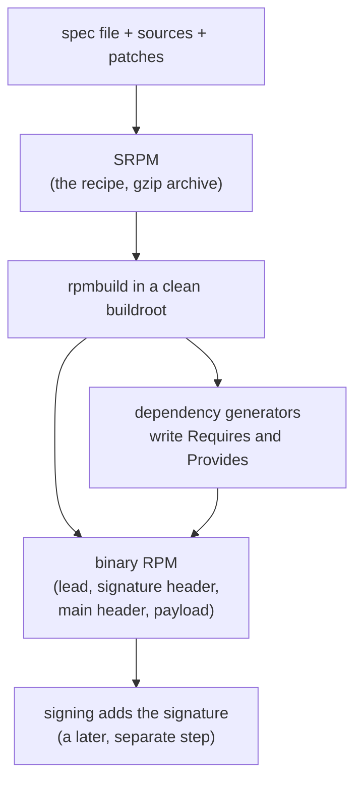
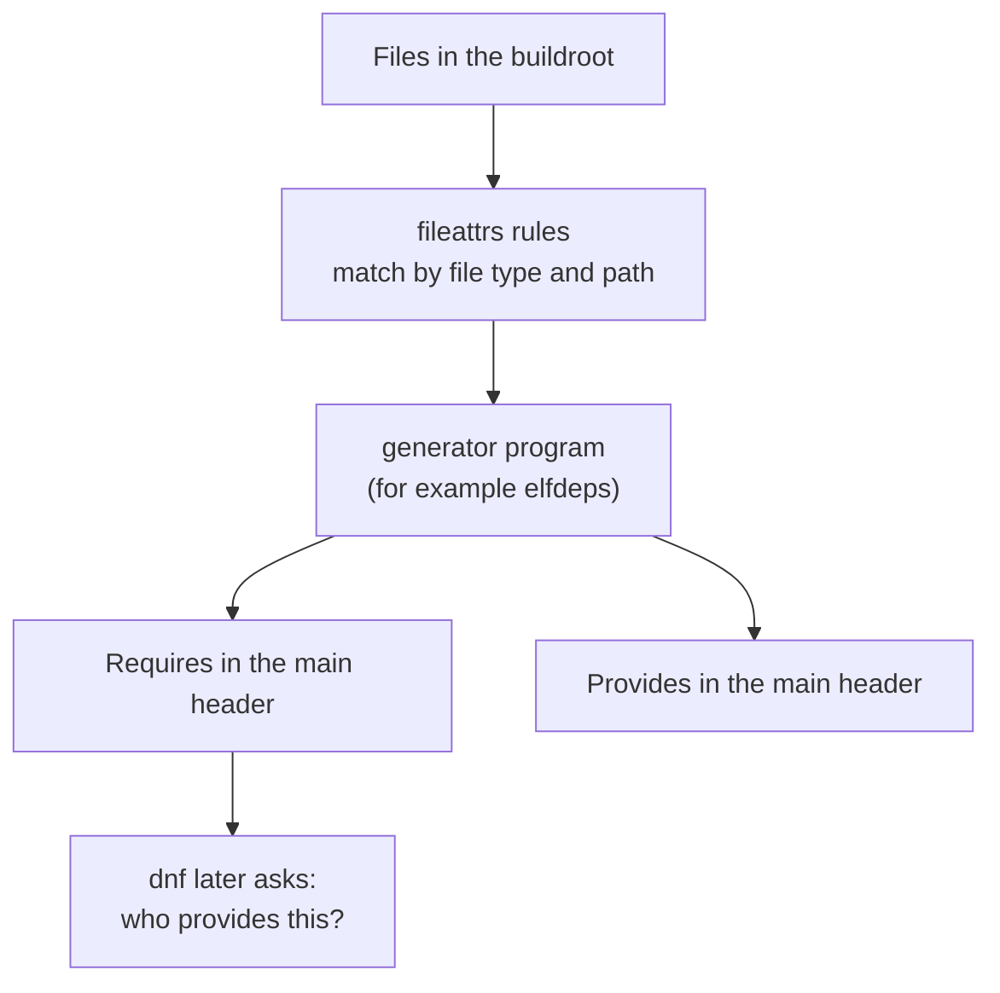

# 41 · Anatomy of a package

<ul class="module-meta">
  <li>⏱ ~2.5 hours</li>
  <li>4 labs</li>
  <li>Builds on: 05 · Software: RPM and DNF, 22 · Building RPMs, 40 · How an OS gets built</li>
  <li>Environment: Tier A</li>
  <li>Verified: Rocky 10.2, 2026-11-07</li>
</ul>

A Rocky RPM starts with four bytes, `ed ab ee db`. After them come a signature header, a metadata header and a compressed archive of files (zstd for most packages, xz for `kernel-core`). The signature seals the metadata header, not the files. The files are protected by a digest recorded inside that signed header, so if you flip one payload byte, `rpm -Kv` still says the signature is OK and then reports the payload digest as BAD.

This module takes one small Rocky package, `which`, apart on the bench. You will read its header, open the source RPM that made it, find the dependencies the build wrote for you, and watch the order in which install-time scripts run. By the end you can answer "what is in this package and what will it do to my system" without installing it.

<div class="pipeline-strip" data-here="build" role="group" aria-label="Rocky build pipeline, six stages" markdown>

1. Source
2. Build
3. Sign
4. Compose
5. Publish
6. Install

</div>

*You are here: Build (stage 2 of 6). Before: Source. After: Sign.*

!!! abstract "What you'll learn"
    - Name the four parts of an RPM file (lead, signature header, main header, payload) and say which one carries the file list, the dependencies and the signature.
    - Read any package header with `rpm -qp --qf`, including the build host, build time and the signature in one clean line.
    - Unpack an RPM and an SRPM without installing anything, and find the spec inside the SRPM.
    - Explain where a dependency you never wrote comes from, and why an EL10 binary can refuse to run on EL9.
    - Put install-time scripts and file triggers in the order rpm runs them, using a measured sequence and not a guess.
    - Recognise Rocky's fingerprints in a package: the dist tag, the `.rocky.0.N` suffix, the build host and the signing time.

## The big picture

!!! note "Remember from 05 and 22"
    [Module 05](05-software-rpm-and-dnf.md) showed the five things in a package (payload, header, scriptlets, signature, NEVRA name) and `rpm2cpio`. [Module 22](22-building-rpms.md) showed how a spec file becomes an RPM, how dependency generators work and how scriptlets behave on upgrade. This module does not repeat those. It goes under them: the bytes on disk, a real spec, what the generators wrote into real Rocky packages, and a measured scriptlet order.

### A package in one sentence

> **An RPM is a signed header that describes a compressed archive of files, and an SRPM is the same idea holding the recipe that built it.**

Everything in this module hangs off that sentence. The **header** is the part you query with `rpm -q`. The **archive** is the part `rpm2cpio` unpacks. The **recipe** is the spec file and sources inside the SRPM.

!!! analogy "Think of it like a shipping crate"
    The crate has a label glued on the outside (the header: what is inside, what it needs, who packed it, a tamper seal) and the goods packed inside (the archive). The SRPM is the crate that holds the blueprint and raw materials instead of finished goods.

    Where the analogy breaks: the tamper seal in an RPM covers the label, not the goods directly. The label carries a fingerprint of the goods, and that is how the goods are protected.



The diagram shows the path of one package. The spec, sources and patches are bundled as an SRPM. A build in a clean buildroot turns the recipe into a binary RPM, and the dependency generators write the requirements into its header during that build. Signing comes afterwards as its own step, which is why the signing time is later than the build time.

### The few things that solve most problems

| Situation | What to do | Where this module teaches it |
|---|---|---|
| "What is in this RPM I was handed?" | `rpm -qpl file.rpm`, or `rpm2cpio file.rpm \| cpio -t` | The four parts of an RPM file |
| "Who built this, and when was it signed?" | `rpm -qp --qf '%{BUILDHOST} %{BUILDTIME:date} %{RSAHEADER:pgpsig}\n'` | The core skill |
| "Why does it need a library I never installed?" | `rpm -qp --requires file.rpm` and look for generated lines | Dependencies you never wrote |
| "What will it run as root?" | `rpm -qp --scripts` and `rpm -qp --filetriggers` | Scriptlets and triggers |
| "What recipe built it?" | Download the SRPM and read the spec | The recipe: SRPM and spec |
| "Is this Rocky's own change or a straight rebuild?" | Read the release field: `.rocky.0.N` marks a change | Rocky's fingerprints |

To pick one, start from the question. If it is about identity, build or signing, query the header with `--qf`. If it is about contents, unpack or list. If it is about behaviour at install time, read scriptlets and triggers. If it is about why a package looks the way it does, open the SRPM.

### Words you'll see

| Word | Plain meaning |
|------|---------------|
| **lead** | The first 96 bytes of an RPM file: a magic number, a format version, the package name and a few flags. |
| **signature header** | The second part: digests and the signature. It describes the rest of the file. |
| **main header** | The third part: the package's metadata (name, version, file list, dependencies, scriptlets). This is what `rpm -q` reads. |
| **payload** | The last part: a compressed archive (cpio format) of the files to install. |
| **SRPM** | A source package: spec file, source tarballs and patches, in the same container format. |
| **spec file** | The recipe: how to unpack, build and install the software, and what the package contains. |
| **dependency generator** | A script that rpm runs during the build to write `Requires` and `Provides` for you. |
| **scriptlet** | A script stored in the header that rpm runs at install, upgrade or removal. |
| **file trigger** | A script that runs once per transaction when any package installs or removes files under a watched path. |
| **dist tag** | The `.el10` or `.el10_0` text at the end of the release, produced by a macro at build time. |

## The core skill: ask the package, not the file name

A file name like `which-2.21-44.el10_0.x86_64.rpm` tells you the name, version, release and architecture. Everything else is in the header, and you can ask for exactly the fields you want without installing anything. Four questions cover most investigations.

1. **Who is it?** Name, version, release, architecture, and the source package it came from.
2. **Who built and sealed it?** Build host, build time, vendor, packager and the signature.
3. **What does it contain?** The file list.
4. **What will it do to my system?** Requirements, scriptlets and triggers.

The tool is `rpm -qp` (query a package file) with `--qf`, a **query format** that prints the header tags you name. Here are the first two questions answered for `which`:

```console
$ dnf -q download which
$ rpm -qp --qf '%{NAME} %{VERSION}-%{RELEASE} %{ARCH}\nsrc=%{SOURCERPM}\nbuildhost=%{BUILDHOST}\nbuilt=%{BUILDTIME:date}\nsig=%{RSAHEADER:pgpsig}\n' which-*.x86_64.rpm
which 2.21-44.el10_0 x86_64
src=which-2.21-44.el10_0.src.rpm
buildhost=ord1-prod-x86build007.svc.aws.rockylinux.org
built=Wed 06 Aug 2025 06:54:42 AM UTC
sig=RSA/SHA256, Wed 06 Aug 2025 03:19:43 PM UTC, Key ID 5b106c736fedfc85
```

Rocky 10.2 x86_64, 2026-11-07. Notice that the file name carried the first line and nothing else. The build host, the build time and the signature were all inside the header. Notice too that the build time and the signing time are different.

Now three predictions. Answer each in your head before you open the fold.

**Practice 1.** The `built` and `sig` lines both carry a time. Are they the same moment?

??? success "Answer: no, signing is a separate, later step"
    For this `which`, the build finished at 06:54:42 UTC and the signature is dated 15:19:43 UTC the same day, about eight and a half hours later. The package was built first and sealed later. For the `bash` that shipped at the 10.0 GA the gap is months: built 2024-10-31, signed 2025-05-21. Module 47 uses this to explain what a signature does and does not tell you.

**Practice 2.** You run `rpm -qip which-*.x86_64.rpm | grep Signature`. What prints?

??? success "Answer: only the label"
    On Rocky 10.2 the `Signature` line in `rpm -qi` output is the label `Signature   :` with nothing after it. The value sits on the next, indented line, and `grep Signature` does not print that line. Use `rpm -q --qf '%{RSAHEADER:pgpsig}\n' name` when you want one clean line you can script against.

**Practice 3.** You run `rpm -qp --scripts which-*.x86_64.rpm`. `which` installs two files under `/etc/profile.d`. Do you see scriptlets?

??? success "Answer: nothing prints"
    `which` has no scriptlets. The two `/etc/profile.d` files are ordinary payload files that your login shell reads. rpm does not run them. Not every package runs code at install time, and the ones that do are the interesting ones (later in this module).

<div class="quiz" data-answer="2" markdown>

You run `rpm -qi bash | grep Signature` on Rocky 10 and see only `Signature   :`. What does that mean?

- The package is unsigned
- The value is on the next line, so `grep` did not print it
- The signing key is not imported

Right: `rpm -qi` prints the label and puts the value on the next indented line. The package is signed. `rpm -q --qf '%{RSAHEADER:pgpsig}\n' bash` prints the value on one line.

</div>

## The four parts of an RPM file

An RPM file is four things end to end. Click through them.

<div class="layers" data-hint="Click a part to see what lives there and how to look at it." data-open="0" markdown>

<div class="layer" data-label="Lead" data-tag="96 bytes" markdown>

The first 96 bytes. It starts with the magic number `edab eedb`, then a format version (3.0), a type (binary or source), and the package name as text. It is a leftover from the early days of RPM: modern rpm reads the lead and then ignores almost all of it. Everything that matters lives in the headers.

```console
$ head -c4 which-*.x86_64.rpm | xxd
00000000: edab eedb                                ....
$ file which-*.x86_64.rpm which-*.src.rpm
which-2.21-44.el10_0.x86_64.rpm: RPM v3.0 bin i386/x86_64 which-2.21-44.el10_0
which-2.21-44.el10_0.src.rpm: RPM v3.0 src
```

</div>

<div class="layer" data-label="Signature header" data-tag="digests, signature" markdown>

A **header structure**: a small index followed by a data area, starting with the magic `8eade8`. This one holds the **signature** (`RSAHEADER`), digests of the main header (`SHA256HEADER`, `SHA1HEADER`), the size of everything after the signature header, and an MD5 of that same span. It also holds an array of per-file IMA signatures (`FILESIGNATURES`), which module 47 covers. The signature header is padded so the next part starts on an 8-byte boundary.

```console
$ rpm -qp --qf '%{SHA256HEADER}\n' which-*.x86_64.rpm
393a7c940023ba7fc2199a81de58fc79c2f74f48cc6be275da465b2e9cfc72d1
```

</div>

<div class="layer" data-label="Main header" data-tag="everything rpm -q reads" markdown>

The same header structure, holding the package's metadata: name, version, release, architecture, build host, build time, vendor, packager, file names, sizes, modes, per-file digests, `Requires`, `Provides`, scriptlets, triggers and the changelog. It also holds the digest of the payload (`PAYLOADDIGEST`). The signature covers this part.

```console
$ rpm -qp --qf '%{PAYLOADDIGEST}\n%{PAYLOADDIGESTALGO}\n' which-*.x86_64.rpm
0895052a64e967f475b7f981ff8ba03efa7815fd2e3d1ff4a154a56e820fa4c7
8
```

Algorithm `8` is SHA-256. Every `rpm -q` command you have ever run reads this part.

</div>

<div class="layer" data-label="Payload" data-tag="compressed cpio" markdown>

The files themselves, in **cpio** archive format, then compressed. For binary packages Rocky uses zstd level 19 for most packages. `rpm2cpio` decompresses the payload and writes the plain cpio stream to standard output.

```console
$ rpm2cpio which-*.x86_64.rpm | file -
/dev/stdin: ASCII cpio archive (SVR4 with no CRC)
$ rpm2cpio which-*.x86_64.rpm | cpio -t
164 blocks
./etc/profile.d/which2.csh
./etc/profile.d/which2.sh
./usr/bin/which
./usr/lib/.build-id
./usr/lib/.build-id/44
./usr/lib/.build-id/44/a94a79d03ba338a518ea9c5543df62174e8996
./usr/share/doc/which
…
```

The `164 blocks` line goes to standard error, which is why it prints first.

</div>

</div>

The layers run in file order: lead, signature header, main header, payload. The signature header seals the main header, and the main header describes the payload and carries its digest.

You can measure the boundaries yourself. A header is a 16-byte intro, then 16 bytes for every index entry, then a data area. So the signature header of `which` is 16 + 10 × 16 + 4228 = 4,244 bytes after the 96-byte lead, which ends at byte 4,500 and is padded up to 4,504. The main header is 16 + 62 × 16 + 4545 = 5,553 bytes, so the payload starts at byte 10,057.

<!-- ev: FACTBASE-B O6; labs/final 02-packages | observed | Rocky 10.2 x86_64 VM, 2026-11-07 -->
!!! evidence "Observed: the offsets add up to where the payload starts"
    **Seen on:** Rocky 10.2 x86_64, 2026-11-07 (`which-2.21-44.el10_0.x86_64.rpm`, 41,963 bytes).

    ```console
    $ python3 - which-*.x86_64.rpm <<'PY'
    …a short parser that reads each header intro (Lab 1 has the full script)…
    PY
    LEAD edabeedb ver 3 0 type 0
    SIGNATURE @96 magic=8eade8 ver=1 nindex=10 datalen=4228
    MAIN @4504 magic=8eade8 ver=1 nindex=62 datalen=4545
    PAYLOAD @10057 first bytes=28b52ffd00686c0a
    ```

    **Check it yourself:** Lab 1 runs the parser. Check that 96 + 16 + 10 × 16 + 4228, rounded up to a multiple of 8, gives the MAIN offset, and that the MAIN offset plus 16 + 62 × 16 + 4545 gives the PAYLOAD offset. The payload starts with `28b52ffd`, the zstd magic number.

### Why zstd, and when it is not zstd

The payload compressor is recorded in the main header, so you can ask for it per package. A package built with zstd carries a requirement that old rpm cannot meet, which is how an old rpm knows to refuse it: look for `rpmlib(PayloadIsZstd)` in the `--requires` output of `which` later in this module.

| Package | Payload format | Compressor and level |
|---|---|---|
| `which`, `bash`, `glibc`, `systemd` (binary RPMs) | cpio | zstd 19 |
| `kernel-core` (binary RPM) | cpio | xz, flags `3T` |
| `which`, `bash` (SRPMs) | cpio | gzip 9 |

<!-- ev: FACTBASE-B O7; COLD-OPEN-VERIFICATION E2b | observed | Rocky 10.2 x86_64 VM, 2026-11-07 -->
!!! freshness "As of 2026-11-07 on Rocky 10.2"
    Binary packages use zstd level 19 by default (rpm 4.19.1.1); `kernel-core` and about ten other packages use xz in an earlier survey on aarch64 (not repeated here); source RPMs use gzip level 9. The mechanism (the compressor is a header tag) is stable. The choice per package changes when a package or a macro changes, so treat it as changing each minor release.

    **Re-check:** `rpm -qp --qf '%{NAME} %{PAYLOADCOMPRESSOR} %{PAYLOADFLAGS}\n' *.rpm`

??? question "What is in the signature header, tag by tag?"
    The parser in Lab 1 can list the signature header tags of a Rocky `which`. The tag numbers are from the v4 package format that every EL10 package uses.

    | Tag | Name | What it holds |
    |---|---|---|
    | 62 | `HEADERSIGNATURES` | Region marker for the signature header itself |
    | 268 | `RSAHEADER` | The OpenPGP RSA signature over the main header |
    | 269 | `SHA1HEADER` | SHA-1 digest of the main header |
    | 273 | `SHA256HEADER` | SHA-256 digest of the main header |
    | 274 | `FILESIGNATURES` | IMA signatures, one per file (module 47) |
    | 275 | `FILESIGNATURELENGTH` | Length of each IMA signature |
    | 1000 | `SIZE` | Size in bytes of the main header plus the compressed payload (37,459 for `which` on 2026-11-07, which is the file size 41,963 minus the 4,504 bytes before the main header) |
    | 1004 | `MD5` | MD5 of the main header plus payload |
    | 1007 | `PAYLOADSIZE` | Uncompressed payload size (83,900 bytes for `which`) |
    | 1008 | `RESERVEDSPACE` | Zero padding so signing can happen without rewriting the file |

    The table lists ten tags, and the parser printed `nindex=10` for the signature header of `which` (the sizes in the table come from reading the tag values on 2026-11-07). Every EL10 package is format v4. A newer package format (v6) exists upstream in rpm 6.0 but is not in EL10.

??? version "Comparison lens: how many signatures does a package carry?"
    A Rocky package carries one OpenPGP signature in the signature header. In an earlier comparison across sibling hosts, the matching AlmaLinux and RHEL packages, and older CentOS Stream packages, carried two. **Check it yourself:** compare `rpm -qp --qf '[%{OPENPGP}\n]' file.rpm | wc -l` on each system. That was observed on separate hosts at different patch levels, so treat the count as a snapshot.

### Which bytes does the signature protect?

The signature covers the main header. It does not cover the payload directly. It covers the payload through a digest stored in that header. That design gives two different failures for two different kinds of damage. The series' tests flipped single bytes in a copy of the x86_64 `which` package and ran `rpm -Kv` each time.

| What was changed | Where | What `rpm -Kv` reported |
|---|---|---|
| One byte in the main header | offset 6000 (main header runs 4504 to 10057) | signature BAD, header SHA-256 digest BAD |
| One byte in the payload | offset 12000 (payload starts at 10057) | signature OK, payload SHA-256 digest BAD |

A signature that says OK with a payload digest that says BAD is not a contradiction. It says the label is genuine and the goods do not match the label. Module 47 runs this tamper matrix in a container and goes through every line of `rpm -Kv`. For now remember one rule: the first line to check is the signature, but a package is only good if the digest lines say OK too.

<div class="quiz" data-answer="3" markdown>

Which part of an RPM file holds the digest of the payload, and which part does the signature cover?

- The lead holds the digest, and the signature covers the whole file
- The signature header holds the digest, and the signature covers the payload
- The main header holds the digest, and the signature covers the main header

Right: `PAYLOADDIGEST` is a tag in the main header, and the signature covers that header. The payload is protected through the digest, not signed directly.

</div>

## Reading a header: query formats, arrays and one decision tree

`rpm -q` has three layers of options, and mixing them up is the usual reason a query "does not work". The **selector** says what to query: an installed package name, a file path with `-f`, or a package file with `-p`. The **verb** picks a canned view: `-i` for the info block, `-l` for the files, `--requires`, `--provides`, `--scripts`. The **format** (`--qf`) lets you build your own view from header tags.

Tag names are listed by `rpm --querytags`. A tag that holds one value prints with `%{TAG}`. A tag that holds a list (file names, sizes, requirements) prints once per entry when you wrap the format in square brackets.

```console
$ rpm -qp --qf '[%{FILESIZES} %{FILENAMES}\n]' which-*.x86_64.rpm | head -4
120 /etc/profile.d/which2.csh
465 /etc/profile.d/which2.sh
28464 /usr/bin/which
0 /usr/lib/.build-id
```

Rocky 10.2 x86_64, 2026-11-07. The square brackets repeat the line for every file. Without them, rpm prints every size on one line and then every name on another.

Two spellings to remember. `%{BUILDTIME:date}` prints a readable date, and `%{RSAHEADER:pgpsig}` prints the signature as algorithm, date and key id. There is no `%{BUILDTIME:iso8601}`: that query fails with an unknown tag error.

<div class="decision" markdown>

<div class="node" data-id="start" markdown>

**What do you want to know?** (Add `-p` and a file name to ask a package file. Leave `-p` off to ask the installed database.)

<button data-goto="built">Who built it, and when was it signed</button> <button data-goto="files">What files are in it</button> <button data-goto="needs">What it needs</button> <button data-goto="runs">What it runs as root</button> <button data-goto="recipe">What recipe made it</button>

</div>

<div class="node" data-id="built" markdown>

Use a query format with the build and signing tags:

`rpm -qp --qf '%{BUILDHOST} %{BUILDTIME:date} %{RSAHEADER:pgpsig}\n' file.rpm`

For an installed package, drop `-p` and give the package name. Do not use `rpm -qi | grep Signature`: the value is on the next line.

</div>

<div class="node" data-id="files" markdown>

`rpm -qpl file.rpm` lists the files (`-c` config files, `-d` documentation). For sizes use `--qf '[%{FILESIZES} %{FILENAMES}\n]'`. To see the real archive, use `rpm2cpio file.rpm | cpio -t`.

</div>

<div class="node" data-id="needs" markdown>

`rpm -qp --requires file.rpm` lists what it needs, `--provides` what it offers. Lines starting with `rpmlib(` are requirements on rpm itself. Lines that look like `libc.so.6(GLIBC_2.34)(64bit)` were written by a dependency generator.

</div>

<div class="node" data-id="runs" markdown>

`rpm -qp --scripts file.rpm` shows the install-time scriptlets. `rpm -qp --triggers file.rpm` shows triggers on other packages. `rpm -qp --filetriggers file.rpm` shows triggers on paths. A package with nothing printed has no such code.

</div>

<div class="node" data-id="recipe" markdown>

The package names its source package: `rpm -qp --qf '%{SOURCERPM}\n' file.rpm`. Download that SRPM with `dnf download --source`, then `rpm2cpio file.src.rpm | cpio -idm` unpacks the spec and sources into the current directory.

</div>

</div>

The tree sorts the questions by the part of the header they read. Identity and build facts come from tags, the file list from the file tags, requirements from the dependency tags, install-time code from the scriptlet and trigger tags, and the recipe from the source package name.

<div class="terminal-sim" data-title="Ask which questions" data-prompt="[alex@rocky-lab ~]$ " markdown>

<div class="task" data-expect="rpm -q --qf '%{RSAHEADER:pgpsig}\n' which||rpm -q which --qf '%{RSAHEADER:pgpsig}\n'" data-match="^rpm -q.*RSAHEADER:pgpsig.*which" data-hint="Ask the installed which package for its signature with a query format. The tag is RSAHEADER with the pgpsig format." markdown>

**Step 1.** Print the signature of the installed `which` package on one clean line.

```text
RSA/SHA256, Wed 06 Aug 2025 03:19:43 PM UTC, Key ID 5b106c736fedfc85
```

</div>

<div class="task" data-expect="rpm -qp --scripts which-2.21-44.el10_0.x86_64.rpm" data-match="^rpm -qp --scripts which" data-hint="Query the package file (-p) and ask for its scriptlets." markdown>

**Step 2.** Ask the package file what scriptlets it runs.

```text
(prints nothing: which has no scriptlets)
```

</div>

<div class="task" data-expect="rpm -qp --requires which-2.21-44.el10_0.x86_64.rpm | grep RELR" data-match="^rpm -qp --requires which.*grep RELR" data-hint="List the requirements of the package file and filter for RELR with grep." markdown>

**Step 3.** Find the generated requirement that mentions RELR.

```text
libc.so.6(GLIBC_ABI_DT_RELR)(64bit)
```

</div>

</div>

## The recipe: SRPM and spec

A binary RPM is a result. The source RPM is the recipe that made it. Every binary package names its source package in the `SOURCERPM` tag, so you can always go from a package on your system back to the recipe.

!!! note "Remember from 22"
    A spec file has a preamble (name, version, release, sources, build requirements), then sections that run in order: `%prep`, `%build`, `%install`, `%check`, `%files` and `%changelog`. Module 22 walks a spec you write from scratch. Here you read one that Rocky ships.

Download the source package and look at what is inside. The `which` source RPM contains the spec, the upstream tarball, two patches and two small scripts:

```console
$ dnf -q download --source which --enablerepo=baseos-source --enablerepo=appstream-source
$ rpm -K which-*.src.rpm
which-2.21-44.el10_0.src.rpm: digests signatures OK
$ rpm -qpl which-*.src.rpm
which-2.21-coverity-fixes.patch
which-2.21-path_max.patch
which-2.21.tar.gz
which.spec
which2.csh
which2.sh
```

Rocky 10.2 x86_64, 2026-11-07. The SRPM is signed like a binary package, and `rpm -K` checks it the same way. Its payload is gzip, not zstd, as the table earlier showed.

An SRPM is a package too, so `--requires` works on it. For a source package it prints the **build requirements**, the packages the buildroot must contain:

```console
$ rpm -qpR which-*.src.rpm
gcc
make
readline-devel
rpmlib(CompressedFileNames) <= 3.0.4-1
rpmlib(FileDigests) <= 4.6.0-1
…
```

Now extract the spec and read it. `rpm2cpio` plus `cpio -idm` unpacks everything into the current directory, so do it in a scratch directory (Lab 2 does):

```console
$ rpm2cpio which-*.src.rpm | cpio -idm
327 blocks
$ wc -l which.spec
405 which.spec
$ grep -n '^%' which.spec | head -20
1:%global has_which2_alias 1
19:%description
23:%prep
24:%autosetup -p1
26:%build
27:%configure
28:%make_build
30:%install
31:%make_install
34:%if %{has_which2_alias}
36:%endif
39:%files
40:%license COPYING
41:%doc EXAMPLES README AUTHORS NEWS
42:%if %{has_which2_alias}
43:%attr(0644,root,root) %{_sysconfdir}/profile.d/which2.*
44:%endif
45:%{_bindir}/which
46:%{_infodir}/which.info*
47:%{_mandir}/man1/which.1*
```

Rocky 10.2 x86_64, 2026-11-07. The spec is 405 lines, almost all of it `%changelog`. The working part is under fifty lines. Here is the preamble:

```text
%global has_which2_alias 1

Summary: Displays where a particular program in your path is located
Name: which
Version: 2.21
Release: 44%{?dist}
License: GPL-3.0-only
Source0: http://ftp.gnu.org/gnu/which/%{name}-%{version}.tar.gz
Source1: which2.sh
Source2: which2.csh
Patch0: which-2.21-coverity-fixes.patch
Patch1: which-2.21-path_max.patch
Url: https://savannah.gnu.org/projects/which/
Requires: coreutils
BuildRequires: make
BuildRequires: gcc
BuildRequires: readline-devel

…
```

Set it beside module 22's spec walk. Almost everything is there, with differences worth noticing:

| Part in module 22 | In the real `which.spec` |
|---|---|
| `Name`, `Version`, `License`, `Source0` | All present. `Source0` is a full URL on `ftp.gnu.org`; rpmbuild uses only the file name. |
| `Release: 1%{?dist}` | `Release: 44%{?dist}`: forty-four packaging rounds. The `.el10_0` in the file name is not in the spec. |
| Extra `Source` and `Patch` lines | `Source1`, `Source2` (the shell snippets) and `Patch0`, `Patch1`. |
| `BuildRequires` | Three lines: `make`, `gcc`, `readline-devel`. |
| Manual `Requires` | One: `Requires: coreutils`. The generators add the rest. |
| `%autosetup` | `%autosetup -p1`: unpack and apply every patch. |
| `%set_build_flags`, `%make_build` | `%configure` then `%make_build`. `%configure` exports the hardening flags for you. |
| `%check` | Absent. This package has no tests. |
| `%files` | `%license`, `%doc`, an `%attr` line inside an `%if`, then the binary, info page and man page. |

Where does the `.el10_0` come from? The spec says `44%{?dist}` and the macro `dist` is filled in during the build. The next section shows where that macro lives.

??? version "Comparison lens: RHEL"
    Rocky rebuilds Red Hat's source. In one earlier comparison on aarch64 hosts (not repeated here), Rocky's `which.spec` was byte-identical to Red Hat's for the same version. **Check it yourself:** run `rpm2cpio which-*.src.rpm | cpio -i --to-stdout which.spec | sha256sum` on the Rocky SRPM and on the RHEL one and compare. The differences between Rocky and Red Hat packages show up in the release field and in the build, not in the recipe, which is where the next section starts.

<div class="quiz" data-answer="2" markdown>

The spec for `which` says `Release: 44%{?dist}`, but the package file is named `which-2.21-44.el10_0.x86_64.rpm`. Where does `.el10_0` come from?

- It is written in the spec's `%changelog`
- The `dist` macro is expanded by the build environment when the package is built
- rpm adds it when you download the package

Right: `%{?dist}` is a macro, and the build environment defines it. On Rocky it comes from a macro file that the `rocky-release` package installs.

</div>

## Rocky's fingerprints in the name and header

Two Rocky-specific things are visible without any special tool: the dist tag and the release suffix. The mechanism is stable. The values change with every update, so read the examples as dated snapshots.

### Where the dist tag comes from

The `dist` macro lives in a macro file owned by the `rocky-release` package:

```console
$ rpm -qf /usr/lib/rpm/macros.d/macros.dist
rocky-release-10.2-1.1.el10.noarch
$ rpm -E '%{dist} %{?rhel} %{?rocky} %{?centos} %{?el10}'
.el10 10 10 10 1
```

Rocky 10.2 x86_64, 2026-11-07. The first line says which package owns the macro file. The second expands five macros: the dist tag is `.el10`, and `%rhel`, `%rocky` and `%centos` are all `10`. A spec can test any of them. The macro file also sets `%distcore .el10` and names the vendor (`%dist_vendor RESF`). The base tag is `.el10`. Updates for a minor release carry longer tags, such as `.el10_0` for `which` here. What decides when a package gets `.el10_0` or `.el10_2` is not public (see the unknown box).

??? version "Comparison lens: AlmaLinux and CentOS Stream"
    For the same `which` version, Rocky and AlmaLinux ship the release `44.el10_0` and CentOS Stream ships `44.el10`. So "same name and version" needs the qualifier "and the same release". In an earlier four-distribution comparison, Alma defines a `%almalinux` macro of 10 and leaves `%rocky` unset, and all four distributions define `%rhel` as 10. The signing key differs per distribution, and so does the build host. **Check it yourself:** `rpm -E '%{dist} %{?rhel} %{?rocky} %{?almalinux}'` on each system.

### `.rocky.0.N`: Rocky's own change

If a Rocky package is a straight rebuild of Red Hat's source, its release has no extra suffix. If Rocky changed the source (debranding, a patch, a different default), the import adds `.rocky.0.N` to the release. So a release like `257-23.el10_2.1.rocky.0.1` says: Red Hat's `257-23.el10_2.1`, plus Rocky's first change.

Ask rpm which of your installed packages carry the marker. Match on the source package name, so a package with many subpackages counts once:

```console
$ rpm -qa --qf '%{SOURCERPM}\n' | grep 'rocky\.0\.' | sort -u
cockpit-356-1.el10.rocky.0.1.src.rpm
dnf-4.20.0-22.el10_2.rocky.0.1.src.rpm
efi-rpm-macros-6-7.el10.rocky.0.1.src.rpm
elfutils-0.194-2.el10.rocky.0.1.src.rpm
grub2-2.12-46.el10_2.rocky.0.1.src.rpm
ima-evm-utils-1.6.2-4.el10.rocky.0.2.src.rpm
libdnf-0.73.1-15.el10_2.rocky.0.1.src.rpm
lorax-40.5.15-1.el10.rocky.0.4.src.rpm
mesa-25.2.7-4.el10.rocky.0.1.src.rpm
openssh-9.9p1-23.el10_2.rocky.0.1.src.rpm
redhat-rpm-config-295-1.el10.rocky.0.2.src.rpm
systemd-257-23.el10_2.1.rocky.0.1.src.rpm
```

Rocky 10.2 x86_64, 2026-11-07. Twelve source packages on a lab VM. The list is short: most of Rocky is a straight rebuild, and the change is findable.

<!-- ev: FACTBASE-A O9; COLD-OPEN-VERIFICATION E2e | observed | Rocky 10.2 x86_64 VM and stock cloud image, 2026-11-07 -->
!!! freshness "As of 2026-11-07 on Rocky 10.2"
    The lab VM above lists 12 source packages; `lorax` and `mesa` were installed by earlier labs, and a stock Rocky 10.2 cloud image listed 10. Across the BaseOS, AppStream and CRB trees (x86_64 and noarch metadata, old retained versions included), 28 of 2,198 distinct source package names carry the marker, about 1.3%. The marker is not a complete list of Rocky's changes: the kernel is patched without it, and some kernel builds use a plain `.0.1`. This changes each time an update adds or drops a patch.

    **Re-check:** `rpm -qa --qf '%{SOURCERPM}\n' | grep 'rocky\.0\.' | sort -u | wc -l` counts your installed set. The repository-wide count reads each repository's `primary.xml`: `for r in BaseOS AppStream CRB; do h=$(curl -s $B/$r/x86_64/os/repodata/repomd.xml | grep -A3 'type="primary"' | grep -o 'href="[^"]*"' | head -1 | sed 's/href="//;s/"//'); curl -s $B/$r/x86_64/os/$h | zcat | grep -o '<rpm:sourcerpm>[^<]*' | sed 's/<rpm:sourcerpm>//'; done | awk '{n=$0; sub(/-[^-]+-[^-]+\.src\.rpm$/,"",n); all[n]=1; if ($0 ~ /\.rocky\.0\./) m[n]=1} END{print length(m) " of " length(all)}'` with `B=https://dl.rockylinux.org/pub/rocky/10` set first.

The marker is a one-way sign: `.rocky.0.N` tells you Rocky changed something, but its absence does not tell you the package is unchanged. A kernel on the same VM shows the plain-suffix case:

```console
$ rpm -q kernel-core --qf '%{RELEASE}\n'
211.16.1.el10_2.0.1
211.74.1.el10_2
```

Both are Rocky kernels. One carries `.0.1` and the newer one carries no suffix at all, yet Rocky's kernel build is not a bare rebuild (module 42 covers the kernel package). So read the suffix as evidence of Rocky's work, not as a complete accounting.

### Build host, vendor and signing time

The header also records who built the package and when it was signed. These are not Rocky-specific in kind, but their values are Rocky's.

<!-- ev: FACTBASE-B O2, O8; labs/final 06-observations | observed | Rocky 10.2 x86_64 VM, 2026-11-07 -->
!!! evidence "Observed: build time and signing time are different events"
    **Seen on:** Rocky 10.2 x86_64, 2026-11-07.

    ```console
    $ rpm -q --qf 'built  %{BUILDTIME:date}\nsigned %{RSAHEADER:pgpsig}\n' which
    built  Wed 06 Aug 2025 06:54:42 AM UTC
    signed RSA/SHA256, Wed 06 Aug 2025 03:19:43 PM UTC, Key ID 5b106c736fedfc85
    $ rpm -q --qf 'built  %{BUILDTIME:date}\nsigned %{RSAHEADER:pgpsig}\n' bash
    built  Thu 31 Oct 2024 05:16:11 AM UTC
    signed RSA/SHA256, Wed 21 May 2025 01:19:52 PM UTC, Key ID 5b106c736fedfc85
    ```

    **Check it yourself:** run the command on any installed Rocky 10 package. The two times are not equal, because the signature is added by a later step. The `bash` here was built months before it was signed, which is how the 10.0 GA set behaved.

The build host is another visible fingerprint. The `which` above was built on a host in Rocky's public build farm (`ord1-prod-x86build007.svc.aws.rockylinux.org`). The `bash` of the same system was built on a differently named host (`pb-<uuid>-b-x86-64`) by Rocky's earlier build system. Module 45 reads these names as a census of where a Rocky system's packages were built.

## Dependencies you never wrote

!!! note "Remember from 22"
    rpm runs **dependency generators** at build time. They read every ELF binary, script and pkg-config file in the buildroot and add `Requires` and `Provides`, so you write manual `Requires` only for things a generator cannot see (see [module 22](22-building-rpms.md)).

The generators are not hidden magic. They are small rules in a directory you can read. Each rule is a file in `/usr/lib/rpm/fileattrs/` that says "for files matching this pattern, run this program to get provides or requires".

```console
$ ls /usr/lib/rpm/fileattrs/
debuginfo.attr  desktop.attr  elf.attr  font.attr  kmod.attr  libsymlink.attr
metainfo.attr  ocaml.attr  pkgconfig.attr  rpm_lua.attr  rpm_macro.attr
script.attr  sysusers.attr  usergroup.attr
$ cat /usr/lib/rpm/fileattrs/elf.attr
%__elf_provides		%{_rpmconfigdir}/elfdeps --provides
%__elf_requires		%{_rpmconfigdir}/elfdeps --requires
%__elf_magic		^(setuid,? )?(setgid,? )?(sticky )?ELF (32|64)-bit.*$
%__elf_exclude_path	^/lib/modules/.*\.ko?(\.[[:alnum:]]*)$
```

Rocky 10.2 x86_64, 2026-11-07 (the first listing is wrapped here for width). The rule for ELF files names a program (`elfdeps`), says which files count as ELF (the `magic` line) and excludes kernel modules (the `exclude_path` line). Other attribute files do the same for pkg-config files, sysusers files, fonts and more.



The diagram shows what happens at build time. Every file in the buildroot is checked against the rules, a matching rule runs its generator, and the output lands in the header as `Requires` and `Provides`. At install time, dnf reads those lines and looks for packages that provide them.

Look at what the generators wrote for `which`, a package whose spec has exactly one manual `Requires`:

```console
$ rpm -qp --requires which-*.x86_64.rpm
coreutils
libc.so.6()(64bit)
libc.so.6(GLIBC_2.2.5)(64bit)
libc.so.6(GLIBC_2.3)(64bit)
libc.so.6(GLIBC_2.3.4)(64bit)
libc.so.6(GLIBC_2.33)(64bit)
libc.so.6(GLIBC_2.34)(64bit)
libc.so.6(GLIBC_2.4)(64bit)
libc.so.6(GLIBC_ABI_DT_RELR)(64bit)
rpmlib(CompressedFileNames) <= 3.0.4-1
rpmlib(FileDigests) <= 4.6.0-1
rpmlib(PayloadFilesHavePrefix) <= 4.0-1
rpmlib(PayloadIsZstd) <= 5.4.18-1
rtld(GNU_HASH)
$ rpm -qp --provides which-*.x86_64.rpm
which = 2.21-44.el10_0
which(x86-64) = 2.21-44.el10_0
```

Rocky 10.2 x86_64, 2026-11-07. One line is hand-written (`coreutils`). The `libc.so.6(GLIBC_...)` lines are the highest symbol versions the binary uses, written by the ELF generator. The `rpmlib(` lines are requirements on rpm itself, including `rpmlib(PayloadIsZstd)`, the line that makes an old rpm refuse this package. And `libc.so.6(GLIBC_ABI_DT_RELR)(64bit)` is the odd one out. It was not in `which` on EL9.

### Worked story: the bash that would not run on EL9

**Symptom.** Someone copies the `bash` binary from an EL10 system into a Rocky 9 container and runs it. It refuses to start:

```text
/bash-el10: /lib64/libc.so.6: version `GLIBC_ABI_DT_RELR' not found (required by /bash-el10)
/bash-el10: /lib64/libc.so.6: version `GLIBC_2.38' not found (required by /bash-el10)
/bash-el10: /lib64/libc.so.6: version `GLIBC_2.36' not found (required by /bash-el10)
```

**Evidence.** The failure above was reproduced on 2026-11-07 on an x86_64 container (podman, emulated) running Rocky Linux 9.8, with the `bash` file from the Rocky 10.2 BaseOS package copied in (Lab 4 repeats it). The same information is in the package header before anything runs:

```console
$ rpm -q --requires bash | grep -E 'RELR|rtld'
libc.so.6(GLIBC_ABI_DT_RELR)(64bit)
rtld(GNU_HASH)
$ rpm -E '%{build_ldflags}' | tr ' ' '\n' | grep -E 'pack-relative|now|relro'
-Wl,-z,relro
-Wl,-z,pack-relative-relocs
-Wl,-z,now
```

**Reasoning.** The linker flag `-Wl,-z,pack-relative-relocs` is in Rocky 10's standard build flags. A binary linked with it needs a symbol version, `GLIBC_ABI_DT_RELR`, that only a newer glibc provides. The ELF generator sees that requirement in the binary and writes it into the package header. The dynamic loader enforces it at run time. Rocky 9's glibc does not have it, so the loader refuses. Copying the binary skipped the check that the header was designed to make. On the same EL9 container, `rpm -ivh --test` on the package file refused it with `error: Failed dependencies` and listed `GLIBC_2.36`, `GLIBC_2.38` and `GLIBC_ABI_DT_RELR` as needed. I did not run `dnf install`, which resolves the same requirements.

**Fix.** Do not carry binaries across major releases. Rebuild the source for the target (that is what the build system's buildroot is for), or run the program in a container of the matching major release.

**Check.** The requirement is visible before you run anything: `rpm -qp --requires pkg.rpm | grep RELR` prints the line. This module's Lab 4 shows the captured run as a read-along.

### The sysusers generator

The same mechanism covers pkg-config files, Perl and Python modules, fonts and more (the listing above shows the rule files). One generator is worth a close look.

It reads a `sysusers.d` file and encodes the whole line as base64 in a `Provides`, so tools that create users can find it later. Decode one:

```console
$ rpm -q --provides openssh-server | grep -E '^(user|group)\('
group(sshd)
user(sshd) = dSBzc2hkIDc0ICJQcml2aWxlZ2Utc2VwYXJhdGVkIFNTSCIgL3Vzci9zaGFyZS9lbXB0eS5zc2hkIC0A
$ echo dSBzc2hkIDc0ICJQcml2aWxlZ2Utc2VwYXJhdGVkIFNTSCIgL3Vzci9zaGFyZS9lbXB0eS5zc2hkIC0A | base64 -d
u sshd 74 "Privilege-separated SSH" /usr/share/empty.sshd -
```

Rocky 10.2 x86_64, 2026-11-07. The decoded line is exactly the entry in `/usr/lib/sysusers.d/openssh-server.conf`. The next section shows what rpm does with it at install time.

<div class="quiz" data-answer="1" markdown>

`bash` on EL10 lists `libc.so.6(GLIBC_ABI_DT_RELR)(64bit)` in its requirements, and no one wrote that line in the spec. Where did it come from?

- The ELF dependency generator read the binary, which was linked with `-Wl,-z,pack-relative-relocs`
- Rocky's release engineers add it by hand to every package
- `dnf` adds it when you install the package

Right: generators write requirements from the files in the buildroot. The linker flag produced a binary that needs that symbol version, and the generator recorded it.

</div>

## Scriptlets and triggers, in the order they run

!!! note "Remember from 22"
    A scriptlet gets one argument, `$1`: the number of instances of the package that will be installed after the operation finishes. On an upgrade the old package's `%preun` runs with `$1=1`, so a removal-only action needs the guard `if [ $1 -eq 0 ]` (see [module 22](22-building-rpms.md)).

Module 22 gave you the spine of an upgrade. Here is the whole line, including the trigger scriptlets that fire in the gaps. It was measured with a throwaway test package whose scriptlets each print their name and arguments: install version 1, upgrade to version 2, then erase.

<div class="stepper" markdown>

<div class="step" data-title="%pretrans (new)" markdown>

Version 1.0 is installed and you upgrade to 2.0. rpm builds one transaction that holds both versions, and the new package's `%pretrans` runs first, before anything changes. Measured: it received `$1=2`.

</div>

<div class="step" data-title="%pre (new)" markdown>

The new package's `%pre` runs. Measured: `$1=2`, because after this step two versions exist on the system.

</div>

<div class="step" data-title="Files, then %post (new)" markdown>

The new package's files are written to disk, then its `%post` runs. Measured: `$1=2`.

</div>

<div class="step" data-title="%triggerin" markdown>

Triggers declared on this package run now. Measured: the `%triggerin` fired after the new `%post`.

</div>

<div class="step" data-title="%triggerun (self)" markdown>

The trigger that watches the package being removed fires next. Measured arguments: `arg1=1 arg2=2`. rpm passes a trigger two counts: instances of the triggered package, then instances of the package that fires it (see the [rpm triggers manual](https://rpm-software-management.github.io/rpm/manual/triggers.html)).

</div>

<div class="step" data-title="%preun (old)" markdown>

The old package's `%preun` runs, with `$1=1`. This is the trap from module 22: it runs on every upgrade, not only on removal.

</div>

<div class="step" data-title="%postun and %triggerpostun" markdown>

The old package's `%postun` runs with `$1=1`, then `%triggerpostun` fires. The old package's own files are removed between `%preun` and `%postun`; the measurement did not log that step.

</div>

<div class="step" data-title="%posttrans (new)" markdown>

The new package's `%posttrans` runs with `$1=2`, after every other package in the transaction has finished. It is the last of the package's own scriptlets. Transaction file triggers (`%transfiletriggerin`, see below) run after it.

</div>

</div>

The stepper shows the measured order for an upgrade, top to bottom. The new package's scripts run first (`%pretrans`, `%pre`, then its files, `%post`), triggers fire next, then the old package's removal scripts (`%preun`, `%postun`), and the new package's `%posttrans` closes the package's own scripts.

<!-- ev: FACTBASE-B O21; reviewer A re-run | observed | Rocky 10.2 x86_64 container (podman, emulated), rpm 4.19.1.1, 2026-11-07 -->
!!! evidence "Observed: the whole upgrade, as measured"
    **Seen on:** Rocky 10.2 x86_64 container (podman, emulated), rpm 4.19.1.1, throwaway test package, 2026-11-07. An earlier aarch64 run of a similar package gave the same order for the plain scriptlets and triggers.

    | Order | Script | Argument or note |
    |---|---|---|
    | 1 | `%pretrans` (v2) | `$1=2` |
    | 2 | `%pre` (v2) | `$1=2` |
    | 3 | files of v2 written | not logged by the test |
    | 4 | `%post` (v2) | `$1=2` |
    | 5 | `%triggerin` | fired after `%post` |
    | 6 | `%triggerun` (self) | `arg1=1 arg2=2` |
    | 7 | `%preun` (v1) | `$1=1` |
    | 8 | `%postun` (v1) | `$1=1` |
    | 9 | `%triggerpostun` | `arg1=2 arg2=1` |
    | 10 | `%posttrans` (v2) | `$1=2` |

    The same run also had file triggers on the package's own directory. They slot in like this: `%transfiletriggerun` of v1 ran right after `%pretrans` and before `%pre`. `%filetriggerin` ran after `%pre` and before `%post`. `%filetriggerun` ran after the `%triggerin` lines and before `%triggerun`. `%transfiletriggerpostun` and `%transfiletriggerin` ran after `%posttrans`, last of all. Several trigger lines printed more than once, because both versions of the package are present during an upgrade and each carries the triggers; I did not work out every repeat.

    **Check it yourself:** the fold below builds the test package and runs install, upgrade and erase.

??? example "Reproduce the order yourself (about 5 minutes, throwaway container)"
    Tested on a Rocky 10.2 x86_64 container (podman, emulated), 2026-11-07. Run it in a throwaway container as root (`podman run --rm -it docker.io/rockylinux/rockylinux:10 bash`). It installs `rpm-build` and one test package inside the container and leaves the host alone.

    ```bash
    dnf -y install rpm-build
    mkdir -p ~/rpmbuild/SPECS && cd ~/rpmbuild/SPECS
    cat > ordertest.spec <<'EOF'
    Name: ordertest
    Version: %{ver}
    Release: 1
    Summary: scriptlet order test
    License: MIT
    BuildArch: noarch
    %description
    Test package that logs each scriptlet.
    %install
    mkdir -p %{buildroot}/usr/share/ordertest
    echo %{version} > %{buildroot}/usr/share/ordertest/v
    %files
    /usr/share/ordertest/v
    %pretrans
    echo "pretrans            v%{version} arg1=$1" >> /tmp/order.log
    %pre
    echo "pre                 v%{version} arg1=$1" >> /tmp/order.log
    %post
    echo "post                v%{version} arg1=$1" >> /tmp/order.log
    %preun
    echo "preun               v%{version} arg1=$1" >> /tmp/order.log
    %postun
    echo "postun              v%{version} arg1=$1" >> /tmp/order.log
    %posttrans
    echo "posttrans           v%{version} arg1=$1" >> /tmp/order.log
    %triggerin -- ordertest
    echo "triggerin           v%{version} arg1=$1 arg2=$2" >> /tmp/order.log
    %triggerun -- ordertest
    echo "triggerun           v%{version} arg1=$1 arg2=$2" >> /tmp/order.log
    %triggerpostun -- ordertest
    echo "triggerpostun       v%{version} arg1=$1 arg2=$2" >> /tmp/order.log
    %transfiletriggerin -- /usr/share/ordertest
    echo "transfiletriggerin  v%{version}" >> /tmp/order.log
    EOF
    rpmbuild -bb --define 'ver 1.0' ordertest.spec
    rpmbuild -bb --define 'ver 2.0' ordertest.spec
    cd ~/rpmbuild/RPMS/noarch
    rpm -ivh --nosignature ordertest-1.0-1.noarch.rpm; cat /tmp/order.log; rm /tmp/order.log
    rpm -Uvh --nosignature ordertest-2.0-1.noarch.rpm; cat /tmp/order.log; rm /tmp/order.log
    rpm -e ordertest; cat /tmp/order.log
    ```

    I ran exactly this fold on 2026-11-07. The upgrade log shows the ten rows of the table in order and ends with the `%transfiletriggerin` line. The spec is a trimmed copy of the fuller one behind the file-trigger notes above, which also had `%filetriggerin`, `%filetriggerun` and the other transaction file triggers.

The practical rule hangs on rows 7 and 8 of the table: the old package's removal scripts run on every upgrade, and `$1` is the only way a script can tell an upgrade (`1`) from a real removal (`0`).

### What real Rocky packages run

Which packages actually carry scriptlets? Ask the package files. This loop prints only the scriptlet headings:

```console
$ for p in which bash openssh-server systemd kernel-core glibc-common; do echo "== $p"; rpm -qp --scripts $p-[0-9]*.rpm | grep -E '^[a-z]+ scriptlet' ; done
== which
== bash
postinstall scriptlet (using <lua>):
postuninstall scriptlet (using <lua>):
== openssh-server
preinstall scriptlet (using /bin/sh):
postinstall scriptlet (using /bin/sh):
preuninstall scriptlet (using /bin/sh):
postuninstall scriptlet (using /bin/sh):
== systemd
preinstall scriptlet (using /bin/sh):
postinstall scriptlet (using /bin/sh):
postuninstall scriptlet (using /bin/sh):
== kernel-core
postinstall scriptlet (using /bin/sh):
preuninstall scriptlet (using /bin/sh):
posttrans scriptlet (using /bin/sh):
== glibc-common
```

Rocky 10.2 x86_64, 2026-11-07, package files downloaded that day. Four things to read here. `which` has none. `bash` runs two small Lua scriptlets (the first adds `/bin/sh` and `/bin/bash` to `/etc/shells`). `openssh-server` and `systemd` use the shell. `kernel-core` has an unusual shape: nothing at `%pre`, but a `%posttrans`. And `glibc-common` has no scriptlet at all, which sets up the next part.

The `kernel-core` scriptlet is the one behind a slow step you meet when you install an OS. Its `%posttrans` registers the kernel with `kernel-install`, which is what generates the initramfs:

```console
$ rpm -qp --scripts kernel-core-*.rpm | grep -A8 '^posttrans'
posttrans scriptlet (using /bin/sh):
if [ -x /usr/sbin/weak-modules ]
then
    /usr/sbin/weak-modules --add-kernel 6.12.0-211.74.1.el10_2.x86_64 || exit $?
fi
rm -f /var/lib/rpm-state/kernel/installing_core_6.12.0-211.74.1.el10_2.x86_64
/bin/kernel-install add 6.12.0-211.74.1.el10_2.x86_64 /lib/modules/6.12.0-211.74.1.el10_2.x86_64/vmlinuz || exit $?
if [[ ! -e "/boot/symvers-6.12.0-211.74.1.el10_2.x86_64.xz" ]]; then
    cp "/lib/modules/6.12.0-211.74.1.el10_2.x86_64/symvers.xz" "/boot/symvers-6.12.0-211.74.1.el10_2.x86_64.xz"
```

Rocky 10.2 x86_64, 2026-11-07 (the `grep -A8` cuts the scriptlet after eight lines; the kernel version shown is the one current that day). In the installroot lab of module 40, the initramfs file (about 27 MB) appeared only after `kernel-core` and `dracut` were installed into the tree, and the kernel package's scriptlets generated it. Our reading: the work sits in `%posttrans` so that every file of the kernel and its modules is in place before the initramfs is built.

### Worked story: the user nobody created

**Symptom.** After `dnf install openssh-server`, there is an `sshd` account (UID 74) and an `sshd` group. Nobody ran `useradd`. Where did they come from?

**Evidence.** Three things in the package, all readable before you install it. The package ships a `sysusers.d` file:

```console
$ cat /usr/lib/sysusers.d/openssh-server.conf
#Type Name ID  GECOS                     Home directory        Shell
u     sshd 74  "Privilege-separated SSH" /usr/share/empty.sshd -
```

Its `Provides` carry the base64 copy of that line (the previous section decoded it). And the `%pre` scriptlet is code you did not read in the spec:

```console
$ rpm -q --scripts openssh-server | sed -n 1,11p
preinstall scriptlet (using /bin/sh):

# generated from openssh-server-systemd-sysusers.conf
getent group 'sshd' >/dev/null || groupadd -f -g '74' -r 'sshd' || :
if ! getent passwd 'sshd' >/dev/null; then
    if ! getent passwd '74' >/dev/null; then
        useradd -r -u '74' -g 'sshd' -d '/usr/share/empty.sshd' -s '/usr/sbin/nologin' -c 'Privilege-separated SSH' 'sshd' || :
    else
        useradd -r -g 'sshd' -d '/usr/share/empty.sshd' -s '/usr/sbin/nologin' -c 'Privilege-separated SSH' 'sshd' || :
    fi
fi
```

Rocky 10.2 x86_64, 2026-11-07. The comment `generated from ...` says the scriptlet was not hand-written.

**Reasoning.** The build saw a `sysusers.d` file in the package and generated two things from it: the `user(sshd)` and `group(sshd)` provides, and the `%pre` that creates the account if it is missing. The scriptlet is careful. It creates the group if absent, and it creates the user with UID 74 unless that UID is already taken. This explains why the package carries no hand-written `useradd`.

**Fix (if you package a service).** Ship a `sysusers.d` file and let the build generate the scriptlet. The same file then also works for image builders that do not run scriptlets.

**Check.** `rpm -q --provides yourpkg | grep '^user('` shows the generated provide, and `rpm -q --scripts yourpkg` shows the generated `%pre`.

### File triggers: scripts that watch a directory

A **file trigger** does not belong to one package's install. It runs when any package in the transaction puts files under a path it watches. That is how glibc keeps the library cache fresh without every library package carrying its own `ldconfig` call.

```console
$ rpm -qp --filetriggers glibc-common-*.rpm | grep '^transfiletrigger'
transfiletriggerin scriptlet (using <lua>) -- /lib, /lib64, /usr/lib, /usr/lib64
transfiletriggerpostun scriptlet (using <lua>) -- /lib, /lib64, /usr/lib, /usr/lib64
$ rpm -qp --filetriggers glibc-common-*.rpm | grep -n -i ldconfig | head -3
28:function call_ldconfig ()
29:  post_exec("Error: call to /usr/sbin/ldconfig failed.n",
30:	    "/usr/sbin/ldconfig")
```

Rocky 10.2 x86_64, 2026-11-07. `glibc-common` watches the four library directories: when a package installs or removes files there, its Lua trigger runs `ldconfig` once for the whole transaction. The package has no scriptlets of its own, and no library package needs to run `ldconfig` by hand.

`systemd` is the other big user of file triggers. It watches unit, user-unit, sysusers, tmpfiles, sysctl and other directories:

```console
$ rpm -qp --filetriggers systemd-[0-9]*.rpm | grep transfiletrigger | sed -n '1,2p;7,11p'
transfiletriggerin scriptlet (using /bin/sh) -- /etc/systemd/system, /usr/lib/systemd/system
transfiletriggerin scriptlet (using /bin/sh) -- /etc/systemd/user, /usr/lib/systemd/user
transfiletriggerin scriptlet (using /bin/sh) -- /usr/lib/sysusers.d
transfiletriggerin scriptlet (using /bin/sh) -- /usr/lib/systemd/catalog
transfiletriggerin scriptlet (using /bin/sh) -- /usr/lib/binfmt.d
transfiletriggerin scriptlet (using /bin/sh) -- /usr/lib/tmpfiles.d
transfiletriggerin scriptlet (using /bin/sh) -- /usr/lib/sysctl.d
```

Rocky 10.2 x86_64, 2026-11-07 (the `sed` skips four of the eleven lines, which repeat the unit paths for removal). When any package drops a unit file under `/usr/lib/systemd/system`, the first one runs a reload helper. So a package that ships a unit file usually does not need to call `systemctl daemon-reload` itself. A plain trigger (declared on another package's name) is rarer: `rpm -qp --triggers openssh-server-*.rpm` prints nothing.

<div class="quiz" data-answer="1" markdown>

During an upgrade of package X from 1.0 to 2.0, the old package's `%preun` runs. What is `$1` in that script?

- 1, because one instance of X remains after the upgrade
- 0, because the old version is being removed
- 2, because two versions exist during the transaction

Right: `$1` counts the instances that remain after the operation. The old version's `%preun` sees `1` on an upgrade and `0` only on a real removal. This is why removal-only actions need `if [ $1 -eq 0 ]`.

</div>

<div class="quiz" data-answer="2" markdown>

You want to know whether installing a package will run code as root. Which command answers that without installing it?

- `rpm -qpl file.rpm`
- `rpm -qp --scripts file.rpm` plus `rpm -qp --filetriggers file.rpm`
- `rpm -K file.rpm`

Right: scriptlets and file triggers are different header tags, so you check both.

</div>

!!! unknown "What nobody outside the project can tell you"
    - What decides whether a Rocky update carries `.el10`, `.el10_0` or `.el10_2`, and what sets the kernel's plain `.0.1`. The public record shows the result in package names and the import patch config adds `.rocky.0.N`, but the rule that picks the base tag is not public.
    - How the signature is added after the build, and why the gap between build time and signing time is hours for `which` and months for the 10.0 GA `bash`. The headers show the times; the mechanism is not public.

## Labs

!!! lab "Lab 1: Extract an RPM and read its header"

    - **Tier** A: Rocky shell
    - **Status** Tested
    - **Time** about 10 minutes
    - **Hardware** any Rocky 10 container or VM, negligible disk
    - **Tested on** Rocky 10.2 x86_64 VM, 2026-11-07

    **Goal:** Take one package apart without installing it: confirm the file starts with the RPM magic, find where each part begins, unpack the payload and verify the package.

    **You'll need:** a Rocky 10 shell with sudo and network access to the Rocky repositories. A container needs `dnf-plugins-core` for `dnf download`.

    1. Install the small tools and download the package into a scratch directory:

        ```bash
        sudo dnf install -y dnf-plugins-core cpio xxd file
        mkdir -p ~/lab41 && cd ~/lab41
        dnf -q download which
        ```

    2. Check the magic number and the file type:

        ```bash
        head -c4 which-*.x86_64.rpm | xxd
        file which-*.x86_64.rpm
        ```

    3. Find the part boundaries with a short parser. It reads the 96-byte lead, then each header's 16-byte intro, and rounds the signature header up to a multiple of 8:

        ```bash
        python3 - which-*.x86_64.rpm <<'PY'
        import struct,sys
        f=open(sys.argv[1],'rb').read()
        print("LEAD", f[:4].hex(), "ver", f[4], f[5], "type", struct.unpack('>H',f[6:8])[0])
        off=96
        def hdr(off,name):
            magic=f[off:off+3].hex(); ver=f[off+3]; n,dl=struct.unpack('>II',f[off+8:off+16])
            print(name,"@%d"%off,"magic="+magic,"ver=%d"%ver,"nindex=%d"%n,"datalen=%d"%dl)
            return off+16+n*16+dl
        e=hdr(off,"SIGNATURE")
        e=(e+7)//8*8
        e=hdr(e,"MAIN")
        print("PAYLOAD @%d first bytes=%s"%(e,f[e:e+8].hex()))
        PY
        ```

    4. Ask the header for the payload format, then unpack the payload as a stream and list it:

        ```bash
        rpm -qp --qf '%{PAYLOADFORMAT} %{PAYLOADCOMPRESSOR} %{PAYLOADFLAGS} rpmver=%{RPMVERSION}\n' which-*.x86_64.rpm
        rpm2cpio which-*.x86_64.rpm | file -
        rpm2cpio which-*.x86_64.rpm | cpio -t
        ```

    5. Verify the package, then read the identity and signing fields:

        ```bash
        rpm -Kv which-*.x86_64.rpm
        rpm -qp --qf '%{NAME} %{VERSION}-%{RELEASE} %{ARCH}\nsrc=%{SOURCERPM}\nbuildhost=%{BUILDHOST}\nbuilt=%{BUILDTIME:date}\nsig=%{RSAHEADER:pgpsig}\n' which-*.x86_64.rpm
        ```

    **Check your work:** Run step 3 and compare. The `LEAD` line starts with `edabeedb`. The `MAIN` offset equals `96 + 16 + nindex*16 + datalen` of the signature header, rounded up to a multiple of 8, and the `PAYLOAD` offset equals the `MAIN` offset plus `16 + nindex*16 + datalen` of the main header. The payload begins `28b52ffd`, the zstd magic. Step 4 prints `cpio zstd 19`, and step 5 prints five lines ending in `OK`. If an offset disagrees by a few bytes, check that you rounded the signature header up to a multiple of 8. If `rpm -Kv` prints `NOKEY` on a bare container, the Rocky release key is not in that container's rpm database. That is not tampering (module 47 explains `NOKEY`).

    ??? success "What just happened?"
        You read a package in three ways. `xxd` and the parser saw the bytes: magic number, two headers and the start of a zstd stream. `rpm -qp` read the main header's tags. `rpm2cpio` decompressed the payload and handed the plain cpio stream to `cpio`. Nothing was installed, and nothing ran. The build host and the signing time that printed in step 5 were stored in the headers you just measured.

    **Clean up:** `cd ~ && rm -rf ~/lab41`. The `dnf install` in step 1 left the small tools installed. Remove them with `sudo dnf remove -y cpio xxd file dnf-plugins-core` only if this lab added them.

!!! lab "Lab 2: Open the SRPM and compare it to the spec layout in module 22"

    - **Tier** A: Rocky shell
    - **Status** Tested
    - **Time** about 10 minutes
    - **Hardware** any Rocky 10 container or VM, negligible disk
    - **Tested on** Rocky 10.2 x86_64 VM, 2026-11-07

    **Goal:** Download the source package behind `which`, list its contents, extract the spec and match its parts against the twelve parts in module 22's spec walk.

    **You'll need:** Lab 1's tools (`dnf-plugins-core`, `cpio`) and a scratch directory.

    1. Download the SRPM and check it:

        ```bash
        mkdir -p ~/lab41 && cd ~/lab41
        dnf -q download --source which --enablerepo=baseos-source --enablerepo=appstream-source
        rpm -K which-*.src.rpm
        rpm -qp --qf '%{PAYLOADFORMAT} %{PAYLOADCOMPRESSOR} %{PAYLOADFLAGS}\n' which-*.src.rpm
        rpm -qpl which-*.src.rpm
        ```

    2. Read the build requirements, then extract everything into the scratch directory:

        ```bash
        rpm -qpR which-*.src.rpm | head -3
        rpm2cpio which-*.src.rpm | cpio -idm
        ls -l
        ```

    3. Look at the spec: its size, its section markers and its top 30 lines:

        ```bash
        wc -l which.spec
        grep -n '^%' which.spec | head -20
        sed -n 1,30p which.spec
        ```

    4. Compare the file name of the binary package to the spec's `Release:` line, and print the fingerprint of the recipe (the first 16 characters of its SHA-256):

        ```bash
        grep '^Release:' which.spec
        rpm2cpio which-*.src.rpm | cpio -i --to-stdout which.spec 2>/dev/null | sha256sum | cut -c1-16
        ```

    5. Archive form: `rpm2archive` writes to standard output, so redirect it. (Without a redirect it dumps binary to your terminal.)

        ```bash
        rpm2archive which-*.src.rpm > which.tgz
        tar tzf which.tgz | head -4
        ```

    **Check your work:** `rpm -K` prints `digests signatures OK`, and step 1 prints `cpio gzip 9`. The extracted directory has the spec, one tarball, two patches and two small shell snippets. `wc -l` gives a few hundred lines (405 on 2026-11-07 for `which-2.21-44`), and the working part, up to the end of `%files`, is under fifty lines. The `Release:` line reads `44%{?dist}` while the package file name reads `44.el10_0`. Tick off module 22's twelve parts in the real spec: `%check` is missing, and `%set_build_flags` is replaced by `%configure`, which exports the same flags. If your `which` version differs, your repository has a newer build, and the numbers will differ with it. The relationships still hold. The spec hash in step 4 depends on the exact build, so it will differ if the package was rebuilt.

    ??? success "What just happened?"
        An SRPM is a package whose payload is the recipe. `rpm2cpio` unpacked it exactly like a binary payload, except the compressor was gzip. The spec you read is the file the build system ran, and the `.el10_0` in the final name was added by a macro in the build environment, not by the spec.

    **Clean up:** `cd ~ && rm -rf ~/lab41`.

!!! lab "Lab 3: Read the scriptlets and file triggers of real packages"

    - **Tier** A: Rocky shell
    - **Status** Tested
    - **Time** about 10 minutes
    - **Hardware** any Rocky 10 container or VM, negligible disk
    - **Tested on** Rocky 10.2 x86_64 VM, 2026-11-07

    **Goal:** Find which packages run code at install time, read one generated scriptlet, and list the file triggers of `systemd` and `glibc-common`. Nothing is installed.

    **You'll need:** Lab 1's tools and a scratch directory. `kernel-core` is the biggest download.

    1. Download six packages as files:

        ```bash
        mkdir -p ~/lab41 && cd ~/lab41
        dnf -q download openssh-server systemd glibc-common kernel-core bash which
        ```

    2. Print only the scriptlet headings for each:

        ```bash
        for p in which bash openssh-server systemd kernel-core glibc-common; do echo "== $p"; rpm -qp --scripts $p-[0-9]*.rpm | grep -E '^[a-z]+ scriptlet' ; done
        ```

    3. Read the generated `%pre` of `openssh-server`, and the `%posttrans` of `kernel-core`:

        ```bash
        rpm -qp --scripts openssh-server-[0-9]*.rpm | sed -n 1,11p
        rpm -qp --scripts kernel-core-*.rpm | grep -A8 '^posttrans'
        ```

    4. List the file triggers, and look for the `ldconfig` call in `glibc-common`'s trigger:

        ```bash
        rpm -qp --filetriggers systemd-[0-9]*.rpm | grep transfiletrigger
        rpm -qp --filetriggers glibc-common-*.rpm | grep '^transfiletrigger'
        rpm -qp --filetriggers glibc-common-*.rpm | grep -n -i ldconfig | head -3
        rpm -qp --triggers openssh-server-*.rpm
        ```

    **Check your work:** Step 2 prints no headings for `which` and `glibc-common`, two Lua headings for `bash`, four for `openssh-server`, and a `posttrans` heading for `kernel-core`. Step 3 shows a comment `generated from ...` at the top of the `openssh-server` scriptlet, and `kernel-install add` in the kernel's `%posttrans`. Step 4 prints a list of `transfiletrigger` lines for `systemd`, a Lua trigger on `/lib, /lib64, /usr/lib, /usr/lib64` for `glibc-common`, and nothing for `--triggers`. If a package shows different scriptlets, you downloaded a newer build than the one captured here. Compare the headings, not the text.

    ??? success "What just happened?"
        You queried three different header tags: scriptlets, triggers and file triggers. A package can use any mix. `which` uses none. `kernel-core` runs one at the end of the transaction, `openssh-server` carries a generated one, and `glibc-common` and `systemd` do their work through file triggers instead of scriptlets, which is how they follow what other packages install.

    **Clean up:** `cd ~ && rm -rf ~/lab41`.

!!! lab "Lab 4: Why an EL10 bash fails on EL9"

    - **Tier** A: Rocky shell with podman
    - **Status** Tested
    - **Time** about 10 minutes
    - **Hardware** 2 vCPU, 4 GiB RAM, podman, outbound HTTPS access
    - **Tested on** Rocky 9.8 x86_64 container (podman, emulated) with the `bash` package from the Rocky 10.2 BaseOS repository, 2026-11-07; the requirement queries also on a Rocky 10.2 x86_64 VM. An aarch64 run (substitute `aarch64` in the URL) was not tried.

    **Goal:** See that the failure follows from a dependency written into the package header, and find that dependency in the header.

    **You'll need:** podman on an x86_64 host. The package file name can change when `bash` is rebuilt: if the download returns an error, list `https://dl.rockylinux.org/pub/rocky/10/BaseOS/x86_64/os/Packages/b/` and use the current name.

    1. Start a throwaway Rocky 9 container and install `cpio`:

        ```bash
        podman run --rm -it docker.io/rockylinux/rockylinux:9 bash
        dnf -y install cpio
        ```

    2. Download the EL10 `bash` package and pull the program file out of it:

        ```bash
        cd /tmp
        curl -s -O https://dl.rockylinux.org/pub/rocky/10/BaseOS/x86_64/os/Packages/b/bash-5.2.26-6.el10.x86_64.rpm
        rpm2cpio bash-5.2.26-6.el10.x86_64.rpm | cpio -idm ./usr/bin/bash
        cp usr/bin/bash /bash-el10
        ```

    3. Run it:

        ```bash
        /bash-el10 -c 'echo hi'; echo "exit $?"
        ```

    4. Ask the package header what it needs, and ask rpm whether it would install:

        ```bash
        rpm -qp --requires bash-5.2.26-6.el10.x86_64.rpm | grep -E 'RELR|rtld'
        rpm -ivh --test --nosignature bash-5.2.26-6.el10.x86_64.rpm
        ```

    The output I got in step 3, then the `rpm -ivh --test` result in step 4:

    ```text
    /bash-el10: /lib64/libc.so.6: version `GLIBC_ABI_DT_RELR' not found (required by /bash-el10)
    /bash-el10: /lib64/libc.so.6: version `GLIBC_2.38' not found (required by /bash-el10)
    /bash-el10: /lib64/libc.so.6: version `GLIBC_2.36' not found (required by /bash-el10)
    exit 1
    error: Failed dependencies:
    	libc.so.6(GLIBC_2.36)(64bit) is needed by bash-5.2.26-6.el10.x86_64
    	libc.so.6(GLIBC_2.38)(64bit) is needed by bash-5.2.26-6.el10.x86_64
    	libc.so.6(GLIBC_ABI_DT_RELR)(64bit) is needed by bash-5.2.26-6.el10.x86_64
    ```

    5. On a Rocky 10 shell (not the container), see the requirement and the linker flags that produced it:

        ```console
        $ rpm -q --requires bash | grep -E 'RELR|rtld'
        libc.so.6(GLIBC_ABI_DT_RELR)(64bit)
        rtld(GNU_HASH)
        $ rpm -E '%{build_ldflags}' | tr ' ' '\n' | grep -E 'pack-relative|now|relro'
        -Wl,-z,relro
        -Wl,-z,pack-relative-relocs
        -Wl,-z,now
        ```

    **Check your work:** step 3 prints three `version ... not found` lines and `exit 1`. The `GLIBC_ABI_DT_RELR` line is the same text as the generated requirement in the header query. Step 4's `rpm -ivh --test` lists the same three versions as failed dependencies. A mismatch usually means a different `bash` build or a container that is not Rocky 9. On an Apple silicon host podman gives you an aarch64 container by default, and an x86_64 binary will not run natively there, so match the architecture first (untested).

    ??? success "What just happened?"
        The binary was linked with `-Wl,-z,pack-relative-relocs`, so it needs a symbol version that only a newer glibc provides. The dependency generator copied that need into the package header, so rpm can refuse the install before anything runs. Copying the bare file skipped rpm, and only the dynamic loader was left to say no.

    **Clean up:** leave the container (`exit`). `--rm` removes it.

## Common pitfalls

!!! pitfall "`rpm -qi | grep Signature` prints nothing useful"
    **Symptom:** only `Signature   :` prints. **Cause:** on Rocky 10.2 the value is on the next indented line, and `grep` shows only the line that matches. **Fix:** `rpm -q --qf '%{RSAHEADER:pgpsig}\n' name`.

!!! pitfall "Treating a missing `.rocky.0.N` as proof of no Rocky change"
    **Symptom:** you conclude a package is a bare Red Hat rebuild because its release has no marker. **Cause:** the marker is added by an import patch, and the kernel, for one, is changed without it. **Fix:** read the marker as proof of a change, never as proof of none. Compare the SRPM against Red Hat's when it matters.

!!! pitfall "Same name and version does not mean same package"
    **Symptom:** two systems print the same `rpm -q bash` and you assume identical packages. **Cause:** the release can differ (`el10_0` against `el10`), and so can the signing key, build host and file contents. **Fix:** compare the full release and per-file digests with `rpm -q name --qf '[%{FILEDIGESTS} %{FILENAMES}\n]' | sort`.

## Cheat sheet

| Command | What it does |
|---------|--------------|
| `rpm -qp --qf '%{BUILDHOST} %{BUILDTIME:date}\n' f.rpm` | Who built a package file and when. |
| `rpm -q --qf '%{RSAHEADER:pgpsig}\n' name` | The signature on one clean line. |
| `rpm -qp --qf '[%{FILESIZES} %{FILENAMES}\n]' f.rpm` | One line per file, from an array tag. |
| `rpm --querytags` | List every tag name a format can use. |
| `rpm -qpl f.rpm` | List the files in a package file. |
| `rpm2cpio f.rpm \| cpio -t` | List the real payload without installing. |
| `rpm2cpio f.src.rpm \| cpio -idm` | Extract an SRPM into the current directory. |
| `rpm2archive f.rpm > f.tgz` | Write the payload as a tar.gz (redirect the output). |
| `rpm -qp --requires f.rpm` | What the package needs, generated lines included. |
| `rpm -qpR f.src.rpm` | For an SRPM: the build requirements. |
| `rpm -qp --scripts f.rpm` | Install-time scriptlets. |
| `rpm -qp --filetriggers f.rpm` | Scripts that watch directories. |
| `rpm -E '%{dist}'` | Expand a macro; here the dist tag. |
| `rpm -qa --qf '%{SOURCERPM}\n' \| grep 'rocky\.0\.'` | Installed packages Rocky changed. |
| `rpm -Kv f.rpm` | Verify signature and digests. |

## Facts and freshness

Every dated fact in this module, in one place.

| Fact | Value (dated) | Re-check | Stale when |
|------|---------------|----------|------------|
| rpm version | 4.19.1.1-23.el10 (2026-11-07) | `rpm -q rpm` | a 10.x update changes rpm |
| Payload compressors | zstd 19 for binaries, xz for `kernel-core`, gzip 9 for SRPMs (2026-11-07) | `rpm -qp --qf '%{NAME} %{PAYLOADCOMPRESSOR} %{PAYLOADFLAGS}\n' *.rpm` | a macro or package changes |
| `which` in Rocky 10.2 | `which-2.21-44.el10_0` (2026-11-07) | `dnf repoquery which` | the package is rebuilt |
| `which` spec size | 405 lines (2026-11-07) | `wc -l which.spec` after extraction | the package is rebuilt |
| `.rocky.0.N` packages | 12 source packages on a lab VM, 10 on a stock cloud image (2026-11-07) | `rpm -qa --qf '%{SOURCERPM}\n' \| grep 'rocky\.0\.' \| sort -u \| wc -l` | each update that adds or drops a patch |
| `.rocky.0.N` repository-wide | 28 of 2,198 distinct source package names in BaseOS, AppStream and CRB (x86_64 and noarch, 2026-11-07) | the `primary.xml` loop in the freshness box above | each update that adds or drops a patch |
| Dist macros | `.el10 10 10 10 1` (2026-11-07) | `rpm -E '%{dist} %{?rhel} %{?rocky} %{?centos} %{?el10}'` | a new major release |

## Flashcards

<div class="flashcards" markdown>

<div class="card" markdown>

What are the four parts of an RPM file, in order?

The lead (96 bytes, magic `edabeedb`), the signature header, the main header, and the compressed payload (cpio).

</div>

<div class="card" markdown>

What does the RPM signature cover, and how are the files protected?

It covers the main header. The main header holds a digest of the payload, so the files are protected through that digest.

</div>

<div class="card" markdown>

Which command prints the signature on one line, and why not `rpm -qi | grep Signature`?

`rpm -q --qf '%{RSAHEADER:pgpsig}\n' name`. In `rpm -qi` the value is on the line after the label, so `grep Signature` shows only the label.

</div>

<div class="card" markdown>

How do you read a package's files without installing it?

`rpm2cpio file.rpm | cpio -t` to list, or `cpio -idm` into a scratch directory to extract. `rpm -qpl` lists from the header.

</div>

<div class="card" markdown>

Where does `.el10_0` in a release come from, if the spec says `%{?dist}`?

The `dist` macro, defined by a macro file that the `rocky-release` package installs, expanded when the package is built.

</div>

<div class="card" markdown>

What does `.rocky.0.N` in a release tell you, and what does its absence not tell you?

Rocky changed the source (a patch or debranding). Its absence does not prove the package is unchanged, because the kernel, for one, is changed without it.

</div>

<div class="card" markdown>

Where did `libc.so.6(GLIBC_ABI_DT_RELR)(64bit)` in the requirements of `bash` come from?

The ELF dependency generator read the binary, which was linked with `-Wl,-z,pack-relative-relocs`. It is why an EL10 binary fails on EL9.

</div>

<div class="card" markdown>

In an upgrade, what is `$1` in the old package's `%preun`?

`1`. `$1` counts the instances remaining after the operation, so it is `0` only on a real removal. Guard removal-only actions with `$1 -eq 0`.

</div>

</div>

## Recap

!!! recap "Key takeaways"
    - An RPM file is four parts in order: a 96-byte lead, a signature header, a main header and a compressed cpio payload. Everything `rpm -q` shows comes from the main header.
    - The signature covers the main header. The payload is protected by a digest stored in that header, so a flipped payload byte gives signature OK and payload digest BAD.
    - Rocky 10.2 uses zstd for most packages and xz for `kernel-core`. Source RPMs are gzip.
    - Ask the package, not the file name: `rpm -qp --qf` gives the build host, build time and signature, and the build and signing times are separate events.
    - An SRPM holds the spec, sources and patches. The `.el10_0` in a file name comes from a macro at build time, not from the spec.
    - `.rocky.0.N` marks a package Rocky changed. Its absence does not prove a package is unchanged.
    - Dependencies you did not write come from generators that read the built files. That is how an EL10 `bash` carries a requirement an EL9 system cannot meet.
    - Scriptlets run in a fixed measured order, and file triggers handle directory-wide work such as `ldconfig` and systemd reloads.

## Add to your dossier

!!! example "Dossier entry"
    Add a section headed `## 41 · Anatomy` to `~/dossier/which.md`. Paste the output of each command below under it. Run them in a scratch directory that holds the downloaded `which` package and its SRPM (`dnf -q download which` and `dnf -q download --source which --enablerepo=baseos-source --enablerepo=appstream-source`; a container needs `dnf-plugins-core`).

    1. `rpm -qp --qf '%{NAME} %{VERSION}-%{RELEASE} %{ARCH}\nsrc=%{SOURCERPM}\nbuildhost=%{BUILDHOST}\nbuilt=%{BUILDTIME:date}\nsig=%{RSAHEADER:pgpsig}\n' which-*.x86_64.rpm`: the header fields.
    2. `rpm -qpl which-*.x86_64.rpm`: the files it installs.
    3. `rpm -qp --scripts which-*.x86_64.rpm` and `rpm -qp --filetriggers which-*.x86_64.rpm`: the install-time code (expect none).
    4. `rpm -qp --requires which-*.x86_64.rpm | grep -v '^rpmlib'`: the requirements, with the generated `libc.so.6` lines.
    5. `rpm2cpio which-*.src.rpm | cpio -i --to-stdout which.spec 2>/dev/null | sha256sum`: the hash of the recipe.
    6. One sentence in your own words: which lines in these outputs were written by a human, and which by a generator?

    **A good entry proves:** the package header, not the file name, is where the build facts live, and the spec hash names the recipe that made this exact package.

## Go deeper

- [[man:rpm(8)]] [[man:rpm2cpio(8)]] [[man:cpio(1)]]
- [The RPM v4 package format](https://rpm-software-management.github.io/rpm/manual/format_v4.html), from the rpm project manual.
- [File triggers](https://rpm-software-management.github.io/rpm/manual/file_triggers.html) and [dependency generators](https://rpm-software-management.github.io/rpm/manual/dependency_generators.html), from the same manual.
- [The spec file reference](https://rpm-software-management.github.io/rpm/manual/spec.html).
- Where this shows up in Rocky's pipeline: [module 45](45-pipeline-source-to-build.md) follows the source package into the build, and [module 47](47-trust-signatures-and-keys.md) follows the signature that is added to it afterwards.

**Next:** [42 · What is inside an OS](42-what-is-inside-an-os.md)

*Verified on Rocky 10.2 (rpm 4.19.1.1), 2026-11-07. Re-verify trigger: 10.3 GA.*
