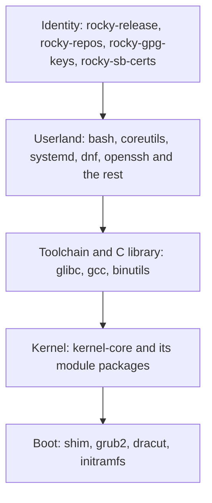
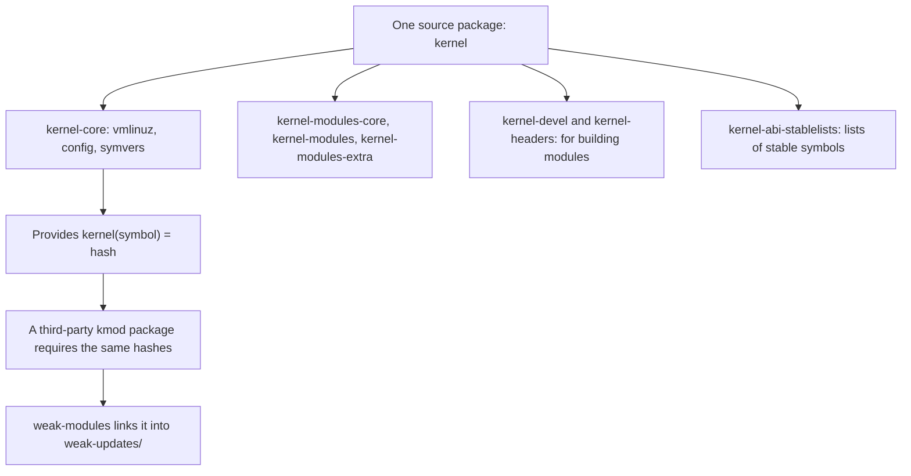
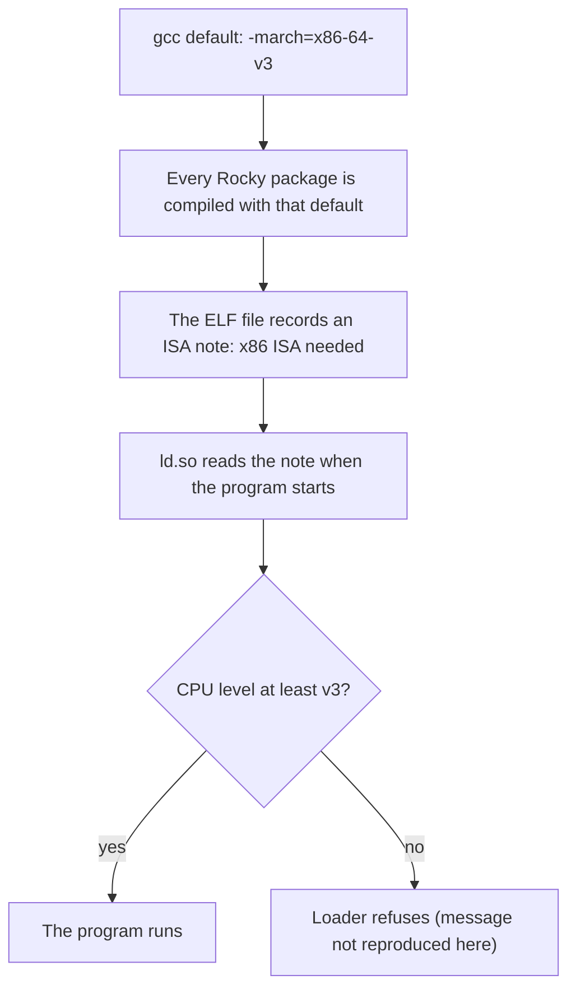

# 42 · What is inside an OS

<ul class="module-meta">
  <li>⏱ ~3 hours</li>
  <li>4 labs</li>
  <li>Builds on: 05 · Software: RPM and DNF, 41 · Anatomy of a package</li>
  <li>Environment: Tier A</li>
  <li>Verified: Rocky 10.2, 2026-11-07</li>
</ul>

Ask rpm who owns `/etc/os-release` and it names one small package, `rocky-release`. Change that package and the machine claims to be a different distribution. Everything else on the disk is an ordinary package that Rocky rebuilt from Red Hat's sources, and a few of those packages (the kernel, the C library and the compiler) decide what every other program on the machine is allowed to assume.

This module takes an installed Rocky Linux 10.2 apart. You will sort its packages into layers, find the handful of files that make it Rocky, learn which package supplies any behaviour you can see, and read two facts straight out of a binary: the CPU level it needs and the hardening it was built with.

<div class="pipeline-strip" data-here="build compose" role="group" aria-label="Rocky build pipeline, six stages" markdown>

1. Source
2. Build
3. Sign
4. Compose
5. Publish
6. Install

</div>

*You are here: Build and Compose (stages 2 and 4 of 6). Before: Source. After: Sign, then Publish.*

!!! abstract "What you'll learn"
    - Sort an installed system into five layers (identity, userland, toolchain, kernel, boot) and name the package that owns any file with `rpm -qf`.
    - Explain why Rocky 10 splits its content into BaseOS, AppStream and CRB, and why there are no DNF modules.
    - Name the four packages built from the one `rocky-release` source package, and read `os-release` and `macros.dist` as identity files.
    - Describe what makes the kernel, glibc and gcc special, and read the kernel package's subpackages and kABI provides.
    - Read the x86-64-v3 baseline from an ELF note, from `ld.so` and from the compiler, and say what we have and have not tested.
    - Read the hardening flags of a binary with `readelf` and match them to the build flags that produced them.
    - Add a layers and build-flags entry for `which` to your dossier.

!!! note "Remember from module 21"
    One Rocky release is a pile of RPMs rebuilt from Red Hat's sources, with a small delta that Rocky adds on top. Repositories are directories of RPMs plus metadata, and `rpm -qf` tells you which package owns a file. This module keeps the same facts but zooms in on what is inside the pile. It adds one detail to module 21's three identity packages: they come from **one** source package, and that source package builds a **fourth** binary package that a stock system does not install.

??? question "Before you start: three questions from earlier modules"
    Try these first, then open the answers.

    1. Which part of an RPM file does the RSA signature cover? (module 41)
    2. Which `rpm --queryformat` tag prints the signature as one clean line? (module 41)
    3. Why does an OS need a "seed" before it can build its own compiler? (module 40)

    ??? success "Answers"
        1. The main header only. The payload is protected by a digest that is recorded inside that signed header.
        2. `rpm -q --qf '%{RSAHEADER:pgpsig}\n' PACKAGE`. The `Signature` line of `rpm -qi` prints a label and puts the value on the next line.
        3. The compiler that builds the compiler has to come from somewhere. An OS is a pile of files built by tools that were themselves built from source, so somebody has to start with a seed.

## The big picture

You can look at an installed Rocky system in two ways. As a user, it is a very large number of files you never think about. As an engineer, it is a pile of packages, and every regular file belongs to exactly one of them. The second view is the useful one, because a package has a name, a version, a source package, a builder and a repository, and those answer most support and audit questions.

Not all packages weigh the same. A few packages decide which distribution this is. Three heavy ones (the kernel, glibc and gcc) set the floor that everything else stands on. The rest is userland, the ordinary programs and libraries you install and remove every day.

### An installed OS in one sentence

> **An installed OS is a pile of packages: a few identity packages say which distribution it is, three heavy ones (kernel, glibc, gcc) set the floor everything else stands on, and every file belongs to a package you can name.**

The word "layers" in this module is our teaching model, not a Rocky taxonomy. Rocky does not publish a layer list. We use five because each one answers a different question and each one can be inspected with a different command.



The diagram stacks the five layers from the part that says what the system is (identity) down to the part that starts it (boot). Identity files are tiny but decide the name and the repositories. Userland sits on the C library and compiler layer, which sits on the kernel, which the boot layer loads. The arrows show "stands on", not "installs before".

!!! analogy "Think of it like a building"
    The identity layer is the sign over the door. The userland is the rooms and furniture. The C library and the compiler are the building code the whole structure was built to. The kernel is the foundation, and the boot layer is the front door key that makes the foundation reachable.

    Where the analogy breaks: a building has one blueprint, while an OS is rebuilt package by package, so two machines with the same sign can hold different bricks. The same version string can hide different bits, which is the question this series keeps returning to.

### The few things that solve most problems

| Situation | What to do | Where this module teaches it |
|-----------|-----------|------------------------------|
| You need to know which package supplies a file, command or behaviour | `rpm -qf PATH`, or `rpm -q --whatprovides CAPABILITY` | The core skill |
| You need to know whether this really is Rocky, and which release | `rpm -qf /etc/os-release`, then read `/usr/lib/os-release` | Identity |
| You wonder whether Rocky changed a package | Look for `.rocky.0.N` in the release, then read the changelog | What Rocky changed |
| A binary will not run on a machine | Read the ISA note with `readelf -n`, and the version needs with `rpm -q --requires` | x86-64-v3, The binary that would not start |
| You need to know how a binary was hardened | `readelf -h`, `-lW`, `-d`, `-n` | Build flags and hardening |
| A third-party kernel module will not load | Compare the `kernel(symbol)` provides and requires, and look at `weak-updates/` | The three heavy packages |
| You are not sure which repository a package should come from | Know the three roles: BaseOS, AppStream, CRB | BaseOS, AppStream and CRB |

To pick one: start with a path. If you have a file, ask rpm who owns it. If you have a behaviour but no file, find the file that defines it (a unit file, a config file, a library) and ask rpm about that. If a program fails to start, ask the binary what it needs before you ask the package manager.

### Words you'll see

| Word | Plain meaning |
|------|---------------|
| **NVR** | Name, version and release, such as `which-2.21-44.el10_0`. The release part carries the dist tag. |
| **dist tag** | The `.el10` style suffix in a release. It comes from a macro the release package defines. |
| **identity package** | A package whose job is to say which distribution this is: `rocky-release` and its siblings. |
| **toolchain** | The compiler, linker and C library that turn source into programs. |
| **BaseOS, AppStream, CRB** | Rocky's three main repositories: the base system, applications and languages, and build-time libraries. |
| **ELF note** | A small labelled record inside a program file. Notes carry facts such as the build ID and the CPU level needed. |
| **ISA level** | A named set of CPU instructions, such as `x86-64-v3`. A program can say which level it needs. |
| **kABI** | The kernel's list of exported symbols that kernel modules are allowed to depend on. |
| **weak-modules** | A script that links a module built for one kernel into the `weak-updates/` directory of a newer, compatible kernel. |

## The core skill: ask rpm whose file this is

Every question in this module starts the same way. You have a path. You want the package behind it, and then the facts about that package.

The template has four steps.

1. Run `rpm -qf PATH`. The answer is a package NVR, or the sentence "is not owned by any package".
2. Read the release. A `.rocky.0.N` suffix means Rocky edited this package after importing it. No suffix means a straight rebuild, with exceptions you will meet below.
3. Ask for the builder facts: `rpm -q --qf '%{PACKAGER} %{SOURCERPM}\n' PACKAGE`.
4. Place the package in a layer and in a repository.

```console
$ rpm -qf /etc/os-release /etc/yum.repos.d/rocky.repo /etc/pki/rpm-gpg/RPM-GPG-KEY-Rocky-10
rocky-release-10.2-1.1.el10.noarch
rocky-repos-10.2-1.1.el10.noarch
rocky-gpg-keys-10.2-1.1.el10.noarch
$ rpm -q --qf '%{NAME}-%{VERSION}-%{RELEASE}.%{ARCH} | %{PACKAGER} | %{SOURCERPM}\n' which bash
which-2.21-44.el10_0.x86_64 | Rocky Linux Build System <releng@rockylinux.org> | which-2.21-44.el10_0.src.rpm
bash-5.2.26-6.el10.x86_64 | Rocky Linux Build System (Peridot) <releng@rockylinux.org> | bash-5.2.26-6.el10.src.rpm
```

Rocky 10.2 x86_64, 2026-11-07. Three files give three packages, and all three carry the same version and release (`10.2-1.1.el10`) because they come from one source package. The second command shows two builders. The plain `Rocky Linux Build System` is a Koji build host, and the one with `(Peridot)` is an older Peridot build (module 21 has the three packager strings).

Try three predictions before you open each answer.

**Practice 1.** Predict the owner of `/usr/sbin/useradd`, and whether the release carries a Rocky suffix.

??? success "Answer: shadow-utils, no Rocky suffix"
    ```console
    $ rpm -qf /usr/sbin/useradd
    shadow-utils-4.15.0-11.el10.x86_64
    ```
    Rocky 10.2 x86_64, 2026-11-07. A straight rebuild (release `11.el10`, no `.rocky`). The command name told you nothing about the package name, which is why you ask rpm instead of guessing.

**Practice 2.** Predict the owner of `/etc/ssh/sshd_config` and read its release. Was this package changed by Rocky?

??? success "Answer: openssh-server, yes, the release ends in .rocky.0.1"
    ```console
    $ rpm -qf /etc/ssh/sshd_config
    openssh-server-9.9p1-23.el10_2.rocky.0.1.x86_64
    ```
    Rocky 10.2 x86_64, 2026-11-07. The `.rocky.0.1` suffix says Rocky edited this package. The second worked story reads the changelog.

**Practice 3.** Predict what `rpm -qf /proc/version` prints.

??? success "Answer: no package owns it"
    ```console
    $ rpm -qf /proc/version
    file /proc/version is not owned by any package
    ```
    Rocky 10.2 x86_64, 2026-11-07. The running kernel generates `/proc`, so no package contains the file. Not every behaviour has a package.

When you have a behaviour and no path, this flow finds one.

<div class="decision" markdown>

<div class="node" data-id="start" markdown>

**What do you have?**

<button data-goto="path">A file path</button> <button data-goto="cmd">A command name</button> <button data-goto="cap">A library or capability name</button> <button data-goto="svc">A service</button>

</div>

<div class="node" data-id="path" markdown>

Run `rpm -qf PATH`. If rpm says "is not owned by any package", something created the file at run time. Look at what generated it.

</div>

<div class="node" data-id="cmd" markdown>

Resolve it with `command -v NAME`, then run `rpm -qf` on the path. `command -v which` prints `/usr/bin/which`, and `rpm -qf /usr/bin/which` prints `which-2.21-44.el10_0.x86_64`.

</div>

<div class="node" data-id="cap" markdown>

Run `rpm -q --whatprovides 'libc.so.6()(64bit)'`. On the test machine this printed `glibc-2.39-121.el10_2.x86_64`. For packages not installed yet, `dnf provides` searches the repositories.

</div>

<div class="node" data-id="svc" markdown>

Ask systemd where the unit file lives with `systemctl cat NAME`; the first line is a comment with the path, such as `# /usr/lib/systemd/system/sshd.service`. Then run `rpm -qf` on that path. The unit file's package is the package that supplies the service.

</div>

</div>

<div class="quiz" data-answer="2" markdown>

You run `rpm -qf /etc/os-release` on a Rocky 10.2 machine. Which package do you expect?

- `systemd`, because it reads the file
- `rocky-release`, because that package supplies the identity files
- `rocky-repos`, because it supplies the repository files

Right: `rocky-release` owns `/usr/lib/os-release` and the `/etc/os-release` link to it. `rocky-repos` owns the `.repo` files, and `rocky-gpg-keys` owns the key files.

</div>

## Five layers in one pile

Click through the layers. Each one has a command that shows what lives there on your own machine.

<div class="layers" data-open="0" data-hint="Click a layer to see what lives there and how to inspect it." markdown>

<div class="layer" data-label="Identity" data-tag="rocky-release" markdown>

**What it is:** the small set of files that says which distribution this is, which repositories it uses and which keys it trusts.

**Where to look:** `rpm -qf /etc/os-release`. The one source package `rocky-release` builds four binary packages: `rocky-release`, `rocky-repos`, `rocky-gpg-keys` and `rocky-sb-certs`. Only the first three are installed on a stock system.

```console
$ rpm -qa --qf '%{NAME}-%{VERSION}-%{RELEASE} <- %{SOURCERPM}\n' | grep -E '^rocky-(release|repos|gpg)' | sort
rocky-gpg-keys-10.2-1.1.el10 <- rocky-release-10.2-1.1.el10.src.rpm
rocky-release-10.2-1.1.el10 <- rocky-release-10.2-1.1.el10.src.rpm
rocky-repos-10.2-1.1.el10 <- rocky-release-10.2-1.1.el10.src.rpm
```

</div>

<div class="layer" data-label="Userland" data-tag="BaseOS, AppStream" markdown>

**What it is:** shell, coreutils, systemd, the package manager, networking, ssh and everything you install on top. This is where almost all the packages are.

**Where to look:** `rpm -qa | wc -l` counts installed binary packages (plus any imported GPG keys, which rpm lists as pseudo-packages). `rpm -qa --qf '%{SOURCERPM}\n' | sort -u | wc -l` counts the source packages they came from. The second number is always smaller, because one source package can build many binary packages.

</div>

<div class="layer" data-label="Toolchain and libc" data-tag="glibc, gcc" markdown>

**What it is:** the C library (glibc) that every program talks to, and the compiler and linker (gcc, binutils) that built the rest. Their defaults become the defaults of every package built afterwards.

**Where to look:** `rpm -q glibc gcc binutils`, and `gcc -Q --help=target | grep -E '^ +-march='` for the default CPU level.

</div>

<div class="layer" data-label="Kernel" data-tag="kernel-core" markdown>

**What it is:** one source package, `kernel`, that builds many binary packages: the core kernel, tiers of modules, headers, development files and the kABI lists.

**Where to look:** `rpm -qf /boot/vmlinuz-$(uname -r)` prints `kernel-core-...`, and `rpm -q --provides kernel-core-$(uname -r) | grep -c '^kernel('` counts the exported symbol hashes.

</div>

<div class="layer" data-label="Boot" data-tag="shim, grub2, dracut" markdown>

**What it is:** the signed loader chain on the EFI partition, the boot loader configuration, and the initramfs that the kernel unpacks first.

**Where to look:** `rpm -qf /boot/efi/EFI/rocky/shimx64.efi` and `ls /boot`. Module 14 covers the boot process and module 29 covers Secure Boot. Module 48 shows who signs which piece.

</div>

</div>

Identity says what the system is, userland is the bulk, the toolchain and libc layer fixes what userland can assume, the kernel sits under all of it, and the boot layer starts the kernel. A package belongs to one layer in this model even when the real dependency graph is messier.

## BaseOS, AppStream and CRB: three roles, no modules

Rocky 10 inherits Red Hat's split of the distribution into repositories. The names matter less than the three roles behind them.

- **BaseOS** is the base system: the pieces that make a minimal system boot and be managed. The kernel, glibc, bash, systemd, rpm and dnf, the identity packages `rocky-release`, `rocky-repos` and `rocky-gpg-keys`, and `kernel-abi-stablelists` are all in `baseos`.
- **AppStream** is applications, languages and build-time pieces that users commonly want. On the test machine, `gcc`, `glibc-devel`, `kernel-devel`, `kernel-headers` and `readline-devel` all come from `appstream`.
- **CRB** is extra development and build-time packages. It is off by default. It holds many `-devel` and documentation style packages that most systems never need.

Why split at all? The split lets the project treat different kinds of content differently (what installs by default, what is on by default, what a build system uses) while keeping everything in one release. The exact support promises for each part come from Red Hat's documentation, and Rocky documentation describes them for Rocky. This module does not repeat them, because we did not verify a statement about them here.

```console
$ dnf repolist --all | grep -E '^(baseos|appstream|crb|devel) '
appstream                     Rocky Linux 10 - AppStream                enabled
baseos                        Rocky Linux 10 - BaseOS                   enabled
crb                           Rocky Linux 10 - CRB                      disabled
devel                         Rocky Linux 10 - Devel WARNING! FOR BUILD disabled
```

Rocky 10.2 x86_64, 2026-11-07. The test machine also had EPEL and a SIG repository enabled; the output above filters to Rocky's four.

<!-- ev: FACTBASE-B 3.1; labs/final 06-observations | observed | Rocky 10.2 x86_64 VM, 2026-11-07 -->
!!! evidence "Observed: where the heavy packages live"
    **Seen on:** Rocky 10.2 x86_64, 2026-11-07.

    ```console
    $ dnf repoquery --disablerepo='*' --enablerepo=baseos,appstream,crb --latest-limit 1 \
        --qf '%{name} %{repoid}' kernel-core glibc glibc-devel gcc rocky-release | sort
    gcc appstream
    glibc baseos
    glibc-devel appstream
    kernel-core baseos
    rocky-release baseos
    ```

    **Check it yourself:** run the command on any Rocky 10 system with network access. The runtime pieces (kernel, glibc) are in BaseOS, and the compiler and the glibc development files are in AppStream. A package that is only useful for building is not automatically in CRB: the split is by role, and the roles overlap.

### Sizes, with denominators

How big are the three? The mechanism is stable: each repository has a metadata file (`primary.xml`) that lists every RPM file in that tree, including older retained versions. Count the entries and you have the size of the tree. The dated values follow.

<!-- ev: FACTBASE-B 3.1; ERRATA E9 | observed | Rocky 10.2 x86_64 VM, 2026-11-07 -->
!!! freshness "As of 2026-11-07 on Rocky 10.2"
    Counting x86_64 and noarch RPM files in each public tree, old retained versions included: BaseOS 3,194 files from 412 source package names, AppStream 7,672 files from 1,653 source package names, CRB 1,909 files from 813 source package names. The source names overlap a little between repositories, so the three do not add up to a distinct total. These numbers change every time the project publishes an update, usually weekly.

    **Re-check:** the loop below.

```bash
cd "$(mktemp -d)"
B=https://dl.rockylinux.org/pub/rocky/10
for r in BaseOS AppStream CRB; do
  h=$(curl -s $B/$r/x86_64/os/repodata/repomd.xml | grep -A3 'type="primary"' | grep -o 'href="[^"]*"' | head -1 | sed 's/href="//;s/"//')
  curl -s $B/$r/x86_64/os/$h -o $r.xml.gz
  printf '%-9s rpm files: %s   source names: %s\n' $r \
    "$(zcat $r.xml.gz | grep -c '<package type="rpm">')" \
    "$(zcat $r.xml.gz | grep -o '<rpm:sourcerpm>[^<]*' | sed -E 's/<rpm:sourcerpm>//;s/-[^-]+-[^-]+\.src\.rpm$//' | sort -u | wc -l)"
done
```

On 2026-11-07 the loop printed `BaseOS rpm files: 3194 source names: 412`, `AppStream rpm files: 7672 source names: 1653` and `CRB rpm files: 1909 source names: 813`. The BaseOS package list alone is about 47 MB compressed, so the loop takes a moment and fills a scratch directory; delete it afterwards.

One consequence is easy to trip on. `dnf repoquery --latest-limit 1` shows only the newest version of each package, so it prints fewer names than the tree has files. On the test machine it listed 1,293 CRB package names against 1,909 CRB files in the tree (2026-11-07). Both numbers are right, because they count different things.

### Why there are no modules

Older Red Hat releases (and Rocky 8 and 9) used **DNF modules**, a way to ship several versions of a program in one repository as named streams. Rocky 10 does not. The repository metadata has no `modules` entry, the compose metadata file for modules is empty, and alternative versions ship as separately named packages instead. DNF itself still has the command, which tells you it is going away.

```console
$ dnf --version | head -1
4.20.0
$ dnf module list
WARNING: modularity is deprecated, and functionality will be removed in a future release of DNF5.
Last metadata expiration check: 0:32:24 ago on Sat 07 Nov 2026 01:24:56 AM UTC.
```

Rocky 10.2 x86_64, 2026-11-07. The command prints the warning and an empty list. The warning names DNF5 as the place the feature goes away, but the installed DNF is the 4.20 line, so do not read "DNF5" as the version you are running.

```console
$ curl -s https://dl.rockylinux.org/pub/rocky/10/BaseOS/x86_64/os/repodata/repomd.xml | grep -E 'revision|<data type'
  <revision>10.2</revision>
  <data type="primary">
  <data type="filelists">
…
  <data type="group">
  <data type="group_xz">
  <data type="updateinfo">
```

Rocky 10.2 x86_64 public tree, 2026-11-07 (trimmed with an ellipsis). The types include a comps `group` file and `updateinfo` (security advisories). There is no `modules` type.

<div class="quiz" data-answer="3" markdown>

Which repository is disabled by default on a stock Rocky 10 system?

- BaseOS
- AppStream
- CRB

Right: `crb` is off until you enable it, for example with `sudo dnf config-manager --set-enabled crb`. BaseOS and AppStream are on.

</div>

??? version "Comparison lens: RHEL and CentOS Stream"
    Red Hat's public UBI 10 BaseOS repository (a RHEL-derived tree that needs no subscription) reads an epoch number as its revision (`1793833871` on 2026-11-07), while Rocky's BaseOS `repomd.xml` reads `<revision>10.2</revision>`. CentOS Stream's BaseOS reads `10-stream` and its metadata has no `updateinfo` entry (2026-11-07). **Check it yourself:** run the `curl` command above against `https://cdn-ubi.redhat.com/content/public/ubi/dist/ubi10/10/x86_64/baseos/os/repodata/repomd.xml` and `https://mirror.stream.centos.org/10-stream/BaseOS/x86_64/os/repodata/repomd.xml`. I did not check Red Hat's entitled RHEL BaseOS repository, which needs a subscription.

## Identity: the handful of files that make this Rocky

The identity of the system is a handful of files owned by `rocky-release`. Module 21 named the three packages a stock system installs. The complete set is a little larger, so here it is exactly.

One **source package**, `rocky-release`, builds four **binary packages**. That is the whole identity set.

| Binary package | What it carries | Installed by default? |
|---|---|---|
| `rocky-release` | `os-release`, `rocky-release`, the Red Hat style links, macros, presets, licence text | yes |
| `rocky-repos` | the `.repo` files and the DNF variables | yes |
| `rocky-gpg-keys` | the public release keys | yes |
| `rocky-sb-certs` | Secure Boot and related certificates | no, it is in `crb` and `devel` |

```console
$ rpm -ql rocky-release | head -13
/etc/issue
/etc/issue.d
/etc/issue.net
/etc/os-release
/etc/redhat-release
/etc/rocky-release
/etc/rocky-release-upstream
/etc/system-release
/etc/system-release-cpe
/etc/yum.repos.d
/usr/lib/os-release
/usr/lib/rpm/macros.d/macros.dist
/usr/lib/sysctl.d/50-redhat.conf
```

Rocky 10.2 x86_64, 2026-11-07, trimmed with `head`. The list goes on with the systemd presets (which services start by default), the documentation, the licence and the EULA. So the identity set is more than the handful of files a first look suggests.

Both `/etc/os-release` and `/etc/redhat-release` are symbolic links. Reading the real fields is the fastest identity check.

```console
$ ls -l /etc/os-release /etc/redhat-release
lrwxrwxrwx. 1 root root 21 May 23 00:00 /etc/os-release -> ../usr/lib/os-release
lrwxrwxrwx. 1 root root 13 May 23 00:00 /etc/redhat-release -> rocky-release
$ cat /usr/lib/os-release
NAME="Rocky Linux"
VERSION="10.2 (Red Quartz)"
…
ID="rocky"
ID_LIKE="rhel centos fedora"
VERSION_ID="10.2"
PLATFORM_ID="platform:el10"
…
CPE_NAME="cpe:/o:rocky:rocky:10::baseos"
…
VENDOR_NAME="RESF"
…
SUPPORT_END="2035-05-31"
ROCKY_SUPPORT_PRODUCT="Rocky-Linux-10"
…
```

Rocky 10.2 x86_64, 2026-11-07. Each field has a reader.

| Field | Who reads it | What it says |
|---|---|---|
| `ID` and `ID_LIKE` | install scripts and tools | this is `rocky`, and it behaves like `rhel` and `centos` |
| `VERSION_ID` | scripts, support tools | the minor release, `10.2` |
| `CPE_NAME` | vulnerability scanners | a machine-readable product name |
| `SUPPORT_END` | lifecycle tools | the last day of support, `2035-05-31` |

A script that needs the release should read `/usr/lib/os-release` rather than parse `/etc/redhat-release`. One more fact is easy to miss. The package that owns the identity also says what it is compatible with.

```console
$ rpm -q --provides rocky-release | grep -E '^(centos|redhat)-release ='
centos-release = 10.2-1.1.el10
redhat-release = 10.2-1.1.el10
```

Rocky 10.2 x86_64, 2026-11-07. `rocky-release` provides `redhat-release` and `centos-release`. That is how a package built for Red Hat's family can say "I need a `redhat-release`" and still install on Rocky: the dependency is satisfied by the Rocky package.

<!-- ev: FACTBASE-B O-13; labs/final 06-observations | observed | Rocky 10.2 x86_64 VM, 2026-11-07 -->
!!! evidence "Observed: the dist tag comes from the release package"
    **Seen on:** Rocky 10.2 x86_64, 2026-11-07.

    ```console
    $ rpm -qf /usr/lib/rpm/macros.d/macros.dist
    rocky-release-10.2-1.1.el10.noarch
    $ rpm --eval '%rhel %dist %dist_vendor'
    10 .el10 RESF
    $ rpm -E '%{?rhel} %{?rocky} %{?centos} %{?el10}'
    10 10 10 1
    ```

    **Check it yourself:** run the three commands on any Rocky 10 system. The macro file belongs to `rocky-release`, so the dist tag (`.el10`) that appears in the name of every package you build or install is defined by the identity package. `rhel`, `rocky` and `centos` all read 10 because Rocky defines all three.

### What `~bootstrap` is for

Open `macros.dist` and you will find a macro called `%__bootstrap` whose value is `~bootstrap`. The `%dist` macro appends it only when a build defines `with_bootstrap`.

```console
$ rpm --eval '%dist'
.el10
$ rpm --define 'with_bootstrap 1' --eval '%dist'
.el10~bootstrap
$ rpm --eval '%{lua: print(rpm.vercmp("1.0-1.el10~bootstrap", "1.0-1.el10"))}'
-1
```

Rocky 10.2 x86_64, 2026-11-07. In RPM's version comparison, a tilde sorts **before** everything, including the end of the string. The last command returns `-1`, so `1.0-1.el10~bootstrap` is older than `1.0-1.el10`. The point of the suffix is clear from that: a package built during a bootstrap pass (when the buildroot is incomplete) is marked so the normal rebuild always replaces it. We did not find a public statement of how Rocky used this for Rocky 10, so treat the explanation as "what the version arithmetic allows", not as a history.

### Where the other three packages go next

`rocky-repos` and `rocky-gpg-keys` are enough for DNF to fetch and check packages. Module 47 follows the keys and the signatures, including the two key files that ship in the tree. `rocky-sb-certs` holds the certificates that Secure Boot and module signing use; module 48 explains how they fit. Here you only need to know where it lives.

<!-- ev: FACTBASE-B O55 | observed | Rocky 10.2 x86_64 VM, 2026-11-07 -->
!!! evidence "Observed: rocky-sb-certs is published to two repositories"
    **Seen on:** Rocky 10.2 x86_64, 2026-11-07.

    ```console
    $ rpm -q rocky-sb-certs
    package rocky-sb-certs is not installed
    $ dnf repoquery --disablerepo='*' --enablerepo=crb,devel,baseos,appstream \
        --qf '%{name}-%{version}-%{release} %{repoid}' rocky-sb-certs glibc32 | tail -4
    rocky-sb-certs-10.2-1.1.el10 crb
    rocky-sb-certs-10.2-1.1.el10 devel
    rocky-sb-certs-10.2-1.2.el10 crb
    rocky-sb-certs-10.2-1.2.el10 devel
    ```

    **Check it yourself:** run the commands. The package is not installed on a stock system and is listed in both `crb` and `devel`, with no `glibc32` line. We found no explanation for the double listing.

??? version "Comparison lens: AlmaLinux and CentOS Stream"
    The same source of identity exists elsewhere, with different values. AlmaLinux defines `%almalinux 10` and leaves `%rocky` unset. The same `which-2.21-44` release number ships on Rocky and AlmaLinux as `el10_0` and on CentOS Stream as `el10` (observed on sibling-distribution test hosts at different patch levels, 2026-11-07, not re-run on 2026-11-07). **Check it yourself:** run `rpm -E '%{?rhel} %{?rocky} %{?almalinux}'` on each system and compare the three numbers.

## What Rocky changed, and how to see it

If Rocky rebuilds Red Hat's sources, how much does Rocky actually change? Less than most people expect, and the changes are findable.

The mechanism is the release suffix. When Rocky edits a package after importing it (for example to remove a Red Hat specific message, or to swap a certificate), it adds `.rocky.0.N` to the release. A package with no such suffix is a rebuild with no recorded edit. Two commands show the pattern on your own machine.

```console
$ rpm -qa --qf '%{RELEASE}\n' | grep -c rocky
45
$ rpm -qa --qf '%{SOURCERPM}\n' | grep '\.rocky\.0' | sed -E 's/-[^-]+-[^-]+\.src\.rpm$//' | sort -u | tr '\n' ' '
cockpit dnf efi-rpm-macros elfutils grub2 ima-evm-utils libdnf lorax mesa openssh redhat-rpm-config systemd
```

Rocky 10.2 x86_64, 2026-11-07. The test machine is a lab VM with extra packages, so it shows 12 source packages with the marker. The first number counts binary packages whose release contains `rocky`. A stock cloud image showed 10 source packages in our earlier test (`cockpit`, `dnf`, `efi-rpm-macros`, `elfutils`, `grub2`, `ima-evm-utils`, `libdnf`, `openssh`, `redhat-rpm-config`, `systemd`), and the lab VM added `lorax` and `mesa`.

<!-- ev: FACTBASE-A O9; labs/final 06-observations | observed | Rocky 10.2 x86_64 VM and public repos, 2026-11-07 -->
!!! freshness "As of 2026-11-07 on Rocky 10.2"
    Across the 10.2 BaseOS, AppStream and CRB trees (x86_64 and noarch metadata, old retained versions included), 28 of 2,198 distinct source package names carry the `.rocky.0.N` marker, about 1.3%. The kernel is patched without the marker (its source package carries `1000-debrand-some-messages.patch` and its release has no `.rocky`), so no suffix does not prove no change. This changes with each rebuild that adds or removes an edit.

    **Re-check:** `rpm -qa --qf '%{SOURCERPM}\n' | grep '\.rocky\.0' | sort -u | wc -l` counts the marked source packages on your own system. The repository-wide count uses the `primary.xml` loop in the freshness box of module 41 (it printed `28 of 2198` on 2026-11-07).

The consequence for support work is simple. The packages that matter most when behaviour differs from Red Hat are the ones with the suffix, plus the kernel, which is patched without it. Module 45 shows where the edits live (small patch files in public repositories) and how Rocky applies them at import time.

<div class="quiz" data-answer="3" markdown>

A package named `kernel-core-6.12.0-211.74.1.el10_2` has no `.rocky` suffix. What can you conclude?

- Rocky built it with no changes of any kind
- It is identical to Red Hat's build, bit for bit
- Nothing yet: the kernel is patched without carrying the marker, and no suffix is only a hint

Right: the suffix marks edits that Rocky chose to record in the release. The kernel carries a debranding patch but not the marker, and an identical version string can still hide different bits.

</div>

## The three heavy packages

Almost every package on the system is built by the same compiler against the same C library, and runs on the same kernel. That makes three packages special.

- The **kernel** is the one package no program can run without.
- **glibc** is the C library. Nearly every program loads it, so its version decides what a program built today can run on.
- **gcc** is the compiler. Its defaults (CPU level, hardening) become the defaults of every package built afterwards.

Each is a large source package that builds many binary packages.

### The kernel package

The kernel is one source package, `kernel`, that builds a family of binary packages. You can see the family on your machine.

```console
$ rpm -q --qf '%{NAME} %{SOURCERPM}\n' kernel-core kernel-modules-core kernel-modules kernel-modules-extra kernel-devel kernel-headers kernel-abi-stablelists | sort -u
kernel-abi-stablelists kernel-6.12.0-211.74.1.el10_2.src.rpm
kernel-core kernel-6.12.0-211.16.1.el10_2.0.1.src.rpm
kernel-core kernel-6.12.0-211.74.1.el10_2.src.rpm
kernel-devel kernel-6.12.0-211.74.1.el10_2.src.rpm
kernel-headers kernel-6.12.0-211.74.1.el10_2.src.rpm
kernel-modules-core kernel-6.12.0-211.16.1.el10_2.0.1.src.rpm
kernel-modules-core kernel-6.12.0-211.74.1.el10_2.src.rpm
kernel-modules-extra kernel-6.12.0-211.74.1.el10_2.src.rpm
kernel-modules kernel-6.12.0-211.74.1.el10_2.src.rpm
```

Rocky 10.2 x86_64, 2026-11-07. Two kernels are installed on the test machine (the one on the image and a newer one), so `kernel-core` and `kernel-modules-core` appear twice. Every line shows the same source package name, `kernel`, because one source builds them all.



The diagram shows one source package fanning out into the core kernel, three tiers of modules, build-time files and the kABI lists. The core kernel (and the module packages) advertise symbol hashes as RPM provides. A third-party module package requires those same hashes, and `weak-modules` links the module into a newer kernel's `weak-updates/` directory when the hashes still match.

The kernel itself is a file. On the test machine, `kernel-core` owns the pieces of one kernel version:

```console
$ rpm -qf /boot/vmlinuz-$(uname -r)
kernel-core-6.12.0-211.16.1.el10_2.0.1.x86_64
$ rpm -ql kernel-core-$(uname -r) | grep -E 'vmlinuz$|/config$|symvers'
/boot/symvers-6.12.0-211.16.1.el10_2.0.1.x86_64.xz
/lib/modules/6.12.0-211.16.1.el10_2.0.1.x86_64/config
/lib/modules/6.12.0-211.16.1.el10_2.0.1.x86_64/symvers.xz
/lib/modules/6.12.0-211.16.1.el10_2.0.1.x86_64/vmlinuz
```

Rocky 10.2 x86_64, 2026-11-07. The kernel image, its build configuration and the symbol table with its checksums all belong to `kernel-core`.

#### kABI: the promise behind the symbol hashes

Kernel modules call kernel functions by name. A module built for one kernel will refuse to load into another if the functions it calls changed shape. The **kABI** (kernel application binary interface) is a list of symbols that the distribution promises to keep stable inside a release, so that vendors can ship a module once and have it keep working across updates.

Rocky shows the list in two forms. Every kernel package advertises the symbols it exports as RPM provides, one per symbol with a checksum of its shape. And `kernel-abi-stablelists` ships the lists of symbols considered stable.

```console
$ rpm -q --provides kernel-core-$(uname -r) | grep -c '^kernel('
13037
$ ls -d /lib/modules/kabi*
/lib/modules/kabi-current
/lib/modules/kabi-rhel100
/lib/modules/kabi-rhel101
/lib/modules/kabi-rhel102
$ ls /lib/modules/kabi-current
kabi_stablelist_aarch64
kabi_stablelist_ppc64le
kabi_stablelist_riscv64
kabi_stablelist_s390x
kabi_stablelist_x86_64
```

Rocky 10.2 x86_64, 2026-11-07. This machine runs the image kernel, and `kernel-abi-stablelists` was installed first (`sudo dnf install kernel-abi-stablelists`). The list directory has one folder per minor release (`kabi-rhel100`, `101`, `102`). Our reading: one list per minor release suggests that the stability promise is per minor. We did not verify the EL10 policy, so check Red Hat's and Rocky's documentation before relying on one module build across minor releases.

<!-- ev: FACTBASE-C O-47; labs/final 06-observations | observed | Rocky 10.2 x86_64 VM, 2026-11-07 -->
!!! evidence "Observed: the provides count belongs to a build, not to a release"
    **Seen on:** Rocky 10.2 x86_64, 2026-11-07.

    ```console
    $ rpm -q --provides kernel-core-6.12.0-211.16.1.el10_2.0.1 | grep -c '^kernel('
    13037
    $ rpm -q --provides kernel-core-6.12.0-211.74.1.el10_2 | grep -c '^kernel('
    13057
    $ rpm -q --provides kernel-core-6.12.0-211.74.1.el10_2 | grep '^kernel(' | head -3
    kernel(BUG_func) = 0xd4ec10e6
    kernel(FSE_readNCount) = 0xe58eb9d7
    kernel(HUF_readStats) = 0xb55139f6
    ```

    **Check it yourself:** run the count for each kernel you have installed. The two builds of the same minor release export different numbers of hashed symbols, so the number is a property of one build, and a module that requires a hash is tied to the interface that exported it.

#### weak-modules on Rocky 10

On Rocky 10.2 `weak-modules` is present. It ships in the `kmod` package, and `kernel-core` calls it from its own scriptlets when the file is executable.

```console
$ rpm -qf /usr/sbin/weak-modules
kmod-31-13.el10.x86_64
$ rpm -q --scripts kernel-core-$(uname -r) | grep -c weak-modules
4
```

Rocky 10.2 x86_64, 2026-11-07. The script belongs to `kmod`, not to the kernel package, and the kernel's install and remove scriptlets mention it four times between them.

<!-- ev: FACTBASE-B O49; FACTBASE-C O-47 | observed | Rocky 10.2 x86_64 disposable VM, V4 report, 2026-11 -->
!!! evidence "Observed: weak-modules links a third-party module into a newer kernel"
    **Seen on:** Rocky 10.2 x86_64 (a disposable VM, earlier test run).

    ```console
    $ ls -l /lib/modules/*/weak-updates/fs/
    ... btrfs.ko.xz -> /lib/modules/6.12.0-211.7.1.el10_2.x86_64/extra/fs/btrfs.ko.xz
    $ modinfo btrfs | grep -E 'filename|vermagic'
    filename:       /lib/modules/6.12.0-211.16.1.el10_2.0.1.x86_64/weak-updates/fs/btrfs.ko.xz
    vermagic:       6.12.0-211.7.1.el10_2.x86_64 SMP preempt mod_unload modversions
    ```

    **Check it yourself:** this needs a third-party module package, so it is not one of the labs. The test used `kmod-btrfs` from a SIG repository on a disposable VM. The link points to a module built for an older kernel (`211.7.1`), and `modinfo` shows that older `vermagic` even though the running kernel is newer.

<!-- ev: FACTBASE-B 3.4; ERRATA E12 | observed | Rocky 10.2 SRPM and x86_64 VM, 2026-11-07 -->
!!! freshness "As of 2026-11-07 on Rocky 10.2"
    The `kernel-6.12.0-211.74.1.el10_2` source package is about 160 MB, has a spec file of 24,589 lines and 44 build requirements, and carries one Rocky patch (`1000-debrand-some-messages.patch`). It builds 64 binary packages for x86_64 (108 for aarch64). A new kernel arrives roughly weekly, so the NVR and these counts change often; the image kernel is frozen per minor release.

    **Re-check:** `dnf repoquery --latest-limit 1 kernel-core` prints the newest kernel NVR. With the source package downloaded, `rpm -qpl kernel-VERSION.src.rpm | wc -l` counts the source files (73), `rpm -qpR kernel-VERSION.src.rpm | grep -vc '^rpmlib'` counts the build requirements, and `rpm -qpl kernel-VERSION.src.rpm | grep debrand` finds the Rocky patch. For the binary-package counts, extract `kernel.spec` and run `rpmspec -q --rpms --target x86_64 kernel.spec | wc -l` (64; use `aarch64` for 108). All reproduced 2026-11-07.

### glibc

glibc is the C library: the layer between programs and the kernel. Its release number is one of the first things that decides whether a binary built on one system runs on another, which is the subject of the first worked story below.

- The glibc source package is large. Its spec file defines a `bootstrap` switch (`%bcond_with bootstrap`) that drops benchmarks, documentation and several build requirements. A switch like this normally supports a first build in an incomplete buildroot. We found no Rocky page saying when it is used.
- glibc is packaged by language. `glibc-minimal-langpack` carries no files, `glibc-all-langpacks` holds every locale in one package, and there is one `glibc-langpack-<language>` package per language.
- There is no 32-bit userland on Rocky 10. `gcc -m32` fails at the link step with "cannot find crt1.o" (observed 2026-11-07).

```console
$ rpm -q glibc gcc binutils
glibc-2.39-121.el10_2.x86_64
gcc-14.3.1-4.4.el10.x86_64
binutils-2.41-63.el10.x86_64
```

Rocky 10.2 x86_64, 2026-11-07. Do not read the installed glibc as the newest: the test machine was not fully updated, which is why `rpm -q glibc` printed `121` while `dnf download --source glibc` fetched `2.39-145.el10_2` the same day.

<!-- ev: FACTBASE-B 3.5 | observed | Rocky 10.2 SRPMs, 2026-11-07 -->
!!! freshness "As of 2026-11-07 on Rocky 10.2"
    glibc `2.39-145.el10_2` has 681 patches and a spec file of 4,702 lines. gcc `14.3.1-4.4.el10` has a spec file of 5,279 lines, and there is a separate `gcc-toolset-15` package set under `/opt/rh/gcc-toolset-15/root/usr`. These numbers change at every rebuild.

    **Re-check:** `dnf download --source glibc gcc --enablerepo=baseos-source --enablerepo=appstream-source`, then `rpm2archive glibc-[0-9]*.src.rpm > glibc.tgz; tar xzOf glibc.tgz ./glibc.spec | wc -l`, and the same for `gcc`.

### gcc

gcc is the compiler that built nearly everything else, so its defaults matter. On Rocky 10.2 x86_64 the compiler targets the x86-64-v3 CPU level by default, and the compiler's own configuration says so.

```console
$ gcc -Q --help=target | grep -E '^ +-march='
  -march=                     		x86-64-v3
$ gcc -v 2>&1 | grep -o 'with-arch_64=[^ ]*'
with-arch_64=x86-64-v3
```

Rocky 10.2 x86_64, 2026-11-07. Both the default `-march` and the configure option that set it read `x86-64-v3`. The next section follows what that means for a binary.

Where did the first gcc come from? A compiler needs a compiler to build it. The gcc spec file builds with `--enable-bootstrap` and `--with-build-config=bootstrap-lto`, which is gcc's own three-stage self-build. It does not create the very first compiler.

Our reading: the spec has no switch that builds gcc from nothing, so the chicken and egg problem is broken by consuming an existing toolchain, not by a from-scratch bootstrap inside Rocky. We found no public description of how the first x86_64 and aarch64 Rocky 10 compiler was obtained. A public post says the riscv64 compiler stack was bootstrapped from another distribution's RISC-V port. Module 40 explains why every distribution has this problem.

Also unexplained is a build requirement in the gcc spec: `BuildRequires: (glibc32 or glibc-devel(%{__isa_name}-32))`. The glibc spec defines a `glibc32` subpackage and gives "a technical limitation in the distribution build environment" as the reason it is not shipped. We queried BaseOS, AppStream, CRB, devel and extras on 2026-11-07 and found no `glibc32` in any of them. How the gcc requirement is satisfied is in the unknown box before the labs.

??? version "Comparison lens: RHEL and CentOS Stream"
    Rocky's gcc and glibc sources arrive from Red Hat like any other package, so their spec files are not Rocky's own design (I did not diff them against Red Hat's). **Check it yourself:** compare `rpm -q --qf '%{VENDOR} %{PACKAGER}\n' gcc` on each distribution.

## x86-64-v3: a baseline you can read from the binary

Not every x86 CPU supports every instruction. The community groups instructions into named **microarchitecture levels**: `x86-64-baseline`, `x86-64-v2`, `x86-64-v3` and `x86-64-v4`. Rocky 10 makes `x86-64-v3` the baseline of the whole distribution, which means a Rocky 10 compiler emits instructions that older CPUs do not have.

The Rocky 10.0 release notes state it plainly: on x86_64, RL 10 no longer supports hardware at the x86-64-v2 level and earlier, and makes the v3 level the baseline (docs release notes for 10.0, checked 2026-11-07).

Three places show the baseline, and each one is a different part of the chain.



The diagram follows one program. The compiler's default sets the level. Every package built with that default carries a note saying which level it needs. The loader (`ld.so`) reads the note when the program starts and compares it with the CPU. The last box is the part we did not test: we never ran a Rocky 10 binary on a CPU below v3.

### The three observations

First, the CPU itself. The Linux CPU flag you need is named `abm` on Intel, not `lzcnt`:

```console
$ grep -m1 'model name' /proc/cpuinfo
model name	: Intel(R) Xeon(R) Platinum 8259CL CPU @ 2.50GHz
$ grep -ow abm /proc/cpuinfo | head -1
abm
```

Second, the loader. Modern glibc also searches **hwcaps** directories, subfolders named for a CPU level, and picks the best libraries that the CPU can run:

```console
$ /lib64/ld-linux-x86-64.so.2 --help | grep -A4 'Subdirectories of glibc-hwcaps'
Subdirectories of glibc-hwcaps directories, in priority order:
  x86-64-v4 (supported, searched)
  x86-64-v3 (supported, searched)
  x86-64-v2 (supported, searched)
```

Third, the binary itself. The ISA note is part of the program file:

```console
$ readelf -n /usr/bin/bash | grep -E 'x86 '
      Properties: x86 feature: IBT, SHSTK
	x86 ISA needed: x86-64-baseline, x86-64-v2, x86-64-v3
	x86 feature used: x86, XMM, YMM
	x86 ISA used: x86-64-baseline, x86-64-v3
```

Rocky 10.2 x86_64, 2026-11-07. `ISA needed` lists every level up to and including the highest the program requires, so `v3` is the top entry. `ISA used` shows the levels whose instructions the compiler actually emitted. The `feature` lines (`IBT`, `SHSTK`) are the control-flow protection that the hardening section explains.

<!-- ev: FACTBASE-B O24; labs/final 06-observations; reviewer A re-run of both scans | observed | Rocky 10.2 x86_64 VM, 2026-11-07 -->
!!! evidence "Observed: every ISA-noted binary we scanned needs v3"
    **Seen on:** Rocky 10.2 x86_64, 2026-11-07 (Xeon Platinum 8259CL, a v4 CPU), run as a normal user.

    ```console
    $ n=0; need=0; for f in /usr/bin/* /usr/lib64/*.so.*; do
    >   [ -f "$f" ] && [ ! -L "$f" ] || continue
    >   head -c4 "$f" 2>/dev/null | grep -q ELF || continue
    >   n=$((n+1))
    >   l=$(readelf -n "$f" 2>/dev/null | grep 'x86 ISA needed') || continue
    >   need=$((need+1))
    >   echo "$l" | grep -q 'x86-64-v3' || echo "not v3: $f"
    > done; echo "ELF files: $n, with an ISA note: $need"
    ELF files: 1199, with an ISA note: 787
    ```

    **Check it yourself:** run the loop (it is Lab 3). No `not v3:` line appeared. The counts depend on the machine and on who runs it. On the same VM, as root, the loop printed 1204 ELF files and 792 with a note (root can read five programs that a normal user cannot, such as `sudo`). An earlier scan of the same two directories on a different VM with more packages installed (2026-11-05) found 1,432 ELF files, of which 889 carried an ISA note, and all 889 needed v3. The scans therefore agree on the relationship (every note says v3) and not on the totals, so quote the relationship and never a fixed count. The files without a note may be assembler-only or carry no properties; we did not classify them.

### What we have and have not tested

Be careful with the next statement. The loader binary contains the string `CPU ISA level is lower than required`, and a Rocky 10 program started on a CPU below v3 presumably triggers it. We read that string with `strings`. We never ran a Rocky 10 program on a CPU below v3.

```console
$ strings /lib64/ld-linux-x86-64.so.2 | grep 'ISA level'
CPU ISA level is lower than required
%s: CPU ISA level is lower than required
```

Rocky 10.2 x86_64, 2026-11-07. The strings exist in the loader. That is all this output shows. It does not show the message appearing on a real old CPU, and it does not show whether RPM blocks installation on old hardware; we found no check in RPM, and did not verify there is none.

Also, you cannot fake an old CPU with a tunable. Setting `GLIBC_TUNABLES=glibc.cpu.hwcaps=-AVX2,...` hides the hwcaps subdirectories but leaves the ISA check alone, so a run with it still starts. This was observed on the x86 test VM on 2026-11-05 and not repeated for this module. It means the tunable cannot stand in for a real old CPU, and it is not a lab step.

??? version "Comparison lens: AlmaLinux"
    AlmaLinux publishes an `x86_64_v2` directory next to `x86_64` for version 10 (checked 2026-11-07: `https://repo.almalinux.org/almalinux/10/BaseOS/x86_64_v2/` answers HTTP 200). Rocky's public 10 tree has no such directory: its listing shows AppStream, BaseOS, CRB, HighAvailability, NFV, RT, SAP, SAPHANA, devel, extras, images, isos, live, metadata, plus and security. **Check it yourself:** `curl -sI` the Alma URL and list `https://dl.rockylinux.org/pub/rocky/10/`.

## Build flags and hardening, as observed

The compiler flags come from a package, not from the spec of the program. On Rocky they come from `redhat-rpm-config` (the Rocky build is `295-1.el10.rocky.0.2`, itself marked as edited). The package defines the `%optflags` macro and the linker flags every build uses.

A stock host without `redhat-rpm-config` prints only `-O2 -g` for `rpm --eval '%optflags'`. That is not "no hardening": the real flags exist inside the build environment, where the package is installed.

```console
$ rpm --eval '%optflags' | tr ' ' '\n' | grep -E 'FORTIFY|stack-protector|stack-clash|cf-protection|march'
-Wp,-U_FORTIFY_SOURCE,-D_FORTIFY_SOURCE=3
-fstack-protector-strong
-march=x86-64-v3
-fstack-clash-protection
-fcf-protection
```

Rocky 10.2 x86_64, 2026-11-07, with `redhat-rpm-config` installed (the machine had it). The five lines are a selection from the full macro.

Each flag defends against one kind of bug, and each leaves a visible mark, or does not.

| Flag or linker option | What it defends against | Visible in the binary? |
|---|---|---|
| `-D_FORTIFY_SOURCE=3` | buffer overruns in common C functions | no, it changes which function is called |
| `-fstack-protector-strong` | stack buffer overflows that overwrite a return address | no, visible only in the code or the build record |
| `-fstack-clash-protection` | stack growing into other memory | no |
| `-fcf-protection` | jumping into the middle of code | yes, the `IBT, SHSTK` feature note |
| `-fPIE` and `-pie` | predictable addresses | yes, file type `DYN` |
| `-Wl,-z,relro` and `-Wl,-z,now` | rewriting the dynamic linking tables | yes, `GNU_RELRO` and `BIND_NOW` |
| `-Wl,-z,pack-relative-relocs` | none, smaller files | yes, `RELR` in the dynamic section |

The last row is not a defence. It makes the dynamic relocations smaller, and it matters here because it adds a symbol requirement that older glibc cannot satisfy (the first worked story). The table shows that only some hardening can be proven from the file; the rest has to be read from the build flags or from a tool such as `annocheck`.

```console
$ readelf -h /usr/bin/bash | grep Type
  Type:                              DYN (Position-Independent Executable file)
$ readelf -lW /usr/bin/bash | grep -E 'GNU_STACK|GNU_RELRO'
  GNU_STACK      0x000000 0x0000000000000000 0x0000000000000000 0x000000 0x000000 RW  0x10
  GNU_RELRO      0x146a50 0x0000000000147a50 0x0000000000147a50 0x0035b0 0x0035b0 R   0x1
$ readelf -d /usr/bin/bash | grep -E 'BIND_NOW|FLAGS_1|\(RELR\)'
 0x0000000000000018 (BIND_NOW)           
 0x000000006ffffffb (FLAGS_1)            Flags: NOW PIE
 0x0000000000000024 (RELR)               0x21170
```

Rocky 10.2 x86_64, 2026-11-07. Read each line as a yes or no. `DYN (Position-Independent Executable file)` is yes for PIE, and `FLAGS_1` says `NOW PIE`. `GNU_RELRO` is present and `BIND_NOW` is present, so the dynamic tables are made read-only after start-up. `GNU_STACK` has flags `RW` and no `E`, so the stack is not executable. A `RELR` entry shows the packed relocations.

`annocheck` (package `annobin-annocheck`) reads notes that the build recorded in the file. On bash in an earlier x86 test (2026-11-05, not repeated for this module) it printed a warning that the separate debug file was missing, then `Hardened: bash: PASS.` Read that as "the checks that could run passed".

The `.comment` section, which on many systems names the compiler, does not exist in the installed `/usr/bin/bash` (`readelf -p .comment` says so). Use the matching `-debuginfo` package or the annobin notes that `annocheck` reads to find the compiler.

<div class="terminal-sim" data-title="Read the identity and the flags" markdown>

<div class="task" data-expect="rpm -qf /etc/os-release||rpm -qf /usr/lib/os-release" data-match="^rpm -qf (/etc|/usr/lib)/os-release$" data-hint="Ask rpm who owns the file /etc/os-release." markdown>

**Step 1.** Which package owns `/etc/os-release`?

```text
rocky-release-10.2-1.1.el10.noarch
```

</div>

<div class="task" data-expect="rpm --eval '%rhel %dist %dist_vendor'||rpm -E '%rhel %dist %dist_vendor'" data-hint="Evaluate three macros in one rpm --eval call: %rhel, %dist and %dist_vendor." markdown>

**Step 2.** Print the release number, dist tag and vendor macros.

```text
10 .el10 RESF
```

</div>

<div class="task" data-expect="readelf -n /usr/bin/bash" data-match="^readelf -n (/usr)?/bin/bash" data-hint="Read the notes in the bash binary with readelf -n." markdown>

**Step 3.** Read the notes in `/usr/bin/bash`.

```text
…
      Properties: x86 feature: IBT, SHSTK
	x86 ISA needed: x86-64-baseline, x86-64-v2, x86-64-v3
	x86 feature used: x86, XMM, YMM
	x86 ISA used: x86-64-baseline, x86-64-v3
…
```

</div>

<div class="task" data-expect="rpm -qf /proc/version" data-hint="Ask rpm about a file that the kernel generates." markdown>

**Step 4.** Who owns `/proc/version`?

```text
file /proc/version is not owned by any package
```

</div>

</div>

<div class="quiz" data-answer="2" markdown>

`readelf -n /usr/bin/bash` shows `x86 ISA needed: x86-64-baseline, x86-64-v2, x86-64-v3`. What does that line tell you?

- The program was built on a v3 machine and will only run there
- The program requires a CPU that supports at least the v3 level
- The program contains v3 instructions in one optional code path

Right: the note lists every level up to the highest one the program needs. The loader compares it with the CPU. `ISA used` is the separate line that shows which levels the compiler actually emitted.

</div>

## Worked story: the binary that would not start

**Symptom.** A colleague copies the `bash` binary from a Rocky 10 machine into a Rocky 9 container to test a script. Running it prints three errors, and none of them mention the CPU.

**Evidence.** I reproduced this on 2026-11-07 on an x86_64 container (podman, emulated) running Rocky Linux 9.8: the `bash` file from the Rocky 10.2 BaseOS package was copied in and started there. The container printed these three lines.

```text
/bash-el10: /lib64/libc.so.6: version `GLIBC_ABI_DT_RELR' not found (required by /bash-el10)
/bash-el10: /lib64/libc.so.6: version `GLIBC_2.38' not found (required by /bash-el10)
/bash-el10: /lib64/libc.so.6: version `GLIBC_2.36' not found (required by /bash-el10)
```

**Reasoning.** The loader refuses because the C library in the container is older than the one the program was built against. Three versions are missing. Two are ordinary symbol versions (`GLIBC_2.38`, `GLIBC_2.36`). The first one, `GLIBC_ABI_DT_RELR`, is a marker that appears when a program uses packed relocations.

Rpm records the same requirement in the package, which you can read without any container:

```console
$ rpm -q --requires bash | grep -i relr
libc.so.6(GLIBC_ABI_DT_RELR)(64bit)
$ rpm -q --whatprovides 'libc.so.6()(64bit)'
glibc-2.39-121.el10_2.x86_64
```

Rocky 10.2 x86_64, 2026-11-07. The requirement was generated automatically from the binary (it is not in the spec), and the package that satisfies it is `glibc`. The binary got that requirement because it was linked with `-Wl,-z,pack-relative-relocs`, one of the `redhat-rpm-config` linker flags. This is the "toolchain defaults become the floor" point in action: the compiler layer wrote a requirement that only a newer C library layer can meet.

**Fix.** Do not copy binaries between major releases. Install the package that belongs to the system you want to run it on, or rebuild the program there.

**Check.** On the Rocky 10 machine the same binary runs, `rpm -q --requires` lists the requirement, and `rpm -q glibc` reports a version that provides it. The container run is Lab 4 of module 41, which also shows `rpm -ivh --test` refusing the package file in the same container with the same three versions as failed dependencies. This failure is a different mechanism from the x86-64-v3 check, which compares the program with the CPU, not with the C library.

### How the gates fit together

A program faces four gates between the compiler and the running process. Step through them in order.

<div class="stepper" markdown>

<div class="step" data-title="Compile" markdown>

The compiler fixes the CPU level and the hardening flags, and writes the ISA note into the file.

</div>

<div class="step" data-title="Package" markdown>

The dependency generators read the finished binary and turn its needs into requirements, such as `libc.so.6(GLIBC_2.38)(64bit)` and `libc.so.6(GLIBC_ABI_DT_RELR)(64bit)`.

</div>

<div class="step" data-title="Install" markdown>

`dnf` (or `rpm`) checks those requirements against the target system and refuses the package if nothing provides them. A binary copied by hand never meets this gate.

</div>

<div class="step" data-title="Run" markdown>

The loader checks the symbol versions the binary asks for and the ISA note against the CPU. In the container run above only this gate could stop the copied `bash`, which is why it printed symbol-version errors. The ISA check also lives here, but we have not seen it fire.

</div>

</div>

A hand-copied binary skips the middle two gates, so only the last one can stop it.

## Worked story: who changed this behaviour

**Symptom.** An audit question arrives: "Is Rocky's `sshd` the same as Red Hat's?" You do not need the answer to be a diff. You need to know which package to look at and whether Rocky touched it.

**Evidence.** Start with the path, then read the release and the changelog.

```console
$ rpm -qf /etc/ssh/sshd_config
openssh-server-9.9p1-23.el10_2.rocky.0.1.x86_64
$ rpm -q --changelog openssh-server | head -2
* Tue May 19 2026 Release Engineering <releng@rockylinux.org> - 9.9p1-23.rocky.0.1
- Remove Red Hat message
```

**Reasoning.** The release ends in `.rocky.0.1`, so Rocky edited the package. The newest changelog entry is from Rocky's release engineering and says "Remove Red Hat message". The entry below it (not shown) is the imported Red Hat build. So the working answer is "the same sources, plus a one-line Rocky edit". The changelog states the reason but not the diff. We read the changelog as a summary, not as proof that nothing else changed.

**Fix.** There is nothing to fix. The answer for the audit is the package NVR, the changelog line and the pointer to the source repository, where the edit is a small patch (module 45).

**Check.** Run `rpm -q --qf '%{PACKAGER}\n' openssh-server`. It prints the Rocky build system, and the vendor and key are Rocky's (module 47).

<div class="quiz" data-answer="1" markdown>

`rpm -q --changelog openssh-server` shows a Rocky entry saying "Remove Red Hat message". What does it prove?

- Rocky recorded one intended change, but the changelog is a summary, not the diff
- Rocky changed nothing else in the package
- The package is not built from Red Hat's sources

Right: the changelog is the packager's own note. The diff lives in the source repository, and an unrecorded edit would not appear. That is also why the kernel carries a change with no suffix.

</div>

!!! unknown "What nobody outside the project can tell you"
    - How the `BuildRequires: (glibc32 or glibc-devel(x86-32))` line in the gcc spec is satisfied when `glibc32` is not published in any repository we queried. Not public.
    - How the first x86_64 and aarch64 Rocky 10 compiler was obtained. We found no public description of it.
    - What sets `.el10_2`, `.el10_0` and the kernel's `.0.1` in a release. We observed the results only. Not public.
    - Whether the per-build module signing key is destroyed after the build, and whether `KBUILD_BUILD_*` variables are set. Not public.
    - Whether `ld.so` prints `CPU ISA level is lower than required` on a Rocky 10 program run on a CPU below v3, and whether RPM blocks the install. Not tested.

## Labs

!!! lab "Lab 1: Take a role census of your system"

    - **Tier** A: Rocky shell
    - **Status** Tested
    - **Time** about 5 minutes
    - **Hardware** any Rocky 10 VM or container
    - **Tested on** Rocky 10.2 x86_64 VM, 2026-11-07

    **Goal:** Count your installed packages, sort them roughly into layers, and list the source packages Rocky edited.

    **You'll need:** a Rocky 10 shell. No `sudo` needed.

    1. Count binary packages and the source packages they came from:

        ```bash
        rpm -qa | wc -l
        rpm -qa --qf '%{SOURCERPM}\n' | sort -u | wc -l
        ```

    2. Count packages in each layer by name pattern. The patterns are our own, so the numbers are a rough size, not a Rocky statistic:

        ```bash
        for r in 'identity|^rocky-' 'package manager|^(rpm|dnf|libdnf|librepo|libsolv)' \
                 'C library and compilers|^(glibc|libgcc|gcc|binutils)' 'kernel|^kernel' \
                 'boot|^(grub2|shim|dracut|efibootmgr|mokutil)'; do
          printf '%-24s %s\n' "${r%%|*}" "$(rpm -qa --qf '%{NAME}\n' | grep -Ec "${r#*|}")"
        done
        ```

    3. List the source packages that carry the Rocky edit marker:

        ```bash
        rpm -qa --qf '%{SOURCERPM}\n' | grep '\.rocky\.0' | sed -E 's/-[^-]+-[^-]+\.src\.rpm$//' | sort -u | tr '\n' ' '; echo
        ```

    **Check your work:** the first count is larger than the second (many binary packages per source package). On our test machine the numbers were 768 binary and 475 source packages, and the layer counts were identity 5, package manager 17, C library and compilers 11, kernel 12 and boot 14. The pattern `^rocky-` is wider than the identity set, so the five are `rocky-release`, `rocky-repos`, `rocky-gpg-keys` plus `rocky-logos` and `rocky-logos-httpd` (artwork). Yours will differ with your installed set. If the source count is not smaller than the binary count, rerun step 1 and check that the second command used `sort -u`.

    ??? success "What just happened?"
        You asked rpm for two views of the same pile: binary packages (what you install) and source packages (what Rocky builds). The identity layer is tiny and the bulk is elsewhere. Our marker list was `cockpit dnf efi-rpm-macros elfutils grub2 ima-evm-utils libdnf lorax mesa openssh redhat-rpm-config systemd`.

    **Clean up:** nothing to clean up. The commands only read the package database.

!!! lab "Lab 2: Read the hardening flags of a binary"

    - **Tier** A: Rocky shell
    - **Status** Tested
    - **Time** about 10 minutes
    - **Hardware** any Rocky 10 x86_64 VM or container, `binutils` installed
    - **Tested on** Rocky 10.2 x86_64 VM, 2026-11-07; Rocky 10.2 x86_64 container (podman, emulated) with `redhat-rpm-config` installed first, 2026-11-07

    **Goal:** Match four `readelf` facts about `/usr/bin/bash` to the build flags that produced them.

    **You'll need:** a Rocky 10 x86_64 shell with `readelf` (package `binutils`). Step 2 needs `redhat-rpm-config`, which a stock container image does not have: run `dnf -y install redhat-rpm-config` first.

    1. Read the file type, the segments and the dynamic section:

        ```bash
        readelf -h /usr/bin/bash | grep Type
        readelf -lW /usr/bin/bash | grep -E 'GNU_STACK|GNU_RELRO'
        readelf -d /usr/bin/bash | grep -E 'BIND_NOW|FLAGS_1|\(RELR\)'
        readelf -n /usr/bin/bash | grep -E 'x86 feature: '
        ```

    2. Print the build flags. If `rpm -q redhat-rpm-config` says it is missing, install it first; without it the command prints only `-O2 -g`:

        ```bash
        rpm --eval '%optflags' | tr ' ' '\n' | grep -E 'FORTIFY|stack-protector|stack-clash|cf-protection|march'
        ```

    **Check your work:** step 1 shows `DYN (Position-Independent Executable file)`, a `GNU_RELRO` line, a `GNU_STACK` line with `RW` and no `E`, `BIND_NOW`, `FLAGS_1` with `NOW PIE`, a `RELR` entry, and `x86 feature: IBT, SHSTK`. Step 2 shows `-D_FORTIFY_SOURCE=3`, `-fstack-protector-strong`, `-fstack-clash-protection`, `-fcf-protection` and `-march=x86-64-v3`. If step 2 prints only `-O2 -g`, the package is missing.

    ??? success "What just happened?"
        Each `readelf` line is a mark that one flag left in the file. The stack protector and fortify flags leave no mark, so they only appear in the flag list.

    **Clean up:** nothing to clean up, unless you installed `redhat-rpm-config` only for this lab: then `dnf -y remove redhat-rpm-config` (tested in the container).

!!! lab "Lab 3: Check the x86-64-v3 baseline"

    - **Tier** A: Rocky shell
    - **Status** Tested
    - **Time** about 10 minutes
    - **Hardware** any Rocky 10 x86_64 VM with `gcc` and `binutils` installed
    - **Tested on** Rocky 10.2 x86_64 VM, 2026-11-07

    **Goal:** Read the CPU level from your CPU, the loader, the compiler and a program, and scan the ELF files on your system.

    **You'll need:** a Rocky 10 x86_64 shell with `gcc` and `binutils`. The scan is read-only.

    1. Read the CPU and the loader:

        ```bash
        grep -m1 'model name' /proc/cpuinfo
        grep -ow abm /proc/cpuinfo | head -1
        /lib64/ld-linux-x86-64.so.2 --help | grep -A4 'Subdirectories of glibc-hwcaps'
        ```

    2. Read the compiler default and one program's note:

        ```bash
        gcc -Q --help=target | grep -E '^ +-march='
        readelf -n /usr/bin/bash | grep 'ISA needed'
        strings /lib64/ld-linux-x86-64.so.2 | grep 'ISA level'
        ```

    3. Scan the ELF files in `/usr/bin` and `/usr/lib64`:

        ```bash
        n=0; need=0; for f in /usr/bin/* /usr/lib64/*.so.*; do
          [ -f "$f" ] && [ ! -L "$f" ] || continue
          head -c4 "$f" 2>/dev/null | grep -q ELF || continue
          n=$((n+1))
          l=$(readelf -n "$f" 2>/dev/null | grep 'x86 ISA needed') || continue
          need=$((need+1))
          echo "$l" | grep -q 'x86-64-v3' || echo "not v3: $f"
        done
        echo "ELF files: $n, with an ISA note: $need"
        ```

    **Check your work:** `abm` is printed (your CPU supports the needed instructions), the loader lists `x86-64-v3 (supported, searched)`, the compiler prints `x86-64-v3`, and bash's note ends in `x86-64-v3`. The scan prints no `not v3:` lines. On our machine the totals were `ELF files: 1199, with an ISA note: 787` as a normal user and 1204 and 792 as root. Yours will differ with your installed set, and a root scan reads a few more files. If `abm` is not printed, your CPU is below v3 and Rocky 10 is not supported on it. We did not run Rocky 10 on such a CPU, so we cannot tell you what you will see.

    ??? success "What just happened?"
        You compared four things that all say v3: the CPU flags, the loader's search list, the compiler default and the ELF note. The string in the loader shows that a check exists, but this lab does not claim to show the message firing.

    **Clean up:** nothing to clean up.

!!! lab "Lab 4: Inspect the kernel package and its kABI provides"

    - **Tier** A: Rocky shell
    - **Status** Tested
    - **Time** about 10 minutes
    - **Hardware** any Rocky 10 VM
    - **Tested on** Rocky 10.2 x86_64 VM, 2026-11-07

    **Goal:** Find the package behind your running kernel, count its exported symbol hashes and see where `weak-modules` comes from.

    **You'll need:** a Rocky 10 x86_64 VM, `sudo`. Read-only apart from one optional package install.

    1. Identify the package and its main files:

        ```bash
        uname -r
        rpm -qf /boot/vmlinuz-$(uname -r)
        rpm -ql kernel-core-$(uname -r) | grep -E 'vmlinuz$|/config$|symvers'
        ```

    2. Count the exported symbol hashes and look at the kABI lists:

        ```bash
        rpm -q --provides kernel-core-$(uname -r) | grep -c '^kernel('
        sudo dnf -y install kernel-abi-stablelists
        ls -d /lib/modules/kabi*
        ```

    3. Read the module signer and the `weak-modules` links:

        ```bash
        modinfo xfs | grep -E 'signer|sig_hashalgo'
        rpm -qf /usr/sbin/weak-modules
        rpm -q --scripts kernel-core-$(uname -r) | grep -c weak-modules
        ```

    **Check your work:** step 1 prints `kernel-core-` followed by the same string as `uname -r`. Step 2 prints a number in the thousands (13037 for our image kernel), and the list directory has `kabi-current` plus one folder per minor release. Step 3 shows `signer: Rocky Linux kernel signing key`, `kmod-31-13.el10.x86_64` for the script owner and a small count of scriptlet mentions (4 for us). A different count of `kernel(` provides is expected on a different kernel build. If `ls -d /lib/modules/kabi*` finds nothing, the install in step 2 did not run.

    ??? success "What just happened?"
        You read the kernel's interface fingerprint without loading anything. The stable lists come from a separate package, and `weak-modules` belongs to `kmod`, which the kernel's scriptlets call.

    **Clean up:** if you installed `kernel-abi-stablelists` only for this lab, remove it with `sudo dnf -y remove kernel-abi-stablelists` (untested). Nothing else changed.

## Common pitfalls

!!! pitfall "Treating no `.rocky` suffix as proof of no change"
    **Symptom:** you rule out a Rocky edit because the release has no `.rocky.0.N`. **Cause:** the kernel, for one, is patched without the marker. **Fix:** read the changelog and, when it matters, the source repository (module 45).

!!! pitfall "Looking for `lzcnt` in `/proc/cpuinfo`"
    **Symptom:** you grep for `lzcnt`, find nothing, and decide the CPU is too old. **Cause:** on Intel the kernel names the flag `abm`. **Fix:** `grep -ow abm /proc/cpuinfo`.

!!! pitfall "Reading `-O2 -g` as an unhardened build"
    **Symptom:** `rpm --eval '%optflags'` on a stock host prints only `-O2 -g`. **Cause:** the full flags come from `redhat-rpm-config`, which is installed in the build environment, not on every host. **Fix:** install the package or inspect the binary with `readelf` and `annocheck`.

!!! pitfall "Comparing `dnf` counts with tree counts"
    **Symptom:** the CRB name count from `dnf repoquery` does not match the metadata count. **Cause:** `--latest-limit 1` lists the newest version of each package, while `primary.xml` also lists retained old versions. **Fix:** state which one you counted and name the denominator.

!!! pitfall "Copying a binary between major releases"
    **Symptom:** a binary that runs on Rocky 10 fails on Rocky 9 with `GLIBC_...' not found`. **Cause:** it was linked against a newer C library and carries generated requirements. **Fix:** install or build the package on the target system.

## Cheat sheet

| Command | What it does |
|---------|--------------|
| `rpm -qf PATH` | Names the package that owns a file |
| `rpm -q --whatprovides 'libc.so.6()(64bit)'` | Names the installed package that provides a capability |
| `rpm -q --qf '%{PACKAGER} %{SOURCERPM}\n' PKG` | Prints the builder and the source package |
| `rpm --eval '%rhel %dist %dist_vendor'` | Prints the release number, dist tag and vendor macros |
| `cat /usr/lib/os-release` | Prints the machine-readable identity |
| `dnf repolist --all` | Lists repositories and whether each is enabled |
| `readelf -n FILE` | Prints the ELF notes (build ID, CPU level, CET features) |
| `readelf -d FILE` | Prints the dynamic section (`BIND_NOW`, `RELR`) |
| `gcc -Q --help=target` | Prints the compiler's target defaults, including `-march` |
| `rpm -q --provides kernel-core-$(uname -r)` | Prints the kernel's exported symbol hashes |

## Facts and freshness

Every dated fact in this module, in one place.

| Fact | Value (dated) | Re-check | Stale when |
|------|---------------|----------|------------|
| Identity set | one SRPM, four binary packages, `10.2-1.1.el10` installed (2026-11-07) | `rpm -qa --qf '%{NAME}-%{VERSION}-%{RELEASE}\n' 'rocky-*'` | a new 10.2 image or 10.3 GA |
| DNF version | 4.20.0 (2026-11-07) | `dnf --version \| head -1` | a new minor release |
| BaseOS, AppStream, CRB sizes | 3,194, 7,672 and 1,909 rpm files; 412, 1,653 and 813 source names (2026-11-07) | the loop in the sizes section | every published update |
| Modules | none in the metadata (2026-11-07) | `curl -s .../repodata/repomd.xml \| grep -c modules` | never expected to change |
| Rocky edits | 10 source packages on a stock cloud image; 28 of 2,198 distinct source package names repo-wide (2026-11-07) | the `.rocky.0` command in Lab 1, and the loop in module 41 | each rebuild |
| Kernel provides | 13,037 and 13,057 for two builds (2026-11-07) | Lab 4 step 2 | every kernel build |
| x86-64-v3 baseline | every ISA-noted ELF file needed v3: 787 of 1,199 ELF files as a normal user and 792 of 1,204 as root, one VM, 2026-11-07; an earlier scan on a different VM found 889 of 1,432 (2026-11-05) | the Lab 3 scan | a change of baseline |
| gcc, glibc | gcc 14.3.1-4.4.el10, glibc 2.39 (2026-11-07) | `rpm -q gcc glibc` | gcc or glibc rebase |
| Spec sizes | glibc 4,702 lines, gcc 5,279 lines, kernel 24,589 lines (2026-11-07) | the `rpm2archive` and `tar` command in the glibc freshness box | each rebuild |

## Flashcards

<div class="flashcards" markdown>

<div class="card" markdown>

Which command tells you which package owns a file?

`rpm -qf PATH`. It prints the package NVR, or says the file is not owned by any package.

</div>

<div class="card" markdown>

How many packages does the one `rocky-release` source package build, and what are they?

Four: `rocky-release`, `rocky-repos`, `rocky-gpg-keys` and `rocky-sb-certs`. The last one is in `crb` and `devel`, not installed by default.

</div>

<div class="card" markdown>

What does a `.rocky.0.N` suffix in a release mean, and what does its absence prove?

Rocky edited the package after importing it. Its absence proves nothing, because the kernel, for one, is patched without the marker.

</div>

<div class="card" markdown>

What are BaseOS, AppStream and CRB in one line each?

BaseOS is the base system, AppStream is applications, languages and build pieces, and CRB is extra development packages that are off by default.

</div>

<div class="card" markdown>

How do you read the CPU level a program needs?

`readelf -n FILE` and read the `x86 ISA needed` line. For Rocky 10 programs the top entry is `x86-64-v3`.

</div>

<div class="card" markdown>

What did we not test about x86-64-v3?

We never ran a Rocky 10 program on a CPU below v3, so the loader message and any RPM install check are untested.

</div>

</div>

## Recap

!!! recap "Key takeaways"
    - An installed OS is a pile of packages, and every regular file belongs to a package you can name with `rpm -qf`.
    - Identity is one source package, `rocky-release`, that builds four binary packages; the files it owns, `os-release` and `macros.dist` first, make the system Rocky.
    - BaseOS, AppStream and CRB are three roles, and Rocky 10 has no DNF modules.
    - Rocky edits few packages, and the `.rocky.0.N` release suffix marks most of them; the kernel is patched without it.
    - The kernel, glibc and gcc set the floor: the kernel's kABI provides tie modules to an interface, glibc's version decides where a binary runs, and gcc's defaults become every package's defaults.
    - x86-64-v3 is readable from the compiler, the loader and a binary's ELF note, and hardening leaves some marks in the file (`DYN`, `RELRO`, `BIND_NOW`, `IBT`, `SHSTK`) and some only in the build flags. We have not tested the failure on a CPU below v3.

## Add to your dossier

!!! example "Dossier entry"
    Add a section headed `## 42 · Layers` to `~/dossier/which.md`. Paste the output of each command below under it.

    1. `rpm -qf $(command -v which)`: the package that owns `which`, which tells you its layer and repository.
    2. `rpm -q --qf '%{NAME}-%{VERSION}-%{RELEASE}.%{ARCH} %{PACKAGER}\n' which`: the release and the builder.
    3. `readelf -n /usr/bin/which | grep -E 'feature|ISA'`: the CPU level and the CET features.
    4. `readelf -d /usr/bin/which | grep -E 'BIND_NOW|FLAGS_1'` and `readelf -lW /usr/bin/which | grep -E 'GNU_RELRO|GNU_STACK'`: the hardening marks.
    5. One sentence in your own words: which layer does `which` sit in, and which of its flags came from the toolchain rather than from `which` itself?

    `readelf` comes from `binutils`; if it is missing, install it first (not run in a container here).

    **A good entry proves:** hardening and the v3 baseline are properties of the compiler defaults and flags in the buildroot, and they are readable from the binary itself, not choices made in the spec of `which`.

## Go deeper

- [[man:rpm(8)]] [[man:readelf(1)]] [[man:ld.so(8)]] [[man:os-release(5)]]
- Rocky Linux 10.0 release notes, the statement of the x86-64-v3 baseline: [docs.rockylinux.org/10/releases/release_notes/10_0/](https://docs.rockylinux.org/10/releases/release_notes/10_0/)
- The public Rocky 10 tree, for BaseOS, AppStream and CRB: [dl.rockylinux.org/pub/rocky/10/](https://dl.rockylinux.org/pub/rocky/10/)
- Back to the repository map and release packages in [21 · Inside Rocky Linux](21-inside-rocky-linux.md), and to the RPM format in [41 · Anatomy of a package](41-anatomy-of-a-package.md). The kernel and Secure Boot are covered in [15 · The kernel](15-the-kernel.md) and [29 · Secure Boot and drivers](29-secure-boot-and-drivers.md).
- Where this shows up in Rocky's pipeline: the `.rocky.0.N` edits arrive in module 45 ([45 · Rocky's pipeline I: from source to build](45-pipeline-source-to-build.md)), and the trees of BaseOS, AppStream and CRB are assembled in module 46 ([46 · Rocky's pipeline II: compose to your server](46-pipeline-compose-to-your-server.md)).

**Next:** [43 · Getting onto a disk: installer and media](43-installer-and-install-media.md)

*Verified on Rocky 10.2 (kernel 6.12.0-211.16.1.el10_2.0.1), 2026-11-07. Re-verify trigger: 10.3 GA.*
