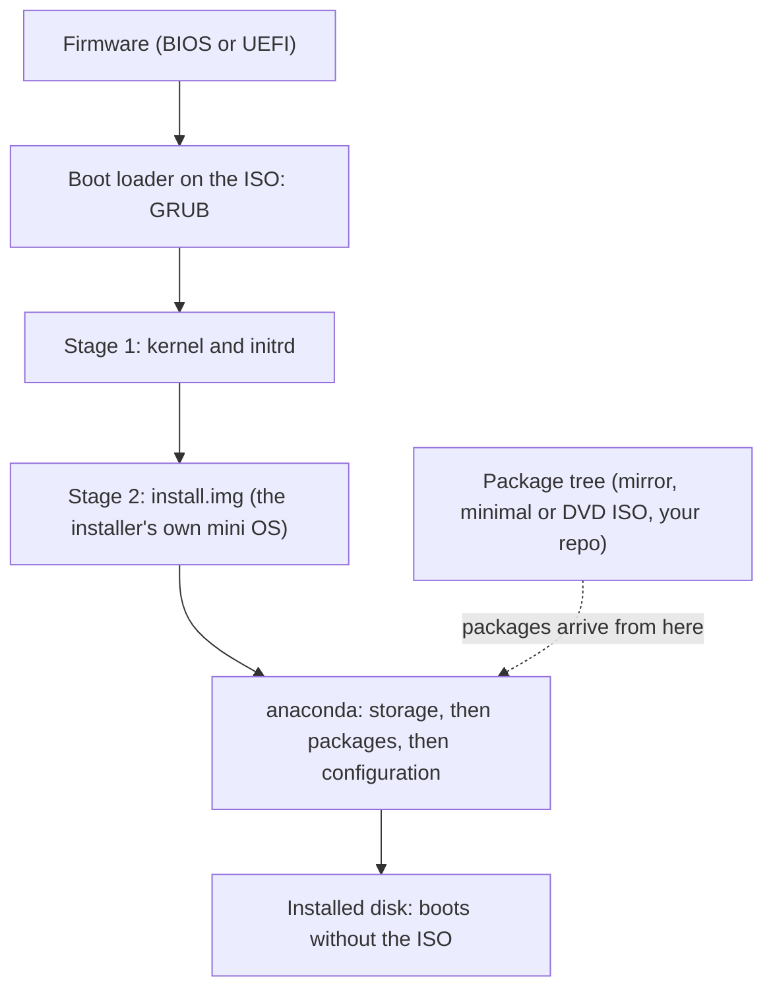
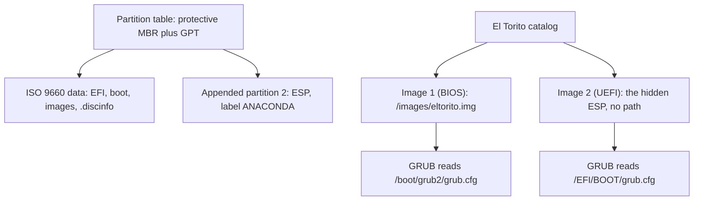
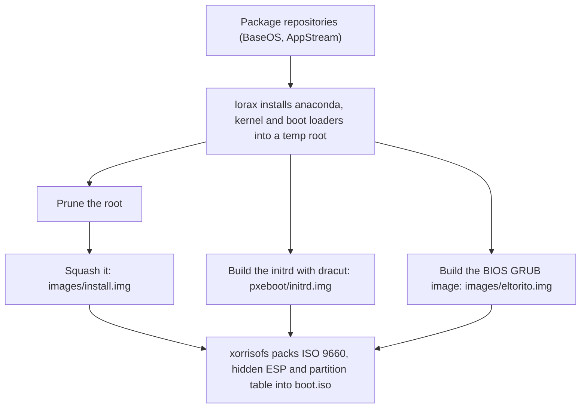
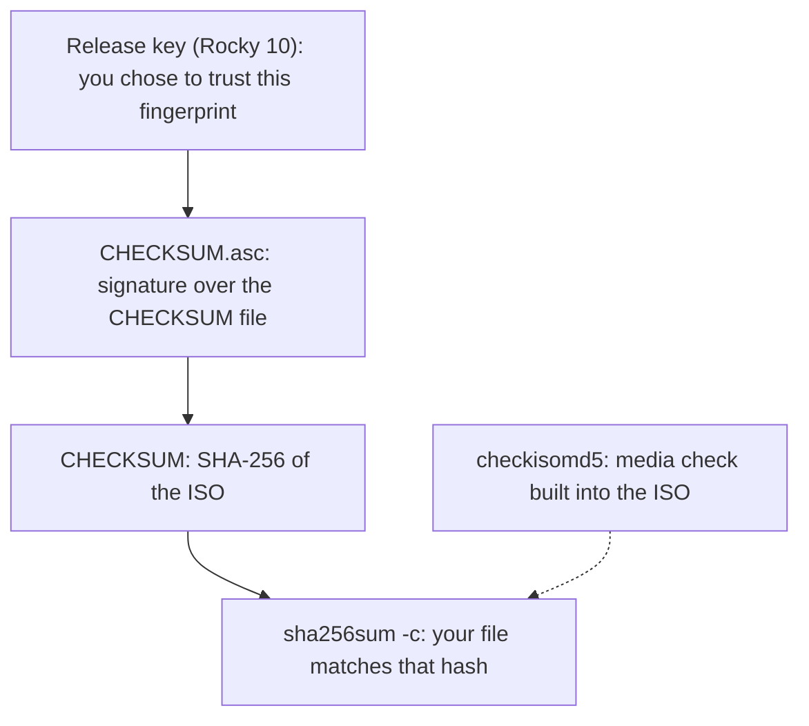

# 43 · Getting onto a disk: installer and install media

<ul class="module-meta">
  <li>⏱ ~3 hours</li>
  <li>4 labs</li>
  <li>Builds on: 14 · The Boot Process, 23 · Automated Installs, 41 · Anatomy of a package, 42 · What is inside an OS</li>
  <li>Environment: Tier A</li>
  <li>Verified: Rocky 10.2, 2026-11-06</li>
</ul>

You download `Rocky-10.2-x86_64-boot.iso`, a file of 1,049,538,560 bytes. You ask `xorriso` to count the RPM files inside it, and it answers zero (checked 2026-11-06). Yet the install we ran from a copy of that kind of ISO pulled 249 packages onto a blank disk and booted. This module explains where those packages came from, what the ISO does hold, and how you prove the file in your hands is the one Rocky published.

<div class="pipeline-strip" data-here="compose install" role="group" aria-label="Rocky build pipeline, six stages" markdown>

1. Source
2. Build
3. Sign
4. Compose
5. Publish
6. Install

</div>

*You are here: Compose and Install (stages 4 and 6 of 6). Before: Build and Sign. After: Publish.*

!!! abstract "What you'll learn"
    - Explain why a Rocky boot ISO holds an installer plus a pointer, and not the operating system.
    - Read an ISO with four questions (label, boot paths, default kernel line, package source) using `xorriso`.
    - Find the BIOS boot image and the hidden EFI partition inside `boot.iso`, and say why there is no isolinux.
    - Name the installer's two stages (initrd and `install.img`) and follow anaconda's sequence from the first menu to "Installation complete".
    - Find where Rocky's name lives in the installer (`profile.d/rocky.conf` and the lorax `.buildstamp`).
    - Verify an ISO end to end: `sha256sum -c`, `gpg --verify` on `CHECKSUM.asc`, and `checkisomd5`.
    - Say exactly what our QEMU boot test showed, and what it did not.

!!! note "Remember from 14, 21 and 23"
    Module 14 gave you the boot chain (firmware, shim, GRUB, kernel plus initramfs). Module 21 explained that debranding swaps release files, logos and installer branding. Module 23 taught you to drive anaconda with a kickstart. This module opens the box those three modules treat as given: the media that carries the installer and reads your kickstart.

## The big picture

You use an install ISO as one object, but it is really two. One is a small bootable thing: a boot loader, a kernel, an early-boot image and the installer's own mini operating system. The other is the repository of packages that becomes your system. On Rocky's `boot.iso` the two are separate. The ISO carries the first and only points at the second.

### The install ISO in one sentence

> **A Rocky install ISO is a bootable installer plus a pointer to where the operating system lives; the operating system itself is a package tree you read from a mirror, a minimal or DVD ISO, or your own repository.**

Everything below hangs off that sentence. The **installer** is anaconda and the tiny system it runs in. The **pointer** is a configured package source: a kickstart `url` line, an `inst.repo=` boot option, or the profile default that picks the closest mirror.

!!! analogy "Think of it like a construction crew's truck"
    The truck carries the crew, the tools and the blueprints. It does not carry the lumber. The crew drives to a lumber yard whose address is written on the work order, loads up, and builds. The `boot.iso` is the truck and crew, the kickstart is the work order, and the package tree on a mirror is the lumber yard.

    Where the analogy breaks: Rocky also publishes bigger ISOs that carry some or all of the lumber (the minimal and DVD ISOs add a repository). Same crew, heavier truck.



The diagram shows the path in order: firmware starts GRUB from the ISO, GRUB starts the kernel and initrd (stage 1), stage 1 starts `install.img` (stage 2), and anaconda in stage 2 writes the disk. The packages do not come down that main path. They arrive from a separate package tree, shown with the dotted arrow.

### The few things that solve most problems

| Situation | What to do | Where this module teaches it |
|-----------|-----------|------------------------------|
| Is this file really Rocky's, and intact? | `sha256sum -c`, then `gpg --verify` the `CHECKSUM.asc`, then `checkisomd5` | The checksum chain |
| What will this ISO do when I boot it? | Read the default entry in `grub.cfg` (`set default="1"`) | What GRUB passes to the kernel |
| Where will the packages come from? | Look for `inst.repo=`, a kickstart `url`, and the profile default | Two objects: the ISO and the tree |
| Does this ISO have a `.treeinfo`? | Ask `xorriso -find`. It does not. The tree beside it does. | Two objects: the ISO and the tree |
| Why did my unattended install sit at a menu? | The default entry is "Test this media" and the timeout is 60 seconds | What GRUB passes to the kernel |
| Can I unpack the installer to read it? | `xorriso -osirrox` to extract, then `unsquashfs -no-xattrs` | install.img, the installer's own system |

To pick a move, ask four questions in order: what is the label, how does firmware boot it, what does the default menu entry pass to the kernel, and where do packages come from? The core skill section drills exactly that.

### Words you'll see

| Word | Plain meaning |
|------|---------------|
| **ISO 9660** | The filesystem format of an optical disc image. A file with this layout is what you call "an ISO". |
| **volume ID** (label) | A short name stored in the ISO. GRUB and the installer both find the media by this name. |
| **El Torito** | The standard that lets firmware boot from a disc: a catalog that lists boot images, one per firmware type. |
| **ESP** | EFI System Partition: the small FAT partition UEFI firmware reads to find a boot loader. |
| **stage 1** | The kernel plus the initrd. Its job is to find stage 2. |
| **stage 2** | `images/install.img`: the installer's own root filesystem, with anaconda inside. |
| **squashfs** | A compressed, read-only filesystem. `install.img` is one. |
| **anaconda** | The Rocky installer, a Python program that runs from stage 2. |
| **kickstart** | A text file that answers every question anaconda would ask. See [module 23](23-automated-installs.md). |
| **lorax** | The tool that builds the installer pieces and packs them into `boot.iso`. |
| **`.treeinfo`** | A table of contents that sits beside a package tree and lists its installer images and variants. |
| **`.discinfo`** | A tiny three-line file on the ISO: a timestamp, the release and the architecture. |
| **`.buildstamp`** | A file lorax writes inside the installer that records product, version and the lorax version. |
| **profile** | An anaconda config file chosen by the OS ID. Rocky's is `rocky.conf`. |
| **CHECKSUM** | A text file that lists the SHA-256 of an ISO. `CHECKSUM.asc` is its detached signature. |

## The core skill: read an ISO with four questions

Any install ISO, Rocky's or one you build, answers four questions in a minute. Learn to ask them in this order.

> **"What is its label, how does firmware boot it, what does the default menu entry pass to the kernel, and where do the packages come from?"**

The first two come from `xorriso`. The third comes from `grub.cfg`. The fourth is mostly an absence: you look for packages on the ISO, find none, and then look for the pointer.

```console
$ xorriso -indev Rocky-10.2-x86_64-boot.iso -pvd_info 2>&1 | grep -E 'Volume Id|Preparer'
Volume Id    : Rocky-10-2-x86_64-dvd
Preparer Id  : XORRISO-1.5.6 2023.06.07.180001, LIBISOBURN-1.5.6, LIBISOFS-1.5.6, LIBBURN-1.5.6
$ xorriso -indev Rocky-10.2-x86_64-boot.iso -report_el_torito plain 2>&1 | grep -E '^(Boot record|El Torito)'
Boot record  : El Torito , MBR protective-msdos-label grub2-mbr cyl-align-off GPT
El Torito catalog  : 136  1
El Torito images   :   N  Pltf  B   Emul  Ld_seg  Hdpt  Ldsiz         LBA
El Torito boot img :   1  BIOS  y   none  0x0000  0x00      4         137
El Torito boot img :   2  UEFI  y   none  0x0000  0x00  17660      507889
El Torito img path :   1  /images/eltorito.img
El Torito img opts :   1  boot-info-table grub2-boot-info
El Torito img blks :   2  4415
$ xorriso -indev Rocky-10.2-x86_64-boot.iso -find / -name '*.rpm' 2>/dev/null | grep -c "^'"
0
```

Rocky 10.2 x86_64, 2026-11-06. Notice that the volume ID says `dvd` even though this is the boot ISO, that the BIOS image has a path and the UEFI image does not, and that the RPM count is zero.

Practise before opening each answer.

**Problem A.** From the El Torito listing above: can this ISO boot a BIOS-only machine, a UEFI machine, or both? Where is each boot image?

??? success "Answer A"
    Both. Image 1 is the BIOS image and it has a path, `/images/eltorito.img`. Image 2 is the UEFI image and it has no path line at all: it is hidden, a FAT partition appended after the ISO 9660 data, starting at sector 507889 (2048-byte sectors) and 17660 sectors of 512 bytes long. Nothing in the listing mentions isolinux or syslinux, and a search for `isolinux*` finds nothing either.

**Problem B.** A menu entry has this kernel line. Where does stage 2 come from? What does the line say about packages?

```text
linux /images/pxeboot/vmlinuz inst.stage2=hd:LABEL=Rocky-10-2-x86_64-dvd quiet
```

??? success "Answer B"
    Stage 2 comes from the disc itself: `inst.stage2=hd:LABEL=...` means "find a block device with this volume ID and read `install.img` from it". The line says nothing about packages. There is no `inst.repo=`, so the package source must come from somewhere else: a kickstart `url` line, or the profile default.

**Problem C.** The search above found 0 RPM files and 1 `install.img`. Can you do an offline install from this ISO alone?

??? success "Answer C"
    No. The ISO has an installer but no packages. Offline installs need a medium that carries a repository (the minimal or DVD ISO) or your own repository added to the ISO (module 23 shows `mkksiso --add`).

<div class="quiz" data-answer="2" markdown>

You find a Rocky `boot.iso` whose root holds `.discinfo`, `EFI`, `boot` and `images`. What is the best reading?

- It is the full OS, because 1 GB is plenty for a minimal install
- It is an installer: the OS packages are not on it and must come from a package source
- It is only a rescue disc, because there is no `Packages` directory

Right: the contents are a boot loader, kernel, initrd and the installer image. The packages arrive from the pointer (kickstart `url`, `inst.repo=` or the profile default). Choosing "rescue disc" confuses a missing repository with a missing installer: the same ISO installs.

</div>

## Two objects: the ISO and the tree

Rocky publishes the same release in two shapes. One is a **tree**: a directory of packages with repository metadata that `dnf` and the installer can read over HTTP. The other is an **image**: an ISO file. The tree describes the image. The image does not describe the tree.

The description is a file called `.treeinfo`. It sits beside the packages and lists the installer images, the variants (BaseOS, AppStream) and the path to stage 2. The ISO 9660 root of `boot.iso` has no such file.

<!-- ev: FACTBASE-B O-34; ERRATA rulings .treeinfo; labs/final V4 | observed | Rocky 10.2 x86_64, 2026-11-06 -->
!!! evidence "Observed: the tree has a .treeinfo, the boot ISO does not"
    **Seen on:** Rocky 10.2 x86_64, 2026-11-06 (tree read over HTTP, ISO searched with `xorriso` on an x86_64 VM).

    ```console
    $ curl -s https://dl.rockylinux.org/pub/rocky/10/BaseOS/x86_64/os/.treeinfo | grep -E '^(boot.iso|mainimage|\[stage2\]|\[variant-)|sha256'
    images/boot.iso = sha256:bf3a75907948563d0c11f3d1b8546ee9216e18a3ea2dc0a67eb4c45452e210f9
    images/eltorito.img = sha256:33facbd454cdfe4cd3e0c5824b4116ae1a254097b73d2b94c1b30ccd4623f0f8
    images/install.img = sha256:07cc6cfb638c25f68a9ced10af03c1d3fc57f55722c50cc0e322077bdd132c5c
    …
    boot.iso = images/boot.iso
    [stage2]
    mainimage = images/install.img
    [variant-BaseOS]
    [variant-AppStream]
    $ xorriso -indev Rocky-10.2-x86_64-boot.iso -find / -name '*treeinfo*' 2>/dev/null | grep -c "^'"
    0
    $ xorriso -indev Rocky-10.2-x86_64-boot.iso -find / -name '.discinfo' 2>/dev/null | grep -c "^'"
    1
    ```

    **Check it yourself:** run both commands. The tree answers with a table of contents that even lists `images/boot.iso`, and the ISO answers `0` for `.treeinfo` and `1` for `.discinfo`.

Two small details are worth keeping. First, the `.treeinfo` in the tree carries the same SHA-256 for `images/boot.iso` as the signed `CHECKSUM` file does, so the hash appears in two places on the same server. Second, `.discinfo` exists on both objects but is a different, smaller thing: on the ISO it has exactly three lines (a timestamp, `10.2`, `x86_64`).

Our reading, not tested: the tree's `.treeinfo` is the map an installer follows when you hand it a tree URL, and the boot ISO does not need one because GRUB and the volume label already led it to stage 2. We never ran an install with `inst.repo=` pointed at the tree, so we did not watch that file being read.

### Three ISOs, three amounts of lumber

| ISO | Size (2026-11-06) | Carries packages? | What we opened |
|-----|-------------------|-------------------|----------------|
| `boot.iso` | 1,049,538,560 bytes | No | x86_64, fully inspected |
| `minimal.iso` | 2,072,444,928 bytes | Yes, a `Minimal` repository | aarch64 only (671 RPMs and a `.treeinfo` inside) |
| `dvd1.iso` | 10,226,171,904 bytes (2026-11-06) | Yes, BaseOS and AppStream | not opened |

Sizes come from `curl -sI` on the public mirror; the contents column says what we looked inside. We did not extract the DVD (it is about 10 GB, and `xorriso -ls` can list it without extracting).

<!-- ev: FACTBASE-B 3.9; labs/final V4; FACTBASE-C O-59 | observed | Rocky 10.2 x86_64 and aarch64, 2026-11-06 -->
!!! freshness "As of 2026-11-06 on Rocky 10.2"
    `Rocky-10.2-x86_64-boot.iso` is 1,049,538,560 bytes with SHA-256 `bf3a75907948563d0c11f3d1b8546ee9216e18a3ea2dc0a67eb4c45452e210f9`, last modified 2026-05-25, volume ID `Rocky-10-2-x86_64-dvd`. The mechanism (boot ISO holds the installer, not the packages) is stable. The size, hash and volume ID change with each minor release.

    **Re-check:** `curl -sI https://dl.rockylinux.org/pub/rocky/10/isos/x86_64/Rocky-10.2-x86_64-boot.iso | grep -iE 'content-length|last-modified'`

What fraction of the boot ISO is installer? Four files account for nearly all of it: `install.img` (786,558,976 bytes), `initrd.img` (224,503,856), `vmlinuz` (16,259,912) and `eltorito.img` (37,368). Together that is 1,027,360,112 of 1,049,538,560 bytes, 97.9% of the ISO (sizes dated 2026-11-06, Rocky 10.2 x86_64). The rest is the boot loader files, the hidden EFI partition and metadata.

??? version "Comparison lens: AlmaLinux and CentOS Stream"
    The boot ISOs of siblings follow the same pattern with different labels. On 2026-11-06 their volume IDs were `AlmaLinux-10-2-x86_64-dvd` and `CentOS-Stream-10-BaseOS-x86_64`, against Rocky's `Rocky-10-2-x86_64-dvd`. AlmaLinux's `.treeinfo` records `version 10` with no minor and lists its sections alphabetically. **Check it yourself:** `xorriso -indev <boot.iso> -pvd_info 2>&1 | grep 'Volume Id'` on each file.

## Inside boot.iso: three ways in, one file

A disc image has to boot on old BIOS firmware, on UEFI firmware, and, if you write it to a USB stick, from a partition table. Rocky's `boot.iso` handles the firmware cases with two separate El Torito entries.

<div class="layers" data-hint="Click a layer to see what lives there and how to look at it." markdown>

<div class="layer" data-label="Boot menu" data-tag="grub.cfg" markdown>

Two copies of a GRUB menu: `/boot/grub2/grub.cfg` (read by BIOS GRUB, 1,718 bytes on 2026-11-06) and `/EFI/BOOT/grub.cfg` (read by UEFI GRUB, 1,585 bytes). Both name the media by label with `search -l` and start the same kernel and initrd.

</div>

<div class="layer" data-label="Installer files" data-tag="images/" markdown>

`images/pxeboot/vmlinuz` (the kernel), `images/pxeboot/initrd.img` (stage 1) and `images/install.img` (stage 2). These four files, with `eltorito.img`, are 97.9% of the ISO's bytes (1,027,360,112 of 1,049,538,560, dated 2026-11-06).

</div>

<div class="layer" data-label="UEFI boot files" data-tag="EFI/BOOT" markdown>

`BOOTX64.EFI` (the shim), `grubx64.efi`, `mmx64.efi` and `grub.cfg`. They exist twice: once as visible files in the ISO 9660 tree and once inside the hidden EFI partition.

</div>

<div class="layer" data-label="Hidden EFI partition" data-tag="appended ESP" markdown>

A FAT16 partition labelled `ANACONDA`, 9,041,920 bytes (2026-11-06), appended after the ISO 9660 data and registered as El Torito image 2 without a file path. You can cut it out with `dd` and read it with `file` and `mdir`.

</div>

<div class="layer" data-label="BIOS boot image" data-tag="eltorito.img" markdown>

`/images/eltorito.img` (37,368 bytes on 2026-11-06) is a GRUB 2 `i386-pc` core image built for El Torito. The GRUB modules live in `/boot/grub2/i386-pc`. The system area at the front of the file also carries a GRUB 2 boot sector.

</div>

<div class="layer" data-label="Partition table" data-tag="MBR + GPT" markdown>

A protective MBR plus a GPT. `xorriso` reports partition 1 as `ISO9660` and partition 2 as the EFI System partition. This hybrid layout is what lets one file serve optical, virtual and USB use.

</div>

</div>

The layers read from the menu you see at the top down to the partition table at the bottom. Firmware picks an entry from the El Torito catalog (BIOS image or hidden EFI partition), that boot code finds `grub.cfg`, and `grub.cfg` loads the files in `images/`.



The diagram shows one file with two entry points. The El Torito catalog lists a BIOS image and a UEFI image. The UEFI image is the appended partition, so it appears both as partition 2 in the partition table and as image 2 in the catalog.

There is no isolinux or syslinux in this ISO: BIOS and UEFI both start GRUB 2. A search for `isolinux*` returns zero matches.

<!-- ev: FACTBASE-B O-33, O-35; labs/final V4 and 04C | observed | Rocky 10.2 x86_64 VM, 2026-11-06 -->
!!! evidence "Observed: the UEFI image is a hidden partition you can cut out"
    **Seen on:** Rocky 10.2 x86_64 VM, 2026-11-06.

    ```console
    $ dd if=Rocky-10.2-x86_64-boot.iso bs=2048 skip=507889 count=4415 of=esp.img 2>/dev/null
    $ file esp.img
    esp.img: DOS/MBR boot sector, code offset 0x3c+2, OEM-ID "mkfs.fat", … label: "ANACONDA   ", FAT (16 bit)
    $ mdir -i esp.img ::EFI/BOOT
    …
    BOOTX64  EFI   1036024 2026-05-23   0:00
    fonts        <DIR>     2026-05-25  20:58
    mmx64    efi    874808 2026-05-23   0:00
    grubx64  efi   4200776 2026-05-23   0:00
    grub     cfg      1585 2026-05-25  20:58
    ```

    **Check it yourself:** the numbers in `dd` come from the El Torito listing: start sector 507889 in 2048-byte units, and 17660 sectors of 512 bytes equal 4415 sectors of 2048 bytes. The file sizes match the visible `EFI/BOOT` copy on the ISO 9660 side.

??? question "Under the hood: what 'hybrid' buys you, and what we did not test"
    The protective MBR and GPT mean the same bytes are a valid disc for optical and virtual drives (through El Torito) and a valid disk for a USB stick (through the partition table, where partition 2 is the ESP that UEFI firmware reads). We read that layout from `xorriso` reports and cut the ESP out with `dd`. We booted the ISO only as a virtual optical disc under UEFI (see the boot test below). We did not boot it under BIOS firmware and we did not write it to a USB stick.

??? version "aarch64 differences (observed on aarch64 only)"
    The aarch64 `boot.iso` (1,120,931,840 bytes, volume ID `Rocky-10-2-aarch64-dvd`, on 2026-11-06) is a much smaller tree of 16 nodes. It has no BIOS path (no `eltorito.img`, no `boot/grub2`) and, unlike the x86_64 ISO, it carries a visible `images/efiboot.img` of about 9.2 MB. Its `vmlinuz` is an EFI-stub PE32+ Aarch64 application. This came from an aarch64 inspection and we did not repeat it on x86_64 because x86_64 behaves differently. **Check it yourself:** `xorriso -indev Rocky-10.2-aarch64-boot.iso -report_el_torito plain` shows the UEFI image with a path.

<div class="quiz" data-answer="3" markdown>

Which statement about Rocky 10.2's x86_64 `boot.iso` is supported by the El Torito listing?

- BIOS boot uses isolinux and UEFI boot uses GRUB
- Both firmware types use the same single boot image
- BIOS boot uses a GRUB 2 image with a path, and UEFI boot uses a hidden appended EFI partition

Right: image 1 (BIOS) is `/images/eltorito.img`, a GRUB 2 `i386-pc` image, and image 2 (UEFI) has no path because it is the appended ESP. There is no isolinux anywhere in the file.

</div>

## What GRUB passes to the kernel

Once firmware loads GRUB from the ISO, `grub.cfg` decides what happens next. Two lines matter more than the rest. `set default="1"` picks the second entry, counting from zero. `search --no-floppy --set=root -l 'Rocky-10-2-x86_64-dvd'` finds the ISO by its volume ID.

<!-- ev: FACTBASE-B O-36; labs/final V4 and 04C | observed | Rocky 10.2 x86_64 VM, 2026-11-06 -->
!!! evidence "Observed: the default entry is 'Test this media', and there is no inst.repo"
    **Seen on:** Rocky 10.2 x86_64 VM, 2026-11-06, file read from `/boot/grub2/grub.cfg` (the UEFI copy carries the same entries).

    ```text
    set default="1"
    …
    set timeout=60
    …
    search --no-floppy --set=root -l 'Rocky-10-2-x86_64-dvd'

    menuentry 'Install Rocky Linux 10.2' --class fedora --class gnu-linux --class gnu --class os {
        linux /images/pxeboot/vmlinuz inst.stage2=hd:LABEL=Rocky-10-2-x86_64-dvd quiet
        initrd /images/pxeboot/initrd.img
    }
    menuentry 'Test this media & install Rocky Linux 10.2' --class fedora --class gnu-linux --class gnu --class os {
        linux /images/pxeboot/vmlinuz inst.stage2=hd:LABEL=Rocky-10-2-x86_64-dvd rd.live.check quiet
        initrd /images/pxeboot/initrd.img
    }
    …
    ```

    **Check it yourself:** `xorriso -osirrox on -indev Rocky-10.2-x86_64-boot.iso -extract /boot/grub2/grub.cfg ./grub.cfg`, then `grep -E 'default|timeout|inst\.' grub.cfg`. Expect `default="1"`, a 60 second timeout, `inst.stage2=hd:LABEL=...` on every kernel line and no `inst.repo=` anywhere. The same file lists a few more entries (a rescue entry and a basic-graphics entry sit under a Troubleshooting submenu).

Read the kernel lines as three words. `inst.stage2=hd:LABEL=...` says where stage 2 is: on a drive with this label. `rd.live.check` tells the initrd to verify the media before going on, which is the "Test this media" part. `quiet` hides kernel messages. Nothing in the line chooses a package source.

The default is the media check, not the plain install. If nobody touches the keyboard, GRUB waits 60 seconds, then runs the check, then installs. That is useful on a desk (it catches a bad burn or download) and a nuisance in automation.

<div class="decision" markdown>

<div class="node" data-id="start" markdown>

**Where do my install's packages come from?** Start here and answer one question at a time.

<button data-goto="net">The installer will have network access to a mirror</button> <button data-goto="nonet">No network to a mirror at install time</button>

</div>

<div class="node" data-id="net" markdown>

**Does a kickstart or boot option name a source?**

<button data-goto="ks">Yes: a `url` or `repo` line, or `inst.repo=`</button> <button data-goto="prof">No, nothing names one</button>

</div>

<div class="node" data-id="ks" markdown>

The installer uses the source you named. In our boot test the kickstart had a `url` line, and the installer's summary screen printed that URL as the "Installation source".

</div>

<div class="node" data-id="prof" markdown>

The Rocky profile says `default_source = CLOSEST_MIRROR` and `enable_closest_mirror = True`, so the installer should choose a nearby mirror. We read that setting in the profile. We did not run an interactive install from the official ISO, so we did not watch it happen.

</div>

<div class="node" data-id="nonet" markdown>

Use media that carries a repository: the minimal or DVD ISO, or your own ISO with a repository added (`mkksiso --add`, see [module 23](23-automated-installs.md)), or a local tree reached with `inst.repo=`.

</div>

</div>

Before you read on, predict. If you boot the official ISO in a VM and press nothing, which of the three things below happens first after the menu counts down: the plain installer, a media check, or a rescue shell?

??? success "Answer: the media check"
    `set default="1"` selects `Test this media & install Rocky Linux 10.2`, whose kernel line includes `rd.live.check`. After the 60 second timeout it checks the media and then continues into the installer. We read this from the file. We did not boot the official ISO, so we did not time the check.

`checkisomd5` runs the same kind of check from a shell, without booting.

```console
$ checkisomd5 Rocky-10.2-x86_64-boot.iso
…
The media check is complete, the result is: PASS.

It is OK to use this media.
```

Rocky 10.2 x86_64, 2026-11-06. `PASS` and exit code 0 were also seen on a lorax-built ISO and on the same ISO after `mkksiso` re-implanted the media checksum. This check detects damage in your copy. It cannot tell you who published the file. The checksum chain below does that.

## install.img, the installer's own system

Stage 1 (the initrd) is small and generic. Its job is to find stage 2, which is `images/install.img`: a complete little operating system with Python, anaconda, DNF and the storage tools. On Rocky 10.2 it is a plain xz-compressed squashfs, not a squashfs wrapped around a second `LiveOS/rootfs.img`.

<!-- ev: FACTBASE-B O-39, O-42; labs/final V4 | observed | Rocky 10.2 x86_64 VM, 2026-11-06 -->
!!! evidence "Observed: install.img is a plain squashfs stamped by lorax"
    **Seen on:** Rocky 10.2 x86_64 VM, 2026-11-06.

    ```console
    $ file install.img
    install.img: Squashfs filesystem, little endian, version 4.0, xz compressed, 786556860 bytes, 33425 inodes, blocksize: 131072 bytes, created: Mon May 25 20:57:28 2026
    $ unsquashfs -no-xattrs -no-progress -d root install.img
    $ cat root/.buildstamp
    [Main]
    Product=Rocky Linux
    Version=10.2
    BugURL=https://bugs.rockylinux.org
    IsFinal=True
    UUID=202605252056.x86_64
    Variant=BaseOS
    [Compose]
    Lorax=40.5.15-1
    ```

    **Check it yourself:** extract the file with `xorriso -osirrox on -indev Rocky-10.2-x86_64-boot.iso -extract /images/install.img install.img`, run the commands above, and expect `Squashfs`, `xz compressed` and a `.buildstamp` that names the product, the version and the lorax version. The `UUID` is a build timestamp plus the architecture, which agrees with the ISO's creation time of 2026-05-25.

Rocky's name lives in two places you can read in that tree. The `.buildstamp` says what product the installer thinks it is and which lorax made it. The **profile** file `etc/anaconda/profile.d/rocky.conf` tells anaconda how to behave on Rocky.

```text
[Profile]
profile_id = rocky
base_profile = rhel
[Profile Detection]
os_id = rocky
[Anaconda]
forbidden_modules = org.fedoraproject.Anaconda.Modules.Subscription
[Bootloader]
efi_dir = rocky
[Payload]
enable_closest_mirror = True
default_source = CLOSEST_MIRROR
[License]
eula = /usr/share/rocky-release/EULA
```

Sections and keys of `rocky.conf`, trimmed from the file on Rocky 10.2 x86_64 (comments dropped, one setting per line). Read it as a short list of differences from `rhel`: Rocky matches on the OS ID `rocky`, installs boot files to `EFI/rocky`, drops the subscription module, picks the closest mirror by default and shows Rocky's EULA.

This is the "installer branding" that [module 21](21-inside-rocky-linux.md) mentions: not a rewritten installer, but a profile inside the stock anaconda package that the OS ID selects. The `install.img` carries 19 profile files in all (counted 2026-11-06 on Rocky 10.2 x86_64).

!!! pitfall "unsquashfs fails with security.selinux errors"
    Run `unsquashfs` without `-no-xattrs` on this image and you get errors like `write_xattr … security.selinux … Invalid argument` and a partial tree. Cause: the image stores SELinux labels as extended attributes and your filesystem refuses them. Fix: add `-no-xattrs`, as in the commands above. We extracted the tree in 7.9 seconds on a 4 vCPU VM.

??? question "Under the hood: how anaconda picks Rocky's profile"
    Anaconda reads `/etc/anaconda/anaconda.conf` first, then the profile file matched by the OS ID in `os-release` (or named with `inst.profile`), then any `conf.d/*.conf`, then kernel arguments. `rhel.conf` is the base for Rocky and sets XFS and a 70 GiB cap for `/`. LVM as the default scheme and LUKS 2 come from `anaconda.conf`. The `rocky.conf` above overrides a handful of keys.

    Two oddities we noticed and could not explain: the Red Hat flatpak remote is inherited through the `rhel` base profile (intent unknown), and the installer carries patches in its `.rocky.0.6` build that we did not diff.

??? version "Comparison lens: AlmaLinux and CentOS Stream"
    The same `install.img` layout and profile set appeared on the three distributions' ISOs in our saved captures (not re-run for this page). The Rocky profile `rocky.conf` is byte-identical in all three, which is what a stock profile in the stock package looks like. AlmaLinux's own `almalinux.conf` is customised (it adds `btrfs_compression = zstd:1` and an ignored package), while Rocky's and Stream's are stock copies. `.buildstamp` differs in `BugURL` (AlmaLinux uses a placeholder text) and in the lorax version (Stream's showed `Lorax=40.5.19-1`). **Check it yourself:** `unsquashfs` each ISO's `install.img` and compare `.buildstamp`.

<div class="quiz" data-answer="1" markdown>

Where does Rocky's identity enter the installer?

- A profile file `rocky.conf` chosen by the OS ID, plus a lorax `.buildstamp` and branding packages in `install.img`
- A forked anaconda that Rocky maintains alone
- The kickstart file, which carries Rocky's name

Right: the profile is part of the stock anaconda package and the OS ID selects it. Rocky's own contribution is a small set of configuration values and release content, not a different installer program.

</div>

## The anaconda sequence, from menu to "Installation complete"

You can watch the whole sequence on a serial console. Our boot test (details later) captured it, so each step below shows a real line from that capture. The kickstart in that test was embedded in the ISO and named on every kernel line.

<div class="stepper" markdown>

<div class="step" data-title="Firmware starts GRUB" markdown>

UEFI firmware finds the ISO as a CD-ROM and starts the boot loader from the hidden EFI partition. BIOS firmware would use the El Torito BIOS image instead.

```text
BdsDxe: starting Boot0002 "UEFI QEMU DVD-ROM QM00001 " from PciRoot(0x0)/Pci(0x1F,0x2)/Sata(0x0,0xFFFF,0x0)
GRUB version 2.12
```

</div>

<div class="step" data-title="GRUB loads kernel and initrd" markdown>

GRUB reads `grub.cfg`, finds the media by label and starts the entry. This is the kernel command line the test's installer reported:

```text
Command line: BOOT_IMAGE=/images/pxeboot/vmlinuz inst.stage2=hd:LABEL=Lab-Rocky-10-2-x86_64 console=ttyS0,115200n8 inst.text inst.ks=hd:LABEL=Lab-Rocky-10-2-x86_64:/lab-tcg.ks
```

`inst.stage2` locates stage 2 and `inst.ks` locates the kickstart. Both name the ISO by label, which is why the label must be consistent everywhere.

</div>

<div class="step" data-title="Stage 1: the initrd" markdown>

The kernel unpacks the initrd. It is a dracut image that lorax built with the anaconda module added, and it records its own build arguments (`--add 'anaconda pollcdrom qemu qemu-net prefixdevname-tools'`, as read from an aarch64 initrd).

```text
Booting initrd of Rocky Linux 10.2 (Red Quartz) dracut-107-9.el10_2 (Initramfs).
```

Its anaconda hooks parse the `inst.*` options, wait for the CD-ROM to appear, find `install.img` by label and fetch the kickstart if `inst.ks=` is set.

</div>

<div class="step" data-title="Stage 2: install.img boots" markdown>

systemd switches into the installer's own root filesystem, the squashfs you unpacked above. Anaconda's support services start first.

```text
Welcome to Rocky Linux 10.2 (Red Quartz)!
…
Starting anaconda-pre.service - pre-anaconda logging service...
```

</div>

<div class="step" data-title="Anaconda starts" markdown>

Anaconda picks the Rocky profile from the OS ID, parses the kickstart and hands each section to the module that owns it (storage, payload, network, users and so on) over D-Bus.

```text
anaconda 40.22.3.46-1.el10.rocky.0.6 for Rocky Linux 10.2 started.
```

</div>

<div class="step" data-title="Storage" markdown>

The kickstart's `zerombr`, `clearpart` and `autopart` lines become real partitions and filesystems. On the test disk that meant four partitions.

```text
Creating disklabel on /dev/vda
Creating swap on /dev/vda3
Creating xfs on /dev/vda4
Creating xfs on /dev/vda2
Creating efi on /dev/vda1
```

</div>

<div class="step" data-title="Packages" markdown>

The payload module downloads the packages from the source and runs an ordinary DNF transaction into the new filesystems. This is where the packages are downloaded from the source the pointer named.

```text
Downloading 249 RPMs, 198.54 MiB / 201.83 MiB (98%) done.
Installing libgcc.x86_64 (1/249)
```

</div>

<div class="step" data-title="Configuration" markdown>

After the packages, anaconda configures the new system: scriptlets for the kernel run, certificates and network config are written, users are created, the initramfs is generated and the kickstart and logs are stored.

```text
Importing certificates
Writing network configuration
Creating users
Generating initramfs
Storing configuration files and kickstarts
Running post-installation scripts
Installation complete
```

</div>

</div>

The stepper shows eight stages in order. Stages 1 to 4 are about getting the installer running, and they use only the ISO. Stages 5 to 8 are the installation itself, and stage 7 is where the packages download.

The kickstart's role is to answer every question anaconda would otherwise ask in the interface. [Module 23](23-automated-installs.md) teaches how to write one. This module explains how the media that reads it is made. `mkksiso` puts your kickstart at the root of the ISO (as `/lab-minimal.ks`, name preserved) and appends `inst.ks=hd:LABEL=<volume ID>:/lab-minimal.ks` to every menu entry, including the rescue entry. It keeps the volume ID and re-implants the media checksum, then `checkisomd5` still passes.

On a failed install, the logs live under `/tmp` during the run (`anaconda.log`, `storage.log`, `packaging.log`, `program.log`) and under `/var/log/anaconda/` afterwards, as module 23 shows.

<div class="quiz" data-answer="3" markdown>

In the sequence above, which stage downloads the packages?

- Stage 2, when `install.img` is mounted
- Stage 5, when anaconda starts
- Stage 7, when the payload downloads packages

Right: the download line, with the 201.83 MiB payload, appears in stage 7. The installer already knew the source earlier, because the summary screen printed it before storage was created. We did not trace when it first contacted the mirror, so we do not claim the earlier stages are offline.

</div>

## How the ISO is made

You do not need to build an ISO to read one, but knowing how it is assembled explains every file you just found. Module 51 is where you build one. Here is the shape.



The diagram shows lorax doing three jobs from the same package repositories: squashing an installer root into `install.img`, building an initrd, and building a GRUB image for BIOS. The last step packs all of it, with the EFI files, into one ISO.

**lorax** is the tool. A set of templates under `/usr/share/lorax/templates.d/` lists which packages go in and how the bootloader is set up. On Rocky 10.2 the `lorax-templates-rocky` package supplies the `70-rocky` templates, and lorax uses the lowest-numbered template directory. The x86_64 BIOS image comes from `grub2-mkimage -O i386-pc-eltorito`, and the system area from `xorrisofs --grub2-mbr`.

<!-- ev: FACTBASE-B 3.10, hop 8; releng issue tracker | official | Rocky releng and build tooling, 2026-11-06 -->
!!! freshness "As of 2026-11-06 on Rocky 10.2"
    Rocky's compose runs lorax through Pungi against Koji tags, and a public request to replace Pungi is open in the releng issue tracker. The idea (a compose step runs lorax and writes `images/boot.iso` plus `.treeinfo` into the tree) is stable. The tool names may change. This changes at the next tooling decision.

    **Re-check:** `gh api repos/rocky-linux/releng/issues/49`

We built a boot ISO with lorax from Rocky's public repositories on an x86_64 VM and compared it to the official file. Same recipe, one visible difference.

| Item | Our lorax ISO | Official `boot.iso` |
|------|---------------|---------------------|
| Volume ID | `Lab-Rocky-10-2-x86_64` (our `--volid`) | `Rocky-10-2-x86_64-dvd` |
| BIOS El Torito image | `/images/eltorito.img` | `/images/eltorito.img` |
| UEFI El Torito image | `/images/efiboot.img`, a visible file | hidden, no path |
| `.treeinfo` or isolinux inside | none | none |
| `grub.cfg` | identical except the label | the reference |
| `checkisomd5` | PASS | PASS |

Compared on 2026-11-06, Rocky 10.2 x86_64. Our ISO's kernel was newer than the official one's because lorax takes the kernel from the repositories of the day (see the freshness table).

Our reading, not checked in Rocky's tooling: Rocky's release pipeline either post-processes the lorax output or packs the ISO differently, because the official file keeps only the hidden EFI image. The lorax output tree (the directory lorax writes, not the ISO) does have a `.treeinfo`, which agrees with the rule you learned above: the tree carries it, the ISO does not.

## The checksum chain

Downloading a 1 GB file invites two questions. Did it arrive intact? Is it the file Rocky published? The chain answers both, one link at a time, and each link proves less than people expect.



The diagram shows a key signing the checksum file (not the ISO), the checksum file naming the ISO's hash, and your local `sha256sum -c` comparing your copy to that hash. `checkisomd5` is a separate integrity check stored in the ISO itself.

```console
$ sha256sum -c Rocky-10.2-x86_64-boot.iso.CHECKSUM
Rocky-10.2-x86_64-boot.iso: OK
$ sed -n '1,/END PGP/p' RPM-GPG-KEY-Rocky-10 > key-rsa.asc
$ export GNUPGHOME=$(mktemp -d)
$ gpg --import key-rsa.asc
…
gpg: key 5B106C736FEDFC85: public key "Release Engineering (Rocky Linux 10) <releng@rockylinux.org>" imported
…
$ gpg --verify Rocky-10.2-x86_64-boot.iso.CHECKSUM.asc Rocky-10.2-x86_64-boot.iso.CHECKSUM
gpg: Signature made Fri 29 May 2026 03:43:03 AM UTC
gpg:                using RSA key FC226859C0860BF0DDB95B085B106C736FEDFC85
gpg: Good signature from "Release Engineering (Rocky Linux 10) <releng@rockylinux.org>" [unknown]
gpg: WARNING: This key is not certified with a trusted signature!
gpg:          There is no indication that the signature belongs to the owner.
Primary key fingerprint: FC22 6859 C086 0BF0 DDB9  5B08 5B10 6C73 6FED FC85
```

Rocky 10.2 x86_64, 2026-11-06. The `export GNUPGHOME` line gives gpg a throwaway keyring, so your own keyring stays untouched. Run `gpg --verify` in the same shell, or it will not see the key you just imported.

What each link proves:

- **`sha256sum -c` says OK.** Your bytes equal the hash in the `CHECKSUM` file. That proves the download is intact. It does not prove the `CHECKSUM` file is genuine, because whoever could swap the ISO on the server could swap that text file too.
- **`gpg --verify` says Good signature.** The `CHECKSUM` file was signed by the key you imported. That ties the hash to a key, not to a person.
- **The warning is real.** `[unknown]` and "not certified" mean you have not yet decided to trust that key. Compare the primary key fingerprint with one you got from somewhere other than the download server before you trust it.
- **`checkisomd5` says PASS.** The media is undamaged. It uses a checksum inside the ISO and anyone who rebuilds an ISO can recompute it.

The key ID in that output, `5B106C736FEDFC85`, is the same ID that `rpm -q --qf '%{RSAHEADER:pgpsig}\n'` reports on Rocky 10 packages (we saw `Key ID 5b106c736fedfc85` on `kernel-core`). So one release key signs both the packages and the ISO checksum. Our reading: a compromised key would therefore affect both channels. The signature on the ISO checksum was made on 2026-05-29 03:43 UTC, four days after the ISO was built (2026-05-25).

!!! pitfall "Use the first key block, because the tree copy of the key has two certificates"
    The copy of `RPM-GPG-KEY-Rocky-10` inside the 10.2 tree is a larger file that holds two certificates: the RSA release key and a second, post-quantum one. GnuPG 2.4.5 aborts when it reads the whole file. The `sed -n '1,/END PGP/p'` line above copies only the first armored block (the RSA key), and it also works on the small RSA-only file at `pub/rocky/RPM-GPG-KEY-Rocky-10`, where it changes nothing. `rpmkeys --import` accepts both blocks. [Module 47](47-trust-signatures-and-keys.md) covers the keys in depth.

<!-- ev: FACTBASE-C 3.3, 3.4; ERRATA E3, E10; labs/final V4 | observed | Rocky 10.2 x86_64 VM, 2026-11-06 -->
!!! freshness "As of 2026-11-06 on Rocky 10.2"
    The key file at `https://dl.rockylinux.org/pub/rocky/RPM-GPG-KEY-Rocky-10` is 1,688 bytes (RSA only). The copy inside the 10.2 tree is 18,586 bytes (two certificates), and the same size appears in `/etc/pki/rpm-gpg/RPM-GPG-KEY-Rocky-10` after the `rocky-gpg-keys` package was updated to 10.2-1.2 (our VM had 10.2-1.1 and the 1,688-byte file). Each file changes only when the key file or the package changes.

    **Re-check:** `curl -sI https://dl.rockylinux.org/pub/rocky/RPM-GPG-KEY-Rocky-10 | grep -i content-length`

<div class="quiz" data-answer="2" markdown>

`sha256sum -c` prints `OK`, and `gpg --verify` prints `Good signature ... [unknown]`. What have you not yet established?

- That the download is intact
- That the key you imported really belongs to Rocky's release engineering
- That the ISO file was not corrupted in transit

Right: the hash proves your copy matches the checksum, and the signature proves the checksum was signed by that key. Whether the key is Rocky's is a decision you make by comparing its fingerprint with an independent source.

</div>

## The boot test: what it showed and what it did not

We wanted to know whether an ISO built from Rocky's public repositories really installs a working system. So we booted one under QEMU on an x86_64 VM that has no KVM, using pure software emulation (**TCG**). The ISO was the stock lorax output wrapped with a small kickstart by `mkksiso`. It was not Rocky's official `boot.iso`, and it was not a branded MyOrg ISO.

<!-- ev: FACTBASE-B L7; labs/final 05-boot and SUMMARY | observed | Rocky 10.2 x86_64 VM (no KVM), 2026-11-06 -->
!!! evidence "Observed: a stock lorax ISO installed 249 packages and the disk booted"
    **Seen on:** Rocky 10.2 x86_64 VM (4 vCPU, no `/dev/kvm`), QEMU TCG, 2026-11-06.

    ```text
    anaconda 40.22.3.46-1.el10.rocky.0.6 for Rocky Linux 10.2 started.
    Downloading 249 RPMs, 198.54 MiB / 201.83 MiB (98%) done.
    Installing libgcc.x86_64 (1/249)
    Generating initramfs
    Installation complete
    …
    Rocky Linux 10.2 (Red Quartz)
    Kernel 6.12.0-211.74.1.el10_2.x86_64 on x86_64

    lab-tcg login:
    ```

    **Check it yourself:** this is a read-along. The first five lines come from the install's serial log, the last three from a separate boot of the resulting disk. The install took about 51 minutes, the boot to a login prompt about 2 minutes (we polled at 90 and 110 seconds).

| Shown | Not shown |
|-------|-----------|
| An ISO built by lorax from Rocky's public repositories plus one kickstart boots under UEFI (OVMF firmware) | The official `boot.iso` was read, never booted |
| The installer ran unattended over a serial console and installed 249 packages (201.83 MiB, 2026-11-06) | A BIOS-firmware boot of any of these ISOs |
| The installed disk booted to a `lab-tcg login:` prompt with kernel 6.12.0-211.74.1.el10_2 (2026-11-06) | Secure Boot: the guest log says `secureboot: Secure boot disabled` |
| The guest needs a CPU model of `max` under TCG to meet the x86-64-v3 baseline | An interactive install, or the default closest-mirror source |
| The slow steps were the kernel scriptlets and "Generating initramfs", about 11 minutes each | A login (we did not type one), SELinux state or network inside the guest |

Dates and numbers are from 2026-11-06, Rocky 10.2 x86_64, kernel build `6.12.0-211.74.1.el10_2`. The test ISO carried that newer kernel because lorax pulled the repositories of the day, while the official 10.2 ISO carries `6.12.0-211.16.1.el10_2.0.1` (read on 2026-11-06). The ISO in the test was a kickstart ISO, which wipes any disk it sees without asking, so it belongs in a throwaway VM only.

!!! warning "A kickstart ISO erases disks without a prompt"
    The test kickstart contains `clearpart --all --initlabel`. An ISO that carries it will wipe every disk the machine shows it. Use a throwaway VM. Lab 4 below is a read-along for exactly this reason: the real run takes about 51 minutes and you do not need to repeat it to learn from it.

## Worked story: the ISO with no packages

**Symptom.** A colleague says: "The boot ISO is 1 GB, so it contains the OS. I'll take it to the plant floor with no network and install from it." The same colleague later asks why the install in the lab downloaded two hundred megabytes.

**Evidence.** First, count what is on the ISO. Then read what the installer says it used.

```console
$ xorriso -indev Rocky-10.2-x86_64-boot.iso -find / -name '*.rpm' 2>/dev/null | grep -c "^'"
0
```

```text
3) [x] Installation source
       (https://dl.rockylinux.org/pub/r
       ocky/10/BaseOS/x86_64/os/)
Downloading 249 RPMs, 198.54 MiB / 201.83 MiB (98%) done.
```

The first block ran on 2026-11-06 against the official x86_64 ISO. The second block is the installer's summary screen and download line from the captured install, wrapped by the narrow console.

**Reasoning.** The ISO is mostly installer: four files make up 97.9% of its bytes (1,027,360,112 of 1,049,538,560). The packages are not there. The install in the lab had a kickstart `url` line that named the BaseOS tree, so that is what the summary screen printed, and stage 7 followed it. Two things could be wrong about the plan. There is no network on the plant floor, so there is nowhere for the pointer to lead. And no kickstart or boot option names a local source.

**Fix.** Bring media that carries lumber: the minimal ISO or the DVD ISO, or build your own ISO with a repository added and a kickstart that points at it ([module 23](23-automated-installs.md) shows `mkksiso --add`). Module 51 is where you build an ISO from the media side.

**Check.** On the installer's summary screen, the "Installation source" line should show your local source rather than a mirror URL. We did not test an offline install, so treat this as the check to run, not a result we have seen.

## Practice

<div class="terminal-sim" data-title="Read the ISO" data-prompt="[alex@rocky-lab ~]$ " markdown>

<div class="task" data-expect="sha256sum -c Rocky-10.2-x86_64-boot.iso.CHECKSUM" data-hint="Check the ISO against its CHECKSUM file with sha256sum -c." markdown>

**Step 1.** You downloaded the ISO and its `CHECKSUM` file. Prove your copy matches the published hash.

```text
Rocky-10.2-x86_64-boot.iso: OK
```

</div>

<div class="task" data-expect="checkisomd5 Rocky-10.2-x86_64-boot.iso" data-hint="The media check tool is checkisomd5, followed by the ISO name." markdown>

**Step 2.** Run the built-in media check on the ISO.

```text
The media check is complete, the result is: PASS.

It is OK to use this media.
```

</div>

<div class="task" data-expect="xorriso -indev Rocky-10.2-x86_64-boot.iso -pvd_info" data-match="^xorriso -indev \S+ -pvd_info" data-hint="Ask xorriso for the volume descriptor with -pvd_info." markdown>

**Step 3.** Read the volume ID (the label) of the ISO.

```text
Volume Id    : Rocky-10-2-x86_64-dvd
Preparer Id  : XORRISO-1.5.6 2023.06.07.180001, LIBISOBURN-1.5.6, LIBISOFS-1.5.6, LIBBURN-1.5.6
```

</div>

<div class="task" data-expect="xorriso -indev Rocky-10.2-x86_64-boot.iso -report_el_torito plain" data-match="^xorriso -indev \S+ -report_el_torito plain" data-hint="Use -report_el_torito plain to list the boot images." markdown>

**Step 4.** List the El Torito boot images.

```text
El Torito boot img :   1  BIOS  y   none  0x0000  0x00      4         137
El Torito boot img :   2  UEFI  y   none  0x0000  0x00  17660      507889
El Torito img path :   1  /images/eltorito.img
```

</div>

<div class="task" data-expect="ksvalidator lab-minimal.ks" data-match="^ksvalidator (-v RHEL10 )?lab-minimal\.ks" data-hint="The kickstart checker is ksvalidator, followed by the file name." markdown>

**Step 5.** Check that the kickstart the media will read is valid.

```text
Checking kickstart file lab-minimal.ks
```

</div>

</div>

<div class="quiz" data-answer="1" markdown>

You build an ISO with lorax and a volume ID of `MYORG-10-2`. After `mkksiso` adds your kickstart, which two places must agree on the label?

- The `search -l` line in `grub.cfg` and the `inst.stage2=` and `inst.ks=` options on the kernel line
- The `.treeinfo` file and the `.discinfo` file
- The CHECKSUM file and the El Torito catalog

Right: GRUB finds the media with `search -l`, and the installer finds stage 2 and the kickstart with `hd:LABEL=`. With lorax's `--volid` they are generated consistently, and `mkksiso` keeps the volume ID and appends `inst.ks=hd:LABEL=<volid>:/...` to every entry. We verified this on our lorax and `mkksiso` ISOs. We did not test what happens when the label is made to disagree.

</div>

!!! unknown "What nobody outside the project can tell you"
    - The full lorax command line Rocky's production pipeline runs for the official `boot.iso`, and why the official file keeps only a hidden EFI image where our lorax output has a visible `efiboot.img`. The public Pungi configuration (as of 2026-11; Re-check: the `git clone` and `grep` in module 51) shows some lorax options (module 51 lists them) but not the command line or the step that produces the hidden image. Not public.
    - Who signs the ISO `CHECKSUM`, with what process, and why the signature came four days after the build we observed. The signature itself is public; the process is not. Not public.
    - What the downstream patches in Rocky's anaconda build (the `.rocky.0.6` release suffix) change. The source package is public, but we did not diff it. Not tested.
    - Whether an interactive install from the official `boot.iso` with no kickstart picks a nearby mirror as the profile says, and whether the ISO boots under BIOS firmware or with Secure Boot on. We read the profile and the layout and did not run these paths. Not tested.

## Labs

!!! tip "Lab kit"
    The kickstart and the ISO inspection script used here are in kits 04 and 05 on the [lab kits](lab-kits.md) page.

Labs 1 to 3 work on any Rocky 10 shell (a VM or a container with network access) and need about 4 GB of free disk. Lab 4 is a read-along: the real run takes most of an hour and erases a disk, so you read what we captured.

!!! lab "Lab 1: Verify the official boot ISO and read it with four questions"

    - **Tier** A: Rocky shell, with network access to the public mirror
    - **Status** Tested
    - **Time** about 10 minutes plus the download (recorded range 5 to 20 minutes)
    - **Hardware** tested on a 4 vCPU, 15 GiB RAM VM; about 4 GB free disk across labs 1 and 2
    - **Tested on** Rocky 10.2 x86_64 VM, 2026-11-06

    **Goal:** Prove an ISO is intact and signed, then answer label, boot paths, default entry and package source for it.

    **You'll need:** a Rocky 10 shell and sudo.

    1. Install the tools and make a work directory:

        ```bash
        sudo dnf -y install xorriso squashfs-tools isomd5sum mtools
        mkdir -p ~/iso && cd ~/iso
        ```

    2. Download the ISO, its checksum, its signature and the small RSA-only key file (a 1 GB download):

        ```bash
        B=https://dl.rockylinux.org/pub/rocky/10
        curl -sO $B/isos/x86_64/Rocky-10.2-x86_64-boot.iso
        curl -sO $B/isos/x86_64/Rocky-10.2-x86_64-boot.iso.CHECKSUM
        curl -sO $B/isos/x86_64/Rocky-10.2-x86_64-boot.iso.CHECKSUM.asc
        curl -sO https://dl.rockylinux.org/pub/rocky/RPM-GPG-KEY-Rocky-10
        ```

    3. Walk the checksum chain:

        ```bash
        sha256sum -c Rocky-10.2-x86_64-boot.iso.CHECKSUM
        checkisomd5 Rocky-10.2-x86_64-boot.iso
        sed -n '1,/END PGP/p' RPM-GPG-KEY-Rocky-10 > key-rsa.asc
        export GNUPGHOME=$(mktemp -d)
        gpg --import key-rsa.asc
        gpg --verify Rocky-10.2-x86_64-boot.iso.CHECKSUM.asc Rocky-10.2-x86_64-boot.iso.CHECKSUM
        ```

    4. Ask the four questions:

        ```bash
        xorriso -indev Rocky-10.2-x86_64-boot.iso -pvd_info 2>&1 | grep -E 'Volume Id|Preparer'
        xorriso -indev Rocky-10.2-x86_64-boot.iso -report_el_torito plain 2>&1 | grep -E '^(Boot record|El Torito)'
        for p in '*.rpm' 'grub.cfg' '*treeinfo*' 'isolinux*' '.discinfo' 'install.img'; do
          printf '%s: ' "$p"
          xorriso -indev Rocky-10.2-x86_64-boot.iso -find / -name "$p" 2>/dev/null | grep -c "^'"
        done
        xorriso -osirrox on -indev Rocky-10.2-x86_64-boot.iso -extract /boot/grub2/grub.cfg ./grub.cfg >/dev/null 2>&1
        grep -E 'default|timeout|inst\.' grub.cfg
        ```

    **Check your work:** `sha256sum -c` prints `OK` and `checkisomd5` prints `PASS`. `gpg --verify` prints `Good signature from "Release Engineering (Rocky Linux 10)"` followed by the `not certified` warning and a primary key fingerprint that ends in `FED FC85`. The `find` loop prints `0` for `*.rpm`, `*treeinfo*` and `isolinux*`, `2` for `grub.cfg` and `1` for `.discinfo` and `install.img`. `grep` shows `default="1"`, a 60 second timeout and `inst.stage2=hd:LABEL=Rocky-10-2-x86_64-dvd` with no `inst.repo`. If the hash does not match, your download is damaged or a newer minor release replaced the file: compare the size with `curl -sI`. If `gpg --import` complains about a key it cannot read, you fetched a different key file than the small RSA-only one: use the first-block `sed` line.

    ??? success "What just happened?"
        You verified three different things with three different tools: integrity of your copy (`sha256sum`), integrity of the media against its own embedded check (`checkisomd5`), and authenticity of the checksum file (`gpg`). Then you used `xorriso` as a read-only microscope. The zero for `*.rpm` and the `inst.stage2=` line are the two halves of the sentence "installer plus pointer".

    **Clean up:** `rm -rf ~/iso` and `rm -rf "$GNUPGHOME"` (then `unset GNUPGHOME`). Nothing else was created.

!!! lab "Lab 2: Open install.img and cut out the hidden EFI partition"

    - **Tier** A: Rocky shell
    - **Status** Tested
    - **Time** about 5 minutes (unpacking took 7.9 seconds)
    - **Hardware** tested on a 4 vCPU, 15 GiB RAM VM; about 3 GB free disk (the image is 786,558,976 bytes and `usr` is 1.9 GB unpacked)
    - **Tested on** Rocky 10.2 x86_64 VM, 2026-11-06

    **Goal:** Read the installer's own system, find Rocky's name in it, and read the EFI partition that has no file name.

    **You'll need:** the ISO from Lab 1 in `~/iso`, plus the tools it installed.

    1. Extract the installer image without root and identify it:

        ```bash
        cd ~/iso
        xorriso -osirrox on -indev Rocky-10.2-x86_64-boot.iso -extract /images/install.img install.img >/dev/null 2>&1
        file install.img
        ```

    2. Unpack it and read the two files where Rocky's name lives:

        ```bash
        unsquashfs -no-xattrs -no-progress -d root install.img
        cat root/.buildstamp
        grep -E 'profile_id|os_id|efi_dir|default_source|eula' root/etc/anaconda/profile.d/rocky.conf
        ls root/etc/anaconda/profile.d | head -30
        ```

    3. Cut out the hidden EFI partition (start sector and size come from the El Torito listing in Lab 1) and list it:

        ```bash
        dd if=Rocky-10.2-x86_64-boot.iso bs=2048 skip=507889 count=4415 of=esp.img 2>/dev/null
        file esp.img
        mdir -i esp.img ::EFI/BOOT
        ```

    **Check your work:** `file install.img` says `Squashfs filesystem ... xz compressed ... 33425 inodes`. `.buildstamp` shows `Product=Rocky Linux`, `Version=10.2`, `Variant=BaseOS` and a `Lorax=` line. The `grep` shows `profile_id = rocky`, `os_id = rocky`, `efi_dir = rocky`, `default_source = CLOSEST_MIRROR` and the EULA path, and the directory listing holds 19 profile files (the count on the 10.2 ISO, 2026-11-06). `file esp.img` ends with `label: "ANACONDA   ", FAT (16 bit)` and `mdir` lists `BOOTX64`, `mmx64`, `grubx64` and `grub`. If `unsquashfs` prints `write_xattr` errors, you left out `-no-xattrs`. If `file esp.img` does not show a FAT label, your `skip` or `count` differs from the El Torito listing: redo the arithmetic (17660 sectors of 512 bytes is 4415 sectors of 2048 bytes).

    ??? success "What just happened?"
        `install.img` is the whole second stage: a squashfs of a small operating system with anaconda inside. Its `.buildstamp` is the lorax signature, and `rocky.conf` is the profile that makes anaconda behave as Rocky. The `dd` command copied bytes that the ISO 9660 filesystem never lists as a file, because the El Torito catalog points at them directly. On the tested VM the sha256 of that copy equalled the partition we had extracted earlier.

    **Clean up:** `rm -rf ~/iso/root ~/iso/install.img ~/iso/esp.img ~/iso/grub.cfg`.

!!! lab "Lab 3: Validate the kickstart the media will read"

    - **Tier** A: Rocky shell
    - **Status** Tested
    - **Time** about 2 minutes (the tools take seconds)
    - **Hardware** tested on a 4 vCPU, 15 GiB RAM VM; no extra disk
    - **Tested on** Rocky 10.2 x86_64 VM, 2026-11-06

    **Goal:** Check a kickstart file for the right syntax before you embed it in media, and see how a bad file fails.

    **You'll need:** a Rocky 10 shell and sudo. This file would erase disks if used for a real install, so you only validate it here.

    1. Install the validator and write the kickstart (the tested file also had two comment lines at the top):

        ```bash
        sudo dnf -y install pykickstart
        cat > lab-minimal.ks <<'EOF'
        text
        reboot --eject
        lang en_US.UTF-8
        keyboard us
        timezone UTC --utc
        rootpw --plaintext labpass
        network --bootproto=dhcp --device=link --activate --hostname=lab-ks
        selinux --enforcing
        firewall --enabled --ssh
        zerombr
        clearpart --all --initlabel
        autopart --type=plain --nohome
        bootloader --timeout=1
        url --url=https://dl.rockylinux.org/pub/rocky/10/BaseOS/x86_64/os/
        repo --name=AppStream --baseurl=https://dl.rockylinux.org/pub/rocky/10/AppStream/x86_64/os/

        %packages --inst-langs=en
        @^minimal-environment
        -iwl*-firmware
        %end

        %post --log=/root/ks-post.log
        echo "installed by lab-minimal.ks on $(date -u)" > /etc/motd
        %end
        EOF
        ```

    2. Validate it, flatten it, compare dialects, then feed the validator a bad file:

        ```bash
        ksvalidator lab-minimal.ks; echo "rc=$?"
        ksvalidator -v RHEL10 lab-minimal.ks; echo "rc=$?"
        ksflatten -c lab-minimal.ks -o flat.ks; head -2 flat.ks
        ksverdiff -f RHEL9 -t RHEL10
        printf 'bogus_cmd\n' > bad.ks; ksvalidator bad.ks; echo "rc=$?"
        ```

    **Check your work:** both good-file runs end with `rc=0`. `head -2 flat.ks` shows `# Generated by pykickstart v3.52.12` and `#version=RHEL10`. `ksverdiff` prints a removed-in-RHEL10 list that includes `auth`, `authconfig`, `autostep`, `btrfs`, `method` and `nvdimm`, and an added list that includes `bootc` and `rdp`. The bad file prints `Unknown command: bogus_cmd` on line 1 and `rc=1`. If your pykickstart version differs, the exact lists can differ, so judge by the relationship (removed and added lists, nonzero code for the bad file).

    ??? success "What just happened?"
        `ksvalidator` parses the file against a named dialect (`-v RHEL10`) without installing anything. That is the cheap gate before you spend an hour in a VM. `ksflatten` expands includes and normalises order, and `ksverdiff` shows what changed between two releases' command sets.

    **Clean up:** `rm -f lab-minimal.ks flat.ks bad.ks`.

!!! lab "Lab 4: Read how a stock lorax ISO installed Rocky under QEMU TCG"

    - **Tier** C: root VM
    - **Status** Read-along
    - **Time** about 10 minutes to read (the captured install took about 51 minutes and the boot about 2 minutes)
    - **Hardware** captured on a 4 vCPU, 15 GiB RAM VM with no KVM, an 8 GiB qcow2 disk and 4 GiB of guest RAM
    - **Tested on** captured output from Rocky 10.2 x86_64, 2026-11-06

    **Goal:** Understand the whole path from a lorax-built ISO and a kickstart to a booting disk, with real command lines and honest timings.

    The captured run started from a lorax-built boot ISO (lorax took 16m16s on this VM). `mkksiso` wrapped it with a small kickstart, switched the console to serial, removed the media check and shortened the menu timeout:

    ```bash
    mkksiso --ks lab-tcg.ks \
      -c "console=ttyS0,115200n8 inst.text" \
      -r "rd.live.check quiet" \
      -R 'set timeout=60' 'set timeout=3' \
      -R 'set default="1"' 'set default="0"' \
      lab-boot.iso lab-tcg.iso
    ```

    The kickstart was deliberately small so emulation could finish. It names eight packages and lets the dependency resolver add the rest, 249 in all:

    ```text
    text
    poweroff
    …
    zerombr
    clearpart --all --initlabel
    autopart --type=plain --nohome
    bootloader --timeout=1 --append="console=ttyS0,115200n8"
    url --url=https://dl.rockylinux.org/pub/rocky/10/BaseOS/x86_64/os/
    repo --name=AppStream --baseurl=https://dl.rockylinux.org/pub/rocky/10/AppStream/x86_64/os/

    %packages --nocore --inst-langs=en --exclude-weakdeps
    bash
    coreutils
    rocky-release
    systemd
    kernel
    dnf
    passwd
    openssh-server
    -iwl*-firmware
    %end
    ```

    The install ran under QEMU's software emulation. The binary on Rocky 10 is `/usr/libexec/qemu-kvm`, and the CPU model had to be `max` so the guest met the x86-64-v3 baseline:

    ```bash
    qemu-img create -f qcow2 disk.qcow2 8G ; cp /usr/share/edk2/ovmf/OVMF_VARS.fd .
    nice -n 10 /usr/libexec/qemu-kvm -accel tcg,thread=multi -machine q35 -cpu max -smp 4 -m 4096 \
      -drive if=pflash,format=raw,readonly=on,file=/usr/share/edk2/ovmf/OVMF_CODE.fd \
      -drive if=pflash,format=raw,file=$PWD/OVMF_VARS.fd \
      -drive file=$PWD/disk.qcow2,if=virtio,format=qcow2 \
      -drive file=lab-tcg.iso,media=cdrom,readonly=on \
      -nic user,model=virtio-net-pci -display none -serial stdio -monitor none
    ```

    To boot the installed disk, the same command was run without the `cdrom` drive and with `-m 2048`. Wall-clock timings of the install, as captured:

    | Phase | Wall time |
    |-------|-----------|
    | Firmware, GRUB, kernel and dracut up to anaconda start | about 5 minutes |
    | Anaconda to "Starting automated install" | about 5 minutes |
    | Creating four partitions | about 4 minutes |
    | Downloading the packages (201.83 MiB) | about 2 minutes |
    | RPM transaction | about 7 minutes |
    | `kernel-core` scriptlets (dracut under emulation) | about 11 minutes |
    | Configuration, users and addons | about 2 minutes |
    | "Generating initramfs" | about 11 minutes |

    The boot of the resulting disk reached `lab-tcg login:` in about 110 seconds, and the qcow2 ended at 755 MiB on disk (8 GiB virtual). QEMU used about 190 to 200% CPU out of a possible 400%, because emulation did not spread across all four vCPUs for this workload.

    **Check your work:** read the capture for four things. The install log contains `anaconda 40.22.3.46-1.el10.rocky.0.6 for Rocky Linux 10.2 started.`, `Downloading 249 RPMs`, `Generating initramfs` and `Installation complete`. The boot log ends with the `Kernel 6.12.0-211.74.1.el10_2.x86_64 on x86_64` banner and `lab-tcg login:`. No step in the capture types a login, so the claim is only that systemd reached multi-user and started the serial getty. Emulation speed depends on the host, so these times belong to a 4 vCPU VM without KVM and will differ on yours.

    ??? success "What just happened?"
        A stock lorax ISO is enough to install a minimal Rocky: the pointer (the kickstart `url` lines) led the installer to the public package tree, and the disk it wrote booted. Nearly half the install time went into two steps that run dracut under emulation, which is why this belongs in a read-along and not in a required lab. What this does not show is listed in the table in the boot-test section above.

    **Clean up:** nothing to clean up.

## Common pitfalls

| Symptom | Cause | Fix |
|---------|-------|-----|
| `xorriso -find` prints only status lines | No match is the answer, and the tool is noisy | Hide stderr and count the output lines that start with a quote, as the Lab 1 loop does |
| `isoinfo: command not found` | `genisoimage` is not in BaseOS or AppStream (the VM found it only in EPEL) | Use `xorriso -indev` for every read |
| `unsquashfs` prints `write_xattr … security.selinux … Invalid argument` | The image stores SELinux labels as xattrs and your filesystem refuses them | Add `-no-xattrs` |
| `gpg --import` fails or lists only one key | The tree copy of the key has two certificates and GnuPG 2.4.5 aborts | Copy the first armored block with `sed -n '1,/END PGP/p'`, or use the RSA-only file at `pub/rocky/` |
| An unattended boot waits, then runs a media check | The default entry is "Test this media" with a 60 second timeout | In a custom ISO, remove `rd.live.check` and change the default with `mkksiso -r` and `-R` |
| A test VM lost its disk | A kickstart ISO carries `clearpart --all` and does not ask | Boot kickstart ISOs only in throwaway VMs |
| `mkksiso` stops with `mkefiboot requires root privileges` | `mkksiso` rebuilds an EFI image and needs root (seen on aarch64) | Run it with `sudo` |
| The TCG install looks hung | Two steps (`kernel-core` scriptlets and "Generating initramfs") take about 11 minutes each under emulation | Wait, and stop QEMU with `pkill -x qemu-kvm`, never `pkill -f` from inside a shell script |
| The installer cannot find stage 2 on a custom ISO | Our reading: the label in `search -l` and `inst.stage2=hd:LABEL=` differs from the real volume ID. Not tested. | Compare `xorriso -pvd_info` with the `grub.cfg` lines |

## Cheat sheet

| Command | What it does |
|---------|--------------|
| `xorriso -indev X.iso -pvd_info` | Show the volume ID and preparer. |
| `xorriso -indev X.iso -report_el_torito plain` | List the BIOS and UEFI boot images. |
| `xorriso -indev X.iso -find / -name 'P' 2>/dev/null` | List files matching a pattern inside the ISO (matches print as quoted paths; count them as in Lab 1). |
| `xorriso -osirrox on -indev X.iso -extract /PATH ./out` | Copy one file out of the ISO without root. |
| `checkisomd5 X.iso` | Run the ISO's built-in media check. |
| `sha256sum -c X.iso.CHECKSUM` | Compare your file with the published hash. |
| `gpg --verify X.iso.CHECKSUM.asc X.iso.CHECKSUM` | Check who signed the checksum file. |
| `sed -n '1,/END PGP/p' KEYFILE` | Copy only the first key block of a key file. |
| `file install.img` | Identify the installer image (xz squashfs). |
| `unsquashfs -no-xattrs -d root install.img` | Unpack the installer's own system. |
| `dd if=X.iso bs=2048 skip=START count=N of=esp.img` | Cut out the hidden EFI partition. |
| `ksvalidator -v RHEL10 file.ks` | Validate a kickstart for the RHEL 10 dialect. |
| `curl -s .../os/.treeinfo` | Read a tree's table of contents. |

## Facts and freshness

Every dated fact in this module, in one place.

| Fact | Value (dated) | Re-check | Stale when |
|------|---------------|----------|------------|
| Official x86_64 `boot.iso` | 1,049,538,560 bytes, last modified 2026-05-25 | `curl -sI` on the ISO URL | 10.3 GA |
| Volume ID of the boot ISO | `Rocky-10-2-x86_64-dvd` (2026-11-06) | `xorriso -indev X.iso -pvd_info` | 10.3 GA |
| Installer image size | 786,558,976 bytes (2026-11-06) | `ls -l install.img` after Lab 2 | 10.3 GA |
| Kernel on the official ISO | `6.12.0-211.16.1.el10_2.0.1` (2026-11-06) | `unsquashfs -l install.img`, then look for `boot/vmlinuz` in the listing | 10.3 ISOs |
| Versions on the ISO | anaconda 40.22.3.46-1.el10.rocky.0.6 in the test, lorax 40.5.15-1 in `.buildstamp` (2026-11-06) | `grep Lorax root/.buildstamp` | 10.3 GA |
| Signature on the ISO checksum | made 2026-05-29 03:43 UTC, RSA key `FC22…FC85` | `gpg --verify` as in Lab 1 | a re-signing or a rotation |
| Key files | 1,688 bytes at `pub/rocky/` and 18,586 bytes in the 10.2 tree (2026-11-06) | `curl -sI` on both | key file or package change |
| TCG install time | about 51 minutes on 4 vCPU without KVM (2026-11-06) | time your own run with the Lab 4 commands | a different host or a new anaconda |
| Compose tool | lorax runs inside the compose step; a replacement request for the compose tool is open (2026-11) | `gh api repos/rocky-linux/releng/issues/49` | a tooling decision |

## Flashcards

<div class="flashcards" markdown>

<div class="card" markdown>

What does a Rocky `boot.iso` hold, and what does it not hold?

An installer (boot loader, kernel, initrd, `install.img`) and a pointer to a package source. It holds no packages: zero `.rpm` files on the 10.2 x86_64 file.

</div>

<div class="card" markdown>

Which file does the tree have that `boot.iso` lacks?

`.treeinfo`, the tree's table of contents (images, stage 2 path, variants). The ISO has only a three-line `.discinfo`.

</div>

<div class="card" markdown>

How does `boot.iso` boot on BIOS and on UEFI?

BIOS: an El Torito image `/images/eltorito.img` (GRUB 2 `i386-pc`) with a GRUB boot sector. UEFI: a hidden El Torito image that is an appended FAT partition (the ESP). No isolinux.

</div>

<div class="card" markdown>

What does `inst.stage2=hd:LABEL=...` tell the installer?

To find a drive with that volume ID and read `install.img` from it. The same label appears in `search -l` in `grub.cfg`.

</div>

<div class="card" markdown>

Which menu entry is the default on the official ISO, and why does it matter?

Entry 1, "Test this media & install" (`set default="1"`, `rd.live.check`), after a 60 second timeout. Unattended installs run a media check first unless you change it.

</div>

<div class="card" markdown>

Where does Rocky's name live in the installer?

In `etc/anaconda/profile.d/rocky.conf` (selected by `os_id = rocky`) and in the lorax `.buildstamp`, both inside `install.img`.

</div>

<div class="card" markdown>

What does `sha256sum -c` prove, and what does `gpg --verify` on `CHECKSUM.asc` add?

`sha256sum -c`: your bytes match the hash in `CHECKSUM`. `gpg --verify`: that `CHECKSUM` was signed by the imported key. You still decide whether that key is Rocky's.

</div>

<div class="card" markdown>

What did our QEMU boot test show, and what did it not?

A stock lorax ISO plus a kickstart installed 249 packages on 2026-11-06 and the disk booted to a login prompt under UEFI and TCG (about 51 minutes plus about 2). It did not boot the official ISO, BIOS, Secure Boot or a MyOrg-branded ISO, and no login was typed.

</div>

</div>

## Recap

!!! recap "Key takeaways"
    - A Rocky install ISO is an installer plus a pointer. The OS packages come from a tree, a bigger ISO or your own repository.
    - The boot ISO has no `.treeinfo`; the tree beside it does. Both carry a `.discinfo` of their own.
    - One file, two El Torito entries: a GRUB 2 BIOS image and a hidden appended EFI partition. There is no isolinux.
    - The default menu entry is "Test this media", `inst.stage2` finds the installer by volume label, and nothing on the kernel line names a package source.
    - `install.img` is a plain xz squashfs. Rocky's name lives in `rocky.conf` and the lorax `.buildstamp`.
    - Anaconda runs from stage 2 and downloads the packages at the payload step. A kickstart answers its questions, and `mkksiso` bakes the kickstart into the media.
    - The checksum chain is sha256, then a signature on the checksum, then a key you chose to trust. Use the first key block when you import.
    - Our boot test proved a stock lorax ISO installs and boots under UEFI and TCG. It did not prove the official ISO, BIOS, Secure Boot or a branded ISO.

## Add to your dossier

!!! example "Dossier entry"
    Add a section headed `## 43 · Install media` to `~/dossier/which.md`. Paste the output of each command below under it.

    1. `curl -s https://dl.rockylinux.org/pub/rocky/10/BaseOS/x86_64/os/Packages/w/ | grep -o 'which-[^"<]*rpm' | sort -u`: where `which` sits in the installer tree.
    2. `curl -s https://dl.rockylinux.org/pub/rocky/10/BaseOS/x86_64/os/.treeinfo | grep -E 'packages|packagedir|mainimage'`: how the tree's table of contents points at the packages and at stage 2.
    3. `dnf group info core | grep -w which || echo 'which is not listed in group core'`: whether `which` is in the core group (needs the Rocky repositories).
    4. One sentence in your own words: is `which` on `boot.iso`, and what is your evidence? If you ran Lab 1, paste the `*.rpm` count.

    **A good entry proves:** the package you are following arrives from the tree, not from the boot ISO, and you can show where the tree names it.

## Go deeper

- [[man:xorriso(1)]] [[man:sha256sum(1)]] [[man:gpg(1)]] [[man:dracut.cmdline(7)]]
- [Lorax documentation](https://weldr.io/lorax/lorax.html) and [mkksiso](https://weldr.io/lorax/mkksiso.html). These pages describe a newer lorax (41.3 when we checked, 2026-11-06) than the 40.5.15 on the 10.2 ISO, so flags may differ.
- [Anaconda documentation](https://anaconda-installer.readthedocs.io/en/latest/) and [pykickstart documentation](https://pykickstart.readthedocs.io/en/latest/) for boot options and kickstart commands.
- [Rocky Linux documentation](https://docs.rockylinux.org/) for the project's own install guides.
- Where this shows up in Rocky's pipeline: the compose step runs lorax and writes `images/boot.iso`, `install.img` and `.treeinfo` into the tree. [Module 46](46-pipeline-compose-to-your-server.md) follows a compose from there to your server, and [module 51](51-build-your-own-install-media.md) builds an ISO yourself.

**Next:** [44 · Images: cloud, container and bootc](44-images-cloud-container-bootc.md)

*Verified on Rocky 10.2 x86_64, 2026-11-06. Re-verify trigger: 10.3 GA. The lab VM's clock (UTC) read 2026-11-07 for its runs; this page uses the series date for them.*
