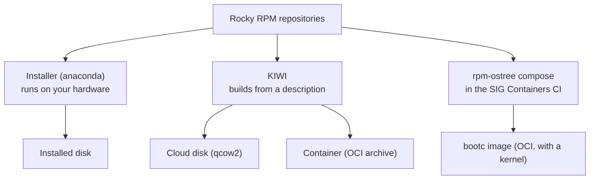
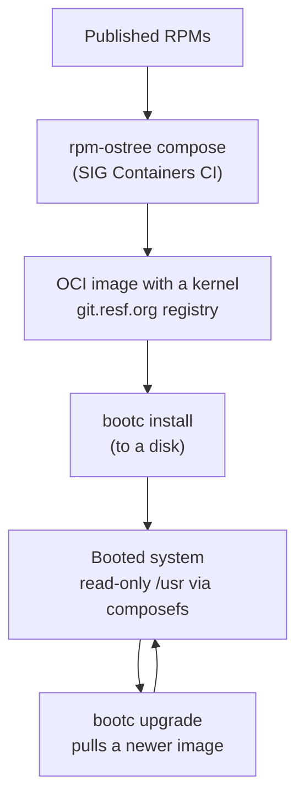

# 44 · Images: cloud, container and bootc

<ul class="module-meta">
  <li>⏱ ~2.5 hours</li>
  <li>5 labs</li>
  <li>Builds on: 18 · Containers from the ground up, 14 · The boot process, 43 · Getting onto a disk: installer and media</li>
  <li>Environment: Tier A</li>
  <li>Verified: Rocky 10.2, 2026-11-06</li>
</ul>

You pull `quay.io/rockylinux/rockylinux:10` and it starts in a second. You boot a Rocky cloud image on a hypervisor and it asks for your SSH key instead of a password. Both report `Rocky Linux 10.2` in `/etc/os-release`, and neither ran an installer. They are not two products. They are the same packages frozen in different shapes, and the differences between the shapes (no kernel here, a partition table there, Secure Boot off) explain most of the surprises people hit.

This module lets you open each shape, say what is inside and what is missing, find the public recipe that built it, and know which claims about it you can prove and which you cannot.

<div class="pipeline-strip" data-here="install" role="group" aria-label="Rocky build pipeline, six stages" markdown>

1. Source
2. Build
3. Sign
4. Compose
5. Publish
6. Install

</div>

*You are here: Install (stage 6 of 6). Before: Publish. After: nothing, this is the end of the line. The images in this module are built earlier, at the compose stage, and you meet them last.*

!!! abstract "What you'll learn"
    - Name the four shapes the same packages come in and say what each one adds or leaves out.
    - Find the tool and the public recipe repository that build Rocky's cloud, container, WSL, Vagrant and Raspberry Pi images.
    - Read the layout of a cloud image: an EFI System Partition, an `/boot` partition with its own type, a root partition with a discoverable type, an empty machine ID, a locked root account and a default user named `rocky`.
    - Explain why a container image is small, then prove it by building one from a directory.
    - Pull the right official container image, and say what the registries do and do not tell you about it.
    - Describe image mode (bootc) and inspect `rocky-bootc`, knowing it is a moving target.

!!! note "Remember from 18 and 14"
    A container shares the host's kernel and starts a process in private namespaces, so it carries no kernel of its own ([module 18](18-containers.md)). A bootable disk needs firmware, a bootloader on the EFI System Partition, a kernel and an initramfs ([module 14](14-the-boot-process.md)). This module is about what happens when you freeze a finished system instead of running an installer each time.

## The big picture

You already know one way to get Rocky onto a disk: boot the installer and let it write packages to a machine ([module 43](43-installer-and-install-media.md)). Every other way skips the installer. Somebody builds a finished system ahead of time, freezes it, and ships the frozen result. What changes between the ways is how much of a machine is wrapped around the packages.

### Images in one sentence

> **An image is an installed system frozen in one of four shapes: the same packages, with a different amount of machine wrapped around them.**

Keep that sentence. Every section hangs off it. The four shapes are:

- **ISO install.** An installer runs on your hardware and builds the system on your disk. The installed machine has everything: kernel, bootloader, init, packages.
- **Cloud disk.** A finished disk (a `qcow2` file) with a partition table, a bootloader, a kernel and the packages already in place. A first-boot agent called cloud-init personalizes it.
- **Container.** The packages as one filesystem layer plus a few lines of config. No kernel, no init, no bootloader: the host provides the kernel.
- **bootc image.** A container image that does carry a kernel, and that can be installed to a disk and updated by pulling a new image.



The diagram shows one source, the published RPM repositories, feeding three build tools. The installer builds a disk on your machine. KIWI builds the cloud disks and the plain containers from a description file. A separate compose step in the SIG Containers CI builds the bootc image. The tool names sit in the boxes because tools get replaced; the shapes on the bottom row are the stable part.

!!! analogy "Think of it like one recipe in four packagings"
    The packages are the recipe and the ingredients. An ISO install is a sit-down dinner: the kitchen (installer) cooks on your table. A cloud image is a frozen meal kit that the cloud reheats and seasons on arrival (cloud-init is the seasoning packet). A container is a lunchbox with no kitchen: it borrows the host's. A bootc image is a subscription box where each delivery replaces the last.

    Where the analogy breaks: food does not need a kernel version to match anything. A container really does depend on the host's kernel, which is why it cannot ship its own.

### The few things that solve most problems

| Situation | What to do | Where this module teaches it |
|-----------|-----------|------------------------------|
| You need a Rocky 10 container image and are not sure of the name | Use `quay.io/rockylinux/rockylinux:10` or `docker.io/rockylinux/rockylinux:10`. Not `docker.io/library/rockylinux` | Container images: names, tags and trust |
| A tool is missing in the container (`systemctl`, a kernel, a bootloader) | That is by design. Containers carry no kernel or init | Why a container is small |
| You cannot log in as root on a new cloud VM | Root is locked. Log in as `rocky` with the key the cloud injected | Worked story: the locked root |
| You expected Secure Boot on a cloud VM | Ask the VM: `mokutil --sb-state`. The image ships with it off | Worked story: Secure Boot that is not on |
| You want to know what is inside an image | Ask the image: `rpm -q` inside it, or `skopeo inspect` before you pull | The core skill |
| You want atomic, image-based updates | That is image mode (`bootc`). Check the image is still being built first | Image mode with bootc |

To pick a shape, ask where the kernel comes from. If the machine should have its own kernel and be a normal server, install from an ISO. If it is a virtual machine on a cloud or hypervisor, use a cloud image. If a host already runs the workload's kernel, use a container. If you want the whole operating system delivered and updated like a container, look at bootc.

### Words you'll see

| Word | Plain meaning |
|------|---------------|
| **image** | A finished system, or part of one, packaged as a file or a registry object instead of installed step by step |
| **KIWI** | The tool that builds Rocky's cloud, container, WSL, Vagrant and Raspberry Pi images from an XML description |
| **kiwibuild** | The compose phase that asks the build system (Koji) to run KIWI for the image set |
| **qcow2** | A disk image file format used by QEMU and most clouds. The file is much smaller than the disk it describes |
| **GenericCloud** | Rocky's cloud image for any cloud or hypervisor that supports cloud-init |
| **cloud-init** | A program that runs at first boot and personalizes the machine: user, SSH key, hostname, disk size |
| **ESP** | The EFI System Partition, a small FAT partition the firmware reads to find the bootloader |
| **XBOOTLDR** | A partition type for `/boot` that sits beside the ESP, defined by the Boot Loader Specification |
| **machine-id** | A unique ID file at `/etc/machine-id`. Empty in a shipped image so that each copy makes its own |
| **OCI image** | The standard container image format: a manifest, a config and one or more filesystem layers |
| **digest** | The SHA-256 name of an image. Same digest, same bytes |
| **manifest list** | An image name that points to one image per architecture |
| **bootc** | A tool that installs a container image as a bootable system and updates it by pulling a new image |
| **ostree** | The object store bootc uses on disk to keep several system versions side by side |
| **composefs** | A read-only filesystem layer that makes `/usr` immutable in image mode |

## The core skill: read an image

An image is a sealed box. The skill is asking it four questions before you trust it, run it, or blame it. Use these in this order.

1. **What shape is it?** The name tells you. `.qcow2` is a disk. `.oci.tar.xz` or a registry tag is a container. `.wsl` is a root filesystem for Windows Subsystem for Linux. `.raw.xz` is a disk for a Raspberry Pi. A label `containers.bootc=1` is an image-mode image.
2. **Which machine parts are inside?** A kernel, an init, a bootloader, firmware. Ask the package database, not your memory: `rpm -q kernel systemd grub2-common shim-x64`.
3. **Who finishes the job?** A cloud image waits for cloud-init. A container waits for a runtime. A bootc image waits for `bootc install`. An ISO install waits for you.
4. **What can I prove about where it came from?** A digest, a `CHECKSUM.asc` next to a download, a label that points at the recipe. Equally important is what is not there: a signature, an attestation.

Here is what question 2 looks like on a real cloud VM. The disk is the evidence for the shape.

```console
$ lsblk -o NAME,SIZE,PARTTYPENAME,PARTLABEL,FSTYPE,MOUNTPOINT
NAME         SIZE PARTTYPENAME        PARTLABEL FSTYPE MOUNTPOINT
nvme0n1      100G                                      
├─nvme0n1p1    2M BIOS boot           p.legacy         
├─nvme0n1p2  200M EFI System          p.UEFI    vfat   /boot/efi
├─nvme0n1p3 1000M Linux extended boot p.lxboot  xfs    /boot
└─nvme0n1p4 98.8G Linux root (x86-64) p.lxroot  xfs    /
```

Rocky 10.2 x86_64 cloud VM on AWS, 2026-11-06. Read the type column: the image carries a boot partition type, an ESP type and a root type. These are the parts a container lacks.

Now try three. Decide your answer before you open the fold.

**Practice 1.** In `quay.io/rockylinux/rockylinux:10`, will `rpm -q kernel systemd grub2-common shim-x64` find any of the four?

??? success "Answer: none of them"
    We observed all four reported as not installed inside the official container image (aarch64 and x86_64, 2026-11-06). The reason is the shape: a container runs on the host's kernel and has no init and no bootloader of its own, so the packages would be dead weight.

**Practice 2.** In the `lsblk` output above, which partition holds the kernel and the BLS entries, and which holds the bootloader files the firmware reads?

??? success "Answer: p3 for the kernel, p2 for the bootloader"
    `/boot` (the `Linux extended boot` partition, label `p.lxboot`) holds the kernel, the initramfs and the BLS entries. `/boot/efi` (the `EFI System` partition, label `p.UEFI`) holds the shim and GRUB files the firmware loads. The 2 MB `BIOS boot` partition is for old-style BIOS boot on x86_64 and is not something to touch.

**Practice 3.** Which of `docker.io/library/rockylinux:10` and `docker.io/rockylinux/rockylinux:10` is Rocky's current official image?

??? success "Answer: the second one"
    On 2026-11-06 `skopeo inspect docker://docker.io/library/rockylinux:10` fails with `manifest unknown`, because the Docker Official Image `library/rockylinux` is frozen at 9.3 and 8.9 (last updated 2024-05-30). The current image lives under the `rockylinux/rockylinux` name on both Docker Hub and Quay.

<div class="quiz" data-answer="2" markdown>

A teammate says "the Rocky 10 container image has an old kernel, we should update it". What is wrong with that sentence?

- Nothing, containers carry the kernel they were built with
- The container image has no kernel at all, so the kernel that matters is the host's
- Containers always use the newest kernel in the registry

Right: we found no `kernel` package in the image. The running kernel is the host's, so patching "the container's kernel" means patching the host.

</div>

## Same packages, four shapes

Start from what does not change. Every shape is built from the same packages as Rocky 10.2, and the `/etc/os-release` in each one says Rocky Linux 10.2. What differs is the wrapper.

| Shape | Arrives as | Who finishes the job | What it leaves out compared with a server install |
|-------|-----------|----------------------|----------------------------------------------------|
| ISO install | `boot.iso`, `dvd1`, `minimal` ISO | You, in anaconda or a kickstart | Nothing: the installer builds a full system on your disk |
| Cloud disk | `.qcow2`, `.vhdfixed.xz` | cloud-init at first boot | The installer, machine-specific config, firmware blobs |
| Container | `.oci.tar.xz`, registry tag | The container runtime | Kernel, init, bootloader, firmware, docs and most language packs |
| bootc image | registry tag | `bootc install`, then `bootc upgrade` | A package manager that edits `/usr` in place |

The cloud disk is the easiest shape to take apart because it is a whole machine. Here is the stack, top to bottom.

<div class="layers" data-hint="Click a layer to see what lives there." markdown>

<div class="layer" data-label="First-boot personalization" data-tag="cloud-init" markdown>

**What it does:** at first boot cloud-init reads the provider's metadata and sets the hostname, creates the default user `rocky`, installs your SSH key, regenerates the SSH host keys and grows the last partition to fill the disk. Nothing machine-specific is baked into the image.

```console
$ rpm -q cloud-init
cloud-init-24.4-7.el10.0.1.noarch
```

Rocky 10.2 x86_64 cloud VM, 2026-11-06.

</div>

<div class="layer" data-label="Userspace (the RPMs)" data-tag="/usr" markdown>

**What it does:** the same packages as any Rocky install, chosen by the image description. The aarch64 GenericCloud image carried 440 RPMs when we counted on 2026-11-06. It is a normal Rocky system: `rpm`, `dnf` and `systemctl` all work.

</div>

<div class="layer" data-label="Kernel and initramfs" data-tag="/boot (p.lxboot)" markdown>

**What it does:** one kernel and an initramfs built at image build time. `dracut-config-generic` is installed, which is our reading of why the image boots on any virtual hardware. The boot entry follows the Boot Loader Specification.

</div>

<div class="layer" data-label="Bootloader on the ESP" data-tag="/boot/efi (p.UEFI)" markdown>

**What it does:** the shim and GRUB files under `/boot/efi/EFI/` that the firmware loads, the same kind of files a normal Rocky install carries. Whether the firmware enforces their signatures is a separate question (see the Secure Boot story below).

</div>

<div class="layer" data-label="GPT partition table" data-tag="ESP, boot, root" markdown>

**What it does:** the layout from the `lsblk` output above. The partition types are set so that tools can tell the roles apart without reading `/etc/fstab`.

</div>

</div>

The layers show a cloud disk from the outside in. The partition table frames the disk. The ESP and `/boot` hold what boots. The RPMs are the operating system. cloud-init is the only part that runs differently from an installed server, and it runs once.

??? question "Where does the installer fit? Is an installed server also an image?"
    Think of an installed server as an image that you built by hand, on your own disk, with an installer standing in for the build tool. You end up with the same kind of system. The reason to ship images instead is repeatability: the cloud image is built once from a description and every copy starts identical, where ten installs may drift.

## Who builds the images: KIWI, Koji and a public recipe

The installer media come from lorax ([module 43](43-installer-and-install-media.md)). Everything else in Rocky's image set, the cloud disks, the containers, the WSL root filesystem, the Vagrant boxes and the Raspberry Pi disk, comes from one tool: **KIWI**. KIWI reads an XML description (a list of packages, a partition layout, a few scripts) and produces the image. The descriptions are public.

<!-- ev: FACTBASE-A hop 6 and O36; FACTBASE-B 3.11 | official | public Pungi and KIWI repositories, read 2026-11 -->
!!! evidence "Stated by the project: Pungi's kiwibuild phase builds the image set through Koji"
    **Seen on:** the public compose configuration and the recipe repository, read 2026-11, Rocky 10.2.

    In the public Pungi configuration for 10.2, the image phase is named `kiwibuild`. It runs on the Koji target `dist-rocky10.2-kiwi` and takes its descriptions from branch `r10` of `sig_core/rocky-kiwi-descriptions` on `git.resf.org`.

    **Check it yourself:** `git clone --depth 1 -b r10.2 https://git.rockylinux.org/rocky/pungi-rocky.git && grep -rn 'kiwibuild_target\|kiwibuild_description_scm' pungi-rocky/rocky`. On 2026-11-06 (branch head `e5796d5`, committed 2026-10-07) `rocky/images.conf` set `kiwibuild_target = 'dist-rocky%s.%s-kiwi'` (which becomes `dist-rocky10.2-kiwi`) and `kiwibuild_description_scm` to the `r%s` branch of the descriptions repository (`r10` for Rocky 10).

The word to hold onto is the mechanism: the compose asks the build system to run KIWI against a public description. The tool names are the part that can change.

<!-- ev: FACTBASE-A 1.2 and releng issue 49 | official | Rocky releng issue tracker, 2026-11 -->
!!! freshness "As of 2026-11-06 on Rocky 10.2"
    Rocky composes with Pungi as of 2026-11, and the image phase is called `kiwibuild`. A public request to replace Pungi is open in Rocky's releng tracker, so the phase name may change while the idea (compose asks Koji to build images from public descriptions) stays. This changes at the next tooling decision.

    **Re-check:** `gh api repos/rocky-linux/releng/issues/49`

The recipe repository is readable by anyone, and its branches tell you which releases it serves.

```console
$ git ls-remote --heads https://git.resf.org/sig_core/rocky-kiwi-descriptions
f498af95…	refs/heads/main
01dbb05a…	refs/heads/oracle
91fb1b1e…	refs/heads/r10
0089ee4b…	refs/heads/r10s
2512bd85…	refs/heads/r8
1ef36aba…	refs/heads/r9
f110963e…	refs/heads/wsl-r9
```

Captured from a macOS host against the public repository, 2026-11-06 (hashes trimmed). Branch `r10` serves Rocky 10. Branch `main` is a stub, which is why every command in this module clones `-b r10`.

On branch `r10` the build scripts are `cloud-build.sh`, `container-build.sh`, `live-build.sh`, `sbc-build.sh`, `vagrant-build.sh` and `wsl-build.sh`. The container profiles are `Container-Base`, `Container-Minimal`, `Container-UBI` and `Container-Toolbox`.

Here is the whole 10.2 image set for x86_64, read from the public download tree.

```console
$ curl -s https://dl.rockylinux.org/pub/rocky/10/images/x86_64/ \
    | grep -o 'Rocky-10-[A-Za-z0-9_-]*-10.2-20260525.0[^"<]*' | sort -u | grep -v CHECKSUM
Rocky-10-Azure-Base-10.2-20260525.0.x86_64.vhdfixed.xz
Rocky-10-Azure-LVM-10.2-20260525.0.x86_64.vhdfixed.xz
Rocky-10-Container-Base-10.2-20260525.0.x86_64.oci.tar.xz
Rocky-10-Container-Minimal-10.2-20260525.0.x86_64.oci.tar.xz
Rocky-10-Container-Toolbox-10.2-20260525.0.x86_64.oci.tar.xz
Rocky-10-Container-UBI-10.2-20260525.0.x86_64.oci.tar.xz
Rocky-10-EC2-Base-10.2-20260525.0.x86_64.qcow2
Rocky-10-EC2-LVM-10.2-20260525.0.x86_64.qcow2
Rocky-10-GenericCloud-Base-10.2-20260525.0.x86_64.qcow2
Rocky-10-GenericCloud-LVM-10.2-20260525.0.x86_64.qcow2
Rocky-10-OCP-Base-10.2-20260525.0.x86_64.qcow2
Rocky-10-Vagrant-Libvirt-10.2-20260525.0.x86_64.vagrant.libvirt.box
Rocky-10-Vagrant-Vbox-10.2-20260525.0.x86_64.vagrant.virtualbox.box
Rocky-10-WSL-Base-10.2-20260525.0.x86_64.wsl
```

The name grammar is `Rocky-10-<Type>-10.2-<build id>.<arch>.<extension>`. The `20260525.0` part is the compose that produced the set. Every file has a `.CHECKSUM` and a `.CHECKSUM.asc` beside it (the `grep -v` hid them). The aarch64 directory has the same set plus a `SBC-RaspberryPi` disk image.

<!-- ev: FACTBASE-A O38; live listing | observed | dl.rockylinux.org images directory, 2026-11-06 -->
!!! evidence "Observed: every image file has a signed checksum beside it"
    **Seen on:** the public download tree, 2026-11-06, build id `20260525.0`, x86_64.

    ```console
    $ curl -s https://dl.rockylinux.org/pub/rocky/10/images/x86_64/ | grep -o 'Rocky-10-Container-Base-10.2-20260525.0[^"<]*' | sort -u
    Rocky-10-Container-Base-10.2-20260525.0.x86_64.oci.tar.xz
    Rocky-10-Container-Base-10.2-20260525.0.x86_64.oci.tar.xz.CHECKSUM
    Rocky-10-Container-Base-10.2-20260525.0.x86_64.oci.tar.xz.CHECKSUM.asc
    ```

    **Check it yourself:** swap `Container-Base` for any other type in the listing. You should see the same three names: the image, a `.CHECKSUM` and a `.CHECKSUM.asc`. The signed checksum is the one place the download form of an image carries a signature. The registry form does not (see the trust section below).

??? question "Installer ISO or image: which tool built it?"
    The installer media (`boot.iso`, `dvd1`, `minimal`) are built by lorax and live under `isos/` in the download tree. The images live under `images/` and come from KIWI. A lorax ISO installs packages onto your disk at install time, while a KIWI image already contains the installed result. If only one shape misbehaves, a good first question is which tool built it.

??? question "A little more about KIWI descriptions"
    The cloud description file `rocky-cloud.xml` declares a KIWI schema version (7.4 in the copy we read), uses `dnf` as the package manager and sets `release-version 10`. Its cloud profiles are named `Core-Cloud` plus GenericCloud, Azure, EC2 and GCE variants (`Base` and `LVM`), and an OCP variant (`Base`). The script names (`cloud-build.sh`) and the profile names do not line up one to one, and we did not reconcile them. The shipped GenericCloud-Base disk uses KIWI's default partition names (`p.UEFI`, `p.lxboot`, `p.lxroot`), which is our reading of why they look like that.

## Cloud image layout

A cloud image is built offline into a loop-mounted disk, so everything an installer would have decided is already decided. Reading the layout teaches you what is fixed and what the first boot fills in.

Here is the aarch64 GenericCloud-Base image as we inspected it.

<!-- ev: FACTBASE-B O56; FACTBASE-B 3.11 | observed | aarch64 Lima VM, GenericCloud-Base 10.2-20260525.0, 2026-11-06 -->
!!! evidence "Observed: three partitions with three different types"
    **Seen on:** Rocky 10.2 aarch64 (Lima VM), image `Rocky-10-GenericCloud-Base-10.2-20260525.0.aarch64.qcow2`, 2026-11-06.

    `qemu-img info` reported a virtual size of 10 GiB and about 448 MiB on disk. `sfdisk -l` on the raw copy showed a GPT disk with:

    - p1, 200M, type `EFI System`, name `p.UEFI`, mounted at `/boot/efi` (vfat)
    - p2, 1000M, type `BC13C2FF-…` (XBOOTLDR), name `p.lxboot`, mounted at `/boot` (xfs)
    - p3, 8.8G, type `B921B045-…` (Linux root, ARM-64), name `p.lxroot`, mounted at `/` (xfs)

    The three `/etc/fstab` lines use `UUID=`. The x86_64 cloud VM above showed the same three roles plus a 2 MB `BIOS boot` partition at the front, which the aarch64 image does not need.

    **Check it yourself:** Lab 3 below walks the same inspection on a downloaded image.

Two design choices stand out. First, `/boot` is not on the ESP. The Boot Loader Specification gives it its own partition type, XBOOTLDR, so the kernel and initramfs files do not have to fit on a small FAT partition. Second, the root partition has the type GUID the Discoverable Partitions Specification defines for the architecture, which lets tools find it by type instead of by name.

Our reading, not something the image states: the correct types make the disk friendly to tools that read the specification, but Rocky's image still boots by UUID. The kernel command line carries `root=UUID=` and `/etc/fstab` lists the partitions by UUID.

```console
$ cat /proc/cmdline
BOOT_IMAGE=(hd0,gpt3)/vmlinuz-6.12.0-211.16.1.el10_2.0.1.x86_64 console=ttyS0,115200n8 no_timer_check crashkernel=1G-4G:192M,4G-64G:256M,64G-:512M nvme_core.io_timeout=4294967295 nvme_core.max_retries=10 root=UUID=<uuid>
```

Rocky 10.2 x86_64 cloud VM on AWS, 2026-11-06 (UUID replaced by a placeholder). The kernel is the one the image shipped with. The `nvme_core` options look specific to this AWS instance type and are probably not part of the generic recipe (our reading). The `console=ttyS0` is the serial console option. The aarch64 GenericCloud image sets the same one, and we found no public explanation for that.

### What the first boot has to fill in

An image copied a thousand times must not hold anything that is supposed to be unique. The cloud image is generalized: the unique parts are empty or locked until the first boot.

| Thing | State in the shipped image | What fills it in |
|-------|----------------------------|------------------|
| `/etc/machine-id` | Empty (0 bytes) | The first boot creates one |
| SSH host keys | None under `/etc/ssh` | cloud-init regenerates them (`ssh_deletekeys: true`) |
| Root password | Locked (`root:!` in `/etc/shadow`) | Nothing: root stays locked |
| Default user | `rocky` with passwordless `sudo` | cloud-init creates it and installs your key |
| Root partition size | 8.8G on the aarch64 image | cloud-init grows the last partition to fill the disk |

On the x86_64 cloud VM from the first example, the machine ID is populated (33 bytes: 32 hex characters and a newline) and the disk is 100G with a 98.8G root, which fits the picture of a first boot that filled in the blanks.

```console
$ getent passwd rocky
rocky:x:1000:1000::/home/rocky:/bin/bash
$ grep -A4 '^  default_user:' /etc/cloud/cloud.cfg
  default_user:
    name: rocky
    lock_passwd: True
    gecos: Cloud User
    groups: [adm, systemd-journal]
```

Rocky 10.2 x86_64 cloud VM on AWS, 2026-11-06. The `rocky` user and the locked password come straight from the cloud-init default configuration.

The same configuration, as we read it on the aarch64 image, sets `disable_root: true` and `ssh_pwauth: false`. That is why a fresh cloud VM refuses root logins and password logins by default.

<div class="quiz" data-answer="3" markdown>

You copy a GenericCloud image to 50 virtual machines. Where does each machine get its own SSH host key?

- It is baked into the image, so all 50 share one
- From the hypervisor's firmware
- Generated at first boot by cloud-init, because the image ships without host keys

Right: the image has no host keys under `/etc/ssh`, and cloud-init is configured to delete and regenerate them, so no two machines start with the same key.

</div>

### Worked story: the locked root

**Symptom.** You launch a Rocky 10.2 cloud VM. You try `ssh root@<address>` with your key, then try a password. Both are refused. The console login prompt will not take root either.

**Evidence.** The root entry in `/etc/shadow` starts with `!`, which means locked. The cloud-init defaults name a different user:

```console
$ sudo grep '^root:' /etc/shadow | cut -c1-8
root:!:2
$ getent passwd rocky
rocky:x:1000:1000::/home/rocky:/bin/bash
```

Rocky 10.2 x86_64 cloud VM on AWS, 2026-11-06 (the shadow line is cut to its first fields).

**Reasoning.** The image is generalized. The image builders could not ship a root password, because every copy would share it. So root is locked, password logins are off, and the one way in is the key your cloud injects for the default user. That user has passwordless `sudo`, so root-level work is one `sudo` away.

**Fix.** Log in as `rocky` with the key you gave the cloud: `ssh rocky@<address>`. For a root shell once you are in, `sudo -i`.

**Check.** `id` shows the `rocky` user, and `sudo -n true && echo ok` prints `ok` without asking for a password. If the key was rejected, the cause is the key pair your cloud attached, not the image.

### Worked story: Secure Boot that is not on

**Symptom.** An auditor's checklist says "Secure Boot enabled". Your team's Rocky 10.2 cloud VM ships Rocky's signed shim, GRUB and kernel. You assume the box is ticked.

**Evidence.** Ask the running machine.

<!-- ev: FACTBASE-C O-28 | observed | Rocky 10.2 x86_64 cloud VM on AWS, 2026-11-06 -->
!!! evidence "Observed: the cloud image runs with Secure Boot off"
    **Seen on:** Rocky 10.2 x86_64 cloud VM on AWS, 2026-11-06 (also seen on the earlier x86_64 test hosts).

    ```console
    $ mokutil --sb-state
    SecureBoot disabled
    Platform is in Setup Mode
    ```

    **Check it yourself:** run `mokutil --sb-state` on any cloud VM. `Setup Mode` means no platform key is enrolled, so the firmware does not check anything. The image carries the signed files; the firmware decides whether to enforce them.

**Reasoning.** Secure Boot is a property of the firmware's variables, not of the disk image. The image can ship signed binaries, and Rocky's shim carries Microsoft signatures, but on the VM we looked at, the firmware started with no platform key enrolled. With no platform key, the chain is never checked.

**Fix.** There is none inside the image. Turning enforcement on is a hypervisor or provider setting, and we did not test it on any provider. Say "signed boot chain present, enforcement not enabled" on the checklist, and cite the command output. Module 48 shows the chain from firmware to kernel module.

**Check.** `mokutil --sb-state` printing `SecureBoot enabled` after the provider-side change. Until it does, the checklist item is not met.

## Container images: names, tags and trust

The container is the shape you meet most often, so it is worth knowing exactly where the official one comes from and what a registry can and cannot vouch for.

### The right name

Rocky publishes its container image under the `rockylinux/rockylinux` name, on both Docker Hub and Quay. The two registries hold the same bytes.

```console
$ skopeo --override-os linux inspect --no-tags docker://quay.io/rockylinux/rockylinux:10
{
    "Name": "quay.io/rockylinux/rockylinux",
    "Digest": "sha256:827d37bc128288ccf160ee318bb3cb92d591164cb217e92f8bc61e3982ae1834",
    "Created": "2026-05-26T00:10:21.371315901Z",
    "Labels": {
        …
        "org.opencontainers.image.source": "https://git.resf.org/sig_core/rocky-kiwi-descriptions/src/branch/r10",
        "org.opencontainers.image.vendor": "Rocky Enterprise Software Foundation",
        "org.opencontainers.image.version": "10",
        …
    },
    "Architecture": "arm64",
    …
    "Env": [
        "container=oci"
    ]
}
```

Captured with `skopeo` 1.24.1 on a macOS arm64 host against the public registry, 2026-11-06 (output trimmed with `…`). The same command with `docker://docker.io/rockylinux/rockylinux:10` prints the identical `Digest` and `Created`. The `Digest` is the manifest list, which points to one image per architecture, and the layer shown belongs to the arm64 entry. On the x86_64 lab VM (`skopeo` 1.22.2) the same `Digest` printed with `"Architecture": "amd64"` and a `Created` of `2026-05-26T00:10:15Z`, a few seconds earlier than the arm64 entry. The manifest list holds five architectures: amd64, arm64, ppc64le, s390x and riscv64.

The `org.opencontainers.image.source` label is the best part for this course. It points from the image to the public recipe branch that built it, the same `r10` branch the compose reads. An image that tells you its recipe is an image you can audit.

```console
$ skopeo --override-os linux inspect --no-tags docker://docker.io/library/rockylinux:10
time="…" level=fatal msg="Error parsing image name \"docker://docker.io/library/rockylinux:10\": reading manifest 10 in docker.io/library/rockylinux: manifest unknown"
```

Captured on the same host, 2026-11-06 (timestamp trimmed). There is no `library/rockylinux:10`. The Docker Official Image under `library/` stopped at Rocky 9.3 and 8.9, last updated 2024-05-30. If you type the short name `rockylinux` and your tooling resolves it to Docker Hub's library namespace, you get that frozen image, not the current one. Use the fully qualified name.

<!-- ev: FACTBASE-A O59; ERRATA E5; FACTBASE-C 3.10 | observed | Docker Hub v2 API and skopeo, 2026-11-06 -->
!!! freshness "As of 2026-11-06 on Rocky 10.2"
    The `10` and `10.2` tags on `rockylinux/rockylinux` have digest `sha256:827d37bc…ae1834`. The Docker Hub tag was last pushed on 2026-06-12, and the image's own `Created` time is 2026-05-26. Variant tags such as `10-ubi-micro` were updated later, on 2026-10-25. The `library/rockylinux` image is frozen with 9.3 and 8.9 as the newest tags. Tag ages move at each image refresh.

    **Re-check:** `skopeo --override-os linux inspect --no-tags docker://quay.io/rockylinux/rockylinux:10`

A tag is a moving pointer, and the digest is the fixed name. For anything you need to reproduce, record the digest from `skopeo inspect`, not the tag.

### What the registries do not give you

Rocky signs the download form of an image: the `.CHECKSUM.asc` beside each file in `images/` verifies with the Rocky 10 release key. The registry form carries no signature that we could find.

<!-- ev: FACTBASE-C O-45 and 3.10 | observed | quay.io and docker.io, 2026-11-06 -->
!!! evidence "Observed: no signature or attestation on the registry images"
    **Seen on:** `quay.io/rockylinux/rockylinux` and `docker.io/rockylinux/rockylinux`, 2026-11-06.

    ```console
    $ skopeo list-tags docker://quay.io/rockylinux/rockylinux | grep -c 'sha256-'
    0
    ```

    No tag in the Quay tag list starts with `sha256-`, which is where a cosign signature or attestation tag would sit. Earlier we also found that the OCI referrers API returned an empty list for the digest, and that the cosign signature tag returned HTTP 404 on both registries.

    **Check it yourself:** run the `skopeo list-tags` command above. A result of `0` means no cosign-style tags. This shows the absence of signatures on the registry. It does not show the image is bad, only that the registry gives you nothing to verify it with.

The Docker Official Image `library/rockylinux` is the opposite case: the frozen one carries BuildKit attestation manifests, the fresh one carries none. The lesson is that the registry you pull from decides what provenance exists. If you need to verify an image, take the tarball from `images/`, check its `CHECKSUM.asc` with the release key (module 47 shows how), and load it yourself.

??? question "A key detail: the image ships the older key package"
    The `quay.io/rockylinux/rockylinux:10` image carries `rocky-gpg-keys-10.2-1.1`, which holds a one-certificate key file. The repositories later published `rocky-gpg-keys-10.2-1.2` with a two-certificate file. A fresh container therefore starts with the older key package, and updating brings the newer one. Module 47 explains the two key files and why GnuPG 2.4 rejects the larger one.

### Why a container is small

You can see how little is in a container with one `rpm -q`. The official image has no `kernel`, no `systemd` and no bootloader packages. It has `coreutils-single` instead of the full `coreutils`, the minimal glibc language pack, and `dnf` is configured with `tsflags=nodocs` so documentation is not installed.

<!-- ev: FACTBASE-B O58 and 3.11 | observed | aarch64 Lima VM, Container-Base 10.2-20260525.0, 2026-11-06 -->
!!! evidence "Observed: the official container image has no kernel, no init and no bootloader"
    **Seen on:** Rocky 10.2 aarch64 (Lima VM and podman), `Container-Base` image 10.2-20260525.0, 2026-11-06.

    From the OCI archive: one layer in `tar+gzip` form, config `Cmd ["/bin/bash"]`, `Env container=oci`, and a history entry created by KIWI 10.2.44. Inside the image, `rpm -q kernel systemd grub2-common shim-x64` reported none installed. `/usr/share/doc` held zero entries.

    **Check it yourself:** Lab 2 runs the `rpm -q` inside the official image. You should see all four reported as not installed.

The sizes tell the same story. We measured them two ways on two architectures, so the table names the architecture. Do not compare numbers across columns.

| Image | aarch64 podman | x86_64 podman |
|-------|----------------|---------------|
| Official `rockylinux/rockylinux:10` | 261 MB (138 packages, 2026-11-06) | 244 MB (138 packages, 2026-11-06) |
| Official `rockylinux/rockylinux:10-minimal` | 142 MB (118 packages, 2026-11-06) | 132 MB (118 packages, 2026-11-06) |
| KIWI-built `Container-Base` (our build) | 210 MB (139 packages, 2026-11-06) | not tried |
| Our tree from `dnf --installroot`, 119 packages, no kernel | 180 MB (2026-11-06) | 224 MB (2026-11-06) |
| Same idea, 97 packages, `nodocs`, with `microdnf` | 132 MB | not run |
| Our tree with `kernel-core` and `dracut` added | not run | 468 MB |

Sizes are what `podman images` reported on 2026-11-06, in decimal megabytes. The x86_64 official-image rows and the 224 MB row were measured again on the x86_64 VM on 2026-11-06 and matched the earlier x86_64 run. The official image was five months older than our KIWI build when we compared them on aarch64, so a few packages differ. The x86_64 rows are the point: adding a kernel and the initramfs tools to the same 119-package tree took the image from 224 MB, a little under the official 244 MB, to 468 MB, nearly double it. The x86_64 and aarch64 columns differ in size for the same package list, so compare rows inside one column. The kernel is not a small package. In the aarch64 cloud image, `kernel-core` was the largest single RPM, at 133 MB.

<!-- ev: FACTBASE-C O-55; FACTBASE-B 3.11; labs/final 02-packages d.log | observed | aarch64 Lima and x86_64 VM, 2026-11-06 -->
!!! freshness "As of 2026-11-06 on Rocky 10.2"
    Official image sizes follow each image refresh and each architecture. The mechanism is stable: no kernel, no init and no docs keeps a container small. The numbers above are for the 10.2 images as of 2026-11-06. Official sizes change at each refresh and have not grown or shrunk in a fixed direction.

    **Re-check:** `podman pull -q quay.io/rockylinux/rockylinux:10 && podman images --format '{{.Repository}}:{{.Tag}} {{.Size}}'`

<div class="quiz" data-answer="1" markdown>

You add `kernel-core` to a container image and rebuild it. What do you now have?

- A bigger image that still uses the host's kernel when it runs as a container
- A container that boots its own kernel
- A virtual machine

Right: a container runtime starts a process on the host's kernel. The extra kernel files only add size. To boot a kernel from an image, you need image mode (bootc) or a disk image, not a plain container.

</div>

Rocky also publishes `Container-Minimal` (which uses `microdnf` instead of `dnf`), `Container-UBI` and `Container-Toolbox` variants, listed in the inventory above.

!!! warning "KIWI container build: tested on aarch64 only"
    We built the `Container-Base` image with KIWI once, on aarch64, in about a minute (Lab 5). We did not try the KIWI container build, the KIWI disk image build or `livemedia-creator --make-disk` on x86_64. Everything in this module about the build process is from the aarch64 run and the public recipe. The x86_64 images you download were built by Rocky.

## Three more shapes in short folds

The same KIWI descriptions build three more shapes. They matter less for this module's main line, so each is one fold. A reader who skips all three still has a correct model.

??? question "WSL: a root filesystem, no kernel"
    The `.wsl` file is a gzip-compressed tar of a plain root filesystem. We opened the aarch64 file (about 150.8 MB) and found no kernel inside: Windows Subsystem for Linux supplies its own. It carries `/etc/wsl.conf` with `[boot] systemd=true` and `/etc/wsl-distribution.conf` with an out-of-box script that creates your user on first run. The icon file in that configuration is still `fedora-logo.ico`, a branding leftover we observed on 2026-11-06. How Rocky distributes the `.wsl` file to users of `wsl --install` was not checked.

??? question "Vagrant: boxes exist, contents not inspected"
    `Rocky-10-Vagrant-Libvirt` and `Rocky-10-Vagrant-Vbox` boxes are listed for x86_64 and aarch64 in the image set above. The recipe repository has a `vagrant-build.sh` script, which is why we believe KIWI builds them. We did not open a box, so we cannot say what is inside one.

??? question "Raspberry Pi: boots through the Pi's own firmware, with a different kernel"
    The aarch64 `SBC-RaspberryPi` image is a `.raw.xz` of 994 MB compressed (3,346 MB raw when we checked on 2026-11-06). Its first partition is a 500M FAT partition typed as an EFI System Partition, but it holds the Raspberry Pi firmware layout, not a shim and GRUB chain: `bootcode.bin`, `start*.elf`, device tree files, `config.txt`, `cmdline.txt`, `kernel8.img` and an initramfs. A 512M swap partition and a 2.3G ext4 root labelled `RPIROOT` follow.

    The kernel is a different one. The image installs `kernel-rpi-4k-core` and `kernel-rpi-16k-core` at version `6.6.77-8.el10.altarch`, from the AltArch SIG, so the Pi runs a Raspberry Pi 6.6 kernel, not the RHEL-compatible 6.12 kernel. There is no shim and no GRUB in the path, so Secure Boot and TPM measurements do not apply. What creates your first user on a Pi image was not verified.

    We did not script this inspection, so there is no lab for it and no command here that we ran.

## Image mode with bootc

Everything so far is "build the system, then run it as it is." **Image mode** changes the update story. You treat the whole operating system as a container image: you build it, push it to a registry, install it to a disk once, and from then on update by pulling a newer image. `bootc` is the tool that does the installing and the updating.

> **A bootc image is a container image that carries a kernel, so a machine can boot from it and update by pulling a newer one.**

That sentence has a surprise in it. Earlier we said a container carries no kernel. A bootc image is the exception: it is shaped like a container image, but its filesystem holds a kernel and an initramfs under `/usr/lib/modules/<version>/`, and it is meant to be installed to a disk, not started by a runtime. At runtime on the installed machine, systemd is process 1 and nothing runs inside a container.

!!! warning "Perishable: rocky-bootc is a moving target"
    When we checked on 2026-11-06, the newest `rocky-bootc` image was 11 days old and the repository's scheduled "Nightly builds" workflow had failed on each of its last 11 runs (2026-10-27 to 2026-11-06). The images are x86_64 only, and the tags change nightly when the CI works. Treat everything in this section as a snapshot. The Lab 4 commands read a public registry and will show you the state on the day you run them.

### What a rocky-bootc image looks like

<!-- ev: FACTBASE-B O60 and 3.12 | observed | git.resf.org registry, skopeo, 2026-11-06 -->
!!! evidence "Observed: rocky-bootc is an x86_64 image with 68 layers and bootc labels"
    **Seen on:** `git.resf.org/sig_containers/rocky-bootc:10`, 2026-11-06, read from a macOS arm64 host with `--override-arch amd64`.

    ```console
    $ skopeo --override-arch amd64 --override-os linux inspect docker://git.resf.org/sig_containers/rocky-bootc:10 | jq '.Layers | length'
    68
    $ skopeo --override-arch amd64 --override-os linux inspect docker://git.resf.org/sig_containers/rocky-bootc:10 \
        | jq -r '.Labels | to_entries[] | select(.key|test("bootc|ostree.boot|redhat|org.opencontainers.image.version")) | "\(.key)=\(.value)"'
    containers.bootc=1
    org.opencontainers.image.version=10.2.20261026.0
    ostree.bootable=1
    redhat.id=rocky
    redhat.version-id=10.2
    ```

    From an arm64 client, plain `skopeo inspect` with no override fails with `no image found in image index for architecture "arm64"`, because the image is built for amd64 only.

    **Check it yourself:** run the first command on your own machine. You need `skopeo` and `jq`. The `containers.bootc=1` label is what marks the image as a bootc image.

The tags we saw on 2026-11-06 for Rocky 10 were `10`, `10.2`, `10.2-20261026` and `10.2.20261026.0` (plus an `-amd64` copy of the dated tag), and the image was created on 2026-10-26. The list also held `latest` and matching Rocky 9.8 tags. The minimal sibling is `rocky-bootc-minimal`.

Each of the 68 layers is not a normal root filesystem. They are slices of an ostree object store (`sysroot/ostree/repo/objects/XX/…`). That packaging is called chunked: the system is split across many layers so `bootc upgrade` only downloads the chunks that changed.

### The layout rules that make image mode different

Image mode divides the filesystem by how it may change. This is the one table to remember.

| Path | Behaviour in image mode |
|------|-------------------------|
| `/usr` | Immutable. A read-only composefs mount from the image |
| `/etc` | Persistent. Your local edits are kept and merged with the new image's defaults at each update (a three-way merge) |
| `/var` | Persistent and shared across updates. Image content here is only unpacked from the first image |
| `/opt` | Read-only |

The image's boot-time settings confirm the read-only root.

<!-- ev: FACTBASE-B O60; research W3-C 7.1 | observed | rocky-bootc layers read with ostree, aarch64 podman, 2026-11-06 -->
!!! evidence "Observed: composefs is enabled and the root is read-only"
    **Seen on:** `rocky-bootc` layers reassembled into one ostree repository on an aarch64 podman host, 2026-11-06.

    ```console
    $ ostree --repo=bmroot/sysroot/ostree/repo cat <ostree.commit> /usr/lib/ostree/prepare-root.conf
    [composefs]
    enabled = yes
    [sysroot]
    readonly = true
    ```

    **Check it yourself:** Lab 4 step 3 reads this file the same way. `<ostree.commit>` is the value of the `ostree.commit` label from the inspect output.

### How an image becomes a running system

<div class="stepper" markdown>

<div class="step" data-title="Build" markdown>

Rocky builds the image in a Forgejo CI job in the SIG Containers, not in the main compose. The job starts from `quay.io/rockylinux/rockylinux:10`, runs `bootc-base-imagectl build-rootfs` with a manifest (`standard` or `minimal`), then `rpm-ostree experimental compose build-chunked-oci --bootc`. The input is the same published RPMs as every other shape. Rocky adds `dnf-yum` and `dnf-bootc` and an install setting that picks `xfs` for the root filesystem.

</div>

<div class="step" data-title="Publish" markdown>

The result is pushed to the registry on `git.resf.org` as `sig_containers/rocky-bootc`. A nightly workflow on the repository's default branch dispatches rebuilds into the maintained branches. That is why the tags carry dates.

</div>

<div class="step" data-title="Install" markdown>

`bootc install to-disk` (run from the image) or `bootc install to-filesystem` lays out partitions, imports the image into an ostree repository, creates a deployment and writes a boot entry. The bootloader files ship inside the image and are installed with `bootupd`. The `bootc` kickstart command, new in the RHEL 10 kickstart syntax, lets anaconda do the same.

</div>

<div class="step" data-title="Boot" markdown>

The initramfs, built when the image was built (never on the target), runs `ostree-prepare-root`. It reads `prepare-root.conf`, builds a read-only composefs root from the chosen deployment, binds the persistent `/var` and the merged `/etc`, and switches to it.

</div>

<div class="step" data-title="Update and roll back" markdown>

`bootc upgrade` pulls a newer image and stages it. The new version takes effect at the next reboot. `bootc rollback` flips the boot order back to the previous deployment.

</div>

</div>

The five steps are one cycle: build the image from packages, publish it as a container, install it to a disk once, boot a read-only root built from it, and replace it by pulling a newer image. The install, boot and update steps are our reading of the bootc and ostree documentation joined with the files we observed in the image. We did not install `rocky-bootc` to a disk, so no step of that cycle was run end to end on Rocky.



The diagram shows the published RPMs becoming an OCI image, the image being installed to a disk, and the booted system looping through upgrades by pulling newer images. The tool names are in the labels so that a replacement is a small edit.

The `bootc` command itself is in Rocky 10.2 AppStream. When we ran `bootc --version` it printed `bootc 1.16.4`, and `bootc --help` listed `upgrade switch rollback edit status usr-overlay install container composefs-finalize-staged`. `bootc install` offers `to-disk`, `to-filesystem` and `to-existing-root`. The package installs the units `bootc-fetch-apply-updates.service` and `.timer`.

!!! danger "bootc install to-disk erases a disk"
    `bootc install to-disk` repartitions the target disk. Never point it at a disk you want to keep, and never run it on your workstation. This module does not ask you to run it.

??? version "Comparison lens: CentOS Stream bootc"
    Rocky's `rocky-bootc` repository says it was forked from the Red Hat CentOS Stream bootc containers repository on GitLab. The base image manifests and the `bootc-base-imagectl` tool come through a pinned `fedora-bootc` submodule (`gitlab.com/fedora/bootc/base-images`). So the build recipe is shared with the upstream bootc project, and the packages are Rocky's. **Check it yourself:** read the `README` and `.gitmodules` on branch `r10` of `git.resf.org/sig_containers/rocky-bootc`.

??? question "Why `dnf` behaves differently in an image-mode system"
    Rocky adds `dnf-bootc` and `dnf-yum` to the image. Our reading is that `dnf-bootc` is what makes `dnf` refuse or redirect in-place package changes on a read-only `/usr`, but we did not confirm what it does. A test of what `dnf install` prints on a booted `rocky-bootc` machine was not run.

??? question "What about building a disk from a bootc image?"
    `bootc-image-builder` is not a Rocky RPM, and its sources have moved into the `osbuild/image-builder` repository. Rocky 10.2 AppStream ships `image-builder` and `osbuild`, but whether a `rocky-10` distribution definition exists was not verified. The stock Rocky boot ISO's installer contains `bootc`, `rpm-ostree` and `ostree`, and `ksverdiff -f RHEL9 -t RHEL10` lists `bootc` among the commands added in the RHEL 10 kickstart syntax. Whether that installer path works end to end with `rocky-bootc` was not tested.

<div class="quiz" data-answer="2" markdown>

On a booted bootc system you edit `/etc/ssh/sshd_config` and later run `bootc upgrade` and reboot. What happens to your edit?

- It is lost, because the whole system is replaced by the new image
- It is kept, because `/etc` is persistent and merged with the new image's defaults
- It is kept only if you also edit `/usr/etc`

Right: `/etc` is persistent in image mode and is updated by a three-way merge, so local changes survive an update. `/usr` is the part that comes straight from the image and is read-only.

</div>

### Worked story: the nightly image that stopped moving

**Symptom.** A teammate wants to base a fleet on `rocky-bootc:10` because "it is rebuilt nightly, so it is always current".

**Evidence.** Ask the registry for the newest tag and its creation time, then look at the CI page.

```console
$ skopeo --override-arch amd64 --override-os linux inspect docker://git.resf.org/sig_containers/rocky-bootc:10 | jq -r '.Created'
2026-10-26T16:24:59.467554432Z
```

Captured from a macOS arm64 host, 2026-11-06. The creation time is 2026-10-26, eleven days before the day we looked. The repository's Actions list showed the scheduled "Nightly builds" workflow failing every night from 2026-10-27 to 2026-11-06, each run ending after about 2 seconds in its single `dispatch` job. The last "Build and publish" run on `r10` that finished was a success on 2026-10-26, which matches the image's creation time. We did not read why the dispatch fails.

**Reasoning.** Two things can both be true. The design is a nightly rebuild, and the pipeline is not guaranteed to be working today. A newest image eleven days old, plus eleven failed nightly runs in a row, says the nightly promise was not holding on 2026-11-06. We cannot say why from the public record.

**Fix.** Do not assume freshness. Pin to a digest you have inspected, check `Created` before each rollout, and keep a plain installed Rocky system for anything you cannot afford to have stale.

**Check.** The `Created` field of the image you intend to deploy, read the day you deploy it.

## Putting it together

Return to the four shapes and the four questions. Every image you meet will be one of these, and the skill is the same.

<div class="decision" markdown>

<div class="node" data-id="start" markdown>

**Does the workload need its own kernel?**

<button data-goto="kernel">Yes</button> <button data-goto="host">No, a host kernel is fine</button>

</div>

<div class="node" data-id="kernel" markdown>

**Is the machine a virtual machine on a cloud or hypervisor?**

<button data-goto="cloud">Yes</button> <button data-goto="metal">No, my own hardware</button>

</div>

<div class="node" data-id="cloud" markdown>

Use a **cloud image** (`GenericCloud`, `EC2`, `Azure`). Log in as `rocky` with the injected key. Remember Secure Boot is off until your provider enforces it.

</div>

<div class="node" data-id="metal" markdown>

**Do you want the whole operating system delivered and updated as one image?**

<button data-goto="bootc">Yes</button> <button data-goto="iso">No, a normal server</button>

</div>

<div class="node" data-id="bootc" markdown>

Look at **bootc** (image mode). Check the image's `Created` date and that CI is producing it. It was x86_64 only and perishable when we checked on 2026-11-06.

</div>

<div class="node" data-id="iso" markdown>

Use the **ISO install** ([module 43](43-installer-and-install-media.md)) or a kickstart. You get a full system with its own kernel and bootloader.

</div>

<div class="node" data-id="host" markdown>

Use a **container**. Pull `quay.io/rockylinux/rockylinux:10` by its full name, record the digest, and update the host to patch the kernel.

</div>

</div>

A practice terminal for the commands this module uses, with output from our real runs. It is local and stable: no network calls.

<div class="terminal-sim" data-title="Read the evidence on a Rocky machine" data-prompt="[rocky@lab ~]$ " markdown>

<div class="task" data-expect="mokutil --sb-state" data-hint="Ask the machine whether Secure Boot is on. The tool is mokutil." markdown>

**Step 1.** Is Secure Boot enabled on this cloud VM?

```text
SecureBoot disabled
Platform is in Setup Mode
```

</div>

<div class="task" data-expect="lsblk -o NAME,SIZE,PARTTYPENAME,PARTLABEL,FSTYPE,MOUNTPOINT||lsblk -o NAME,SIZE,PARTTYPENAME" data-hint="lsblk with -o and the columns NAME, SIZE, PARTTYPENAME, PARTLABEL, FSTYPE, MOUNTPOINT." markdown>

**Step 2.** Show the disk layout with the partition type names.

```text
NAME         SIZE PARTTYPENAME        PARTLABEL FSTYPE MOUNTPOINT
nvme0n1      100G                                      
├─nvme0n1p1    2M BIOS boot           p.legacy         
├─nvme0n1p2  200M EFI System          p.UEFI    vfat   /boot/efi
├─nvme0n1p3 1000M Linux extended boot p.lxboot  xfs    /boot
└─nvme0n1p4 98.8G Linux root (x86-64) p.lxroot  xfs    /
```

</div>

<div class="task" data-expect="rpm --root /var/tmp/lab-root -qa | wc -l||rpm --root /var/tmp/lab-root -qa|wc -l" data-hint="rpm with --root pointing at the lab tree, query all (-qa), count the lines." markdown>

**Step 3.** Count the packages in the lab tree you built with `dnf --installroot`.

```text
119
```

</div>

<div class="task" data-expect="podman images --format '{{.Repository}}:{{.Tag}} {{.Size}}'||sudo podman images --format '{{.Repository}}:{{.Tag}} {{.Size}}'" data-hint="podman images with a --format string of Repository, Tag and Size." markdown>

**Step 4.** List your images and their sizes (this output is from the test VM run that included the kernel, and that VM also held the `:9` image).

```text
localhost/rocky-lab-base:10 468 MB
quay.io/rockylinux/rockylinux:10-minimal 132 MB
quay.io/rockylinux/rockylinux:10 244 MB
quay.io/rockylinux/rockylinux:9 244 MB
```

</div>

</div>

<div class="quiz" data-answer="3" markdown>

An auditor asks whether your cloud VM boots with Secure Boot enforced. Which answer is supported by evidence?

- Yes, the image ships Rocky's signed shim, GRUB and kernel
- Yes, because Rocky's installer enables it
- Not enforced: `mokutil --sb-state` reports `SecureBoot disabled`, even though the signed files are present

Right: signed binaries are one half. Enforcement needs a platform key in the firmware, and the cloud image's virtual firmware starts in Setup Mode with none.

</div>

!!! unknown "What nobody outside the project can tell you"
    - How the image set is signed and who signs the `CHECKSUM` files: the public record shows a verifying `CHECKSUM.asc` beside each file, not the signing path. Not public.
    - How the Docker Hub and Quay images are published, and how Rocky's images reach the Azure, GCP and Oracle marketplaces. Not public.
    - Whether `rocky-bootc` will be signed with cosign, and whether an aarch64 image is planned. We found no statement either way. Not public.
    - Whether the stock installer installs `rocky-bootc` end to end, and what KIWI does for the cloud disk or the container on x86_64. Not tested here.
    - Why the aarch64 GenericCloud image sets `console=ttyS0`, and why an aarch64 ESP carries a `bootx64.efi`. Not public.

## Labs

The labs build a container from a directory, read the official image, take apart a cloud image, read the public `rocky-bootc` image, and follow a KIWI build. Lab 1 needs root on a Rocky 10 machine with podman. The others need only a shell and network.

!!! lab "Lab 1: Build a container from a directory and weigh it"

    - **Tier** A: Rocky shell
    - **Status** Tested partly
    - **Time** about 10 minutes for the package labs this comes from; on the test VM the tree install took 37 seconds and adding the kernel took 56 seconds
    - **Hardware** 4 GiB RAM was ample; about 2 GB of free disk (tree 444M, tar 447M, gzip 234M, image 468 MB on the test VM)
    - **Tested on** Rocky 10.2 x86_64 VM, 2026-11-06 (tree, kernel, import and size comparison); the import of the tree before the kernel was added measured 180 MB on aarch64 and 224 MB on x86_64 (a second run of steps 1 and 3 only)

    **Goal:** Turn a directory of Rocky packages into a container image and see why the official image is the size it is.

    **You'll need:** a Rocky 10 shell with `sudo` and `podman`. Use `sudo podman` throughout so the file owners are preserved.

    1. Build a minimal tree. This installs packages into a directory and takes about 40 seconds. Do not pipe `dnf` into `head`: the broken pipe can leave a half-built tree.

        ```bash
        R=/var/tmp/lab-root
        sudo rm -rf $R; sudo mkdir -p $R
        sudo dnf -y --installroot=$R --releasever=10 --setopt=install_weak_deps=False \
          install bash coreutils rpm dnf rootfiles rocky-release
        sudo dnf --installroot=$R clean all
        du -sh $R; rpm --root $R -qa | wc -l
        ```

    2. Check the tree is a working system and read its identity:

        ```bash
        rpm --root $R -V bash && echo VERIFY-OK
        sudo chroot $R /bin/bash -c 'head -3 /etc/os-release; rpm -qa | wc -l; uname -m'
        ```

    3. Import the tree as a container image and run it:

        ```bash
        sudo tar --numeric-owner --xattrs -C $R -cf /var/tmp/lab-root.tar .
        sudo gzip -k -1 -f /var/tmp/lab-root.tar
        sudo podman import --change 'CMD ["/bin/bash"]' --message "installroot lab" \
          /var/tmp/lab-root.tar.gz localhost/rocky-lab-nokernel:10
        sudo podman run --rm localhost/rocky-lab-nokernel:10 bash -c 'head -2 /etc/os-release; rpm -qa | wc -l'
        ```

    4. Pull the official images and compare sizes:

        ```bash
        sudo podman pull -q quay.io/rockylinux/rockylinux:10 >/dev/null
        sudo podman pull -q quay.io/rockylinux/rockylinux:10-minimal >/dev/null
        sudo podman images --format '{{.Repository}}:{{.Tag}} {{.Size}}'
        ```

    5. Add a kernel and the initramfs tools to the tree, re-import it and compare again:

        ```bash
        sudo dnf -y --installroot=$R --releasever=10 --setopt=install_weak_deps=False \
          install kernel-core dracut
        ls -lh $R/boot
        sudo tar --numeric-owner --xattrs -C $R -cf /var/tmp/lab-root.tar .
        sudo gzip -k -1 -f /var/tmp/lab-root.tar
        sudo podman import --change 'CMD ["/bin/bash"]' /var/tmp/lab-root.tar.gz localhost/rocky-lab-base:10
        sudo podman images --format '{{.Repository}}:{{.Tag}} {{.Size}}'
        ```

    **Check your work:** the listing in step 4 should show `rocky-lab-nokernel` smaller than `rockylinux/rockylinux:10`, because your tree has fewer packages. The listing in step 5 should show `rocky-lab-base` larger than the official image. For reference, on the x86_64 test VM (2026-11-06) the tree had 119 packages and 211M after the cache was cleaned, grew to 444M with the kernel, and the kernel-included image listed 468 MB against 244 MB for the official `:10` and 132 MB for `:10-minimal`. On the same x86_64 VM the kernel-free import of this tree listed 224 MB (211M tree, 119 packages). On aarch64 it measured 180 MB. If your numbers keep the same order (without kernel smaller, with kernel larger) but differ in size, the cause is architecture or image refresh date. If the kernel-included image is not larger, check that the `kernel-core` install in step 5 completed.

    ??? success "What just happened?"
        You built the second shape yourself. A container image is a directory tree packed into one layer plus config (here, just `CMD`). The initramfs sits in `/boot` inside your tree, generated by the `kernel-core` scriptlets (27M on the test VM), but a container runtime never boots it. That is the whole reason the official image skips the kernel: it adds size and cannot be used.

    **Clean up:** `sudo podman rmi localhost/rocky-lab-nokernel:10 localhost/rocky-lab-base:10`, then `sudo rm -rf /var/tmp/lab-root /var/tmp/lab-root.tar /var/tmp/lab-root.tar.gz`. If you want the official images gone too: `sudo podman rmi quay.io/rockylinux/rockylinux:10 quay.io/rockylinux/rockylinux:10-minimal`.

!!! lab "Lab 2: Inspect the official container image"

    - **Tier** D: network services
    - **Status** Tested partly
    - **Time** about 10 minutes recorded for the inspection; the archive download is about 85 MB
    - **Hardware** the aarch64 test VM had 4 vCPU, 8 GiB RAM and 80 GiB disk; the lab uses far less of it
    - **Tested on** Rocky 10.2 aarch64 (Lima VM and podman), 2026-11-06; the registry commands were also run from a macOS arm64 host; x86_64 not run for this lab

    **Goal:** Learn what the official image is, what it points back to, and what it lacks, without trusting anyone's summary.

    **You'll need:** a Rocky 10 shell with `skopeo`, `podman`, `jq` and `curl`. Install any that are missing with `sudo dnf install`.

    1. Read the image from the registry without pulling it, on both registries, and compare the digests:

        ```bash
        skopeo inspect --no-tags docker://quay.io/rockylinux/rockylinux:10 | grep -E '"Digest"|"Created"|image.source'
        skopeo inspect --no-tags docker://docker.io/rockylinux/rockylinux:10 | grep -E '"Digest"|"Created"'
        skopeo inspect --no-tags docker://docker.io/library/rockylinux:10
        ```

    2. Download the tarball form and read its OCI index:

        ```bash
        curl -sSLO https://dl.rockylinux.org/pub/rocky/10/images/x86_64/Rocky-10-Container-Base-10.2-20260525.0.x86_64.oci.tar.xz
        mkdir oci && tar -xJf Rocky-10-Container-Base-10.2-20260525.0.x86_64.oci.tar.xz -C oci
        jq . oci/index.json
        ```

        We ran this step on the aarch64 file (replace `x86_64` with `aarch64` to match). The x86_64 file name is from the public listing and was not run.

    3. Ask the image what it lacks:

        ```bash
        sudo podman run --rm quay.io/rockylinux/rockylinux:10 rpm -q kernel systemd grub2-common shim-x64
        ```

    4. Look for signatures on the registry:

        ```bash
        skopeo list-tags docker://quay.io/rockylinux/rockylinux | grep -c 'sha256-'
        ```

    **Check your work:** step 1 prints the same `Digest` for both registries and a `Created` time on 2026-05-26 (it moves when the image is refreshed), and an `org.opencontainers.image.source` label that points at branch `r10` of `rocky-kiwi-descriptions`. The third command fails with `manifest unknown`. Step 3 reports the four packages as not installed. Step 4 prints `0` (no cosign-style tags). If the digests differ, one registry has been refreshed before the other; compare `Created`.

    ??? success "What just happened?"
        You answered the four questions without running the image: its shape (a single-layer OCI image), its parts (no kernel, init or bootloader), who finishes the job (a runtime), and what you can prove (the label points to the recipe; the registry offers no signature). The tarball in `images/` is the form that has a signed checksum.

    **Clean up:** `rm -rf oci Rocky-10-Container-Base-10.2-20260525.0.x86_64.oci.tar.xz`. Nothing else was created.

!!! lab "Lab 3: Take apart a cloud image without booting it"

    - **Tier** D: network services
    - **Status** Tested partly
    - **Time** about 10 minutes recorded for the inspection, plus the download (about 470 MB for aarch64); the guestfish step took about 75 seconds under software emulation
    - **Hardware** the aarch64 test VM had 4 vCPU, 8 GiB RAM and 80 GiB disk; the raw copy is a 10 GiB file unless your filesystem keeps it sparse
    - **Tested on** Rocky 10.2 aarch64 Lima VM, 2026-11-06; the guestfish package name was not recorded and the x86_64 image was not inspected this way

    **Goal:** Read the partition layout, the boot entry and the generalized state of the official GenericCloud image, read only.

    **You'll need:** `qemu-img` and `sfdisk` (from `util-linux`), and `guestfish`. We did not record which package provided `guestfish` on the test VM. Find it with `dnf provides '*/guestfish'` before you install anything.

    1. Download the image (the aarch64 file is shown, as we tested it) and check the signed checksum if you have the release key imported (module 47):

        ```bash
        curl -sSLO https://dl.rockylinux.org/pub/rocky/10/images/aarch64/Rocky-10-GenericCloud-Base-10.2-20260525.0.aarch64.qcow2
        qemu-img info Rocky-10-GenericCloud-Base-10.2-20260525.0.aarch64.qcow2
        ```

    2. Convert to a raw copy and list the partitions:

        ```bash
        qemu-img convert -O raw Rocky-10-GenericCloud-Base-10.2-20260525.0.aarch64.qcow2 gc.raw
        sfdisk -l gc.raw
        ```

    3. Open the raw copy read only. This is slow without hardware virtualization (about 75 seconds on our test VM):

        ```bash
        LIBGUESTFS_BACKEND=direct LIBGUESTFS_BACKEND_SETTINGS=force_tcg guestfish --ro -a gc.raw -i
        ```

        At the `><fs>` prompt, `guestfish` does not expand wildcards, so list first and then use the full name:

        ```text
        ><fs> ls /boot/loader/entries
        ><fs> cat /boot/loader/entries/<the full file name from ls>
        ><fs> cat /etc/fstab
        ><fs> exit
        ```

    **Check your work:** `qemu-img info` shows a virtual size of 10 GiB and a disk size under 500 MiB. `sfdisk -l` lists three partitions: about 200M `EFI System`, about 1000M with the XBOOTLDR type GUID `BC13C2FF-…`, and about 8.8G of Linux root. The boot entry has `title`, `linux`, `initrd` and `options` lines with `root=UUID=` and a serial `console=` option. If your sizes differ a little, the image was rebuilt; if the partition count differs, check you used a GenericCloud Base image and not an LVM or EC2 variant.

    ??? success "What just happened?"
        You read a machine that was never booted. The virtual size is far larger than the file because the file is compressed and mostly empty. The boot entry was written when the image was built, so its root UUID belongs to the build-time filesystem. The partition types and the generalized files are the things module 48 and the cloud-init behaviour in this module rest on.

    **Clean up:** `rm -f gc.raw Rocky-10-GenericCloud-Base-10.2-20260525.0.aarch64.qcow2`. Remove any packages you installed for the lab with `sudo dnf remove` if you want the machine back as it was.

!!! lab "Lab 4: Read rocky-bootc without installing it"

    - **Tier** D: network services
    - **Status** Tested partly
    - **Time** about 15 minutes recorded; the layer download is large (the minimal image is about 366 MB compressed)
    - **Hardware** a shell with `skopeo` and `ostree` and about 2 GB of free disk
    - **Tested on** Rocky 10.2 aarch64 podman with `--override-arch amd64`, 2026-11-06; steps 1 and 2 also from a macOS arm64 host; the layer reassembly in step 3 is shown as we did it by hand and the exact loop is untested

    **Goal:** Read the labels, layer count and boot settings of the public `rocky-bootc` image, and record how fresh it is.

    **You'll need:** `skopeo`, `jq` and, for step 3, `ostree` and `tar`. This lab is perishable: the registry may be empty, the tags may have moved or the CI may be healthy by the time you read this.

    1. Read the image metadata. The override flags are needed on an arm64 client because the image is amd64 only:

        ```bash
        skopeo --override-arch amd64 --override-os linux inspect docker://git.resf.org/sig_containers/rocky-bootc:10 \
          | jq '.Created, (.Layers | length)'
        ```

    2. Read the bootc labels:

        ```bash
        skopeo --override-arch amd64 --override-os linux inspect docker://git.resf.org/sig_containers/rocky-bootc:10 \
          | jq -r '.Labels | to_entries[] | select(.key|test("bootc|ostree|redhat|org.opencontainers.image.version")) | "\(.key)=\(.value)"'
        ```

    3. (untested as a script) Copy the minimal image to a directory and reassemble its layers into one directory, then read the root settings from the ostree repository. In our hand run, every layer was a tar of ostree objects under `sysroot/ostree/repo/`:

        ```bash
        skopeo --override-arch amd64 --override-os linux copy docker://git.resf.org/sig_containers/rocky-bootc-minimal:10 dir:/tmp/bm
        # extract every layer blob listed in /tmp/bm/manifest.json into one directory (bmroot), then:
        ostree --repo=bmroot/sysroot/ostree/repo cat <ostree.commit> /usr/lib/ostree/prepare-root.conf
        ```

    4. If you have a spare Rocky 10 machine, see what the `bootc` command offers. This installs a package and changes nothing else:

        ```bash
        sudo dnf -y install bootc
        bootc --version
        bootc --help
        ```

    **Check your work:** step 1 prints a `Created` time and `68` layers (the layer count may differ if Rocky has changed the layout). Step 2 prints `containers.bootc=1`, `ostree.bootable=1` and `redhat.id=rocky`, plus an `org.opencontainers.image.version` such as `10.2.20261026.0`. Step 3, if you ran it, prints `[composefs]` with `enabled = yes` and `[sysroot]` with `readonly = true`. Step 4 on our aarch64 test printed `bootc 1.16.4` and a command list including `upgrade`, `switch`, `rollback` and `install`. Write down the `Created` date: if it is weeks old, the nightly build is not running. If `skopeo inspect` says no image for your architecture, you forgot the override flags.

    ??? success "What just happened?"
        You inspected an operating system as a container image and found the markers that make it an image-mode system: the `containers.bootc` label, layers made of ostree objects, and a boot-time configuration that mounts a read-only composefs root. You did this without installing it, which is the safe way: installing is a disk-erasing operation.

    **Clean up:** `rm -rf /tmp/bm bmroot` and, if you installed it, `sudo dnf remove bootc`.

!!! lab "Lab 5: Follow a KIWI container build"

    - **Tier** A: Rocky shell
    - **Status** Read-along
    - **Time** about 10 minutes to read; the build itself took 1 minute 2 seconds on our aarch64 test VM, and 20 to 30 minutes with setup
    - **Hardware** none to read this; the test VM had 4 vCPU, 8 GiB RAM and about 15 GB of free disk
    - **Tested on** captured output from a Rocky 10.2 aarch64 Lima VM, 2026-11-06; x86_64 not tried

    **Goal:** See how Rocky's public recipe becomes a container image, and which parts of the recipe needed workarounds.

    This is a read-along because the build lowers SELinux protection on the machine and we tested it only once, on aarch64. Do not copy it onto a machine you care about. This is what we ran, in order:

    ```bash
    sudo dnf -y install epel-release dnf-plugins-core git
    sudo dnf config-manager --set-enabled crb          # required: python3-pygments
    sudo dnf -y install kiwi-cli kiwi-systemdeps-core kiwi-systemdeps-containers   # kiwi 11.1.1 from EPEL
    git clone --depth 1 -b r10 https://git.resf.org/sig_core/rocky-kiwi-descriptions rkd10 && cd rkd10
    sudo setenforce 0                                   # the README says SELinux must be permissive
    sed -i 's#download.rockylinux.org/stg/rocky#dl.rockylinux.org/pub/rocky#' repositories/core-default.xml
    grep -v 'vagrant/vagrant.xml' config.xml > c && mv c config.xml
    sudo TERM=xterm ./container-build.sh --container Base --output-dir ~/lab/kiwi-out
    sudo podman load -i ~/lab/kiwi-out/Rocky.aarch64-10.oci.tar.xz
    ```

    The build script runs `kiwi-ng --type=oci --profile=Container-Base --kiwi-file=config.xml --color-output system build --description=. --target-dir OUT`. The result was an archive `Rocky.aarch64-10.oci.tar.xz` of 68 MB with a package list of 139 packages (captured 2026-11-06), and `podman load` produced `localhost/rockylinux:10` at 210 MB, with `os-release` reporting 10.2, `CMD /bin/bash` and the official OCI labels.

    Three workarounds were needed: the `crb` repository must be enabled for a KIWI dependency; with `kiwi` 11.1.1 the description failed schema validation (`Element vagrantconfig has extra content: info`) until the `vagrant/vagrant.xml` include was dropped; and the recipe's default repositories point at the staging tree, `download.rockylinux.org/stg`, not the public tree, which is what the `sed` line changes.

    **Check your work:** compare the captured numbers with the official image in the size table above. The KIWI-built image has about the same package count as the official `:10` image (139 against 138) and a similar size (210 MB against 261 MB, with the official image built five months earlier). The difference between your build and Rocky's published image is the recipe branch, the repository snapshot and the day: that is what a rebuild of an image can and cannot promise.

    **Clean up:** nothing to clean up.

## Common pitfalls

!!! pitfall "Pulling the frozen library image"
    **Symptom:** you pull `rockylinux` from Docker Hub and get Rocky 9.3 or 8.9, or `docker.io/library/rockylinux:10` says `manifest unknown`.
    **Cause:** the Docker Official Image `library/rockylinux` stopped at 9.3 and 8.9 (last updated 2024-05-30).
    **Fix:** use `quay.io/rockylinux/rockylinux:10` or `docker.io/rockylinux/rockylinux:10`, spelled out in full.

!!! pitfall "Expecting systemd or a kernel in a container"
    **Symptom:** `systemctl` does not work in the container, or someone asks to patch the container's kernel.
    **Cause:** the official image has no kernel, no systemd binary and no bootloader.
    **Fix:** run services with a supervisor or with Quadlet on the host ([module 18](18-containers.md)), and patch the host's kernel.

!!! pitfall "Trying to log in as root on a cloud VM"
    **Symptom:** `ssh root@host` is refused, and so is a password.
    **Cause:** root is locked, root and password SSH logins are disabled, and cloud-init creates a user named `rocky`.
    **Fix:** `ssh rocky@host` with the key your cloud injected, then `sudo -i`.

!!! pitfall "Assuming Secure Boot is on in the cloud"
    **Symptom:** a checklist says Secure Boot enabled, and `mokutil --sb-state` says `SecureBoot disabled`.
    **Cause:** the image carries signed binaries but the hypervisor's firmware has no platform key enrolled (`Setup Mode`).
    **Fix:** report it as signed but not enforced, and change the setting at the provider if you need enforcement.

!!! pitfall "Treating a tag as a version"
    **Symptom:** two machines pulled `rockylinux/rockylinux:10` at different times and behave differently.
    **Cause:** a tag moves; the registry carries no signature to tell you what changed.
    **Fix:** record the digest from `skopeo inspect` and pin to it. Run `dnf update` after the pull, since the image starts from the packages it was built with (including an older `rocky-gpg-keys`).

!!! pitfall "Treating a bootc image as a normal container, or as always fresh"
    **Symptom:** a bootc image is started with `podman run` and does little, or a fleet is based on a nightly tag that has not changed for weeks.
    **Cause:** a bootc image is meant to be installed to a disk, and the scheduled nightly workflow that triggers `rocky-bootc` builds was failing on 2026-11-06.
    **Fix:** read `Created` before every rollout and pin a digest. Never run `bootc install to-disk` on a disk you want to keep.

## Cheat sheet

| Command | What it does |
|---------|--------------|
| `skopeo inspect --no-tags docker://quay.io/rockylinux/rockylinux:10` | Read an image's digest, creation time, labels and layers without pulling it |
| `skopeo list-tags docker://quay.io/rockylinux/rockylinux \| grep -c 'sha256-'` | Count cosign-style signature tags (0 means none) |
| `podman run --rm IMAGE rpm -q kernel systemd grub2-common shim-x64` | Check which machine parts an image carries |
| `dnf --installroot=DIR --releasever=10 install …` | Build an OS tree in a directory |
| `sudo podman import --change 'CMD ["/bin/bash"]' TAR NAME` | Turn a tree tarball into a container image |
| `git ls-remote --heads https://git.resf.org/sig_core/rocky-kiwi-descriptions` | List the recipe branches |
| `qemu-img info X.qcow2` | Show a cloud disk's virtual and on-disk size |
| `sfdisk -l X.raw` | List a disk image's partitions and their types |
| `lsblk -o NAME,SIZE,PARTTYPENAME,PARTLABEL,FSTYPE,MOUNTPOINT` | Show partition types on a running machine |
| `mokutil --sb-state` | Ask whether Secure Boot is enforced |
| `bootc --version` | Show the bootc version (and confirm the tool is installed) |

## Facts and freshness

Every dated fact in this module, in one place.

| Fact | Value (dated) | Re-check | Stale when |
|------|---------------|----------|------------|
| Image set at 10.2 | Build id `20260525.0`, 14 image files for x86_64 (2026-11-06) | `curl -s https://dl.rockylinux.org/pub/rocky/10/images/x86_64/` | 10.3 images are published |
| Image build tool | KIWI via the compose's `kiwibuild` phase, target `dist-rocky10.2-kiwi` (2026-11) | `git clone --depth 1 -b r10.2 https://git.rockylinux.org/rocky/pungi-rocky.git && grep -rn kiwibuild_target pungi-rocky/rocky` | the compose tool is replaced |
| Recipe branches | `main oracle r10 r10s r8 r9 wsl-r9` (2026-11-06) | `git ls-remote --heads https://git.resf.org/sig_core/rocky-kiwi-descriptions` | a new release branch appears |
| Official container tag `10` | digest `827d37bc…ae1834`, pushed 2026-06-12, created 2026-05-26 | `skopeo inspect --no-tags docker://quay.io/rockylinux/rockylinux:10`, and for the push date `curl -s https://hub.docker.com/v2/repositories/rockylinux/rockylinux/tags/10 \| jq -r .last_updated` | the image is refreshed |
| Frozen library image | newest tags 9.3 and 8.9, last updated 2024-05-30 (2026-11-06) | `curl -s 'https://hub.docker.com/v2/repositories/library/rockylinux/tags?page_size=3'` | Docker or Rocky updates it |
| Registry signatures | 0 `sha256-` tags in the Quay tag list (2026-11-06) | `skopeo list-tags docker://quay.io/rockylinux/rockylinux \| grep -c 'sha256-'` | signing is added |
| Cloud image layout | 3 partitions on aarch64, plus a BIOS boot partition on the x86_64 VM seen (2026-11-06) | `sfdisk -l` on the raw image | a new image build changes it |
| `rocky-bootc` | created 2026-10-26, 68 layers, amd64 only; nightly workflow failed 2026-10-27 to 2026-11-06 (2026-11-06) | `skopeo --override-arch amd64 --override-os linux inspect docker://git.resf.org/sig_containers/rocky-bootc:10`, and `curl -s https://git.resf.org/api/v1/repos/sig_containers/rocky-bootc/actions/runs \| jq -r '.workflow_runs[0:3][] \| [.title,.status,.created] \| @tsv'` | any nightly build |
| `bootc` version | 1.16.4 (2026-11-06) | `bootc --version` | a minor release |

## Flashcards

<div class="flashcards" markdown>

<div class="card" markdown>

What is an image, in one sentence?

An installed system frozen in one of four shapes (ISO install, cloud disk, container, bootc): the same packages with a different amount of machine wrapped around them.

</div>

<div class="card" markdown>

What tool builds Rocky's cloud, container, WSL, Vagrant and Raspberry Pi images?

KIWI, run through Koji by the compose's `kiwibuild` phase, from the public `rocky-kiwi-descriptions` repository (branch `r10` for Rocky 10).

</div>

<div class="card" markdown>

Which container image name is current for Rocky 10?

`quay.io/rockylinux/rockylinux:10` or `docker.io/rockylinux/rockylinux:10`. The Docker Official Image `library/rockylinux` is frozen at 9.3 and 8.9.

</div>

<div class="card" markdown>

Why is the official container image small?

It has no kernel, no init, no bootloader, no firmware and no docs. It runs on the host's kernel.

</div>

<div class="card" markdown>

What are the three partitions in a GenericCloud image?

An `EFI System` partition at `/boot/efi`, an XBOOTLDR-typed `/boot`, and a root partition with the architecture's discoverable root type. The x86_64 image has an extra BIOS boot partition.

</div>

<div class="card" markdown>

How do you log in to a fresh Rocky cloud VM?

As `rocky`, with the key cloud-init injected. Root is locked and password SSH is off. Use `sudo` for root work.

</div>

<div class="card" markdown>

Is Secure Boot on in a Rocky cloud image?

No. `mokutil --sb-state` reports `SecureBoot disabled` and `Platform is in Setup Mode`. The signed files are present; the firmware does not enforce them.

</div>

<div class="card" markdown>

What makes a bootc image different from a normal container image?

It carries a kernel and initramfs under `/usr/lib/modules`, is installed to a disk with `bootc install`, boots a read-only composefs `/usr`, and updates by pulling a new image.

</div>

<div class="card" markdown>

What does the registry give you to verify the Rocky container image?

Nothing signed. No cosign tag or attestation was found. The signed form is the `.CHECKSUM.asc` beside the tarball in `images/`.

</div>

</div>

## Recap

!!! recap "Key takeaways"
    - An image is an installed system frozen in one of four shapes: ISO install, cloud disk, container, bootc. The packages are the same. The wrapper differs.
    - Rocky builds its non-installer images with KIWI, through the compose's `kiwibuild` phase on Koji, from public descriptions at `git.resf.org/sig_core/rocky-kiwi-descriptions` (branch `r10`). The tool name is dated; the idea is stable.
    - A cloud image has an ESP, an XBOOTLDR `/boot` and a typed root partition. It ships with an empty machine ID, a locked root and a default user `rocky`, and cloud-init fills in the rest at first boot.
    - A container is small because it has no kernel, init, bootloader or docs. Add a kernel to a tree and the image roughly doubles in size, and it still runs on the host's kernel.
    - Pull `quay.io/rockylinux/rockylinux` or `docker.io/rockylinux/rockylinux`, not `library/rockylinux`. The registries carry no signatures. The signed form is the checksum file in `images/`. Pin digests, not tags.
    - Cloud images run with Secure Boot off. Signed binaries are present, enforcement is a firmware setting.
    - Image mode (bootc) delivers the OS as a container image with a kernel, read-only `/usr`, persistent `/etc` and `/var`. `rocky-bootc` is x86_64 only and perishable: check its creation date and CI before relying on it.
    - The KIWI container build is tested on aarch64 only; the KIWI disk build and `livemedia-creator` are not tried on x86_64.

## Add to your dossier

!!! example "Dossier entry"
    Add a section headed `## 44 · Images` to `~/dossier/which.md`. Paste the output of each command below under it.

    1. `podman run --rm quay.io/rockylinux/rockylinux:10 rpm -q which`: is the `which` package in the official container image? Paste whatever it prints, a version or a "not installed" message.
    2. `podman run --rm quay.io/rockylinux/rockylinux:10 rpm -q kernel`: does the same image carry a kernel?
    3. `skopeo inspect --no-tags docker://quay.io/rockylinux/rockylinux:10`: paste the `Digest`, `Created` and `org.opencontainers.image.source` lines.
    4. One sentence in your own words: which shapes of Rocky 10.2 contain the `which` package, and which of them carry a kernel?

    **A good entry proves:** membership in an image is a fact you query inside the image, not an assumption, and an image's provenance is whatever the digest and the labels let you check.

## Go deeper

- [[man:podman-import(1)]] [[man:skopeo-inspect(1)]] [[man:qemu-img(1)]]
- Rocky's KIWI descriptions: [sig_core/rocky-kiwi-descriptions](https://git.resf.org/sig_core/rocky-kiwi-descriptions)
- Rocky's bootc image repository: [sig_containers/rocky-bootc](https://git.resf.org/sig_containers/rocky-bootc)
- The upstream bootc documentation: [bootc.dev/bootc](https://bootc.dev/bootc/)
- The Discoverable Partitions Specification: [uapi-group.org](https://uapi-group.org/specifications/specs/discoverable_partitions_specification/)
- The KIWI documentation: [osinside.github.io/kiwi](https://osinside.github.io/kiwi/)
- Where this shows up in Rocky's pipeline: the compose hop that runs the `kiwibuild` phase, in [module 46](46-pipeline-compose-to-your-server.md).

**Next:** [45 · Rocky's pipeline I: from source to build](45-pipeline-source-to-build.md)

*Verified on Rocky 10.2 (kernel 6.12.0-211.74.1.el10_2), 2026-11-06. Re-verify trigger: 10.3 GA. The x86_64 lab VM's clock (UTC) read 2026-11-07 for its runs; this page uses the series date for them.*
