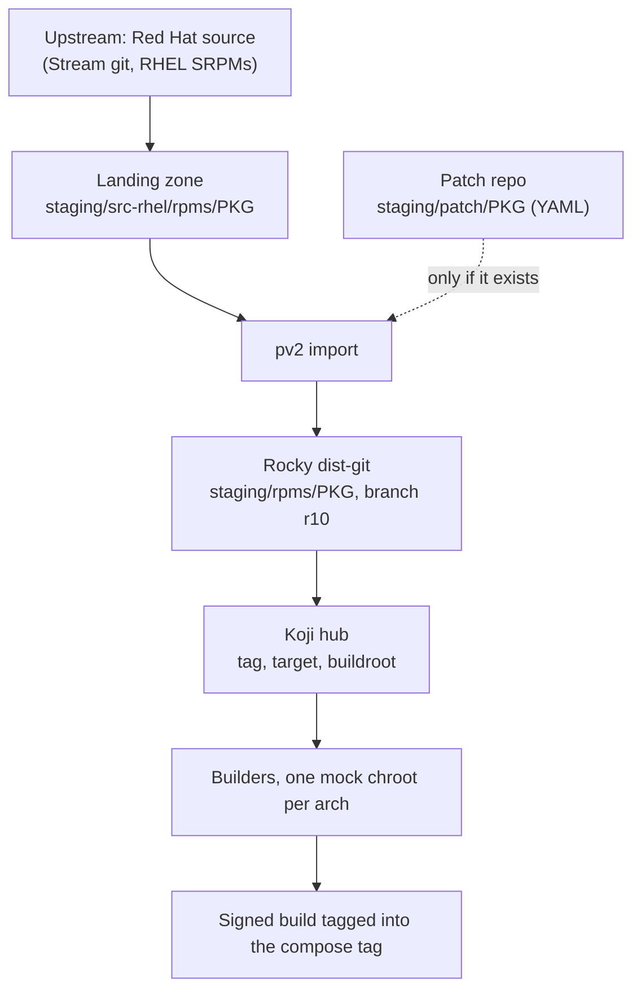
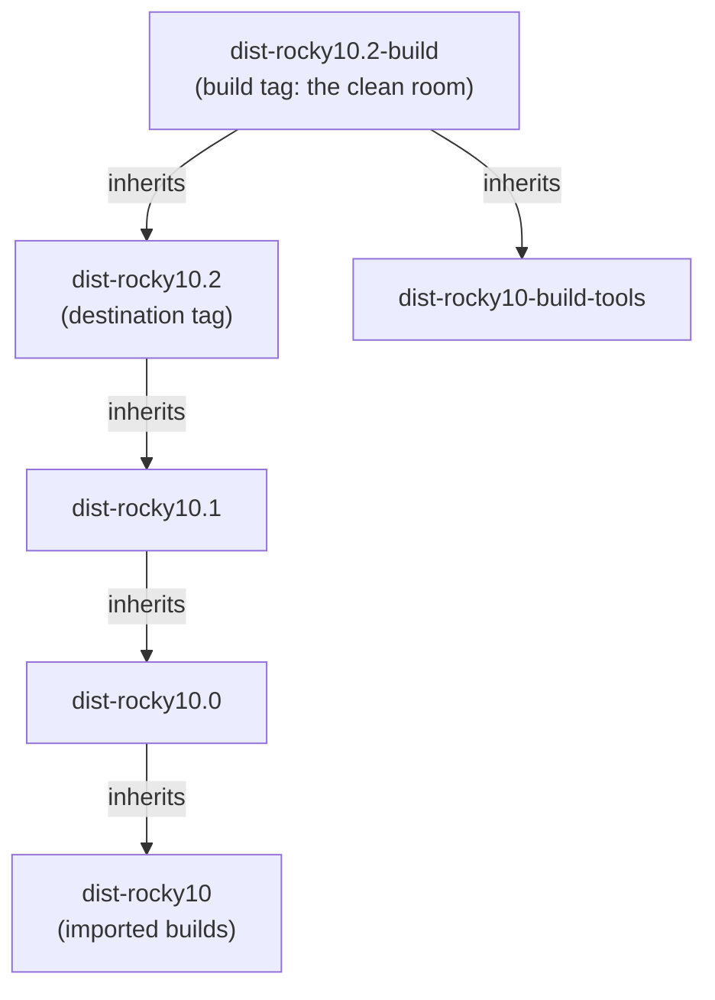

# 45 · Rocky's pipeline I: from source to build

<ul class="module-meta">
  <li>⏱ ~3 hours</li>
  <li>4 labs</li>
  <li>Builds on: 21 · Inside Rocky Linux, 22 · Building RPMs, 41 · Anatomy of a package</li>
  <li>Environment: Tier B</li>
  <li>Verified: Rocky 10.2, 2026-11-06</li>
</ul>

Ask the public Koji hub what is tagged `dist-rocky10` and it answers with 8,110 builds (queried 2026-11-06) that share two traits: one service account owns every one of them and the task id is empty. Their creation times run from 2025-05-13 to 2025-05-18, so this hub did not compile them, it imported them, and some of the RPMs behind them were built on Peridot pods as early as 2024-02-24. A 2023 commit in Rocky's compose configuration already names a tag called `r10-bootstrap`, and that tag is not on the hub today. You opened an RPM in module 41; this module follows the same kind of package backwards to the repository, the patch and the machine that made it, and shows you which parts of that trail are public and which are not.

<div class="pipeline-strip" data-here="source build" role="group" aria-label="Rocky build pipeline, six stages" markdown>

1. Source
2. Build
3. Sign
4. Compose
5. Publish
6. Install

</div>

*You are here: Source and Build (stages 1 and 2 of 6). Before: nothing, this is where the pipeline starts. After: Sign.*

!!! abstract "What you'll learn"
    - Trace an installed package back to its source repository, branch, import commit and Koji build, using only anonymous public tools.
    - Read a debranding patch file (YAML) and predict the exact change it makes to a spec file.
    - Explain Koji's data model (tags, inheritance, targets, buildroots, external repositories) and query it without logging in.
    - Tell the three build populations apart (Peridot pods, Koji builders, Release Engineering hosts) from `BUILDHOST` and `PACKAGER`, and quote every share with its denominator.
    - Rebuild `which` twice and explain why only a pinned buildroot plus the point-release dist tag reproduces the shipped payload.
    - State exactly what nobody outside the project can tell you about sourcing and bootstrap.

## The big picture

Module 41 took one RPM apart. This module goes the other way: given that RPM, where did its source come from, who changed it, and which machine compiled it? Rocky leaves a surprising amount of that trail in public: Git repositories you can clone without an account, a build database you can query without a password, and fingerprints stamped into every package header.

!!! tip "Remember from 21"
    Red Hat's source lands unmodified in a landing-zone repository, an importer called pv2 applies small YAML patches to debrand it, Koji builds the result in clean buildroots, and a `.rocky.0.N` suffix in the release marks packages Rocky changed. Module 21 gives that summary. Here you check each claim with a command, and meet the parts 21 left out: branches and tags, the Koji data model and the build-host census.

### From source to build in one sentence

> **A package enters Rocky at one door, gets repainted by a small YAML patch if it needs one, and is built in a clean room by a builder whose name is stamped on the result.**

Everything in this module hangs off that sentence. The **door** is a public repository of Red Hat's unmodified source. The **repainting** is a patch file that changes a few exact strings. The **clean room** is a Koji buildroot. The **stamp** is the `BUILDHOST` and `PACKAGER` fields in the RPM header.

Where the analogy breaks: the door is not the only door. The kernel, `grub2` and `shim` are built by hand in a separate environment and imported, and large riscv64 packages are built apart too. You will meet both exceptions below.



The diagram shows five stations in order. Red Hat's source is copied unmodified into the landing zone. pv2 reads it, applies the patch repository's YAML if one exists, and commits the result to Rocky's own repository. Koji builds exactly that commit on builders, and the signed result is tagged so the next stage can pick it up. The sign and compose stages are modules [47](47-trust-signatures-and-keys.md) and [46](46-pipeline-compose-to-your-server.md).

### The few things that solve most problems

| Situation | What to do | Where this module teaches it |
|-----------|-----------|------------------------------|
| Which door did package X come through? | `git ls-remote --heads` on its `src-rhel` repo, then read `.X.checksum` | The front door |
| Did Rocky change X? | Look for `.rocky.0.N` in the release, then read `staging/patch/X` | Debranding |
| Who built this RPM, and where? | `rpm -q --qf '%{BUILDHOST} %{PACKAGER}\n' X` | Builders |
| Which build and task made it? | Ask Koji with `getBuild` and `getTaskChildren` | Koji as a database |
| Can I rebuild it and get the same bytes? | `mock` with a pinned buildroot and `--define 'dist .el10_0'` | Why your rebuild does not match |

### Words you'll see

| Word | Plain meaning |
|------|---------------|
| **landing zone** | The public repo `staging/src-rhel/rpms/PKG` where Red Hat's source is stored unmodified |
| **dist-git** | A Git repo that holds a package's spec and patches. Rocky's is `staging/rpms/PKG` |
| **pv2** | The Python importer that copies, patches and commits a package into dist-git |
| **patch repo** | `staging/patch/PKG`: YAML files that list the debranding actions for one package |
| **lookaside** | A store for big source tarballs, addressed by their SHA-256, so Git stays small |
| **Stream** | Red Hat's public development source (CentOS Stream). Branch names ending in `s` track it |
| **Koji** | The build system. A **hub** holds the database, **builders** run the compiles |
| **tag** | A named set of builds in Koji. Tags can inherit from other tags |
| **buildroot** | The clean package set a build runs in, assembled from a tag |
| **Peridot** | The earlier build system whose pods (`pb-<uuid>` hosts) built early Rocky 10 content |

## The core skill: trace a package backwards

Every question in this module is a variation on one skill: start from something you can touch, and walk back one hop at a time until you reach a repository or a database row. The template has five questions, each with a command.

1. **Release and source RPM.** Did Rocky change it? A `.rocky.0.N` suffix says yes.
2. **Builder.** `BUILDHOST` and `PACKAGER` say which kind of machine made it.
3. **Source repo and branch.** Where is its spec in Git, and on which branch?
4. **Koji build.** Which build id, task and tag? Is there a task at all?
5. **Import record.** Does the hash in the repo match an upstream source package?

You can answer the first two on any Rocky 10 system with one command:

```console
$ rpm -q --qf 'name      %{NAME}-%{VERSION}-%{RELEASE}.%{ARCH}\nsource    %{SOURCERPM}\nbuilt     %{BUILDTIME:date}\nbuildhost %{BUILDHOST}\npackager  %{PACKAGER}\nvendor    %{VENDOR}\nsigned    %{RSAHEADER:pgpsig}\n' which
name      which-2.21-44.el10_0.x86_64
source    which-2.21-44.el10_0.src.rpm
built     Wed 06 Aug 2025 06:54:42 AM UTC
buildhost ord1-prod-x86build007.svc.aws.rockylinux.org
packager  Rocky Linux Build System <releng@rockylinux.org>
vendor    Rocky Enterprise Software Foundation
signed    RSA/SHA256, Wed 06 Aug 2025 03:19:43 PM UTC, Key ID 5b106c736fedfc85
```

Rocky 10.2 x86_64, 2026-11-06. Read it as a short story. No `.rocky.0.N`, so Rocky did not change the source. A builder host with `prod` in its name and a plain packager, so a Koji build. Signed about nine hours after it was built, which is module 47's subject.

Now try three yourself before you open the answers. Each is a real header from a Rocky 10.2 machine.

**Practice 1.** `bash-5.2.26-6.el10` shows `Build Host: pb-0d1a2830-bb51-4e9b-99ed-5362b27ea632-b-x86-64` and packager `Rocky Linux Build System (Peridot)`. What built it, and roughly when?

??? success "Answer: a Peridot pod, on or before 2025-05-16"
    The `pb-<uuid>` host and the `(Peridot)` packager are Peridot's fingerprints. Packages built on Koji builders start on 2025-05-16, and no package built after 2025-05 carries a `pb-` host, so this one is older and nobody has rebuilt it since. The `bash` header says built 2024-10-31, signed 2025-05-21.

**Practice 2.** `dnf-4.20.0-22.el10_2.rocky.0.1` was built on `ord1-prod-a64build009.svc.aws.rockylinux.org`, an aarch64 builder, but `dnf` is a `noarch` package. Did Rocky change it, and is the builder a surprise?

??? success "Answer: Rocky changed it, and the builder is normal"
    The `.rocky.0.1` suffix means a patch repo changed it. A `noarch` package is built once, on any builder, and published in every architecture's repository, so an aarch64 builder is not a surprise. Do not read the builder's architecture as the package's architecture.

**Practice 3.** `kernel-core-6.12.0-211.74.1.el10_2` shows packager `Release Engineering` and build host `hou1-build-x86-01.releng.rockylinux.org`. Which population is this, and what would you expect to find if you asked Koji for its task?

??? success "Answer: the Secure Boot set, and no task"
    `Release Engineering` is the packager of the kernel, `grub2`, `shim` and `fwupd-efi`, which Rocky builds in an isolated environment and imports into Koji. Asked for the build, Koji returns a `task_id` of `None`. You will check that yourself in the Koji section.

<div class="quiz" data-answer="2" markdown>

An installed package has release `3.el10_2.rocky.0.1` and packager `Rocky Linux Build System`. What do the two fields tell you?

- Rocky changed the source, and it was built on a Peridot pod
- Rocky changed the source, and it was built on a Koji builder
- Rocky did not change the source, and it was built on a Koji builder
- The kernel team built it in the Secure Boot environment

Right: `.rocky.0.N` is the mark of a Rocky change, and the plain packager without `(Peridot)` or `Release Engineering` is the Koji population.

</div>

## The front door: where a package enters Rocky

Rocky has to store Red Hat's source somewhere before it can change a single byte of it. That place is a set of public repositories on Rocky's Git server, one per package. Because the repositories are public, you can see which packages exist, which Red Hat release lines they follow, and when each import happened, without an account.

The repository name and the branch name together tell you what you are looking at.

| Where | Branch | What it holds |
|-------|--------|---------------|
| `staging/src-rhel/rpms/PKG` | `c10s` | A copy of Stream's Git history. Commit subjects read `import NVR (git)` |
| `staging/src-rhel/rpms/PKG` | `c10` | The RHEL 10 stable source package, unpacked. Subjects read `import NVR (srpm)` or just `import NVR` |
| `staging/src-rhel/rpms/PKG` | `c10-beta` | The same for the beta line (10.3 beta at the time of writing) |
| `staging/rpms/PKG` | `r10`, `r10-beta`, `r10s` | Rocky's result after pv2: this is what Koji builds |

The letters after `c` or `r` are the major version, and a trailing `s` means the branch follows Stream. Older majors (`c8`, `c9`, `r8`, `r9`) sit in the same repositories, so one repo holds a package's whole history across Rocky 8, 9 and 10.

```console
$ for p in which bash; do for r in staging/src-rhel/rpms staging/rpms; do printf '%s/%s: ' $r $p; git ls-remote --heads https://git.rockylinux.org/$r/$p.git | awk '{sub("refs/heads/","",$2); printf "%s ", $2}'; echo; done; done
staging/src-rhel/rpms/which: c10 c10s c8 c8-beta c8s c9 c9-beta
staging/rpms/which: r10 r10s r8 r8-beta r8s r9 r9-beta
staging/src-rhel/rpms/bash: c10s c8 c8-beta c8s c9 c9-beta c9s
staging/rpms/bash: r10s r8 r8-beta r8s r9 r9-beta
```

Read on 2026-11-06 from a macOS shell with git, no account. `which` has `c10` and `r10`. `bash` has neither, only `c10s` and `r10s`: its installed build is a Peridot-era one that was never re-imported (our reading, not stated by anyone). A branch list is a diary of how a package arrived.

### What is inside one of these repositories

Clone the Rocky result for `which` and look at it.

```console
$ git clone -q --depth 3 -b r10 https://git.rockylinux.org/staging/rpms/which.git which-r10
$ ls -a which-r10
.  ..  .git  .which.checksum  .which.metadata  SOURCES  SPECS
$ cat which-r10/.which.metadata
f4a245b94124b377d8b49646bf421f9155d36aa7614b6ebf83705d3ffc76eaad SOURCES/which-2.21.tar.gz
$ git -C which-r10 log -1 --format='%h %ad%n    %s' --date=iso-strict
52b49f1 2025-08-05T15:06:26Z
    import which-2.21-44.el10_0
```

The tarball is not in Git. The file `.which.metadata` lists each large source with its SHA-256 and the path where it belongs. The hash is also the file's name in the **lookaside**, a hash-addressed object store, so you can fetch it and prove it is the right file.

```console
$ curl -sI https://sources.build.resf.org/f4a245b94124b377d8b49646bf421f9155d36aa7614b6ebf83705d3ffc76eaad | head -4
HTTP/2 200
content-type: binary/octet-stream
content-length: 149305
accept-ranges: bytes
$ curl -s https://sources.build.resf.org/f4a245b94124b377d8b49646bf421f9155d36aa7614b6ebf83705d3ffc76eaad | sha256sum
f4a245b94124b377d8b49646bf421f9155d36aa7614b6ebf83705d3ffc76eaad  -
```

The name of the object is the SHA-256 of its contents, so a corrupted or swapped file cannot hide. The bucket's top level is not browsable (it answers 403), so you need a hash from a `.metadata` file to fetch anything.

The other dot file, `.which.checksum`, holds the SHA-256 of the whole source package that was imported. This is the link back to Red Hat's bytes.

<!-- ev: labs/final V5; FACTBASE-A O4 | observed | public git and UBI source repo, 2026-11-06 -->
!!! evidence "Observed: the checksum file equals the hash of a public Red Hat source package"
    **Seen on:** public repositories and a macOS shell, 2026-11-06.

    ```console
    $ curl -s "https://git.rockylinux.org/api/v4/projects/staging%2Fsrc-rhel%2Frpms%2Fwhich/repository/files/.which.checksum/raw?ref=c10"
    ff3ee430391dd8cf0ba07d3f2d734a971028be5441d02fefd506bfb21746912b
    $ curl -s https://cdn-ubi.redhat.com/content/public/ubi/dist/ubi10/10/x86_64/baseos/source/SRPMS/Packages/w/which-2.21-44.el10_0.src.rpm | sha256sum
    ff3ee430391dd8cf0ba07d3f2d734a971028be5441d02fefd506bfb21746912b  -
    ```

    The two values are identical, and so is the one in Rocky's own `staging/rpms` repo. Re-run on 2026-11-07 UTC with the same result. This proves the bytes Rocky imported equal a source package that Red Hat publishes in its Universal Base Image. It does not prove which route Rocky used to get them, because the same file can reach you by more than one route.

    **Check it yourself:** run the two commands. Then run `sha256sum` on `which-2.21-44.el10_0.src.rpm` from `dnf download --source which` on Rocky: that one differs, because Koji builds Rocky's source package again from the Git commit.

### What is public about sourcing, and what is not

Until mid-2023 rebuilders such as Rocky could copy Red Hat's source from one public place. Since then, Red Hat says Stream is the only public source repository for RHEL-related source. Module 21 told that story, so here is only the evidence trail.

| Public | Not public |
|--------|-----------|
| Rocky's 2023-06-29 post names routes: Stream, pristine upstream, and RHEL source packages obtained through UBI images or pay-per-use cloud instances. It says the routes are "subject to change" | Which route supplies which package today. I found no public description of this in any 2024 to 2026 post |
| The commit bodies on `c10` and `c10-beta` carry `Vendor: Red Hat, Inc.`, so those branches hold real Red Hat source packages, not Stream history | How the source packages are fetched, from which accounts or services |
| UBI source repositories are anonymous and public, and for `which` they hold the identical file | Whether the "transparency ledger" of source hashes that Rocky promised in its 2023-06-24 post ("Brave New World: Path Forward") was ever published. I did not find one, and nothing says whether Rocky receives fixes early under an embargo arrangement |

<!-- ev: FACTBASE-A O1; R3 sec 1.3 | official | rockylinux.org news 2023-06-29, read 2026-11-06 -->
!!! evidence "Stated by the project: the routes are examples, and they can change"
    **Seen on:** Rocky's post "Keeping Open Source Open", dated 2023-06-29, read 2026-11-06.

    The post lists Stream, pristine upstream sources and RHEL source packages (through UBI images and cloud instances) as the places Rocky now gathers source. It ends the list with "subject to change". No later post I found revises it.

    **Check it yourself:** read `https://rockylinux.org/news/keeping-open-source-open` and search the news page for later sourcing posts. Absence of a post is not proof that nothing changed.

UBI holds only a subset of RHEL, and the kernel is not in it, so the one route you can check yourself cannot explain every package.

### The landing zone is not a complete ledger

You might expect every package Rocky imported to appear in the landing zone. I checked five packages by searching the landing-zone history for the hash that Rocky's newest `r10` import records.

<!-- ev: labs/final V5; FACTBASE-A O4 | observed | public git, 2026-11-06 -->
!!! evidence "Observed: for two of five packages the newest import is missing from the landing zone"
    **Seen on:** public repositories, 2026-11-06. Packages checked: `which`, `openssl`, `anaconda`, `dnf`, `systemd` (five repositories out of thousands).

    ```console
    $ H=$(curl -s "https://git.rockylinux.org/api/v4/projects/staging%2Frpms%2Fsystemd/repository/files/.systemd.checksum/raw?ref=r10")
    $ git clone -q --bare https://git.rockylinux.org/staging/src-rhel/rpms/systemd.git sd-src.git
    $ git -C sd-src.git log --all --oneline -S"$H" | wc -l
    0
    $ git -C sd-src.git log c10 -1 --format='%ad %s' --date=short
    2025-05-18 import systemd-257-9.el10_0.1
    ```

    For `which`, `openssl` and `anaconda` the same search found the hash in the landing zone (one commit each). For `dnf` and `systemd` it found nothing: the landing zone's `c10` branch stops at 2025-09-24 for `dnf` and 2025-05-18 for `systemd`, while Rocky's `r10` branch holds imports of both from 2026-05 and 2026-06.

    Re-run on 2026-11-07 UTC with the same result for all five packages. The newest `r10` imports of `dnf` and `systemd` are patched ones, and their `.checksum` file holds the hash of the source package before patching (the `Original Hash` in the commit body), so that is the hash the search looks for.

    **Check it yourself:** run the commands for any package. Zero commits means the landing zone does not hold that source package's hash. Our reading: the public landing zone is a partial record of what pv2 imported, and some updates reach Rocky's repository by a path you cannot see.

### What works anonymously, and what does not

Four kinds of read-only access work with no account: Git over HTTPS (`git clone`, `git ls-remote`), the GitLab REST API (`/api/v4/projects/...`), Koji XML-RPC from Python, and plain `curl` on the package trees at `dl.rockylinux.org`. Use them and nothing else.

The web interfaces are different. Ask `curl` for the page of a repository or the Koji web UI and you get a "Making sure you're not a bot!" proof-of-work page (Anubis) instead of content. That page exists to stop scripts hammering the site. Do not try to get around it. Everything the page would show you is available through the four routes above, and that is what this module uses.

### Worked story: a prompt for a password that is not a password

**Symptom.** `git ls-remote` on the patch repository for `which` asks for a username, while the API says something different.

```console
$ GIT_TERMINAL_PROMPT=0 git ls-remote --heads https://git.rockylinux.org/staging/patch/which.git
fatal: could not read Username for 'https://git.rockylinux.org': terminal prompts disabled
$ curl -s -o /dev/null -w '%{http_code}\n' "https://git.rockylinux.org/api/v4/projects/staging%2Fpatch%2Fwhich"
404
$ curl -s -o /dev/null -w '%{http_code}\n' "https://git.rockylinux.org/api/v4/projects/staging%2Fpatch%2Fanaconda"
200
```

**Reasoning.** Git over HTTPS answers "ask for credentials" when it cannot find a repository, which looks like a private one. The API is more honest: `staging/patch/which` is 404 and `staging/patch/anaconda` is 200. There is no patch repo for `which` because it needs no debranding, which fits the identical specs you saw. A missing patch repo means "no changes", not "locked".

**Fix and check.** Ask the API before you assume a repo is private. From outside, a 404 cannot tell "absent" from "not visible to you", and you should not try credentials.

??? version "Comparison lens: AlmaLinux"
    AlmaLinux's public Git writes its route into the commit subject. On 2026-11-06 the `c10` branch of `rpms/which` there carries `import UBI which-2.21-44.el10_0`, and for packages it patches, such as the kernel, it keeps result branches (`a10`, `a10s`) next to the `c` branches. Rocky's commit subjects record the form of the import (`(srpm)`, `(git)`) and the body records `Vendor:` and a hash, but not the route. **Check it yourself:** `git clone --depth 1 -b c10 https://git.almalinux.org/rpms/which.git` and `git log -1 --format=%s`, then `git ls-remote --heads https://git.almalinux.org/rpms/kernel.git | grep -c refs/heads/a10`.

<div class="quiz" data-answer="3" markdown>

`git ls-remote --heads` on `staging/rpms/PKG` shows `r10s` and older branches but no `r10`. Which statement is best supported?

- The package was removed from Rocky 10
- The package is built from a private repository
- No stable Rocky 10 import has been needed for it; check its build host before drawing more
- Rocky compiles that package from the Stream branch of CentOS Git

Right: the branch list only says how the package arrived. For `bash` the header shows a Peridot-era build that has not been rebuilt, which fits, but the branch list alone does not prove it.

</div>

## Debranding: a small strict diff

Red Hat's source says "Red Hat" in places that matter: the installer's product name, support and bug-tracker URLs, the identity inside Secure Boot components, the signing certificates the kernel trusts. Rocky cannot ship those marks, and it cannot change anything else without breaking compatibility. **Debranding** is the answer: change the smallest possible set of exact strings, and record each change so anyone can read it.

Most packages need no change at all, like `which`. For the rest, the change lives in a **patch repo**, `staging/patch/PKG`, as YAML files that **pv2** reads. pv2 reads `main.yml` first (changes for every branch), then the file for the branch being imported (`r10.yml`), and applies the actions in order. The repo's `files/` directory holds any patch or replacement file the YAML names.

| Action | What it does |
|--------|--------------|
| `search_and_replace` | Replaces an exact string in the spec or another file (`count` limits it, `regex: true` allows a pattern) |
| `add_file` | Adds a patch or a source file and numbers it (`PatchNNNNN` or `SourceNNNNN`) |
| `replace_file`, `delete_file`, `delete_line` | Swaps a file for one from `files/`, removes a file, or removes lines |
| `apply_patch`, `apply_script` | Applies a patch or runs a script from the patch repo |
| `append_release` | Adds a suffix such as `.rocky.0.1` to the Release |
| `spec_changelog` | Adds a changelog entry signed "Release Engineering" |

The last two are the signature of authorship. Every patched package gets the suffix and the changelog line. Here are five real patch files, fetched from the public API on 2026-11-06.

=== "systemd"

    ```yaml
    ---
    patch:
      - search_and_replace:
          - target: specfile
            find: "-Dsupport-url=https://access.redhat.com/support"
            replace: "-Dsupport-url=https://wiki.rockylinux.org/rocky/support"
          - target: specfile
            find: "-Dsbat-distro-url=mailto:secalert@redhat.com"
            replace: "-Dsbat-distro-url=mailto:security@rockylinux.org"
      - append_release:
          - suffix: ".rocky.0.1"
            enabled: true
      - spec_changelog:
          - name: "Release Engineering"
            email: "releng@rockylinux.org"
            line:
              - Set support URL to the wiki
              - Set sbat mail to security@rockylinux.org
    ...
    ```

=== "anaconda"

    ```yaml
    ---
    patch:
      - add_file:
          - type: patch
            name: "0001-Create-specific-Rocky-Linux-changes-10.patch"
            number: "99999"
      - add_file:
          - type: source
            name: "quickfix.sh"
            number: "99999"
            add_to_spec: true
      - search_and_replace:
          - target: specfile
            find: "%autosetup -p 1"
            replace: |
              %autosetup -p 1
              cp %{SOURCE99999} quickfix.sh
              /bin/bash quickfix.sh
            count: 1
          - target: specfile
            find: "%bcond_with live"
            replace: "%bcond_without live"
            count: 1
      - append_release:
          - suffix: ".rocky.0.6"
            enabled: true
      - spec_changelog:
          - name: "Release Engineering"
            email: "releng@rockylinux.org"
            line:
              - Add Rocky Linux specific changes
    ...
    ```

=== "subscription-manager"

    ```yaml
    ---
    patch:
      - add_file:
          - type: patch
            name: "ROCKY-use-rocky-syspurposes.patch"
            number: "99998"
      - add_file:
          - type: patch
            name: "0001-subscription-manager-rocky-remove-redhat-refs.patch"
            number: "99999"
      - search_and_replace:
          - target: specfile
            find: "the Red Hat"
            replace: "an"
      - search_and_replace:
          - target: specfile
            find: "a Red Hat"
            replace: "a"
      - append_release:
          - suffix: ".rocky.0.1"
            enabled: true
      - spec_changelog:
          - name: "Release Engineering"
            email: "releng@rockylinux.org"
            line:
              - Remove Red Hat references
    ...
    ```

=== "kernel (excerpt)"

    ```yaml
    ---
    patch:
      - delete_file:
          - filename: "SOURCES/nvidiajetsonsoc.x509"
          - filename: "SOURCES/nvidiabfdpu.x509"
      - search_and_replace:
          - target: "SOURCES/kernel.sbat.template"
            find: "kernel.@SBAT_SUFFIX,1,Red Hat,kernel-core,@KVER,mailto:secalert@redhat.com"
            replace: "kernel.rocky,1,RESF,kernel-core,@KVER,mailto:security@rockylinux.org"
            count: 1
          # ... more templates, identity rewrites and a certificate edit follow (144 lines in all)
    ```

=== "grub2 (excerpt)"

    ```yaml
    ---
    patch:
      - append_release:
          - suffix: ".rocky.0.1"
            enabled: true
      - search_and_replace:
          - target: specfile
            regex: true
            find: "%define sb_key.*"
            replace: "%define sb_key rockylinuxsecurebootkey"
          # ... more edits to grub.macros and grub-cc.macros follow
    ```

Read the `systemd` file first: it is the whole idea in 19 lines. Two exact strings in the spec change (the support URL and the contact address Secure Boot components embed), the release gains `.rocky.0.1`, and a changelog entry says why. The `anaconda` file shows the other pattern: it adds a patch file and a small script, and edits the spec to run the script. `subscription-manager` is patched, not removed: the package is still in Rocky's repositories, with its Red Hat references rewritten. The kernel and `grub2` files change the identity strings that Secure Boot checks, which is module 48's subject.

Lab 2 has you fetch the files with `curl`.

### The result in the spec

A patch file is a recipe. The proof is the spec that comes out. Compare the Stream copy of `systemd` with Rocky's.

```console
$ grep -n -e 'support-url' -e 'sbat-distro-url' -e '^Release' stream-systemd/SPECS/systemd.spec
1299:        -Dsupport-url=https://access.redhat.com/support
1304:        -Dsbat-distro-url=mailto:secalert@redhat.com
51:Release:        23%{?dist}
$ grep -n -e 'support-url' -e 'sbat-distro-url' -e '^Release' rocky-systemd/SPECS/systemd.spec
1317:        -Dsupport-url=https://wiki.rockylinux.org/rocky/support
1322:        -Dsbat-distro-url=mailto:security@rockylinux.org
51:Release:        23%{?dist}.2.rocky.0.1
$ grep -n -A3 'Release Engineering' rocky-systemd/SPECS/systemd.spec | head -4
1691:* Wed Jun 10 2026 Release Engineering <releng@rockylinux.org> - 257-23.2.rocky.0.1
1692-- Set support URL to the wiki
1693-- Set sbat mail to security@rockylinux.org
```

Rocky 10.2 sources, 2026-11-06 (Stream `c10s` at `257-23.el10`, Rocky `r10` at `257-23.el10_2.2.rocky.0.1`). The `find:` strings in the YAML appear verbatim on the Red Hat side, the `replace:` strings on the Rocky side, and the suffix and changelog line match the YAML's last two actions.

### What the import commit records

pv2 leaves a trail in the commit and in a tag.

```console
$ git -C rocky-systemd log -1 --format='%h %ad%n    %s%n%b' --date=iso-strict | head -4
e9edd86 2026-06-10T04:19:23Z
    import systemd-257-23.el10_2.2.rocky.0.1 (pv2) (patched by pv2)
Original Hash: db23c50419f16100e48563e0b8a0ba7066817a83486db5105962a73b9aa6ef99
Patched: True
```

The subject says the importer (`pv2`) and whether a patch was applied. The `Original Hash` is the SHA-256 of the source package before patching: it equals the contents of `.systemd.checksum`. The tag on that commit is `patched/r10/systemd-257-23.el10_2.2.rocky.0.1`: it reads `imports/r10/NVR` when nothing was patched and `patched/r10/NVR` when pv2 changed something, so you can tell the two apart without reading a diff (`git ls-remote --tags` lists them). Older commits (for example `which`, imported in 2025) have no body at all; for those, `.PKG.checksum` is your record.

<!-- ev: R3 sec 5.3; releng 45 | official | GitHub issue rocky-linux/releng 45, read 2026-11-06 -->
!!! evidence "Stated by the project: patch application is strict and all-or-nothing"
    **Seen on:** the project's issue tracker, read 2026-11-06 (issue still open).

    The issue titled "Automate applying changes to upstream packages" says an exact-string match that no longer matches, for example because upstream reformatted the spec, "will fail the whole package", and that on failure the package should be held so un-debranded content does not move forward. The same issue records a known problem: pv2 can place a new patch directive inside a conditional block, so the patch does not always apply.

    **Check it yourself:** `curl -s https://api.github.com/repos/rocky-linux/releng/issues/45 | jq -r .body`. The issue describes the intended behaviour; whether it holds today is not something you can read from outside.

<div class="quiz" data-answer="1" markdown>

A `find:` string in a patch YAML file stops matching after Red Hat reformats a spec line. What is the project's stated intent for that package?

- Hold the package, so un-debranded content does not move forward, and tell release engineering
- Skip that one edit and import the rest
- Import it anyway and fix the YAML later
- Fall back to the Stream copy of the package

Right: patch application is strict and all-or-nothing, and the issue says to hold the package on failure. That is the stated target behaviour, not a promise about how it behaves today.

</div>

Debranding is deliberately small.

<!-- ev: FACTBASE-A O9, 4.1 | observed | Rocky 10.2 x86_64 VM, 2026-11-06 -->
!!! freshness "As of 2026-11-06 on Rocky 10.2"
    On a stock cloud install, the `.rocky.0.N` marker appears on 10 source packages (36 installed binary packages). The kernel is patched without the marker (its source carries a debranding patch, yet its release string has no `.rocky` part), so the count is a floor for "visibly modified". Roughly 60 to 70 patch repos have Rocky 10 configuration, a ceiling from a scripted scan, not an official count. These numbers change with every patch change.

    **Re-check:** `rpm -qa --qf '%{SOURCERPM}\n' | grep '\.rocky\.0' | sed -E 's/-[^-]+-[^-]+\.src\.rpm//' | sort -u | tr '\n' ' '`

!!! note "pv2 replaced srpmproc"
    Rocky 8 and 9 used srpmproc (Go), archived on 2025-06-27. On the kernel, commits read plain `import NVR` until 2025-12-19 and `(pv2) (patched by pv2)` from 2026-01-01. The exact cut-over date is not public.

## Koji: the build system as a database

A build system has one job that is easy to say and hard to do: build a package in a clean room, and remember exactly what went into the room. **Koji** does it with a small set of ideas, and every one of them is a row in a database you can read anonymously.

A **tag** is a named set of builds. A tag can **inherit** from other tags, which means it also sees their builds. Rocky 10 uses tags as a ladder: each minor release inherits the one before it. A **target** names two tags: the **build tag**, whose contents become the clean room (the **buildroot**), and the **destination tag**, where the finished build is placed. A **build** is one NVR in the database, produced by a tree of **tasks**, and the tasks run on **builders** grouped into **channels**.



The diagram reads from the bottom of each arrow up: `dist-rocky10.2` sees everything in 10.1, 10.0 and the base tag, and the build tag sees all of that plus a tools tag. The target `dist-rocky10.2-build` points at the build tag as its clean room and at `dist-rocky10.2` as its destination. Nothing is copied: a build tagged once in `dist-rocky10.0` is visible in 10.2 by inheritance.

Click through the layers to see each idea next to the query that shows it. Start Python (`python3`) and enter these lines.

```python
import xmlrpc.client as x
s = x.ServerProxy('https://koji.rockylinux.org/kojihub', allow_none=True)
```

<div class="layers" data-hint="Click a layer to see the idea and the query that shows it." markdown>

<div class="layer" data-label="Hub, builders, channels" data-tag="who works" markdown>

The **hub** is the database and API. **Builders** (kojid daemons) take tasks from it, grouped into **channels** such as `secureboot` or `runroot`.

```console
>>> s.getAPIVersion(), len(s.listHosts()), len(s.listChannels())
(1, 40, 15)
```

On 2026-11-06 the hub lists 40 builders, and 28 of them are enabled (from `listHosts()` and each host's `arches`): 7 x86_64 (which also carry `i386`), 7 riscv64, 6 s390x, 5 aarch64 and 3 ppc64le.

</div>

<div class="layer" data-label="Tasks and the build record" data-tag="the work" markdown>

A build is a tree of **tasks**, and its record names the source. For a normal build the source is a Git URL pinned to a commit.

```console
>>> b = s.getBuild('which-2.21-44.el10_0'); (b['build_id'], b['task_id'])
(79334, 481353)
>>> b['source']
'git+https://git.rockylinux.org/staging/rpms/which.git#52b49f1cf9c3f1c505cb452d1a80c2de02dd7988'
>>> sorted((c['method'], c['arch']) for c in s.getTaskChildren(b['task_id']))
[('buildArch', 'aarch64'), ('buildArch', 'ppc64le'), ('buildArch', 'riscv64'), ('buildArch', 's390x'), ('buildArch', 'x86_64'), ('buildSRPMFromSCM', 'aarch64'), ('tagBuild', 'noarch')]
```

One `buildSRPMFromSCM` makes the source package from Git, five `buildArch` tasks compile it and `tagBuild` files the result. The commit `52b49f1` is the `r10` import commit you cloned earlier: the join between the Git world and the Koji world.

</div>

<div class="layer" data-label="Targets and tags" data-tag="the ladder" markdown>

A **target** pairs a build tag with a destination tag. Tags inherit, which is how a minor release gets the previous one's packages without copying them.

```console
>>> [(t['name'], t['build_tag_name'], t['dest_tag_name']) for t in s.getBuildTargets() if t['name'] == 'dist-rocky10.2-build']
[('dist-rocky10.2-build', 'dist-rocky10.2-build', 'dist-rocky10.2')]
>>> [(i['nvr'], i['tag_name']) for i in s.listTagged('dist-rocky10.2', None, True, None, True, 'which')]
[('which-2.21-44.el10_0', 'dist-rocky10.0')]
```

Asking the 10.2 tag for the latest `which`, following inheritance, returns the build that was tagged into the 10.0 tag.

</div>

<div class="layer" data-label="Buildroot and external repos" data-tag="the clean room" markdown>

The build tag defines what is installed into the build chroot. It can also borrow packages from a URL through an **external repository**.

```console
>>> s.getExternalRepoList('dist-rocky10.2-build')
[]
```

Rocky's 10.2 build tag has no external repository, counting those it inherits (2026-11-06): its buildroot is made of tagged builds only. A fresh Koji of your own has nothing tagged yet, so its first build tag borrows Rocky's public repositories. That is how module 50 bootstraps.

</div>

</div>

The tag chain, the imports in `dist-rocky10` (next section) and the `which` build all come from the same database, and build 79334 should keep answering the same way.

### Two doors into the build tag

Almost everything is built by Koji tasks from a Git commit and then tagged. The Secure Boot packages are built elsewhere and imported, so Koji has the build record but no task behind it.

<!-- ev: FACTBASE-A O14, O15; COLD-OPEN-VERIFICATION 6 | observed | public Koji hub, 2026-11-06 -->
!!! evidence "Observed: the kernel's Koji build has no task"
    **Seen on:** the public Koji hub, 2026-11-06.

    ```console
    >>> for n in ('openssl-3.5.8-2.el10_2', 'kernel-6.12.0-211.74.1.el10_2', 'shim-16.1-2.el10'):
    ...     b = s.getBuild(n); print(n, b['build_id'], b['task_id'], b['start_time'][:19], b['completion_time'][:19])
    ...
    openssl-3.5.8-2.el10_2 125917 801106 2026-10-07 23:19:03 2026-10-08 00:26:14
    kernel-6.12.0-211.74.1.el10_2 127819 None 2026-11-05 18:27:33 2026-11-05 18:27:33
    shim-16.1-2.el10 120716 None 2026-05-24 10:20:31 2026-05-24 10:20:31
    ```

    `openssl` has a task id and took about an hour. The kernel and `shim` have none, and their start and completion times are the same second: an import. The package headers agree (packager `Release Engineering`, hosts at the `hou1` and `iad1` sites). That these packages are built in an isolated environment is what the project's automation issue says; that this import is why the task is empty is our reading.

    **Check it yourself:** run the loop in Python. A build with no task was not compiled by this hub.

The project's own words on this are in its automation roadmap: Secure Boot packages ("kernel, grub2, shim, fwupd") are "built manually in the isolated Secure Boot environment", and very large riscv64 packages are built separately and imported. What the isolated environment looks like is not public.

### Mock inside Koji

Under every Koji build task sits **mock**, the tool that creates a throwaway chroot, installs the buildroot's packages and runs `rpmbuild`. You used it in module 22. The `mock` package Rocky users get from EPEL ships configurations for Rocky, which read like a small version of what Koji does.

```console
$ ls /etc/mock/rocky-*.cfg | xargs -n1 basename | tr '\n' ' '
rocky-10-aarch64.cfg rocky-10-ppc64le.cfg rocky-10-riscv64.cfg rocky-10-s390x.cfg rocky-10-x86_64.cfg rocky-8-aarch64.cfg rocky-8-x86_64.cfg rocky-9-aarch64.cfg rocky-9-ppc64le.cfg rocky-9-s390x.cfg rocky-9-x86_64.cfg
$ grep chroot_setup_cmd /etc/mock/templates/rocky-10.tpl
config_opts['chroot_setup_cmd'] = 'install bash bzip2 coreutils cpio diffutils findutils gawk glibc-minimal-langpack grep gzip info patch redhat-rpm-config rocky-release rpm-build sed tar unzip util-linux which xz'
```

Rocky 10.2 x86_64, mock 6.9-1.el10_2, 2026-11-06. That list is the package set installed into every build chroot. Mock's configs point at Rocky's published mirrors, while Koji's chroot is assembled from its own tag. The `rocky-10-*` list has no `x86_64_v2` entry, consistent with Rocky 10's x86-64-v3 baseline.

??? question "A Koji of your own, as a read-along (module 50 builds it)"
    Module 50 stands up a single-host Koji and builds `which` in it (tested on Rocky 10.2 x86_64, 2026-11-06, about 10 minutes scripted). Its build tag borrows Rocky's BaseOS, AppStream and CRB as external repositories (priorities 10, 20 and 30) because nothing is tagged yet, and `koji list-tasks` shows `build`, `rebuildSRPM`, `buildArch` and `tagBuild` for `which-2.21-44.el10_0.src.rpm`. The output is named `which-2.21-44.el10`: the toy Koji's `%dist` is `.el10`. The RPM says `Packager: Koji` and has no signature, because Koji does not sign.

## Builders: who compiled this, and where

Every RPM header records the machine that built it (`BUILDHOST`) and a name for the build system (`PACKAGER`). Together they are a fingerprint, and Rocky 10 shows three distinct ones.

| Population | `BUILDHOST` looks like | `PACKAGER` | What it means |
|------------|------------------------|------------|---------------|
| Peridot pods | `pb-<uuid>-b-x86-64` | `Rocky Linux Build System (Peridot)` | Built in the earlier build system, 2024-02 to 2025-05 |
| Koji builders | `ord1-prod-x86build007.svc.aws...` | `Rocky Linux Build System` | Built by an ordinary Koji task |
| Release Engineering hosts | `iad1-prod-build001.bld.equ...`, `hou1-build-x86-01.releng...` | `Release Engineering` | Kernel, `grub2`, `shim`, `fwupd-efi`: the Secure Boot set |

The hostname prefixes (`ord1`, `iad1`, `hou1`) look like site codes, and the words `aws` and `equ` appear in the names. Who owns each site is our reading from the names; Rocky has not published a site list.

You can read the fingerprint of everything installed on your own machine. This is lab 1, and here is its core.

```console
$ rpm -qa --qf '%{BUILDHOST}\n' | sed -E 's/^pb-.*/pb-<uuid>/;s/[0-9]+/N/g' | sort | uniq -c | sort -rn | head -8
    295 ordN-prod-xNbuildN.svc.aws.rockylinux.org
    218 pb-<uuid>
     26 ordN-prod-aNbuildN.svc.aws.rockylinux.org
     13 iadN-prod-buildN.bld.equ.rockylinux.org
      6 houN-build-xN-N.releng.rockylinux.org
      3 buildvm-aN-N.rduN.fedoraproject.org
      2 localhost
      2 kojid-xN-N.cloud.ueN.centos.org
$ rpm -qa --qf '%{PACKAGER}\n' | sort | uniq -c | sort -rn | head -5
    321 Rocky Linux Build System <releng@rockylinux.org>
    218 Rocky Linux Build System (Peridot) <releng@rockylinux.org>
     19 Release Engineering <releng@rockylinux.org>
      9 Fedora Project
      2 CBS <cbs@centos.org>
```

Rocky 10.2 x86_64 cloud VM, 2026-11-06, 571 packages installed. The `sed` collapses digits so that `ord1` and `ord2` count as one kind. The hosts with `fedoraproject.org` and `centos.org` names are not Rocky builds at all: they are third-party packages (EPEL and a CentOS SIG) on that VM. The same fingerprints per package:

```console
$ rpm -q --qf '%{NAME}-%{VERSION}-%{RELEASE}  %{BUILDHOST}  %{PACKAGER}\n' bash which kernel-core-6.12.0-211.74.1.el10_2 grub2-efi-x64 shim-x64 dnf
bash-5.2.26-6.el10  pb-0d1a2830-bb51-4e9b-99ed-5362b27ea632-b-x86-64  Rocky Linux Build System (Peridot) <releng@rockylinux.org>
which-2.21-44.el10_0  ord1-prod-x86build007.svc.aws.rockylinux.org  Rocky Linux Build System <releng@rockylinux.org>
kernel-core-6.12.0-211.74.1.el10_2  hou1-build-x86-01.releng.rockylinux.org  Release Engineering <releng@rockylinux.org>
grub2-efi-x64-2.12-46.el10_2.rocky.0.1  iad1-prod-build001.bld.equ.rockylinux.org  Release Engineering <releng@rockylinux.org>
shim-x64-16.1-2.el10  iad1-prod-build001.bld.equ.rockylinux.org  Release Engineering <releng@rockylinux.org>
dnf-4.20.0-22.el10_2.rocky.0.1  ord1-prod-a64build009.svc.aws.rockylinux.org  Rocky Linux Build System <releng@rockylinux.org>
```

One install, three populations, plus `dnf` (a `noarch` package) built on an aarch64 builder. The share of Peridot packages on one machine depends on what you installed, so it is not a statement about Rocky.

<!-- ev: FACTBASE-A O16, O17; ERRATA E9 | observed | Rocky 10.2 x86_64 VM, 2026-11-06 -->
!!! freshness "As of 2026-11-06 on Rocky 10.2"
    On one cloud VM, 218 of 571 installed packages (38%) carry a Peridot build host. The share on your machine depends on your install set and falls as those packages are rebuilt. It only falls: no Rocky 10 package built after 2025-05 carries a Peridot build host, so a package leaves the Peridot population when it is rebuilt and does not rejoin it. This changes with each package update.

    **Re-check:** `rpm -qa --qf '%{PACKAGER}\n' | sort | uniq -c | sort -rn | head -5`

### The whole repository, from its own metadata

The census does not need an installed system. Every repository's `primary.xml` lists the build host of each package, so you can count the whole tree with one download.

```console
$ B=https://dl.rockylinux.org/pub/rocky/10/BaseOS/x86_64/os
$ P=$(curl -s $B/repodata/repomd.xml | grep -o 'repodata/[0-9a-f]*-primary.xml.gz' | head -1)
$ curl -s $B/$P | gunzip | python3 -I -c "import sys,re,collections;t=sys.stdin.read();h=re.findall(r'<rpm:buildhost>([^<]*)</rpm:buildhost>',t);c=collections.Counter(re.sub(r'\d+','N',re.sub(r'^pb-.*','pb-<uuid>',x)) for x in h);print(len(h));[print(v,k) for k,v in c.most_common(6)]"
3194
2104 ordN-prod-xNbuildN.svc.aws.rockylinux.org
562 houN-build-xN-N.releng.rockylinux.org
276 pb-<uuid>
154 ordN-prod-aNbuildN.svc.aws.rockylinux.org
97 iadN-prod-buildN.bld.equ.rockylinux.org
1 iadN-prod-build-aarchN.bld.equ.rockylinux.org
```

The first line is the number of RPM files in the BaseOS x86_64 tree, the next lines are build-host kinds. The 154 aarch64-host files are `noarch` packages built once on an arm builder.

<!-- ev: ERRATA section 3 Peridot shares; FACTBASE-B O62 | observed | primary.xml of x86_64 BaseOS and AppStream, 2026-11-06 -->
!!! freshness "As of 2026-11-06 on Rocky 10.2"
    Peridot pods built 276 of 3,194 RPM files (8.6%) in the x86_64 BaseOS tree, and 2,741 of 7,672 RPM files (35.7%) in the x86_64 AppStream tree. These count `noarch` files too and include older versions the tree keeps. All of them were built between 2024-02-24 and 2025-05-16, and the earliest Koji-built RPM still shipped is dated 2025-05-16. The two percentages have different denominators, so never add them. Both only fall, each time a Peridot-built package is rebuilt.

    **Re-check:** the census command above; for AppStream replace `BaseOS` with `AppStream` in the first line.

??? question "Other architectures: native hardware, not emulation farms"
    The same census on the ppc64le and s390x BaseOS trees (2026-11-06) shows 2,452 of 3,061 ppc64le RPM files built on hosts named for ppc64le, and 2,579 of 3,170 s390x RPM files on hosts named for s390x. The `noarch` files in those trees were built on AWS builders. Which site owns each host prefix is our reading from the names, and how riscv64 is built (real boards or emulated) is not public.

### Peridot and Koji: a half-true sentence with a date on it

You will hear "Rocky is built in Peridot". It is true for some packages and false for others, and the dates decide which.

The calendar runs like this. Peridot pods built early Rocky 10 content from 2024-02-24 onward. Between 2025-05-13 and 2025-05-18 the Koji hub imported that content (next section), and the earliest Koji-built RPM still shipped is dated 2025-05-16. Rocky 10.0 shipped on 2025-06-11. Rocky 9.7 and 9.8 are Koji builds too; Rocky 9.0 to 9.6 shipped from Peridot.

<!-- ev: COLD-OPEN-VERIFICATION E3e; FACTBASE-A C2, C3 | official | rockylinux.org GA post 2025-06-11, installed bash header, 2026-11-06 -->
!!! evidence "Stated by the project: the builds will not come from Peridot, but instead from Koji"
    **Seen on:** the Rocky 10.0 release announcement (2025-06-11) and an installed Rocky 10.2 `bash`, read 2026-11-06.

    The announcement says: "the builds will not come from our Peridot build system, but instead from Koji", because Peridot Two "isn't ready" and Rocky wanted IMA file signing, which Peridot's signing tool does not support. Yet `rpm -q --qf '%{BUILDHOST}\n' bash` on Rocky 10.2 prints a `pb-<uuid>` Peridot pod name, because `bash-5.2.26-6.el10` was built in 2024-10 and never rebuilt. Both statements are partial: one is about where new builds come from, the other about where an old build came from. Date every claim of this kind.

    **Check it yourself:** run the `bash` command above and read the announcement at `https://rockylinux.org/news/rocky-linux-10-0-ga-release`.

<!-- ev: FACTBASE-A C2; labs/final V5 | observed | public Koji hub tags dist-rocky9.7 and dist-rocky9.8, 2026-11-06 -->
!!! freshness "As of 2026-11-06 on Rocky 10.2"
    The hub holds 3,526 builds in `dist-rocky9.7` and 1,666 in `dist-rocky9.8`. Of the 3,526 builds in 9.7, 2,819 have no task; 2,796 of those were created on 2025-11-17, and task-backed builds begin on 2025-11-18 (re-queried 2026-11-07 UTC). Tags `dist-rocky9.1` to `dist-rocky9.6` also exist, and what they hold was not inspected. These counts grow with every update to those releases.

    **Re-check:** `python3 -I -c "import xmlrpc.client as x; s=x.ServerProxy('https://koji.rockylinux.org/kojihub',allow_none=True); print(len(s.listTagged('dist-rocky9.8',None,False,None,False)))"`

### The imports in dist-rocky10 and the vanished tag

Back to the hook. The base tag of the Rocky 10 ladder holds builds nobody compiled on this hub.

<!-- ev: COLD-OPEN-VERIFICATION 4; FACTBASE-A C23 | observed | public Koji hub and pungi-rocky history, 2026-11-06 -->
!!! evidence "Observed: dist-rocky10 is an import, five days wide"
    **Seen on:** the public Koji hub, 2026-11-06.

    ```console
    $ python3 -I -c "import xmlrpc.client as x; s=x.ServerProxy('https://koji.rockylinux.org/kojihub',allow_none=True); b=s.listTagged('dist-rocky10',None,False,None,False); print(len(b), len({i['owner_name'] for i in b}), {i['task_id'] for i in b}, min(i['creation_time'] for i in b)[:19], max(i['creation_time'] for i in b)[:19])"
    8110 1 {None} 2025-05-13 03:41:17 2025-05-18 23:46:23
    ```

    All 8,110 builds share one owner (a service account) and have no task, so they were imported, not compiled here. A commit from 2023-09-22 in Rocky's compose configuration repository sets the package source to a Koji tag named `r10-bootstrap`; that tag is not among the hub's tags today.

    **Check it yourself:** run the command, then `curl -s https://git.resf.org/sig_core/pungi-rocky/commit/e04a5e32.diff | grep -n bootstrap`, which prints the line `+PKGSET_KOJI_TAG = 'r10-bootstrap'`. Then list the hub's tags and search for `bootstrap`.

Two readings of "no `r10-bootstrap` tag" are tempting, and both are too strong. It does not mean a bootstrap was never done: the hub shows an import of 8,110 builds (2026-11-06). And it does not mean there is a public account of how: the table below is everything I found.

| Architecture | What is public | What I found no public description of |
|--------------|----------------|----------------------------------------|
| riscv64 | Rocky's riscv64 announcement says the compiler stack was bootstrapped from the Fedora RISC-V port | The details beyond that sentence |
| x86_64, aarch64 | The 2023 `r10-bootstrap` commit, the 2025-05 import record on the hub, and Peridot-built RPMs dating to 2024-02-24 | How the first buildroot got its first compiler, and how build cycles were broken |

!!! unknown "What nobody outside the project can tell you"
    - Which route supplies which Red Hat source package today, and how those packages are fetched. Rocky's 2023 post names routes and says they may change; no later post says more. Not public.
    - Whether the "transparency ledger" of source hashes promised in 2023 ever shipped, and why the landing zone lacks some recent imports (`dnf`, `systemd`). I found no ledger and no explanation. Not public.
    - What gates a package between `staging/rpms` and a build, who reviews it, and who or what submits the service-account builds in `dist-rocky10`. The roadmap issues describe a target design, not today's behaviour. Not public.
    - How the first x86_64 and aarch64 Rocky 10 buildroot got its compiler, whether `r10-bootstrap` was ever populated, and how Peridot-built content entered the Koji flow. I found no public description. Not public.
    - Which Koji version Rocky's hub runs, what sets the `el10_0` style dist tag on Rocky's own builds, and whether the pinned rebuild in lab 3 reproduces on aarch64 or for packages other than `which`. The first two are not public. The last is not tested.

### Worked story: one package's trip, from commit to builder

Put the pieces together for `which`. Every timestamp below is in a public record: Git, Koji, or the RPM header.

<div class="stepper" markdown>

<div class="step" data-title="Landing zone" markdown>

On 2025-08-05 at 15:01 UTC an import bot commits `import which-2.21-44.el10_0` to `staging/src-rhel/rpms/which`, branch `c10`. Its `.which.checksum` equals the SHA-256 of Red Hat's public UBI source package.

</div>

<div class="step" data-title="Rocky dist-git" markdown>

At 15:06 UTC the import automation commits the same name to `staging/rpms/which`, branch `r10`, commit `52b49f1`. There is no patch repo, so the two specs are identical, and the tag is `imports/r10/which-2.21-44.el10_0`.

</div>

<div class="step" data-title="Koji build" markdown>

On 2025-08-06 at 06:53 UTC, about 16 hours later, Koji build 79334 starts from `git+https://git.rockylinux.org/staging/rpms/which.git#52b49f1...`. Task 481353 spawns one `buildSRPMFromSCM`, five `buildArch` tasks and a `tagBuild`, and finishes in about three minutes. What triggered it and why it waited is not public.

</div>

<div class="step" data-title="Builder and buildroot" markdown>

The x86_64 compile ran on `ord1-prod-x86build007...` in a mock chroot Koji recorded as buildroot 117902: build tag `dist-rocky10.0-updates-build`, 164 packages (recorded 2025-08-06), including `gcc-14.2.1-7.el10` (the same record answered anonymously again on 2026-11-07 UTC). The header says built `Wed 06 Aug 2025 06:54:42 AM UTC`.

</div>

<div class="step" data-title="Tag and signature" markdown>

The build is tagged `dist-rocky10.0`, which is why Rocky 10.2 still serves it by inheritance. At 15:19 UTC the same day, about nine hours after the build, the header gets its signature: module 47's subject.

</div>

</div>

The stepper shows five stations and two gaps. The first three and the tag are read from public records. The builder and build time come from the package header. The wait before the build, and the signing mechanism, are the gaps nobody outside the project can fill.

<div class="quiz" data-answer="3" markdown>

You ask Koji for a build and its `task_id` is `None`, with start and completion times equal. What is the most defensible statement?

- The build failed
- The build is still running
- The build record was created by an import, so this hub did not compile it
- The package is unsigned

Right: no task means no compile on this hub. Why it was imported (a Secure Boot package, or the 2025-05 bulk import) comes from other evidence, not from the empty field itself.

</div>

## Worked story: why your rebuild does not match

**Symptom.** You download Rocky's source package for `which`, rebuild it with mock, and compare your RPM with the one on your system. Everything looks the same on paper and nothing matches on disk.

**Evidence.** Three RPMs, one source package. Values below are from the tested x86_64 run of lab 3 (Rocky 10.2, 2026-11-06).

| | Shipped | Rebuilt, pinned | Rebuilt, current |
|---|---|---|---|
| File name | `which-2.21-44.el10_0` | `which-2.21-44.el10_0` | `which-2.21-44.el10` |
| `PAYLOADDIGEST` | `0895052a…fa4c7` | `0895052a…fa4c7` | `8aefadaa…f8d4` |
| `/usr/bin/which` size | 28464 bytes | 28464 bytes | 28456 bytes |
| Build ID | `44a94a79…` | `44a94a79…` | `400e5750…` |
| All files, per-file hash | | identical | `which` and its build-id link differ |

The "current" column is a plain `mock -r rocky-10-x86_64 --rebuild` against the current repositories. The "pinned" column used a buildroot from Rocky's 10.0 vault and one extra option.

**Reasoning.** Two inputs that are invisible in the source package decide the result.

First, the buildroot. A source package says what to build, not what compiler to build it with. The shipped `which` was compiled with GCC 14.2.1-7. The current repositories carry GCC 14.3.1-4, so the machine code differs.

Second, the dist tag. `%dist` is evaluated in the buildroot, and in the current configuration it expands to `.el10`. Rocky's real build system produced `.el10_0` for a 10.0 build, and what sets that is not public. The tag matters beyond the name: the debug-info file name, which includes the release, is recorded in the binary's `.gnu_debuglink`, and the build ID derives from the file's bytes. Changing `el10_0` to `el10` moves the binary by 8 bytes and changes the build ID, even before the compiler differs.

```console
$ rpm -E '%{dist} %{?rhel} %{?rocky} %{?centos} %{?el10}'
.el10 10 10 10 1
```

**Fix.** Pin both. Point the buildroot at the 10.0 vault and tell mock the dist tag: `--define 'dist .el10_0'`. The payload then comes out bit for bit identical to the shipped one. Pin only the buildroot and it does not: the author's saved negative run (vault buildroot, no `dist` define) gave the NVR `which-2.21-44.el10` and `PAYLOADDIGEST` `45203a0a…`, different from both columns above.

**Check.** Compare `PAYLOADDIGEST`. It is the right "same content" test because it ignores the fields that describe the build event: `BUILDTIME`, `BUILDHOST`, the header digest and the signature always differ, and they should.

<!-- ev: labs/final 01-exact-which; labs/final 03-koji; FACTBASE-B O15 | observed | Koji hub buildroot 117902 and Rocky 10.2 x86_64 VM, 2026-11-06 -->
!!! evidence "Observed: the pinned buildroot is close to Koji's record, not equal to it"
    **Seen on:** the public Koji hub and the x86_64 lab run, 2026-11-06.

    Koji recorded the buildroot of the shipped `which` build. Compare it with what the lab's pinned configuration installed and what the current repositories installed.

    | Package | Koji's record (shipped build) | Lab, pinned | Lab, current |
    |---------|------------------------------|-------------|--------------|
    | `gcc` | `14.2.1-7.el10` | `14.2.1-7.el10` | `14.3.1-4.4.el10` |
    | `binutils` | `2.41-53.el10` | `2.41-53.el10` | `2.41-63.el10` |
    | `glibc` | `2.39-43.el10_0` | `2.39-46.el10_0.4` | `2.39-145.el10_2` |
    | `annobin-plugin-gcc` | `12.92-1.el10` | `12.92-1.el10` | `13.02-2.el10` |

    The pinned set uses the final 10.0 vault versions, so `glibc` (and `redhat-rpm-config`, 289 against 288) differ slightly from what Koji used, and the payload is identical anyway. For this one package, the compiler, binutils and the dist tag are what matter. One small package on x86_64 says nothing yet about larger ones, or about aarch64.

    **Check it yourself:** lab 4 (the lines marked 4) prints the recorded buildroot, and the `installed_pkgs.log` file in each lab 3 result directory lists the packages your own builds used.

<div class="terminal-sim" data-title="Read build fingerprints" markdown>

<div class="task" data-expect="rpm -q --qf '%{BUILDHOST}\n' which||rpm -q --qf &quot;%{BUILDHOST}\n&quot; which" data-hint="Ask rpm for the BUILDHOST tag of the which package, using --qf and a trailing newline." markdown>

**Step 1.** Print the build host of `which`.

```text
ord1-prod-x86build007.svc.aws.rockylinux.org
```

</div>

<div class="task" data-expect="rpm -q --qf '%{PACKAGER}\n' bash||rpm -q --qf &quot;%{PACKAGER}\n&quot; bash" data-hint="Same idea with the PACKAGER tag, for bash." markdown>

**Step 2.** Print the packager of `bash`. Which population does it name?

```text
Rocky Linux Build System (Peridot) <releng@rockylinux.org>
```

</div>

<div class="task" data-expect="rpm -q --qf '%{SOURCERPM}\n' dnf||rpm -q --qf &quot;%{SOURCERPM}\n&quot; dnf" data-hint="The SOURCERPM tag names the source package a binary came from." markdown>

**Step 3.** Print the source package of `dnf`. Did Rocky change it?

```text
dnf-4.20.0-22.el10_2.rocky.0.1.src.rpm
```

</div>

<div class="task" data-expect="rpm -E '%{dist} %{?rhel} %{?rocky} %{?centos} %{?el10}'||rpm -E &quot;%{dist} %{?rhel} %{?rocky} %{?centos} %{?el10}&quot;" data-hint="rpm -E expands macros: ask for dist, rhel, rocky, centos and el10 in one string." markdown>

**Step 4.** Expand the dist macros in one string.

```text
.el10 10 10 10 1
```

</div>

</div>

The practice terminal only simulates your typing and prints stored output from the tested Rocky 10.2 x86_64 VM. Run the same commands on any Rocky 10 system.

## Labs

!!! tip "Lab kit"
    The exact-reproduction scripts and the pinned mock configuration are in kit 01 on the [lab kits](lab-kits.md) page.

!!! lab "Lab 1: Where was this package built? A census of your own box"

    - **Tier** D: network services (steps 1 and 2 also run on any Rocky shell with no network)
    - **Status** Tested
    - **Time** about 10 minutes (every command returns in seconds; the rest is reading)
    - **Hardware** any Rocky 10 shell for steps 1 and 2; any machine with `curl` and `python3` for step 3
    - **Tested on** Rocky 10.2 x86_64 VM (steps 1 and 2) and a macOS shell (step 3), 2026-11-06

    **Goal:** Read the build fingerprints of your installed packages and of a whole repository, and name the three build populations with their denominators.

    **You'll need:** a Rocky 10 system, plus `curl` and `python3` anywhere for the repository step.

    1. Count the build hosts of every installed package. The `sed` collapses digits so that `ord1` and `ord2` count as one kind and hides each Peridot pod's id.

        ```bash
        rpm -qa --qf '%{BUILDHOST}\n' | sed -E 's/^pb-.*/pb-<uuid>/;s/[0-9]+/N/g' | sort | uniq -c | sort -rn | head -8
        ```

    2. Count the packagers.

        ```bash
        rpm -qa --qf '%{PACKAGER}\n' | sort | uniq -c | sort -rn | head -5
        ```

    3. Count the build hosts of the whole BaseOS x86_64 tree from its metadata. Re-run it with `AppStream` in place of `BaseOS` to see the other share.

        ```bash
        B=https://dl.rockylinux.org/pub/rocky/10/BaseOS/x86_64/os
        P=$(curl -s $B/repodata/repomd.xml | grep -o 'repodata/[0-9a-f]*-primary.xml.gz' | head -1)
        curl -s $B/$P | gunzip | python3 -I -c "import sys,re,collections;t=sys.stdin.read();h=re.findall(r'<rpm:buildhost>([^<]*)</rpm:buildhost>',t);c=collections.Counter(re.sub(r'\d+','N',re.sub(r'^pb-.*','pb-<uuid>',x)) for x in h);print(len(h));[print(v,k) for k,v in c.most_common(6)]"
        ```

    **Check your work:** In step 1 the `pb-<uuid>` count equals the `(Peridot)` count in step 2, because the two tags travel together. In step 3 the six kind counts add up to the first number (3,194 on 2026-11-06). If your numbers differ from this page, the repository changed or your install set differs. The relationships should still hold. A package built on a host you cannot place is usually third party: check `rpm -q --qf '%{VENDOR}\n' PKG`.

    ??? success "What just happened?"
        You read two layers of one fact. The installed census is about you (your install set) and the repository census is about the tree (every RPM file it lists, old versions included). Their denominators differ, so their percentages cannot be added. On the author's VM, 218 of 571 installed packages carried a Peridot host, while 276 of 3,194 BaseOS RPM files did.

    **Clean up:** nothing was installed or written.

!!! lab "Lab 2: Read one debranding patch end to end"

    - **Tier** D: network services (a shell with `git` and `curl`, no Rocky needed)
    - **Status** Tested
    - **Time** about 15 minutes (both clones took about 3 seconds each on a fast link)
    - **Hardware** any machine with `git` and `curl` and about 40 MB of disk
    - **Tested on** macOS shell with git and curl, 2026-11-06

    **Goal:** Take one patch file, predict what it will do to a spec, then confirm it against the Stream copy and Rocky's copy.

    **You'll need:** `git`, `curl`, network access to `git.rockylinux.org`.

    1. Fetch the patch file for `systemd` and read it first.

        ```bash
        mkdir -p ~/lab45/lab2 && cd ~/lab45/lab2
        curl -s "https://git.rockylinux.org/api/v4/projects/staging%2Fpatch%2Fsystemd/repository/files/r10.yml/raw?ref=main"
        ```

    2. Before you look at any spec, write down what you expect: which two strings change, what the Release becomes, and which changelog entry appears.

    3. Clone both sides, shallowly. The first is Stream's copy in the landing zone, the second is Rocky's result.

        ```bash
        git clone -q --depth 1 -b c10s https://git.rockylinux.org/staging/src-rhel/rpms/systemd.git stream-systemd
        git clone -q --depth 1 -b r10 https://git.rockylinux.org/staging/rpms/systemd.git rocky-systemd
        ```

    4. Compare the three things the YAML touches.

        ```bash
        for d in stream-systemd rocky-systemd; do echo "== $d"; grep -n -e 'support-url' -e 'sbat-distro-url' -e '^Release' $d/SPECS/systemd.spec; done
        grep -n -A3 'Release Engineering' rocky-systemd/SPECS/systemd.spec | head -4
        git -C rocky-systemd log -1 --format='%h %s'
        ```

    **Check your work:** The two `find:` strings from the YAML (`access.redhat.com/support` and `mailto:secalert@redhat.com`) appear in the Stream copy only, and their `replace:` strings (`wiki.rockylinux.org/rocky/support` and `mailto:security@rockylinux.org`) appear in Rocky's copy only. Rocky's `Release:` is Stream's plus `.rocky.0.1` (on 2026-11-06: `23%{?dist}` against `23%{?dist}.2.rocky.0.1`). The changelog entry is signed `Release Engineering <releng@rockylinux.org>` with the two lines from the YAML. The last commit subject ends with `(pv2) (patched by pv2)`. If the version numbers differ from this page, an import happened since 2026-11-06; the relationships still hold unless the YAML itself changed.

    ??? success "What just happened?"
        You read the whole interface between Red Hat's source and Rocky's. The YAML is the only place the change is written down, and the spec is what pv2 produced from it, so a hand edit to `staging/rpms` would be overwritten by the next import. In the example the two copies are different versions (`257-23.el10` against `257-23.el10_2.2.rocky.0.1`), so a whole-file diff would mix upstream changes with Rocky's; the `find:` and `replace:` strings are the clean evidence.

    **Clean up:** `rm -rf ~/lab45/lab2`

!!! lab "Lab 3: Rebuild which twice, and see why only one rebuild matches"

    - **Tier** B: build tools
    - **Status** Tested
    - **Time** about 10 minutes (the builds took 61 s and 49 s cold in the test; the rest is installing and reading)
    - **Hardware** 2 vCPU, 4 GiB RAM, 30 GiB disk (the lab author's guidance; the test VM had 4 vCPU and 15 GiB)
    - **Tested on** Rocky 10.2 x86_64 VM (systemd host, SELinux enforcing), 2026-11-06

    **Goal:** Rebuild Rocky's `which` in a current buildroot and in a buildroot pinned to the 10.0 vault, and compare both with the shipped RPM.

    **You'll need:** a Rocky 10 VM with systemd (mock uses systemd-nspawn; in a plain container it silently falls back to a chroot), sudo, and network access to `dl.rockylinux.org`.

    1. Install the tools and join the `mock` group. Log out and back in so the group applies.

        ```bash
        sudo dnf -y install epel-release
        sudo dnf -y install mock rpmdevtools rpm-build dnf-plugins-core
        sudo usermod -aG mock $USER
        ```

    2. Download the shipped RPM and its source package, and check the source package's signature.

        ```bash
        mkdir -p ~/lab/45 ~/mockcfg && cd ~/lab/45
        dnf download --source which --enablerepo=baseos-source --enablerepo=appstream-source
        dnf download which --arch x86_64
        rpm -K which-2.21-44.el10_0.src.rpm
        ```

    3. Write the pinned mock configuration. It includes the stock Rocky 10 configuration and points BaseOS, AppStream and CRB at the 10.0 vault.

        ```bash
        cat > ~/mockcfg/rocky-10.0-vault-x86_64.cfg <<'EOF'
        include('/etc/mock/rocky-10-x86_64.cfg')

        config_opts['root'] = 'rocky-10.0-vault-x86_64'
        config_opts['description'] = 'Rocky Linux 10.0 (vault, pinned buildroot)'

        config_opts['dnf.conf'] = """
        [main]
        keepcache=1
        debuglevel=2
        reposdir=/dev/null
        logfile=/var/log/yum.log
        retries=20
        obsoletes=1
        gpgcheck=1
        assumeyes=1
        syslog_ident=mock
        syslog_device=
        metadata_expire=0
        best=1
        install_weak_deps=0
        protected_packages=
        skip_if_unavailable=False
        module_platform_id=platform:el10
        user_agent={{ user_agent }}

        [baseos]
        name=Rocky Linux 10.0 vault - BaseOS
        baseurl=https://dl.rockylinux.org/vault/rocky/10.0/BaseOS/$basearch/os/
        gpgkey=file:///usr/share/distribution-gpg-keys/rocky/RPM-GPG-KEY-Rocky-10
        enabled=1

        [appstream]
        name=Rocky Linux 10.0 vault - AppStream
        baseurl=https://dl.rockylinux.org/vault/rocky/10.0/AppStream/$basearch/os/
        gpgkey=file:///usr/share/distribution-gpg-keys/rocky/RPM-GPG-KEY-Rocky-10
        enabled=1

        [crb]
        name=Rocky Linux 10.0 vault - CRB
        baseurl=https://dl.rockylinux.org/vault/rocky/10.0/CRB/$basearch/os/
        gpgkey=file:///usr/share/distribution-gpg-keys/rocky/RPM-GPG-KEY-Rocky-10
        enabled=1
        """
        EOF
        ```

    4. Run both builds. Run A uses the current repositories. Run B uses the pinned buildroot and sets the dist tag.

        ```bash
        time mock -r rocky-10-x86_64 --rebuild which-2.21-44.el10_0.src.rpm --resultdir=$PWD/results-current
        time mock -r ~/mockcfg/rocky-10.0-vault-x86_64.cfg --define 'dist .el10_0' --rebuild which-2.21-44.el10_0.src.rpm --resultdir=$PWD/results-pinned
        ```

    5. Compare the shipped RPM (`S`), the pinned rebuild (`P`) and the current rebuild (`C`).

        ```bash
        S=which-2.21-44.el10_0.x86_64.rpm
        P=results-pinned/which-2.21-44.el10_0.x86_64.rpm
        C=results-current/which-2.21-44.el10.x86_64.rpm
        for f in $S $P $C; do echo $f; rpm -qp --qf '  PAYLOADDIGEST=%{PAYLOADDIGEST}\n  BUILDHOST=%{BUILDHOST}\n  SIZE=%{SIZE}\n' $f; done
        rm -rf x; mkdir -p x/s x/p x/c
        (cd x/s && rpm2cpio ../../$S | cpio -idm 2>/dev/null)
        (cd x/p && rpm2cpio ../../$P | cpio -idm 2>/dev/null)
        (cd x/c && rpm2cpio ../../$C | cpio -idm 2>/dev/null)
        sha256sum x/s/usr/bin/which x/p/usr/bin/which x/c/usr/bin/which
        for d in s p c; do printf '%s ' $d; readelf -n x/$d/usr/bin/which | awk '/Build ID/{print $3}'; done
        cmp x/s/usr/bin/which x/p/usr/bin/which && echo BINARY-IDENTICAL pinned
        ```

    **Check your work:** The `PAYLOADDIGEST` of the shipped RPM and of the pinned rebuild are equal, and the current rebuild's is different. The `/usr/bin/which` hashes follow the same pattern (shipped equals pinned, current differs), the build IDs too, and `cmp` of shipped against pinned prints `BINARY-IDENTICAL pinned`. The current rebuild's file is named `which-2.21-44.el10`, and its `SIZE` is 8 bytes smaller. `BUILDHOST` of both rebuilds is your own hostname: that field, `BUILDTIME`, the header digest and the signature always differ, and they should. If the pinned rebuild does not match, check that you passed both the vault configuration and the `--define`: on 2026-11-06 the vault buildroot alone gave a different `PAYLOADDIGEST` and the name `...el10`. If `dnf download` fetches a different version of `which`, adjust the file names. A result from one package on x86_64 says nothing about aarch64 or other packages.

    ??? success "What just happened?"
        Run A changed two inputs you did not control: the compiler (GCC 14.3.1 instead of 14.2.1) and the dist tag (`.el10` instead of `.el10_0`). Run B pinned both, so the compiler, binutils and dist string matched what Koji used for the shipped build, and the payload came out identical. The vault buildroot is the final 10.0 set, slightly newer than the exact set Koji recorded, and it still reproduced this package. That is evidence about this package, not a general guarantee.

    **Clean up:** `mock -r ~/mockcfg/rocky-10.0-vault-x86_64.cfg --scrub=all`, then `mock -r rocky-10-x86_64 --scrub=all`, then `rm -rf ~/lab/45 ~/mockcfg/rocky-10.0-vault-x86_64.cfg`. The installed packages and your `mock` group membership remain; removing them was not tested.

!!! lab "Lab 4: Ask Rocky's Koji hub questions, read-only"

    - **Tier** D: network services (any machine with `python3`, no account)
    - **Status** Tested
    - **Time** about 10 minutes (the script ran in about 2 seconds)
    - **Hardware** any machine with `python3` and network access
    - **Tested on** macOS shell with Python 3, 2026-11-06

    **Goal:** Query the public hub for the tag ladder, the build of `which`, its recorded buildroot, the imports in `dist-rocky10` and builds with no task.

    **You'll need:** `python3`, and network access to `koji.rockylinux.org`.

    1. Save this as `kq.py`.

        ```python
        import xmlrpc.client as x

        s = x.ServerProxy('https://koji.rockylinux.org/kojihub', allow_none=True)

        for t in ('dist-rocky10.2', 'dist-rocky10.1', 'dist-rocky10.0', 'dist-rocky10.2-build'):
            print('1', t, 'inherits', [p['name'] for p in s.getInheritanceData(t)])

        b = s.getBuild('which-2.21-44.el10_0')
        print('2', b['build_id'], b['task_id'], b['source'])
        print('3', sorted((c['method'], c['arch']) for c in s.getTaskChildren(b['task_id'])))

        rpm = [r for r in s.listRPMs(b['build_id']) if r['arch'] == 'x86_64' and r['name'] == 'which'][0]
        br = s.getBuildroot(rpm['buildroot_id'])
        pkgs = s.listRPMs(None, None, None, br['id'])
        print('4', br['tag_name'], br['host_name'], len(pkgs), 'packages')
        print('4', sorted({p['nvr'] for p in pkgs if p['name'] in ('gcc', 'binutils', 'glibc')}))

        imp = s.listTagged('dist-rocky10', None, False, None, False)
        print('5', len(imp), len({i['owner_name'] for i in imp}), {i['task_id'] for i in imp})
        print('5', min(i['creation_time'] for i in imp)[:19], max(i['creation_time'] for i in imp)[:19])

        for n in ('openssl-3.5.8-2.el10_2', 'kernel-6.12.0-211.74.1.el10_2', 'shim-16.1-2.el10'):
            k = s.getBuild(n)
            print('6', n, k['task_id'], k['start_time'][:19], k['completion_time'][:19])
        ```

    2. Run it. Koji's API takes positional arguments here (keyword arguments need a special encoding), so the fourth argument of `listRPMs(None, None, None, bid)` is the component buildroot id.

        ```bash
        python3 -I kq.py
        ```

    **Check your work:** Lines marked 1 show a chain: 10.2 inherits 10.1, which inherits 10.0, which inherits `dist-rocky10`, and the build tag inherits the destination tag and a tools tag. Line 2 prints build `79334`, task `481353` and a source URL ending in the `r10` commit `52b49f1c…`, the same commit you cloned in the front-door section. Line 3 lists seven child tasks. Line 4 names a build tag with `updates-build` in it and an `ord1` builder, and lists `gcc-14.2.1-7.el10`. Line 5 prints `8110 1 {None}` on 2026-11-06 (8110 builds, one owner, every task id empty), created between 2025-05-13 and 2025-05-18. Lines marked 6 show a task id for `openssl` and `None` for the kernel and `shim`, with equal start and completion times. Counts move over time. The relationships (a ladder, a pinned commit, a task of `None` for imports) should not.

    **Clean up:** `rm -f kq.py`.

## Common pitfalls

!!! pitfall "`git ls-remote` asks for a username on a patch repository"
    **Symptom:** `fatal: could not read Username for 'https://git.rockylinux.org'`. **Cause:** the repository does not exist (or is not public), and Git over HTTPS answers that way for both. **Fix:** ask the API (`/api/v4/projects/staging%2Fpatch%2FPKG`): 404 means there is no patch repo for that package. Do not try credentials.

!!! pitfall "`curl` on a Git or Koji web page returns a bot check"
    **Symptom:** the page title is "Making sure you're not a bot!". **Cause:** an anti-bot proof-of-work page protects the web interfaces from scripts. **Fix:** use Git, the REST API or Koji XML-RPC, which are anonymous and are what this module uses. Do not try to bypass the page.

!!! pitfall "Your rebuild has a different name and different bytes"
    **Symptom:** you rebuild an `el10_0` source package and get `el10`, and the payload digest differs. **Cause:** `%dist` is evaluated in the buildroot, and the compiler in the current repositories differs from the shipped one. **Fix:** pin the buildroot (vault repositories) and pass `--define 'dist .el10_0'`. Both are needed.

!!! pitfall "Adding Peridot percentages together"
    **Symptom:** you quote "about 36 percent of Rocky is Peridot-built". **Cause:** each share has its own denominator: BaseOS x86_64, AppStream x86_64 and one machine's install set are three different populations. **Fix:** always quote the numerator, the denominator, the tree and the date, for example 276 of 3,194 RPM files in the BaseOS x86_64 tree on 2026-11-06.

## Cheat sheet

| Command | What it does |
|---------|--------------|
| `git ls-remote --heads https://git.rockylinux.org/staging/src-rhel/rpms/PKG.git` | Lists the landing-zone branches (`c10`, `c10s`, `c10-beta`) |
| `git ls-remote --heads https://git.rockylinux.org/staging/rpms/PKG.git` | Lists Rocky's result branches (`r10`, `r10s`, `r10-beta`) |
| `rpm -q --qf '%{BUILDHOST} %{PACKAGER}\n' PKG` | Reads a package's build fingerprint |
| `rpm -q --qf '%{SOURCERPM}\n' PKG` | Shows the source package and any `.rocky.0.N` suffix |
| `s.getBuild('NVR')` | Koji: build id, task id and source commit |
| `s.getInheritanceData('TAG')` | Koji: what a tag inherits from |
| `mock -r CONFIG --define 'dist .el10_0' --rebuild X.src.rpm` | Rebuilds with the point-release dist tag |
| `rpm -qp --qf '%{PAYLOADDIGEST}\n' X.rpm` | Compares content, ignoring build-event fields |

## Facts and freshness

Every dated fact in this module, in one place.

| Fact | Value (dated) | Re-check | Stale when |
|------|---------------|----------|------------|
| Koji hub size | 40 builders, 28 enabled, 15 channels (2026-11-06) | `len(s.listHosts())` and `len(s.listChannels())` in the Koji section | capacity changes |
| Imported builds in `dist-rocky10` | 8,110 builds, created 2025-05-13 to 2025-05-18 (2026-11-06) | lab 4, lines marked 5 | builds are untagged or added |
| Peridot share of BaseOS x86_64 | 276 of 3,194 RPM files (2026-11-06) | lab 1, step 3 | any rebuild of an old package; share only falls |
| Peridot share of AppStream x86_64 | 2,741 of 7,672 RPM files (2026-11-06) | lab 1, step 3 with `AppStream` | any rebuild; share only falls |
| Peridot share of one VM | 218 of 571 installed packages (2026-11-06) | lab 1, step 2 | install set changes |
| Source packages with `.rocky.0.N` | 10 source packages on a stock cloud install (2026-11-06) | the command in the freshness box above | any patch change |
| Automation roadmap | releng issues 42 to 46 open (2026-11-06) | `curl -s https://api.github.com/repos/rocky-linux/releng/issues/45 \| jq -r .state` | any week |
| `which` pinned rebuild | payload `0895052a…` identical to shipped, x86_64 only (2026-11-06) | lab 3 | vault change or a rebuilt `which` |

## Flashcards

<div class="flashcards" markdown>

<div class="card" markdown>

Where does a package first appear in Rocky's public Git, and what do the branches `c10s`, `c10` and `c10-beta` mean?

The landing zone `staging/src-rhel/rpms/PKG`. `c10s` copies Stream's Git, `c10` holds the RHEL 10 stable source package, `c10-beta` the beta line.

</div>

<div class="card" markdown>

What does `.PKG.checksum` hold, and how do you check it?

The SHA-256 of the imported source package. For `which` it equals the hash of the source package in Red Hat's public UBI source repository, which you can fetch and `sha256sum` yourself.

</div>

<div class="card" markdown>

What is the difference between a Koji tag, a target and a buildroot?

A tag is a set of builds that can inherit from other tags. A target pairs a build tag with a destination tag. The buildroot is the clean package set assembled from the build tag.

</div>

<div class="card" markdown>

What does `task_id` of `None` on a Koji build tell you?

The build was imported, not compiled by this hub. Examples: the kernel and `shim` (Secure Boot set) and the 8,110 builds in `dist-rocky10` from 2025-05.

</div>

<div class="card" markdown>

Name the three build populations in Rocky 10 and their fingerprints.

Peridot pods (`pb-<uuid>`, packager with "Peridot"), Koji builders (`ord1-prod-...`, plain "Rocky Linux Build System"), and Release Engineering hosts (`iad1`, `hou1`, packager "Release Engineering").

</div>

<div class="card" markdown>

Why does a plain mock rebuild of `which-2.21-44.el10_0` not match the shipped RPM?

The compiler in the current repositories is newer, and `%dist` expands to `.el10`, which changes the name, the `.gnu_debuglink` and the build ID. Pin the vault buildroot and pass `--define 'dist .el10_0'`.

</div>

</div>

## Recap

!!! recap "Key takeaways"
    - A package enters Rocky at one public door, `staging/src-rhel/rpms/PKG`, where Red Hat's source is stored unmodified. Which route fetched it is not public.
    - Debranding is a small, strict YAML patch file per package, applied by pv2. `.rocky.0.N` in the release marks a package Rocky changed.
    - Koji is a database you can read anonymously: tags inherit, targets pair a build tag with a destination, and every build records its source commit and buildroot.
    - A build with no task was imported. The kernel, `grub2` and `shim` take that second door, as did the builds that seeded `dist-rocky10`.
    - `BUILDHOST` and `PACKAGER` identify Peridot pods, Koji builders and Release Engineering hosts. Quote every share with its tree, numerator, denominator and date.
    - A rebuild matches only if you pin both the buildroot and the dist tag. The result is proven for one package on x86_64.
    - "I found no public description" is a precise statement. Use it for the bootstrap, the sourcing route and the Koji version.

## Add to your dossier

!!! example "Dossier entry"
    Add a section headed `## 45 · Source to build` to `~/dossier/which.md`. Paste the output of each command under it.

    1. `git ls-remote --heads https://git.rockylinux.org/staging/rpms/which.git`: the branches. Is there an `r10`?
    2. `curl -s "https://git.rockylinux.org/api/v4/projects/staging%2Frpms%2Fwhich/repository/files/.which.checksum/raw?ref=r10"`: the hash of the imported source package (`which` was imported before the pv2-era commits that carry `Original Hash`).
    3. `python3 -I -c "import xmlrpc.client as x; s=x.ServerProxy('https://koji.rockylinux.org/kojihub',allow_none=True); b=s.getBuild('which-2.21-44.el10_0'); print(b['build_id'], b['task_id'], b['source'])"`: the Koji build, its task and the source commit.
    4. `rpm -q --qf '%{BUILDHOST}\n' which`: the builder.
    5. One sentence in your own words: what proves that this RPM was built from that Git commit?

    **A good entry proves:** the chain from a Git commit to a Koji task to a builder is public and joined by identifiers, and you can name the one gap in it (how the source reached the landing zone).

## Go deeper

- [[man:rpm(8)]] [[man:mock(1)]]
- [Rocky Linux 10.0 release announcement](https://rockylinux.org/news/rocky-linux-10-0-ga-release): the Koji versus Peridot decision, in the project's words.
- [Keeping Open Source Open](https://rockylinux.org/news/keeping-open-source-open): Rocky's 2023 statement on sourcing.
- [pv2 on GitHub](https://github.com/peridotbuild/pv2): the importer and its patch format documentation.
- [Koji documentation](https://docs.pagure.org/koji/) and [Mock documentation](https://rpm-software-management.github.io/mock/): the tools underneath.
- [Rocky release engineering issues](https://github.com/rocky-linux/releng/issues): the public roadmap for import and build automation.
- Where this shows up when you build it yourself: [module 49](49-build-your-own-packages-and-repo.md) builds two packages in mock and [module 50](50-build-your-own-koji.md) builds them in a Koji of your own.

**Next:** [46 · Rocky's pipeline II: compose to your server](46-pipeline-compose-to-your-server.md)

*Verified on Rocky 10.2 (kernel 6.12.0-211.74.1.el10_2), 2026-11-06. Re-verify trigger: 10.3 GA.*
