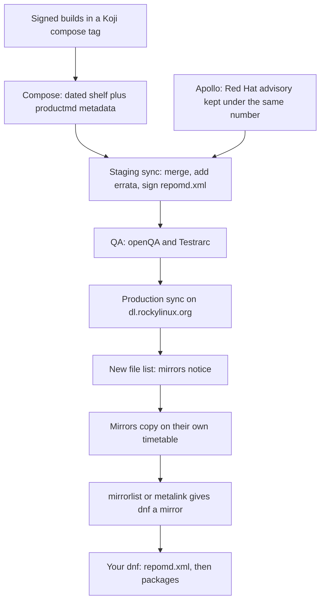
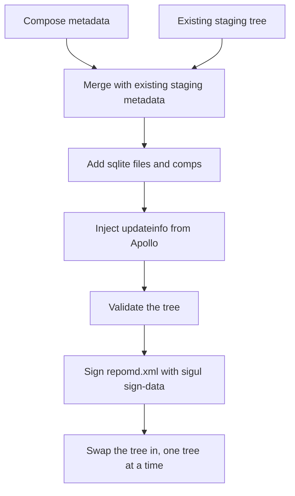

# 46 · Rocky's pipeline II: compose to your server

<ul class="module-meta">
  <li>⏱ ~3 hours</li>
  <li>4 labs</li>
  <li>Builds on: 05 · Software: RPM and DNF, 21 · Inside Rocky Linux, 45 · Rocky's pipeline I: from source to build</li>
  <li>Environment: Tier A</li>
  <li>Verified: Rocky 10.2, 2026-11-06</li>
</ul>

Red Hat issued the Januscape kernel advisory for Enterprise Linux 10, RHSA-2026:36956, on 2026-07-09. Rocky's `kernel-core-6.12.0-211.32.1.el10_2` was compiled that same day on a release-engineering host, imported into Koji with no task id at 19:34 UTC, and signed on Friday 2026-07-10 at 18:56 UTC. Its advisory, RLSA-2026:36956, carries a publish time of Saturday 2026-07-11 12:05 UTC, and a staff forum post on 2026-07-12 said the packages were being pushed to production that morning, blaming a brand new Secure Boot environment and compose time. Every timestamp except that last quote sits in a header or an API you can read without logging in, and they do not line up neatly, which is the lesson of this module: the delay lives in the stations between a signed build and your `dnf`.

In [module 45](45-pipeline-source-to-build.md) you followed a package from Red Hat's source to a Koji build. This module starts where that stopped, at the compose tag, and ends at the `dnf` on your server. Everything you run here talks to Rocky's real public services with `curl` and `jq`. Nothing is simulated.

<div class="pipeline-strip" data-here="compose publish install" role="group" aria-label="Rocky build pipeline, six stages" markdown>

1. Source
2. Build
3. Sign
4. Compose
5. Publish
6. Install

</div>

*You are here: Compose, Publish and Install (stages 4 to 6 of 6). Before: Sign. After: this module covers the end of the strip.*

!!! abstract "What you'll learn"
    - Explain what a compose is, and read a compose id and the public `metadata/` files as a package inventory.
    - Name each station between a signed build and your `dnf`, and run one public command that shows the state of each.
    - Query Apollo, the errata service, with `curl` and `jq`, and show that an RLSA number equals its RHSA number.
    - Tell `mirrorlist` from `metalink`, and check whether a mirror serves the same `repomd.xml` as the origin.
    - Read an openQA job and say what Testrarc is for.
    - Say what the `security` repository is and is not.
    - Diagnose a stale update with a decision tree, and say which parts of the pipeline nobody outside the project can show you.

## The big picture

[Module 45](45-pipeline-source-to-build.md) ended with a signed build sitting in a Koji tag. A tag is a row in a database, and nobody installs from a database row. Four things must happen before your `dnf` sees the package. The build must be collected into a repository. That repository must be merged with the older packages that belong to the same minor release. The result must be tested and promoted to the public server. And mirrors must copy it. Separately, an advisory has to be attached to the same packages.

Each of those is a station with its own public evidence: a metadata file, a directory, a timestamp or an API. The skill in this module is reading those traces, so that "my update has not arrived" becomes "it is waiting at this station, and here is the proof".

Everything below was checked on Rocky Linux 10.2 on 2026-11-06. Rocky 8 and 9 follow the same shape with their own trees: the staging shelf you will read lists 8.10 and 9.x next to 10.x.

### The pipeline from compose to server in one sentence

> **Rocky freezes its newest signed builds into a dated shelf called a compose, merges that shelf into a staging tree, promotes the tree to production, and lets mirrors copy it on their own timetable, while Apollo attaches Red Hat's advisory text to the same packages.**

!!! analogy "Think of it like a print run"
    A compose is one print run of a newspaper: it contains today's edition and nothing older. The staging tree is the archive room, which keeps every edition of the current volume. Mirrors are branch libraries that restock on their own timetable.

    Where the analogy breaks: a print run is thrown away after distribution, but a compose stays on disk and its inventory files stay readable. Only the shared `metadata/` directory is overwritten by whichever compose ran last.



The diagram shows one main line. A compose is made from a Koji tag, the staging sync merges it into the staging tree (taking advisories from Apollo on the way), QA gates promotion, the production sync republishes the tree, a new file list tells mirrors to copy, and your `dnf` is handed a mirror and reads `repomd.xml` first.

### The few things that solve most problems

| Situation | What to do | Where this module teaches it |
|-----------|-----------|------------------------------|
| An update exists upstream but your `dnf` does not see it | Walk the station ladder: Koji tag, RPM file, origin metadata, mirror, client | The core skill |
| You need the list of packages in a release or beta | Read `metadata/rpms.json` of that compose | A compose is a dated shelf |
| Someone asks "is there an advisory for this CVE?" | Query Apollo with `filters.keyword` | Errata |
| `dnf upgrade --security` finds nothing, plain `dnf upgrade` finds updates | The advisory attaches at a later sync than the RPM | Worked story |
| A mirror answers 404 on a repodata file | Compare its `repomd.xml` with the origin, then wait or pin `dl.rockylinux.org` | Mirrors |
| A customer asks for a faster kernel fix | The `security` repo is opt-in hotfixes, not a fast track | The security repo |

How to pick: start at the top of the ladder and stop at the first station that does not show the package. That is where it is waiting.

### Words you'll see

| Word | Plain meaning |
|------|---------------|
| **compose** | A dated snapshot of the newest signed builds in one Koji tag, laid out as repositories plus inventory files |
| **compose id** | The name of one compose, such as `Rocky-10.3-20261101.t.0` |
| **productmd** | A file format for compose inventory: `composeinfo.json`, `images.json`, `rpms.json` |
| **staging tree** | The public pre-release copy under `stg/rocky/` that also holds older packages of the minor |
| **production tree** | The tree your `dnf` uses, under `pub/rocky/` on `dl.rockylinux.org` |
| **syncv2** | Rocky's containerised staging sync tool: merge, add errata, sign, swap |
| **file list** | `fullfiletimelist-rocky`, a plain list of every file with its time and size |
| **mirror** | A volunteer or partner server that copies the production tree |
| **mirrorlist** | A service that returns plain mirror URLs for your location |
| **metalink** | A service that returns XML with the expected hash of `repomd.xml` plus mirror URLs |
| **Apollo** | Rocky's errata service: it clones Red Hat advisories onto Rocky packages |

## The core skill: find the station an update is waiting at

When an update is missing, guessing wastes hours. Ask each station one question, in order, and stop at the first "no".

| # | Station | The question | A public command |
|---|---------|--------------|------------------|
| 1 | Koji | Is the build tagged with the NVR you expect? | Koji anonymous XML-RPC `listTagged` |
| 2 | Origin file | Is the RPM file on `dl.rockylinux.org`? | `curl -sI` on its URL |
| 3 | Origin metadata | Was `repomd.xml` swapped after the file arrived, and does `primary` list it? | `Last-Modified` of `repomd.xml`, then the primary file |
| 4 | Mirror | Does your mirror serve the same `repomd.xml` as the origin? | `sha256sum` against `metalink` |
| 5 | Client | Does `dnf` see it after its cache expires? | `dnf clean expire-cache`, `dnf repoquery` |
| 6 | Advisory | Is the advisory in Apollo, and in the repo's `updateinfo`? | Apollo API, then the `updateinfo` file |

Here are the first three stations for a real package, the Rocky 10.2 kernel, on 2026-11-06. The commands are read-only.

```console
$ python3 -I -c "import xmlrpc.client as x; s=x.ServerProxy('https://koji.rockylinux.org/kojihub',allow_none=True); print([(b['nvr'],b['task_id']) for b in s.listTagged('dist-rocky10.2-compose',None,False,None,True,'kernel')])"
[('kernel-6.12.0-211.74.1.el10_2', None)]
$ B=https://dl.rockylinux.org/pub/rocky/10/BaseOS/x86_64/os
$ curl -sI $B/Packages/k/kernel-core-6.12.0-211.74.1.el10_2.x86_64.rpm | grep -i last-modified
last-modified: Thu, 05 Nov 2026 21:56:09 GMT
$ curl -sI $B/repodata/repomd.xml | grep -i last-modified
last-modified: Fri, 06 Nov 2026 08:03:08 GMT
```

Rocky 10.2 x86_64, 2026-11-06. The build is tagged. The `None` is the task id: no Koji task built it, which our reading takes to mean it was imported. The RPM file's `Last-Modified` is 5 November, 21:56 GMT. The metadata that lets `dnf` see it was swapped later, on 6 November at 08:03 GMT. Between those two times the file existed and `dnf` could not see it.

`Last-Modified` is the file's modification time on the server. It is the best public sign of when a file arrived, not proof of it. A **timestamp ladder** is the habit of writing each station's time on one line and reading the gaps. A gap is not a fault. It is the place to look.

**Practice 1.** On 2026-11-06 at 20:00 UTC, `dnf repoquery --latest-limit 1 kernel-core` shows the new kernel, but advisory `RLSA-2026:95367` is missing from the repo's `updateinfo`. Which station is behind? Predict, then open the answer.

??? success "Answer: the advisory attach, not the package"
    The kernel arrived with the 08:03 UTC metadata swap. Apollo published the advisory at 12:09 UTC, after that swap, and the staging sync takes the advisories it finds in Apollo at the moment it runs. This appears to be the explanation. You prove it by reading the `updateinfo` file itself, which the worked story below does.

**Practice 2.** A customer says: "The RPM is on the server, so my `dnf` should have offered it at 23:00 UTC on 5 November." Right or wrong?

??? success "Answer: wrong, because `dnf` reads metadata and not directories"
    The metalink lists the previous `repomd.xml` as dated 5 November 07:59 UTC, which is the one live at that hour. Our reading is that it did not yet list the package, since the next one came at 08:03 UTC on 6 November. The file sat in a directory, but `dnf` never lists directories. It reads `repomd.xml` and the files it points to.

<div class="quiz" data-answer="2" markdown>

The RPM's `Last-Modified` is 21:56 GMT on 5 November and `repomd.xml` shows 08:03 GMT on 6 November. What do the two times tell you?

- The mirror is stale
- The file existed on the origin for hours before the metadata swap that could list it
- The advisory was published before the package
- The package was rebuilt on 6 November

Right: the file landed first and the metadata followed. To be sure the new metadata really lists it, the next step is to look inside `primary`. Times show the order of events, never the cause.

</div>

## A compose is a dated shelf of builds

**The problem.** Koji remembers every build Rocky ever made, and tags choose which builds count for a release. A repository needs something stricter: one consistent set of the newest signed packages, split by variant and architecture, with checksums. A **compose** is that set, frozen on a date. The compose idea is stable across tools. The tool that makes it is a separate question.

Rocky's own description is plain: the tool takes "all the latest packages in koji" and turns them into a compose, "a collection of packages split into separate repositories". A compose "only contains the latest packages", so it is not the whole repo. Making one takes about an hour.

<!-- ev: FACTBASE-A hop 6, C1; public curl run | official | rockylinux.org news 2026-08-05 and releng issue 49, 2026-11-06 -->
!!! freshness "As of 2026-11-06 on Rocky 10.2"
    Rocky composes with Pungi against Koji tags (its own 2026-08-05 post says "We use a tool called pungi"). Issue 49 in Rocky's public release engineering tracker (`rocky-linux/releng`), opened 2026-07-28 and still open on 2026-11-07 UTC, is titled "Switch from pungi to something that scales linearly for composes". It says Pungi "always" takes about an hour for a compose and asks for a single update to take under a minute. It is a plan on a tracker, not a decision that has been carried out. The idea of a compose is stable. The tool name is what may change, at the next tooling decision.

    **Re-check:** `curl -s https://api.github.com/repos/rocky-linux/releng/issues/49 | jq -r '[.state,.title]|@tsv'`

The input to a compose is a Koji tag. Ask the anonymous hub about it:

```console
$ python3 -I -c "import xmlrpc.client as x; s=x.ServerProxy('https://koji.rockylinux.org/kojihub',allow_none=True); t=s.getTag('dist-rocky10.2-compose'); print(t['arches'], t['extra'])"
x86_64 aarch64 ppc64le s390x riscv64 {'repo.auto': True, 'repo.opts': {'separate_src': True}}
```

Rocky 10.2, 2026-11-06. The compose tag for 10.2 covers five architectures. Behind it the tag inherits `dist-rocky10.1-compose`, so a tag is a layered folder, not a flat list. A different tag, `dist-rocky10.2-security-compose`, feeds the `security` repo, and `dist-rocky10-lookahead-compose` feeds the LookAhead trees.

### Reading a compose id

Every compose has an id with the same grammar. Four ids you can read today, plus one from the test system:

| Compose id | Where you see it | `type` field | Reading |
|------------|------------------|--------------|---------|
| `Rocky-10.2-20260525.0` | `metadata/images.json` | production | The 10.2 GA compose: short name `Rocky`, version `10.2`, date 2026-05-25, respin 0 |
| `Security-10.2-20260929.0` | `metadata/composeinfo.json` | production | The security repo compose, short name `Security` |
| `Rocky-10.3-20261101.t.0` | `stg/rocky/10.3/metadata/` | test | A beta compose: the letter `t` marks type test |
| `Rocky-9.9-20261028.t.1` | `stg/rocky/9.9/metadata/` | test | A second respin the same day: `.1` |
| `Rocky-10.2-20261106.n.0` | an openQA build name | not in the file | The letter `n` is productmd's suffix for the nightly type, so our reading is a nightly build (the name is openQA's, and no file on this page confirms it) |

The pattern is `<short>-<version>-<YYYYMMDD>[.<type letter>].<respin>`. Production composes carry no type letter. In the productmd source code (`productmd/composeinfo.py`, read 2026-11-07 UTC) the letters are `t` for test, `n` for nightly, `ci` for continuous integration and `d` for development. The format also allows a release-type suffix and a layered base product in the id. None of the Rocky ids above uses either, so the short pattern is enough for them.

### The metadata directory is an inventory

Next to the repositories, a compose writes machine-readable files in the productmd format. Rocky publishes them in `metadata/`:

```console
$ curl -s https://dl.rockylinux.org/pub/rocky/10/metadata/ | sed 's/<[^>]*>/ /g; s/&nbsp;/ /g' | grep -E 'json' | tr -s ' '
 composeinfo.json 4367 2026-Sep-29 14:36:45Z
 extra_files.json 47096 2026-Aug-20 14:36:37Z
 images.json 48222 2026-May-26 00:51:38Z
 modules.json 301 2026-Sep-29 14:35:28Z
 rpms.json 78401 2026-Sep-29 14:34:20Z
```

| File | What it holds |
|------|---------------|
| `composeinfo.json` | The compose id, label, type, whether it is final, and its variants |
| `rpms.json` | Every RPM: category (`binary`, `source`, `debug`), path in the tree, and the key id that signed it |
| `images.json` | Every ISO and image: path, size, sha256, volume id |
| `modules.json` | Module metadata. It is empty for Rocky 10, which has no modules |
| `extra_files.json` | Extra files with hashes, such as the key files |

<!-- ev: FACTBASE-A O34; ERRATA D10 | observed | dl.rockylinux.org public metadata, 2026-11-06 -->
!!! evidence "Observed: the metadata directory mixes two different composes"
    **Seen on:** the public server and a Rocky 10.2 x86_64 VM, 2026-11-06.

    ```console
    $ curl -s https://dl.rockylinux.org/pub/rocky/10/metadata/composeinfo.json | jq -c '.payload.compose'
    {"date":"20260929","final":true,"id":"Security-10.2-20260929.0","label":"RC-10.2","respin":0,"type":"production"}
    $ curl -s https://dl.rockylinux.org/pub/rocky/10/metadata/images.json | jq -c '.payload.compose'
    {"date":"20260525","id":"Rocky-10.2-20260525.0","respin":0,"type":"production"}
    ```

    **Check it yourself:** run both commands. The two ids differ. The direct reading is that each compose overwrites the files it produces in this shared directory, so the last one to write wins; why the security compose writes here at all is not public. Here the September security compose owns `composeinfo.json` and `rpms.json`, while `images.json` still describes the May GA compose.

So `rpms.json` in `pub/rocky/10/metadata/` is a complete inventory of the security compose only, which today is one source package. For a pre-release compose, read the files in its own staging tree.

### A compose as a package inventory

`rpms.json` is nested: variant, then architecture, then source package, then each RPM built from it. Here is `which`, the course's through-line package, in the 10.3 beta compose:

```console
$ curl -s https://dl.rockylinux.org/stg/rocky/10.3/metadata/rpms.json | jq -r '.payload.compose.id, (.payload.rpms.BaseOS.x86_64 | to_entries[] | select(.key|startswith("which-")) | .value | to_entries[] | [.value.category,.value.path,.value.sigkey]|@tsv)'
Rocky-10.3-20261101.t.0
source	BaseOS/source/tree/Packages/w/which-2.21-44.el10_0.src.rpm	6fedfc85
binary	BaseOS/x86_64/os/Packages/w/which-2.21-44.el10_0.x86_64.rpm	6fedfc85
debug	BaseOS/x86_64/debug/tree/Packages/w/which-debuginfo-2.21-44.el10_0.x86_64.rpm	6fedfc85
debug	BaseOS/x86_64/debug/tree/Packages/w/which-debugsource-2.21-44.el10_0.x86_64.rpm	6fedfc85
```

Rocky 10.2 x86_64 VM, 2026-11-06. One source package produced four files in the BaseOS variant: the SRPM, the binary RPM and two debug packages. The `sigkey` column is the short id of the signing key. It is `6fedfc85` on every line. That key id is the end of the Rocky 10 release key's fingerprint, the one you see as `Key ID 5b106c736fedfc85` in `rpm -q --qf '%{RSAHEADER:pgpsig}\n'`.

Count the keys across a whole inventory to check that claim:

```console
$ curl -s https://dl.rockylinux.org/pub/rocky/10/metadata/rpms.json | jq -c '[.payload.rpms[][][][]|.sigkey]|group_by(.)|map({key:.[0],n:length})'
[{"key":"6fedfc85","n":229}]
```

Rocky 10.2 x86_64 VM, 2026-11-06. One key signed all 229 entries of the security compose, and the same command on the 10.3 test compose found one key for all 64,202 of its entries. The counts move with every compose. The relationship to expect is one key, however many entries.

<div class="quiz" data-answer="3" markdown>

You want the full package list of Rocky 10.2 today and fetch `pub/rocky/10/metadata/rpms.json`. Why is it not the full list?

- The file is encrypted
- Rocky 10 does not publish inventories
- The last compose written there was the security compose, so the file lists only its packages
- It lists only source packages

Yes. The shared `metadata/` directory is overwritten by the last compose, and today that is the September security compose. To list a whole tree you read the repository metadata (`primary`), or the `rpms.json` of a staging tree.

</div>

## Installer media and images ride the same compose

**The problem.** A repository is not enough to install an OS. You also need a boot image, an installer ISO, cloud images and container images, all built from the same packages. If they came from a different snapshot than the repository, an installer could ask for packages that no longer exist.

**The idea.** The compose builds them in the same run, from the same package set. Two public settings in Rocky's compose configuration show how (the file is read in Lab 4):

- `buildinstall_method = "lorax"` with `global_runroot_method = "koji"`: the installer boot image is made by **lorax**, run as a Koji "runroot" task on the build tag. You met lorax in [module 43](43-installer-and-install-media.md) and build your own in [module 51](51-build-your-own-install-media.md).
- `kiwibuild_target = 'dist-rocky10.2-kiwi'`: cloud, container, Vagrant and WSL images are built by **KIWI**, as Koji `kiwibuild` tasks, from image descriptions kept in a public repository on branch `r10`. [Module 44](44-images-cloud-container-bootc.md) shows what is inside them.

The inventory of all that is `images.json`. For 10.2 it has three variants, and the BaseOS variant lists the two ISOs:

```console
$ curl -s https://dl.rockylinux.org/pub/rocky/10/metadata/images.json | jq -r '(.payload.images|keys|join(" ")), (.payload.images.BaseOS.x86_64[]|[.type,.path]|@tsv)'
BaseOS images live
boot	BaseOS/x86_64/iso/Rocky-10.2-x86_64-boot.iso
dvd	BaseOS/x86_64/iso/Rocky-10.2-x86_64-dvd1.iso
```

Rocky 10.2 x86_64 VM, 2026-11-06. The paths are paths inside the compose. The same files are published under `isos/x86_64/` on the server, so a compose path and a download path are not the same string.

<!-- ev: FACTBASE-A O35; ERRATA E5d | observed | public server, 2026-11-06 -->
!!! evidence "Observed: three public files give one checksum for the boot ISO"
    **Seen on:** the public server, 2026-11-06.

    ```console
    $ curl -s https://dl.rockylinux.org/pub/rocky/10/metadata/images.json | jq -r '.payload.images.BaseOS.x86_64[]|select(.type=="boot")|.checksums.sha256'
    bf3a75907948563d0c11f3d1b8546ee9216e18a3ea2dc0a67eb4c45452e210f9
    $ curl -s https://dl.rockylinux.org/pub/rocky/10/BaseOS/x86_64/os/.treeinfo | grep 'boot.iso = sha256'
    images/boot.iso = sha256:bf3a75907948563d0c11f3d1b8546ee9216e18a3ea2dc0a67eb4c45452e210f9
    $ curl -s https://dl.rockylinux.org/pub/rocky/10/isos/x86_64/CHECKSUM | grep -m1 'SHA256 (Rocky-10.2-x86_64-boot.iso)'
    SHA256 (Rocky-10.2-x86_64-boot.iso) = bf3a75907948563d0c11f3d1b8546ee9216e18a3ea2dc0a67eb4c45452e210f9
    ```

    **Check it yourself:** run the three commands. The three digests are equal because the compose metadata, the tree's `.treeinfo` and the release checksum file all describe the same ISO. The ISO itself has no `.treeinfo` inside it. The tree's `.treeinfo` lists the ISO, not the other way round.

Two limits apply. The compose records an image's checksum, but who signs the ISO `CHECKSUM` file and whether KIWI image results are signed in the RPM path are not public. Both are in the unknown box below.

## Signatures at the compose boundary

**The problem.** A compose publishes whatever is in its tag. If an unsigned or wrongly signed build slipped into the tag, the compose would publish it. So the compose is also a checkpoint.

**What the public record shows.** Three signatures matter on this part of the road, and you can see each one.

- The compose configuration lists the key it accepts: `sigkeys = ['6FEDFC85']`. In the compose output, every RPM entry records `sigkey: 6fedfc85` (you just counted it above). One key signs the packages.
- The staging sync signs the repository metadata. Rocky's `syncv2` README says `repomd.xml.asc` is made with `sigul sign-data` after the advisories are injected and before the tree is swapped in.
- Installer ISOs and images carry a signed `CHECKSUM` file next to them, not a signature on the ISO.

<!-- ev: FACTBASE-C 3.4; FACTBASE-A hop 7 | inference | repomd.xml and repomd.xml.asc times, public server, 2026-11-06 -->
!!! evidence "Our reading: the metadata signature is made just after the metadata"
    **Seen on:** the public server, 2026-11-06.

    ```console
    $ B=https://dl.rockylinux.org/pub/rocky/10/BaseOS/x86_64/os
    $ curl -sI $B/repodata/repomd.xml | grep -i last-modified
    last-modified: Fri, 06 Nov 2026 08:03:08 GMT
    $ curl -sI $B/repodata/repomd.xml.asc | grep -i -E 'last-modified|content-length'
    last-modified: Fri, 06 Nov 2026 08:04:40 GMT
    content-length: 833
    ```

    **Check it yourself:** run the commands. The signature file is newer than `repomd.xml` by about a minute and a half. That fits the README's order: metadata first, then the signature, then the swap. The times alone do not prove the order.

Your `dnf` does not check that metadata signature by default. Stock Rocky repo files set `gpgcheck=1` for packages and leave `repo_gpgcheck` unset. [Module 47](47-trust-signatures-and-keys.md) walks through what each check proves.

!!! note "What is not shown here"
    How an RPM gets its signature inside the build system is not visible from outside. You can see the result (the signature time, hours after the build, and the key id) but not the mechanism. Whether Rocky 10 signs through the Sigul tooling in Rocky's public 2021 Ansible role is not public.

```console
$ rpm -q --qf 'built  %{BUILDTIME:date}\nsigned %{RSAHEADER:pgpsig}\n' kernel-core-6.12.0-211.74.1.el10_2
built  Thu 05 Nov 2026 04:51:17 PM UTC
signed RSA/SHA256, Thu 05 Nov 2026 09:49:17 PM UTC, Key ID 5b106c736fedfc85
```

Rocky 10.2 x86_64 VM, 2026-11-06. Built at 16:51 UTC, signed at 21:49 UTC, on the origin at 21:56 UTC. Signing is its own event, and the compose configuration accepts only the release key.

## Staging, then production

**The problem.** A compose holds only the newest packages. Rocky keeps older packages of the same minor release in the same repository (there is no separate updates repo), so a user can install an older version or pin one. The repository your `dnf` reads must therefore be the compose plus everything that was already there.

**The idea.** A second tool, `syncv2`, merges the compose into the existing **staging tree**. A later promotion step copies the staging tree to production.



The diagram shows the order in the `syncv2` README: merge the compose with the metadata already in staging (compose first, so its checksums win, and RPMs are never re-read), add the supporting files, take advisories from Apollo, validate, sign `repomd.xml`, and swap.

??? question "Why was the merge a big deal in August 2026?"
    Before August 2026 the sync copied the compose into staging and regenerated the metadata to include the old packages too. Rocky's post says that was the bulk of the time, "over three hours" across all repositories and architectures. Merging the compose's metadata with what staging already had avoids reading every package again.

    The README also says the Apollo step exits successfully if it cannot fetch advisories, so an Apollo outage would republish the previous cycle's errata. The sign is the log line `apollo has no updateinfo`.

<!-- ev: FACTBASE-A hop 6, hop 7; ERRATA section 3 | official | rockylinux.org news 2026-08-05 -->
!!! freshness "As of 2026-11-06 on Rocky 10.2"
    Rocky's post of 2026-08-05 says the compose takes about an hour, the post-compose staging sync fell from 3 to 4 hours to 20 to 25 minutes, and the full compose and sync fell from 4 to 5 hours to roughly 1.5 hours. These are stated figures from one post, not measurements of today's runs. They change when the pipeline changes (the Pungi replacement issue is the next candidate).

    **Re-check:** `curl -s https://rockylinux.org/news/2026-08-05-compose-improvements | grep -o 'roughly 1.5 hours'`

### The staging shelf is public

Staging trees are readable by anyone, which makes them the best place to watch a release take shape:

```console
$ curl -s https://dl.rockylinux.org/stg/rocky/ | sed 's/<[^>]*>//g' | grep -E '^[0-9a-z]'
10/                                                29-Sep-2026 14:34                   -
10-BETA/                                           01-Nov-2026 22:26                   -
10-LookAhead/                                      14-Mar-2026 06:34                   -
10.2/                                              29-Sep-2026 14:34                   -
10.2-PQC-test/                                     11-Aug-2026 14:56                   -
10.2-RC2/                                          29-Sep-2026 14:34                   -
10.3/                                              01-Nov-2026 22:26                   -
10.3-BETA/                                         01-Nov-2026 22:26                   -
10.3-LookAhead/                                    14-Mar-2026 06:34                   -
…
```

Rocky 10.2 era, 2026-11-06, listing trimmed with ellipses. Read the names as stages of a release:

| Directory | What it is | Compose id inside |
|-----------|------------|-------------------|
| `10-LookAhead`, `10.3-LookAhead` | A trial tree built months ahead of a minor release | `Rocky-10.3-20260314.t.0` |
| `10-BETA`, `10.3-BETA`, `10.3` | The beta tree for the next minor (the same compose, listed under several names) | `Rocky-10.3-20261101.t.0` |
| `10.2-RC2`, `10.2` | The 10.2 release tree (see our reading below) | `Security-10.2-20260929.0` (the shared `metadata/` problem again) |
| `10.2-PQC-test`, `9.8-PQC-test` | Small trial trees dated 2026-08-11. Their purpose is not stated; the name suggests post-quantum signing tests. The 10.2 one holds only an `AppStream` directory and no `metadata/` | none |

Testrarc's README lists the typical release-candidate names as LookAhead, Beta, RC1, RC2 and Final. Rocky's directory for the final tree is still called `10.2-RC2`, and its composeinfo label reads `RC-10.2`. Our reading: in Rocky practice the final is the last release candidate, promoted.

<!-- ev: FACTBASE-A O37; public curl run | observed | stg/rocky listing and composeinfo, 2026-11-06 -->
!!! freshness "As of 2026-11-06 on Rocky 10.2"
    Rocky 10.3 and Rocky 9.9 are in beta. Their staging trees carry test composes dated 2026-11-01 and 2026-10-28. No GA date for either was announced in the news posts as of this date. The shelf changes at every beta compose, and the beta directories disappear into release trees at GA.

    **Re-check:** `curl -s https://dl.rockylinux.org/stg/rocky/10.3/metadata/composeinfo.json | jq -c '.payload.compose'`

### Promotion, QA and the production tree

Rocky's public toolkit repository (`sig_core/toolkit` on `git.resf.org`) shows what the promotion step is wired to. Commit subjects dated 2026-09-07 read "Automate successful stable compose promotion", "Gate promotion on VM update tests", "Generate production filelists incrementally" and "Preserve unchanged staging repository metadata", and one of 2026-08-24 reads "Gate promotion on repoclosure". Testing is a station of its own; the next sections show where to read it.

After promotion the production tree is `pub/rocky/` on `dl.rockylinux.org`, and a new **file list** is generated. It is a plain text file, large and tab-separated:

```console
$ curl -sI https://dl.rockylinux.org/pub/rocky/fullfiletimelist-rocky | grep -i -E 'last-modified|content-length'
last-modified: Fri, 06 Nov 2026 23:18:07 GMT
content-length: 79427723
$ curl -s https://dl.rockylinux.org/pub/rocky/fullfiletimelist-rocky | sed -n 1,6p
[Version]
2

[Files]
1717167809	l	4	8
…
```

Rocky 10.2 era, 2026-11-06. Each line is `mtime`, type (`f` file, `l` link), size and path. Our reading, from Rocky's sync scripts and mirror practice, is that mirrors compare this file with their own copy to decide whether to sync. Rocky's mirror documentation does not describe it, so treat that as a hypothesis.

Because the file lists every file with its size, you can measure the tree without downloading it:

```console
$ curl -s https://dl.rockylinux.org/pub/rocky/fullfiletimelist-rocky | awk -F'\t' '$2=="f"{t+=$3} END{printf "%.2f TiB\n", t/2^40}'
8.36 TiB
```

<!-- ev: FACTBASE-A O41, section 4.7; public curl run | observed | fullfiletimelist-rocky, 2026-11-06 -->
!!! freshness "As of 2026-11-06 on Rocky 10.2"
    The production tree `pub/rocky/` adds up to 8.36 TiB (logical size, 761,160 files). The 10.2 tree alone is 2,876 GiB, including 251,275 RPM files. A full copy of the tree is the reason mirror hosting is a serious commitment. These sizes grow at each release and shrink when a minor moves to the vault.

    **Re-check:** `curl -s https://dl.rockylinux.org/pub/rocky/fullfiletimelist-rocky | awk -F'\t' '$2=="f"{t+=$3} END{printf "%.2f TiB\n", t/2^40}'`

### Walk one update through the stations

<div class="stepper" markdown>

<div class="step" data-title="Compose" markdown>

The compose tool reads the compose tag and writes a dated shelf of repositories plus `metadata/`, in about an hour per Rocky's post of 2026-08-05. Public trace: the compose id in `composeinfo.json`.

</div>

<div class="step" data-title="Staging sync" markdown>

`syncv2` merges the shelf into the staging tree, adds advisories from Apollo, signs `repomd.xml` and swaps the tree in (20 to 25 minutes since August 2026). Public trace: `Last-Modified` of `repomd.xml` and `repomd.xml.asc` under `stg/rocky/<release>/`.

</div>

<div class="step" data-title="QA" markdown>

openQA runs install and desktop tests against the staging tree, and Testrarc tracks the manual tests. Public trace: openQA job results and the Testrarc dashboard.

</div>

<div class="step" data-title="Production sync" markdown>

The staging tree is copied to `pub/rocky/` on `dl.rockylinux.org` and the file list is regenerated. Public trace: the file list's `Last-Modified` and the production `repomd.xml`.

</div>

<div class="step" data-title="Mirrors" markdown>

Mirrors copy on their own schedule and MirrorManager answers your `dnf` with URLs. Public trace: the `mirrorlist` and `metalink` responses. A reply in a 2025 forum thread (linked in the mirrors section) said it can take 24 to 48 hours for all mirrors to catch up after a release.

</div>

<div class="step" data-title="Advisory" markdown>

Apollo has the advisory, and the next sync after it appears copies it into `updateinfo`. Public trace: the Apollo API and the `updateinfo` file in the repo.

</div>

<div class="step" data-title="Your dnf" markdown>

`dnf` re-reads `repomd.xml` when its cache is older than `metadata_expire` (6 hours in the stock repo files), picks a mirror, fetches the files `repomd.xml` names, and checks each package's signature before installing.

</div>

</div>

The stepper shows the same line as the big-picture diagram with one public trace per station. If you can name the trace, you can find the station an update is waiting at.

## Errata: Apollo says why the shelf changed

!!! tip "Remember from 21"
    An erratum is a published update with a description. Rocky's advisories keep Red Hat's numbers (`RLSA-2026:1234` fixes what `RHSA-2026:1234` fixes), and `dnf updateinfo` reads them from repo metadata. [Module 21](21-inside-rocky-linux.md) covers the prefixes and the `dnf` commands. This section is about the service behind them.

**The problem.** Red Hat writes the advisory text. Rocky ships its own rebuilt packages. Someone has to match the two, publish the result, and put it in the metadata `dnf` reads. That is Apollo, Rocky's errata service. It takes Red Hat's advisory data, which is licensed CC-BY-4.0, matches it to the packages Rocky built, and serves it from a public API. The staging sync asks it for advisories.

### Query Apollo with curl and jq

The API lives at `https://apollo.build.resf.org/v2/advisories`. A list call returns the total, the time of the last update, and advisory objects:

```console
$ curl -s 'https://apollo.build.resf.org/v2/advisories?limit=3' | jq -r '.total, .lastUpdated, (.advisories[]|[.name,.synopsis,.publishedAt,(.affectedProducts|join(",")),.source.name]|@tsv)'
10363
2026-11-07T00:55:16Z
RLSA-2023:4330	Moderate: nodejs:18 security, bug fix, and enhancement update	2026-11-07T00:04:09.758654Z	Rocky Linux 9	RHSA-2023:4330
RLSA-2023:6961	Low: qt5-qtsvg security update	2026-11-07T00:01:17.178014Z	Rocky Linux 8	RHSA-2023:6961
RLSA-2026:95519	Important: delve security update	2026-11-06T12:09:31.090950Z	Rocky Linux 10	RHSA-2026:95519
```

Rocky 10.2 x86_64 VM, captured on the evening of 2026-11-06 US time, so the API's UTC times already read 2026-11-07. The last column is `source.name`, the Red Hat advisory the Rocky one was cloned from. Notice the order: the rows come in descending `publishedAt`, and two advisories with 2023 numbers carry a 2026 publish time, so the first rows are not the highest numbers. Do not read the top of the list as "the newest advisories". Search by CVE with `filters.keyword`, and fetch one advisory by id (the single-advisory response is wrapped in an `advisory` object, so use `.advisory.name`, and a `limit` above 100 returns an error):

```console
$ curl -s 'https://apollo.build.resf.org/v2/advisories?filters.keyword=CVE-2026-53359' | jq -r '.advisories[]|[.name,.synopsis,.publishedAt,(.affectedProducts|join(",")),.source.name]|@tsv'
RLSA-2026:36957	Important: kernel security update	2026-07-13T00:03:36.461878Z	Rocky Linux 9	RHSA-2026:36957
RLSA-2026:36956	Important: kernel security update	2026-07-11T12:05:28.871633Z	Rocky Linux 10	RHSA-2026:36956
$ curl -s 'https://apollo.build.resf.org/v2/advisories/RLSA-2026:13566' | jq -r '.advisory|[.name,.source.name]|@tsv'
RLSA-2026:13566	RHSA-2026:13566
```

Rocky 10.2 x86_64 VM, 2026-11-06. The first query finds the Januscape advisories from this module's opening: one for Rocky 10 and one for Rocky 9, with Red Hat's numbers. Page size is limited: ask for `limit=100` at most, and use `&page=N` for more.

<!-- ev: FACTBASE-A O49, C11; ERRATA section 3 | observed | Apollo API scan of the Rocky Linux 10 product, 2026-11-06 -->
!!! evidence "Observed: the RLSA number always equals the RHSA number"
    **Seen on:** the public Apollo API, 2026-11-06, from a Rocky 10.2 x86_64 VM.

    ```console
    $ for p in 0 1 2 3 4 5 6 7 8; do curl -s "https://apollo.build.resf.org/v2/advisories?limit=100&page=$p&filters.product=Rocky%20Linux%2010"; done | jq -s '[.[].advisories[]?] | {total: length, same_tail: ([.[]|select((.name|sub("^[A-Z]+-";"")) == (.source.name|sub("^[A-Z]+-";"")))]|length)}'
    {
      "total": 894,
      "same_tail": 894
    }
    ```

    **Check it yourself:** run the loop. The two counts are equal: all 894 advisories for the Rocky Linux 10 product had the same year and number as the Red Hat advisory they came from. An earlier red-team sample found the same in 400 of 400 advisories spread over 2022 to 2026. Treat it as "always observed", not as a guarantee: the service's own documentation does not promise it.

The mapping you saw is `RLSA` to `RHSA`, `RLBA` to `RHBA`, and `RXSA` to `RHSA` (the `RXSA-2026:13565` in Lab 1 is a kernel advisory for the product "Rocky Linux SIG Cloud 9"). Among the 894 Rocky Linux 10 advisories, 886 were `RLSA` and 8 were `RLBA`.

<!-- ev: FACTBASE-A section 4.8; public curl run | observed | Apollo totals, 2026-11-06 -->
!!! freshness "As of 2026-11-06 on Rocky 10.2"
    Apollo held 10,361 advisories in total at an early capture on 2026-11-06 and 10,363 at a later one that evening (894 of them for Rocky Linux 10 at the later one). Totals only rise, and they rise every day, so they are never a stable fact to quote. A cap applies: `limit` above 100 returns an error.

    **Re-check:** `curl -s 'https://apollo.build.resf.org/v2/advisories?limit=1' | jq '.total, .lastUpdated'`

??? version "Comparison lens: AlmaLinux and CentOS Stream"
    AlmaLinux also reuses Red Hat's number: `ALSA-2026:18142` matches `RHSA-2026:18142`. CentOS Stream's repository has no `updateinfo` at all: its `repomd.xml` lists `primary`, `filelists`, `other` and `group` only, so there are no advisories to query. Rocky's `repomd.xml` lists `updateinfo` plus the sqlite databases. **Check it yourself:** `curl -s <repo>/repodata/repomd.xml | grep -o '<data type="[a-z_]*"'` on each distribution's repo.

### The advisory arrives on its own schedule

An advisory is not part of the compose. Apollo runs its own matching, and the staging sync takes whatever Apollo has when the sync runs. Rocky's issue tracker describes the gap in its own words. Issue #10, "Ensure advisories are only visible after packages are available in repos", says advisory cloning "runs on its own schedule, independent of compose", and that `updateinfo.xml` can therefore miss advisories that should be present. That is the project's own statement of the gap, and it is still open. The worked story below shows the gap on a real kernel.

<div class="quiz" data-answer="2" markdown>

A teammate says `RLSA-2026:95367` is Rocky's own numbering and cannot be mapped to Red Hat's. Which command settles it?

- `dnf updateinfo list --all`
- `curl -s https://apollo.build.resf.org/v2/advisories/RLSA-2026:95367 | jq -r '.advisory.source.name'`
- `rpm -qi kernel-core`
- `git log` in the kernel repo

Right. Apollo's `source.name` holds the Red Hat advisory, and for every Rocky Linux 10 advisory we scanned the year and number are the same.

</div>

## Mirrors: how the shelf reaches your dnf

[Module 21](21-inside-rocky-linux.md) has the sequence diagram of `dnf` talking to a mirror: your repo files use `mirrorlist=`, and a stale mirror cannot forge a package because `gpgcheck=1` checks each signature.

**The problem.** The origin server cannot serve every Rocky user. Volunteers and partners copy the tree and serve it nearer to users. The service in front of them must decide which mirror to send you to, and it must avoid mirrors that are behind.

**The idea.** **MirrorManager** keeps the list of mirrors. Two front doors read it: `mirrorlist`, which returns plain mirror URLs for your location, and `metalink`, which returns the same kind of URLs plus the hash, size and timestamp `repomd.xml` should have.

<!-- ev: FACTBASE-A O42, O43; public curl run | observed | mirrors.rockylinux.org, 2026-11-06 -->
!!! evidence "Observed: mirrorlist returns URLs, metalink returns the expected hash"
    **Seen on:** the public mirror service, 2026-11-06. Mirror host names are replaced by `<mirror-host>`.

    ```console
    $ curl -s 'https://mirrors.rockylinux.org/mirrorlist?arch=x86_64&repo=BaseOS-10' | head -4
    # repo = rocky-BaseOS-10.2 arch = x86_64 country = US country = CA country = PR
    https://<mirror-host>/rocky/10.2/BaseOS/x86_64/os/
    http://<mirror-host>/rocky-linux/10.2/BaseOS/x86_64/os/
    https://dl.rockylinux.org/pub/rocky/10.2/BaseOS/x86_64/os/
    $ curl -s 'https://mirrors.rockylinux.org/metalink?repo=rocky-BaseOS-10.2&arch=x86_64' | head -12
    <?xml version="1.0" encoding="utf-8"?>
    <metalink version="3.0" … type="dynamic" … generator="mirrormanager" …>
     <files>
      <file name="repomd.xml">
       <mm0:timestamp>1793952188</mm0:timestamp>
       <size>4452</size>
       <verification>
        <hash type="md5">…</hash>
        <hash type="sha1">…</hash>
        <hash type="sha256">ecee53d599fca278b78aedd05bb8a3459d163bf894d063aeacfb142e69d4e133</hash>
    ```

    **Check it yourself:** run both commands. Three differences stand out. The `mirrorlist` repo id is the major version (`BaseOS-10`) and the service maps it to the current minor (`rocky-BaseOS-10.2` in the header), while the `metalink` repo id must name the minor. The URL path after the host differs per mirror (`rocky/`, `rocky-linux/`, `pub/rocky/`). The host at the top changes from call to call, which is why this page never claims who runs which mirror. The metalink also lists older repomd hashes under `alternates`.

Rocky's own repo files use `mirrorlist=`, not `metalink=`. The metalink exists, and you can use it as a referee. It tells you the hash `repomd.xml` should have on the origin right now:

```console
$ M=$(curl -s 'https://mirrors.rockylinux.org/mirrorlist?arch=x86_64&repo=BaseOS-10' | grep -m1 '^http')
$ curl -s "${M}repodata/repomd.xml" | sha256sum
ecee53d599fca278b78aedd05bb8a3459d163bf894d063aeacfb142e69d4e133  -
$ curl -s 'https://mirrors.rockylinux.org/metalink?repo=rocky-BaseOS-10.2&arch=x86_64' | grep -m1 'type="sha256"'
    <hash type="sha256">ecee53d599fca278b78aedd05bb8a3459d163bf894d063aeacfb142e69d4e133</hash>
```

Rocky 10.2 x86_64 VM, 2026-11-06. The first mirror in the list served the same `repomd.xml` the metalink describes. If the two hashes differ, either that mirror is behind, or a sync swapped the metadata between your two requests. Repeat once before you blame the mirror.

### Why metadata files carry their hash in the name

Packages and metadata are separate files. `repomd.xml` is a pointer with a stable name. Everything it points to, such as `primary` and `updateinfo`, has its sha256 in its file name (for example `59adca43…-updateinfo.xml.gz` in the BaseOS repo on 2026-11-06). That makes a half-synced mirror fail loudly. If a mirror has the new `repomd.xml` but not the new hashed files yet, `dnf` gets a 404, not silently stale data.

A real case: after the Rocky 9.6 release, in June 2025, container builds got 404 on `…/9.6/AppStream/aarch64/os/repodata/<hash>-GROUPS.xml.gz` from two Australian mirrors. a reply in the thread said it can take 24 to 48 hours for all the mirrors. The cause is our reading, not a project statement: those mirrors had the new pointer before the new files. The fix was to wait, pin a mirror, or use `dl.rockylinux.org`. The forum thread is [18650](https://forums.rockylinux.org/t/18650), where the 404s, the two mirror names and the 24 to 48 hour reply are all posted.

### Mirrors, rsync and the size of the job

Mirror operators copy with rsync from a partner server. The module list is public:

```console
$ rsync -4 --contimeout=15 --list-only rsync://msync.rockylinux.org/ | tail -6
rocky-linux    	Rocky Linux Production
rocky-sigs     	Rocky Linux Special Interest Groups
…
rocky          	YOU SHOULD NOT USE THIS! DEPRECATED! Rocky Linux Production - Use rocky-linux
```

Rocky 10.2 x86_64 VM, 2026-11-06. The banner above this list says the service is for the use of mirror partners, and the contents are access-controlled. Listing the modules (`rocky-linux`, `rocky-sigs`, `rocky-everything`, `rocky-vault`, `centos-vault` and a deprecated `rocky`) is as far as an ordinary user goes. Rocky's mirror documentation (`docs.rockylinux.org/guides/mirror_management/add_mirror_manager/`) asks public mirrors for at least 1 Gbit/s, a data-centre-like host, no dynamic DNS and no anycast CDN in front. [Lab 3](#labs) is a read-along about the size of the job.

<!-- ev: FACTBASE-A O44, section 4.7; public curl run | observed | MirrorManager mirror page, 2026-11-06 -->
!!! freshness "As of 2026-11-06 on Rocky 10.2"
    MirrorManager showed 153 active public mirrors on 2026-11-07 at about 02:00 UTC. The same page showed 152 earlier on 2026-11-06, so the count moved by one within hours. It changes without notice, in both directions, which is why this page quotes it with a time.

    **Re-check:** `curl -s https://mirrors.rockylinux.org/mirrormanager/mirrors | grep -o 'We have currently [0-9]* active'`

<div class="quiz" data-answer="3" markdown>

You get a 404 for a hashed `repodata` file from one mirror, and `dl.rockylinux.org` serves it fine. What is the most likely cause, and the right response?

- The package was removed; use `--nogpgcheck`
- The key expired; re-import it
- The mirror has a newer `repomd.xml` than its files; wait, pick another mirror, or use the origin
- Rocky's server is down

Yes. Hashed names make a half-synced mirror fail loudly. Never switch off `gpgcheck` or `repo_gpgcheck` to cure a mirror 404.

</div>

## Testing in public: openQA and Testrarc

**The problem.** Before a tree is promoted, someone must install it and check that it works. Rocky does this with two public systems, one automated and one manual.

### openQA reads like a log you can query

**openQA** installs Rocky in virtual machines, drives the installer and desktop with screenshots, and records a result for every test. The instance is `openqa.rockylinux.org`, and the REST API accepts anonymous reads:

```console
$ curl -s 'https://openqa.rockylinux.org/api/v1/jobs?limit=3&latest=1' | jq -r '.jobs[]|[.id,.name,.result]|@tsv'
380605	rocky-10.2-universal-x86_64-BuildRocky-10.2-20261106.n.0-install_kickstart_nfs@uefi	passed
380606	rocky-9.8-minimal-iso-x86_64-BuildRocky-9.8-20261106.n.0-install_minimal_upload@bios	passed
380607	rocky-9.8-minimal-iso-x86_64-BuildRocky-9.8-20261106.n.0-install_minimal@bios	passed
```

Rocky 10.2 x86_64 VM, 2026-11-06. A job name has a grammar: `rocky-<version>-<flavor>-<arch>-Build<BUILD>-<test>@<machine>`. The first job reads: Rocky 10.2, flavor `universal`, x86_64, build `Rocky-10.2-20261106.n.0` (the same grammar as a compose id), test `install_kickstart_nfs`, machine `uefi`. Common results are `passed`, `failed` and `softfailed` (a test passed with a known soft failure). `parallel_failed` means a job that runs in parallel with this one failed, so this job could not continue (the comment in openQA's `lib/OpenQA/Jobs/Constants.pm`, read 2026-11-07 UTC). That file lists twelve job results in all, including `incomplete`, `obsoleted`, `user_cancelled` and `user_restarted`. The steps inside one job report their own results, such as `passed`, `failed` and `skipped`.

To read one job, fetch its details. A failed install test looks like this:

```console
$ curl -s 'https://openqa.rockylinux.org/api/v1/jobs/380604/details' | jq -r '.job|.name, .result, (.testresults[]|[.name,.result]|@tsv)'
rocky-10.2-universal-x86_64-BuildRocky-10.2-20261106.n.0-install_iscsi@uefi
failed
_boot_to_anaconda	passed
_anaconda_network_static	passed
…
_do_install_and_reboot	passed
_console_wait_login	failed
disk_custom_iscsi_postinstall	skipped
uefi_postinstall	skipped
_console_avc_crash	skipped
```

Rocky 10.2 x86_64 VM, 2026-11-06, one job. The steps run in order, so the first `failed` line is where to look: here the steps up to `_do_install_and_reboot` passed and `_console_wait_login` did not. From the names, the install finished and the wait for a login prompt after the reboot is what failed (our reading). Everything after it is `skipped`, because a later step cannot run once an earlier one fails. What the list does not tell you is why. The job's page, `https://openqa.rockylinux.org/tests/380604`, holds the screenshots and logs.

<!-- ev: FACTBASE-A O52, O53, section 4.6; public curl run | observed | openQA API, 2026-11-06 -->
!!! evidence "Observed: a nightly build is a few hundred jobs with a few reds"
    **Seen on:** the public openQA instance, 2026-11-06.

    ```console
    $ curl -s 'https://openqa.rockylinux.org/api/v1/jobs?build=Rocky-10.2-20261106.n.0&latest=1&limit=500' | jq -r '[.jobs[]|.result]|group_by(.)|map("\(.[0]) \(length)")|join(", ")'
    failed 8, parallel_failed 1, passed 131, softfailed 3
    ```

    **Check it yourself:** run it with a build id from a recent job name. The shape to expect is mostly `passed` with a handful of `failed` and `softfailed`, for 143 jobs in this build. The one `parallel_failed` job in this build is a `support_server` job (a helper VM that other tests talk to); I did not trace which sibling job failed. The failing test names (cockpit, FreeIPA replication, iSCSI, navigation) also failed in the builds of 2026-11-04 and 2026-11-05 when we re-ran the query on 2026-11-07 UTC, so a red job is not automatically a product bug. Read the first failed step before you decide.

Beta builds use the same tests against the staging tree. The job names carry `Rocky-10.3-BETA-20261104.n.0`, and the job setting `LOCATION` is `https://download.rockylinux.org/stg/rocky/10.3`.

<!-- ev: FACTBASE-A section 4.6; public curl run | observed | openQA workers and job groups, 2026-11-06 -->
!!! freshness "As of 2026-11-06 on Rocky 10.2"
    Of the groups in openQA, only `Rocky` and `Rocky AArch64` had jobs. The `Rocky PowerPC` and `Rocky s390x` groups had none. Among the registered workers, 18 were idle on x86_64 and 2 aarch64 workers were dead. Worker state and job counts change by the hour.

    **Re-check:** `curl -s https://openqa.rockylinux.org/api/v1/workers | jq -r '[.workers[]|.status]|group_by(.)|map("\(.[0]) \(length)")|join(", ")'`

### Testrarc is the manual half

Some checks need a person, real hardware or another architecture. **Testrarc** ("TEST tRAcking for Rocky Candidates") is the Testing team's web tracker for them. Rocky announced its production instance live on 2026-11-04, with beta results for 10.3 and 9.9 ready to read. The announcement says it records, for each test on each architecture (x86_64, aarch64, riscv64, ppc64le, s390x), who validated it, the result (pass, fail, partial) and the environment (bare metal, KVM, container, VM, cloud). It takes over from the Mattermost Playbooks the team had used since 2022. No login is needed to view the status. A Rocky account is needed to submit a test.

So testing has two public traces: openQA for what a machine checked, and Testrarc for what a person checked. Neither is a promise about the release date.

<div class="quiz" data-answer="2" markdown>

An openQA job shows `failed`, and its steps list ends with several `skipped` lines. Where do you look first?

- At the last `skipped` step
- At the first step whose result is `failed`
- At the job name
- At the mirror count

Right. Steps run in order and later steps are skipped once one fails, so the first `failed` step is where the run stopped.

</div>

## The security repo and the repo layout

### The security repo is opt-in, and not a fast track

**What Rocky says.** In a post of 2026-05-14 Rocky describes the `security` repository as optional, opt-in and disabled by default, for the narrow case where a significant vulnerability is public, exploit code exists and upstream fixes are not available yet. It says in the post that it is "not a general-purpose fast-track channel", that its packages are versioned to be superseded by the next upstream release, that it does not carry traditional errata records, and that it will not surface in `dnf update --security`.

**What you can see.** Each of those statements has a trace on a Rocky 10.2 system or on the public server:

```console
$ dnf repolist --all | grep security
security                      Rocky Linux 10 - Security                 disabled
security-debuginfo            Rocky Linux 10 - Security Debug           disabled
security-source               Rocky Linux 10 - Security Source          disabled
$ curl -s https://dl.rockylinux.org/pub/rocky/10/security/x86_64/os/repodata/repomd.xml | grep -c updateinfo
0
$ dnf --quiet --disablerepo="*" --enablerepo=security repoquery --latest-limit 1 kernel-core
kernel-core-0:6.12.0-211.69.1.el10_2.0.1.x86_64
$ dnf --quiet --disablerepo="*" --enablerepo=baseos repoquery --latest-limit 1 kernel-core
kernel-core-0:6.12.0-211.74.1.el10_2.x86_64
```

Rocky 10.2 x86_64 VM, 2026-11-06. The repo is off. Its metadata has no `updateinfo`, so there are no advisories to find. And its newest kernel has a lower release number than BaseOS's, which fits the "superseded by the next upstream release" behaviour: the BaseOS kernel is ahead.

<!-- ev: FACTBASE-A C5, O47; public curl run | official | rockylinux.org news 2026-05-14 and rocky-security.repo, 2026-11-06 -->
!!! freshness "As of 2026-11-06 on Rocky 10.2"
    The `security` repo is disabled by default. Its compose is `Security-10.2-20260929.0`, built from the Koji tag `dist-rocky10.2-security-compose`, and the repo's metadata was last modified on 2026-10-30. The x86_64 metadata lists only packages built from the `kernel` source package. The repo changes when Rocky decides a new hotfix is needed, and it can be superseded without warning.

    **Re-check:** `grep -A8 '^\[security\]' /etc/yum.repos.d/rocky-security.repo`

!!! warning "Enabling the security repo changes your kernel"
    `sudo dnf --enablerepo=security update` (the command from Rocky's post) installs packages that deliberately differ from Red Hat's. Use it only for the case the post describes. Confirm the customer has a maintenance window, and note that the next upstream kernel replaces it, so users who have not version-locked the kernel lose any fix upstream declines to take.

### The tree has one directory per variant

The `pub/rocky/10/` directory is a symlink to the current minor, old minors move unchanged to `vault/rocky/` (the 10.0 and 10.1 BaseOS repos both answered with HTTP 200 there on 2026-11-06), and [module 21](21-inside-rocky-linux.md) has the full map of repos. What this module adds is the link between a compose and a directory. The compose configuration has one variants file per repo family (`variants.xml`, `variants-extras.xml`, `variants-devel.xml`, `variants-security.xml`). The ids inside `variants.xml` are the directory names you see on the server. The tree is the compose, laid out for downloading:

<div class="layers" data-hint="Click a layer to see where that part of a compose ends up on the server." markdown>

<div class="layer" data-label="metadata/" data-tag="inventory" markdown>

The productmd files: `composeinfo.json`, `rpms.json`, `images.json`, `modules.json`, `extra_files.json`. Shared and overwritten by the latest compose. In a staging tree they are intact.

</div>

<div class="layer" data-label="<variant>/<arch>/os/" data-tag="the repo" markdown>

`Packages/<letter>/` and `repodata/`. This is the URL `dnf` uses, for example `BaseOS/x86_64/os/`. It also carries a hidden `.treeinfo` that describes the installer and lists `images/boot.iso`.

</div>

<div class="layer" data-label="<variant>/<arch>/debug/tree/" data-tag="debuginfo" markdown>

Debug packages, such as `which-debuginfo`. Off by default in the repo files.

</div>

<div class="layer" data-label="<variant>/source/tree/" data-tag="SRPMs" markdown>

Source RPMs, one tree per variant rather than per architecture. The `which` SRPM from the inventory above lives here.

</div>

<div class="layer" data-label="isos/ and images/" data-tag="media" markdown>

Installer ISOs under `isos/<arch>/` and cloud, container and Vagrant images under `images/<arch>/`, each with a `CHECKSUM` file and its signature.

</div>

</div>

The layers show one compose from the inventory down to the media. Within a variant directory, `os/` is what you configure in a repo file, `debug/tree/` and `source/tree/` are what `dnf` enables only on demand.

!!! pitfall "A directory date is not a release date"
    In the `stg/rocky/` listing above, `10.2-RC2/` shows 29-Sep-2026, but 10.2 shipped in May 2026. The listing date is the last time something inside the directory changed (here, the security compose). Dates on directories tell you when files moved, not when a release happened. Use the release posts or the composeinfo inside the tree.

## Worked story: dnf shows the kernel, but the advisory is missing

**Symptom.** This scenario is built on real timestamps, not on a reported incident. On the evening of 2026-11-06 a Rocky 10.2 server sees a new kernel, `6.12.0-211.74.1.el10_2`, but `dnf updateinfo list --security` does not list the advisory for it, and a scanner cannot connect the update to an advisory. Plain `dnf upgrade` finds the kernel. `dnf upgrade --security` finds nothing.

**Evidence, station by station.** Start with the ladder, then compare the repo's `updateinfo` with Apollo:

```console
$ B=https://dl.rockylinux.org/pub/rocky/10/BaseOS/x86_64/os
$ curl -sI $B/Packages/k/kernel-core-6.12.0-211.74.1.el10_2.x86_64.rpm | grep -i last-modified
last-modified: Thu, 05 Nov 2026 21:56:09 GMT
$ curl -sI $B/repodata/repomd.xml | grep -i last-modified
last-modified: Fri, 06 Nov 2026 08:03:08 GMT
$ U=$(curl -s $B/repodata/repomd.xml | grep -A3 'data type="updateinfo"' | grep -o 'repodata/[^"]*')
$ curl -s $B/$U | gzip -dc | grep -c 'RLSA-2026:95367'
0
$ curl -s https://apollo.build.resf.org/v2/advisories/RLSA-2026:95367 | jq -r '.advisory|[.name,.publishedAt]|@tsv'
RLSA-2026:95367	2026-11-06T12:09:31.090950Z
```

Rocky 10.2 x86_64 VM, 2026-11-06, a few hours after Apollo published. The advisory exists in Apollo. It is not in the `updateinfo` file that the origin's `repomd.xml` points to.

**Putting the times on one ladder:**

| Time (UTC) | Event | Where you read it |
|------------|-------|-------------------|
| 2026-11-05 16:51 | Kernel built | `rpm -q --qf '%{BUILDTIME:date}\n'` |
| 2026-11-05 18:27 | Imported into Koji, no task id | Koji `getBuild` |
| 2026-11-05 21:49 | Signed | `rpm -q --qf '%{RSAHEADER:pgpsig}\n'` |
| 2026-11-05 21:56 | RPM file on the origin | `Last-Modified` of the file |
| 2026-11-06 08:03 | `repomd.xml` swapped: kernel now listed | `Last-Modified` of `repomd.xml` |
| 2026-11-06 12:09 | Advisory published in Apollo | `publishedAt` |
| after 12:09 | Advisory not yet in the repo's `updateinfo` | `grep -c` on `updateinfo` |

**Reasoning.** The package made it into the metadata at the 08:03 swap. The advisory appeared four hours later. The staging sync takes the advisories Apollo has when it runs, so an advisory published after the last sync waits for the next one. This appears to be the explanation, and Rocky's issue #10 describes the same independence between advisory cloning and compose. Two other explanations are worth ruling out. A stale mirror would show a different `repomd.xml` hash from the origin, and you can test that with the metalink. A client cache would clear with `dnf clean expire-cache`. Neither applies when you read the origin directly, as above.

What this evidence does not show is the cause of the timing. The public record does not say how often metadata is regenerated. The metalink listed two `repomd.xml` versions, from 2026-11-05 at 07:59 UTC and 2026-11-06 at 08:03 UTC, which is one swap at about 08:00 UTC on each of two days. On 2026-11-06 the `repomd.xml` files of BaseOS, AppStream and CRB for x86_64 and aarch64 all carry times between 07:56 and 08:04 UTC, which fits one run, but that is still only two days of data. Our reading is that metadata is swapped on a schedule, not the moment a package lands. The schedule is not public.

**Fix.** There is nothing to fix on your server. Do not change your configuration. Run `sudo dnf upgrade` (the package is already visible), and plan to see the advisory in `dnf updateinfo` after the next metadata swap. If compliance depends on advisories, a full `dnf upgrade` on a schedule covers the gap that `--security` leaves. A new kernel runs only after a reboot, so schedule one.

**Check.** After the next swap, repeat the `grep -c` command. When it prints `1` or more, the repo's `updateinfo` has caught up with Apollo.

### Speed, embargoes and what Rocky says it aims for

<!-- ev: W2 section 3; FACTBASE-A section 3 | official | docs.rockylinux.org releases page, 2026-11-06 -->
!!! evidence "Stated by the project: ordinary updates aim for 24 to 48 hours"
    **Seen on:** `docs.rockylinux.org/10/releases/`, read on 2026-11-06.

    The page says an update "should be completed within 24-48 hours after the upstream release" when the packaging work is normal, nothing new is needed upstream and the team makes every effort. For minor releases it says the team expects "one week or more" and cannot guarantee a GA date. A forum reply of 2026-03-11 from the release engineering team ([thread 20281](https://forums.rockylinux.org/t/20281)) calls 24 to 48 hours "the minimum" and "a general expectation, but cannot be assumed to be the rule", and says it depends on volunteer time and the severity of the updates.

    **Check it yourself:** open `https://docs.rockylinux.org/10/releases/` and read the "Updates" and "Minor releases" paragraphs under "General update timeline".

That is a statement of best effort, not a service level. For embargoed security fixes there is no public Rocky statement at all, and the unknown box says so. Third-party sources say such fixes usually reach RHEL before the public Stream source. Do not tell a customer that Stream shows a fix first.

### Where to look: a decision tree

<div class="decision" markdown>

<div class="node" data-id="start" markdown>

**Station 1. Is the build in Koji with the NVR you expect?** Run the `listTagged` call from the core skill on `dist-rocky10.2-compose` for the package name.

<button data-goto="built">Yes, it is tagged</button> <button data-goto="notbuilt">No</button>

</div>

<div class="node" data-id="notbuilt" markdown>

**Not built or not imported yet.** Nothing on the compose side can be wrong yet. Check whether upstream really published (Red Hat's page for the advisory), and read Rocky's stated target: 24 to 48 hours after the upstream release, best effort. How an import is triggered is module 45's subject. Embargo handling is not public.

</div>

<div class="node" data-id="built" markdown>

**Station 2. Is the RPM file on `dl.rockylinux.org`?** `curl -sI` on its URL under `pub/rocky/10/BaseOS/x86_64/os/Packages/`.

<button data-goto="onfile">200</button> <button data-goto="nofile">404</button>

</div>

<div class="node" data-id="nofile" markdown>

**Built and tagged, but not yet delivered.** Compose or sync has not put it there. Look at `metadata/composeinfo.json` and the staging tree's `repomd.xml` timestamp for signs of a run in progress. Wait for the next run. The schedule is not public.

</div>

<div class="node" data-id="onfile" markdown>

**Station 3. Did `repomd.xml` change after the file's `Last-Modified`, and does `primary` list the package?**

<button data-goto="onmeta">Yes</button> <button data-goto="nometa">No, repomd is older than the file</button>

</div>

<div class="node" data-id="nometa" markdown>

**The file is there but `dnf` cannot see it.** `dnf` reads metadata, not directories. Wait for the next metadata swap (on 2026-11-05 the kernel file arrived at 21:56 UTC and the swap came at 08:03 UTC the next morning). Do not install by direct URL on production machines.

</div>

<div class="node" data-id="onmeta" markdown>

**Station 4. Does your mirror serve the same `repomd.xml` as the metalink says?** Compare `sha256sum` of the mirror's file with the metalink hash.

<button data-goto="mirrorok">Same hash</button> <button data-goto="mirrorbad">Different hash</button>

</div>

<div class="node" data-id="mirrorbad" markdown>

**A stale mirror.** Repeat once, then wait, pick another mirror, or set a `baseurl=` that points at `dl.rockylinux.org`. If you see 404s on hashed files, that is a half-synced mirror. Keep `gpgcheck` on.

</div>

<div class="node" data-id="mirrorok" markdown>

**Station 5. After `sudo dnf clean expire-cache`, does `dnf repoquery --latest-limit 1 <package>` show it?**

<button data-goto="visible">Yes</button> <button data-goto="hidden">No</button>

</div>

<div class="node" data-id="hidden" markdown>

**Something local hides it.** Check `dnf repolist --all` for a disabled repo, `grep -rE '^(exclude|includepkgs)=' /etc/dnf/dnf.conf /etc/yum.repos.d/` for filters, and any version lock. The pipeline is not at fault.

</div>

<div class="node" data-id="visible" markdown>

**Station 6. The package is visible. Is the problem an advisory that `dnf upgrade --security` or a scanner cannot find?** Query Apollo with `filters.keyword=CVE-...`, then look for the advisory id inside the repo's `updateinfo`.

<button data-goto="inapollo">In Apollo, not in updateinfo</button> <button data-goto="notapollo">Not in Apollo</button>

</div>

<div class="node" data-id="inapollo" markdown>

**The advisory attaches at a later sync than the RPM.** This is the worked story above. Plan for the next metadata swap, and rely on a scheduled full `dnf upgrade` if compliance cannot wait.

</div>

<div class="node" data-id="notapollo" markdown>

**Apollo has no advisory yet.** Check whether Red Hat issued one (the Red Hat security data API, or the RHSA page). If it did, Apollo is a matching step behind. If Red Hat did not, there may be nothing to find: not every update has an advisory.

</div>

</div>

The tree walks the same ladder as the core skill. Each end node names what is waiting where, and what, if anything, you can do about it.

<div class="terminal-sim" data-title="Read the local evidence" markdown>

<div class="task" data-expect="dnf repolist --all | grep security||dnf repolist --all|grep security" data-hint="List every repo, enabled or not, and filter for the word security." markdown>

**Step 1.** Is the `security` repository enabled on this machine?

```text
security                      Rocky Linux 10 - Security                 disabled
security-debuginfo            Rocky Linux 10 - Security Debug           disabled
security-source               Rocky Linux 10 - Security Source          disabled
```

</div>

<div class="task" data-expect="dnf repoinfo baseos | grep Repo-revision||dnf repoinfo baseos|grep Repo-revision" data-hint="Use dnf repoinfo on the baseos repo and filter for the revision line." markdown>

**Step 2.** Which release label does your `baseos` repo report?

```text
Repo-revision      : 10.2
```

</div>

<div class="task" data-expect="rpm -q --qf '%{RSAHEADER:pgpsig}\n' bash||rpm -q --qf &quot;%{RSAHEADER:pgpsig}\n&quot; bash" data-hint="Ask rpm for the RSAHEADER:pgpsig field of the bash package." markdown>

**Step 3.** Which key signed the installed `bash`?

```text
RSA/SHA256, Wed 21 May 2025 01:19:52 PM UTC, Key ID 5b106c736fedfc85
```

The key id ends in `6fedfc85`, the same short id that `rpms.json` lists for every package.

</div>

</div>

!!! unknown "What nobody outside the project can tell you"
    - How RPMs are signed inside the build system. The public record shows the result (signature times, key id `6fedfc85`) and a Sigul-signed `repomd.xml.asc`, but not the mechanism, who approves it, or where the keys live. Not public.
    - How Rocky handles embargoed fixes: whether it receives them early, and what it does with them. Rocky has no public statement. The stated target is 24 to 48 hours after the upstream release, best effort, and staff have said it cannot be assumed to be the rule. Not public.
    - Where composes run, on what schedule, and how often metadata is swapped. The relationship between the `/mnt/compose` and `/mnt/koji/compose` paths in public material is undocumented, as are freeze dates, release-candidate records and the GA dates of 10.3 and 9.9. Not public.
    - Who signs the ISO `CHECKSUM` file, and whether KIWI image results are signed in the RPM path. The checksum signature verifies against the release key, but the signing step is not public.

## Labs

!!! lab "Lab 1: Watch the pipeline with public APIs only"

    - **Tier** A: Rocky shell
    - **Status** Tested
    - **Time** about 15 minutes
    - **Hardware** any machine with outbound HTTPS, `curl`, `jq`, `rsync` and `python3`
    - **Tested on** Rocky 10.2 x86_64 VM, 2026-11-06

    **Goal:** Read one trace from each public station: compose, Koji, mirror, errata, tests and the sync server, without credentials.

    **You'll need:** a Rocky 10 shell with outbound HTTPS. These commands only read. Check the tools with `command -v curl jq rsync python3`; the test VM already had all four (installing a missing one with `sudo dnf install jq rsync` was not tested).

    1. The newest compose in the shared metadata directory:

        ```bash
        curl -s https://dl.rockylinux.org/pub/rocky/10/metadata/composeinfo.json | jq -c '.payload.compose'
        ```

    2. The Koji hub, anonymously (hosts, channels, and the compose tag):

        ```bash
        python3 -I -c "import xmlrpc.client as x; s=x.ServerProxy('https://koji.rockylinux.org/kojihub',allow_none=True); print(s.getAPIVersion(), len(s.listHosts()), len(s.listChannels())); t=s.getTag('dist-rocky10.2-compose'); print(t['arches'], t['extra'])"
        ```

    3. A mirror, and the metalink referee:

        ```bash
        M=$(curl -s 'https://mirrors.rockylinux.org/mirrorlist?arch=x86_64&repo=BaseOS-10' | grep -m1 '^http')
        curl -s "${M}repodata/repomd.xml" | sha256sum
        curl -s 'https://mirrors.rockylinux.org/metalink?repo=rocky-BaseOS-10.2&arch=x86_64' | grep -m1 'type="sha256"'
        curl -s 'https://mirrors.rockylinux.org/mirrorlist?arch=x86_64&repo=BaseOS-10&country=DE' | head -3
        ```

    4. Apollo, with the number equality:

        ```bash
        curl -s 'https://apollo.build.resf.org/v2/advisories?limit=1' | jq -r '.total, .lastUpdated'
        for id in RLSA-2026:13566 RXSA-2026:13565 RLBA-2026:43594; do curl -s "https://apollo.build.resf.org/v2/advisories/$id" | jq -r '.advisory|[.name,.source.name]|@tsv'; done
        ```

    5. openQA, with the nightly count:

        ```bash
        curl -s 'https://openqa.rockylinux.org/api/v1/jobs?limit=3&latest=1' | jq -r '.jobs[]|[.id,.name,.result]|@tsv'
        curl -s 'https://openqa.rockylinux.org/api/v1/jobs?build=Rocky-10.2-20261106.n.0&latest=1&limit=500' | jq -r '[.jobs[]|.result]|group_by(.)|map("\(.[0]) \(length)")|join(", ")'
        ```

    6. The partner rsync server, list only. Do not sync:

        ```bash
        rsync -4 --contimeout=15 --list-only rsync://msync.rockylinux.org/ | tail -6
        ```

    **Check your work:** Compare each step with its relationship. Step 1 prints a compose id shaped like `<short>-<version>-<YYYYMMDD>.<respin>`. Step 2 prints the API version, host count and channel count on one line (`1 40 15` on 2026-11-06; the counts move) and then the five architectures of the compose tag. In step 3 the two sha256 values match; if they differ, repeat once, then suspect a stale mirror or a metadata swap between the two requests. In step 4 each pair shares its tail after the prefix (`RLSA` and `RHSA`, `RXSA` and `RHSA`, `RLBA` and `RHBA`). In step 5 the job names follow `rocky-<version>-<flavor>-<arch>-Build<BUILD>-<test>@<machine>`, and the results line is mostly `passed`. Step 6 lists six module names, starting with `rocky-linux`.

    ??? success "What just happened?"
        You touched every public station without a login: the compose metadata (stage 4), the Koji hub that feeds it, the mirror service that fronts production (stage 5), the errata API, the test system, and the sync server's module list. The only station you did not reach is the one nobody outside the project can show you, signing.

    **Clean up:** nothing to clean up. The commands print to the terminal and write no files.

!!! lab "Lab 2: Read a compose as a package inventory"

    - **Tier** A: Rocky shell
    - **Status** Tested
    - **Time** about 10 minutes
    - **Hardware** any machine with outbound HTTPS, `curl` and `jq`, and about 22 MB of free disk
    - **Tested on** Rocky 10.2 x86_64 VM, 2026-11-06

    **Goal:** Use `rpms.json` and `images.json` to answer "what is in this compose, where does it live, and who signed it?" for the through-line package `which`.

    **You'll need:** a Rocky 10 shell with outbound HTTPS and `jq`.

    1. Make a working directory and save the 10.3 beta compose inventory (about 21 MB):

        ```bash
        mkdir -p ~/lab46 && cd ~/lab46
        curl -s https://dl.rockylinux.org/stg/rocky/10.3/metadata/rpms.json -o rpms-103.json
        jq -c '.payload.compose, (.payload.rpms|keys)' rpms-103.json
        ```

    2. List the files the compose holds for `which` on x86_64:

        ```bash
        jq -r '.payload.rpms.BaseOS.x86_64 | to_entries[] | select(.key|startswith("which-")) | .value | to_entries[] | [.value.category,.value.path,.value.sigkey]|@tsv' rpms-103.json
        ```

    3. Check that the binary RPM exists in both the staging tree and the production tree:

        ```bash
        curl -sI https://dl.rockylinux.org/stg/rocky/10.3/BaseOS/x86_64/os/Packages/w/which-2.21-44.el10_0.x86_64.rpm | grep -i -E 'HTTP|last-modified'
        curl -sI https://dl.rockylinux.org/pub/rocky/10/BaseOS/x86_64/os/Packages/w/which-2.21-44.el10_0.x86_64.rpm | grep -i -E 'HTTP|last-modified'
        ```

    4. Count the signing keys across the whole compose, then compare with the security compose in the production `metadata/` directory:

        ```bash
        jq -c '[.payload.rpms[][][][]|.sigkey]|group_by(.)|map({key:.[0]})' rpms-103.json
        curl -s https://dl.rockylinux.org/pub/rocky/10/metadata/rpms.json | jq -r '.payload.compose.id, (.payload.rpms.security.x86_64|keys[])'
        ```

    5. Compare one checksum in three places:

        ```bash
        curl -s https://dl.rockylinux.org/pub/rocky/10/metadata/images.json | jq -r '.payload.images.BaseOS.x86_64[]|select(.type=="boot")|.checksums.sha256'
        curl -s https://dl.rockylinux.org/pub/rocky/10/BaseOS/x86_64/os/.treeinfo | grep 'boot.iso = sha256'
        curl -s https://dl.rockylinux.org/pub/rocky/10/isos/x86_64/CHECKSUM | grep -m1 'SHA256 (Rocky-10.2-x86_64-boot.iso)'
        ```

    **Check your work:** Step 1 prints a compose id ending `.t.0` and eight variants (AppStream, BaseOS, CRB, HighAvailability, NFV, RT, SAP, SAPHANA). Step 2 prints four lines (`source`, `binary`, two `debug`), all with sigkey `6fedfc85`. In step 3 both URLs answer `HTTP/2 200` with the same `last-modified` (`Wed, 06 Aug 2025 20:37:51 GMT` when we ran it), consistent with one build serving both trees. Step 4 prints one key, and the security compose lists one source package, a `kernel`. Step 5 prints one sha256 three times, the second and third wrapped in other text. If the three differ, a file changed between your requests or the pieces come from different releases.

    ??? success "What just happened?"
        You used compose metadata as a database. `rpms.json` told you what is in a compose without downloading a package, and `images.json` gave an image's checksum that two other public files repeat. You also saw why the production `metadata/` directory is the wrong place to look for a full list today: the security compose overwrote it.

    **Clean up:** `cd ~ && rm -rf ~/lab46` removes the downloaded inventory.

!!! lab "Lab 3: What it takes to be a mirror (read-along)"

    - **Tier** A: Rocky shell
    - **Status** Read-along
    - **Time** about 10 minutes to read
    - **Hardware** none beyond a shell
    - **Tested on** captured output from Rocky 10.2 x86_64 VM, 2026-11-06

    **Goal:** See the size and shape of a mirror's job from public data, without copying anything. Standing up a real mirror was not tested: it needs 8.4 TiB for the production tree, which no lab machine has.

    The captured output below comes from the public file list:

    ```console
    $ curl -s https://dl.rockylinux.org/pub/rocky/fullfiletimelist-rocky | awk -F'\t' '$2=="f"{split($4,p,"/"); s[p[1]]+=$3} END{for(k in s) printf "%s %.0f GiB\n",k,s[k]/2^30}' | sort -k2 -n -r | head -3
    8.10 3268 GiB
    10.2 2876 GiB
    9.8 2419 GiB
    $ curl -s https://dl.rockylinux.org/pub/rocky/fullfiletimelist-rocky | awk -F'\t' '$2=="f" && $4 ~ /^10\.2\//{split($4,p,"/"); s[p[2]]+=$3} END{for(k in s) printf "%s %.0f GiB\n",k,s[k]/2^30}' | sort -k2 -n -r | head -2
    devel 1210 GiB
    BaseOS 440 GiB
    ```

    **Check your work:** Notice two things in the captured output. The 10.2 tree alone is about 2.8 TiB, and `devel`, a repo that exists for build roots, is the largest part of it. And the whole tree is 8.36 TiB, which is why nobody copies `pub/rocky/` as a hobby.

    **Clean up:** nothing to clean up.

!!! lab "Lab 4: Read the public compose configuration (read-along)"

    - **Tier** A: Rocky shell
    - **Status** Read-along
    - **Time** about 15 minutes to read
    - **Hardware** none beyond a shell
    - **Tested on** captured output from a shallow clone read on macOS, branch `r10.2`, 2026-11-06; no compose was run

    **Goal:** Read how Rocky's compose is configured, and see where each public setting you met in this module comes from. A mini compose was not tried. The compose tool is not packaged in the repositories enabled on the Rocky 10.2 test VM (BaseOS, AppStream, extras and EPEL: `dnf repoquery pungi` found nothing), so this is reading, not a lab.

    The configuration lives in a public repository, `rocky/pungi-rocky` on `git.rockylinux.org`, mirrored on `git.resf.org`. The captured lines below come from its `r10.2` branch, whose newest commit was dated 2026-10-07:

    ```text
    rocky/variables.conf:   PKGSET_KOJI_TAG = 'dist-rocky%s-compose' % RELEASE_VERSION_XY
    rocky/variables.conf:   RUNROOT_TAG = 'dist-rocky%s-build' % RELEASE_VERSION_XY
    rocky/override.conf:    sigkeys = ['6FEDFC85']
    shared/pkgset.conf:     pkgset_source = "koji"
    shared/pkgset.conf:     pkgset_koji_module_tag = ""
    shared/buildinstall.conf: buildinstall_method = "lorax"
    shared/runroot.conf:    global_runroot_method = "koji"
    rocky/images.conf:      kiwibuild_target = 'dist-rocky%s.%s-kiwi' % (RELEASE_VERSION_X, RELEASE_VERSION_Y)
    security/variables.conf: PKGSET_KOJI_TAG = 'dist-rocky%s-security-compose' % RELEASE_VERSION_XY
    ```

    Match each line to something you have seen. `PKGSET_KOJI_TAG` is the Koji compose tag from the core skill. `sigkeys` is why `rpms.json` shows one key. `pkgset_koji_module_tag = ""` is why `modules.json` is empty. `buildinstall_method` and `global_runroot_method` are lorax run through Koji. `kiwibuild_target` is the image builds. The `security` variables file points at the security compose tag.

    **Check your work:** In the captured lines, find the one setting that decides which packages enter the compose (`PKGSET_KOJI_TAG`) and the one that decides which signatures are acceptable (`sigkeys`). If you can say what would happen when you changed either, you have read the compose.

    **Clean up:** nothing to clean up.

## Common pitfalls

!!! pitfall "Treating a file's presence as proof that dnf can see it"
    A package can sit on the origin for hours before the metadata that lists it is swapped. `dnf` reads `repomd.xml` and the files it points to, never directory listings. Compare the file's `Last-Modified` with `repomd.xml`'s, then look inside `primary`.

!!! pitfall "Reading the shared metadata directory or a directory date as the release"
    `pub/rocky/10/metadata/rpms.json` belongs to whichever compose wrote last (today a security compose with a kernel), and a listing date is the last change inside a directory, not a release date. For a full inventory read the staging tree's own `metadata/` or the repo's `primary`, and use release posts for dates.

!!! pitfall "Concluding there is no fix because dnf upgrade --security prints nothing"
    Advisories attach at a sync of their own and can trail the package. A full `dnf upgrade` finds the update, and Apollo or the repo's `updateinfo` shows whether the advisory has arrived.

!!! pitfall "Using the security repo as a fast track, or turning off checks to get past a mirror error"
    The `security` repo is opt-in hotfixes with no errata records, superseded by the next upstream release. And a 404 on a hashed file means a half-synced mirror: wait, choose another mirror or point `baseurl=` at `dl.rockylinux.org`. Switching off `gpgcheck` or `repo_gpgcheck` removes the protection that makes mirrors safe to use.

## Cheat sheet

| Command | What it does |
|---------|--------------|
| `curl -s https://dl.rockylinux.org/pub/rocky/10/metadata/composeinfo.json` | Shows the compose id, type and date in the shared metadata (read `.payload.compose` with `jq`) |
| `curl -sI <url>` | Shows `Last-Modified` for a file or `repomd.xml` (filter with `grep -i`) |
| `curl -s 'https://apollo.build.resf.org/v2/advisories?filters.keyword=CVE-...'` | Finds advisories for a CVE |
| `curl -s https://apollo.build.resf.org/v2/advisories/RLSA-2026:13566` | Returns one advisory, with the Red Hat one in `.advisory.source.name` |
| `curl -s 'https://mirrors.rockylinux.org/mirrorlist?arch=x86_64&repo=BaseOS-10'` | Lists mirrors for your location |
| `curl -s 'https://mirrors.rockylinux.org/metalink?repo=rocky-BaseOS-10.2&arch=x86_64'` | Shows the expected hash of `repomd.xml` |
| `rsync -4 --contimeout=15 --list-only rsync://msync.rockylinux.org/` | Lists the partner rsync modules |
| `dnf clean expire-cache` | Forces `dnf` to re-read repo metadata |
| `dnf --disablerepo="*" --enablerepo=security repoquery --latest-limit 1 kernel-core` | Shows the newest kernel in the `security` repo |

## Facts and freshness

Every dated fact in this module, in one place. Most values dated 2026-11-06 were run again on 2026-11-07 UTC and agreed; the mirror count is the one that moved.

| Fact | Value (dated) | Re-check | Stale when |
|------|---------------|----------|------------|
| Compose tool | named in the compose section, with an open issue to replace it (2026-11-06) | `curl -s https://api.github.com/repos/rocky-linux/releng/issues/49 \| jq -r .state` | the issue closes or the tool changes |
| Compose, sync and total times | about 1 h, 20 to 25 min, about 1.5 h (post of 2026-08-05) | read the post | the pipeline changes |
| Shared `metadata/` owner | `Security-10.2-20260929.0` (2026-11-06) | `curl -s https://dl.rockylinux.org/pub/rocky/10/metadata/composeinfo.json` | the next compose writes there |
| Beta composes | 10.3 and 9.9 in beta: `Rocky-10.3-20261101.t.0`, `Rocky-9.9-20261028.t.1` (2026-11-06) | `curl -s https://dl.rockylinux.org/stg/rocky/10.3/metadata/composeinfo.json` | 10.3 or 9.9 GA, or a new beta compose |
| Signing key id in `rpms.json` | `6fedfc85` on all entries (2026-11-06) | the `group_by` command in the compose section | a key rotation or the first new-algorithm signature |
| Apollo advisories | 10,361, later 10,363 in total; 894 for Rocky Linux 10 (2026-11-06) | `curl -s 'https://apollo.build.resf.org/v2/advisories?limit=1'`, field `total` | every day |
| RLSA equals RHSA | 894 of 894 Rocky Linux 10 advisories (2026-11-06) | the scan loop in the evidence box | any advisory that breaks the rule |
| Active public mirrors | 153 (2026-11-07 about 02:00 UTC); 152 earlier on 2026-11-06 | `curl -s https://mirrors.rockylinux.org/mirrormanager/mirrors`, the "We have currently N active" line | every week or sooner |
| Production tree size | 8.36 TiB, 10.2 tree 2,876 GiB (2026-11-06) | the `awk` command on `fullfiletimelist-rocky` | each release |
| openQA nightly | 143 jobs for `Rocky-10.2-20261106.n.0`: 131 passed, 8 failed (2026-11-06) | the `group_by` command in the evidence box | every night |
| `security` repo | disabled by default; kernels only; metadata modified 2026-10-30 | `grep -A8 '^\[security\]' /etc/yum.repos.d/rocky-security.repo` | a policy change |
| Update target | 24 to 48 hours after upstream, best effort (docs, 2026-11-06) | read `docs.rockylinux.org/10/releases/` | the docs change |

## Flashcards

<div class="flashcards" markdown>

<div class="card" markdown>

What is a compose, in one sentence?

A dated snapshot of the newest signed builds in one Koji tag, laid out as repositories per variant and architecture, with productmd inventory files.

</div>

<div class="card" markdown>

How do you read the compose id `Rocky-10.3-20261101.t.0`?

Short name `Rocky`, version `10.3`, date 2026-11-01, type letter `t` for a test compose, respin 0.

</div>

<div class="card" markdown>

Why can't `pub/rocky/10/metadata/rpms.json` list all of Rocky 10.2 today?

The shared `metadata/` directory is overwritten by the last compose written there, which is the security compose.

</div>

<div class="card" markdown>

What does the staging sync add that a compose lacks?

The older packages of the minor (by merging with the staging metadata), advisories from Apollo, and a signed `repomd.xml`.

</div>

<div class="card" markdown>

`mirrorlist` or `metalink`: which one gives you the expected hash of `repomd.xml`?

`metalink`. Rocky's repo files use `mirrorlist=`, which returns only URLs.

</div>

<div class="card" markdown>

A package is on `dl.rockylinux.org` but `dnf` does not offer it. What do you compare?

The file's `Last-Modified` with `repomd.xml`'s `Last-Modified`, then check whether `primary` lists the package.

</div>

</div>

## Recap

!!! recap "Key takeaways"
    - A compose is a dated shelf of the newest signed builds in a Koji tag, plus inventory files you can read. A compose tool makes it (named and dated in the compose section), and an open issue asks to replace that tool.
    - The compose id grammar and the `metadata/` files turn a compose into a package inventory, but the shared `metadata/` directory belongs to whichever compose ran last.
    - The staging sync merges the shelf into the staging tree, adds Apollo's advisories, signs `repomd.xml` and swaps the tree in. The staging shelf under `stg/rocky/` is public.
    - Apollo clones Red Hat's advisories: the RLSA number equals the RHSA number in all 894 Rocky Linux 10 advisories we scanned on 2026-11-06, and an advisory can arrive later than the RPM.
    - `mirrorlist` returns URLs, `metalink` returns the expected hash, and hashed metadata names make a half-synced mirror fail loudly.
    - openQA is public and readable job by job, and Testrarc tracks the manual half. A red nightly is not automatically a product bug.
    - The `security` repo is opt-in hotfixes, not a fast track. How RPMs are signed, how embargoes are handled, and when metadata is swapped are not public.

## Add to your dossier

!!! example "Dossier entry"
    Add a section headed `## 46 · Compose and publish` to `~/dossier/which.md`. Paste the output of each command below under it.

    1. `curl -s https://dl.rockylinux.org/stg/rocky/10.3/metadata/rpms.json | jq -r '.payload.compose.id, (.payload.rpms.BaseOS.x86_64 | to_entries[] | select(.key|startswith("which-")) | .value | to_entries[] | select(.value.category=="binary") | .value.path)'`: a compose that contains `which`, and its path in the tree.
    2. `curl -sI https://dl.rockylinux.org/pub/rocky/10/BaseOS/x86_64/os/Packages/w/which-2.21-44.el10_0.x86_64.rpm | grep -i -E '^HTTP|last-modified'`: the file in the production tree.
    3. `for p in 0 1 2 3 4 5 6 7 8; do curl -s "https://apollo.build.resf.org/v2/advisories?limit=100&page=$p&filters.product=Rocky%20Linux%2010"; done | jq -s '[.[].advisories[]? | select([.rpms[]?.nvras[]? | select(startswith("which-"))] | length > 0) | .name]'`: the Rocky Linux 10 advisories that list a `which` package (an empty list on 2026-11-06).
    4. One sentence in your own words: which public file shows that `which` was in a compose, and how can you tell that no advisory touched it?

    **A good entry proves:** a package's place in a compose is readable from public metadata, and "no advisory" is an answer you can check, not assume.

## Go deeper

- [[man:curl(1)]] [[man:dnf(8)]] [[man:rsync(1)]]
- [Speeding up Rocky Linux's build-to-staging pipeline](https://rockylinux.org/news/2026-08-05-compose-improvements): the 2026-08-05 post that explains the compose and sync steps.
- [Rocky Linux introduces a security repository](https://rockylinux.org/news/2026-05-14-introducing-security-repository): Rocky's own statement on what the repo is for.
- [Introducing Testrarc](https://rockylinux.org/news/2026-11-04-testrarc-announcement): the manual test tracker.
- [Rocky release timeline and terminology](https://docs.rockylinux.org/10/releases/): the 24 to 48 hour expectation.
- [releng issue 49](https://github.com/rocky-linux/releng/issues/49) and [issue 10](https://github.com/rocky-linux/releng/issues/10): the open plans to replace the compose tool and to hold advisories until packages are available.
- [productmd documentation](https://productmd.readthedocs.io): the format of `composeinfo.json`, `images.json` and `rpms.json`.

Everything on this page happened on Rocky's side of a TLS connection. How would you know none of it was altered? Module 47 answers that.

**Next:** [47 · Trust I: signatures and keys](47-trust-signatures-and-keys.md)

*Verified on Rocky 10.2 (kernel 6.12.0-211.16.1.el10_2.0.1), 2026-11-06. Re-verify trigger: Rocky 10.3 GA.*
