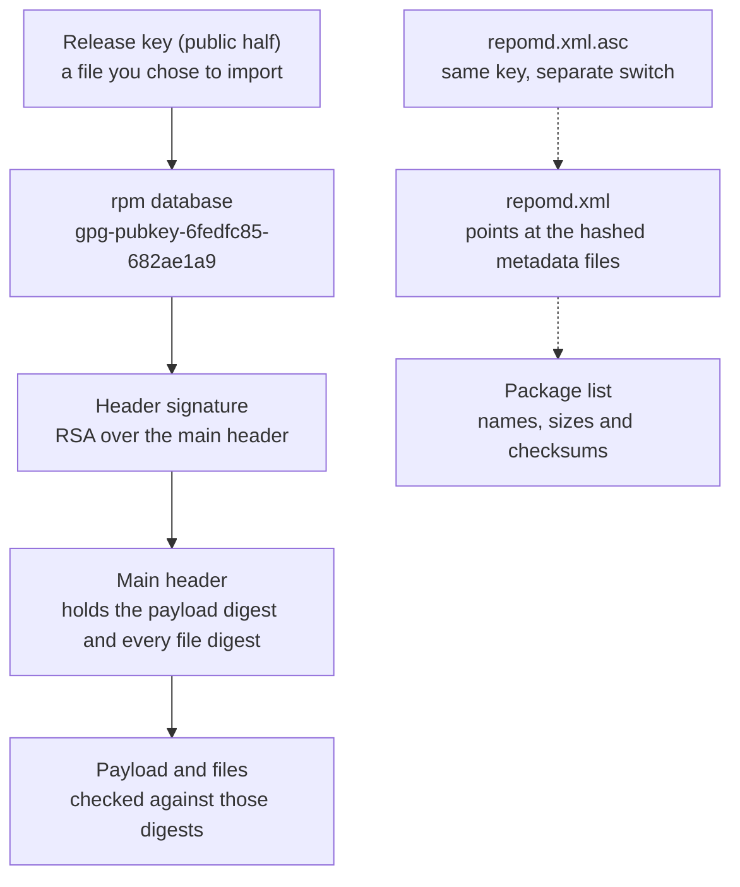
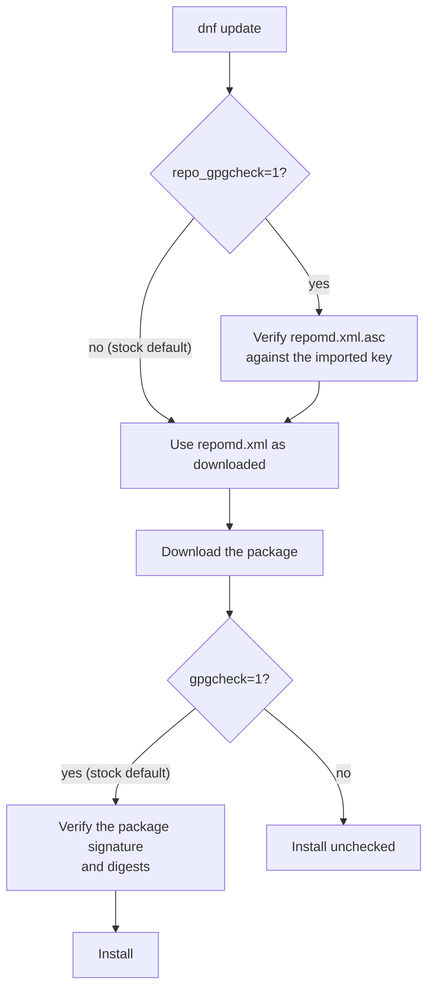
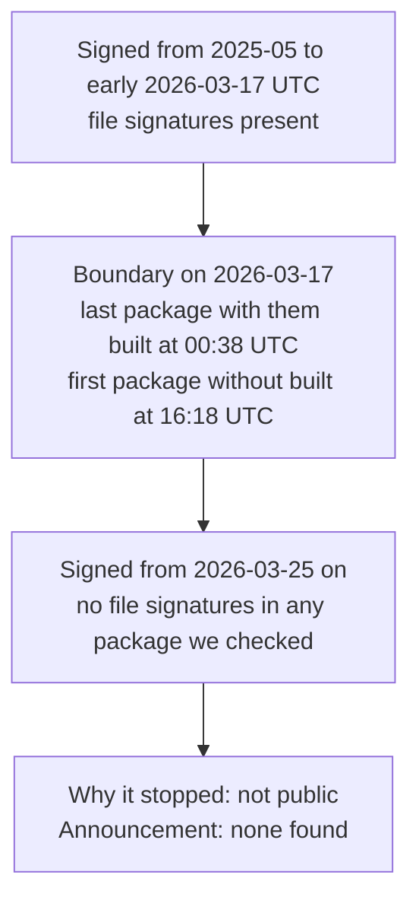

# 47 · Trust I: signatures and keys

<ul class="module-meta">
  <li>⏱ ~3 hours</li>
  <li>4 labs</li>
  <li>Builds on: 05 · Software: RPM and DNF, 21 · Inside Rocky Linux, 33 · TLS, Certificates and Crypto Policies, 41 · Anatomy of a package</li>
  <li>Environment: Tier A</li>
  <li>Verified: Rocky 10.2, 2026-11-06</li>
</ul>

Take a Rocky package, change one byte inside its payload, and run `rpm -Kv`. The first line still says `Header V4 RSA/SHA256 Signature, key ID 6fedfc85: OK`. A few lines lower it says `Payload SHA256 digest: BAD`. Both lines are telling the truth, and knowing why is the difference between reading a green check mark and knowing what it proves.

In [module 41](41-anatomy-of-a-package.md) you opened a package. Here you break one, then follow the signature back to the key, the key back to the file Rocky publishes, and the file back to the one thing nobody can check for you. By the end you can say exactly what a green `rpm -K` proves, what it never did, and which of Rocky's trust claims you can verify with a shell and which you take on trust.

<div class="pipeline-strip" data-here="sign" role="group" aria-label="Rocky build pipeline, six stages" markdown>

1. Source
2. Build
3. Sign
4. Compose
5. Publish
6. Install

</div>

*You are here: Sign (stage 3 of 6). Before: Build. After: Compose.*

!!! abstract "What you'll learn"
    - Read `rpm -Kv` line by line and say which bytes each line protects.
    - Tell NOKEY from BAD from a clean result, and say what to do in each case.
    - Break a package three different ways in a container and predict the verdict before you run it.
    - Name Rocky's 8, 9 and 10 release keys, and explain why there are two different files called `RPM-GPG-KEY-Rocky-10`.
    - Explain why GnuPG 2.4 cannot read the newer key file and what `rpm` and `dnf` do with it.
    - State what `repo_gpgcheck` does, that stock Rocky leaves it off, and what happened to users who turned it on.
    - Count IMA file signatures in a package and describe the 2026-03-17 cut-over without guessing a cause.
    - Sort the trust chain into what you can verify yourself and what you must trust.

## The big picture

A Rocky package is signed once, by a build step that runs hours after the build. Your machine checks that signature against a public key it already holds. The check is exact, and it is narrow: it tells you which key vouched for which bytes, and nothing about whether to trust the key, the build or the source.

This module is about the width of that "narrow". You will see the signature and three kinds of digest, then the keys, then two more layers (repository metadata and IMA file signatures) that exist next to the package signature, and last the parts of the chain nobody outside the project can inspect.

!!! tip "Remember from module 21"
    - The RSA signature covers the main header only. The payload is protected by a digest stored inside that signed header.
    - The key file `RPM-GPG-KEY-Rocky-10` exists in two versions: one RSA certificate (1,688 bytes on 2026-11-06) and a newer one with a second, post-quantum certificate (18,586 bytes on 2026-11-06).
    - Stock Rocky repository files set `gpgcheck=1` but do not set `repo_gpgcheck`.

    This module adds the measured evidence, the failure modes and the open questions. If those three lines are new to you, read the "Signatures" section of [module 21](21-inside-rocky-linux.md) first.

### Signatures in one sentence

> **A signature says one key vouched for these bytes; trust is whatever keys you chose to import.**

Everything in this module hangs off that sentence. "One key" means a key pair: the private half stays with the signer, the public half is a file anyone can hold. "These bytes" is the part that surprises people, because it is less than the whole package. "You chose to import" is the part nobody can do for you: your `rpm` database trusts every key in it equally, for every package.

!!! analogy "Think of it like a wax seal on a parcel"
    A seal proves who sealed the parcel and that the seal is unbroken. It does not prove the sender is honest, that what is inside is good, or that the seal you recognise is the one the sender really uses. Where the analogy breaks: this seal covers the parcel's contents list, and the list carries a fingerprint of each item, so the seal protects the contents indirectly.



The solid path is what `rpm` checks on every package: your imported key verifies the header signature, the header holds the digests, and the digests cover the payload and the files. The dotted path is the repository layer: a second signature, made by the same key, over the metadata that lists the packages. Stock Rocky does not ask `dnf` to check it.

### The few things that solve most problems

| Situation | What to do | Where this module teaches it |
|-----------|-----------|------------------------------|
| `rpm -K` or `dnf` says NOKEY | The key is not in your rpm database. Verify its fingerprint, then import it. Never disable the check. | NOKEY, BAD or fine |
| `rpm -Kv` says BAD on any line | Something changed after signing, or the download is damaged. Fetch again, compare mirrors. | NOKEY, BAD or fine |
| `gpg --show-keys` fails on the Rocky 10 key | You have the two-certificate file and GnuPG 2.4. Read the first certificate with `sed`. | Two key files |
| dnf fails with a metadata signature error | `repo_gpgcheck` is on and the metadata signature does not match. Clear the cache and retry. | The repository layer |
| A scanner or auditor asks "is it signed?" | Show the signing time, the key ID and the fingerprint, and say which key you trust. | The keys |
| A package has no IMA file signatures | Expected for anything signed after 2026-03-17. It is not tampering. | IMA file signatures |

To pick one: start with the first line of `rpm -Kv`. OK, NOKEY and BAD are three different situations, and the decision tree below sends each to its own fix.

### Words you'll see

| Word | Plain meaning |
|------|---------------|
| **signature** | A number made with a private key over some bytes. Anyone with the public key can check it. |
| **digest** | A short fixed-size fingerprint of some bytes (SHA-256 here). A digest alone proves nothing about who made it. |
| **key ID** | The last 32 or 64 bits of a key's fingerprint, used as a short label. `6fedfc85` and `5b106c736fedfc85` are the same key. |
| **fingerprint** | The full 40-hex-digit identity of an OpenPGP v4 key. The thing to compare. |
| **NOKEY** | The signature is well formed but no key with that ID is in your rpm database. Not a failure of the package. |
| **BAD** | A key was found, the check ran, and the answer was no. |
| **`gpg-pubkey`** | A pseudo-package in the rpm database for each imported key. Its version is the short key ID. |
| **`repo_gpgcheck`** | A dnf option that checks the signature on the repository metadata. Separate from `gpgcheck`. |
| **IMA** | The kernel's Integrity Measurement Architecture. Packages can carry one signature per file for it to check at run time. |
| **v6 key** | A newer OpenPGP key format (RFC 9580). GnuPG 2.4 cannot read it. |

## The core skill: reading rpm -Kv

The thing to learn first is how to read the verdict. `rpm -Kv` prints one line per check. Read them top to bottom and ask one question per line: which bytes does this protect, and who could have changed them?

```console
$ rpm -Kv bash-5.2.26-6.el10.x86_64.rpm
bash-5.2.26-6.el10.x86_64.rpm:
    Header V4 RSA/SHA256 Signature, key ID 6fedfc85: OK
    Header SHA256 digest: OK
    Header SHA1 digest: OK
    Payload SHA256 digest: OK
    MD5 digest: OK
```

Rocky 10.2 x86_64, 2026-11-06. A good Rocky 10 package prints exactly these five lines. There is no `ALT` digest line on a good package; you will meet it later, on a damaged one.

| Line | Protects | Who could change it |
|------|----------|---------------------|
| `Header V4 RSA/SHA256 Signature` | The main header (name, files, per-file digests, the payload digest) | Only a holder of the private key |
| `Header SHA256 digest`, `Header SHA1 digest` | The same main header | Anyone, because these digests sit in the signature header, outside the signed part |
| `Payload SHA256 digest` | The compressed payload, through a digest stored in the signed main header | Only a holder of the private key |
| `MD5 digest` | Legacy check over header plus payload | Anyone |

Our reading of that table: the digest lines in the signature header catch accidents such as a bad download, because an attacker who rewrote the file could also rewrite those digests. Only the signature line catches an attacker. That follows from where the tags live, not from a statement in the rpm documentation.

Here is the template. Read the first line for the key and the verdict. If it is OK, the next three lines tell you whether the header and the payload still match what was signed. If it is NOKEY, the other lines still tell you whether the file is intact, but nobody has vouched for it yet. If it is BAD, stop and fetch the file again.

Try three before you read on. Predict the verdict, then open the answer.

**Practice 1.** `rpm -Kv` prints this for a package you just downloaded. What is the state of the package, and what is your next move?

```text
    Header V4 RSA/SHA256 Signature, key ID 6fedfc85: NOKEY
    Header SHA256 digest: OK
    Header SHA1 digest: OK
    Payload SHA256 digest: OK
    MD5 digest: OK
```

??? success "Answer: intact, but nobody you trust has vouched for it yet"
    Every digest is OK, so the bytes are consistent. NOKEY means no key with ID `6fedfc85` is in this rpm database, so the signature could not be checked. Next move: verify the key's fingerprint against a source you trust, import it, and run the check again. This is a missing key, not a damaged package.

**Practice 2.** What does this tell you?

```text
    Header V4 RSA/SHA256 Signature, key ID 6fedfc85: OK
    Header SHA256 digest: OK
    Header SHA1 digest: OK
    Payload SHA256 ALT digest: BAD (Expected 8a1f9e87… != 169cd0c3…)
    Payload SHA256 digest: BAD (Expected 3dc1a77e… != 169cd0c3…)
    DSA signature: NOTFOUND
    RSA signature: NOTFOUND
    MD5 digest: BAD (Expected 6a1f8396… != 49f43278…)
```

??? success "Answer: the header is as signed, the payload is not"
    The signature is OK and the header digests are OK, so the header is exactly what was signed. The payload no longer matches the digest recorded in that header. Either the download was damaged or the file was altered after signing. The signature is still valid because it never covered the payload directly. The two `NOTFOUND` lines are checks for a legacy header-plus-payload signature that Rocky packages do not carry (our reading), and the `ALT` line appears only on a damaged payload in our runs.

**Practice 3.** And this?

```text
    Header V4 RSA/SHA256 Signature, key ID 6fedfc85: BAD
    Header SHA256 digest: BAD (Expected 154b4d16… != 8a6083c9…)
    Header SHA1 digest: BAD (Expected d5be30d4… != 9cc037dc…)
    Payload SHA256 digest: OK
    MD5 digest: BAD (Expected 6a1f8396… != 89f1070c…)
```

??? success "Answer: the header changed, so the signature fails"
    The main header was altered, so the signature over it is BAD and so are the header digests. The payload digest is OK because the payload was untouched. With a BAD signature, `rpm` refuses to read the package at all. Treat it as untrustworthy and fetch it again from a different mirror.

<div class="quiz" data-answer="2" markdown>

You flip one byte inside a package's payload and run `rpm -Kv`. Which line goes BAD?

- `Header V4 RSA/SHA256 Signature`
- `Payload SHA256 digest`
- `Header SHA256 digest`

Right: the payload is protected by a digest stored in the signed header. The signature line stays OK because the header did not change. The signature never covered the payload directly.

</div>

<div class="terminal-sim" data-title="Read a verdict" markdown>

<div class="task" data-expect="rpm -Kv bash-5.2.26-6.el10.x86_64.rpm" data-hint="Verbose check of the downloaded bash package." markdown>

**Step 1.** Check the downloaded `bash` package with the verbose option.

```text
bash-5.2.26-6.el10.x86_64.rpm:
    Header V4 RSA/SHA256 Signature, key ID 6fedfc85: OK
    Header SHA256 digest: OK
    Header SHA1 digest: OK
    Payload SHA256 digest: OK
    MD5 digest: OK
```

</div>

<div class="task" data-expect="rpm --dbpath /tmp/emptydb -Kv bash-5.2.26-6.el10.x86_64.rpm" data-hint="Point rpm at an empty database so it holds no keys." markdown>

**Step 2.** Run the same check against an empty rpm database at `/tmp/emptydb`, so no key is loaded.

```text
bash-5.2.26-6.el10.x86_64.rpm:
    Header V4 RSA/SHA256 Signature, key ID 6fedfc85: NOKEY
    Header SHA256 digest: OK
    Header SHA1 digest: OK
    Payload SHA256 digest: OK
    MD5 digest: OK
```

</div>

<div class="task" data-expect="rpm -q --qf '%{RSAHEADER:pgpsig}\n' bash" data-hint="Ask rpm for the RSAHEADER tag in its pgpsig rendering." markdown>

**Step 3.** Print the installed `bash` signature on one clean line.

```text
RSA/SHA256, Wed 21 May 2025 01:19:52 PM UTC, Key ID 5b106c736fedfc85
```

</div>

<div class="task" data-expect="rpm -qa 'gpg-pubkey*'" data-match="^rpm -qa ['&quot;]?gpg-pubkey" data-hint="List the gpg-pubkey pseudo-packages." markdown>

**Step 4.** List the keys your rpm database trusts.

```text
gpg-pubkey-6fedfc85-682ae1a9
```

</div>

<div class="task" data-expect="grep -c repo_gpgcheck /etc/yum.repos.d/rocky.repo" data-hint="Count the repo_gpgcheck lines in rocky.repo." markdown>

**Step 5.** Count how many `repo_gpgcheck` lines the stock `rocky.repo` sets.

```text
0
```

</div>

</div>

## What one signature covers: header, payload and files

An RPM file is four parts in a row: a 96-byte lead that starts with the magic bytes `edabeedb`, a **signature header**, the **main header**, and the compressed **payload**. Which part protects which is the whole question, so click through the layers.

<div class="layers" data-hint="Click a layer to see what it holds and what protects it." markdown>

<div class="layer" data-label="Payload" data-tag="the files" markdown>

**What it is:** the files, as a compressed archive (zstd for most packages, xz for `kernel-core`).

**Protected by:** a SHA-256 digest recorded in the main header (the `PAYLOADDIGEST` tag). That digest is covered by the signature, so a change here shows as `Payload SHA256 digest: BAD` while the signature line stays OK.

</div>

<div class="layer" data-label="Main header" data-tag="signed" markdown>

**What it is:** name, version, dependencies, the file list, one digest per file (`FILEDIGESTS`), and the payload digest.

**Protected by:** the RSA signature (tag 268, `RSAHEADER`), a v4 OpenPGP signature over this header only. A change here shows as `Signature: BAD`, and `rpm` will not read the package.

</div>

<div class="layer" data-label="Signature header" data-tag="unsigned" markdown>

**What it is:** the signature itself plus the header digests (tags 269 and 273), the legacy MD5 (1004), and for packages signed before 2026-03-17 the per-file IMA signatures (274).

**Protected by:** nothing. It is outside the signed region. Flip a byte inside it and `rpm -Kv` still prints five OK lines. IMA signatures are checked only if a kernel IMA policy asks for them.

</div>

<div class="layer" data-label="Lead" data-tag="96 bytes" markdown>

**What it is:** magic bytes, format version, package type. Legacy.

**Protected by:** nothing. The signature covers the main header only.

</div>

</div>

The layers read top to bottom as a package is laid out from the file's end to its start. The payload is guarded by a digest that lives in the signed main header. The main header is guarded by the signature. The signature header holds the signature and the digests next to it. It guards the main header, and nothing guards it.

Per-file digests deserve a sentence of their own. Every file in the package has a SHA-256 digest in the main header. `rpm -Kv` never looks at them one by one. After installation, `rpm -V PACKAGE` compares them with what is on your disk, which is how you find a binary changed long after the signature was checked ([module 21](21-inside-rocky-linux.md) shows it).

<!-- ev: FACTBASE-C O-03 to O-05; labs/final 02-packages lab1 rerun | observed | Rocky 10.2 x86_64 and aarch64 containers (podman), 2026-11-06 -->
!!! evidence "Observed: three tampers, three different verdicts"
    **Seen on:** Rocky 10.2 containers, x86_64 (emulated) and aarch64, 2026-11-06. Package `bash-5.2.26-6.el10`. Each test inverts every bit of one byte in a copy.

    ```console
    $ flip t-payload.rpm 500000; rpm -Kv t-payload.rpm        # a byte in the payload
        Header V4 RSA/SHA256 Signature, key ID 6fedfc85: OK
        Payload SHA256 digest: BAD (Expected 3dc1a77e… != 169cd0c3…)
    $ flip t-header.rpm 40000; rpm -Kv t-header.rpm            # a byte in the main header
        Header V4 RSA/SHA256 Signature, key ID 6fedfc85: BAD
        Payload SHA256 digest: OK
    $ flip t-sighdr.rpm 12000; rpm -Kv t-sighdr.rpm            # a byte in the signature header
        Header V4 RSA/SHA256 Signature, key ID 6fedfc85: OK
        Payload SHA256 digest: OK
    ```

    **Check it yourself:** Lab 1 runs all three. The relationship to expect: payload change, signature OK and payload BAD; header change, signature BAD and payload OK; signature-header change, everything OK.

The third result is the uncomfortable one. Altering the signature header, including the IMA blobs in it, is invisible to `rpm -K`. If you rely on IMA file signatures, only the kernel's appraisal at run time protects them.

??? question "Under the hood: why `rpm -K` says DIGESTS or SIGNATURES NOT OK"
    `rpm -K` without `-v` collapses everything to one word. On the damaged payload from Practice 2 it prints `DIGESTS SIGNATURES NOT OK`. With `--nosignature` it prints `DIGESTS NOT OK`. With `--nodigest` it prints `SIGNATURES NOT OK`.

    The last one is the confusing case. Our reading: skipping digests still leaves the "SIGNATURES" word because the legacy signature lines that report `NOTFOUND` on this package count as failures. Read the verbose output rather than the summary when two switches are in play.

## NOKEY, BAD or fine

Most trust problems you will meet are one of three verdicts. Before the tree, here is a worked case for the most common one.

### Worked story: dnf refuses a package from your own repository

**Symptom.** You built a package and put it in a repository. On another machine `dnf install` stops with `Error: GPG check FAILED`.

**Evidence.** From the lab in [module 49](49-build-your-own-packages-and-repo.md), run on a Rocky 10.2 x86_64 VM:

```console
$ sudo dnf install myorg-greeter
Public key for myorg-greeter-1.0-1.el10.x86_64.rpm is not installed
Public key for myorg-libgreet-1.0-1.el10.x86_64.rpm is not installed
Error: GPG check FAILED
$ rpm -Kv myorg-greeter-1.0-1.el10.x86_64.rpm
    Header V4 RSA/SHA256 Signature, key ID 80045a5b: NOKEY
    Header SHA256 digest: OK
```

**Reasoning.** The package is signed, intact and unknown. NOKEY means the verifier has no key with that ID. The cause is on the consumer, not in the package: the repository file has `gpgcheck=1` but no `gpgkey=` line, and nobody ran `rpm --import`.

**Fix.** Give the repository a `gpgkey=` pointing at the public key. dnf then asks to import it and prints the fingerprint.

```console
Importing GPG key 0x80045A5B:
 Userid     : "MyOrg Lab Signing <signing@lab.example>"
 Fingerprint: 36D6 A283 53A6 E493 A355 7F56 13BF FD4B 8004 5A5B
Key imported successfully
```

**Check.** Run `rpm -Kv` again: the signature line says OK. In that lab the key arrived over plain HTTP, so the fingerprint on that screen was the only protection. If you accept it without comparing it with a copy you got another way, you imported whatever the network handed you.

Plain `rpm` is more forgiving than `dnf` here. On a package with NOKEY, `rpm -i` prints `warning: ...: NOKEY` and goes on to its next check (in our run that was dependency resolution, which stopped a throwaway test for an unrelated reason). `dnf` with `gpgcheck=1` treats the same condition as a hard failure. The default `rpm` verification level is `digest`, so the signature requirement for packages from a repository comes from `dnf`, not from `rpm`.

<div class="decision" markdown>

<div class="node" data-id="start" markdown>

**What does the first line of `rpm -Kv` say?**

<button data-goto="ok">OK</button> <button data-goto="nokey">NOKEY</button> <button data-goto="bad">BAD</button> <button data-goto="none">No signature line at all</button>

</div>

<div class="node" data-id="ok" markdown>

**Signature OK. What do the other lines say?**

<button data-goto="allok">All OK</button> <button data-goto="payloadbad">Payload digest BAD</button>

</div>

<div class="node" data-id="allok" markdown>

**Fine.** A key in your rpm database verified a signature over this package's header, and the payload matches the digest in that header. Now ask the question the green line cannot answer: is that key really Rocky's? Check its fingerprint (the keys section below).

</div>

<div class="node" data-id="payloadbad" markdown>

**The header is as signed, the payload is not.** Fetch the file again, from `dl.rockylinux.org` or a different mirror, and compare sizes. If the second download is also BAD from the same origin, that is worth reporting. Never install it with the check turned off.

</div>

<div class="node" data-id="nokey" markdown>

**NOKEY.** No key with that ID is in your rpm database. Have you compared the key's fingerprint with an independent source?

<button data-goto="verified">Yes</button> <button data-goto="unverified">No</button>

</div>

<div class="node" data-id="verified" markdown>

**Import it and check again.** `sudo rpmkeys --import KEYFILE`, then `rpm -Kv`. If the line now says OK, the package was signed by the key you verified. If it says BAD, treat it as a changed or damaged package.

</div>

<div class="node" data-id="unverified" markdown>

**Verify first.** `gpg --show-keys --with-fingerprint KEYFILE` prints the fingerprint without importing anything. Compare all 40 hex digits with at least one source you did not get from the same place as the file. Then import. Do not use `--nogpgcheck` to move on.

</div>

<div class="node" data-id="bad" markdown>

**BAD.** A key was found and the maths failed. The most common cause is a damaged download or a mirror caught mid-sync. Possible but rare: the package was altered. The output cannot tell you which. Fetch again, preferably from a different source, and compare. A package that is BAD from two independent sources is a problem for the project to hear about.

</div>

<div class="node" data-id="none" markdown>

**Unsigned.** `rpm -Kv` prints only digest lines when a package carries no signature, which is what a package you just built looks like before `rpmsign`. If it came from a Rocky repository, something is wrong. If you built it, sign it, or accept that it is unsigned.

</div>

</div>

The tree is a summary, not a script: the next sections tell you how to do the verifying it asks for.

## Signing is a separate event, hours after the build

A signature is not part of the build. The build produces a package with digests. A later step adds the signature, and that step has its own timestamp. You can see both on any package.

<!-- ev: FACTBASE-A O24; labs/final w47 dos.sh | observed | Rocky 10.2 x86_64 container, 2026-11-06 -->
!!! evidence "Observed: the signature is hours after the build"
    **Seen on:** Rocky 10.2 x86_64 container, 2026-11-06, package `which-2.21-44.el10_0`.

    ```console
    $ rpm -qp --qf 'built  %{BUILDTIME:date}\nsigned %{RSAHEADER:pgpsig}\n' which-*.rpm
    built  Wed Aug  6 06:54:42 2025
    signed RSA/SHA256, Wed Aug  6 15:19:43 2025, Key ID 5b106c736fedfc85
    ```

    **Check it yourself:** run the command on any Rocky 10 package. The two times differ. The gap is hours for this package, and it varies by package.

The signing time is the date in the `Signature` value, not a build date. For `bash` it is more than six months after the build: the Rocky 10.0 release set was built in 2024 and signed in a batch on 2025-05-21. For `kernel-core-6.12.0-211.74.1.el10_2` on x86_64, the build finished on 2026-11-05 and the signature was added about five hours later.

Note the two key identifiers in this module's output. `rpm -Kv` prints `key ID 6fedfc85` (the low 32 bits). `%{RSAHEADER:pgpsig}` prints `Key ID 5b106c736fedfc85` (the low 64 bits). Both are the tail of the same fingerprint, `…6FED FC85`. A short ID is a label for finding the key in the database, not an identity, so the thing to compare when you verify a key is the full fingerprint.

`rpm -qi` has one more quirk on Rocky 10. The `Signature` value is on the line after its label, so `rpm -qi bash | grep Signature` prints only the label. Use the `--qf` form for one clean line.

```console
$ rpm -qi bash | grep Signature
Signature   :
$ rpm -q --qf '%{RSAHEADER:pgpsig}\n' bash
RSA/SHA256, Wed 21 May 2025 01:19:52 PM UTC, Key ID 5b106c736fedfc85
```

Rocky 10.2 x86_64, 2026-11-06. The first command prints the label only; the value is on the next line of `rpm -qi` output.

??? version "Comparison lens: one OpenPGP signature or two"
    Rocky writes one OpenPGP signature on each package, the header signature. Other builds in the same family write that one and, on many packages, a second legacy signature over header plus payload. Observed 2026-11-06 on four x86_64 cloud hosts at different patch levels, on the package `which`, by counting entries of the `%{OPENPGP}` tag (a count, not a comparison of quality):

    | Distribution | `%{OPENPGP}` entries on `which` | Signed after build (which) | Release key created |
    |---|---|---|---|
    | Rocky 10.2 | 1 | about 5 to 9 hours | 2025-05-19 |
    | RHEL 10.2 | 2 | about 3 days | 2009-10-22 |
    | AlmaLinux 10.2 | 2 | about 3 hours | 2024-07-11 |
    | CentOS Stream 10 | 2 on older packages, 1 on newer | about 3 days | 2019-05-03 |

    The second signature is the legacy header-plus-payload one (tag 1002, `SIGPGP`). Rocky has none. All four use RSA signatures on packages today. **Check it yourself:** `rpm -qp --qf '[%{OPENPGP}\n]' FILE.rpm | grep -c .` counts entries on any host (the tag prints a base64 blob, so count lines).

<!-- ev: labs/V5 section 3b; FACTBASE-C O-36 | observed | four x86_64 cloud hosts, 2026-11-06 -->
!!! freshness "As of 2026-11-06 on Rocky 10.2"
    Every Rocky-signed package sampled carries exactly one OpenPGP signature, an RSA header signature. On one Rocky host, 516 of 518 installed packages carried the Rocky release key; the other two were third-party kernel-module packages signed with their own key. This changes when Rocky changes how it signs (see the post-quantum key below).

    **Re-check:** `rpm -qa --qf '%{RSAHEADER:pgpsig}\n' | grep -o 'Key ID .*' | sort | uniq -c`

## The keys: Rocky 8, 9 and 10

Rocky has one release key per major version, and none has been rotated. You need the fingerprint for the major version you run, because that is the thing you compare. The page `https://rockylinux.org/keys` lists them. On 2026-11-06 it showed these RSA release keys.

| Release | Fingerprint | Created | Notes |
|---------|-------------|---------|-------|
| Rocky 8 | `7051 C470 A929 F454 CEBE 37B7 15AF 5DAC 6D74 5A60` | 2021-02-14 | rsa4096, no expiry |
| Rocky 9 | `21CB 256A E16F C54C 6E65 2949 702D 426D 350D 275D` | 2022-05-09 | rsa4096, no expiry, user ID "Rocky Enterprise Software Foundation - Release key 2022" |
| Rocky 10 | `FC22 6859 C086 0BF0 DDB9 5B08 5B10 6C73 6FED FC85` | 2025-05-19 | rsa4096, no expiry, user ID "Release Engineering (Rocky Linux 10)" |

In a census of 26,844 Rocky 10 package headers (2026-11-06) every one carried this one key ID, across packages signed from 2025-05 to 2026-11. The same key signs the packages, the repository metadata and the ISO checksum files. Our reading: that is convenient, and it also means one compromised key would break all three channels at once.

When you import a key, `rpm` records it as a pseudo-package named after the short key ID and the creation time.

```console
$ rpm -qa 'gpg-pubkey*' --qf '%{NAME}-%{VERSION}-%{RELEASE} %{SUMMARY}\n'
gpg-pubkey-6fedfc85-682ae1a9 Release Engineering (Rocky Linux 10) <releng@rockylinux.org> public key
```

Rocky 10.2 container, 2026-11-06. The release part, `682ae1a9`, is the key's creation time in hex seconds since 1970, which decodes to 2025-05-19 07:45:45 UTC. That is how you read the age of a key from its `gpg-pubkey` name.

<!-- ev: rockylinux.org/keys fetched 2026-11-06; FACTBASE-C 3.2 | official | rockylinux.org key page, 2026-11-06 -->
!!! freshness "As of 2026-11-06 on Rocky 10.2"
    Rocky's key page lists the RSA release keys for 8, 9 and 10 and does not list the post-quantum certificate described below. None of the three release keys has an expiry and none has rotated since it was created. This changes only if Rocky rotates a key or edits the page.

    **Re-check:** `curl -sL https://rockylinux.org/keys | grep -c 'FC22 6859 C086 0BF0 DDB9 5B08 5B10 6C73 6FED FC85'`

## Two key files with one name, and a certificate GnuPG cannot read

There are two different files called `RPM-GPG-KEY-Rocky-10`, and which one you hold depends on where you fetched it and which version of `rocky-gpg-keys` you have.

| Where | Size and date | What it holds |
|-------|---------------|----------------|
| `https://dl.rockylinux.org/pub/rocky/RPM-GPG-KEY-Rocky-10` (repo-root file) | 1,688 bytes, 2025-05-30 | One RSA certificate |
| `https://dl.rockylinux.org/pub/rocky/10/BaseOS/<arch>/os/RPM-GPG-KEY-Rocky-10` (tree file) | 18,586 bytes, 2026-09-01 | Two certificates: the RSA key, then a post-quantum key |
| `https://dl.rockylinux.org/pub/rocky/10/RPM-GPG-KEY-Rocky-10` | HTTP 404 | Nothing: the file is not there |
| `/etc/pki/rpm-gpg/RPM-GPG-KEY-Rocky-10` from `rocky-gpg-keys-10.2-1.1` | 1,688 bytes | The one-certificate file |
| `/etc/pki/rpm-gpg/RPM-GPG-KEY-Rocky-10` from `rocky-gpg-keys-10.2-1.2` | 18,586 bytes | The two-certificate file |

On 2026-11-06 the Rocky 10 container and cloud images shipped version 1.1 and the repository carried 1.2. After `dnf update`, the file on your disk silently becomes the larger one. The first certificate in the larger file is byte for byte the whole of the smaller file.

<!-- ev: FACTBASE-C O-12, ERRATA key file table; labs/final w47 t2.sh | observed | Rocky 10.2 aarch64 container and curl, 2026-11-06 -->
!!! evidence "Observed: the same name, two different files"
    **Seen on:** Rocky 10.2 aarch64 container, 2026-11-06.

    ```console
    $ curl -sI https://dl.rockylinux.org/pub/rocky/RPM-GPG-KEY-Rocky-10 | grep -iE '^(HTTP|content-length)'
    HTTP/2 200
    content-length: 1688
    $ curl -sI https://dl.rockylinux.org/pub/rocky/10/BaseOS/aarch64/os/RPM-GPG-KEY-Rocky-10 | grep -iE '^(HTTP|content-length)'
    HTTP/2 200
    content-length: 18586
    $ curl -sI https://dl.rockylinux.org/pub/rocky/10/RPM-GPG-KEY-Rocky-10 | head -1
    HTTP/2 404
    ```

    **Check it yourself:** Lab 3 fetches both and counts the certificate blocks with `grep -c 'BEGIN PGP PUBLIC KEY BLOCK'`: 1 in the small file, 2 in the large one.

<!-- ev: FACTBASE-C 3.2 and 3.3; ERRATA key file rows | observed | curl and dnf download, 2026-11-06 -->
!!! freshness "As of 2026-11-06 on Rocky 10.2"
    The two files above are what the origin served and what `rocky-gpg-keys` 1.1 and 1.2 install. Images that still carry 1.1 keep the small file until they update. This changes when Rocky edits either file, replaces the image, or moves the package forward.

    **Re-check:** `rpm -q rocky-gpg-keys; wc -c /etc/pki/rpm-gpg/RPM-GPG-KEY-Rocky-10`

### The second certificate

The second certificate in the large file is a post-quantum key: OpenPGP version 6, algorithm ML-DSA-87 plus Ed448, created 2026-08-11. Its fingerprint is `E33684D4 2EBBA43F CB7D2CC3 C0F472FC 3280EB2F 3A6F3850 C23212DB ECF449E0` (32 bytes, where a v4 fingerprint is 20).

```console
$ sq inspect key-tree.asc | grep -E 'Fingerprint|Public-key algo|Creation time'
      Fingerprint: FC226859C0860BF0DDB95B085B106C736FEDFC85
  Public-key algo: RSA
    Creation time: 2025-05-19 07:45:45 UTC
      Fingerprint: E33684D42EBBA43FCB7D2CC3C0F472FC3280EB2F3A6F3850C23212DBECF449E0
  Public-key algo: ML-DSA-87+Ed448
    Creation time: 2026-08-11 11:36:18 UTC
```

Rocky 10.2 aarch64 container with `sequoia-sq` 1.4.0.1, 2026-11-06. The two certificates share one user ID and are certified only by themselves: nothing in the file ties the second to the first. Your confidence in the second certificate is exactly your confidence in the file that carried it.

A release engineer wrote in a forum thread about the August 2026 tool breakage that the key was added "in preparation for doing RPM signing with it in a later point release". That is the only public statement of purpose we found. It gives no date and no format.

<!-- ev: FACTBASE-A I4; labs V5 | official | forums.rockylinux.org thread 20744, read 2026-11-06 -->
!!! evidence "Stated by the project: the new key is for later RPM signing"
    **Seen on:** Rocky forum thread 20744, read 2026-11-06. A release engineer says the post-quantum key was added in preparation for later RPM signing, and that the manifest listing the key file's hash was not updated to match.

    **Check it yourself:** open `https://forums.rockylinux.org/t/20744`. Then run `rpm -qp --qf '%{RSAHEADER:pgpsig}\n'` on any new package: every package we checked is RSA-signed.

All packages are still signed with the RSA key. The post-quantum certificate exists in the file; no package carries a signature from it. What `rpm` verifies today is unchanged by the second certificate.

### What reads the file and what does not

<!-- ev: FACTBASE-C O-10, O-11, ERRATA E3; labs/final w47 t2.sh t3.sh lab3.sh | observed | Rocky 10.2 containers and a macOS host with GnuPG 2.5.24, 2026-11-06 -->
!!! evidence "Observed: GnuPG 2.4.5 rejects the file, 2.5.24 skips the second certificate"
    **Seen on:** Rocky 10.2 containers (GnuPG 2.4.5, rpm 4.19.1.1, dnf 4.20.0) and a macOS host (GnuPG 2.5.24), 2026-11-06.

    ```console
    $ gpg --quiet --show-keys --with-fingerprint key-tree.asc        # GnuPG 2.4.5
    gpg: packet(6) with unknown version 6
    gpg: read_block: read error: Invalid packet
    gpg: import from 'key-tree.asc' failed: Invalid keyring
    $ sed -n '1,/END PGP/p' key-tree.asc | gpg --quiet --show-keys --with-fingerprint
    pub   rsa4096 2025-05-19 [SCE]
          FC22 6859 C086 0BF0 DDB9  5B08 5B10 6C73 6FED FC85
    $ gpg --show-keys --with-fingerprint key-tree.asc                # GnuPG 2.5.24, macOS
    pub   rsa4096 2025-05-19 [SCE]
          FC22 6859 C086 0BF0 DDB9  5B08 5B10 6C73 6FED FC85
    ```

    **Check it yourself:** Lab 3 reproduces the first two. On GnuPG 2.5.24 the exit status is 0 and the second certificate is not listed; `gpg --list-packets` shows `version 6, algo 31` followed by `unknown algorithm 31`.

The failure on 2.4.5 is the whole file. GnuPG 2.4 is the version in Rocky 10, so a plain `gpg --show-keys /etc/pki/rpm-gpg/RPM-GPG-KEY-Rocky-10` fails on a fully updated system. The `sed` form reads only the first certificate and works everywhere. GnuPG 2.5.24 does not fail: it quietly lists one certificate, so a script that counts `pub` lines will report one and stay silent about the second.

`rpm` is different. `rpmkeys --import` takes both certificates, and the rpm database then holds two pseudo-packages.

```console
$ rpmkeys --dbpath /tmp/scratchdb --import key-tree.asc
$ rpm --dbpath /tmp/scratchdb -qa 'gpg-pubkey*' --qf '%{NAME}-%{VERSION}-%{RELEASE}\n'
gpg-pubkey-6fedfc85-682ae1a9
gpg-pubkey-2ebba43f-6a7b0932
```

Rocky 10.2 aarch64 container, 2026-11-06. The second name decodes to 2026-08-11 11:36:18 UTC.

What `dnf` does on first use is easy to check. On the x86_64 and the aarch64 container image (dnf 4.20.0-22.el10_2.rocky.0.1), with `rocky-gpg-keys` 1.2 installed and the key removed from the database, `dnf -y install bc` printed two import prompts, one per certificate, and both `gpg-pubkey` packages appeared. A throwaway installroot on the x86_64 lab VM gave the same result: `gpg-pubkey-6fedfc85` and `gpg-pubkey-2ebba43f` both landed. An independent re-run on 2026-11-07 UTC (same VM, same dnf build, `gpgkey=file://` pointing at the 18,586-byte tree file, `bc` installed with `--installroot` into a directory that was deleted afterwards) printed two import blocks again. One earlier test on an aarch64 container recorded only the first certificate, so treat the number of certificates dnf imports as something to re-check on your own build. Lab 3 shows you how.

??? question "Under the hood: what does an older rpm do with a v6 certificate?"
    Our container and VM runs used rpm 4.19.1.1, which reads OpenPGP through `rpm-sequoia` and understood both certificates. What an older rpm on a Rocky 8 or 9 machine does with the second armored block in the file is not tested here, and no public source we found says. Do not copy the 1.2 key file onto older systems and assume it works.

### How to verify a fingerprint out of band

"Out of band" means through a channel the attacker who gave you the file does not also control. For Rocky's RPM keys, be honest about how much of one exists. The practical procedure is to compare four things, in this order.

1. **The file you will use.** `gpg --quiet --show-keys --with-fingerprint FILE`, with the `sed` filter if the file has two certificates. Read all 40 hex digits.
2. **The key page.** Compare with `https://rockylinux.org/keys`. Rocky's own guidance is to compare the fingerprint this way.
3. **A second path.** Fetch the key from the repo-root URL and from a repo tree, and from the installed package. Their first certificate has to agree. They all come from Rocky, so this finds mistakes and tampering in one path, not a compromised origin.
4. **A copy you saved earlier, or a colleague's.** A key file kept from a machine installed before today, or a fingerprint a colleague read from their own system. This is the closest thing to out of band, and it only helps if it predates the question.

Every one of those ends at content delivered by `rockylinux.org` and `dl.rockylinux.org` over TLS. We found no independently published fingerprint for the RPM release keys. That is the single anchor under everything in this module, and it is the first entry in the trust column below.

<div class="quiz" data-answer="3" markdown>

You run `gpg --show-keys /etc/pki/rpm-gpg/RPM-GPG-KEY-Rocky-10` on a fully updated Rocky 10 machine and it fails with `packet(6) with unknown version 6`. What is the right reading?

- The file is corrupted; reinstall `rocky-gpg-keys`
- The key was revoked
- GnuPG 2.4 cannot read the second, v6 certificate in the file; read the first with `sed -n '1,/END PGP/p'`

Right: the file is fine. The failure is GnuPG 2.4 meeting a v6 key. `rpm` reads both certificates without complaint.

</div>

### Worked story: a key file that broke a mirror tool

**Symptom.** In August 2026, Katello syncs of Rocky 10 repositories failed. The checksum recorded for `RPM-GPG-KEY-Rocky-10` in `extra_files.json` did not match the file.

**Evidence.** The file's hash began `be8c4f07` in the manifest and `7f517e9c` on disk. Those are the two key files: 1,688 bytes and 18,586 bytes. We reproduced both prefixes on 2026-11-06 with `sha256sum`.

**Reasoning.** The new file replaced the old one under the same name, and the manifest that pinned the hash was not regenerated. A tool that pins a hash is right to refuse a file that does not match. Per the forum thread, the first fix updated only the top-level manifest and each repository's own manifest needed updating too.

**Fix.** The project updated the manifests, in two rounds, in the `os` directories of 10.2. The thread notes that the kickstart trees still carry the original key file.

**Check.** `sha256sum` the file you fetch and compare with the manifest. The lesson is wider than this tool: any consumer that pins a key file's hash will break the day the file changes, even when the change is benign.

## The repository layer: repomd.xml.asc and repo_gpgcheck

Package signatures say nothing about the repository that told you to fetch the package. That is the job of the metadata signature. Rocky signs `repomd.xml`, the small file that points at all the other metadata, and publishes the signature next to it as `repomd.xml.asc`. The signature is regenerated on every sync and it verifies against the same release key.

<!-- ev: FACTBASE-C O-13; labs/final w47 lab2.sh | observed | Rocky 10.2 x86_64 container, 2026-11-06 -->
!!! evidence "Observed: repomd.xml.asc exists and verifies"
    **Seen on:** Rocky 10.2 x86_64 container, 2026-11-06, BaseOS x86_64.

    ```console
    $ gpg --verify repomd.xml.asc repomd.xml
    gpg: Signature made Fri Nov  6 08:04:40 2026 UTC
    gpg:                using RSA key FC226859C0860BF0DDB95B085B106C736FEDFC85
    gpg: Good signature from "Release Engineering (Rocky Linux 10) <releng@rockylinux.org>" [unknown]
    gpg: WARNING: This key is not certified with a trusted signature!
    gpg:          There is no indication that the signature belongs to the owner.
    Primary key fingerprint: FC22 6859 C086 0BF0 DDB9  5B08 5B10 6C73 6FED FC85
    ```

    **Check it yourself:** Lab 2 runs it. `[unknown]` and the warning are expected: GnuPG has no web of trust here. What matters is that the primary key fingerprint on the last line matches the one you verified.

Whether `dnf` uses that signature is a separate switch, `repo_gpgcheck`, and stock Rocky leaves it off.



The diagram shows two independent switches. `repo_gpgcheck` guards the metadata and is off by default. `gpgcheck` guards each package and is on by default. A modified package still fails `gpgcheck`. What the off switch leaves open is a replayed or filtered metadata file, for example one that hides a newer version.

<!-- ev: FACTBASE-C O-14, RED-TEAM row 9; labs/final w47 t2.sh | observed | Rocky 10.2 container, rocky-repos-10.2, 2026-11-06 -->
!!! freshness "As of 2026-11-06 on Rocky 10.2"
    The stock repository files (`rocky.repo`, `rocky-addons.repo`, `rocky-devel.repo`, `rocky-extras.repo`, `rocky-security.repo`) set `gpgcheck=1` and contain no `repo_gpgcheck` line. This changes only if `rocky-repos` changes.

    **Re-check:** `grep -c repo_gpgcheck /etc/yum.repos.d/rocky*.repo`

You can turn the check on for one run without editing anything.

```console
$ dnf --setopt=baseos.repo_gpgcheck=1 -y --disablerepo='*' --enablerepo=baseos makecache
Rocky Linux 10 - BaseOS                         264 kB/s | 1.6 kB     00:00
Importing GPG key 0x6FEDFC85:
 Userid     : "Release Engineering (Rocky Linux 10) <releng@rockylinux.org>"
 Fingerprint: FC22 6859 C086 0BF0 DDB9 5B08 5B10 6C73 6FED FC85
 From       : /etc/pki/rpm-gpg/RPM-GPG-KEY-Rocky-10
Rocky Linux 10 - BaseOS                          32 MB/s |  45 MB     00:01
…
Metadata cache created.
```

Rocky 10.2 x86_64 container, 2026-11-06. On the first run dnf imports the key into its own store and prints the usual import block, and after that a pass prints nothing about the signature. If your `gpgkey=` points at the two-certificate file described below, expect a second import block for the post-quantum certificate: a throwaway-installroot run on 2026-11-07 UTC printed one for `0x2EBBA43F` right after this one. Because of that cached key, a failure test with a wrong key is easy to muddy: clear dnf's cache first.

Two more notes. Repositories from the SIG area are not metadata-signed: the `repomd.xml.asc` under `sig/10/core/` returns 404, and SIG packages are signed one by one with SIG keys. For ISOs, the project signs a checksum file, not the ISO: `Rocky-10.2-x86_64-boot.iso.CHECKSUM.asc` returns 200 and `Rocky-10.2-x86_64-boot.iso.asc` returns 404 (checked 2026-11-06). The ISO is covered only through the checksum file it is listed in.

### Worked story: dnf says Bad GPG signature on the repository metadata

**Symptom.** In March 2026, Rocky 9 users reported that `dnf update` failed on the BaseOS repository: `Failed to download metadata for repo 'baseos': repomd.xml GPG signature verification error: Bad GPG signature`. The forum thread ran from 2026-03-20 to 2026-03-24 ([thread 20300](https://forums.rockylinux.org/t/20300)).

**Evidence.** The key import prompt showed the correct Rocky 9 fingerprint, so the key was right. A release engineer described it as a problem with the repodata signing, not the package signing, and later said it was resolved. The staff workaround in the thread was to set `repo_gpgcheck=0`.

**Reasoning.** Two checks exist and only one failed. The package signature check, `gpgcheck`, was fine. The metadata signature check, `repo_gpgcheck`, was failing. Our reading: the people who saw it had `repo_gpgcheck` switched on, since stock Rocky leaves it off (the `rocky.repo` of `rocky-repos` 9.0, 9.3, 9.5, 9.7 and 9.8 has no such line, checked 2026-11-07 UTC) and a workaround that sets it to 0 only helps someone who had it at 1. A global `repo_gpgcheck=1` in `/etc/dnf/dnf.conf` would do it too. The thread does not say how it got switched on. Earlier threads in 2023 and 2024 describe the same class, where `repomd.xml` had changed without a matching new `.asc`. The root cause of the March 2026 case was not published.

**Fix.** Clear the cache and retry, or point the repository at the primary origin. Never turn off `gpgcheck` to cure a `repo_gpgcheck` error: it is a different control, and turning it off throws away the one that was working.

**Check.** `gpg --verify repomd.xml.asc repomd.xml` on a fresh download from the origin either passes or does not. A pass means the origin's pair is consistent right now; if dnf still fails, suspect a cached or stale mirror copy.

<div class="quiz" data-answer="2" markdown>

You set `repo_gpgcheck=1` and get a metadata signature error. A colleague suggests `dnf --nogpgcheck` to get past it. What is wrong with that?

- Nothing, it is the same check
- It disables the package signature check, which was not the one failing, so it removes the working control and leaves the broken one alone
- It works only on Rocky 9

Right: `gpgcheck` guards packages and `repo_gpgcheck` guards metadata. They are separate. The right fix is on the metadata side: clear the cache, verify the `.asc` by hand, switch the mirror.

</div>

## IMA file signatures: present, then absent

The package signature protects the package as a file. **IMA** (the kernel's Integrity Measurement Architecture) protects each file after installation. A package signed for IMA carries one signature per regular file, in the signature header (tag 274), and `rpm-plugin-ima` writes each one into the file's `security.ima` extended attribute when the package is installed. A kernel running an IMA appraisal policy can then refuse to run a file whose signature does not verify.

Nothing checks them by default on Rocky 10: the kernel is built with IMA, but no IMA policy is active in the stock configuration (on the lab VM on 2026-11-07 UTC the kernel config had `CONFIG_IMA=y` and `CONFIG_IMA_APPRAISE=y`, and `/sys/kernel/security/ima/policy` was empty). The signatures sit in the package and in the attribute and wait for a policy.

You can count them on any package, and the count changes with the signing date.

```console
$ rpm -qp --qf '[%{FILESIGNATURES}\n]' bash-5.2.26-6.el10.x86_64.rpm | grep -c .
124
$ rpm -qp --qf '[%{FILESIGNATURES}\n]' kernel-core-6.12.0-211.74.1.el10_2.x86_64.rpm | grep -c .
0
$ rpm -qp --qf '[%{FILESIGNATURES}\n]' dnf-4.20.0-22.el10_2.rocky.0.1.noarch.rpm | grep -c .
0
```

Rocky 10.2 x86_64 container, 2026-11-06. `bash` was signed on 2025-05-21 and has a signature for each of its 124 regular files. `dnf` was signed on 2026-05-20 and the kernel on 2026-11-05, and neither has any.



The diagram shows a cliff, not a slope. Packages signed up to early on 2026-03-17 UTC carry per-file signatures. Packages built later that day and signed from 2026-03-25 on carry none. Nothing in the evidence explains the cut.

<!-- ev: FACTBASE-C O-17, O-18, ERRATA E4, COLD-OPEN-VERIFICATION item 2; labs/v4 ima_report | observed | Rocky 10.2 x86_64 container and VM, header census of the Rocky 10 tree, 2026-11-06 -->
!!! freshness "As of 2026-11-06 on Rocky 10.2"
    A header census run on 2026-11-06 read 26,844 x86_64 and noarch package headers: the current 10.2 repositories plus the 10.0 and 10.1 vaults, all versions. The latest build time among packages that carry file signatures is early on 2026-03-17 UTC (00:38) and the earliest build time among file-bearing packages without them is later that day (16:18). Of the 6,774 file-bearing packages signed on or after 2026-03-25 in that census, none had tag 274. We did not re-run the census for this page; we re-ran single packages. A reviewer's 30-package sample on 2026-11-07 UTC (small x86_64 packages built between 2026-03-12 and 2026-03-26, read from the first 3 MB of each file) agreed: the four built up to 2026-03-15 had file signatures, and the 26 built from 2026-03-17 16:19 UTC on had none. The cut moves only if signing resumes.

    **Re-check:** `rpm -qp --qf '[%{FILESIGNATURES}\n]' PACKAGE.rpm | grep -c .` on a package you just downloaded

An honest edge case: `efi-filesystem` is a package of directories only. It was signed on the old side of the line, and `grep -c .` on it prints 0, because every entry's signature value is empty. For the boundary use `efi-srpm-macros-6-7.el10.rocky.0.1` (signed 2026-03-17, signatures present) and `yggdrasil-0.4.8-3.el10_1` from the 10.1 vault (signed 2026-03-25, none). Lab 4 does exactly that.

??? question "Under the hood: what is inside one IMA signature"
    The first signature in `bash` begins `030204828f8cdc0067 3065…`. Read left to right: type `03` (a digital signature), version `02`, hash algorithm `04` (SHA-256), key ID `828f8cdc`, a two-byte length (`0x0067`, 103), then a DER-encoded ECDSA signature (`30 65 02 30 …`). An earlier openssl check of ours confirmed the curve is P-384 and that the signature verified against the IMA certificate Rocky ships in `rocky-sb-certs` (in the CRB repository). We did not re-run that verification for this page.

### What we can and cannot say

What we found: a sharp cut on one day, the same RSA package-signing key before and after, and no change in how a package verifies with `rpm -K`. The release announcement for 10.0 (2025-06-11) called IMA signing a top priority.

What we did not find: any announcement that it stopped. We searched on 2026-11-06 and found nothing about the signatures stopping in the following places. The Rocky news posts (all of them), the release notes for 10.0, 10.1 and 10.2, the Rocky forum search for IMA, file signatures, fs-verity and integrity measurement for March and April 2026, the `git.resf.org` issue search, and the issue search for the Rocky Linux GitHub organisation. We did not search places that are not public or not reachable to us: chat, mailing lists, and the bug tracker behind a login. So the accurate sentence is "no announcement found", not "never announced".

The certificates are an unknown of their own. Two certificates stand behind the same IMA signing key ID (`828f8cdc`): one in the installer image, issued by "Rocky Linux IMA Intermediate CA" and valid 2025-05-15 to 2026-05-15 (not re-read for this page), and a later one in `rocky-sb-certs` in the CRB repository, issued by "Rocky Linux IMA CA" and valid 2026-03-31 to 2027-03-31 (re-read with `openssl x509` on 2026-11-07 UTC). The root is not shipped, so `openssl verify` of the second reports `unable to get local issuer certificate`. We cannot say why there are two generations, and the evidence does not link the 2026-03-31 reissue to the 2026-03-17 stop.

!!! warning "A package without IMA signatures is not a suspicious package"
    If you run IMA appraisal on Rocky 10, files from packages signed after 2026-03-17 will have nothing to appraise against. On a default system with no IMA policy, nothing changes. The correct response to `0` is "this package was signed after the cut", not "this package was tampered with".

<div class="quiz" data-answer="3" markdown>

`kernel-core-6.12.0-211.74.1.el10_2` has 0 IMA file signatures and `bash` has 124. What does that prove?

- The kernel package is unsigned
- The kernel package was altered after signing
- The two packages were signed on different sides of a change in what Rocky puts in packages; it says nothing about why

Right: the kernel verifies with `rpm -Kv` like any other Rocky package. The count is a property of when it was signed.

</div>

## Containers and the unsigned remainder

Container images are different again. We found no signature or attestation on the current Rocky base image on either registry.

<!-- ev: FACTBASE-C O-45, 3.10; ERRATA E5 | observed | quay.io and Docker Hub registry checks, 2026-11-06 -->
!!! freshness "As of 2026-11-06 on Rocky 10.2"
    The checks we ran found the same image digest on both registries, no cosign signature tag, an empty OCI referrers list and no attestation tags. The tarball form of the image on `dl.rockylinux.org` is covered by a signed `CHECKSUM.asc`; the registry form is not. Whether signing or attestation is planned is not public. This changes when the project signs images.

    **Re-check:** `skopeo inspect --no-tags docker://quay.io/rockylinux/rockylinux:10`

So the signature on an image is whatever you add yourself: a digest you pin and compare, or an image you sign with your own key. Registry and tag alone do not give you a Rocky-signed image.

## What you can verify and what you must trust

Here is the whole picture, split in two. The left column is what a learner with a shell can check end to end today. The right column is what you take on trust, because there is no public way to check it.

| You can verify yourself | You must trust |
|---|---|
| An RPM: `rpm -Kv` checks a signature over the header, header digests, and a payload digest recorded in the signed header | That the fingerprints Rocky publishes are authentic: every path (page, package, mirror, tree) is content from one TLS-delivered origin |
| The key's fingerprint, across the page, the repo-root file, the tree file and the installed package | That Red Hat's sources and Rocky's debranding patches are benign: a reproducible build proves binaries match source, not that source is harmless |
| Repository metadata: `repomd.xml.asc` verifies, and `repo_gpgcheck=1` makes `dnf` check it | That the build hosts did not inject code: we found no SBOM, no provenance attestations, no transparency log, no independent rebuild of Rocky RPMs |
| An ISO's checksum signature: `CHECKSUM.asc` verifies against the same key (the ISO itself is not signed) | That the signing service signed only what it should have: custody, approval and audit trail are not public |
| IMA signatures in packages signed up to 2026-03-17, against the certificate Rocky ships | That the post-quantum certificate and the end of IMA signing mean what they appear to: nothing public explains either |
| Installed files against their package: `rpm -V` compares disk with the digests in the signed header | That the release key has stayed private: it has no expiry and has never rotated, so no date retires it |
| One small package's rebuild: `which` rebuilds to an identical payload with a pinned buildroot and the right `%dist` (modules 45 and 49; one package, one date) | That Microsoft signed only what Rocky submitted (module 48 covers the boot chain) |

Our reading of the right column as a whole: the checks you can make all end at material Rocky itself delivered. They catch a corrupted download, a hostile mirror and a tampered copy. They cannot catch a compromised origin, build host or signing service.

### What a green rpm -K proves, and what it never did

A green `rpm -Kv` proves two things. First, a key in your rpm database whose ID matches the one in the signature verified a signature over this package's main header. Second, the payload (and so every file) still matches the digests recorded in that signed header. Together: these are the bytes the holder of that key signed.

It never proved, and never can prove, any of the following:

- That the key belongs to Rocky. You imported it. The fingerprint check is yours.
- That this is the newest version. An old signed package stays validly signed forever, so replay and downgrade are not caught by `rpm -K`.
- That the source or the build was benign.
- That the repository metadata that led you here was authentic. That is `repo_gpgcheck`, and it is off by default.
- That the signing service signed only what it should have.
- That nothing in the signature header (including IMA blobs) was changed.
- That the files on your disk today still match the package. That is `rpm -V`.

<div class="quiz" data-answer="1" markdown>

Which statement is true of `rpm -Kv` reporting `Header V4 RSA/SHA256 Signature, key ID 6fedfc85: OK` and four more OK lines?

- A key in your rpm database verified a signature over these package bytes, and says nothing about whether you were right to import that key
- The package came from Rocky and the build was audited
- The package is the newest version in the repository

Right: OK is relative to the keys you chose to import. It tells you the bytes are the ones the key holder signed.

</div>

!!! unknown "What nobody outside the project can tell you"
    - Who holds the release keys and how many people can use them. The only custody statement we found comes from a Secure Boot review submission and says the keys it concerns are held in a hardware security module with restricted access; vendor, model and ceremony are not public.
    - Whether Rocky signs packages with classic Sigul or its newer design (siguldry), where the servers run, who approves a signing request, and what the audit trail looks like. The public automation code we read for our fact base refers to Sigul for signing steps; what production runs today is not public.
    - Why IMA file signing stopped on 2026-03-17, whether that was intended, and whether it returns. Not public. Why the IMA release certificate exists in two generations is also not public.
    - What the post-quantum certificate is for beyond a changelog line and one forum statement, whether any package or repository metadata will carry a v6 signature, why the key page does not list it, and why the two key files on the origin differ. Not public.
    - Whether an SBOM, build provenance, transparency log, container signing or independent rebuild exists or is planned for Rocky RPMs and images. We found none. Not public.
    - What an older rpm on Rocky 8 or 9 does with the second certificate in the key file. Not tested.

## Labs

!!! lab "Lab 1: Read a signature, break it three ways"

    - **Tier** A: Rocky shell (a container is enough)
    - **Status** Tested
    - **Time** about 1 minute of commands (60 s measured in an emulated x86_64 container), plus reading
    - **Hardware** any host that runs a Rocky 10 container (tested in a podman VM with 6 vCPU and 3.7 GiB RAM)
    - **Tested on** Rocky 10.2 x86_64 (emulated) and aarch64 containers, podman, 2026-11-06

    **Goal:** See a good verdict, a NOKEY verdict, and three tamper verdicts on the same package, and predict each before you run it.

    **You'll need:** a Rocky 10 container with network access, as root. For example `podman run --rm -it quay.io/rockylinux/rockylinux:10 bash`.

    1. Install the download plugin and fetch the package:

        ```bash
        dnf -y install dnf-plugins-core
        mkdir /w && cd /w
        dnf download bash
        rpm -Kv bash-*.rpm
        ```

    2. Make rpm forget its keys by pointing it at an empty database, and check again:

        ```bash
        mkdir /tmp/emptydb
        rpm --dbpath /tmp/emptydb -Kv bash-*.rpm
        ```

    3. Define a helper that inverts every bit of one byte in a copy, then break three copies. Predict each verdict first.

        ```bash
        B=$(ls bash-*.rpm)
        flip() { cp "$B" "$1"; v=$(od -An -tu1 -j "$2" -N1 "$B"); printf "\\$(printf %03o $((v ^ 255)))" | dd of="$1" bs=1 seek="$2" conv=notrunc 2>/dev/null; sha256sum "$B" "$1" | cut -c1-16; }
        flip t-payload.rpm 500000; rpm -Kv t-payload.rpm
        flip t-header.rpm 40000; rpm -Kv t-header.rpm
        flip t-sighdr.rpm 12000; rpm -Kv t-sighdr.rpm
        ```

    4. Compare the summary wording:

        ```bash
        rpm -K t-payload.rpm; rpm -K --nosignature t-payload.rpm; rpm -K --nodigest t-payload.rpm
        ```

    **Check your work:** `sha256sum` prints two different values for each `flip` (original and copy), so the copy really changed. Then expect: `t-payload.rpm` shows signature OK and `Payload SHA256 digest: BAD`; `t-header.rpm` shows signature BAD and payload OK; `t-sighdr.rpm` shows all five lines OK. The offsets are for `bash-5.2.26-6.el10`; with another package the regions sit elsewhere, so a mismatch means your offset landed in a different part of the file. A NOKEY run in step 2 should leave every digest line OK.

    ??? success "What just happened?"
        The signature covers the main header only. A payload flip leaves the header untouched, so the signature is OK, and the payload digest stored in that header disagrees with the flipped bytes. A header flip breaks the signature and the header digests. The signature header is outside the signed region, so a flip inside it is invisible to `rpm -Kv`. The `DIGESTS` and `SIGNATURES` words in the `rpm -K` summary are confusing; our reading is that the legacy signature lines reporting `NOTFOUND` on a damaged package count towards `SIGNATURES`.

    **Clean up:** exit the container. `--rm` removes it, along with `/w` and `/tmp/emptydb`.

!!! lab "Lab 2: Verify the chain, key to ISO checksum"

    - **Tier** D: network services
    - **Status** Tested partly
    - **Time** about 1 minute of commands (53 s measured in an emulated x86_64 container), plus reading
    - **Hardware** any host that runs a Rocky 10 container (tested in a podman VM with 6 vCPU and 3.7 GiB RAM)
    - **Tested on** Rocky 10.2 x86_64 (emulated) container, 2026-11-06; the optional 1 GiB ISO download in step 6 was not run here

    **Goal:** Compare a key across two sources, verify the repository metadata signature by hand, make dnf check it for one run, and verify the ISO checksum signature.

    **You'll need:** a Rocky 10 container as root, with outbound HTTPS.

    1. Fetch the key and read its fingerprint without importing it. Compare it with the key page; the `grep` prints how many times the page contains the same 40 digits:

        ```bash
        dnf -y install gnupg2 dnf-plugins-core
        mkdir /w && cd /w
        R=https://dl.rockylinux.org/pub/rocky
        curl -sLo key.asc $R/RPM-GPG-KEY-Rocky-10
        gpg --quiet --show-keys --with-fingerprint key.asc
        curl -sL https://rockylinux.org/keys | grep -c 'FC22 6859 C086 0BF0 DDB9 5B08 5B10 6C73 6FED FC85'
        ```

    2. Import the key into a throwaway GnuPG home and verify the BaseOS metadata signature:

        ```bash
        export GNUPGHOME=$(mktemp -d)
        gpg --quiet --import key.asc
        T=$R/10/BaseOS/$(uname -m)/os/repodata
        curl -sO $T/repomd.xml -O $T/repomd.xml.asc
        gpg --verify repomd.xml.asc repomd.xml
        ```

    3. Confirm stock Rocky does not ask dnf to check it, then turn the check on for one run:

        ```bash
        grep -c repo_gpgcheck /etc/yum.repos.d/rocky.repo
        dnf --setopt=baseos.repo_gpgcheck=1 -y --disablerepo='*' --enablerepo=baseos makecache
        ```

    4. Fetch the ISO checksum and its signature and verify them:

        ```bash
        I=$R/10/isos/x86_64
        curl -sO $I/Rocky-10.2-x86_64-boot.iso.CHECKSUM -O $I/Rocky-10.2-x86_64-boot.iso.CHECKSUM.asc
        gpg --verify Rocky-10.2-x86_64-boot.iso.CHECKSUM.asc Rocky-10.2-x86_64-boot.iso.CHECKSUM
        ```

    5. See that the checksum file names the ISO's size, and that no signature file exists for the ISO itself:

        ```bash
        head -1 Rocky-10.2-x86_64-boot.iso.CHECKSUM
        curl -sI $I/Rocky-10.2-x86_64-boot.iso | grep -i content-length
        curl -sI $I/Rocky-10.2-x86_64-boot.iso.asc | head -1
        ```

    6. Optional (untested here, run by the project's earlier checks): download the ISO and run `sha256sum -c Rocky-10.2-x86_64-boot.iso.CHECKSUM`. The download is about 1 GiB.

    **Check your work:** step 1 prints a fingerprint equal to the one on the page and a `grep` count of at least 1. Step 2 prints `Good signature from "Release Engineering (Rocky Linux 10)"` with the same primary key fingerprint; the `[unknown]` trust and the warning are expected. Step 3 prints `0`, then `Metadata cache created.`. Step 4 prints a good signature dated 2026-05-29. Step 5 prints a size line, a `content-length` that equals that size, and `HTTP/2 404` for the `.asc` of the ISO. A mismatch on a fresh download usually means a mirror caught mid-sync or a release that moved the files to the vault; repeat from the origin before suspecting anything else.

    ??? success "What just happened?"
        You checked the same key against two copies, then used it to check a signature on repository metadata that stock dnf never checks, then to check a signature on a checksum file. The ISO is not signed; the signed checksum file vouches for it. Every check ended at content Rocky delivered, which is why none of it is independent of the origin.

    **Clean up:** exit the container. `--rm` removes `/w` and the throwaway GnuPG home.

!!! lab "Lab 3: Fingerprints across paths and the v6 trap"

    - **Tier** A: Rocky shell (a container is enough)
    - **Status** Tested
    - **Time** about 17 seconds of commands (measured in a native aarch64 container), plus reading
    - **Hardware** any host that runs a Rocky 10 container (tested in a podman VM with 6 vCPU and 3.7 GiB RAM)
    - **Tested on** Rocky 10.2 aarch64 container, podman, 2026-11-06; the GnuPG 2.5.24 comparison was run on a macOS host

    **Goal:** Hold both key files, watch GnuPG 2.4 fail on the large one, read it with `sed` and with `sq`, and see what `rpm` and `dnf` do with both certificates.

    **You'll need:** a Rocky 10 container with the stock image's `rocky-gpg-keys` 1.1, as root. Use a throwaway container: step 6 changes the installed key file.

    1. Install the tools and check what the image ships:

        ```bash
        dnf -y install gnupg2 sequoia-sq
        mkdir /w && cd /w
        R=https://dl.rockylinux.org/pub/rocky
        rpm -q rocky-gpg-keys
        wc -c /etc/pki/rpm-gpg/RPM-GPG-KEY-Rocky-10
        ```

    2. Fetch both files under different names and count their certificates:

        ```bash
        curl -sLo key-top.asc $R/RPM-GPG-KEY-Rocky-10
        curl -sLo key-tree.asc $R/10/BaseOS/$(uname -m)/os/RPM-GPG-KEY-Rocky-10
        wc -c key-top.asc key-tree.asc
        for f in key-top.asc key-tree.asc; do grep -c 'BEGIN PGP PUBLIC KEY BLOCK' $f; done
        curl -sI $R/10/RPM-GPG-KEY-Rocky-10 | head -1
        ```

    3. Read them with GnuPG 2.4 and watch the large one fail:

        ```bash
        gpg --version | head -1
        gpg --quiet --show-keys --with-fingerprint key-top.asc
        gpg --quiet --show-keys --with-fingerprint key-tree.asc
        sed -n '1,/END PGP/p' key-tree.asc | gpg --quiet --show-keys --with-fingerprint
        ```

    4. Read both certificates with Sequoia:

        ```bash
        sq inspect key-tree.asc | grep -E 'Fingerprint|Public-key algo|Creation time'
        ```

    5. Import both into a scratch rpm database (this does not touch the real one):

        ```bash
        mkdir /tmp/scratchdb
        rpmkeys --dbpath /tmp/scratchdb --import key-tree.asc
        rpm --dbpath /tmp/scratchdb -qa 'gpg-pubkey*' --qf '%{NAME}-%{VERSION}-%{RELEASE}\n'
        ```

    6. Update the key package (container only), then see which certificates dnf imports on first use:

        ```bash
        dnf -y update rocky-gpg-keys rocky-release rocky-repos
        rpm -q rocky-gpg-keys; wc -c /etc/pki/rpm-gpg/RPM-GPG-KEY-Rocky-10
        sha256sum /etc/pki/rpm-gpg/RPM-GPG-KEY-Rocky-10 key-tree.asc | cut -c1-16
        rpm -e gpg-pubkey-6fedfc85-682ae1a9
        dnf -y install bc 2>&1 | grep -E 'Importing|Fingerprint|imported'
        ```

    7. Optional, on a machine with GnuPG 2.5: run `gpg --show-keys --with-fingerprint key-tree.asc` and `gpg --list-packets key-tree.asc | grep -E 'version 6|unknown algorithm'`.

    **Check your work:** step 1 prints `rocky-gpg-keys-10.2-1.1` and 1688. Step 2 prints 1688 and 18586, then `1` and `2`, then `HTTP/2 404`. Step 3 shows the RSA key for the small file, the three `gpg:` error lines for the large one, and the RSA key again from `sed`. Step 4 lists the RSA key and then an `ML-DSA-87+Ed448` key created 2026-08-11. Step 5 prints two names ending `-682ae1a9` and `-6a7b0932`. Step 6 prints `rocky-gpg-keys-10.2-1.2`, 18586, two equal hash prefixes, and one or two `Importing` blocks depending on your dnf build: on the build we tested it was two. If your result differs from ours, record which dnf you ran; that is the interesting part.

    ??? success "What just happened?"
        The same file name holds two different files. GnuPG 2.4 cannot parse a v6 packet, so it stops on the whole file, and `sed` hides the second certificate. `sq` and `rpmkeys` read both. After `dnf update` the installed file silently becomes the large one, which is why the second certificate matters even if you never downloaded anything by hand. The second certificate has no packages signed by it today.

    **Clean up:** exit the container. `--rm` removes the downloads, the scratch rpm database and the changed key package. Do not run step 6 on a machine you care about.

!!! lab "Lab 4: Find the IMA cut-over from five packages"

    - **Tier** D: network services
    - **Status** Tested
    - **Time** about 1 minute of commands (49 s measured in an emulated x86_64 container), plus reading
    - **Hardware** any host that runs a Rocky 10 container (tested in a podman VM with 6 vCPU and 3.7 GiB RAM)
    - **Tested on** Rocky 10.2 x86_64 (emulated) container, podman, 2026-11-06

    **Goal:** Count IMA file signatures in packages on both sides of 2026-03-17 and read their signing dates, without any census tooling.

    **You'll need:** a Rocky 10 container as root, with outbound HTTPS to `dl.rockylinux.org`.

    1. Download four current packages and one from the 10.1 vault:

        ```bash
        dnf -y install dnf-plugins-core
        mkdir /w && cd /w
        dnf download bash efi-srpm-macros dnf kernel-core
        V=https://dl.rockylinux.org/vault/rocky/10.1/AppStream/x86_64/os/Packages/y
        curl -sfO $V/yggdrasil-0.4.8-3.el10_1.x86_64.rpm
        ```

    2. Count file signatures and print the build and signing times for each:

        ```bash
        for p in bash-5 efi-srpm-macros dnf-4 kernel-core yggdrasil; do
          f=$(ls $p*.rpm)
          echo "$f: $(rpm -qp --qf '[%{FILESIGNATURES}\n]' $f | grep -c .) file signatures"
          rpm -qp --qf '  built  %{BUILDTIME:date}\n  signed %{RSAHEADER:pgpsig}\n' $f
        done
        ```

    3. Look at the first signature's bytes:

        ```bash
        rpm -qp --qf '[%{FILENAMES} %{FILESIGNATURES}\n]' bash-5*.rpm | head -1 | cut -c1-60
        ```

    **Check your work:** `bash` shows a count in the low hundreds (124 on 2026-11-06), signed 2025-05-21. `efi-srpm-macros` shows a small non-zero count (4 on 2026-11-06), signed 2026-03-17. `dnf`, `kernel-core` and `yggdrasil` show 0, signed 2026-05-20, 2026-11-05 and 2026-03-25. The key ID in the signing line is the same for all five. A different count for the first two means a newer build replaced them; what has to hold is non-zero before the line and zero after.

    ??? success "What just happened?"
        The package signature, the RSA header signature, never changed: all five verify with the same key. What changed is whether the signature header also carries per-file IMA signatures, and the dates put the change between the signing of `efi-srpm-macros` and the signing of `yggdrasil`, about eight days apart. A header census (26,844 headers, run 2026-11-06) puts the build-time boundary on 2026-03-17. The cause is not in any public record we found.

    **Clean up:** exit the container. `--rm` removes `/w`.

## Common pitfalls

!!! pitfall "rpm -qi | grep Signature shows nothing"
    On Rocky 10 the `Signature` value is on the line after its label, so the `grep` prints only `Signature   :`. Use `rpm -q --qf '%{RSAHEADER:pgpsig}\n' PACKAGE`.

!!! pitfall "Using --nogpgcheck to get past an error"
    `gpgcheck` guards packages and `repo_gpgcheck` guards metadata. NOKEY, a metadata signature error and a BAD package are three different problems. Disabling the check removes a control and does not fix the cause. Work out which verdict you have first.

!!! pitfall "gpg --show-keys fails on /etc/pki/rpm-gpg/RPM-GPG-KEY-Rocky-10"
    You are on GnuPG 2.4 with the two-certificate file. Read the first certificate with `sed -n '1,/END PGP/p' FILE | gpg --show-keys --with-fingerprint`. A newer GnuPG will not fail, but it will list only one key and say nothing about the other.

!!! pitfall "Fetching the key from the wrong URL"
    `https://dl.rockylinux.org/pub/rocky/10/RPM-GPG-KEY-Rocky-10` returns 404. The repo-root file is `https://dl.rockylinux.org/pub/rocky/RPM-GPG-KEY-Rocky-10`, and the copy in a repo tree is a different, larger file. Check the size and the number of `BEGIN PGP` blocks.

!!! pitfall "Pinning a hash of the key file"
    A mirror or sync tool that records a sha256 of `RPM-GPG-KEY-Rocky-10` breaks when the file changes under the same name, as it did in August 2026. Keep the manifest and the file moving together, or pin the fingerprint instead.

!!! pitfall "Treating the key ID as the identity"
    `6fedfc85` is the low 32 bits of a fingerprint. It is a database label. Compare the full 40 hex digits when you verify a key.

!!! pitfall "Reading missing IMA signatures as tampering"
    A package signed after 2026-03-17 has none. Check the signing time first. A package whose `rpm -Kv` is clean and whose signing time is later than the cut is normal.

## Cheat sheet

| Command | What it does |
|---------|--------------|
| `rpm -Kv FILE.rpm` | Check signature and digests of a package file, line by line |
| `rpm -K FILE.rpm` | One-word summary of the same check |
| `rpm --dbpath /tmp/emptydb -Kv FILE.rpm` | Check with no keys loaded, to see NOKEY |
| `rpm -q --qf '%{RSAHEADER:pgpsig}\n' PACKAGE` | Algorithm, signing time and key ID on one line |
| `rpm -qp --qf 'built  %{BUILDTIME:date}\nsigned %{RSAHEADER:pgpsig}\n' FILE.rpm` | Build time against signing time |
| `rpm -qa 'gpg-pubkey*' --qf '%{NAME}-%{VERSION}-%{RELEASE} %{SUMMARY}\n'` | Keys your rpm database trusts |
| `rpmkeys --import FILE` | Import a key (both certificates of a two-certificate file) |
| `gpg --quiet --show-keys --with-fingerprint FILE` | Read a key's fingerprint without importing it |
| `sed -n '1,/END PGP/p' FILE \| gpg --show-keys --with-fingerprint` | Read only the first certificate (the GnuPG 2.4 workaround) |
| `sq inspect FILE` | Read every certificate in a key file, including v6 |
| `gpg --verify repomd.xml.asc repomd.xml` | Verify repository metadata by hand |
| `dnf --setopt=baseos.repo_gpgcheck=1 -y --disablerepo='*' --enablerepo=baseos makecache` | Make dnf check the metadata signature for one run |
| `rpm -qp --qf '[%{FILESIGNATURES}\n]' FILE.rpm \| grep -c .` | Count IMA file signatures in a package |
| `rpm -qp --qf '[%{OPENPGP}\n]' FILE.rpm \| grep -c .` | Count OpenPGP signatures on a package |

## Facts and freshness

Every dated fact in this module, in one place. The key files, fingerprints, `rpm -Kv` outputs, tamper results, IMA counts, repository and ISO signature checks and the dnf import were run again on 2026-11-07 UTC and agreed with the values below.

| Fact | Value (dated) | Re-check | Stale when |
|------|---------------|----------|------------|
| Rocky 10 release key | `FC22 6859 C086 0BF0 DDB9 5B08 5B10 6C73 6FED FC85`, created 2025-05-19, no expiry (2026-11-06) | `gpg --quiet --show-keys --with-fingerprint FILE` | a key rotation |
| Post-quantum certificate | `E33684D4…ECF449E0`, v6, ML-DSA-87+Ed448, created 2026-08-11, self-certified (2026-11-06) | `sq inspect FILE` | the first package signed with it |
| Repo-root key file | 1,688 bytes, last modified 2025-05-30 (2026-11-06) | `curl -sI https://dl.rockylinux.org/pub/rocky/RPM-GPG-KEY-Rocky-10` | the file is replaced |
| Tree key file | 18,586 bytes, last modified 2026-09-01, two certificates (2026-11-06) | `curl -sI https://dl.rockylinux.org/pub/rocky/10/BaseOS/x86_64/os/RPM-GPG-KEY-Rocky-10` | the file is replaced |
| `rocky-gpg-keys` in the image and in the repo | 10.2-1.1 and 10.2-1.2 (2026-11-06) | `rpm -q rocky-gpg-keys` | new images or 10.3 |
| What packages are signed with | RSA header signature only; one OpenPGP signature (2026-11-06) | `rpm -qp --qf '%{RSAHEADER:pgpsig}\n' FILE.rpm` | the first v6-signed package |
| `repo_gpgcheck` in stock repos | Not set in five repo files (2026-11-06) | `grep -c repo_gpgcheck /etc/yum.repos.d/rocky*.repo` | a `rocky-repos` change |
| IMA file signatures | Present through early 2026-03-17 UTC, none from 2026-03-25 on (2026-11-06) | `rpm -qp --qf '[%{FILESIGNATURES}\n]' FILE.rpm \| grep -c .` | IMA signing resumes |
| Tool versions used here | rpm 4.19.1.1-23.el10, dnf 4.20.0-22.el10_2.rocky.0.1, GnuPG 2.4.5, `sequoia-sq` 1.4.0.1 in the test containers and 1.3.1.1 on the lab VM, with identical `sq inspect` output (2026-11-06 and 2026-11-07) | `rpm -q rpm dnf gnupg2 sequoia-sq` | a minor release |
| What dnf imports from the two-certificate file | Both certificates on the build tested (2026-11-06) | Lab 3 step 6 | a dnf update |
| Container image signing | None found on either registry (2026-11-06) | `skopeo inspect --no-tags docker://quay.io/rockylinux/rockylinux:10` | the project signs images |

## Flashcards

<div class="flashcards" markdown>

<div class="card" markdown>

Which bytes does the RSA signature on a Rocky RPM cover?

The main header only. The payload is protected by a digest stored inside that signed header.

</div>

<div class="card" markdown>

You flip a byte in a package's payload. What does `rpm -Kv` show?

Signature OK, header digests OK, `Payload SHA256 digest: BAD`.

</div>

<div class="card" markdown>

NOKEY or BAD: which means "no key loaded" and which means "the check ran and failed"?

NOKEY is no key loaded. BAD is a check that ran and failed.

</div>

<div class="card" markdown>

What are the two switches in dnf and which one is off by default on Rocky?

`gpgcheck` (packages) is on. `repo_gpgcheck` (metadata) is off.

</div>

<div class="card" markdown>

Why are there two files named `RPM-GPG-KEY-Rocky-10`?

The repo-root file has one RSA certificate (1,688 bytes on 2026-11-06). The tree file and `rocky-gpg-keys` 1.2 have two (18,586 bytes on 2026-11-06), the second a post-quantum v6 key.

</div>

<div class="card" markdown>

What does GnuPG 2.4.5 say about the larger key file, and why?

`packet(6) with unknown version 6`. It cannot parse a v6 key and stops on the whole file. `sed -n '1,/END PGP/p'` reads the first certificate.

</div>

<div class="card" markdown>

What signs Rocky packages today, RSA or the post-quantum key?

RSA. Every package we checked carries one RSA header signature. The post-quantum certificate exists in the file but signs nothing yet.

</div>

<div class="card" markdown>

How do you read a package's IMA signature count, and what does 0 mean?

`rpm -qp --qf '[%{FILESIGNATURES}\n]' FILE.rpm | grep -c .`. 0 means signed after 2026-03-17 (or a package without files), not tampering.

</div>

<div class="card" markdown>

Name two things a green `rpm -K` never proves.

That the key is Rocky's (you imported it), that this is the newest version, that the build or source was benign, that the repository metadata was authentic.

</div>

</div>

## Recap

!!! recap "Key takeaways"
    - A signature says one key vouched for these bytes. Trust is whatever keys you chose to import, and `rpm` trusts them all equally.
    - `rpm -Kv` has one signature line and several digest lines. The RSA signature covers the main header; the payload is covered by a digest inside it; the signature header protects nothing.
    - NOKEY means no key loaded and BAD means a failed check. A NOKEY package can be intact, and NOKEY is never fixed by turning checking off.
    - Rocky has one release key per major version: 8, 9 and 10, none rotated, none expiring. Two different `RPM-GPG-KEY-Rocky-10` files exist, 1,688 and 18,586 bytes, and GnuPG 2.4 cannot read the larger.
    - Every package is still RSA-signed. The v6 post-quantum certificate is in the key file and signs nothing.
    - `repomd.xml.asc` exists and verifies, but stock dnf does not check it, and users who turned `repo_gpgcheck` on were the ones hit in March 2026.
    - IMA file signatures are present in packages signed up to early 2026-03-17 UTC and absent after. No announcement was found and no cause is known.
    - Everything you can verify ends at content Rocky delivered. Compromise of the origin, build hosts or signing service is not detectable from outside.

## Add to your dossier

!!! example "Dossier entry"
    Add a section headed `## 47 · Trust` to `~/dossier/which.md`. In a Rocky 10 container run `dnf -y install dnf-plugins-core && dnf download which`, then paste the output of each command below under it.

    1. `rpm -qp --qf 'built  %{BUILDTIME:date}\nsigned %{RSAHEADER:pgpsig}\n' which-*.rpm`: the key ID, and the signing time against the build time.
    2. `rpm -Kv which-*.rpm`: the five verdict lines.
    3. `rpm -qp --qf '[%{FILESIGNATURES}\n]' which-*.rpm | grep -c .`: how many IMA file signatures it carries.
    4. One sentence in your own words: what does `Key ID` in the first command tell you, and what does it not?

    **A good entry proves:** the signature is a separate, later event than the build, and "OK" names a key you imported, not a person you verified.

## Go deeper

- [[man:rpm(8)]] [[man:rpmkeys(8)]] [[man:rpmsign(8)]] [[man:gpg(1)]]
- [Rocky Linux key page](https://rockylinux.org/keys): the published fingerprints for 8, 9 and 10 (on 2026-11-06 the PQ certificate was not listed there).
- [RPM package file format, version 4](https://rpm.org/docs/latest/manual/format_v4.html): the lead, the two headers and the payload.
- [RFC 9580, OpenPGP](https://datatracker.ietf.org/doc/html/rfc9580): where v6 keys and signatures come from.
- [Rocky 10.0 release announcement](https://rockylinux.org/news/rocky-linux-10-0-ga-release): the statement that IMA signing was a priority.
- [Forum thread 20300](https://forums.rockylinux.org/t/20300) and [thread 20744](https://forums.rockylinux.org/t/20744): the March 2026 metadata signature report and the August 2026 key file report.
- Where this shows up in Rocky's pipeline: signing is a separate step after the build, and the repository metadata is signed during the publish sync. [Module 45](45-pipeline-source-to-build.md) covers the build side and [module 46](46-pipeline-compose-to-your-server.md) the publish side. The next module follows trust into the boot chain.

**Next:** [48 · Trust II: Secure Boot, Module Signing, Reproducibility](48-trust-secure-boot-and-reproducibility.md)

*Verified on Rocky 10.2 (kernel 6.12.0-211.74.1.el10_2), 2026-11-06. Re-verify trigger: 10.3 GA.*
