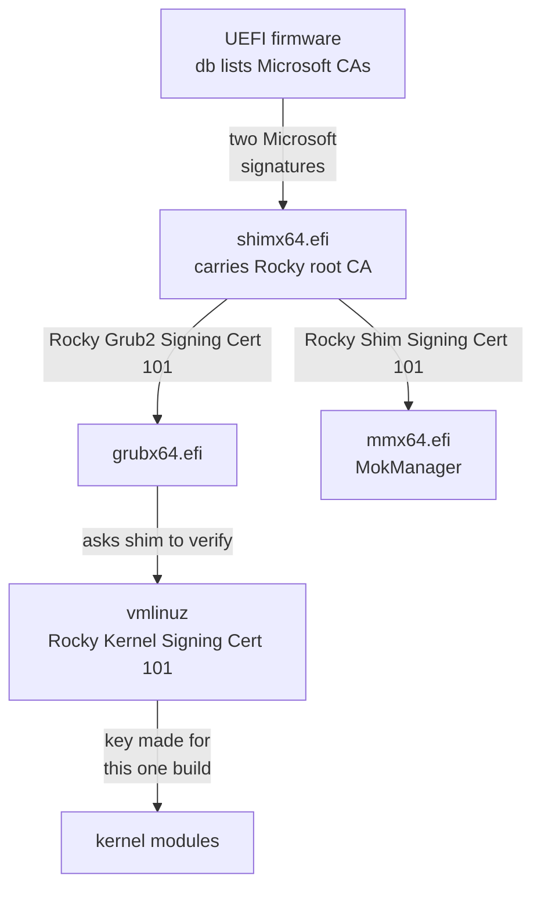
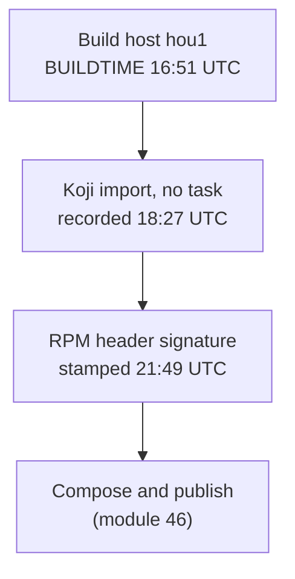
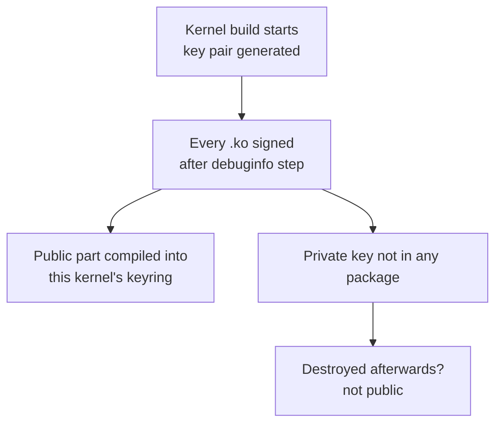

# 48 · Trust II: Secure Boot, module signing, reproducibility, siblings

<ul class="module-meta">
  <li>⏱ ~3 hours</li>
  <li>5 labs</li>
  <li>Builds on: 29 · Secure Boot and Third-Party Drivers, 47 · Trust I: signatures and keys</li>
  <li>Environment: Tier C</li>
  <li>Verified: Rocky 10.2, 2026-11-06</li>
</ul>

On Rocky 10.2 and on RHEL 10.2, `rpm -q bash` prints the same string, `bash-5.2.26-6.el10.x86_64`. Compare the 124 file digests inside the two packages and 123 match. Only `/usr/bin/bash` differs, and the two payload digests are different too. Same version string did not mean same package.

This module asks the same question about the boot path and about rebuilds. Who signed each link from firmware to a loaded module, and how much of it could anyone rebuild and prove identical? You will read the evidence on a real Rocky system, and you will learn to say which statements it supports and which it does not.

<div class="pipeline-strip" data-here="sign install" role="group" aria-label="Rocky build pipeline, six stages" markdown>

1. Source
2. Build
3. Sign
4. Compose
5. Publish
6. Install

</div>

*You are here: Sign (stage 3 of 6) and Install (stage 6 of 6). Before: Build. After: Compose.*

!!! abstract "What you'll learn"
    - Name the signer of each Rocky boot file (shim, GRUB, MokManager, kernel) with `pesign -S` and say which certificate chain it belongs to.
    - Read an SBAT section field by field, and write it to a file so the read actually works.
    - Explain why the kernel's module-signing key belongs to one build, and list the keys a running kernel trusts.
    - Show what kABI and `weak-updates` do for a third-party module, and why such a module has no signer.
    - Rank four kinds of "same" (version, files, payload, RPM file) and say what the `which` rebuild proves.
    - State what nobody outside the project can show about Rocky's signing and build environments.

## The big picture

[Module 29](29-secure-boot-and-drivers.md) explained why a machine boots only signed code. This module reads the chain from the other end: from the files on disk and the package headers back to the certificates and the builds that made them. You can do all of it from a Rocky shell, and none of it needs a private key.

There is a second half. A signature says who vouched for some bytes. It does not say anyone else could have produced the same bytes. That is the question of **reproducibility**, and it comes with its own evidence: the same package name with different files inside, and one small package that could be rebuilt to match exactly.

!!! note "Remember from module 29"
    Firmware trusts Microsoft's signature on shim. Shim carries Rocky's root certificate and checks GRUB and the kernel. The kernel checks every module against its keyrings, and a MOK adds your own key. Microsoft's certificate dates are in [module 29](29-secure-boot-and-drivers.md), with their source, so this module does not repeat them.

### Trust and rebuilds in one sentence

> **Firmware trusts Microsoft's signature on shim, shim trusts Rocky's certificates for everything after it, and the kernel trusts a key made for one build; every link can be read, but none of them promises that anyone can rebuild the same bits.**

Keep the two halves apart in your head. The first half is about *who signed*. The second is about *could it be rebuilt*. A strong answer to one says nothing about the other. The analogy is a notary stamp: it proves who stood in front of the notary, and nothing about whether the document could be written again word for word. It breaks because a signature on a binary also covers the exact bytes, which a notary stamp does not.



The diagram shows one chain with two kinds of signer. Microsoft signs shim. Rocky signs everything after shim with numbered certificates that chain to one Rocky root, and the modules carry a signature from a key that exists only for one kernel build.

### Three signatures on one kernel

A kernel package carries three unrelated signatures. People mix them up constantly, so separate them now.

| Signature | On what | Checked by, and when | Made with |
|-----------|---------|----------------------|-----------|
| RPM header (OpenPGP) | the `kernel-core` package | rpm and dnf, at install | the Rocky 10 release key ([module 47](47-trust-signatures-and-keys.md)) |
| PE signature (Authenticode) | `vmlinuz` inside the package | shim, at every boot | Kernel Signing Cert 101 under the Rocky root CA |
| Module signature (PKCS#7) | each `.ko` file | the kernel, at every module load | a key made for this one kernel build |

### The few things that solve most problems

| Situation | What to do | Where this module teaches it |
|-----------|-----------|------------------------------|
| Someone asks who signed a boot file | `sudo pesign -S -i FILE`, read the common name. "Content is detached" is normal. | The core skill |
| An auditor wants the Secure Boot generation of a binary | Write the `.sbat` section to a file, then read it | The SBAT section |
| A module loads but shows no signer | `modinfo FILE`, then `mokutil --sb-state`, then check `weak-updates` | Third-party modules |
| "Same version, so same binary?" | Compare `PAYLOADDIGEST` and per-file digests, never the version | Reproducibility as a spectrum |
| "Can you reproduce Rocky's build?" | Say which bucket: shipped, rebuilt pinned, rebuilt current | The which result |
| "Is the container signed?" | `skopeo inspect` and `skopeo list-tags`, look for signature tags | Provenance |

To pick a row, ask two questions in order. First, is this about a signature (who vouched) or a rebuild (could it be made again)? Second, which file or package exactly, and which build of it?

### Words you'll see

| Word | Plain meaning |
|------|---------------|
| **PE file** | The Windows-style executable format that UEFI boot files use. `shimx64.efi`, `grubx64.efi` and `vmlinuz` on x86_64 are all PE files. |
| **Authenticode** | The signature format inside a PE file. One file can carry more than one. |
| **leaf certificate** | A short-lived certificate that signs one kind of file, issued under a longer-lived root. |
| **root CA** | The long-lived certificate at the top. Shim has Rocky's embedded. |
| **SBAT** | A small table in a boot file that names the component and its generation number, so old versions can be revoked by number. |
| **kABI** | The list of kernel symbols a vendor promises to keep stable for out-of-tree modules. |
| **weak-updates** | A directory of symlinks that lets a module built for one kernel load on a later compatible kernel. |
| **ephemeral key** | A key made for one purpose and one run, not kept as a standing key. |
| **NVR** | Name, version, release: `which-2.21-44.el10_0`. A claim about sources and release numbering. |
| **PAYLOADDIGEST** | The digest of an RPM's payload. The right test for "same content in the package". |
| **build-id** | A hash stamped into an ELF binary at link time. Different build-ids mean different binaries. |
| **provenance** | A record of what built an artifact from what inputs, on what machine. |

## The core skill: read a signed boot file

You need three commands and one sentence. Ask who signed it, ask which component and generation it claims to be, and ask which package and build it came from. Then say the result in one sentence of the form: "FILE has N signatures, from NAMES, claims component C at generation G, and came from package P built on HOST."

Start with the signer. The `-S` option lists every signature in a PE file.

```console
$ sudo pesign -S -i /boot/efi/EFI/rocky/shimx64.efi
---------------------------------------------
certificate address is 0x7fdb96ceb3e0
Content was not encrypted.
Content is detached; signature cannot be verified.
The signer's common name is Microsoft Windows UEFI Driver Publisher
No signer email address.
No signing time included.
There were certs or crls included.
---------------------------------------------
…
```

Rocky 10.2 x86_64, 2026-11-06. The line "Content is detached; signature cannot be verified." appears for every file you will ever check. It is normal and it is not an error. Filter it away and keep the names.

```console
$ sudo pesign -S -i /boot/efi/EFI/rocky/shimx64.efi | grep -E 'common name|Signing time'
The signer's common name is Microsoft Windows UEFI Driver Publisher
The signer's common name is Microsoft UEFI CA 2023 signer
$ sudo pesign -S -i /boot/efi/EFI/rocky/grubx64.efi | grep -E 'common name|Signing time'
The signer's common name is Rocky Linux Grub2 Signing Cert 101
Signing time: Sun May 24, 2026
$ sudo pesign -S -i /boot/efi/EFI/rocky/mmx64.efi | grep -E 'common name|Signing time'
The signer's common name is Rocky Linux Shim Signing Cert 101
Signing time: Sun May 24, 2026
$ sudo pesign -S -i /boot/vmlinuz-$(uname -r) | grep -E 'common name|Signing time'
The signer's common name is Rocky Linux Kernel Signing Cert 101
Signing time: Sun May 24, 2026
```

Rocky 10.2 x86_64, 2026-11-06, running kernel `6.12.0-211.16.1.el10_2.0.1`. Shim has two Microsoft signatures and no signing time. GRUB, MokManager and the kernel each have one Rocky signature, each from a different numbered certificate.

### Practise: say the sentence

Predict before you open each answer.

**Item A.** You run the same command on `/boot/efi/EFI/rocky/shimx64-rocky.efi`. How many signatures do you expect, and whose?

??? success "Answer A"
    One, from `Rocky Linux Shim Signing Cert 101`, with a signing time of Sun May 24, 2026 (we ran it on 2026-11-06). This file is shim without Microsoft's signature. Our reading of its purpose is that it is meant for firmware that has been taught to trust Rocky's certificate directly. The package does not say so and the project has not described it, so treat the purpose as a hypothesis.

**Item B.** Someone hands you a `grubx64.efi` whose `pesign -S` output names only `Rocky Linux Grub2 Signing Cert 101`. Is that a problem?

??? success "Answer B"
    No. GRUB is loaded by shim, not by the firmware, so it does not need a Microsoft signature. Only the first file the firmware loads (shim) needs one. Each later file needs a signature shim accepts, and Rocky's certificate is embedded in shim for that.

**Item C.** The kernel's PE signature says `Signing time: Sun May 24, 2026`, and the RPM header signature on the same package says `Sun 24 May 2026 10:15:18 PM UTC`. Are those the same event?

??? success "Answer C"
    No. They are two different signatures made with two different keys. The PE signature carries only a date and sits inside `vmlinuz`. The RPM signature carries a full time and sits in the package header. The two dates match here because both happened on the same day, not because they are one signature.

<div class="quiz" data-answer="2" markdown>

`pesign -S` prints "Content is detached; signature cannot be verified." for the kernel. What should you conclude?

- The kernel signature is broken
- Nothing: the tool prints this for every file, so read the signer names instead
- The kernel is unsigned

The line comes from how `pesign` reads the embedded signature, and it appears on shim, GRUB, MokManager and the kernel alike. It is not a verdict. The common name and signing time lines are the evidence.

</div>

## The chain, link by link, with evidence

Module 29 gave you the diagram. Here you will step through the chain and read what each link actually carries.

<div class="stepper" markdown>

<div class="step" data-title="Firmware checks shim" markdown>

The firmware loads `shimx64.efi` from the EFI System Partition and checks its signature against `db`. Rocky's shim carries two Microsoft signatures, one from the 2011 chain and one from the 2023 chain, so it can boot on firmware that trusts either (the source for that statement is in [module 29](29-secure-boot-and-drivers.md); `pesign` itself shows only the two signer names).

```console
$ sudo pesign -S -i /boot/efi/EFI/rocky/shimx64.efi | grep -c 'common name'
2
```

The shim is built by Rocky and then sent to Microsoft for signing after a public review. Lab 5 reads that review.

</div>

<div class="step" data-title="Shim checks GRUB and MokManager" markdown>

Shim has Rocky's root certificate embedded. It uses it to accept `grubx64.efi` and `mmx64.efi`, which carry Rocky signatures from two different numbered leaf certificates.

```console
$ sudo pesign -S -i /boot/efi/EFI/rocky/grubx64.efi | grep 'common name'
The signer's common name is Rocky Linux Grub2 Signing Cert 101
$ sudo pesign -S -i /boot/efi/EFI/rocky/mmx64.efi | grep 'common name'
The signer's common name is Rocky Linux Shim Signing Cert 101
```

</div>

<div class="step" data-title="GRUB asks shim about the kernel" markdown>

GRUB does not verify the kernel itself. It asks shim, which checks the kernel's single signature against the same embedded Rocky certificate.

```console
$ sudo pesign -S -i /boot/vmlinuz-$(uname -r) | grep 'common name'
The signer's common name is Rocky Linux Kernel Signing Cert 101
```

There is no Microsoft signature on the kernel. Microsoft is not involved after shim.

</div>

<div class="step" data-title="The kernel loads its own keys" markdown>

The kernel starts with keys compiled into it. On the Rocky 10.2 kernel there are five, and none of them belongs to Microsoft.

```console
$ sudo keyctl list %:.builtin_trusted_keys | sed 's/.*asymmetric: //'
5 keys in keyring:
Rocky Enterprise Software Foundation: Rocky Linux kernel signing key: ad377a58…
Rocky Enterprise Software Foundation: Rocky Linux IMA Intermediate CA: 01
Rocky Enterprise Software Foundation: Nvidia GPU OOT Signing 101: 816ba9c7…
Rocky Enterprise Software Foundation: Rocky Linux Kpatch Signing Cert 101: b5ee07c7…
Rocky Enterprise Software Foundation: Rocky Linux Driver Signing Cert 101: ce537f0c…
```

</div>

<div class="step" data-title="Every module load is checked" markdown>

Each `.ko` file is checked at load time. The modules Rocky ships name "Rocky Linux kernel signing key" as their signer, which is the name of the first key in that list.

```console
$ modinfo xfs | grep -E '^(signer|sig_hashalgo)'
signer:         Rocky Linux kernel signing key
sig_hashalgo:   sha256
```

Match them by name only. The `sig_key` fingerprint that `modinfo` prints for `xfs` (`1E:24:82:87…`) does not equal the hex string `keyctl` prints for that key (`ad377a58…`). Both are real identifiers and we did not establish how they relate, so do not compare them by eye.

Notice what is not in the five-key list: the certificates that signed `vmlinuz`, GRUB and MokManager. Shim checks those earlier. The kernel's own list is for modules, drivers, live patches and IMA.

</div>

</div>

The stepper shows the chain as five reads. Firmware reads shim, shim reads GRUB and MokManager, shim reads the kernel on GRUB's behalf, the kernel reads its own built-in keys, and the kernel reads each module's signature.

<!-- ev: FACTBASE-C O-22, O-23, O-24; labs/final 06-observations items 7 and 8 and 13 | observed | Rocky 10.2 x86_64 VM, 2026-11-06 -->
!!! evidence "Observed: shim has two signers, everything after it has one Rocky signer"
    **Seen on:** Rocky 10.2 x86_64, 2026-11-06. This AWS image runs with Secure Boot off, so the commands read the signatures and the kernel does not enforce them.

    ```console
    $ mokutil --sb-state
    SecureBoot disabled
    Platform is in Setup Mode
    $ cat /sys/kernel/security/lockdown
    [none] integrity confidentiality
    ```

    **Check it yourself:** run the `pesign -S` commands above on any Rocky 10 system with `pesign` installed. Expect two Microsoft names for shim and one Rocky name for each later file. Secure Boot being off does not change what the files carry.

??? version "Comparison lens: AlmaLinux"
    AlmaLinux signs the kernel, GRUB and MokManager with one certificate named `AlmaLinux Secure Boot Signing`. Rocky uses a separate numbered certificate for each, which limits what one leaked key could sign. Captured on 2026-11-06 from an x86_64 AlmaLinux host; we did not re-run it. **Check it yourself:** run the `pesign` commands on each of the three files on an AlmaLinux system and compare the names.

### The certificates behind the names

The names in `pesign` output are leaf certificates. Rocky ships them, with the root they chain to, in a package called `rocky-sb-certs`, in the CRB repository. You can download the package and read the dates without installing anything.

```console
$ mkdir ~/sbcerts && cd ~/sbcerts
$ dnf download --enablerepo=crb rocky-sb-certs
rocky-sb-certs-10.2-1.2.el10.noarch.rpm         280 kB/s |  59 kB     00:00
$ rpm2cpio rocky-sb-certs-*.rpm | cpio -idm
$ for f in rocky-root-ca rocky-kernel rocky-kernelsecurityupdate; do echo "== $f"; openssl x509 -inform DER -in usr/share/pki/sb-certs/$f.der -noout -subject -dates | sed 's/.*CN=//;s/, emailAddress.*//'; done
== rocky-root-ca
Rocky Linux Secure Boot Root CA
notBefore=Jun 20 15:05:01 2021 GMT
notAfter=Jun 18 15:05:01 2031 GMT
== rocky-kernel
Rocky Linux Kernel Signing Cert 101
notBefore=Mar 31 20:53:23 2026 GMT
notAfter=Mar 31 20:53:23 2027 GMT
== rocky-kernelsecurityupdate
Rocky Linux Kernel Security Update Signing Cert 101
notBefore=May  8 00:46:52 2026 GMT
notAfter=May  8 00:46:52 2027 GMT
```

<!-- ev: FACTBASE-C O-26, O-27; FACTBASE-C 3.7 | observed | rocky-sb-certs 10.2-1.2 on Rocky 10.2 x86_64 VM, 2026-11-06 -->
!!! freshness "As of 2026-11-06 on Rocky 10.2"
    The root CA is valid from 2021-06-20 to 2031-06-18. The numbered leaf certificates (the "101" set) are valid from 2026-03-31 to 2027-03-31, exactly one year. The kernel security update certificate runs from 2026-05-08 to 2027-05-08. Module 29 says the leaves are refreshed each spring by rebuilding the signed packages, so expect a new set (likely a different number) after 2027-03-31. This changes at each yearly refresh, and the root changes only at a rotation.

    **Re-check:** `openssl x509 -inform DER -in usr/share/pki/sb-certs/rocky-kernel.der -noout -dates` after unpacking the current `rocky-sb-certs` package as above.

Notice what the dates do and do not tell you. A leaf that is valid for one year signs a file once, and the file keeps its signature after the leaf expires. Module 29 explains why expiry alone does not stop a boot (firmware has no trustworthy clock at that point). The plan for rotating the leaves and the root is not something the project has published.

## SBAT: how to read a generation line

Every PE file in the chain carries a small table named `.sbat`. Shim reads it before running the file, and each row names a component and a generation number. Shim also keeps a minimum generation per component in firmware variables. Raise the minimum and every older build of that component is refused, without a hash for each one. Module 29 covers why that exists. This section covers how to read the table.

The key detail is how you extract it. Write the section to a regular file. Sending it to `/dev/stdout` through a pipe silently produces nothing.

```console
$ T=$(mktemp -d)
$ sudo objcopy -O binary --only-section=.sbat /boot/efi/EFI/rocky/grubx64.efi /dev/stdout | tr -d '\0' | wc -c
0
$ sudo objcopy -O binary --only-section=.sbat /boot/efi/EFI/rocky/grubx64.efi $T/grub.sbat
$ tr -d '\0' < $T/grub.sbat
sbat,1,SBAT Version,sbat,1,https://github.com/rhboot/shim/blob/main/SBAT.md
grub,5,Free Software Foundation,grub,2.12,https//www.gnu.org/software/grub/
grub.rh,2,Red Hat,grub2,2.12-46.el10_2.rocky.0.1,mailto:secalert@redhat.com
grub.rocky,2,Rocky Linux,grub2,2.12-46.el10_2.rocky.0.1,mail:security@rockylinux.org
```

Rocky 10.2 x86_64, 2026-11-06. The first command printed zero bytes, which is the trap. The section itself is NUL padded, so `tr -d '\0'` removes the padding.

Each row has six fields, as the SBAT document defines them: component name, component generation, vendor name, vendor package name, vendor version, and a URL. Shim compares the first two. The rest are for humans.

```console
$ sudo objcopy -O binary --only-section=.sbat /boot/vmlinuz-$(uname -r) $T/kernel.sbat
$ tr -d '\0' < $T/kernel.sbat
sbat,1,SBAT Version,sbat,1,https://github.com/rhboot/shim/blob/main/SBAT.md
kernel.rocky,1,RESF,kernel-core,6.12.0-211.16.1.el10_2.0.1.x86_64,mailto:security@rockylinux.org
```

Read the kernel row left to right: component `kernel.rocky`, generation `1`, vendor `RESF`, package `kernel-core`, version the full NVRA of the running kernel, contact address. The component name carries the vendor (`kernel.rocky`), so the revocation applies to Rocky's kernels only. GRUB has three rows below the `sbat` header row: the upstream `grub` at generation 5, Red Hat's `grub.rh` at 2, and Rocky's `grub.rocky` at 2. Shim has an upstream `shim,4,UEFI shim,shim,1,...` row and Rocky's own `shim.rocky,3,Rocky Linux,shim,16.1,security@rockylinux.org` (both read from `shimx64.efi` the same way, 2026-11-07 re-check).

<!-- ev: FACTBASE-C O-25; labs/final 06-observations items 9, 10 and 11 | observed | Rocky 10.2 x86_64 VM, 2026-11-06 -->
!!! evidence "Observed: the human-readable SBAT fields are shipped as written"
    **Seen on:** Rocky 10.2 x86_64, 2026-11-06, `grub2-efi-x64-2.12-46.el10_2.rocky.0.1`.

    The GNU URL reads `https//` with no colon, and the Rocky contact reads `mail:` where the kernel row reads `mailto:`. The shim contact has no scheme at all. Only the first two fields are compared, so none of this changes any revocation.

    **Check it yourself:** run the two `objcopy` commands above and compare the last field of each row.

<div class="quiz" data-answer="1" markdown>

In `kernel.rocky,1,RESF,kernel-core,…`, what does the `1` mean?

- The component generation, which shim compares against its stored minimum
- The number of signatures on the file
- The release number of the package

Shim compares the component name and this generation number. If its stored minimum for `kernel.rocky` rises above 1, kernels at generation 1 are refused.

</div>

## Where the signed boot files come from

The boot files you just read are not built the way an ordinary package is. Look at the package headers for the boot-path packages.

```console
$ rpm -q --qf '%{NVRA}\n  built  %{BUILDTIME:date}\n  host   %{BUILDHOST}\n  packager %{PACKAGER}\n  signed %{RSAHEADER:pgpsig}\n' kernel-core-6.12.0-211.74.1.el10_2 shim-x64
kernel-core-6.12.0-211.74.1.el10_2.x86_64
  built  Thu 05 Nov 2026 04:51:17 PM UTC
  host   hou1-build-x86-01.releng.rockylinux.org
  packager Release Engineering <releng@rockylinux.org>
  signed RSA/SHA256, Thu 05 Nov 2026 09:49:17 PM UTC, Key ID 5b106c736fedfc85
shim-x64-16.1-2.el10.x86_64
  built  Sun 24 May 2026 10:19:38 AM UTC
  host   iad1-prod-build001.bld.equ.rockylinux.org
  packager Release Engineering <releng@rockylinux.org>
  signed RSA/SHA256, Sun 24 May 2026 12:19:26 PM UTC, Key ID 5b106c736fedfc85
```

Rocky 10.2 x86_64, 2026-11-06. Two things stand out. The hosts are `hou1` and `iad1`, not the `ord1` hosts that built most of this VM's installed packages. And the packager is `Release Engineering`, not the build-system string you see on ordinary packages. Now ask the public build hub what it recorded for the same builds, next to an ordinary package.

```console
$ python3 -I -c "
import xmlrpc.client as x
s=x.ServerProxy('https://koji.rockylinux.org/kojihub',allow_none=True)
for n in ['kernel-6.12.0-211.74.1.el10_2','shim-16.1-2.el10','openssl-3.5.8-2.el10_2']:
    b=s.getBuild(n); print(n, b['task_id'], b['start_time'], b['completion_time'])
"
kernel-6.12.0-211.74.1.el10_2 None 2026-11-05 18:27:33.839285+00:00 2026-11-05 18:27:33.839285+00:00
shim-16.1-2.el10 None 2026-05-24 10:20:31.772872+00:00 2026-05-24 10:20:31.772872+00:00
openssl-3.5.8-2.el10_2 801106 2026-10-07 23:19:03.995392+00:00 2026-10-08 00:26:14.397554+00:00
```

Rocky 10.2, queried 2026-11-06, anonymous hub, no login. The ordinary package has a task id and a build that took over an hour. The kernel and shim builds have no task, and their start time equals their completion time: they were recorded at one instant, as an import.

<!-- ev: FACTBASE-A O-15; FACTBASE-B O50; ERRATA E12; labs/final 06-observations | inference | Rocky 10.2 x86_64 VM and anonymous Koji hub, 2026-11-06 -->
!!! evidence "Our reading: boot-path builds are made apart and imported by a person"
    **Seen on:** Rocky 10.2 x86_64 and the public Koji hub, 2026-11-06.

    What the data shows: no task, start equals completion, a different build host family, the packager `Release Engineering`, and an owner field that holds an individual account (we do not print it). What we infer: a release engineer imports these builds by hand, from an environment separate from the normal builders. The project has not described that environment.

    **Check it yourself:** run the `getBuild` call above for a kernel and for an ordinary package. The ordinary package shows a task id. The kernel shows `None`.

Follow the kernel through time. On 2026-11-05 the RPM header says the build happened at 16:51:17 UTC. The hub recorded the import at 18:27:33 UTC. The RPM signature is stamped 21:49:17 UTC. Three events, three places, hours apart.



The diagram shows the order of three recorded events for one kernel, all on 2026-11-05 UTC. The Secure Boot signing of `vmlinuz` is not on this line because its time is only a date. Where the Secure Boot private keys live is not public.

## Module signing: a key made for one build

Every module Rocky ships is signed, and the key that signed them was made for that kernel build. That is why a driver you build yourself is unsigned until you or its vendor sign it.

<!-- ev: shim-review README answers; FACTBASE-C 3.7, 3.8; labs/final 06-observations | official | rocky-linux/shim-review submission, read 2026-11-06; modinfo on Rocky 10.2 x86_64 VM, 2026-11-06 -->
!!! evidence "Stated by the project: the module key is ephemeral per kernel build"
    **Seen on:** the Rocky shim-review submission (tag `rockylinux-10-shim-16.1-x86_64-aarch64-NX-20260529`), read 2026-11-06. The submission answers the kernel questions: it is the RHEL kernel, lockdown is forced when Secure Boot is on, and "ephemeral keys per kernel build" are used.

    We can see the effect on a machine that has two kernels installed. Rocky 10.2 x86_64, 2026-11-06:

    ```console
    $ for k in 6.12.0-211.16.1.el10_2.0.1.x86_64 6.12.0-211.74.1.el10_2.x86_64; do modinfo -k $k xfs | grep -E '^(signer|sig_key)'; done
    signer:         Rocky Linux kernel signing key
    sig_key:        1E:24:82:87:11:EB:1E:95:4C:A8:A5:B4:32:2F:EA:F3:72:6C:B8:90
    signer:         Rocky Linux kernel signing key
    sig_key:        21:CD:E5:64:3A:AC:AF:8A:2D:32:63:75:F7:1A:D2:11:71:CB:44:C7
    ```

    **Check it yourself:** run the loop on any Rocky 10 system with two kernels installed. The signer name is the same and the `sig_key` fingerprint is different for each kernel.

Reading the kernel source package, as the fact base for this course did, the spec generates a 3072-bit RSA key from `x509.genkey` during the build, signs each `.ko` after the debuginfo step, and does not put the private key in any package. The public part is built into that one kernel.



The diagram shows a key born at the start of one build, used to sign every module, with its public half built into that kernel. What happens to the private key after the build is not something the public record shows.

On a running system you can see the result:

```console
$ modinfo -F signer xfs
Rocky Linux kernel signing key
$ modinfo btrfs | grep -E '^(filename|vermagic|signer)'
filename:       /lib/modules/6.12.0-211.16.1.el10_2.0.1.x86_64/weak-updates/fs/btrfs.ko.xz
vermagic:       6.12.0-211.7.1.el10_2.x86_64 SMP preempt mod_unload modversions
```

Rocky 10.2 x86_64, 2026-11-06, with a third-party `kmod-btrfs` installed (Lab 2). The `xfs` module has a signer. The `btrfs` module has no `signer:` line at all, and it was built for kernel `211.7.1` while the running kernel is `211.16.1`.

Why does that unsigned module load? On this AWS image Secure Boot is off and the kernel is not built to require signatures (`CONFIG_MODULE_SIG_FORCE` is not set), so it loads without complaint. Turn Secure Boot on and the rules from module 29 apply: an unsigned module is refused until a trusted key signs it.

## Third-party modules: kABI, weak-updates and a MOK

Module 29 showed how to sign your own module and enroll the key. This section adds the part it did not show: how a vendor's prebuilt module survives a kernel update, and what that looks like in the file system.

The **kABI** promise is a list of kernel symbols the vendor keeps stable for out-of-tree modules. Each Rocky kernel package advertises the symbols it provides as RPM provides, and a third-party module package requires them.

```console
$ rpm -q --provides kernel-core-6.12.0-211.74.1.el10_2 | grep -c '^kernel('
13057
$ rpm -qf /usr/sbin/weak-modules
kmod-31-13.el10.x86_64
```

The `weak-modules` script is present on Rocky 10, owned by `kmod`, and the kernel package calls it when a kernel is installed. When a new kernel arrives, the script links compatible modules into the new kernel's `weak-updates` directory.

<!-- ev: FACTBASE-B O49; FACTBASE-C O-47 | observed | Rocky 10.2 x86_64 VM, 2026-11-06 -->
!!! evidence "Observed: one module, two kernels, one symlink each"
    **Seen on:** Rocky 10.2 x86_64, 2026-11-06, a disposable VM with `kmod-btrfs` from the CentOS Kmods SIG installed.

    ```console
    $ ls -l /lib/modules/*/weak-updates/fs/
    /lib/modules/6.12.0-211.16.1.el10_2.0.1.x86_64/weak-updates/fs/:
    lrwxrwxrwx. 1 root root 62 Nov  6 23:01 btrfs.ko.xz -> /lib/modules/6.12.0-211.7.1.el10_2.x86_64/extra/fs/btrfs.ko.xz

    /lib/modules/6.12.0-211.74.1.el10_2.x86_64/weak-updates/fs/:
    lrwxrwxrwx. 1 root root 62 Nov  6 23:01 btrfs.ko.xz -> /lib/modules/6.12.0-211.7.1.el10_2.x86_64/extra/fs/btrfs.ko.xz
    ```

    **Check it yourself:** Lab 2 does this on a disposable VM. After the install, both installed kernels have a link in `weak-updates` that points at the one real file under `extra`.

<!-- ev: FACTBASE-B 3.4 | observed | kernel-core 211.74.1 provides, Rocky 10.2 x86_64 VM, 2026-11-06 -->
!!! freshness "As of 2026-11-06 on Rocky 10.2"
    `kernel-core-6.12.0-211.74.1.el10_2` provides 13057 `kernel(symbol)` entries, and the older `211.16.1.el10_2.0.1` provides 13037. The exact number changes with every kernel update, usually by a few. This changes at each kernel build.

    **Re-check:** `rpm -q --provides kernel-core | grep -c '^kernel('`

Put the pieces together for a driver you do not build yourself:

1. The vendor builds the module against the stable symbols and signs it with their own key (or does not sign it at all).
2. `weak-modules` links it into each later compatible kernel, so it loads without a rebuild.
3. Under Secure Boot the kernel still wants a signature it trusts, so you enroll the vendor's key as a MOK (module 29).

A weak-updates link adds compatibility. It adds no trust. Those are separate questions with separate fixes.

The promise has limits. Red Hat recommends recompiling out-of-tree modules for each minor release, so a module that needs a rebuild after a minor-release upgrade is expected, not an incident.

??? question "Under the hood: what the kABI files look like"
    The `kernel-abi-stablelists` package installs one directory per release under `/lib/modules/` (`kabi-rhel100`, `kabi-rhel101`, `kabi-rhel102`, plus `kabi-current`). The x86_64 list inside carries the header `[rhel9_x86_64_stablelist]` even on EL10, a name inherited from the earlier release. The kernel's `symvers` file lists the symbols and their hashes, and the `kernel(symbol) = 0xhash` provides are what a module package matches against.

<div class="quiz" data-answer="2" markdown>

A vendor's prebuilt module loads on a new Rocky kernel through a `weak-updates` symlink, on a machine with Secure Boot on. It is refused with "unavailable key". What does that tell you?

- The kABI promise was broken
- The module was found and linked, but nobody you trust signed it, so enroll the vendor's key
- `weak-modules` failed to run

A symlink gets the file in front of the kernel. The kernel then checks the signature against its keyrings. Compatibility and trust are separate checks.

</div>

## Reproducibility as a spectrum

"Is it reproducible?" is the wrong question. The useful one is: *same in which sense?* There is a ladder of claims, and each rung proves less than the one below it.

<div class="layers" data-hint="Click a rung to see what it proves and what it does not." markdown>

<div class="layer" data-label="Same name and version" data-tag="NVR" markdown>

**What it claims:** the package has the same name, version and release number. `rpm -q bash` prints `bash-5.2.26-6.el10.x86_64` on Rocky and on RHEL.

**What it proves:** the two packages came from sources with the same version number. Nothing else. The dist tag is part of it: Rocky ships `which-2.21-44.el10_0` and RHEL's matching package is `which-2.21-44.el10`.

</div>

<div class="layer" data-label="Same source" data-tag="spec, SRPM" markdown>

**What it claims:** the recipe is the same. The `which.spec` inside Rocky's source package is byte-identical to the one in RHEL's.

**What it proves:** nobody changed the build recipe. It says nothing about the tools that ran it.

</div>

<div class="layer" data-label="Same file contents" data-tag="FILEDIGESTS" markdown>

**What it claims:** every regular file inside the package has the same digest. `rpm -q --qf '[%{FILEDIGESTS} %{FILENAMES}\n]' PKG | sort` lists them.

**What it proves:** the files on your disk are bit-identical, even if the packages are not.

</div>

<div class="layer" data-label="Same payload" data-tag="PAYLOADDIGEST" markdown>

**What it claims:** the stored payload, as the archive, is identical. File contents, order, modes and times all match.

**What it proves:** the package contents are identical in every way that matters to an install. This is the strongest honest test of "same content".

</div>

<div class="layer" data-label="Same RPM file" data-tag="whole file" markdown>

**What it claims:** the `.rpm` file itself is identical.

**What it proves:** nothing you will ever see. Build time, build host, header digest and the signature are all different for every build event, so two builds never produce the same file. That is why the test sits at payload level.

</div>

</div>

The five layers move from a claim about names down to a claim about archive bytes. Each step down is harder to meet and says more. The last one cannot be met by two separate builds, so the payload is the working ceiling.

Mark one more thing before the evidence: reproducibility is about the bits matching a build, not about the build being good. A perfectly reproducible build proves the binary came from that source. It does not prove the source is harmless. That is our reading of what the technique can claim, not a finding about Rocky.

### What a learner can prove today: the which result

One small package has been rebuilt on Rocky 10.2 x86_64 and compared with the shipped one. The test is `which-2.21-44.el10_0`, rebuilt in a clean build chroot three ways. [Module 45](45-pipeline-source-to-build.md) runs the rebuild as a lab. Here you read the result.

```console
$ mock -r rocky-10-x86_64 --rebuild which-2.21-44.el10_0.src.rpm --resultdir=$PWD/results-current
$ mock -r ~/mockcfg/rocky-10.0-vault-x86_64.cfg --define 'dist .el10_0' --rebuild which-2.21-44.el10_0.src.rpm --resultdir=$PWD/results-pinned
```

The first command rebuilds against today's repositories. The second pins the build root to the Rocky 10.0 vault and sets the dist tag to match the shipped package. The vault config includes the stock mock config, a new root name and repository URLs pointing at the 10.0 vault. Module 45 supplies the file.

<!-- ev: labs/final 01-exact-which compare.log; COLD-OPEN-VERIFICATION 7 | observed | Rocky 10.2 x86_64 VM, 2026-11-06 -->
!!! evidence "Observed: pinned reproduces the payload, current does not"
    **Seen on:** Rocky 10.2 x86_64 VM (4 vCPU), mock 6.9, 2026-11-06. One package, one architecture.

    | | shipped | rebuilt pinned | rebuilt current |
    |---|---|---|---|
    | file name | `which-2.21-44.el10_0` | `which-2.21-44.el10_0` | `which-2.21-44.el10` |
    | `PAYLOADDIGEST` | `0895052a...` | `0895052a...` | `8aefadaa...` |
    | `/usr/bin/which` size | 28464 | 28464 | 28456 |
    | build-id | `44a94a79...` | `44a94a79...` | `400e5750...` |
    | compiler in buildroot | GCC 14.2.1-7 | GCC 14.2.1-7 | GCC 14.3.1-4 |
    | whole `.rpm` sha256 | `da453094...` | `d8ab01f4...` | `a0fe849d...` |

    The pinned and shipped binaries are byte-identical (`cmp` prints nothing). The current rebuild first differs from the shipped file at byte 25. The whole-RPM digest differs in all three, because build time, host and signature differ.

    **Check it yourself:** the `which` lab in module 45, or compare `rpm -q --qf '%{PAYLOADDIGEST}\n' which` on your own system with the shipped value `0895052a...`.

Two inputs decide the result, and the pinned build needs both:

- **The build root.** Today's buildroot carries a newer compiler (GCC 14.3.1 against 14.2.1), so the code section differs.
- **The dist tag.** Without `--define 'dist .el10_0'` the NVR collapses to `el10`. The debug-link name inside the binary contains the NVR, so a different NVR changes the build-id.

We tried the pinned build root without the dist define as a negative test. It gave `PAYLOADDIGEST` `45203a0a...`, different from both the shipped and the current rebuild.

The limits matter as much as the result:

- It is one small C package, built on x86_64. The pinned build on aarch64 is not verified.
- The vault buildroot is the final 10.0 set, not the exact set from the shipped build's day.
- The rebuilt file's mtimes match the shipped ones (`1751328000` in both dumps), because this system's rpm macros clamp file times to the changelog date. On this system `rpm --eval '%source_date_epoch_from_changelog %clamp_mtime_to_source_date_epoch %use_source_date_epoch_as_buildtime'` prints `1 1 0`.

<div class="quiz" data-answer="3" markdown>

You pin the build root to the Rocky 10.0 vault but forget `--define 'dist .el10_0'`. What do you get?

- The shipped payload, byte for byte
- The same payload but a different RPM signature
- A different NVR and a different payload digest, so not the shipped package

Both inputs matter. The dist define changes the NVR, the debug-link name and therefore the build-id. In our negative test the payload digest came out different from both the shipped and the current rebuilds.

</div>

## Same version, different bits

The `which` result is the clean case. Most packages are less tidy, and the comparison between Rocky and RHEL shows three different kinds of "different".

### Worked story: a scanner says the file is not RHEL's

**Symptom.** A compliance tool compares `bash-5.2.26-6.el10` on a Rocky 10.2 host and on a RHEL 10.2 host. The version strings agree. The tool reports that `/usr/bin/bash` has a different checksum and asks whether Rocky shipped a modified bash.

**Evidence.** Compare the packages the way the spectrum says, from the weakest rung down. We captured this on x86_64 hosts on 2026-11-06 (the hosts were at different patch levels). The RHEL lines are a capture we could not re-run.

```console
[rocky]$ rpm -q --qf 'PAYLOADDIGEST=%{PAYLOADDIGEST}\n' bash
PAYLOADDIGEST=3dc1a77e...
[rocky]$ sha256sum /usr/bin/bash
a59fc4da...98fc  /usr/bin/bash
[rhel]$ rpm -q --qf 'PAYLOADDIGEST=%{PAYLOADDIGEST}\n' bash
PAYLOADDIGEST=0db80afc...
[rhel]$ sha256sum /usr/bin/bash
a7178e58...0376  /usr/bin/bash
```

The payload digests differ and so do the main binaries. Next compare all regular files (also captured 2026-11-06): of 124 files with digests, 123 are identical and only `/usr/bin/bash` differs.

**Reasoning.** At least two explanations fit. One: Rocky built bash with a different build root (compiler, libraries) than RHEL, so the ELF differs while the source is the same. Two: Rocky changed something in the build, a patch or a flag. The data cannot separate them, because either would change only the main binary. Two clues lean toward the first. The release is `6.el10` with no `.rocky.0.N` suffix, which is how Rocky marks packages it changed ([module 41](41-anatomy-of-a-package.md)), although the kernel and shim are patched without that marker. And Rocky's bash was built in a Peridot build pod, RHEL's on its own build farm two days earlier (a captured build date, 2024-10-29). What would settle it is a diff of the two source packages and a pinned rebuild of bash, and we ran neither.

**Fix.** There is nothing to fix. State the finding precisely: "the package has the same version string and 123 of 124 identical files; the main binary is different; we have not shown why." Do not say "bit-for-bit RHEL" and do not say "modified".

**Check.** Run the three commands on your system and compare against a RHEL value if you have one. If you cannot, compare against the captured values in Lab 4.

A second case shows a different shape. In `glibc-2.39-145.el10_2`, all 36 file digests are identical between Rocky and RHEL, including `libc.so.6`, but the payload digests differ. The Rocky package was built on 2026-10-19 and the RHEL one on 2026-09-21. The files match and the archive does not, and we did not isolate why.

<!-- ev: FACTBASE-C O-32; labs/v5 dig captures; COLD-OPEN-VERIFICATION 1 | observed | four x86_64 hosts at different patch levels, 2026-11-06 -->
!!! evidence "Observed: three packages, three kinds of difference between Rocky and RHEL"
    **Seen on:** x86_64 hosts at different patch levels, 2026-11-06, as captures. The RHEL host is a paid cloud image, so this is a captured result, not something you can repeat without one. The Rocky `bash` values (payload `3dc1a77e...`, `/usr/bin/bash` `a59fc4da...`, 124 file digests) were re-read on the Rocky VM on 2026-11-07 and match.

    | Package | Files identical | Payload digest | What differs |
    |---|---|---|---|
    | `bash-5.2.26-6.el10` | 123 of 124 | differs | the main binary, and its build-id |
    | `glibc-2.39-145.el10_2` | 36 of 36 | differs | nothing in the files; cause not isolated |
    | `which-2.21-44` (`el10_0` against `el10`) | 9 of 10 | differs | the main binary; different NVR |

    **Check it yourself:** `rpm -q PKG --qf '[%{FILEDIGESTS} %{FILENAMES}\n]' | sort` on each host, then `diff` the two lists. Add `rpm -q --qf '%{PAYLOADDIGEST}\n' PKG` for the payload.

??? version "Comparison lens: AlmaLinux"
    AlmaLinux patches glibc (release `2.39-145.el10_2.alma.1`), and only 7 of the 36 file digests match RHEL's, including a different `libc.so.6`. That difference is by design, because the package is changed. For bash, AlmaLinux differs from RHEL in two files, `bash` and `bashbug-64`. CentOS Stream matches RHEL on all 124 bash files and on the payload digest. Captured on 2026-11-06 from x86_64 hosts at different patch levels; we did not re-run it. **Check it yourself:** the same `FILEDIGESTS` and `PAYLOADDIGEST` commands on each system.

The decision tree below turns this into a habit. Use it whenever someone says "same version".

<div class="decision" markdown>

<div class="node" data-id="start" markdown>

**Do the two packages have the same NVR, including the dist tag?**

<button data-goto="diffnvr">No</button> <button data-goto="payload">Yes</button>

</div>

<div class="node" data-id="diffnvr" markdown>

The NVR differs, so the sources or the build environment differ in at least the release field. Compare the spec files and the SRPMs first. The `which` result shows that even the dist tag alone changes the binary.

</div>

<div class="node" data-id="payload" markdown>

**Do the `PAYLOADDIGEST` values match?**

<button data-goto="same">Yes</button> <button data-goto="files">No</button>

</div>

<div class="node" data-id="same" markdown>

The package contents are identical. For a rebuild you made, that is the strongest result available (the pinned `which`). The `.rpm` files will still differ in header fields.

</div>

<div class="node" data-id="files" markdown>

**Do all per-file digests match?**

<button data-goto="filesame">Yes</button> <button data-goto="filesdiff">No</button>

</div>

<div class="node" data-id="filesame" markdown>

The files on disk are identical and the archive differs (the `glibc` case). The cause is not isolated in our data. Report it as "same files, different archive, cause unknown".

</div>

<div class="node" data-id="filesdiff" markdown>

**Is it the main binary only, or many files?** One binary points at a toolchain or build-root difference (compare build-ids and the buildroot). Many files point at patches. Check the release suffix: `.rocky.0.N` marks a package Rocky changed (module 41).

</div>

</div>

## What can be proved, and what stays trust

So far you have proved things about signatures and about one rebuild. Say what that adds up to, honestly.

You can verify, from public files: the signer of every boot file, the SBAT rows, the certificates and their dates, the module signer, the key list in the kernel, and, for one package, a pinned rebuild. You cannot verify, from public evidence: how the private keys are held, what the Secure Boot build environment does, or whether anything in Rocky's builds was altered, because there is no record you can check it against.

We searched for an SBOM, build provenance (SLSA or in-toto style), a transparency log, container signatures and an independent rebuild of Rocky packages. We found none. That is a statement about what we found on 2026-11-06, not a proof of absence.

One component does have an independent reproduction. Rocky's shim went through the public shim-review process. The submission includes a Dockerfile that builds shim from the source package in a frozen container image and compares the result with the submitted binary, and the reviewers wrote that the builds reproduce on x86_64 and aarch64. Lab 5 reads it. This is stronger than anything else in the pipeline, and it covers shim only.

<!-- ev: FACTBASE-C O-45, 3.10; skopeo run on Rocky 10.2 x86_64 VM | observed | Rocky 10.2 x86_64 VM, 2026-11-06 -->
!!! evidence "Observed: the Rocky container image has no signature or attestation tags"
    **Seen on:** Rocky 10.2 x86_64 VM with skopeo 1.22.2, 2026-11-06.

    ```console
    $ skopeo inspect --no-tags --format '{{.Digest}}' docker://quay.io/rockylinux/rockylinux:10
    sha256:827d37bc128288ccf160ee318bb3cb92d591164cb217e92f8bc61e3982ae1834
    $ skopeo inspect --no-tags --format '{{.Digest}}' docker://docker.io/rockylinux/rockylinux:10
    sha256:827d37bc128288ccf160ee318bb3cb92d591164cb217e92f8bc61e3982ae1834
    $ skopeo inspect --no-tags --raw docker://quay.io/rockylinux/rockylinux:10 | grep -c attestation
    0
    ```

    **Check it yourself:** Lab 3. The same digest on both registries means the same image. Zero attestation entries means no provenance is attached to it.

??? version "Comparison lens: Debian and Fedora"
    Debian publishes reproducibility results for its whole archive, and Fedora has a project goal. Neither tells you anything about Rocky, and the definitions differ (Fedora's excludes signatures and some metadata). Debian's figures come from a daily test that builds each package twice in deliberately varied environments, which is a weaker test than an independent rebuild. This part is secondhand and we did not re-check it.

    <!-- ev: FACTBASE-C 3.11 | unverified | tests.reproducible-builds.org as read for the fact base, 2026-11-06 -->
    !!! freshness "As of 2026-11-06 on Rocky 10.2"
        Reported on that date: 95.9% of 39,854 source packages for the Debian forky amd64 suite, and 94.6% of 41,691 for unstable amd64. The figures change daily and could be higher or lower by the time you look. Fedora's own estimate is about 90%, with 99% as a goal, and we have no dated figure for it.

        **Re-check:** open `https://tests.reproducible-builds.org/` and read the per-suite summary.

## Siblings, in a tight table

Rocky's neighbours make some Rocky choices easier to see. The comparison below is a lens, not a ranking. The Rocky column was re-read on the Rocky VM on 2026-11-07. The other columns are captures from 2026-11-06 that we did not re-run, on hosts at different patch levels, so version-dependent values may differ today.

| What you can read | Rocky 10.2 | RHEL 10.2 | AlmaLinux 10.2 |
|-------------------|-----------|-----------|----------------|
| Signatures on shim | 2 (both Microsoft) | 3 (adds Red Hat's own) | 2 (Microsoft) |
| Certificates for kernel, GRUB, MokManager | 3 numbered certs | 801 and 802 numbered | 1 shared cert |
| Kernel SBAT row | `kernel.rocky,1,RESF` | `kernel.rhel,1,Red Hat` | `kernel.almalinux,1,AlmaLinux` |
| Builtin kernel keys | 5 | 7 | 8 |

??? version "Comparison lens: CentOS Stream"
    CentOS Stream's kernel trusts Red Hat's IMA certificate authority, named `RH-IMA-CA: Red Hat IMA CA`, together with Red Hat's driver-update, kpatch and NVIDIA keys, so its builtin list has 7 keys. Rocky carries its own IMA intermediate CA instead and drops the NVIDIA Jetson and BlueField keys, which is why it has 5. Stream's certificates are numbered like Red Hat's. Captured on 2026-11-06 from x86_64 hosts at different patch levels; we did not re-run it. **Check it yourself:** `sudo keyctl list %:.builtin_trusted_keys` on each system.

??? version "Comparison lens: RHEL"
    RHEL's shim carries a third signature from `Red Hat UEFI Publisher 2024`, besides the two Microsoft ones. Its installed shim package is `16.1-4.el10`, yet its SBAT shim row reads `shim.redhat,3,Red Hat Inc,shim,15.8,secalert@redhat.com`. We did not find out why the version field reads 15.8, so treat that as unexplained and do not read it as the package version. Captured on 2026-11-06 from a paid RHEL cloud image that we could not re-run. **Check it yourself:** `pesign -S` on `shimx64.efi` and the `objcopy` SBAT read on a RHEL system.

## Practice terminal

<div class="terminal-sim" data-title="Read the chain on a Rocky shell" data-prompt="[alex@rocky-lab ~]$ " markdown>

<div class="task" data-expect="mokutil --sb-state||sudo mokutil --sb-state" data-hint="mokutil reports the Secure Boot state." markdown>

**Step 1.** Check whether this machine enforces Secure Boot.

```text
SecureBoot disabled
Platform is in Setup Mode
```

</div>

<div class="task" data-expect="sudo pesign -S -i /boot/efi/EFI/rocky/shimx64.efi||sudo pesign -S -i /boot/efi/EFI/rocky/shimx64.efi | grep 'common name'" data-match="pesign\s+-S\s+-i\s+\S*shimx64\.efi" data-hint="Use pesign -S -i on the shim file under /boot/efi/EFI/rocky." markdown>

**Step 2.** List the signers on shim.

```text
The signer's common name is Microsoft Windows UEFI Driver Publisher
The signer's common name is Microsoft UEFI CA 2023 signer
```

</div>

<div class="task" data-expect="sudo objcopy -O binary --only-section=.sbat /boot/efi/EFI/rocky/grubx64.efi /tmp/grub.sbat" data-match="objcopy\s+-O\s+binary\s+--only-section=\.sbat\s+\S*grubx64\.efi\s+/tmp/\S+" data-hint="objcopy needs a regular file as its last argument, not /dev/stdout." markdown>

**Step 3.** Write GRUB's SBAT section to a file.

```text
(no output: the section is now in /tmp/grub.sbat)
```

</div>

<div class="task" data-expect="tr -d '\0' &lt; /tmp/grub.sbat" data-match="^tr\s+-d\s+\S+\s+&lt;\s+\S+" data-hint="The section is NUL padded. Remove the NULs with tr -d and read the file." markdown>

**Step 4.** Read the SBAT rows.

```text
sbat,1,SBAT Version,sbat,1,https://github.com/rhboot/shim/blob/main/SBAT.md
grub,5,Free Software Foundation,grub,2.12,https//www.gnu.org/software/grub/
grub.rh,2,Red Hat,grub2,2.12-46.el10_2.rocky.0.1,mailto:secalert@redhat.com
grub.rocky,2,Rocky Linux,grub2,2.12-46.el10_2.rocky.0.1,mail:security@rockylinux.org
```

</div>

<div class="task" data-expect="modinfo -F signer xfs" data-hint="modinfo -F prints one field, here the signer." markdown>

**Step 5.** Who signed the `xfs` module?

```text
Rocky Linux kernel signing key
```

</div>

<div class="task" data-expect="rpm -q --qf '%{PAYLOADDIGEST}\n' which" data-match="rpm\s+-q\s+--qf\s+\S*PAYLOADDIGEST\S*\s+which" data-hint="Ask rpm for the PAYLOADDIGEST tag with --qf." markdown>

**Step 6.** Print the payload digest of the installed `which`.

```text
0895052a64e967f475b7f981ff8ba03efa7815fd2e3d1ff4a154a56e820fa4c7
```

</div>

</div>

<div class="quiz" data-answer="2" markdown>

An auditor asks whether Rocky's Secure Boot signing key is held in a hardware security module. What is the correct answer from public evidence?

- Yes, verified: the public submission proves it is in an HSM
- The project states it in one line of its shim-review submission (an HSM with restricted access), but nobody outside can check the design, who approves signing, or how keys are used
- No, it is on the build host

The shim-review submission contains a one-line custody statement naming a hardware security module with restricted access. That is the project's own claim and it is not independently verifiable. The environment's design, who approves signing, and how the keys are used are not published. Report the statement as a statement, and do not fill the gap with a guess.

</div>

!!! unknown "What nobody outside the project can tell you"
    - The plan for rotating the numbered leaf certificates after 2027-03-31 and the root CA before 2031-06-18. The public record shows the dates and the yearly refresh, not the plan. Not public.
    - Whether the private module-signing key is destroyed after each kernel build, and whether the build sets fixed build-user and build-host strings. The project says the keys are ephemeral. Not public.
    - How the separate Secure Boot build environment is designed, and who approves what it signs. Only a brief custody statement exists. Not public.
    - Whether any SBOM, build provenance, transparency log, container signing or independent rebuild of Rocky packages exists or is planned. We found none on 2026-11-06, which is a search result and not a proof. Not public.
    - Which shim version the Microsoft-signed submission covers (16.1-2 or 16.1-3) and when the newer one ships. Not public.

## Labs

!!! lab "Lab 1: Read the Secure Boot chain from files"

    - **Tier** C: root VM
    - **Status** Tested
    - **Time** about 20 to 30 minutes (an estimate, not timed)
    - **Hardware** x86_64 VM with UEFI, 4 vCPU and 15 GiB RAM as tested, no extra disk
    - **Tested on** Rocky 10.2 x86_64 VM, 2026-11-06, Secure Boot off (reads signatures, does not enforce them); re-run by an independent reviewer on 2026-11-07 with the same names, SBAT rows and dates

    **Goal:** Name the signer of shim, GRUB, MokManager and the kernel, read the SBAT rows, and read the certificate dates from the Rocky package.

    **You'll need:** a Rocky 10.2 x86_64 shell with sudo, and the packages `pesign`, `binutils`, `openssl` and `mokutil`.

    1. Install the tools and check the machine state:

        ```bash
        sudo dnf -y install pesign binutils openssl mokutil
        mokutil --sb-state
        ```

    2. List the signers on each boot file, keeping only the names and times:

        ```bash
        for f in /boot/efi/EFI/rocky/shimx64.efi /boot/efi/EFI/rocky/grubx64.efi \
                 /boot/efi/EFI/rocky/mmx64.efi /boot/vmlinuz-$(uname -r); do
          echo "== $f"; sudo pesign -S -i $f | grep -E 'common name|Signing time'
        done
        ```

    3. Write the SBAT sections of GRUB and the kernel to files and read them:

        ```bash
        T=$(mktemp -d)
        sudo objcopy -O binary --only-section=.sbat /boot/efi/EFI/rocky/grubx64.efi $T/grub.sbat
        sudo objcopy -O binary --only-section=.sbat /boot/vmlinuz-$(uname -r) $T/kernel.sbat
        tr -d '\0' < $T/grub.sbat; tr -d '\0' < $T/kernel.sbat
        ```

    4. Download the certificate package and read the dates:

        ```bash
        mkdir ~/sbcerts && cd ~/sbcerts
        dnf download --enablerepo=crb rocky-sb-certs
        rpm2cpio rocky-sb-certs-*.rpm | cpio -idm
        for f in rocky-root-ca rocky-kernel rocky-grub2 rocky-shim rocky-kernelsecurityupdate; do
          echo "== $f"; openssl x509 -inform DER -in usr/share/pki/sb-certs/$f.der -noout -subject -dates | sed 's/.*CN=//;s/, emailAddress.*//'
        done
        ```

    5. Record the build facts of the boot-path packages:

        ```bash
        rpm -q --qf '%{NVRA}\n  built  %{BUILDTIME:date}\n  host   %{BUILDHOST}\n  signed %{RSAHEADER:pgpsig}\n' shim-x64 grub2-efi-x64 kernel-core
        ```

    **Check your work:** shim lists two Microsoft names, and each of GRUB, MokManager and the kernel lists one Rocky name from a different numbered certificate. The kernel SBAT has a `kernel.rocky,1` row, and the GRUB SBAT has `grub.rocky` and `grub.rh` rows. The root certificate ends in 2031 and the leaves end one year after they start. If a file lists a different number of signers, check that you named the right file. If an SBAT read is empty, you wrote to `/dev/stdout` instead of a file.

    ??? success "What just happened?"
        You read signatures and tables out of boot files without running any of them. The names are leaf certificates under one Rocky root, and the dates are in a package you downloaded but did not install. The build facts in step 5 show the boot-path packages come from the `Release Engineering` family of hosts, with the RPM signature hours after the build.

    **Clean up:** `rm -rf ~/sbcerts "$T"`. The installed tools are harmless; remove them with `sudo dnf -y remove pesign mokutil` if you want the machine back as it was.

!!! lab "Lab 2: Modules, keyrings, kABI and weak-updates"

    - **Tier** C: root VM
    - **Status** Tested
    - **Time** about 20 minutes (an estimate, not timed)
    - **Hardware** x86_64 VM, 4 vCPU and 15 GiB RAM as tested, disposable for step 5
    - **Tested on** Rocky 10.2 x86_64 VM, 2026-11-06

    **Goal:** Read a module's signer, list the keys the running kernel trusts, count the kABI symbols, and watch `weak-updates` appear for a third-party module.

    **You'll need:** a Rocky 10.2 x86_64 VM with sudo. Step 5 changes the system, so use a disposable VM for it.

    1. Read the module signer and the lockdown state:

        ```bash
        modinfo xfs | grep -E 'signer|sig_key|sig_hashalgo|vermagic'
        cat /sys/kernel/security/lockdown
        ```

    2. List the keys built into the running kernel:

        ```bash
        sudo dnf -y install keyutils
        sudo keyctl list %:.builtin_trusted_keys | sed 's/.*asymmetric: //'
        ```

    3. Count the kABI symbols the installed kernel provides, and find `weak-modules`:

        ```bash
        rpm -q --provides kernel-core-$(uname -r) | grep -c '^kernel('
        rpm -qf /usr/sbin/weak-modules
        ```

    4. Check the build facts of the kernel package, with the signature time:

        ```bash
        rpm -q --qf '%{NVRA}\n  built  %{BUILDTIME:date}\n  host   %{BUILDHOST}\n  signed %{RSAHEADER:pgpsig}\n' kernel-core-$(uname -r)
        ```

    5. (Disposable VM only.) Install a third-party kernel module and look at the links. Warning: `--nogpgcheck` skips package signature checks and is acceptable only on a throwaway VM, because the SIG key is not imported here:

        ```bash
        sudo dnf -y install centos-release-kmods
        sudo dnf -y install --nogpgcheck kmod-btrfs
        ls -l /lib/modules/*/weak-updates/fs/
        modinfo btrfs | grep -E '^(filename|vermagic|signer)'
        ```

    **Check your work:** `modinfo xfs` shows a signer named "Rocky Linux kernel signing key", and the keyring lists five keys on the 10.2 kernel. The provides count is in the low tens of thousands and changes with each kernel build. After step 5, each installed kernel has a `btrfs.ko.xz` link under `weak-updates` that points at one file under `extra`, and `modinfo btrfs` shows no `signer:` line. If you see no link, the kernel the module was built for may not match yours (read the `vermagic` line).

    ??? success "What just happened?"
        The `xfs` module carries the signature of a key made for this kernel build. The `btrfs` module came from a different vendor, was built for an earlier kernel, and was linked onto yours by `weak-modules`. It has no signer because the vendor did not sign it with a key you or Rocky trust, and it loads here only because Secure Boot is off.

    **Clean up:** `sudo dnf -y remove kmod-btrfs centos-release-kmods`, then `sudo dnf -y remove keyutils` if you installed it only for this lab.

!!! lab "Lab 3: Container provenance with skopeo"

    - **Tier** D: network services
    - **Status** Tested
    - **Time** about 15 minutes (an estimate, not timed)
    - **Hardware** any Rocky shell with outbound access and `skopeo`
    - **Tested on** Rocky 10.2 x86_64 VM, 2026-11-06 (an earlier run was on aarch64); steps 1 to 4 re-run on 2026-11-07 with the same digest, 132 tags and 0 signature-like tags

    **Goal:** Compare the same image on two registries, look for signature or attestation tags, and contrast it with an older image that does carry attestations.

    **You'll need:** a Rocky 10 shell with `skopeo` and `python3`, and network access to `quay.io` and `docker.io`.

    1. Read the digest of tag `10` on both registries:

        ```bash
        skopeo inspect --no-tags --format '{{.Digest}}' docker://quay.io/rockylinux/rockylinux:10
        skopeo inspect --no-tags --format '{{.Digest}}' docker://docker.io/rockylinux/rockylinux:10
        ```

    2. List the tags on Quay and count any that look like signatures or attestations:

        ```bash
        skopeo list-tags docker://quay.io/rockylinux/rockylinux > /tmp/tags.json
        python3 -c 'import json;t=json.load(open("/tmp/tags.json"))["Tags"];print(len(t), sum(1 for x in t if x.startswith("sha256-") or x.endswith((".sig",".att",".sbom"))))'
        ```

    3. Ask for the tag a signing tool would create, and see the registry refuse it:

        ```bash
        skopeo inspect --no-tags docker://quay.io/rockylinux/rockylinux:sha256-827d37bc128288ccf160ee318bb3cb92d591164cb217e92f8bc61e3982ae1834.sig
        ```

    4. Look for attestation entries in the current image and in the old Docker Official Image:

        ```bash
        skopeo inspect --no-tags --raw docker://quay.io/rockylinux/rockylinux:10 | grep -c attestation
        skopeo inspect --no-tags --raw docker://docker.io/library/rockylinux:9.3 | grep -o attestation-manifest | wc -l
        ```

    **Check your work:** step 1 prints the same digest twice (`sha256:827d37bc...` on 2026-11-06). Step 2 prints the tag count followed by `0`. Step 3 fails with `manifest unknown`. Step 4 prints `0` for the current image and a positive number (4 on 2026-11-06) for the old one. If the digests differ, the tag was refreshed since 2026-11-06, which is a normal change and not an error.

    ??? success "What just happened?"
        The current Rocky image has the same content on two registries and nothing attached that proves where it came from. The old Docker Official Image, frozen at 9.3, carries BuildKit attestation manifests. The registry you pull from decides what provenance exists, and the freshest content here has none. We did not test whether another signing system is used out of band, so this shows the absence of the usual signature tags, not of every possible signature.

    **Clean up:** `rm /tmp/tags.json`. Nothing else was created.

!!! lab "Lab 4: Compare Rocky with its siblings (pre-captured transcript)"

    - **Tier** D: network services
    - **Status** Read-along
    - **Time** about 15 minutes to read
    - **Hardware** none beyond a shell
    - **Tested on** captured output from four x86_64 AWS hosts, 2026-11-06 (not re-run, at different patch levels)

    **Goal:** Read how the same package compares across Rocky and three siblings, and learn which commands to run if you have access to each.

    This is a read-along because one of the hosts is a paid RHEL cloud image, which the course cannot give you. The transcript below was captured once. Each host ran the same two commands.

    ```console
    [rocky]$ rpm -q bash
    bash-5.2.26-6.el10.x86_64
    [rocky]$ rpm -q --qf 'PAYLOADDIGEST=%{PAYLOADDIGEST}\n' bash; sha256sum /usr/bin/bash
    PAYLOADDIGEST=3dc1a77e...
    a59fc4da...98fc  /usr/bin/bash
    [rhel]$ rpm -q --qf 'PAYLOADDIGEST=%{PAYLOADDIGEST}\n' bash; sha256sum /usr/bin/bash
    PAYLOADDIGEST=0db80afc...
    a7178e58...0376  /usr/bin/bash
    [alma]$ rpm -q --qf 'PAYLOADDIGEST=%{PAYLOADDIGEST}\n' bash; sha256sum /usr/bin/bash
    PAYLOADDIGEST=e15359b4...
    7eab1847...64f3  /usr/bin/bash
    [stream]$ rpm -q --qf 'PAYLOADDIGEST=%{PAYLOADDIGEST}\n' bash; sha256sum /usr/bin/bash
    PAYLOADDIGEST=0db80afc...
    a7178e58...0376  /usr/bin/bash
    ```

    The first command printed `bash-5.2.26-6.el10.x86_64` on all four hosts. Compare the payload digests and the main binary digests across the four lines, then read this summary of the same data.

    | `bash` against RHEL | Files identical | Payload digest |
    |---------------------|-----------------|----------------|
    | Rocky | 123 of 124 | differs |
    | AlmaLinux | 122 of 124 | differs |
    | CentOS Stream | 124 of 124 | equal |

    **Check your work:** notice that Stream and RHEL share a payload digest and a binary, while Rocky and Alma each differ in the main binary. Notice that the version string told you none of this. If you have a Rocky host and one sibling, run the two commands on both and see which row of the table you land in. The hosts here were at different patch levels, so a fresh run may not match exactly.

    **Clean up:** nothing to clean up.

!!! lab "Lab 5: Read the shim reproduction (read-along)"

    - **Tier** D: network services
    - **Status** Read-along
    - **Time** about 20 minutes to read
    - **Hardware** none beyond a browser
    - **Tested on** text of the project's public submission, read 2026-11-06; nobody here rebuilt shim

    **Goal:** Read how Rocky's shim was independently reproduced during review, and decide what that does and does not show.

    This is a read-along. We read the submission but did not run its build. The repository is `https://github.com/rocky-linux/shim-review`, at the tag `rockylinux-10-shim-16.1-x86_64-aarch64-NX-20260529`. Read three things in it.

    1. The README answers about the kernel and the build. Find the lines saying the kernel is the RHEL kernel, that lockdown is forced when Secure Boot is on, and that ephemeral keys are used for each kernel build.
    2. The x86_64 Dockerfile. It starts from a frozen Rocky shim build image (`quay.io/rockylinux/rockylinux-shim:10`), installs the shim source package (`shim-unsigned-x64-16.1-3.el10.src.rpm`), installs the build dependencies, runs `rpmbuild -bb`, and then compares the result with the submitted binary using `cmp`.
    3. The reviewers' comment on the submission: "shim builds reproduce here for builds on x64 and aa64 with the Dockerfiles provided - OK".

    **Check your work:** decide for yourself what this shows. It shows that, from a pinned container and a source package, two parties got the same unsigned shim bytes. It does not show that the shim on your disk is that exact build, because Rocky 10.2 ships `shim-x64-16.1-2.el10` while the Dockerfile builds 16.1-3. It does not audit the vendor's infrastructure, and it covers shim only, not GRUB or the kernel.

    **Clean up:** nothing to clean up.

## Common pitfalls

!!! pitfall "The SBAT read prints nothing"
    You sent `objcopy` output to `/dev/stdout` through a pipe, so the text vanished. Write the section to a regular file, then run `tr -d '\0' < file`.

!!! pitfall "Treating 'Content is detached' as an error"
    `pesign -S` prints "Content is detached; signature cannot be verified." for every file, good or bad. It is normal. Read the signer names, not that line.

!!! pitfall "Filtering for `Signer` with a capital letter"
    The tool prints `The signer's common name is ...` in lowercase. A `grep Signer` returns nothing. Use `grep -E 'common name|Signing time'`.

!!! pitfall "Pinning the build root but not the dist tag"
    A rebuild with the vault buildroot and no `--define 'dist .el10_0'` gets a different NVR and a different payload. Both inputs matter, and the payload then matches neither the shipped nor the current rebuild.

!!! pitfall "Comparing the `.rpm` file digest"
    Two builds never produce the same `.rpm`, because the header holds build time, host and signature. Compare `PAYLOADDIGEST` and per-file digests instead.

!!! pitfall "Reading 'unsigned module' as a failure on a Secure Boot off machine"
    A module with no `signer:` line loads normally when Secure Boot is off. The problem appears when you turn enforcement on. Check `mokutil --sb-state` first.

## Cheat sheet

| Command | What it does |
|---------|--------------|
| `sudo pesign -S -i FILE` | List every signer of a PE boot file |
| `sudo pesign -S -i FILE \| grep -E 'common name\|Signing time'` | Keep only signer names and signing time |
| `sudo objcopy -O binary --only-section=.sbat FILE OUT` | Write a file's SBAT section to a file |
| `tr -d '\0' < OUT` | Print the SBAT text without padding |
| `dnf download --enablerepo=crb rocky-sb-certs` | Fetch the Secure Boot certificate package |
| `openssl x509 -inform DER -in FILE -noout -subject -dates` | Read a certificate's name and validity |
| `sudo keyctl list %:.builtin_trusted_keys` | List the keys compiled into the kernel |
| `modinfo -F signer MODULE` | Print who signed a module |
| `rpm -q --provides kernel-core \| grep -c '^kernel('` | Count the kABI symbols a kernel provides |
| `rpm -q --qf '%{PAYLOADDIGEST}\n' PKG` | Print the payload digest of a package |
| `rpm -q --qf '[%{FILEDIGESTS} %{FILENAMES}\n]' PKG \| sort` | List per-file digests for comparison |
| `skopeo inspect --no-tags --format '{{.Digest}}' docker://IMAGE` | Print an image's manifest digest |

## Facts and freshness

Every dated fact in this module, in one place.

| Fact | Value (dated) | Re-check | Stale when |
|------|---------------|----------|------------|
| Rocky Secure Boot root CA validity | 2021-06-20 to 2031-06-18 (2026-11-06) | `openssl x509 -inform DER -in rocky-root-ca.der -noout -dates` | a root rotation |
| Numbered leaf certificates | 2026-03-31 to 2027-03-31 (2026-11-06) | `openssl x509 ... -dates` on `rocky-kernel.der` | the spring 2027 refresh |
| Kernel security update certificate | 2026-05-08 to 2027-05-08 (2026-11-06) | same, on `rocky-kernelsecurityupdate.der` | the next reissue |
| Shim package and signatures | `shim-x64-16.1-2.el10`, 2 Microsoft signatures (2026-11-06) | `rpm -q shim-x64` and `pesign -S` | the next shim update |
| Builtin kernel keys | 5 on the 10.2 kernel (2026-11-06) | `sudo keyctl list %:.builtin_trusted_keys` | a kernel that changes the list |
| kABI provides | 13057 for `211.74.1`, 13037 for `211.16.1.el10_2.0.1` (2026-11-06) | `rpm -q --provides kernel-core \| grep -c '^kernel('` | every kernel update |
| `which` shipped payload digest | `0895052a...` for `which-2.21-44.el10_0` (2026-11-06) | `rpm -q --qf '%{PAYLOADDIGEST}\n' which` | a rebuild of the package |
| Container tags without signatures | 132 tags, 0 signature-like (2026-11-06) | Lab 3 step 2 | any new tag |
| Container image digest | `sha256:827d37bc...` for tag `10` (2026-11-06) | Lab 3 step 1 | a refreshed image |

## Flashcards

<div class="flashcards" markdown>

<div class="card" markdown>

Name the three signatures on a Rocky kernel package.

The RPM header signature (OpenPGP, the release key, checked at install), the PE signature on `vmlinuz` (a numbered Rocky certificate, checked by shim at boot), and the module signatures (a key made for that build, checked by the kernel at module load).

</div>

<div class="card" markdown>

`pesign -S` says "Content is detached". Is that a problem?

No. It prints that for every file. Read the signer names and the signing time instead.

</div>

<div class="card" markdown>

Why does `objcopy ... /dev/stdout | tr` print nothing for SBAT?

`objcopy` cannot write a binary section into a pipe here. Write to a regular file, then `tr -d '\0' < file`.

</div>

<div class="card" markdown>

What does `kernel.rocky,1,RESF,kernel-core,<NVRA>,mailto:...` mean, field by field?

Component `kernel.rocky`, generation `1`, vendor `RESF`, package `kernel-core`, version (the NVRA), contact. Shim compares the first two fields.

</div>

<div class="card" markdown>

Why is a driver you build yourself unsigned?

Rocky's module-signing key is made for one kernel build and its private half is not packaged, so nothing you build can use it. You or the vendor sign with your own key and enroll it.

</div>

<div class="card" markdown>

What does a `weak-updates` symlink add?

Compatibility: a module built for an earlier kernel loads on a later one. It adds no trust, so Secure Boot still wants a signature the kernel accepts.

</div>

<div class="card" markdown>

What does it take to reproduce Rocky's `which` payload?

Both the pinned 10.0 vault build root and `--define 'dist .el10_0'`. One package, x86_64, one date.

</div>

<div class="card" markdown>

Why test `PAYLOADDIGEST` and not the `.rpm` file digest?

Every build changes the header (time, host, signature), so two builds never give the same `.rpm`. The payload digest is the working test for same content.

</div>

</div>

## Recap

!!! recap "Key takeaways"
    - A Rocky kernel carries three separate signatures: the RPM header (release key), the PE signature on `vmlinuz` (a numbered Rocky certificate), and the module signatures (a key made for one build).
    - Shim has two Microsoft signatures. GRUB, MokManager and the kernel each have one Rocky signature from a different numbered certificate under one root valid to 2031.
    - The leaf certificates last one year and are refreshed each spring; the rotation plan is not public.
    - Read SBAT by writing the section to a file, then stripping NULs. Shim compares the component name and generation.
    - Kernel and shim builds come from `Release Engineering` hosts and appear in Koji as imports with no task. Our reading is that a person imports them.
    - A `weak-updates` link adds compatibility, not trust. A third-party module has no signer until someone you trust signs it.
    - Same NVR is a claim about sources. Compare payload and file digests. The pinned `which` rebuild matches the shipped payload only with the vault build root and the dist define, for one package.
    - Reproducible means the binary matches a source and inputs, not that the source is benign. No Rocky SBOM or provenance was found.

## Add to your dossier

!!! example "Dossier entry"
    Add a section headed `## 48 · Reproducibility` to `~/dossier/which.md`. Paste the output of each item under it.

    1. `rpm -q --qf '%{NVR}\n%{PAYLOADDIGEST}\n' which`: the name and the payload digest of the `which` on your system (in a container, `dnf install -y which` first).
    2. If you ran the `which` rebuild in module 45, paste your rebuilt payload digest. Say which bucket it falls in: shipped, rebuilt pinned, or rebuilt current.
    3. One sentence in your own words: which row of the "same" ladder does your `PAYLOADDIGEST` comparison prove, and what row does it not reach?

    **A good entry proves:** you can separate "same version" from "same payload", and you can say what a matching payload does and does not show.

## Go deeper

- [[man:mokutil(1)]] [[man:objcopy(1)]] [[man:keyctl(1)]] [[man:modinfo(8)]]
- [The SBAT document in the shim repository](https://github.com/rhboot/shim/blob/main/SBAT.md): the field definitions and how revocation by generation works
- [Kernel module signing facility](https://docs.kernel.org/admin-guide/module-signing.html): how signed modules and the keyrings work
- [Rocky's shim-review submission](https://github.com/rocky-linux/shim-review): the README answers, the Dockerfiles and the review history
- [Rocky news: Secure Boot CA and KEK transition, 2026-06-02](https://rockylinux.org/news/2026-06-02-secure-boot-ca-kek-transition): what Rocky says about dual-signed shims and the old certificates
- [Reproducible Builds project](https://reproducible-builds.org/): the general definitions and tooling
- Where this shows up in Rocky's pipeline: module 45 makes the build, 47 covers the RPM signature, and 46 follows the compose that publishes both.

**Next:** [49 · Build your own packages and repository](49-build-your-own-packages-and-repo.md)

*Verified on Rocky 10.2 (kernel 6.12.0-211.16.1.el10_2.0.1 running, 211.74.1 installed), 2026-11-06. Re-verify trigger: 10.3 GA or the spring 2027 leaf certificate refresh.*
